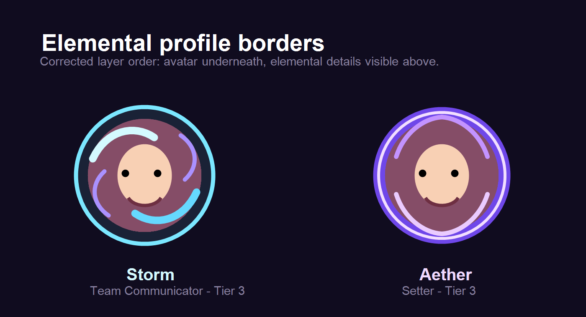

# Elemental avatar border layering evidence

This reference captures the intended result of the `ProfileAvatar` layering fix:

- the profile image stays clipped to its circular photo area;
- Storm and Aether SVG artwork renders above that photo, so it is visible;
- the SVG uses `pointerEvents="none"`, preserving the photo's edit tap target.

The automated regression test in `__tests__/profileAvatar.layering.test.ts` asserts this render order for both elemental borders. This is a code-rendering reference, not a physical-device screenshot.
