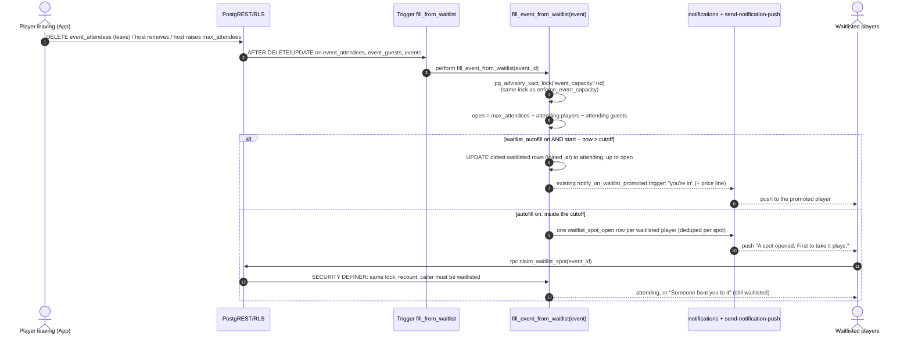
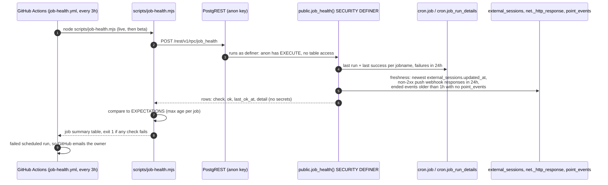

# vteam ideas: 2026-11-01

Three proposals for review. Reply in the run: `approve 1, 3` / `reject 2 because …`.

| # | Idea | Bucket | Size | Verdict |
|---|---|---|---|---|
| 1 | Auto-fill from the waitlist: the next person moves in, and near start the first to tap gets it | Competitor gap (Meetup, BenchApp, CourtReserve) | M | Worth it: fills spots the host would miss |
| 2 | Player card setup after sign-up: position, level, home city in three skippable steps | End-user experience (onboarding) | S | Easy yes: feeds #149 and the regional feed |
| 3 | Background job health check: catch a silent pg_cron or push failure within hours | Testing robustness (monitoring) | S | Yes: points and reminders fail silently today |

Every image here is a design mock with made-up people and data (marked MOCK). Diagrams are Mermaid; sources are next to the PNGs in `ideas/assets/2026-11-01/`.

Checked against every issue and PR (#1–#155, open and closed) and `ideas/log.json`. None of these is planned or in flight. Idea 1 builds on the capacity trigger (`20261024120200_event_capacity_enforcement.sql`) and the late-dropout notice (#129/#132). Idea 2 feeds balanced teams (#149). Idea 3 extends the daily drift-check pattern (#94) to job health.

---

## 1. Auto-fill from the waitlist

**Bucket:** competitor gap · **Size:** M · **Pitch:** When a player drops out of a full event, the first person on the waitlist moves in automatically and gets the "you're in" push. Within a host-set cutoff before start (default 2h), everyone waiting is told a spot opened instead, and the first to tap **Take the spot** gets it.

### Why
- **Today a spot stays empty until the host acts.** Leaving deletes the row (`useEventAttendance` → `deleteMine()`). The host gets a `late_dropout` notice ("2 people are on the waitlist", `20261101090000_event_reminders.sql`) and has to open the event and tap Promote (`approveFromWaitlist`). The person on the waitlist hears nothing until then. For a 7 PM game, a 5 PM drop often means a short court.
- **The waitlist logic is split.** Joins are capacity-checked in the database (`enforce_event_capacity`, advisory lock), but promotion when a host raises capacity happens in the client (`app/(app)/host.tsx` ~L394). That loop counts attending players only, not attending +1 guests, so it can over-fill. Moving promotion into one server function fixes that too.
- **Competitors do this automatically:**
  - [Meetup](https://help.meetup.com/hc/en-us/articles/41229648295181-How-to-Join-an-Event-Waitlist-on-Meetup): when a spot opens, waitlisted members move to Going automatically, in the order they joined. Members with guests move only when the whole party fits, and they get a notification.
  - [BenchApp Auto Waitlist](https://help.benchapp.com/en/articles/15036041-how-do-pickup-organizers-use-auto-waitlist), for pickup organizers: Off / **Top of waitlist** (invite the next player) / **Invite all** (first to accept gets the spot).
  - [CourtReserve event waitlists](https://intercom.help/courtreserve/en/articles/6601471-event-waitlists): **Auto Register From Waitlist** (first in, first out) plus **Prevent Auto Registration X Hours Before Event**, after which everyone waiting is notified and the first to register gets it.

  vteam's version combines the last two: automatic far from start, first-tap-wins close to start, when people may no longer be free.

### User stories
- As a waitlisted player, I'm moved in and notified the moment a spot opens, without waiting on the host.
- As a waitlisted player close to start, I'm told a spot is open and can take it in one tap, if I can still make it.
- As a host, I don't have to watch my phone to keep the court full. I can turn auto-fill off or change the cutoff per event.
- As a host, raising Max players fills the new spots from the waitlist in order, counting +1 guests correctly.

### Acceptance criteria
- [ ] New events have **Fill spots from the waitlist** on, with a 2h cutoff (options 1h / 2h / 6h / Never); templates save both.
- [ ] When an attending player or guest leaves, is removed, or the host raises `max_attendees`, open spots go to waitlisted players in `joined_at` order. A waitlisted player who added +1s moves only if their whole party fits (Meetup's rule); otherwise the next one is tried.
- [ ] A promoted player gets the existing `waitlist_promoted` notification and push. For a paid event the body adds "$8, pay @handle on Venmo".
- [ ] Inside the cutoff, nobody is moved. Each waitlisted player gets one `waitlist_spot_open` notification per opening, and the event page shows **Take the spot**. `claim_waitlist_spot(event_id)` takes the spot only if one is still open and the caller is still waitlisted, under the same lock as `enforce_event_capacity`. The loser sees "Someone beat you to it" and stays on the waitlist at the same position.
- [ ] With auto-fill off, behavior is exactly today's: the host promotes by hand.
- [ ] The host's `late_dropout` notice says who moved up ("Priya Rao moved up from the waitlist"), or that the spot was offered to N people.
- [ ] `host.tsx` no longer promotes in the client. It relies on the trigger on `events.max_attendees`.
- [ ] Cancelled, past or approval-only (`requested`) rows are never touched.

### Mocks


From left: today, the host gets the dropout notice and has to promote by hand; the host form's new setting; a player moved in automatically (more than 2h before start); a waitlisted player inside the cutoff with **Take the spot**.

### Design
- **Host form**, `app/(app)/host.tsx` and the capacity section in `components/host/`: a "Fill spots from the waitlist" card under Max players, shown only when Max players is set. It has a `Switch` (labelled, `accessibilityRole="switch"`, which also helps #138) and a 4-option segmented control for the cutoff. Copy goes in `constants/copy.ts` (`WAITLIST_AUTOFILL_*`). Remove the client promotion loop (~L394–420).
- **Event detail:**
  - `components/event/JoinFooter.tsx` gets a new `action === 'claim-spot'`: primary **Take the spot**, secondary **Leave waitlist**. It's derived in `hooks/event/derive.ts` from `isWaitlisted && openSpots > 0 && withinCutoff && autofill`.
  - `components/event/DetailsTab.tsx` shows a "1 spot open" card in that state and a one-time "You moved up from the waitlist" card after promotion. The card is keyed off the notification deep link `?moved=1`, not stored.
- **Hook**, `hooks/event/useEventAttendance.ts`: `claimSpot` is a `useMutation` calling `supabase.rpc('claim_waitlist_spot', { p_event_id })`. On success it calls `patchAttendees`; on `spot_taken` it shows a toast and refetches `eventKeys.detail(id)`. The roster already refreshes through the event's realtime channel when a trigger moves someone.
- **People tab**, `components/event/PeopleTab.tsx`: the Waitlist header shows "Auto-fill on · next up: Priya" for hosts. Promote stays for manual overrides.
- **Notifications:** add `waitlist_spot_open` to `NOTIFICATION_TYPES`, its check constraint and Settings → Notifications (default on, push on). The deep link is `/event/<id>`, so no new route. `send-notification-push` already pushes every row.
- **Routes / guests:** no new routes and nothing in `authGate`. Guests never see the controls: they can't be waitlisted, and Join already calls `requireSignIn`.
- **Surfaces:** native and mobile web use the existing footer layout (44pt buttons, safe-area bottom). Desktop web uses the same card in the right-hand detail column. Segmented control options are reachable with Tab and arrow keys and have hover states.

### Backend




**Model changes**

| Object | Change | Notes (who can read/write) |
|---|---|---|
| `events.waitlist_autofill` | add `boolean not null default true` | Read: everyone who can read events (anon included). Write: host/co-host through the existing events UPDATE policy. |
| `events.waitlist_cutoff_minutes` | add `integer null default 120`, check `>= 0`; null = never stop | Same as above. |
| `user_event_templates` | add the same two columns (nullable) | Owner only (existing policy). |
| `fill_event_from_waitlist(uuid)` | new, SECURITY DEFINER, `search_path = public`, no client EXECUTE | Called only by triggers. Takes the capacity lock, promotes FIFO, or writes `waitlist_spot_open` rows. Skips cancelled or past events. |
| `trg_*_fill_from_waitlist` | AFTER DELETE or UPDATE OF status on `event_attendees` and `event_guests`; AFTER UPDATE OF max_attendees, waitlist_autofill on `events` | Fires only when a row leaves `attending` or capacity grows. |
| `claim_waitlist_spot(p_event_id uuid)` | new RPC, SECURITY DEFINER, EXECUTE to `authenticated` only | `auth.uid()` must have a `waitlisted` row. Returns `'claimed' \| 'spot_taken' \| 'not_waitlisted'`. Rate-limited with #108's helper once it lands. |
| `notifications` type check, `NOTIFICATION_TYPES` | add `waitlist_spot_open` | Server-written only. |
| `notify_on_waitlist_promoted()` | replace: add the price/Venmo line when `events.price > 0` | Unchanged trigger. |
| `notify_host_on_late_dropout()` | replace: body names who moved up, read after the fill | Ordered so the fill trigger runs first (trigger names sort alphabetically). |

**Migration sketch** (`20261102xxxxxx_waitlist_autofill.sql`, expand-only):
```sql
alter table public.events
  add column if not exists waitlist_autofill boolean not null default true,
  add column if not exists waitlist_cutoff_minutes integer default 120
    check (waitlist_cutoff_minutes is null or waitlist_cutoff_minutes >= 0);
alter table public.user_event_templates
  add column if not exists waitlist_autofill boolean,
  add column if not exists waitlist_cutoff_minutes integer;

create or replace function public.fill_event_from_waitlist(p_event_id uuid) returns void
language plpgsql security definer set search_path = public as $$
declare ev record; open_spots int; r record; party int;
begin
  select * into ev from events where id = p_event_id and cancelled_at is null and event_date > now();
  if not found or ev.max_attendees is null or not ev.waitlist_autofill then return; end if;
  perform pg_advisory_xact_lock(hashtextextended('event_capacity:' || p_event_id::text, 0));
  open_spots := ev.max_attendees
    - (select count(*) from event_attendees where event_id = p_event_id and status = 'attending')
    - (select count(*) from event_guests    where event_id = p_event_id and status = 'attending');
  if open_spots <= 0 then return; end if;
  if ev.waitlist_cutoff_minutes is not null
     and ev.event_date - now() <= make_interval(mins => ev.waitlist_cutoff_minutes) then
    -- broadcast: one waitlist_spot_open per waitlisted player (skip anyone told in the last 10 min)
    ...
    return;
  end if;
  for r in select user_id from event_attendees where event_id = p_event_id and status = 'waitlisted'
           order by joined_at, user_id loop
    party := 1 + (select count(*) from event_guests where event_id = p_event_id and added_by = r.user_id and status = 'waitlisted');
    continue when party > open_spots;
    update event_attendees set status = 'attending' where event_id = p_event_id and user_id = r.user_id;
    update event_guests set status = 'attending' where event_id = p_event_id and added_by = r.user_id and status = 'waitlisted';
    open_spots := open_spots - party;
    exit when open_spots = 0;
  end loop;
end $$;
revoke all on function public.fill_event_from_waitlist(uuid) from public, anon, authenticated;
-- + trigger functions, claim_waitlist_spot, notification type check, notify_* replacements
```
**Down** (`.down.sql`): drop the triggers and both functions, restore the previous `notify_on_waitlist_promoted` / `notify_host_on_late_dropout` bodies and the type check, then drop the four columns.

**RLS expectations** for `e2e/rls.spec.ts`:
- anon can't `rpc('claim_waitlist_spot')` (permission denied).
- The e2e user calling `claim_waitlist_spot` on an event where it isn't waitlisted gets `not_waitlisted` and no row changes.
- Neither anon nor the e2e user can call `fill_event_from_waitlist`.
- anon can read `events.waitlist_autofill`. The e2e user can't update it on an event it doesn't host.

### Test plan
- **Unit:**
  - `hooks/event/derive.ts`: the `claim-spot` action (inside/outside cutoff, autofill off, full, not waitlisted).
  - `JoinFooter` renders Take the spot.
  - Host form saves and loads both fields (and template round-trip).
  - `__tests__/notificationSettings.test.tsx` lists the new type.
- **DB** (pgTAP from #150 once it lands; otherwise RLS spec):
  - FIFO order.
  - Party-fits rule.
  - Concurrent `claim_waitlist_spot` × 2 for one spot → one `claimed`, one `spot_taken`.
  - Raising capacity counts guests.
  - Cutoff boundary.
  - Cancelled event untouched.
- **e2e** (`events` shard, new `e2e/waitlist.spec.ts`): fixtures create a 1-spot event with `e2ebuddy` attending and `e2ebot` waitlisted. Buddy leaves through supabase-js, and the bot's event page shows "You're going". A second case sets the cutoff to Never, then 6h, with a start 1h away, and expects **Take the spot**.
- **Shots:** add `event-waitlisted-claim` and `host-edit-capacity` to `SCREENS` in `scripts/shots/screens.mjs`, with fixtures for an event with `waitlist_autofill`.

### Pros and cons
**Pros**
- Fills the spot that matters most to a pickup game, a late drop, without the host on their phone. It reuses the existing `waitlist_promoted` notification and push.
- Puts promotion in one locked server function. That removes the client loop in `host.tsx`, which ignores +1 guests and races a concurrent join.
- Matches what Meetup, BenchApp and CourtReserve players already expect.
- The cutoff keeps a 6:30 auto-move from putting someone on a 7:00 roster when they can't come. Points then come only to people who can still make it (and #151 handles real no-shows).
- Makes the late-dropout notice actionable information instead of a chore.

**Cons**
- Default-on changes behaviour for every capped event. A host who used the waitlist as a hand-picked bench will be surprised. That needs a one-time banner for hosts, or defaulting existing events to off.
- Paid events: a player moved in at 3 PM owes $8 they may not have planned for. Leaving stays one tap, but a host may chase a payment from someone who didn't actively choose.
- A new trigger path on `event_attendees` deletes. A bug there blocks people leaving, so the fill must catch its own errors the way `notify_host_on_late_dropout` does, which also hides failures. Idea 3 helps.
- First-tap-wins inside the cutoff favours whoever is looking at their phone. A non-waitlisted player can also tap Join and take the spot (the capacity trigger allows it), which may feel unfair to people waiting.
- Adds one notification type and two event columns to keep in templates, shots fixtures and the drift ledger.

**Verdict:** Pros win. Late drops are the most common way a game ends up short, and the change also fixes a real capacity bug. Ship it default-on for new events only, with existing events off until their host saves.

### Risks, open questions, dependencies
- **Open:** default for existing events (proposed: off until edited)? Should first-tap inside the cutoff be limited to waitlisted players for a few minutes before Join opens to everyone?
- **Depends on:** nothing blocking. It touches the same triggers as #151 (no-show) only by reading `status`. #108 (rate limiting) can wrap `claim_waitlist_spot` later. Not parallel with another PR changing `notify_host_on_late_dropout` on beta.

---

## 2. Player card setup after sign-up

**Bucket:** end-user experience (onboarding) · **Size:** S · **Pitch:** Right after creating an account, three skippable full-screen steps ask what you play, your level (with a one-line description of each letter), and your home city, then drop you on Events.

### Why
- **Nothing asks for these today.** `register.tsx` collects name, username, email and password. Position, level and home city live behind Profile → Edit (`components/profile/EditProfileForm.tsx`), and a new profile shows "—" for both (`ProfileHero.tsx`).
- **Other features depend on them:**
  - Balanced teams (#149) splits by `profiles.skill_level` and spreads `position = setter`. With empty profiles it falls back to random.
  - The feed's outside sessions follow `user_settings.home_city_id` (`useFeedRegion()`), so a new user outside Austin sees Austin.
  - Event and tournament skill tags (`events.skill_levels`) mean little if players don't know their own letter.
- **The letters aren't self-explanatory.** The editor shows only "D (Newbie), C, B, BB, A, AA+" (`components/profile/options.ts`). A one-line description per level makes self-rating more consistent, which is what balancing needs.

### User stories
- As a new player, I can tell the app what I play, my level and my city in under 30 seconds, or skip it.
- As a new player, I can pick my level from plain descriptions instead of guessing what "BB" means.
- As a host using balanced teams, more of my roster has a level and position.
- As an existing player with these fields empty, I'm asked once (not every launch).

### Acceptance criteria
- [ ] After the first successful sign-up or sign-in where `skill_level`, `position` and `home_city_id` are all empty and `user_settings.seen_banners` lacks `player-setup-v1`, the app opens `/welcome` once, before the post-sign-in redirect. The redirect target is kept and used after Done or Skip.
- [ ] Step 1: position multi-select (the 6 `VOLLEYBALL_POSITION_OPTIONS` plus "Not sure yet", which saves nothing). Step 2: level, single select, with `SKILL_LEVEL_HINTS`. Step 3: `MajorCityAutocomplete`, with Austin marked "Live now" (from `DEFAULT_FEED_REGION`).
- [ ] Each step has Skip (whole flow) and Back. Values save on Next through the existing `useMyProfile` / `useUserSettings` mutations, so a mid-flow exit keeps what was entered.
- [ ] Finishing or skipping records `player-setup-v1` in `seen_banners`, on the device and the account (same mechanism as one-time banners), so it never returns. The intro tour (`TOURS.intro`) starts after Done if it hasn't been seen.
- [ ] Analytics: `player_setup_shown`, `player_setup_step_done {step}`, `player_setup_skipped {step}`, `player_setup_completed`, added to `ANALYTICS_EVENTS`.
- [ ] Level hints also appear under each option in `EditProfileForm`.
- [ ] Works at Extra large text size, and has no a11y baseline regressions.

### Mocks


Desktop web: the same step as a centered 520px card over the app shell, keyboard-first.

### Design
- **Route:** `app/(app)/welcome.tsx`, a stack screen (no tab bar) with `gestureEnabled: SWIPE_NAVIGATION.back` per the swipe test. Add `routes.welcome(next?)` in `utils/routes.ts`, add `/welcome` to `PROTECTED_ROUTES` in `utils/authGate.ts`, and add a `public/serve.json` rewrite. It isn't dynamic, but static export already emits it.
- **Trigger:** the decision is a pure function, `shouldShowPlayerSetup(profile, settings)` in `utils/playerSetup.ts`. It is checked in `app/_layout.tsx` right where the post-sign-in redirect resolves (`utils/authGate.ts` → `takePostSignInRedirect`), so it runs once per sign-in and never for guests.
- **Components:** `components/welcome/SetupStep.tsx` (title, body, footer with dots and Next), and `PositionStep`, `LevelStep`, `CityStep`, which reuse the chips from `EditProfileForm` (extract the position and level pickers into `components/profile/PositionPicker.tsx` and `LevelPicker.tsx`; this is the third use, so the abstraction rule allows it). Options are `accessibilityRole="checkbox"` (positions) and `"radio"` (levels) with `aria-checked`.
- **Copy:** `SKILL_LEVEL_HINTS` and `PLAYER_SETUP_*` go in `constants/copy.ts`. The level wording needs Bryan's sign-off (see open questions).
- **Guests:** never shown. If a guest signs up from an event page, setup runs, then they land back on that event.
- **Surfaces:** on native, full screen with safe-area insets, 44pt chips and the keyboard avoiding the city field. On mobile web, the same, with the city input at 16px so iOS doesn't zoom. On desktop web, a 520px card centered in `ScreenContainer` with the sidebar visible. Tab and arrow keys move between options, Enter means Next, and Esc means Skip.

### Backend
None. It uses existing columns (`profiles.position`, `profiles.skill_level`, `user_settings.home_city_id`, `user_settings.seen_banners`) and existing owner RLS. No migration.

### Test plan
- **Unit:**
  - `shouldShowPlayerSetup`: empty profile → true; any field set → false; marker present → false; guest → false.
  - Step components save the right shape.
  - `authGate.test.ts` covers `/welcome` as protected.
  - `routes.test.ts` covers the builder.
  - `analytics.test.ts` covers the names.
- **e2e:**
  - `e2e/playerSetup.spec.ts` in the signed-in shard, using a fresh account created in `beforeAll` (the shared `e2ebot` already has fields set). Skip records the marker; Done saves the level and lands on Events.
  - Guest spec asserts `/welcome` bounces to login.
- **Shots / a11y:** add `welcome-position`, `welcome-level` and `welcome-city` to `SCREENS` (mobile and desktop). The axe baseline picks them up through `a11y:baseline`.

### Pros and cons
**Pros**
- Gets the data balanced teams (#149) and region filtering need, at the one moment people expect to be asked.
- Plain-language level descriptions make ratings comparable across players, the main weakness of self-rated balancing.
- No schema, no RLS, no migration: small and low risk. It reuses existing pickers and mutations.
- Measurable through `app_events` (step funnel, skip rate), like the tour.
- Gives Profile a filled-in look on day one, which makes the app feel more personal.

**Cons**
- Adds friction between sign-up and the first event. Someone who signed up from a shared event link wants to RSVP, not answer questions (mitigated by Skip on every step and returning to the redirect).
- Self-rating is still self-rating: new players over- or under-rate, and the hints are vteam's own wording, not an official scale. Hosts may disagree with them.
- Overlaps with the intro tour and the Austin one-time banner. Three "first-time" surfaces need ordering (setup → tour; the banner stays on Events) or they feel naggy.
- Existing users with empty fields see it only on their next sign-in, not on app open. People with long-lived sessions won't see it for a while, so coverage of existing accounts grows slowly.

**Verdict:** Pros win. It's small, and it removes the main reason balanced teams would fall back to random. Keep it to three steps, and make sure Skip is fast.

### Risks, open questions, dependencies
- **Open:** level hint wording (draft in the mock). Should existing users with empty fields also get it (proposed: yes, once)? Ask for an avatar too (proposed: no, keep it three steps)?
- **Depends on:** none. It pairs naturally with #149 and can ship before or after it.

---

## 3. Background job health check

**Bucket:** testing robustness (monitoring) · **Size:** S · **Pitch:** A scheduled GitHub workflow calls a new `job_health()` RPC on live and beta every 3 hours. If any pg_cron job hasn't succeeded within its expected window, points stop being awarded, or the push webhook starts failing, the run fails and GitHub emails Bryan, with a table in the job summary.

### Why
- **Six-plus pieces of user-visible behaviour run on pg_cron with no alerting:**
  - `award-event-points`
  - `event-reminders`
  - `ingest-schelagg-feed`
  - `prune-app-events` (and its rollup)
  - `vclub-check-push-receipts`
  - `vclub-maintenance-cleanup`
  - `kudos-reminders` (live only)

  A failure is recorded only in `cron.job_run_details`, which nobody reads. If `award_event_points()` breaks after a migration, nobody gets points, and points now buy ad-free time (#103).
- **Some failures are deliberately swallowed.** The late-dropout notice catches its own errors. `ingest_schelagg_feed()` skips stale feeds, and the app then hides external sessions after 12h (`EXTERNAL_SESSION_MAX_AGE_MS`), so a dead ingest looks like "no sessions". Push delivery runs through a Database Webhook (pg_net), whose failures appear only in `net._http_response`.
- **There is a proven pattern for this.** The daily `schema-drift.yml` already calls an anon-executable SECURITY DEFINER RPC on both projects and relies on GitHub emailing on failure. This does the same for runtime health, with no new service or secret.

### User stories
- As the maintainer, I find out within about 3 hours, by email, when a background job stops working, before players notice missing points, reminders or sessions.
- As the maintainer, the email links to a summary that names the failing job, how long it has been failing and how many runs failed, so I know where to look.
- As a reviewer, adding a new cron job without an expectation fails CI, so monitoring can't be forgotten.

### Acceptance criteria
- [ ] `public.job_health()` returns one row per check: `check text, ok boolean, last_ok_at timestamptz, failures_24h int, detail text`. `detail` has counts and ages only: no `return_message`, no SQL, no user ids.
- [ ] **Checks:**
  - Every `cron.job` row: last succeeded run vs. its allowed age; failures in 24h.
  - External sessions freshness (`max(updated_at)` where `region = 'austin'`).
  - Ended events: events that ended more than 1h ago, in the last 7 days, with attending players and no `point_events` row.
  - Push webhook: non-2xx or timed-out `net._http_response` rows (pg_net keeps about 6h); skipped where pg_net is absent.
- [ ] `scripts/job-health.mjs` holds `EXPECTATIONS` (job → max age, per project; e.g. `award-event-points` 45m, `event-reminders` 30m, `ingest-schelagg-feed` 2h, daily jobs 26h). It writes a Markdown table to `$GITHUB_STEP_SUMMARY` and exits 1 on any failing check, or on a cron job with no expectation (or an expectation with no job).
- [ ] `.github/workflows/job-health.yml` runs every 3 hours (staggered, e.g. `:47`) and on `workflow_dispatch`, using the anon keys already in `schema-drift.mjs`.
- [ ] The same script runs in CI's Web build job against beta only, in "expectations complete" mode, so a PR adding a cron job must add its expectation.
- [ ] `CLAUDE.md` gets a "Job health" paragraph next to Usage metrics, and the `README` in `supabase/` lists how to read `cron.job_run_details` for the message.

### Mocks / flow


The job summary on a failing run (mock data).

### Backend




**Model changes**

| Object | Change | Notes (who can read/write) |
|---|---|---|
| `public.job_health()` | new function, `security definer`, `set search_path = public, cron, net`, `stable` | EXECUTE granted to `anon` and `authenticated` (like `schema_fingerprint`). Returns aggregates only. Reads `cron.*`, `net._http_response`, `external_sessions`, `events`, `event_attendees`, `point_events` as the owner. No table grants change. |
| Fingerprint | the function appears in `schema_fingerprint()` | Same body on live and beta. Where pg_net or a job is missing, the checks are simply not returned, so the definition stays identical. |

**Migration sketch** (`20261102xxxxxx_job_health.sql`):
```sql
create or replace function public.job_health()
returns table (check_name text, ok boolean, last_ok_at timestamptz, failures_24h int, detail text)
language sql stable security definer set search_path = public, cron as $$
  select 'cron: ' || j.jobname,
         true,  -- ok is decided by the script against EXPECTATIONS; true = job active
         (select max(d.end_time) from cron.job_run_details d where d.jobid = j.jobid and d.status = 'succeeded'),
         (select count(*)::int from cron.job_run_details d where d.jobid = j.jobid and d.status = 'failed'
            and d.start_time > now() - interval '24 hours'),
         case when j.active then 'active' else 'inactive' end
  from cron.job j
  union all
  select 'feed: external_sessions', true, max(updated_at), 0, null from external_sessions where region = 'austin'
  union all
  select 'points: ended events with no award',
         count(*) = 0, null, count(*)::int, count(*) || ' events'
  from events e
  where e.cancelled_at is null
    and e.event_date + make_interval(mins => e.duration_minutes) between now() - interval '7 days' and now() - interval '1 hour'
    and exists (select 1 from event_attendees a where a.event_id = e.id and a.status = 'attending')
    and not exists (select 1 from point_events p where p.event_id = e.id);
  -- + webhook check via a plpgsql wrapper that returns nothing when to_regclass('net._http_response') is null
$$;
revoke all on function public.job_health() from public;
grant execute on function public.job_health() to anon, authenticated;
```
**Down:** `drop function if exists public.job_health();`

**RLS expectations** for `e2e/rls.spec.ts`:
- anon can call `job_health()`, and every row has only the 5 columns, with no uuid or `ERROR:` text in `detail`.
- anon still can't `select` from `point_events` or `cron.job`.

### Test plan
- **Unit:** `scripts/job-health.test.mjs` (node --test, already run by CI's unit job) covers:
  - Age math against `EXPECTATIONS`.
  - Missing expectation → fail.
  - Expectation with no job → fail.
  - Summary table rendering.
  - Live-only job (`kudos-reminders`) ignored on beta.
- **RLS:** the expectations above, in the `api` shard.
- **Proof before merge:** `--fixture <json>` mode runs the script against canned `job_health()` rows (one stale job, one failing check) and must exit 1. Then a `workflow_dispatch` run against live and beta must pass.
- No screens.

### Pros and cons
**Pros**
- Turns silent failures in points, reminders, Schelagg ingest and push into an email within about 3 hours, using the GitHub email channel Bryan already gets for drift.
- No new service, secret or vendor: anon RPC plus Actions, mirroring `schema-drift`.
- The "every cron job needs an expectation" rule in CI keeps monitoring complete as jobs are added (idea 1 adds none, #151 may).
- The ended-events-without-points check tests the outcome, not just the job, so it catches a job that "succeeds" but awards nothing.
- Gives future debugging a starting point: which job, since when, how many failures.

**Cons**
- Exposes job names, schedules' health and failure counts to anyone with the public anon key. That's low sensitivity, but more than today. It could move to a service-role secret in Actions instead, at the cost of a new secret.
- Every 3 hours is coarse: a reminder job dead at 4 PM may miss that evening's reminders before the email. Hourly doubles Actions minutes and email noise.
- The thresholds need tuning. A daily job that runs at 03:17 UTC needs a 26h window, and a slow Schelagg upstream will page about something vteam can't fix.
- `net._http_response` keeps only about 6h, so a push outage between runs can be partly missed. Reading `check-push-receipts` results helps, but adds scope.
- One more scheduled workflow and script to maintain. If GitHub's scheduled runs are delayed or disabled after 60 days of repo inactivity, monitoring stops quietly too.

**Verdict:** Pros win clearly. Points and reminders are now things people notice when they break, and this costs one function and one script. Start at every 3h and tighten once thresholds settle.

### Risks, open questions, dependencies
- **Open:** anon RPC (proposed, same as drift) or a service-role secret? Every 3h or hourly? Should Schelagg staleness page, or only show in the summary?
- **Depends on:** none. It complements #150 (pgTAP tests logic before merge; this watches it after). It adds an `ALLOWED`-free function to both projects through the normal beta ledger.
