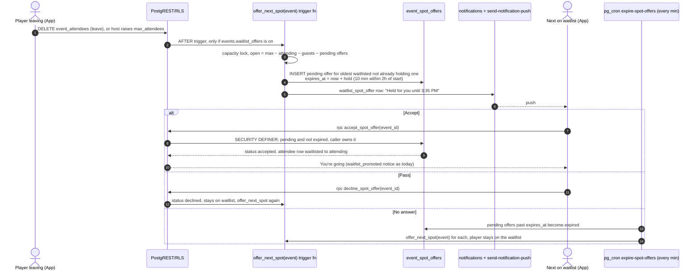
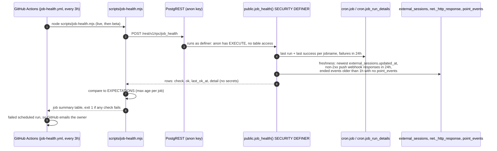

# vteam ideas: 2026-11-01

Three proposals for review. Reply in the run: `approve 1, 3` / `reject 2 because …`.

| # | Idea | Bucket | Size | Verdict |
|---|---|---|---|---|
| 1 | Waitlist spot offers: the next person gets the spot held, and joins only if they accept (revised at review) | Competitor gap (Meetup, BenchApp, CourtReserve) | M | Worth it: fills dropped spots with consent |
| 2 | ✅ [#156](https://github.com/bryanw121/vteam/issues/156) Player card setup after sign-up: position, level, home city in three skippable steps | End-user experience (onboarding) | S | Easy yes: feeds #149 and the regional feed |
| 3 | ✅ [#157](https://github.com/bryanw121/vteam/issues/157) Background job health check: catch a silent pg_cron or push failure within hours | Testing robustness (monitoring) | S | Yes: points and reminders fail silently today |

Every image here is a design mock with made-up people and data (marked MOCK). Diagrams are Mermaid; sources are next to the PNGs in `ideas/assets/2026-11-01/`.

Checked against every issue and PR (#1–#155, open and closed) and `ideas/log.json`. None of these is planned or in flight. Idea 1 builds on the capacity trigger (`20261024120200_event_capacity_enforcement.sql`) and the late-dropout notice (#129/#132). Idea 2 feeds balanced teams (#149). Idea 3 extends the daily drift-check pattern (#94) to job health.

---

## 1. Waitlist spot offers: the next person gets the spot held, and joins only if they accept

> **Revised at review (2026-11-01).** The first draft moved people in automatically, which could put a player on a paid roster without asking, and could add someone who forgot they were waiting. This version is host opt-in (off by default), and nobody is added without tapping **Accept**. The first draft's mocks are kept at [1-waitlist.png](https://github.com/bryanw121/vteam/raw/ideas/ideas/assets/2026-11-01/1-waitlist.png) for reference.

**Bucket:** competitor gap · **Size:** M · **Pitch:** When a spot opens in a full event whose host turned on **Offer open spots to the waitlist**, vteam holds it for the next person in line and pushes them an offer: "Held for you until 3:35 PM." They tap **Accept** to join, or **Pass**. If they don't answer in time, the offer moves to the next person. Nobody is ever added, or owes a fee, without accepting.

### Why
- **Today a spot stays empty until the host acts.** Leaving deletes the row (`useEventAttendance` → `deleteMine()`). The host gets a `late_dropout` notice ("2 people are on the waitlist", `20261101090000_event_reminders.sql`) and has to open the event and tap Promote (`approveFromWaitlist`). The person waiting hears nothing until then.
- **Moving people in automatically is the wrong fix for vteam.** Events can cost money (Venmo, #6), and a waitlist is often joined days ahead. A player moved in at 5 PM for a 7 PM game may have made other plans, may owe $8, and becomes a likely no-show (#151). An offer the player must accept keeps consent with the player, and an expiry keeps a forgotten waitlist from blocking the spot.
- **The waitlist logic is split.** Joins are capacity-checked in the database (`enforce_event_capacity`, advisory lock), but promotion when a host raises capacity happens in the client (`app/(app)/host.tsx` ~L394). That loop ignores attending +1 guests, so it can overfill. Offers go through one locked server function instead.
- **Competitors:**
  - [Meetup](https://help.meetup.com/hc/en-us/articles/41229648295181-How-to-Join-an-Event-Waitlist-on-Meetup): waitlisted members move to Going automatically, in the order they joined, and are notified.
  - [BenchApp Auto Waitlist](https://help.benchapp.com/en/articles/15036041-how-do-pickup-organizers-use-auto-waitlist), for pickup organizers: Off / **Top of waitlist** (invites the next player, who accepts) / **Invite all** (first to accept). It's an organizer setting.
  - [CourtReserve event waitlists](https://intercom.help/courtreserve/en/articles/6601471-event-waitlists): auto-register first in, first out, with a cutoff before the event. It notes that it doesn't tell anyone when an auto-registered player's payment fails.

  vteam's version is closest to BenchApp's "Top of waitlist", plus a hold timer, so the spot can't be taken while the offer is open and can't sit with someone who forgot.

### User stories
- As a waitlisted player, when a spot opens I get a push with the spot held for me, and I decide whether to take it.
- As a waitlisted player who no longer wants to go, I can pass and stay on the waitlist, or leave it. If I miss the push, nothing happens to me.
- As a host, I can turn offers on for an event and pick how long each one is held, so a dropped spot gets filled without me watching my phone.
- As a host, I can see on the People tab who holds an offer and how long is left, and I can still promote by hand.

### Acceptance criteria
- [ ] Host form: **Offer open spots to the waitlist** (off by default for new and existing events), visible only when Max players is set. **Hold each offer for** 15 / 30 / 60 min, default 30. Templates save both.
- [ ] With it off, nothing changes from today (manual Promote).
- [ ] With it on, when an attending player or guest leaves or is removed, or the host raises `max_attendees`, each open spot gets one `pending` offer for the next eligible waitlisted player. Eligible means no pending offer already. Order is: fewest declined/expired offers on this event first, then `joined_at`. So someone who let one expire is asked again only after everyone else has had a turn.
- [ ] A pending offer holds the spot. `enforce_event_capacity` counts pending offers as taken, so a new Join goes to the waitlist.
- [ ] Hold time is the host's setting, cut to 10 minutes within 2 hours of start and never past the start time. No new offers are made once the event has started.
- [ ] The player gets a `waitlist_spot_offer` notification and push with the hold-until time and the price line when `price > 0`. The event page shows a held-spot card with a countdown, **Accept the spot** and **Pass, keep me on the waitlist**.
- [ ] Only `accept_spot_offer(event_id)` moves the player to `attending`, and only while the offer is pending and unexpired. Then the existing `waitlist_promoted` notice fires. Their +1 guests come along only if spots are open for them; otherwise the guests stay waitlisted and the player is told.
- [ ] `decline_spot_offer(event_id)` and expiry (pg_cron `expire-spot-offers`, every minute) mark the offer and immediately offer the spot to the next eligible person. The player keeps their waitlist row. The expired card says what happened and offers **Leave waitlist**.
- [ ] Leaving the waitlist, the host promoting someone else, or the event being cancelled withdraws pending offers.
- [ ] Hosts and co-hosts see "Offered a spot · 26 min left" on the waitlist rows. The `late_dropout` notice adds "Offered to Priya Rao until 3:35 PM" when an offer went out.
- [ ] `host.tsx` no longer promotes in the client. With offers off, raising capacity behaves as today, but through `promote_from_waitlist(event_id)` on the server, which counts guests.

### Mocks


From left: today, the host promotes by hand; the host form setting (off by default); the next person's push and the held-spot card with a countdown; a player who didn't answer (the offer moved on, they keep their place) and the host's view of who holds the offer.

### Design
- **Host form**, `app/(app)/host.tsx` and the capacity section in `components/host/`:
  - A card under Max players with a labelled `Switch` and a 3-option segmented control.
  - Copy in `constants/copy.ts` (`WAITLIST_OFFER_*`).
  - Remove the client promotion loop (~L394–420).
- **Event detail:**
  - `hooks/event/derive.ts` derives `myOffer` (pending, `expires_at`) from the roster query, which embeds `event_spot_offers` for the viewer, and for hosts all pending offers.
  - `components/event/JoinFooter.tsx` gets `action === 'offer'`: **Accept the spot** / **Pass, keep me on the waitlist**.
  - `components/event/DetailsTab.tsx` shows the held-spot card. The countdown uses one `setInterval` per second while the card is visible, and refetches on reaching 0. A small expired card shows after an offer lapses.
- **Hook**, `hooks/event/useEventAttendance.ts`: `acceptOffer` and `declineOffer` are `useMutation`s calling the RPCs. They patch the roster on success, and refetch with a toast on `offer_expired`.
- **People tab**, `components/event/PeopleTab.tsx`: waitlist rows show "Offered a spot · N min left" with a "Held" badge for hosts. Promote stays.
- **Notifications:** add `waitlist_spot_offer` to `NOTIFICATION_TYPES`, its check constraint and Settings → Notifications. It's on by default; push on. The deep link is `/event/<id>`, so no new route.
- **Routes / guests:** no new routes. Guests can't be waitlisted, so they never see offers. An anon viewer sees "1 spot held", the same count everyone sees.
- **Surfaces:**
  - Native: the footer buttons are 44pt+, the countdown has an `accessibilityLiveRegion="polite"` label that updates once a minute (not every second), and a light haptic on accept.
  - Mobile web: the same layout.
  - Desktop web: the card sits in the detail column, the buttons have hover and focus states, and Enter triggers Accept when focused.

### Backend




**Model changes**

| Object | Change | Notes (who can read/write) |
|---|---|---|
| `events.waitlist_offers` | add `boolean not null default false` | Read: anyone who can read events. Write: host/co-host through the existing events UPDATE policy. |
| `events.waitlist_offer_minutes` | add `integer not null default 30`, check `in (15, 30, 60)` | Same as above. |
| `user_event_templates` | add both columns (nullable) | Owner only (existing policy). |
| `event_spot_offers` | new table: `id`, `event_id` → events on delete cascade, `user_id` → profiles on delete cascade, `created_at`, `expires_at`, `status` check in (`pending`,`accepted`,`declined`,`expired`,`withdrawn`), `resolved_at`. Partial unique index on `(event_id, user_id) where status = 'pending'`; index on `(status, expires_at)`. | RLS SELECT: the offer's own user, plus the event's host and co-hosts. Anon reads only the count through the roster view (`event_open_spot_holds` view or a count column). No client INSERT/UPDATE/DELETE: only SECURITY DEFINER functions write. |
| `offer_next_spot(uuid)` | new, SECURITY DEFINER, `search_path = public`, no client EXECUTE | Takes the same advisory lock as `enforce_event_capacity`, counts pending offers as taken, inserts offers and notifications. |
| `enforce_event_capacity()` | replace: `taken` also counts pending, unexpired offers | Same trigger. |
| `accept_spot_offer(uuid)`, `decline_spot_offer(uuid)` | new RPCs, SECURITY DEFINER, EXECUTE to `authenticated` only | Act only on `auth.uid()`'s pending offer. Return `'accepted' \| 'offer_expired' \| 'no_offer'`. |
| `promote_from_waitlist(uuid)` | new, SECURITY DEFINER, no client EXECUTE | Used when offers are off and capacity is raised. Replaces the `host.tsx` loop and counts guests. |
| `expire_spot_offers()` + pg_cron `expire-spot-offers` (`* * * * *`) | new | Marks expired and calls `offer_next_spot` per event. Add its expectation to job health (#157). |
| Triggers | AFTER DELETE / UPDATE OF status on `event_attendees` and `event_guests`; AFTER UPDATE OF max_attendees, waitlist_offers, cancelled_at on `events` | Call `offer_next_spot` when offers are on (else `promote_from_waitlist` on a capacity raise). Withdraw pending offers on leave or cancel. |
| `notifications` type check, `NOTIFICATION_TYPES` | add `waitlist_spot_offer` | Server-written only. |
| `notify_host_on_late_dropout()` | replace: append "Offered to <name> until <time>" | Runs after the offer trigger (trigger name order). |

**Migration sketch** (`20261102xxxxxx_waitlist_spot_offers.sql`, expand-only):
```sql
alter table public.events
  add column if not exists waitlist_offers boolean not null default false,
  add column if not exists waitlist_offer_minutes integer not null default 30
    check (waitlist_offer_minutes in (15, 30, 60));
alter table public.user_event_templates
  add column if not exists waitlist_offers boolean,
  add column if not exists waitlist_offer_minutes integer;

create table public.event_spot_offers (
  id bigint generated always as identity primary key,
  event_id uuid not null references public.events (id) on delete cascade,
  user_id uuid not null references public.profiles (id) on delete cascade,
  created_at timestamptz not null default now(),
  expires_at timestamptz not null,
  status text not null default 'pending'
    check (status in ('pending','accepted','declined','expired','withdrawn')),
  resolved_at timestamptz
);
create unique index event_spot_offers_one_pending on public.event_spot_offers (event_id, user_id) where status = 'pending';
create index event_spot_offers_due on public.event_spot_offers (expires_at) where status = 'pending';
alter table public.event_spot_offers enable row level security;
create policy "offer owner or event host reads" on public.event_spot_offers for select to authenticated
  using (user_id = auth.uid() or exists (select 1 from public.events e where e.id = event_id and e.created_by = auth.uid())
         or exists (select 1 from public.event_cohosts c where c.event_id = event_spot_offers.event_id and c.user_id = auth.uid()));

create or replace function public.offer_next_spot(p_event_id uuid) returns void
language plpgsql security definer set search_path = public as $$
declare ev record; open_spots int; nxt uuid; hold interval;
begin
  select * into ev from events where id = p_event_id and cancelled_at is null and event_date > now();
  if not found or not ev.waitlist_offers or ev.max_attendees is null then return; end if;
  perform pg_advisory_xact_lock(hashtextextended('event_capacity:' || p_event_id::text, 0));
  open_spots := ev.max_attendees
    - (select count(*) from event_attendees where event_id = p_event_id and status = 'attending')
    - (select count(*) from event_guests    where event_id = p_event_id and status = 'attending')
    - (select count(*) from event_spot_offers where event_id = p_event_id and status = 'pending' and expires_at > now());
  hold := least(make_interval(mins => case when ev.event_date - now() <= interval '2 hours' then 10 else ev.waitlist_offer_minutes end),
                ev.event_date - now());
  while open_spots > 0 loop
    select a.user_id into nxt from event_attendees a
    where a.event_id = p_event_id and a.status = 'waitlisted'
      and not exists (select 1 from event_spot_offers o where o.event_id = p_event_id and o.user_id = a.user_id and o.status = 'pending')
    order by (select count(*) from event_spot_offers o where o.event_id = p_event_id and o.user_id = a.user_id
              and o.status in ('declined','expired')), a.joined_at, a.user_id
    limit 1;
    exit when nxt is null;
    insert into event_spot_offers (event_id, user_id, expires_at) values (p_event_id, nxt, now() + hold);
    -- insert waitlist_spot_offer notification (pref-checked), deep_link /event/<id>
    open_spots := open_spots - 1;
  end loop;
end $$;
revoke all on function public.offer_next_spot(uuid) from public, anon, authenticated;
-- + accept/decline RPCs, promote_from_waitlist, expire_spot_offers + cron.schedule,
--   enforce_event_capacity replacement, triggers, notification type, late-dropout body
```
**Down** (`.down.sql`): unschedule `expire-spot-offers`, drop the triggers and new functions, restore the previous `enforce_event_capacity` / `notify_host_on_late_dropout` bodies and the type check, drop `event_spot_offers`, then drop the four columns.

**RLS expectations** for `e2e/rls.spec.ts`:
- anon can't select `event_spot_offers` and can't call `accept_spot_offer` / `decline_spot_offer`.
- The e2e user can't insert or update `event_spot_offers`, and can't read another user's offer on an event it doesn't host.
- `accept_spot_offer` on an event where the e2e user has no offer returns `no_offer` and changes nothing.
- Nobody can call `offer_next_spot`, `promote_from_waitlist` or `expire_spot_offers`.

### Test plan
- **Unit:**
  - `derive.ts` `offer` action (pending, expired, none; host view).
  - `JoinFooter` renders Accept / Pass.
  - Countdown formatting and the 0-reached refetch.
  - Host form saves and loads both fields (template round-trip too).
  - `notificationSettings.test.tsx` lists the new type.
- **DB** (pgTAP from #150 when it lands):
  - FIFO order.
  - Someone with an expired offer goes after people never offered.
  - A pending offer blocks a new Join (it lands waitlisted).
  - Two concurrent accepts can't overfill.
  - Accept after `expires_at` → `offer_expired`.
  - Hold shrinks to 10 min near start and never passes start.
  - Raising capacity by 2 → two offers.
  - Leave or cancel withdraws.
  - Offers off: `promote_from_waitlist` counts guests.
- **e2e** (`events` shard, `e2e/waitlistOffers.spec.ts`): fixtures create a 1-spot event with offers on, `e2ebuddy` attending and `e2ebot` waitlisted. Buddy leaves (supabase-js), the bot sees the held-spot card, accepts, and sees "You're going". A second case: decline, and the bot stays waitlisted.
- **Shots:** add `event-offer-held`, `event-offer-expired` and `host-edit-capacity` to `SCREENS`, plus fixtures for `event_spot_offers`.

### Pros and cons
**Pros**
- Fills a dropped spot without the host watching their phone, and nobody is added or charged without tapping Accept. That matches how vteam handles paid events and join approval.
- Handles the forgotten waitlist: no answer just passes the offer on. The player keeps their place but goes to the back of the offer order, so they don't block the spot twice.
- The held spot can't be sniped by a new Join while the offer is open, so the person waiting is treated fairly.
- Moves promotion into locked server functions and removes the client loop in `host.tsx` that ignores +1 guests.
- Opt-in per event lets hosts who hand-pick their bench keep doing it.

**Cons**
- Slower to fill than automatic promotion: with a 30-minute hold and two people who don't answer, a spot stays empty for an hour. Near start the 10-minute hold helps, but a 6:45 drop may still go unfilled.
- More moving parts: a new table, three RPCs, a per-minute pg_cron job and a countdown UI. That's more to test (pgTAP from #150 really helps) and to monitor (#157).
- Off by default means most events won't use it until hosts find the setting. It may need a one-time host banner, or a later decision to default it on.
- Spot holds show up as "1 spot held" to everyone, which can confuse players who see 11/12 but can't join.
- A per-minute cron job adds a little constant database load, and its expiry is up to a minute late.

**Verdict:** Pros win. It keeps the value of filling dropped spots while respecting consent and payments. The extra machinery is the cost of doing that safely, and #150 and #157 cover testing and monitoring it.

### Risks, open questions, dependencies
- **Open:** is a 10-minute hold within 2 hours of start right? Should a host be able to make it default-on for all their events? Should the held count show as "1 spot held" or simply as full?
- **Depends on:** nothing blocking. It benefits from #150 (pgTAP) for the concurrency tests and from #157 (job health) for the new cron job. It touches `notify_host_on_late_dropout`, so it shouldn't be on beta at the same time as another PR changing that function. #151 (no-show) is independent.

---

## 2. Player card setup after sign-up

> **Approved and filed as [#156](https://github.com/bryanw121/vteam/issues/156).** At review Bryan asked where the city list comes from: the existing `major_cities` table (about 110 seeded metros, the same list the profile editor and clubs use), filtered as you type. The issue spells this out.

**Bucket:** end-user experience (onboarding) · **Size:** S · **Pitch:** Right after creating an account, three skippable full-screen steps ask what you play, your level (with a one-line description of each letter), and your home city, then drop you on Events.

### Why
- **Nothing asks for these today.** `register.tsx` collects name, username, email and password. Position, level and home city live behind Profile → Edit (`components/profile/EditProfileForm.tsx`), and a new profile shows "—" for both (`ProfileHero.tsx`).
- **Other features depend on them:**
  - Balanced teams (#149) splits by `profiles.skill_level` and spreads `position = setter`. With empty profiles it falls back to random.
  - The feed's outside sessions follow `user_settings.home_city_id` (`useFeedRegion()`), so a new user outside Austin sees Austin.
  - Event and tournament skill tags (`events.skill_levels`) mean little if players don't know their own letter.
- **The letters aren't self-explanatory.** The editor shows only "D (Newbie), C, B, BB, A, AA+" (`components/profile/options.ts`). A one-line description per level makes self-rating more consistent, which is what balancing needs.

### User stories
- As a new player, I can tell the app what I play, my level and my city in under 30 seconds, or skip it.
- As a new player, I can pick my level from plain descriptions instead of guessing what "BB" means.
- As a host using balanced teams, more of my roster has a level and position.
- As an existing player with these fields empty, I'm asked once (not every launch).

### Acceptance criteria
- [ ] After the first successful sign-up or sign-in where `skill_level`, `position` and `home_city_id` are all empty and `user_settings.seen_banners` lacks `player-setup-v1`, the app opens `/welcome` once, before the post-sign-in redirect. The redirect target is kept and used after Done or Skip.
- [ ] Step 1: position multi-select (the 6 `VOLLEYBALL_POSITION_OPTIONS` plus "Not sure yet", which saves nothing). Step 2: level, single select, with `SKILL_LEVEL_HINTS`. Step 3: `MajorCityAutocomplete`, with Austin marked "Live now" (from `DEFAULT_FEED_REGION`).
- [ ] Each step has Skip (whole flow) and Back. Values save on Next through the existing `useMyProfile` / `useUserSettings` mutations, so a mid-flow exit keeps what was entered.
- [ ] Finishing or skipping records `player-setup-v1` in `seen_banners`, on the device and the account (same mechanism as one-time banners), so it never returns. The intro tour (`TOURS.intro`) starts after Done if it hasn't been seen.
- [ ] Analytics: `player_setup_shown`, `player_setup_step_done {step}`, `player_setup_skipped {step}`, `player_setup_completed`, added to `ANALYTICS_EVENTS`.
- [ ] Level hints also appear under each option in `EditProfileForm`.
- [ ] Works at Extra large text size, and has no a11y baseline regressions.

### Mocks


Desktop web: the same step as a centered 520px card over the app shell, keyboard-first.

### Design
- **Route:** `app/(app)/welcome.tsx`, a stack screen (no tab bar) with `gestureEnabled: SWIPE_NAVIGATION.back` per the swipe test. Add `routes.welcome(next?)` in `utils/routes.ts`, add `/welcome` to `PROTECTED_ROUTES` in `utils/authGate.ts`, and add a `public/serve.json` rewrite. It isn't dynamic, but static export already emits it.
- **Trigger:** the decision is a pure function, `shouldShowPlayerSetup(profile, settings)` in `utils/playerSetup.ts`. It is checked in `app/_layout.tsx` right where the post-sign-in redirect resolves (`utils/authGate.ts` → `takePostSignInRedirect`), so it runs once per sign-in and never for guests.
- **Components:** `components/welcome/SetupStep.tsx` (title, body, footer with dots and Next), and `PositionStep`, `LevelStep`, `CityStep`, which reuse the chips from `EditProfileForm` (extract the position and level pickers into `components/profile/PositionPicker.tsx` and `LevelPicker.tsx`; this is the third use, so the abstraction rule allows it). Options are `accessibilityRole="checkbox"` (positions) and `"radio"` (levels) with `aria-checked`.
- **Copy:** `SKILL_LEVEL_HINTS` and `PLAYER_SETUP_*` go in `constants/copy.ts`. The level wording needs Bryan's sign-off (see open questions).
- **Guests:** never shown. If a guest signs up from an event page, setup runs, then they land back on that event.
- **Surfaces:** on native, full screen with safe-area insets, 44pt chips and the keyboard avoiding the city field. On mobile web, the same, with the city input at 16px so iOS doesn't zoom. On desktop web, a 520px card centered in `ScreenContainer` with the sidebar visible. Tab and arrow keys move between options, Enter means Next, and Esc means Skip.

### Backend
None. It uses existing columns (`profiles.position`, `profiles.skill_level`, `user_settings.home_city_id`, `user_settings.seen_banners`) and existing owner RLS. No migration.

### Test plan
- **Unit:**
  - `shouldShowPlayerSetup`: empty profile → true; any field set → false; marker present → false; guest → false.
  - Step components save the right shape.
  - `authGate.test.ts` covers `/welcome` as protected.
  - `routes.test.ts` covers the builder.
  - `analytics.test.ts` covers the names.
- **e2e:**
  - `e2e/playerSetup.spec.ts` in the signed-in shard, using a fresh account created in `beforeAll` (the shared `e2ebot` already has fields set). Skip records the marker; Done saves the level and lands on Events.
  - Guest spec asserts `/welcome` bounces to login.
- **Shots / a11y:** add `welcome-position`, `welcome-level` and `welcome-city` to `SCREENS` (mobile and desktop). The axe baseline picks them up through `a11y:baseline`.

### Pros and cons
**Pros**
- Gets the data balanced teams (#149) and region filtering need, at the one moment people expect to be asked.
- Plain-language level descriptions make ratings comparable across players, the main weakness of self-rated balancing.
- No schema, no RLS, no migration: small and low risk. It reuses existing pickers and mutations.
- Measurable through `app_events` (step funnel, skip rate), like the tour.
- Gives Profile a filled-in look on day one, which makes the app feel more personal.

**Cons**
- Adds friction between sign-up and the first event. Someone who signed up from a shared event link wants to RSVP, not answer questions (mitigated by Skip on every step and returning to the redirect).
- Self-rating is still self-rating: new players over- or under-rate, and the hints are vteam's own wording, not an official scale. Hosts may disagree with them.
- Overlaps with the intro tour and the Austin one-time banner. Three "first-time" surfaces need ordering (setup → tour; the banner stays on Events) or they feel naggy.
- Existing users with empty fields see it only on their next sign-in, not on app open. People with long-lived sessions won't see it for a while, so coverage of existing accounts grows slowly.

**Verdict:** Pros win. It's small, and it removes the main reason balanced teams would fall back to random. Keep it to three steps, and make sure Skip is fast.

### Risks, open questions, dependencies
- **Open:** level hint wording (draft in the mock). Should existing users with empty fields also get it (proposed: yes, once)? Ask for an avatar too (proposed: no, keep it three steps)?
- **Depends on:** none. It pairs naturally with #149 and can ship before or after it.

---

## 3. Background job health check

> **Approved and filed as [#157](https://github.com/bryanw121/vteam/issues/157).** What it's for: points, reminders, the outside-sessions import and push all run on database timers. When one breaks, nothing shows an error, so this check emails Bryan within about 3 hours.

**Bucket:** testing robustness (monitoring) · **Size:** S · **Pitch:** A scheduled GitHub workflow calls a new `job_health()` RPC on live and beta every 3 hours. If any pg_cron job hasn't succeeded within its expected window, points stop being awarded, or the push webhook starts failing, the run fails and GitHub emails Bryan, with a table in the job summary.

### Why
- **Six-plus pieces of user-visible behaviour run on pg_cron with no alerting:**
  - `award-event-points`
  - `event-reminders`
  - `ingest-schelagg-feed`
  - `prune-app-events` (and its rollup)
  - `vclub-check-push-receipts`
  - `vclub-maintenance-cleanup`
  - `kudos-reminders` (live only)

  A failure is recorded only in `cron.job_run_details`, which nobody reads. If `award_event_points()` breaks after a migration, nobody gets points, and points now buy ad-free time (#103).
- **Some failures are deliberately swallowed.** The late-dropout notice catches its own errors. `ingest_schelagg_feed()` skips stale feeds, and the app then hides external sessions after 12h (`EXTERNAL_SESSION_MAX_AGE_MS`), so a dead ingest looks like "no sessions". Push delivery runs through a Database Webhook (pg_net), whose failures appear only in `net._http_response`.
- **There is a proven pattern for this.** The daily `schema-drift.yml` already calls an anon-executable SECURITY DEFINER RPC on both projects and relies on GitHub emailing on failure. This does the same for runtime health, with no new service or secret.

### User stories
- As the maintainer, I find out within about 3 hours, by email, when a background job stops working, before players notice missing points, reminders or sessions.
- As the maintainer, the email links to a summary that names the failing job, how long it has been failing and how many runs failed, so I know where to look.
- As a reviewer, adding a new cron job without an expectation fails CI, so monitoring can't be forgotten.

### Acceptance criteria
- [ ] `public.job_health()` returns one row per check: `check text, ok boolean, last_ok_at timestamptz, failures_24h int, detail text`. `detail` has counts and ages only: no `return_message`, no SQL, no user ids.
- [ ] **Checks:**
  - Every `cron.job` row: last succeeded run vs. its allowed age; failures in 24h.
  - External sessions freshness (`max(updated_at)` where `region = 'austin'`).
  - Ended events: events that ended more than 1h ago, in the last 7 days, with attending players and no `point_events` row.
  - Push webhook: non-2xx or timed-out `net._http_response` rows (pg_net keeps about 6h); skipped where pg_net is absent.
- [ ] `scripts/job-health.mjs` holds `EXPECTATIONS` (job → max age, per project; e.g. `award-event-points` 45m, `event-reminders` 30m, `ingest-schelagg-feed` 2h, daily jobs 26h). It writes a Markdown table to `$GITHUB_STEP_SUMMARY` and exits 1 on any failing check, or on a cron job with no expectation (or an expectation with no job).
- [ ] `.github/workflows/job-health.yml` runs every 3 hours (staggered, e.g. `:47`) and on `workflow_dispatch`, using the anon keys already in `schema-drift.mjs`.
- [ ] The same script runs in CI's Web build job against beta only, in "expectations complete" mode, so a PR adding a cron job must add its expectation.
- [ ] `CLAUDE.md` gets a "Job health" paragraph next to Usage metrics, and the `README` in `supabase/` lists how to read `cron.job_run_details` for the message.

### Mocks / flow


The job summary on a failing run (mock data).

### Backend




**Model changes**

| Object | Change | Notes (who can read/write) |
|---|---|---|
| `public.job_health()` | new function, `security definer`, `set search_path = public, cron, net`, `stable` | EXECUTE granted to `anon` and `authenticated` (like `schema_fingerprint`). Returns aggregates only. Reads `cron.*`, `net._http_response`, `external_sessions`, `events`, `event_attendees`, `point_events` as the owner. No table grants change. |
| Fingerprint | the function appears in `schema_fingerprint()` | Same body on live and beta. Where pg_net or a job is missing, the checks are simply not returned, so the definition stays identical. |

**Migration sketch** (`20261102xxxxxx_job_health.sql`):
```sql
create or replace function public.job_health()
returns table (check_name text, ok boolean, last_ok_at timestamptz, failures_24h int, detail text)
language sql stable security definer set search_path = public, cron as $$
  select 'cron: ' || j.jobname,
         true,  -- ok is decided by the script against EXPECTATIONS; true = job active
         (select max(d.end_time) from cron.job_run_details d where d.jobid = j.jobid and d.status = 'succeeded'),
         (select count(*)::int from cron.job_run_details d where d.jobid = j.jobid and d.status = 'failed'
            and d.start_time > now() - interval '24 hours'),
         case when j.active then 'active' else 'inactive' end
  from cron.job j
  union all
  select 'feed: external_sessions', true, max(updated_at), 0, null from external_sessions where region = 'austin'
  union all
  select 'points: ended events with no award',
         count(*) = 0, null, count(*)::int, count(*) || ' events'
  from events e
  where e.cancelled_at is null
    and e.event_date + make_interval(mins => e.duration_minutes) between now() - interval '7 days' and now() - interval '1 hour'
    and exists (select 1 from event_attendees a where a.event_id = e.id and a.status = 'attending')
    and not exists (select 1 from point_events p where p.event_id = e.id);
  -- + webhook check via a plpgsql wrapper that returns nothing when to_regclass('net._http_response') is null
$$;
revoke all on function public.job_health() from public;
grant execute on function public.job_health() to anon, authenticated;
```
**Down:** `drop function if exists public.job_health();`

**RLS expectations** for `e2e/rls.spec.ts`:
- anon can call `job_health()`, and every row has only the 5 columns, with no uuid or `ERROR:` text in `detail`.
- anon still can't `select` from `point_events` or `cron.job`.

### Test plan
- **Unit:** `scripts/job-health.test.mjs` (node --test, already run by CI's unit job) covers:
  - Age math against `EXPECTATIONS`.
  - Missing expectation → fail.
  - Expectation with no job → fail.
  - Summary table rendering.
  - Live-only job (`kudos-reminders`) ignored on beta.
- **RLS:** the expectations above, in the `api` shard.
- **Proof before merge:** `--fixture <json>` mode runs the script against canned `job_health()` rows (one stale job, one failing check) and must exit 1. Then a `workflow_dispatch` run against live and beta must pass.
- No screens.

### Pros and cons
**Pros**
- Turns silent failures in points, reminders, Schelagg ingest and push into an email within about 3 hours, using the GitHub email channel Bryan already gets for drift.
- No new service, secret or vendor: anon RPC plus Actions, mirroring `schema-drift`.
- The "every cron job needs an expectation" rule in CI keeps monitoring complete as jobs are added (idea 1 adds none, #151 may).
- The ended-events-without-points check tests the outcome, not just the job, so it catches a job that "succeeds" but awards nothing.
- Gives future debugging a starting point: which job, since when, how many failures.

**Cons**
- Exposes job names, schedules' health and failure counts to anyone with the public anon key. That's low sensitivity, but more than today. It could move to a service-role secret in Actions instead, at the cost of a new secret.
- Every 3 hours is coarse: a reminder job dead at 4 PM may miss that evening's reminders before the email. Hourly doubles Actions minutes and email noise.
- The thresholds need tuning. A daily job that runs at 03:17 UTC needs a 26h window, and a slow Schelagg upstream will page about something vteam can't fix.
- `net._http_response` keeps only about 6h, so a push outage between runs can be partly missed. Reading `check-push-receipts` results helps, but adds scope.
- One more scheduled workflow and script to maintain. If GitHub's scheduled runs are delayed or disabled after 60 days of repo inactivity, monitoring stops quietly too.

**Verdict:** Pros win clearly. Points and reminders are now things people notice when they break, and this costs one function and one script. Start at every 3h and tighten once thresholds settle.

### Risks, open questions, dependencies
- **Open:** anon RPC (proposed, same as drift) or a service-role secret? Every 3h or hourly? Should Schelagg staleness page, or only show in the summary?
- **Depends on:** none. It complements #150 (pgTAP tests logic before merge; this watches it after). It adds an `ALLOWED`-free function to both projects through the normal beta ledger.
