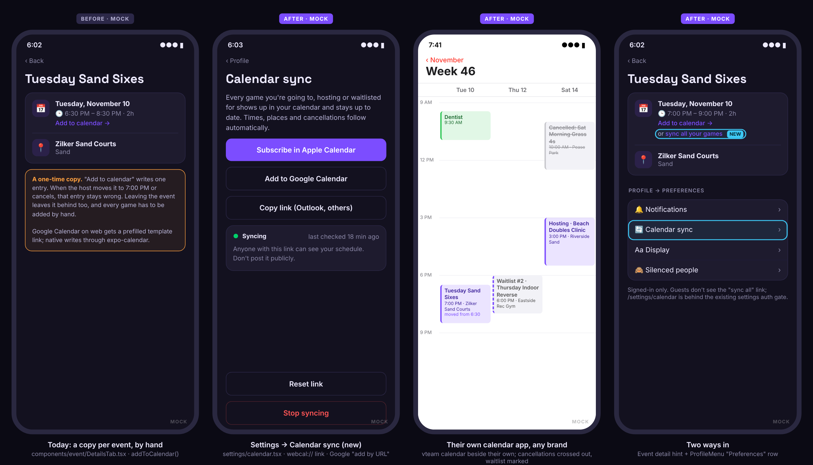
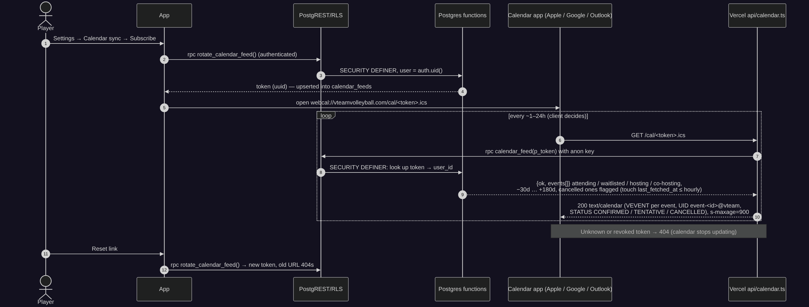
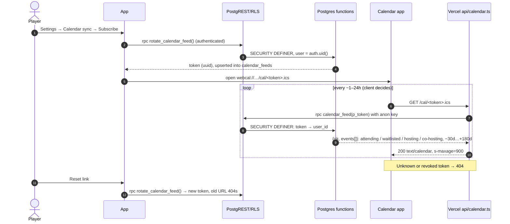
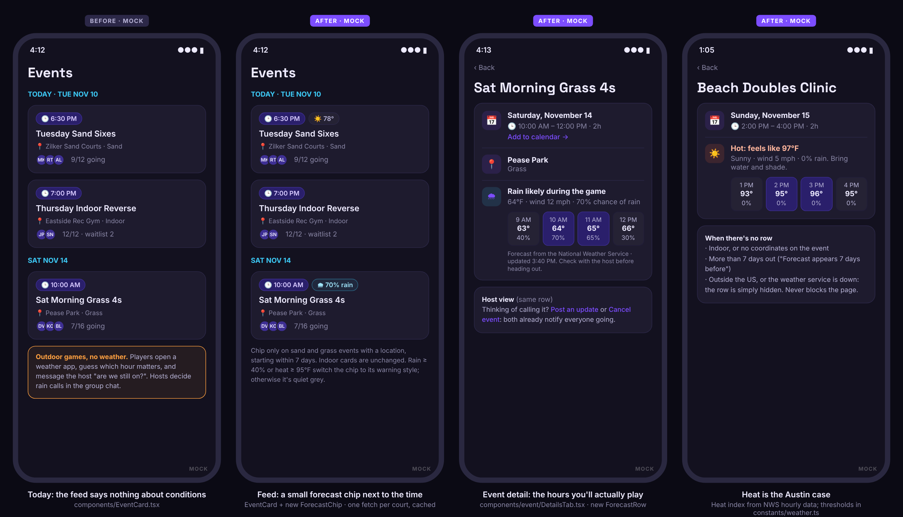
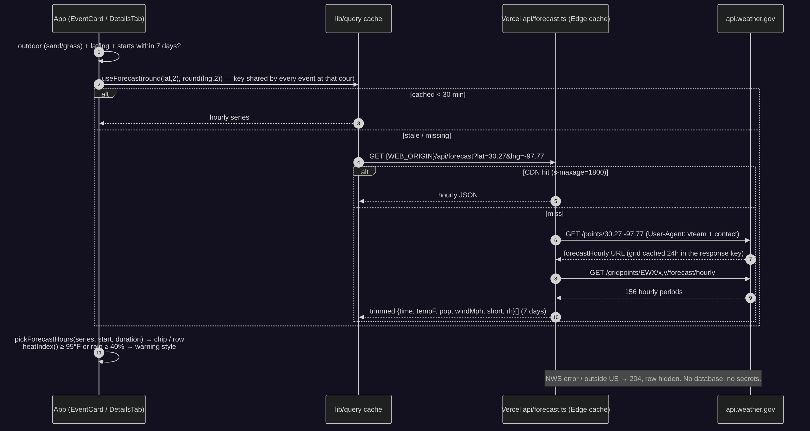
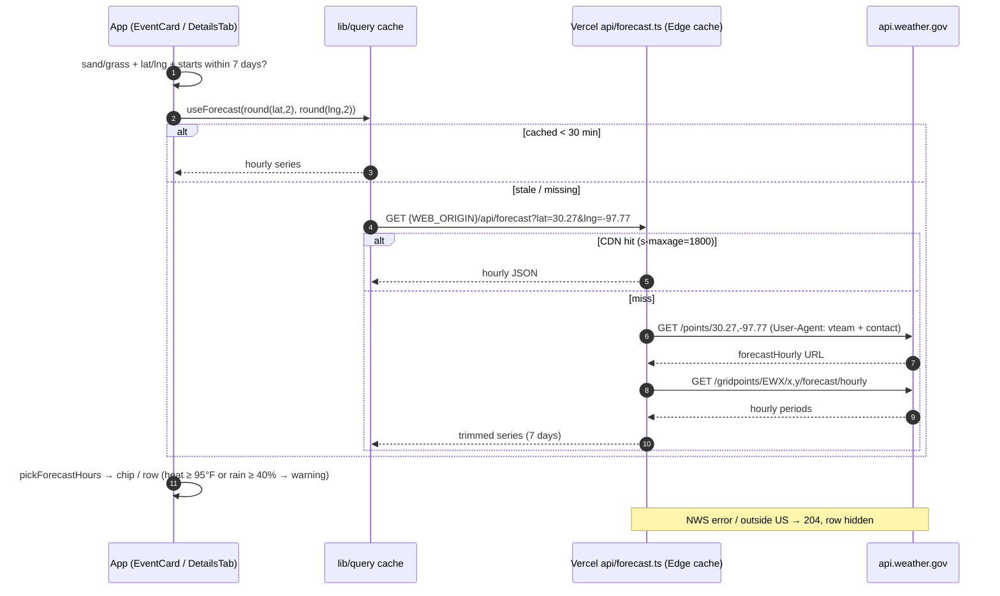
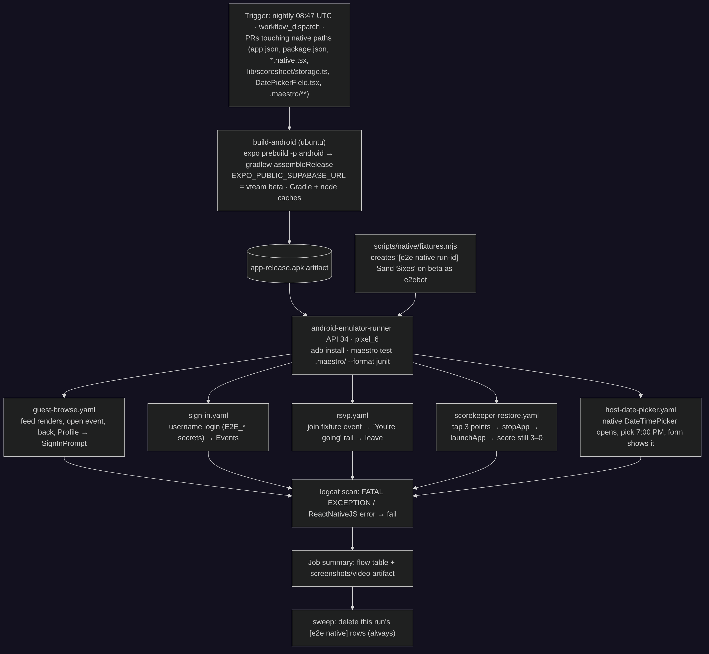
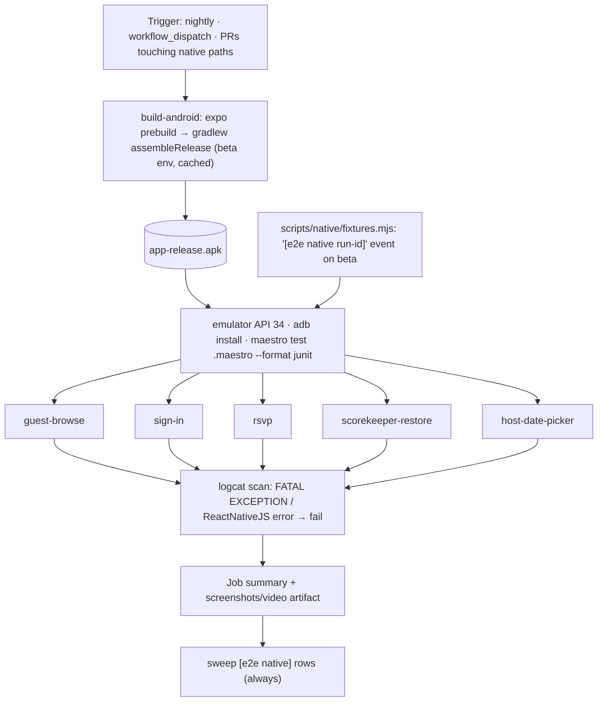

# vteam ideas: 2026-11-02

Three proposals for review. Reply in the run: `approve 1, 3` / `reject 2 because …`.

| # | Idea | Bucket | Size | Verdict |
|---|---|---|---|---|
| 1 | Calendar sync: a private feed of your games that stays up to date in Apple / Google / Outlook | Competitor gap (TeamSnap, Spond, Meetup, Luma) | M | Yes: fixes stale "Add to calendar" copies, small backend |
| 2 | ✅ [#165](https://github.com/bryanw121/vteam/issues/165) Weather on outdoor games: forecast chip on sand and grass cards, hourly row on the event | New feature (players and hosts) | S | Yes: cheap, no schema, useful in Austin heat and rain |
| 3 | ✅ [#166](https://github.com/bryanw121/vteam/issues/166) Native app smoke tests: Maestro flows on an Android emulator, nightly and on native PRs | Testing robustness | M | Yes, Android first: nothing tests the shipped app today |

Every image here is a design mock with made-up people and data (marked MOCK). Diagrams are Mermaid; sources are next to the PNGs in `ideas/assets/2026-11-02/`.

Checked against every issue and PR (#1–#164, open and closed) and `ideas/log.json`. None of these is planned or in flight. Idea 1 builds on the existing one-shot **Add to calendar** (`components/event/DetailsTab.tsx`) and the Vercel functions from share links (#130/#141). Idea 2 uses the court surface filter (#81) and event coordinates. Idea 3 reuses the Android emulator job from `mobile-browsers.yml` (#96) and the e2e fixtures pattern (#30).

---

## 1. Calendar sync: a private feed of your games that stays up to date

**Bucket:** competitor gap · **Size:** M · **Pitch:** One link, set up once in Settings, puts every vteam game you're going to, hosting, co-hosting or waitlisted for into your own calendar app. When a host moves the time or cancels, or you leave, your calendar updates by itself.



### Why
- **Today's "Add to calendar" makes a copy that goes stale.** `addToCalendar()` in `components/event/DetailsTab.tsx` writes one entry (expo-calendar on native, a Google template link on web). The host can move the time (`event_material_change`) or cancel (`event_cancelled`), and vteam sends a notification, but the calendar entry stays wrong. Leaving the event leaves the entry behind too. It also only fills the address for the hardcoded `LOCATIONS`, and every game has to be added by hand.
- **Players plan their week in their calendar, not in vteam.** A recurring player (weekly series, `utils/recurrence.ts`) has to tap Add every week.
- **Competitors:**
  - [TeamSnap: Subscribe to a Team Schedule](https://helpme.teamsnap.com/article/128-subscribe-to-a-team-schedule): an iCal link for Google, Outlook or Apple that's "automatically updated any time the schedule is changed", with a combined feed across teams. TeamSnap also warns that calendar apps can take up to 24 hours to pick up changes.
  - [Spond: Calendar synchronisation](https://help.spond.com/app/en/articles/115529-calendar-synchronisation): writes events you're invited to into the phone calendar. It needs full calendar access to remove cancelled events, and leaves entries behind if you turn it off in the wrong order. That's the pain a server-side feed avoids.
  - [Meetup](https://product.meetup.com/meetup-events-are-now-automatically-added-to-google-calendar-lSLHW) moved away from one-time `.ics` invites because those "didn't update when details changed".
  - [Luma iCal syncing](https://help.luma.com/p/ical-syncing.md): a subscribable calendar of the events you're going to.

  vteam's version is TeamSnap's model: a subscribed URL served from our side, so we never need calendar permission on the phone and cancellations always propagate.

### User stories
- As a player, I subscribe once and all my vteam games appear in my calendar, next to work and everything else.
- As a player, when a host moves a game to 7:00 PM or cancels it, my calendar shows the change without me doing anything.
- As a waitlisted player, the game shows in my calendar marked as waitlisted (tentative), so I keep the slot free.
- As a host, the games I host and co-host are in my calendar too.
- As a privacy-minded player, I can reset the link if I shared it by mistake, or stop syncing entirely.

### Acceptance criteria
- [ ] Profile → Preferences → **Calendar sync** (`settings/calendar.tsx`), signed-in only; guests are bounced by the existing `routes.settings()` auth gate.
- [ ] The first visit has no link; **Subscribe in Apple Calendar** / **Add to Google Calendar** / **Copy link** create one (`rotate_calendar_feed()`) and open it.
- [ ] Apple: opens `webcal://<host>/cal/<token>.ics`. Google: opens `https://calendar.google.com/calendar/r?cid=<webcal url>`. Copy puts the https URL on the clipboard and shows a Toast.
- [ ] The feed holds events the user is **attending**, **waitlisted** (`STATUS:TENTATIVE`, title prefixed `Waitlist #n · `), **hosting** or **co-hosting** (`Hosting · `), from 30 days ago to 180 days ahead.
- [ ] Cancelled events within the window stay in the feed for 14 days as `STATUS:CANCELLED` (title prefixed `Cancelled: `), then drop out. Events the user left drop out.
- [ ] Each VEVENT has a stable `UID` (`event-<id>@vteamvolleyball.com`), `DTSTART`/`DTEND` in UTC, `LOCATION` (name + address), `GEO` when known, `URL` = `shareUrl(routes.event(id))`, and a description that ends with the link.
- [ ] The calendar is named "vteam games", with `REFRESH-INTERVAL:PT1H` / `X-PUBLISHED-TTL:PT1H`.
- [ ] **Reset link** (ConfirmDialog) issues a new token; the old URL returns 404. **Stop syncing** deletes the row; the URL returns 404.
- [ ] The settings screen shows "Syncing · last checked <relative time>" from `last_fetched_at`, or "Not picked up yet" until a calendar first fetches it.
- [ ] Event detail: under "Add to calendar", signed-in users see "or **sync all your games**" linking to `routes.settings('calendar')`.
- [ ] Unknown tokens, malformed paths and RPC errors never leak whether a user exists: 404 for unknown, 503 for an upstream error.
- [ ] `track('calendar_sync_created' | 'calendar_sync_opened' {target} | 'calendar_sync_reset' | 'calendar_sync_stopped')`.

### Design
- **Route and screen:** `app/(app)/(tabs)/settings/calendar.tsx`; add `'calendar'` to `SettingsSection` in `utils/routes.ts`; ProfileMenu row `{ title: 'Calendar sync', icon: 'sync-outline', section: 'calendar' }` in **Preferences** (`components/profile/ProfileMenu.tsx`). Built from `ScreenHeader`, `ScreenState`, `Button`, `ConfirmDialog`, `Toast`, inside `ScreenContainer`.
- **Hook:** `hooks/useCalendarFeed.ts`: `useQuery(queryKey('calendarFeed', userId), …)` reading `calendar_feeds` (own row: `token, created_at, last_fetched_at`), plus `useMutation`s `rotate()` and `stop()` that call the RPCs and `setQueryData`. Cache-scoped to the user (`useCacheUserScope` prefix).
- **URL builder:** `calendarFeedUrls(token)` in `constants/share.ts` (beside `shareUrl`, no React Native imports): `{ https, webcal, google }` from `WEB_ORIGIN`.
- **Feed endpoint:** `api/calendar.ts` (Vercel Node function, like `api/event-page.ts`). `vercel.json` adds `{ "src": "/cal/(?<token>[0-9a-fA-F-]{36})\\.ics", "dest": "/api/calendar?token=$token" }` before the catch-all, and `functions["api/calendar.ts"].memory = 128`. It calls the RPC through `supabaseRestConfig()` (anon key) and returns `text/calendar; charset=utf-8` with `Cache-Control: public, s-maxage=900, stale-while-revalidate=3600` (the URL itself is the secret, so CDN caching per URL is safe; a reset takes effect within 15 min at worst).
- **ICS builder:** `utils/icalFeed.ts`, pure and React Native–free (imported by `api/`, covered by the existing "api imports stay RN-free" test): escaping (`\\`, `;`, `,`, newlines), 75-octet line folding, CRLF, `DTSTAMP`, `SEQUENCE` = minutes since epoch of the newest of event changes we know about (use `extract(epoch from coalesce(cancelled_at, created_at))` for now; see open questions).
- **Event detail hint:** `DetailsTab.tsx` renders the "sync all your games" link only when `!isGuest`. No navigation logic in the component: it gets an `onOpenCalendarSync` callback from the screen.
- **Surfaces:** native opens `webcal://` through `Linking.openURL` (iOS hands it to Calendar; Android has no webcal handler, so Android shows Google and Copy only: `Platform.select`). Mobile web: same as native per OS (detect iOS Safari for webcal). Desktop web: all three buttons, centered max-width card, hover states; Copy is the primary for Outlook users.
- **No new route for guests;** `serve.json` unchanged (`/cal/*` is a Vercel function, not an app route).

### Backend





**Model changes**

| Object | Change | Notes (who can read / write) |
|---|---|---|
| `calendar_feeds` | New table: `user_id uuid pk → auth.users on delete cascade`, `token uuid not null unique default gen_random_uuid()`, `created_at timestamptz default now()`, `last_fetched_at timestamptz` | RLS on. SELECT: owner only (`user_id = auth.uid()`). No INSERT/UPDATE/DELETE policies: writes only through the functions below. anon: nothing. |
| `rotate_calendar_feed()` | New function `returns uuid`, SECURITY DEFINER, `set search_path = public` | EXECUTE: `authenticated` only. Upserts the caller's row with a fresh token. |
| `stop_calendar_feed()` | New function `returns void`, SECURITY DEFINER | EXECUTE: `authenticated`. Deletes the caller's row. |
| `calendar_feed(p_token uuid)` | New function `returns jsonb` (`{ok:false}` or `{ok:true, name, events:[…]}`), SECURITY DEFINER, STABLE except the throttled `last_fetched_at` touch (so VOLATILE) | EXECUTE: `anon` (the Vercel function), revoked from `public`. Returns only events the token's owner is on; columns `id, title, event_date, duration_minutes, location, location_name/address, latitude, longitude, cancelled_at, role ('attending'\|'waitlisted'\|'host'\|'cohost'), waitlist_position`. |

Migration sketch, `supabase/migrations/20261103xxxxxx_calendar_feeds.sql`:

```sql
create table public.calendar_feeds (
  user_id uuid primary key references auth.users(id) on delete cascade,
  token uuid not null unique default gen_random_uuid(),
  created_at timestamptz not null default now(),
  last_fetched_at timestamptz
);
alter table public.calendar_feeds enable row level security;
create policy calendar_feeds_owner_select on public.calendar_feeds
  for select to authenticated using (user_id = auth.uid());

create function public.rotate_calendar_feed() returns uuid
language sql security definer set search_path = public as $$
  insert into calendar_feeds (user_id) values (auth.uid())
  on conflict (user_id) do update set token = gen_random_uuid(), created_at = now(), last_fetched_at = null
  returning token;
$$;

create function public.stop_calendar_feed() returns void
language sql security definer set search_path = public as $$
  delete from calendar_feeds where user_id = auth.uid();
$$;

create function public.calendar_feed(p_token uuid) returns jsonb
language plpgsql security definer set search_path = public as $$
declare v_user uuid;
begin
  select user_id into v_user from calendar_feeds where token = p_token;
  if v_user is null then return jsonb_build_object('ok', false); end if;
  update calendar_feeds set last_fetched_at = now()
   where user_id = v_user and (last_fetched_at is null or last_fetched_at < now() - interval '1 hour');
  return jsonb_build_object('ok', true, 'events', coalesce((
    select jsonb_agg(row_to_json(x)) from (
      -- attending / waitlisted (event_attendees), host (events.created_by), cohost (event_cohosts)
      -- window: event_date between now() - 30 days and now() + 180 days
      -- cancelled: keep while cancelled_at > now() - 14 days
      ...
    ) x), '[]'::jsonb));
end $$;

revoke all on function public.rotate_calendar_feed(), public.stop_calendar_feed(), public.calendar_feed(uuid) from public;
grant execute on function public.rotate_calendar_feed(), public.stop_calendar_feed() to authenticated;
grant execute on function public.calendar_feed(uuid) to anon;
```

`.down.sql`:

```sql
drop function if exists public.calendar_feed(uuid);
drop function if exists public.stop_calendar_feed();
drop function if exists public.rotate_calendar_feed();
drop table if exists public.calendar_feeds;
```

Purely additive (expand only). Tested on beta with `beta_meta.apply_pr_migration(...)`, applied to live on merge, `types/database.ts` regenerated.

**RLS expectations** (`e2e/rls.spec.ts`, read-only as that spec requires):
- anon `select` on `calendar_feeds` returns `[]`; anon insert is rejected.
- e2ebot's `select` returns at most its own row; an insert/update/delete of a row for e2ebuddy is rejected.
- anon `rpc('rotate_calendar_feed')` and `rpc('stop_calendar_feed')` are rejected (no EXECUTE).
- anon `rpc('calendar_feed', { p_token: <random uuid> })` returns `{ ok: false }`.

### Test plan
- **Unit (Jest):** `__tests__/icalFeed.test.ts`: escaping, folding at 75 octets (multi-byte titles), CRLF, UTC times across DST, waitlist/host/cancelled prefixes and STATUS, stable UID, empty feed is still a valid VCALENDAR. `__tests__/calendarApi.test.ts` (like `eventPage.test.ts`): 404 for bad path / `{ok:false}`, 503 on RPC error, headers and body for a fixture. `calendarFeedUrls` per platform. ProfileMenu snapshot includes the row.
- **RLS:** as above, in the `api` shard.
- **e2e:** `e2e/calendar.spec.ts` in the `other` shard: as e2ebot open Settings → Calendar sync, tap Copy link, assert the clipboard URL matches `/cal/<uuid>.ics`, call `rpc('calendar_feed')` with that token via supabase-js and expect the `[e2e]` fixture event to be present; Reset link → old token returns `{ok:false}`; `afterAll` calls `stop_calendar_feed()`. (CI's `serve` has no functions, so the `.ics` route itself is covered by the unit test.)
- **Shots:** add `settings-calendar` (`/settings/calendar`, ready text "Calendar sync") to `SCREENS` in `scripts/shots/screens.mjs`, with a fixture row for `calendar_feeds`; the a11y job then scans it.

### Pros and cons
**Pros**
- Fixes a real correctness gap: a moved or cancelled game is wrong in people's calendars today, and the notification doesn't fix the entry.
- One setup covers every future game, including weekly series, so players stop re-adding the same Tuesday session.
- No calendar permission on the phone and no expo-calendar edge cases; works the same for web-only players.
- Small, additive backend that reuses the Vercel function pattern and `shareUrl`; no new secrets or third parties.
- Every calendar entry links back into vteam, a small, steady source of return visits.

**Cons**
- A bearer URL: anyone who gets it sees that person's game schedule (times and places). Needs clear copy and an easy reset, and is one more thing #99's privacy review must cover.
- Calendar apps refresh on their own schedule (Google can take hours), so "stays up to date" isn't instant. Players may report "it didn't update" bugs that aren't ours.
- Adds a public, unauthenticated endpoint that hits Postgres on every CDN miss; it depends on the rate limiting in #108 for abuse protection.
- No `updated_at` on `events`, so `SEQUENCE` is approximate; some clients may keep a stale copy until the next full refresh.
- Android has no native webcal handler, so Android users go through Google Calendar on the web: an extra step.

**Verdict:** Pros outweigh the cons. It closes a correctness gap players will hit as soon as a host edits a game, at the cost of one small table and one function, and the privacy risk is contained by an unguessable token and a reset button.

### Risks, open questions, dependencies
- **Open:** include tournaments (`tournament_team_members` of approved teams) in v1, or follow up? Proposal: follow-up.
- **Open:** add `events.updated_at` (trigger-maintained) for an exact `SEQUENCE`/`LAST-MODIFIED`? It's a separate small migration; worth it if Outlook proves sticky.
- **Open:** include events pending host approval as TENTATIVE too?
- **Depends on:** nothing blocking. Benefits from #108 (rate limits) and should be listed in #99's privacy checklist and the Privacy Policy (`constants/legal.ts`).
- **Parallel:** independent of #149/#151/#156; touches `DetailsTab.tsx` lightly (one link).

---

## 2. Weather on outdoor games

**Bucket:** new feature · **Size:** S · **Pitch:** Sand and grass events show a small forecast chip on their feed card ("☀️ 78°", "🌧 70% rain") and, on the event page, the forecast for the hours you'll actually be playing, with a heat warning when it's dangerous. Indoor events are unchanged.



### Why
- **Outdoor volleyball is a big share of Austin play.** The feed already separates Indoor / Sand / Grass (#81), and many outside sessions (ATX Beach and similar, via Schelagg) are outdoor. Whether a sand game is pleasant, unbearable or rained out depends on the forecast for that exact hour and park.
- **Today players check a weather app, guess the hour, and ask the host "still on?"** in comments or chat. Hosts make rain calls from the same guesswork.
- **Heat is a safety issue here.** Afternoon heat index in Austin regularly passes 100°F in summer; a clear "Hot: feels like 97°F, bring water and shade" at decision time is worth more than a generic temperature.
- **The data is free and public.** The [National Weather Service API](https://www.weather.gov/documentation/services-web-API) is "open data, free to use for any purpose", needs no key (only a User-Agent with contact info), and its `/points/{lat},{lng}` → `forecastHourly` gives hourly periods for the next seven days. Events already store `latitude` / `longitude` from the Places picker.

### User stories
- As a player scanning the feed, I can see at a glance which outdoor games look rained out or very hot.
- As a player on an event page, I see the forecast for the start through the end of the game, not the whole day.
- As a host, I see the same forecast and can post an update or cancel from the same screen (existing actions).
- As anyone, I'm never blocked or misled when there's no forecast: the row just isn't there.

### Acceptance criteria
- [ ] A forecast shows only when the event's surface is `sand` or `grass`, it has latitude and longitude, it isn't cancelled, and it starts between now and 7 days from now.
- [ ] **Card chip** (`EventCard`, both layouts): next to the `TimePill`. Neutral style `<icon> <temp>°`; warning style when rain probability ≥ 40% (`🌧 70% rain`) or heat index ≥ 95°F (`🔥 97°`). Accessible label, e.g. "Forecast: 70 percent chance of rain".
- [ ] **Event detail row** (`DetailsTab`, after the location row): headline ("Rain likely during the game", "Hot: feels like 97°F", or the NWS short forecast), a line with temperature, wind and rain chance, the hourly cells from one hour before start to end (game hours highlighted), and "Forecast from the National Weather Service · updated <time>".
- [ ] Beyond 7 days, the row says "Forecast appears 7 days before" (detail only; no chip).
- [ ] Any failure (outside the US, NWS down, timeout) hides the chip and row silently; the page never waits on the forecast.
- [ ] One request per court (coordinates rounded to 2 decimals) is shared by every event there; the feed never makes more than one request per distinct court.
- [ ] Guests see forecasts too (it's public data and needs no account).
- [ ] Thresholds and copy live in `constants/weather.ts`; colors from `theme` (`warm` for heat, `accent` for rain).
- [ ] Works at Extra large text size (chip wraps under the time pill rather than overflowing).

### Design
- **Proxy endpoint:** `api/forecast.ts` (Vercel Edge function). `GET /api/forecast?lat=30.27&lng=-97.77` validates and rounds the coordinates, calls NWS `/points` then the `forecastHourly` URL with `User-Agent: vteam (vteamvolleyball.com, <contact from env NWS_CONTACT>)`, trims to `{ updatedAt, hours: [{ t, tempF, pop, windMph, short, icon, rh }] }`, and returns it with `Cache-Control: public, s-maxage=1800, stale-while-revalidate=3600`. Errors and non-US points return `204` (cached 10 min). Pure parsing in `api/_lib/forecast.ts`.
- **Why a proxy and not the browser directly:** browsers can't set the User-Agent NWS asks for, the CDN cache collapses every viewer of a court into one upstream call per 30 minutes, and native gets the same code path (`fetch(`${WEB_ORIGIN}/api/forecast…`)`).
- **Hook:** `hooks/useForecast.ts`: `useQuery(queryKey('forecast', lat2, lng2), …, { staleMs: STALE.forecast /* 30 min */, enabled })`. No user scope (public data). Add `forecast` to `constants/cache.ts`.
- **Pure helpers:** `utils/forecast.ts`: `shouldShowForecast(event, now)`, `pickForecastHours(hours, start, durationMinutes)`, `heatIndexF(tempF, rh)` (NWS Rothfusz regression with its adjustments), `forecastSummary(hours)` → `{ tone: 'neutral'|'rain'|'heat', chipLabel, headline, a11yLabel }`.
- **Components:** `components/event/ForecastChip.tsx`, `components/event/ForecastRow.tsx`. `EventCard` receives `forecast` from the feed item (rendered only when `shouldShowForecast`), so the card stays presentational and the feed's ad slots are untouched.
- **External sessions:** `external_sessions` have no coordinates, so they get no forecast in v1 (open question).
- **No new app routes,** no `authGate` or `serve.json` changes. `vercel.json` adds `functions["api/forecast.ts"]` (edge runtime).
- **Surfaces:** native and mobile web: chip fits beside the time pill on a 320pt phone at default size, wraps at larger sizes (`COMPACT_TEXT_SCALE` on the chip). Desktop web: the hourly cells show up to 6 hours in one row; hover shows the NWS short forecast as a tooltip.

### Backend (no database changes)





| Object | Change | Notes |
|---|---|---|
| `api/forecast.ts` | New Vercel Edge function | Public, read-only, no Supabase access, no secrets (contact string in env). |
| `vercel.json` | `functions` entry | No route change: `/api/*` is served by the filesystem handler. |
| Database | none | No migration, nothing for `e2e/rls.spec.ts`. |

### Test plan
- **Unit:** `__tests__/forecast.test.ts`: `shouldShowForecast` (surface, coords, cancelled, 7-day window, past events), `pickForecastHours` across midnight and DST, `heatIndexF` against NWS reference values, tone thresholds and labels. `__tests__/forecastApi.test.ts`: coordinate validation and rounding, NWS JSON fixture → trimmed shape, 204 on 404/500/timeout, cache headers. Add `api/forecast.ts` to the "api imports stay RN-free" test.
- **e2e:** `e2e/surfaces.spec.ts` (already creates sand/grass fixtures): `page.route('**/api/forecast**')` answers a fixture; assert the chip on the sand card, none on the indoor card, and the detail row's hours; a second case answers 204 and asserts no row.
- **Shots:** add a sand event with coordinates to `scripts/shots/fixtures/` and a handler for `/api/forecast` in the harness (it only mocks Supabase today); capture `events-feed` and `event-detail` with the chip and row.
- **a11y:** the chip's label and the row are scanned by the existing axe job.

### Pros and cons
**Pros**
- Answers the question players ask in comments ("still on? it's going to rain") right where they decide.
- A real safety cue for Austin heat on sand at 2 PM.
- Cheap: no schema, no RLS, no secrets; one edge function and two small components.
- Free, public-domain data with commercial use allowed; CDN caching keeps upstream calls to about one per court per 30 minutes.
- Makes outdoor games feel considered; a hook for later host features (rain-call nudges).

**Cons**
- US-only (NWS). Fine for the Austin pilot, but a new region outside the US gets nothing until we add a second provider.
- Forecasts can be wrong; a "70% rain" chip may scare people off a game that ends up dry. Needs the "check with the host" copy.
- A third-party dependency on the feed: NWS has occasional outages and undocumented rate limits (mitigated by the cache and hiding on error).
- More visual weight on cards, which compete with the time pill and with the sponsored and banner slots.
- External outdoor sessions (no coordinates) don't get forecasts, which can feel inconsistent in the same feed.

**Verdict:** Pros outweigh the cons. It's a small, safe add with clear value for a big slice of Austin games, and every failure mode is "the chip isn't there".

### Risks, open questions, dependencies
- **Open:** add coordinates to `external_sessions` (venue lookup in `ingest_schelagg_feed()`) so outside sand sessions get forecasts too? Separate idea.
- **Open:** thresholds (≥ 40% rain, ≥ 95°F heat index): Bryan's call; easy to tune in `constants/weather.ts`.
- **Open:** should a host get a push the morning of an outdoor game with ≥ 60% rain? Out of scope here; would be a new notification type.
- **Depends on:** nothing. Independent of open PRs.

---

## 3. Native app smoke tests: Maestro flows on an Android emulator

**Bucket:** testing robustness · **Size:** M · **Pitch:** Build the real Android app in CI and drive it with [Maestro](https://maestro.dev) on an emulator, nightly and on PRs that touch native code: guest browse, sign in, join and leave an event, the scorekeeper surviving an app restart, and the native date picker. Today every automated test runs the web build.

### Why
- **Nothing tests the app that ships to the stores.** Unit tests run in Jest; Playwright e2e, shots and axe run the web export; `mobile-browsers.yml` runs *Chrome* on an Android emulator. The native binary (Hermes, native modules, `.tsx` vs `.web.tsx` files) is only checked by hand.
- **There's native-only code with real failure modes:** `components/DatePickerField.tsx` (native picker), `lib/scoresheet/storage.ts` (the alternating-copy save that must survive the app being killed), `lib/sentry.ts`, `utils/pushNotifications.ts`, expo-calendar and expo-print loaded lazily, and `SWIPE_NAVIGATION` (swipes turned off in the apps because they kept navigating by accident, #153). A broken native import or a crash at launch would only be found by players.
- **The pieces already exist:** `mobile-browsers.yml` boots an API 34 emulator with KVM; the app has ~240 `testID`s (which Maestro targets as `id:`); `e2e/eventsFixtures.ts` shows how to create and sweep `[e2e …]` data on beta; the `E2E_*` secrets sign in the e2e account.
- **Maestro fits Expo:** YAML flows, no test code in the app, works with release builds; Expo documents it for CI ([Expo blog](https://expo.dev/blog/expo-now-supports-maestro-cloud-testing-in-your-ci-workflow)), and it runs locally on GitHub's emulator runner without a paid cloud.

### User stories
- As the maintainer, a PR that breaks app launch, sign-in or the scorekeeper's restore on Android fails CI before it reaches TestFlight / Play testing.
- As the maintainer, every night I know the main branch's native app still starts and completes the core flows, with screenshots and a video when it doesn't.

### Acceptance criteria
- [ ] New workflow `.github/workflows/native-smoke.yml`: nightly, `workflow_dispatch`, and `pull_request` on native-sensitive paths (`app.json`, `eas.json`, `package.json`, `package-lock.json`, `**/*.native.ts(x)`, `components/DatePickerField.tsx`, `lib/scoresheet/storage.ts`, `lib/sentry.ts`, `utils/pushNotifications.ts`, `.maestro/**`, the workflow itself).
- [ ] `build-android` job: `npx expo prebuild -p android --no-install` + `./gradlew :app:assembleRelease` (debug keystore), env pointed at **vteam beta** (same public URL/anon key as `ci.yml`), Gradle and npm caches; uploads the APK. Target ≤ 20 min warm.
- [ ] `smoke` job: emulator (API 34, pixel_6, animations off), `adb install`, fixtures created, `maestro test .maestro --format junit`, then logcat scanned for `FATAL EXCEPTION` and uncaught `ReactNativeJS` errors.
- [ ] Flows: `guest-browse`, `sign-in`, `rsvp` (join fixture event → "You're going" rail → leave), `scorekeeper-restore` (3 points → `stopApp` → `launchApp` → still 3–0), `host-date-picker`, `no-tab-swipe` (horizontal swipe on Events stays on Events).
- [ ] Fixture data is created under `[e2e native <run id>]` and swept in an `always()` step; the job is in its own concurrency group `e2e-beta-supabase-native`.
- [ ] Job summary: a table of flows (pass/fail, duration) plus links to the screenshot/video artifact.
- [ ] Any `testID` the flows need and that's missing is added (no text-only selectors for buttons whose copy changes).
- [ ] `CLAUDE.md` "Test layers" gets a **Native smoke (Maestro)** entry; `docs/` gets a short "run it locally" note (`maestro test .maestro` against a dev build).
- [ ] iOS is explicitly out of scope for v1 (see open questions).

### Flow





Example flow, `.maestro/scorekeeper-restore.yaml`:

```yaml
appId: com.vteamvolleyball.app
---
- runFlow: subflows/sign-in.yaml
- tapOn: { id: "tab-profile" }        # new testID on the tab bar / sidebar item
- tapOn: "Experimental features"
- tapOn: "Scorekeeper"
- tapOn: { id: "new-match" }
- runFlow: subflows/quick-setup.yaml
- repeat: { times: 3, commands: [ { tapOn: { id: "point-home" } } ] }   # existing point-${side}
- assertVisible: { id: "score-home", text: "3" }
- stopApp
- launchApp: { clearState: false }
- tapOn: { id: "experimental-resume" }
- assertVisible: { id: "score-home", text: "3" }
- takeScreenshot: scorekeeper-restored
```

### Design notes
- **Files:** `.maestro/*.yaml` + `.maestro/subflows/`, `scripts/native/fixtures.mjs` (reuses the `[e2e <tag>]` create/sweep logic from `e2e/eventsFixtures.ts` through a small shared module so the two don't drift), `scripts/native/logcat-check.mjs`, `scripts/native/summary.mjs`.
- **Secrets:** `E2E_USERNAME` / `E2E_PASSWORD` passed to Maestro as `-e` env, never written to files. PRs from forks don't get secrets, so the sign-in flows skip there and `guest-browse` still runs.
- **Speed:** cache `~/.gradle`, the `android/` prebuild output keyed on `app.json` + lockfile, and the emulator AVD snapshot. PR runs only when native paths change, so most PRs pay nothing.
- **Flake control:** Maestro's built-in waits; `retry: 1` per flow; the same "a second failure is real" rule as Playwright.
- **No database changes,** no app behavior changes beyond added `testID`s.

### Test plan
- Prove the harness catches real breakage before merging it: on a scratch branch, (1) throw in `lib/scoresheet/storage.ts`'s load path → `scorekeeper-restore` fails; (2) import a web-only module in a native file → launch crash caught by `guest-browse` + logcat; (3) set `SWIPE_NAVIGATION.tabs = true` → `no-tab-swipe` fails.
- Run nightly for a week before adding the PR trigger, and record durations and any flaky flows.

### Pros and cons
**Pros**
- First automated check of the binary people install: catches launch crashes, native-module breaks and Hermes-only bugs before store testers do.
- Covers code no other layer can reach: native date picker, scorekeeper storage across a kill, native swipe flags.
- Reuses what's there: emulator job, `testID`s, e2e account, fixture/sweep pattern; YAML flows are quick to add.
- Path-filtered, so normal PRs don't slow down; nightly gives a daily "the app still works" signal.

**Cons**
- Slow and heavy: a cold Gradle release build plus emulator is 25–35 minutes, and Actions minutes add up nightly.
- Emulators flake (boot timeouts, ANR dialogs); without care this becomes the job everyone re-runs.
- Android only: iOS-specific breakage (the platform with the swipe-back history) stays untested until a macOS job is added, which costs about 10× per minute.
- Another consumer of the shared e2e account and beta data, which needs its own concurrency group and sweep discipline.
- Doesn't cover push delivery or store-build signing; it's a smoke test, not a release gate.

**Verdict:** Pros outweigh the cons. The native apps are the store product and have zero automated coverage, and an Android-first, path-filtered job gets most of the value at a bounded CI cost.

### Risks, open questions, dependencies
- **Open:** add iOS later on `macos-15` with a simulator build (`eas build --local -p ios --profile simulator`), nightly only?
- **Open:** gate store submissions (EAS) on a green native-smoke run?
- **Open:** does a release build need `EXPO_PUBLIC_APP_ENV=preview` to skip the min-version gate (#66) against beta's `app_config`?
- **Depends on:** nothing. Complements #150 (database tests) and #157 (job health); shares the emulator setup with `mobile-browsers.yml`.
