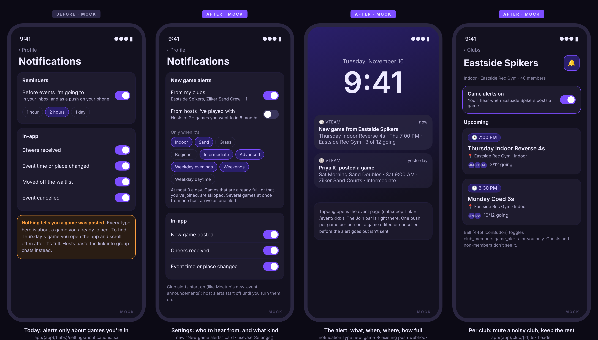
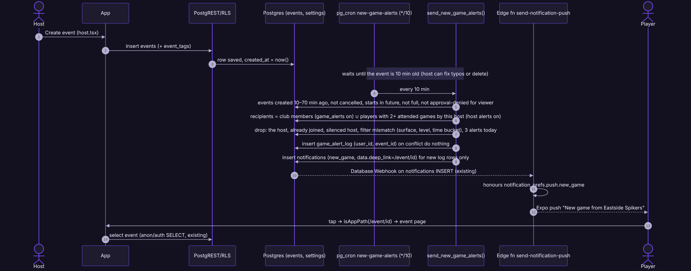
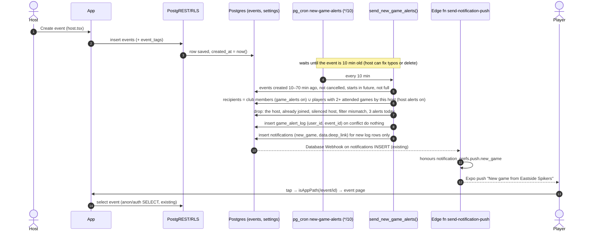
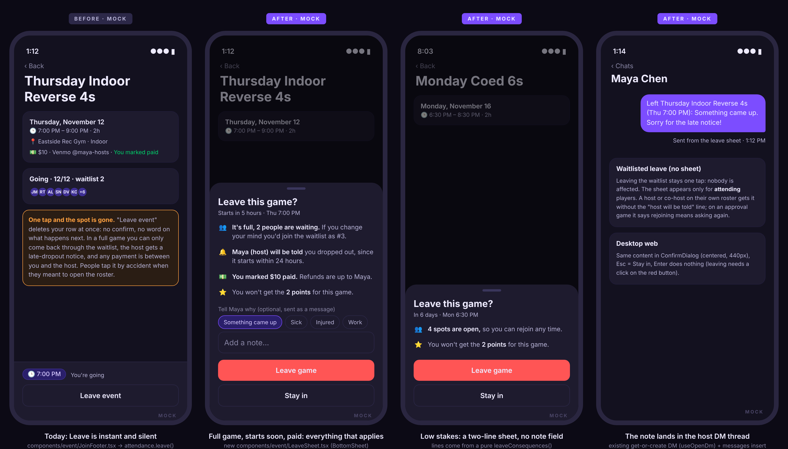
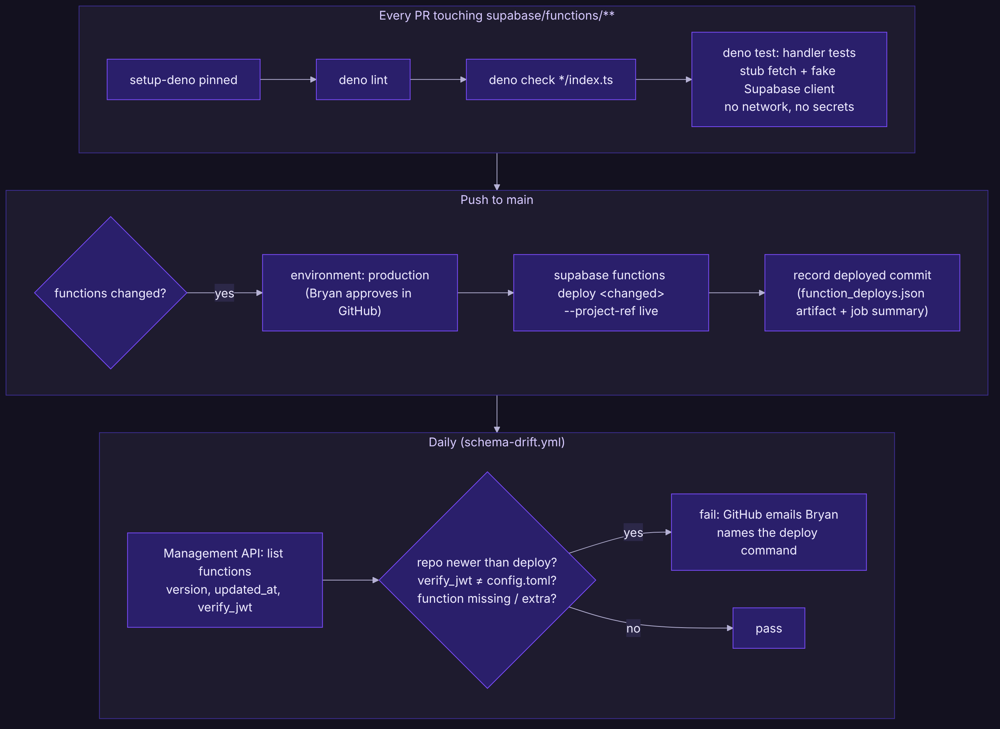
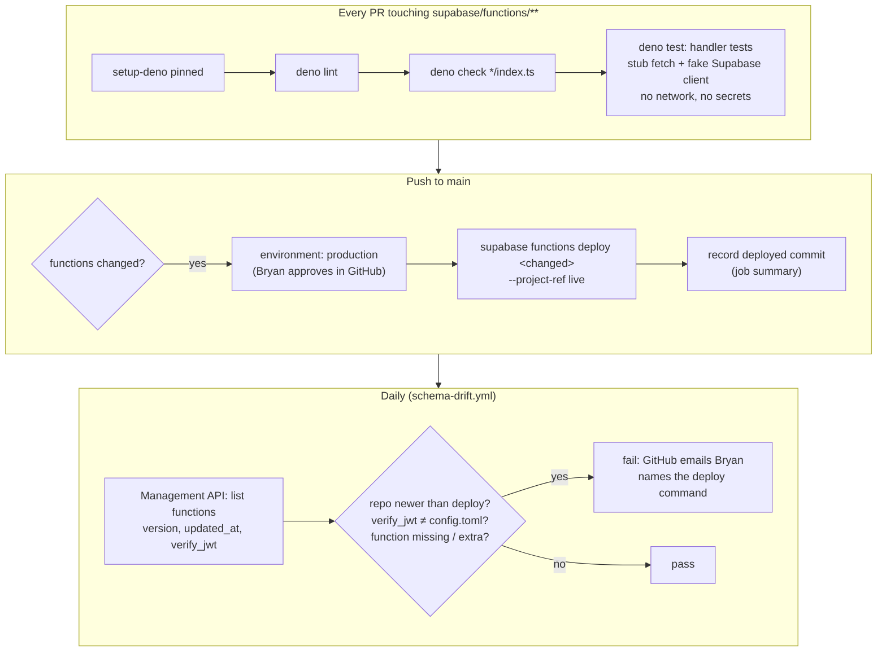

# vteam ideas: 2026-11-03

Three proposals for review. Reply in the run: `approve 1, 3` / `reject 2 because …`.

| # | Idea | Bucket | Size | Verdict |
|---|---|---|---|---|
| 1 | ✅ [#170](https://github.com/bryanw121/vteam/issues/170) New game alerts: hear when your clubs, or hosts you play with, post a game | Competitor gap (Meetup, Playtomic) | M | Yes: biggest gap in how players find games today; reuses the push pipeline |
| 2 | ✅ [#171](https://github.com/bryanw121/vteam/issues/171) Leave with a heads-up: a sheet that says what leaving costs, and an optional note to the host | End-user experience | S | Yes: tiny, no schema, protects spots and hosts from accidental leaves |
| 3 | ✅ [#172](https://github.com/bryanw121/vteam/issues/172) Edge functions under test: Deno handler tests on every PR, approved deploy on merge, daily deploy drift check | Testing robustness | M | Yes, tests first: push for every notification runs through untested handlers |

Every image here is a design mock with made-up people and data (marked MOCK). Diagrams are Mermaid; sources are next to the PNGs in `ideas/assets/2026-11-03/`.

Checked against every issue and PR (#1–#169, open and closed) and `ideas/log.json`. None of these is planned or in flight. Idea 1 is new (no notification type today is about a game you haven't joined); it is related to, but separate from, Friends (#15, #123/#124: "friends going") and the still-proposed waitlist spot offers (2026-11-01 #1). Idea 2 builds on late-dropout notices (#129/#132) and "I've paid" (#6/#115). Idea 3 complements the static guards in `__tests__/edgeFunctions.test.ts` and the job health check (#157); it doesn't overlap pgTAP (#150), which tests SQL only.

---

## 1. New game alerts: hear when your clubs, or hosts you play with, post a game

**Bucket:** competitor gap · **Size:** M · **Pitch:** When a club you're in, or a host whose games you keep going to, posts a game that fits what you play (surface, level, evenings or weekends), you get one push with the time, place and how full it is. Tapping it opens the event, Join bar ready.



### Why
- **Nothing in vteam tells you a game was posted.** Every type in `NOTIFICATION_TYPES` (`types/index.ts`) is about a game you're already in, a club post, chat, cheers or tournaments. To find this week's game a player opens the app and scrolls the feed, often after the good games are full. Hosts fill the gap by pasting links into group chats outside vteam.
- **Clubs have members and events have `club_id`, but the two never meet in a notification.** A club is the natural "subscribe" unit and it already exists (`club_members`).
- **Competitors:**
  - [Meetup: What notifications Meetup can send](https://help.meetup.com/hc/en-us/articles/40708711818637-What-notifications-Meetup-can-send): a **New event announcement**, "a message about a newly created event in one of your groups", sent to "all eligible group members who haven't RSVP'd yet", by email and push, "shortly after the event is announced".
  - [Playtomic: How to manage the notifications](https://playerhelp.playtomic.com/hc/en-gb/articles/19831492072337-How-to-manage-the-notifications-from-Playtomic-App): **Priority Alerts** push "for available matches" (one free, unlimited on Premium), plus pushes when people you follow create or join a match.

  vteam's version takes Meetup's group announcement (our clubs) and Playtomic's "people you follow" (hosts you've actually played with, no follow graph needed), filtered by what you play, capped so it never becomes spam.

### User stories
- As a club member, I hear about my club's new games without checking the app every day.
- As a regular at one host's Thursday game, I hear when she posts the next one, even if it isn't under a club.
- As a sand-only player, I don't get alerts for indoor games.
- As a member of a busy club, I can mute that one club and keep the rest.
- As a host, my game fills from people who already like playing with me, without me pasting the link anywhere.

### Acceptance criteria
- [ ] New notification type `new_game` in `NOTIFICATION_PREF_TYPES` and the `notifications_notification_type_check` constraint, with label "New game posted" in `NOTIFICATION_TYPE_LABELS`; in-app and push toggles appear in Settings → Notifications like the others.
- [ ] Settings → Notifications gets a **New game alerts** card: "From my clubs" (default on), "From hosts I've played with" (default off; host = creator of 2+ events you attended in the last 180 days), and "Only when it's" chips for surface (Indoor / Sand / Grass), level (`SKILL_LEVEL_LABELS`) and time (Weekday evenings / Weekday daytime / Weekends). No chip selected in a row = any.
- [ ] Club page (`app/(app)/club/[id].tsx`): members see a 44pt bell `IconButton` that turns that club's alerts off/on for them (`set_club_game_alerts`); guests and non-members don't see it.
- [ ] An alert goes out 10–70 minutes after an event is created, never for an event that is cancelled, already started, already full, created by the recipient, or that the recipient has already joined, waitlisted or requested.
- [ ] Each person gets at most one alert per event (`game_alert_log`) and at most 3 `new_game` alerts per local day; several games from one host or club in one run arrive as one alert ("Priya K. posted 4 games · first Thu 7:00 PM").
- [ ] Copy: title "New game from <club>" or "<host first name + initial> posted a game"; body "<title> · <Thu 7:00 PM> · <location> · <n> of <max> going" (times in `SHARE_TIME_ZONE`); `data.deep_link = /event/<id>` (single) or the host's/club's page (grouped).
- [ ] The push goes through the existing `send_notification_push` webhook and honours `notification_prefs.push.new_game`; nothing new on the push side.
- [ ] A player who silenced the host (`chat_silences`) gets no alerts for that host.
- [ ] `track('game_alert_opened', { source: 'club' | 'host' })` when a `new_game` push or inbox row is opened; `track('game_alerts_changed', { field })` on settings changes.

### Design
- **Settings screen:** `app/(app)/(tabs)/settings/notifications.tsx` gets a `GameAlertsCard` (new `components/profile/GameAlertsCard.tsx`) above Reminders: two switch rows (the screen's existing `ToggleRow`), then three `Chip` rows (`tint` variant), each `role="group"` with `aria-pressed` chips. Saves through `useUserSettings()` (new `game_alerts` field), debounced like reminder lead time. Club names in the subtitle come from the user's clubs (`useClub`'s list query, already cached on the Clubs tab).
- **Club page:** header `IconButton` (`notifications-outline` / `notifications-off-outline`, `aria-label="Game alerts for <club>"`, `aria-pressed`) next to the existing actions; `useMutation(rpc('set_club_game_alerts'))` with an optimistic `setQueryData` on the club's membership row. One-line confirmation `Toast`.
- **Types:** `GameAlertPrefs` in `types/index.ts` derived from the generated jsonb + `GAME_ALERT_TIME_BUCKETS` / defaults in a new `constants/gameAlerts.ts`.
- **Deep link:** `/event/<id>` already passes `isAppPath`; grouped alerts use `routes.profileOf(hostId)` or the club route. No new routes, no `authGate` or `serve.json` change.
- **Guests:** nothing changes for guests; settings and the bell need an account. The inbox and push need one already.
- **Surfaces:** native (push + inbox), mobile web (inbox row only; no web push today), desktop web (same card inside `ScreenContainer`, chips hover/focus states, keyboard toggles). Chip rows wrap at Extra large text (check the 320px phone).

### Backend





Why a 10-minute cron rather than an `AFTER INSERT` trigger: hosts often create, then fix the time or delete; a trigger would alert on the first draft. The 10–70 minute window means a missed run catches up, and the log makes reruns harmless. It mirrors `send_event_reminders()`.

**Model changes**

| Object | Change | Notes (who can read / write) |
|---|---|---|
| `user_settings.game_alerts` | new `jsonb not null default '{"clubs":true,"hosts":false,"surfaces":[],"levels":[],"times":[]}'` | Owner-only RLS (existing). CHECK that it's an object; app validates values. |
| `club_members.game_alerts` | new `boolean not null default true` | Readable as today; written only via `set_club_game_alerts` (members can't update their own row directly today, and shouldn't be able to change `role`). |
| `set_club_game_alerts(p_club_id uuid, p_on boolean)` | new SECURITY DEFINER RPC, `search_path = public` | Updates only the caller's own membership row; raises if not a member. EXECUTE to `authenticated` only. |
| `game_alert_log` | new table `(user_id, event_id, sent_at)`, PK `(user_id, event_id)` | RLS on, no policies: service/definer only (like `event_reminder_log`). FK cascade on event and profile delete. Index on `(user_id, sent_at)` for the daily cap. |
| `send_new_game_alerts()` | new SECURITY DEFINER function | EXECUTE revoked from `public, anon, authenticated` (as #111 does for every definer). |
| `notifications_notification_type_check` | add `'new_game'` | Drop + recreate constraint in the same file (a replacement, passes migration safety). |
| pg_cron `new-game-alerts` | `*/10 * * * *` → `select public.send_new_game_alerts()` | Runs on beta too (only test accounts there); part of the fingerprint, so no `ALLOWED` change. |

**Migration sketch** (`supabase/migrations/20261104120000_new_game_alerts.sql`)

```sql
alter table public.user_settings
  add column game_alerts jsonb not null
  default '{"clubs":true,"hosts":false,"surfaces":[],"levels":[],"times":[]}'::jsonb
  check (jsonb_typeof(game_alerts) = 'object');
alter table public.club_members add column game_alerts boolean not null default true;

create table public.game_alert_log (
  user_id uuid not null references public.profiles(id) on delete cascade,
  event_id uuid not null references public.events(id) on delete cascade,
  sent_at timestamptz not null default now(),
  primary key (user_id, event_id)
);
create index game_alert_log_user_sent on public.game_alert_log (user_id, sent_at);
alter table public.game_alert_log enable row level security;

alter table public.notifications drop constraint notifications_notification_type_check;
alter table public.notifications add constraint notifications_notification_type_check
  check (notification_type in (/* existing list */ 'new_game'));

create function public.set_club_game_alerts(p_club_id uuid, p_on boolean) returns void
language plpgsql security definer set search_path = public as $$
begin
  update club_members set game_alerts = p_on where club_id = p_club_id and user_id = auth.uid();
  if not found then raise exception 'not a member' using errcode = '42501'; end if;
end $$;
revoke execute on function public.set_club_game_alerts(uuid, boolean) from public, anon;
grant execute on function public.set_club_game_alerts(uuid, boolean) to authenticated;

create function public.send_new_game_alerts() returns integer
language plpgsql security definer set search_path = public as $$
  -- candidates: events created between now()-70m and now()-10m, cancelled_at is null,
  --   event_date > now(), attending count < coalesce(max_attendees, ∞)
  -- recipients: club members with game_alerts and user_settings.game_alerts->>'clubs'
  --   ∪ players with 2+ attended past events by created_by in 180 days and ->>'hosts'
  -- minus: creator, anyone with an event_attendees row, chat_silences of the host,
  --   surface/level/time mismatch (empty array = any; time in America/Chicago),
  --   users with 3 game_alert_log rows today
  -- insert into game_alert_log … on conflict do nothing returning …
  -- one notifications row per (user, host-or-club) group, honouring notification_pref_enabled(user,'in_app','new_game')
$$;
revoke execute on function public.send_new_game_alerts() from public, anon, authenticated;
select cron.schedule('new-game-alerts', '*/10 * * * *', 'select public.send_new_game_alerts()');
```

**Down** (`…_new_game_alerts.down.sql`): `cron.unschedule('new-game-alerts')`; drop both functions and `game_alert_log`; delete `new_game` notifications; restore the old check constraint; drop `club_members.game_alerts` and `user_settings.game_alerts`.

**RLS expectations to add to `e2e/rls.spec.ts`**
- anon and the e2e user: `select` on `game_alert_log` returns no rows / is denied; `insert` is rejected.
- the e2e user can't `rpc('send_new_game_alerts')` (permission denied).
- the e2e user can't `rpc('set_club_game_alerts')` for a club they aren't in (42501); anon can't call it at all.
- the e2e user can't insert a `notifications` row of type `new_game`.
- `user_settings.game_alerts` for `e2ebuddy` isn't readable by `e2ebot`.

### Test plan
- **Unit:** `__tests__/gameAlerts.test.ts` for the pure copy builder (`utils/gameAlerts.ts`: title/body for single vs grouped, times in `SHARE_TIME_ZONE`) and prefs defaults/merging; `NOTIFICATION_TYPES` vs constraint test already exists and picks up `new_game`.
- **SQL:** once #150 (pgTAP) lands, cases for `send_new_game_alerts()`: window edges, full events, already joined, silenced host, filters, daily cap, grouping, rerun is a no-op. Until then, a beta check in the PR description.
- **RLS:** the five expectations above (`api` shard).
- **e2e:** `e2e/profile.spec.ts` (shard `other`): toggle a chip in Settings → Notifications, reload, still selected; club bell toggles and survives reload.
- **Shots:** existing `settings-notifications`, `club-detail` and `club-detail-guest` (bell absent) cover the screens; add a `user_settings.game_alerts` fixture and a `new_game` row to the notifications fixture so `notifications` shows it.

### Pros and cons
**Pros**
- Fixes the main way players miss games: they learn about a game when it's posted, not when they happen to open the app.
- Directly helps hosts fill games from people who already play with them, without leaving vteam for group chats.
- Reuses what exists: clubs, notification rows, the push webhook, deep links, prefs toggles. No new edge function.
- The host-affinity source gives Playtomic-style "follow" without building a follow graph, and can switch to friends (#15) later.
- Settings-level filters plus a daily cap and grouping keep it from becoming spam.

**Cons**
- A new recurring job that writes notifications to real people: a bug sends wrong or repeated pushes to everyone (mitigated by the log, cap, and a beta run first).
- Push fatigue: even capped at 3/day, a busy club can annoy; some people will mute the app, not the club.
- Alerts only help where hosts post on vteam; Schelagg sessions (`external_sessions`) aren't covered in v1.
- The time buckets assume one time zone (Chicago) while we pilot in Austin; another region needs `major_cities` to carry a zone.
- Adds a migration with a constraint replacement and a new cron to the drift fingerprint, one more thing #157's health check should watch.

**Verdict:** Pros outweigh cons: it closes the biggest discovery gap with mostly existing plumbing, and the cap, defaults and per-club mute keep the risk contained.

### Size, risks, open questions, dependencies
- **Size:** M (one migration, one SQL function, one settings card, one club button, tests).
- **Risks:** noisy alerts on launch (start host alerts off; watch `game_alert_opened` vs mutes in `app_events`); `send_new_game_alerts()` cost on big clubs (indexes on `club_members(club_id)` and `event_attendees(user_id, status)` already exist; check with `explain`).
- **Open questions:** Should club alerts default on for existing members (Meetup does) or start with a one-time banner that offers them? Is 3/day the right cap? Should a host be able to post "quietly" (no alerts, e.g. for a private run)?
- **Dependencies:** none blocking. Better with #150 (pgTAP) for the SQL cases and #157 (job health) to watch the new cron. Friends (#123) can become a third source later.

---

## 2. Leave with a heads-up: say what leaving costs before it happens

**Bucket:** end-user experience · **Size:** S · **Pitch:** Tapping "Leave event" opens a short sheet that lists only what applies (full game with a waitlist, the host will be told, you marked paid, you lose the points), with an optional reason that goes to the host as a message. Low-stakes leaves get a two-line sheet.



### Why
- **Leave is one tap and irreversible in the cases that matter.** `JoinFooter.tsx` calls `attendance.leave()` straight from the button: the row is deleted with no confirm. In a full game you can only come back through the waitlist (hosts promote by hand, `approveFromWaitlist`), and in an approval game you have to ask again.
- **The consequences are real but invisible.** Since #129/#132 a leave within 24h sends the host `late_dropout`; "I've paid" (#115) means money is between you and the host; points (#100) go only to players still attending at the end. None of this is said at the moment of leaving.
- **Hosts get "X left" with no context,** then DM to ask why. A reason chip answers it up front, through the existing DM.
- The footer's secondary "Leave event" sits where the primary Join was, so a tap meant for the roster or a scroll can hit it.

### User stories
- As a player, before I leave I see what I lose, so I don't give up a spot in a full game by accident.
- As a player who has to drop late, I can tell the host why in one tap.
- As a host, a late dropout comes with a reason, so I know whether to find a sub.
- As a player leaving a game far off with open spots, I'm not slowed down by a long warning.

### Acceptance criteria
- [ ] "Leave event" on an event you're **attending** opens `LeaveSheet` (`BottomSheet` on native and narrow web, `ConfirmDialog` layout at ≥ `BREAKPOINTS` desktop). Leaving the waitlist and cancelling a request stay one tap.
- [ ] The sheet lists only the lines that apply, in this order, from a pure `leaveConsequences(event, roster, me, now)`:
  - full with a waitlist → "It's full, N people are waiting. If you change your mind you'd join the waitlist as #N+1."
  - full, no waitlist → "It's full. If a spot doesn't open you won't get back in."
  - spots open → "N spots are open, so you can rejoin any time."
  - requires approval → "Rejoining means asking <host> again."
  - starts within 24h and you aren't the host/co-host → "<host> (host) will be told you dropped out."
  - you marked paid → "You marked $X paid. Refunds are up to <host>."
  - always → "You won't get the N points for this game." (2, or 5 for an event tagged Tournament, same rule as `award_event_points()`).
- [ ] Reason chips (Something came up / Sick / Injured / Work) and a note field appear only when the host will be told (within 24h). Sending is optional; if a chip or note is set, after the leave succeeds the app sends one DM to the host: "Left <title> (<Thu 7:00 PM>): <reason>. <note>" via `find_or_create_dm` + a `messages` insert.
- [ ] A failed DM never undoes or blocks the leave; it shows a `Toast` "Left, but the message didn't send" with a Message host action.
- [ ] Buttons: "Leave game" (error fill) and "Stay in" (secondary). Esc / back / scrim tap = Stay in. Focus starts on Stay in.
- [ ] `track('leave_sheet_shown', { full, within24h, paid })`, `track('leave_confirmed', { reason })`, `track('leave_cancelled')`.
- [ ] Screen readers: sheet has `role="dialog"`, title as label; consequence lines are a list.

### Design
- **New:** `components/event/LeaveSheet.tsx` (presentational: props `lines`, `hostName`, `showReason`, `onLeave(reason, note)`, `onCancel`); `utils/leaveConsequences.ts` (pure, React-free); copy strings in `constants/copy.ts` (`LEAVE_COPY`, `LEAVE_REASONS`); `LeaveConsequence` type in `types/index.ts`.
- **Changed:** `components/event/JoinFooter.tsx` opens the sheet instead of calling `attendance.leave()`; the screen (`app/(app)/event/[id].tsx`) owns the DM side effect through `useOpenDm`'s mutation (no navigation: a new `sendDm(otherUserId, text)` that reuses its `find_or_create_dm` call and inserts the message without opening the chat). No navigation in `LeaveSheet`.
- **Data:** everything comes from what the event page already loads: roster counts (`deriveRoster`), `max_attendees`, `requires_approval`, tags, `event_payments` via `useEventPayments`, host profile. No new queries.
- **Guests:** unchanged (they never see Leave).
- **Surfaces:** native `BottomSheet` with safe-area bottom inset, 44pt buttons; mobile web the same sheet, note input at 16px (no iOS zoom); desktop web `ConfirmDialog` 440px, hover states, keyboard: Tab order chips → note → Stay in → Leave.
- **No backend change.**

### Test plan
- **Unit:** `__tests__/leaveConsequences.test.ts`: full + waitlist, full no waitlist, open spots, approval, 24h edge (exactly 24h, 23h59m), host on own roster (no notice line), paid vs unpaid, tournament points 5 vs 2; DM text builder.
- **Component:** `__tests__/LeaveSheet.test.tsx`: lines render, reason hidden outside 24h, Stay in doesn't call `onLeave`.
- **e2e:** `e2e/events.spec.ts` (shard `events`): join a fixture event, tap Leave → sheet → Stay in → still going; Leave game → left. One case with a reason checks the DM appears in the seed host conversation (e2ebuddy hosts the fixture).
- **Shots:** add `event-leave-sheet` to `scripts/shots/screens.mjs` (route: a fixture event the fake user attends, `actions: [{ tap: 'leave-event' }]`, with a new `testID="leave-event"` on the footer button), mobile and desktop; axe scans it automatically.

### Pros and cons
**Pros**
- Stops accidental leaves from a full game, the most costly one-tap mistake in the app today.
- Makes three existing features visible at the moment they matter (late-dropout notice, "I've paid", points) instead of after.
- Gives hosts a reason with late dropouts, through the DM they already use, so they can find a sub sooner.
- No schema, no RLS, no new queries: all data is already on the event page. Small and easy to revert.
- The pure `leaveConsequences()` is a natural home for future lines (e.g. waitlist offers if 2026-11-01 #1 is revived).

**Cons**
- One more tap for every leave, including people who know what they're doing (mitigated: two-line sheet when nothing's at stake).
- Players may read the consequence lines as guilt-tripping; copy has to stay neutral and short.
- The DM path adds a second write that can fail independently of the leave (handled with a Toast, but it's a new edge case).
- A note sent as a DM lands in chat, not on the host's late-dropout notification; hosts see two things for one event.
- Doesn't help hosts who remove players (that path has its own dialog) or players who simply no-show (#151).

**Verdict:** Pros outweigh cons: an S-sized, schema-free change that prevents the most painful mistake on the event page and gives hosts context they ask for today.

### Size, risks, open questions, dependencies
- **Size:** S.
- **Risks:** layout at Extra large text on a 320px phone with all lines shown (scroll the sheet body); copy tone.
- **Open questions:** Put the reason on the `late_dropout` notification itself instead of a DM (needs a column and a trigger change)? Add an Undo toast for a few seconds after leaving (the host notice would already be sent)?
- **Dependencies:** none. Plays well with #151 (no-show flag) and the proposed waitlist spot offers.

---

## 3. Edge functions under test: handler tests on every PR, approved deploy on merge, daily drift check

**Bucket:** testing robustness · **Size:** M · **Pitch:** Run the five Deno edge functions' real request handlers in CI with a stubbed network and a fake Supabase client, deploy them from `main` behind a one-click approval instead of from a laptop, and fail a daily check when what's live differs from the repo.





### Why
- **The handlers never run before production.** `__tests__/edgeFunctions.test.ts` says it outright: "Static guards for the Deno edge functions, which jest cannot execute." Jest covers the pure helpers (`_shared/notificationPush.ts`, `_shared/feedback.ts`, webhook auth) but not the `Deno.serve` bodies: status codes, duplicate-delivery handling, dead-token cleanup, receipts, error paths. A typo there ships.
- **Every notification now goes through one of them.** Since #129/#132 every inbox row is pushed by `send-notification-push`; chat by `send-chat-push`; feedback email by `send-feedback-email`. They are the app's only server code outside Postgres.
- **Deploys are manual and invisible.** `supabase/functions/README.md` lists `supabase functions deploy …` commands to run by hand. Nothing records which commit is live, and beta has no functions, so nothing catches a merged-but-not-deployed fix, a stale deploy, or `verify_jwt` drifting from `supabase/config.toml` (for `places-proxy` and `send-feedback-email` that is a security setting).
- **Supabase supports both directly:** [Testing your Edge Functions](https://supabase.com/docs/guides/functions/unit-test) (Deno's test runner) and [Deploying with CI / CD pipelines](https://supabase.com/docs/guides/functions/cicd-workflow) / [GitHub Actions](https://supabase.com/docs/guides/functions/examples/github-actions).

### User stories
- As the maintainer, a PR that breaks a push handler fails CI with the case that broke, before it reaches anyone's phone.
- As the maintainer, merging a function change deploys exactly that function after one approval click, and the job summary says which commit is live.
- As the maintainer, I get an email the day live functions differ from `main` (not deployed, or `verify_jwt` wrong), with the command to fix it.

### Acceptance criteria
- [ ] Each function's handler moves to `supabase/functions/<name>/handler.ts` exporting `createHandler(deps)` (`deps`: `fetch`, `getClient`, `env`, `now`); `index.ts` becomes `Deno.serve(createHandler(defaultDeps))`. Behaviour unchanged; `__tests__/edgeFunctions.test.ts` static guards updated to read `handler.ts`.
- [ ] `supabase/functions/deno.json` with `tasks.check`, `tasks.lint`, `tasks.test` and a lockfile; `_shared/testing.ts` provides `fakeSupabase()` (records `from().select/insert/delete` calls, returns scripted rows/errors) and `stubFetch()` (scripted Expo / Resend / Places responses; throws on any unscripted URL).
- [ ] Handler tests (`<name>/handler.test.ts`), at least:
  - all webhook functions: 405 on GET, 401 without/with wrong auth, 400 on bad JSON and wrong payload;
  - `send-notification-push`: duplicate id ignored; prefs off → not pushed; `chat_mention` skipped; no tokens → 200; `DeviceNotRegistered` → token deleted; Expo 500 or throw → still 200 and nothing deleted; receipts inserted for ok tickets; >100 tokens → two batches;
  - `send-chat-push`: silenced members and the sender skipped; mention vs plain body;
  - `check-push-receipts`: `DeviceNotRegistered` receipt deletes the token; processed receipts removed;
  - `send-feedback-email`: someone else's row → refused; row older than 15 minutes → 410; already emailed → 409; no `RESEND_API_KEY` → 503; Resend rejects → 502;
  - `places-proxy`: bad input → 400; missing `GOOGLE_MAPS_KEY` → 500; the key never appears in any response body.
- [ ] CI job **Edge functions** in `ci.yml` (runs when `supabase/functions/**` or `supabase/config.toml` changes, and on `main`): `denoland/setup-deno` pinned by SHA, `deno task lint`, `deno task check`, `deno task test --allow-env` with no network permission. No secrets.
- [ ] `.github/workflows/deploy-functions.yml` on push to `main` touching `supabase/functions/**`: computes changed functions (a `_shared` change = all), waits on the `production` environment (required reviewer: Bryan), runs `supabase functions deploy <name> --project-ref rmelsdqgrpfjzqisycdl` (CLI pinned), writes name → commit to the job summary. Secret: `SUPABASE_ACCESS_TOKEN` in the environment, not the repo.
- [ ] `scripts/functions-drift.mjs`, run daily from `schema-drift.yml`: lists live functions via the Management API, compares each function's `updated_at` with the last commit touching its folder (and `_shared`), `verify_jwt` with `config.toml`, and the set of names with the repo; fails naming the function and the deploy command. Never deploys.
- [ ] README updated: "deploys happen from `deploy-functions.yml`; manual deploy only to recover".

### Design
- **Files:** `supabase/functions/*/handler.ts` (+ `handler.test.ts`), `supabase/functions/_shared/testing.ts`, `supabase/functions/deno.json`, `deno.lock`; `.github/workflows/ci.yml` (new job), `.github/workflows/deploy-functions.yml` (new), `.github/workflows/schema-drift.yml` (one step), `scripts/functions-drift.mjs` (+ `scripts/functions-drift.test.mjs` for the comparison logic, run by the existing `node --test scripts/*.test.mjs`).
- **Why `handler.ts` and not `import.meta.main`:** the Supabase edge runtime's entry handling isn't something to rely on; a two-line `index.ts` keeps deploy output identical.
- **Not touched:** app code, database, beta. CI still never writes to live: the deploy job is a separate workflow behind a manual approval, and the drift check only reads.

### Test plan
- The tests above are the deliverable. Prove the harness bites: a deliberate break (e.g. skip the dead-token delete) makes `handler.test.ts` fail locally; include the failing output in the PR.
- `scripts/functions-drift.test.mjs`: fixture API responses for in-sync, stale deploy, `verify_jwt` mismatch, missing and extra functions.
- First deploy run: approve once on a no-op README change to `_shared` to see all five deploy and the summary written.

### Pros and cons
**Pros**
- Covers the only server code outside Postgres, which now carries every push and the feedback email.
- Catches the deploy mistakes that tests can't: merged but not deployed, deployed from an unmerged branch, `verify_jwt` drift on a JWT-protected function.
- Deterministic and fast: no network, no secrets, no beta, so it can't flake on Supabase or Expo and runs in under a minute.
- Turns the README's manual deploy steps into one approval click with a record of what's live.
- The `createHandler(deps)` seam makes future functions (e.g. a calendar feed or a weather proxy) testable from day one.

**Cons**
- Refactors five working functions to add the seam; small, but a mistake there is itself a production risk (mitigated by the tests landing in the same PR and a careful first deploy).
- Adds a Deno toolchain and lockfile next to Node, and fakes that must be kept in step with how supabase-js is actually called.
- `SUPABASE_ACCESS_TOKEN` is a powerful credential in GitHub; scoped to an environment with a required reviewer, but still a new secret to guard and rotate.
- A deploy job means CI-adjacent automation can now change live; Bryan has to approve each one, which is friction for quick fixes.
- The drift check depends on Management API fields (`updated_at`, `verify_jwt`); if Supabase changes them, the check needs updating.

**Verdict:** Pros outweigh cons, especially for the tests and drift check; if the deploy job feels like too much access, ship parts 1 and 3 first and keep deploying by hand.

### Size, risks, open questions, dependencies
- **Size:** M (refactor + tests S/M, workflows S).
- **Risks:** the first automated deploy; `deno check` on remote `esm.sh` imports needs network in that step only (or vendor the import via an import map).
- **Open questions:** Approve each deploy, or auto-deploy and rely on the drift check + tests? Should the deploy also run `supabase secrets list` to check required secrets exist (names only)?
- **Dependencies:** complements #157 (job health catches a broken push at runtime; this catches it before merge) and #150 (pgTAP). Parallel with #166 (Maestro).
