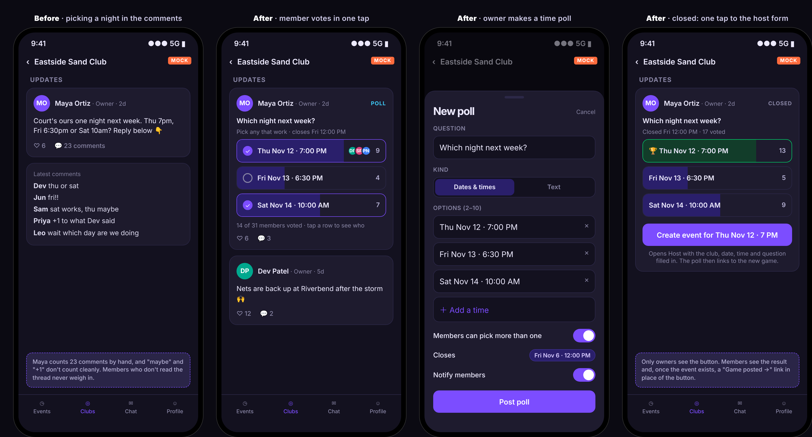
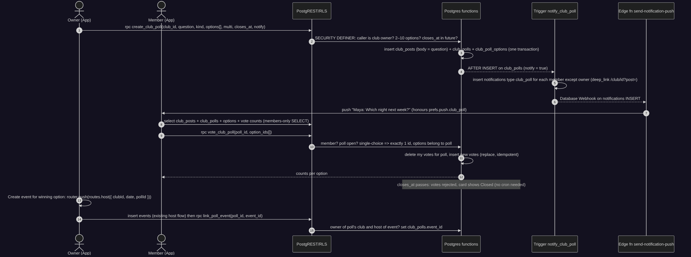
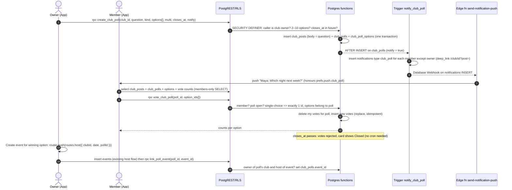
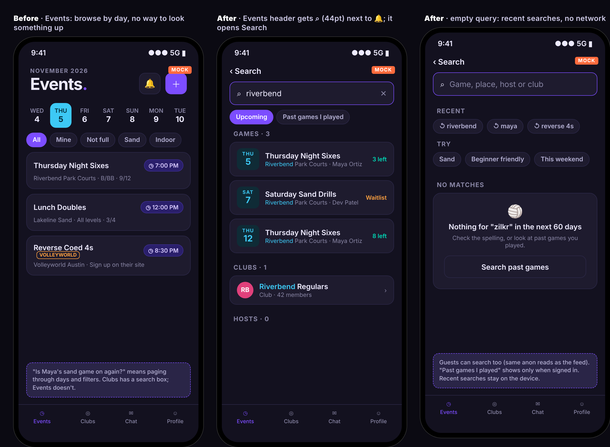
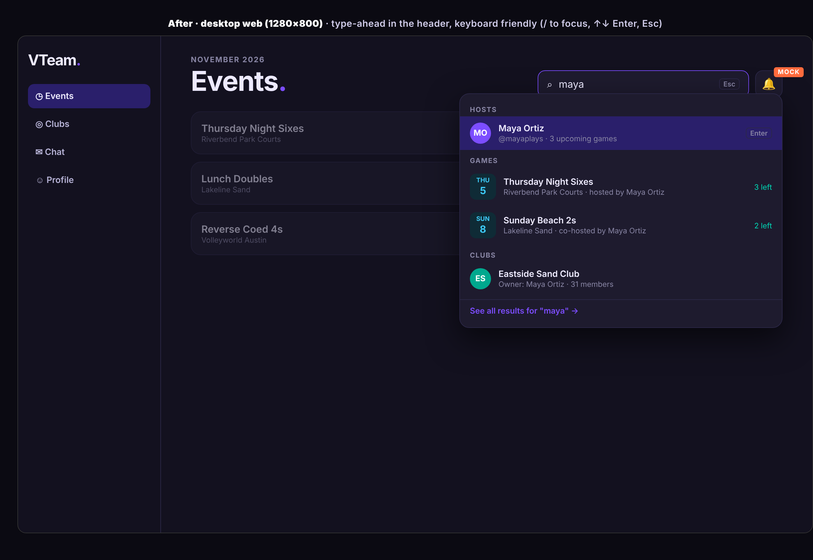
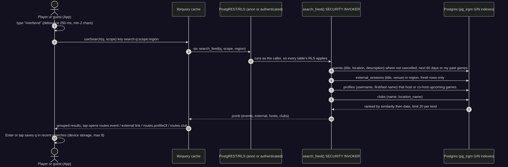
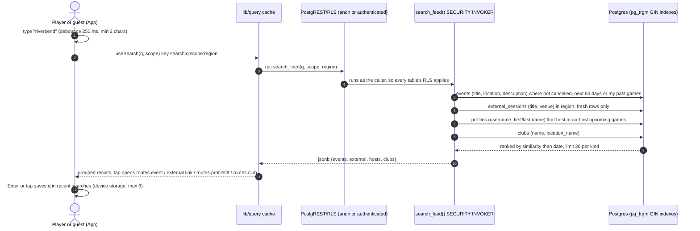
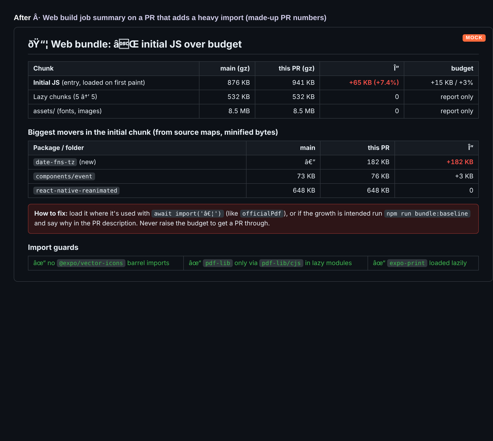
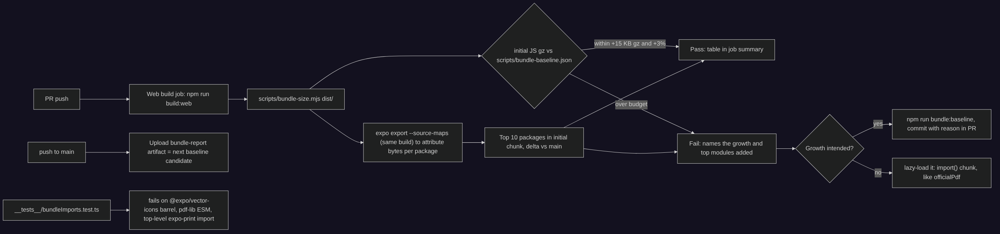

# vteam ideas: 2026-11-04

Three proposals for review. Reply in the run: `approve 1, 3` / `reject 2 because …`.

| # | Idea | Bucket | Size | Verdict |
|---|---|---|---|---|
| 1 | Club polls: "Which night next week?" in one tap, and the winning time becomes the event | Competitor gap (Spond, Heja) | M | Yes: clubs already schedule this way in comments; small schema, clear owner value |
| 2 | Search games: find a game, place, host or club from the Events tab | End-user experience | M | Yes, kept narrow: the one lookup the feed can't answer, works for guests |
| 3 | Web bundle budget: size report on every PR, fail on unplanned growth of the first-load JS | Testing robustness (performance) | S | Yes: first load is 876 KB gz today and nothing watches it |

Every image here is a design mock with made-up people and data (marked MOCK). Diagrams are Mermaid; sources are next to the PNGs in `ideas/assets/2026-11-04/`.

Checked against every issue and PR (#1–#174, open and closed) and `ideas/log.json`. None of these is planned or in flight. Idea 1 builds on club posts (`club_posts`, `ClubPostCard`) and pairs with, but doesn't need, new game alerts (#170). Idea 2 reuses the Clubs tab's search box pattern and the feed's region rules; it is separate from Friends (#15). Idea 3 is new: CI checks a11y, schema drift and migrations, but no check looks at bundle size (the `@expo/vector-icons` barrel rule in `CLAUDE.md` isn't enforced by any test today).

---

## 1. Club polls: "Which night next week?" in one tap, and the winning time becomes the event

**Bucket:** competitor gap · **Size:** M · **Pitch:** Club owners can post a poll (dates and times, or plain text) to the club's Updates. Members vote in one tap and see the counts live. When it closes, the owner taps **Create event for Thu Nov 12 · 7 PM** and lands on Host with the club, date and time filled in.



### Why
- **Clubs pick nights in the comments today.** `club_posts` is text-only (`body`), so an owner asking "Thu, Fri or Sat?" counts replies by hand, and "+1" or "maybe" don't count cleanly. Members who don't read the thread never weigh in.
- **The step before an event is missing.** vteam handles everything after the event exists (RSVP, waitlist, reminders, teams). Deciding *when* happens outside the app, or in a club post nobody can tally.
- **Competitors:**
  - [Spond: Poll in groups](https://help.spond.com/app/en/articles/112748-poll-in-groups): admins create text polls (up to 30 options) or **time polls** that "suggest multiple dates and times for an event", and "you can turn the winning option into an event". Options for multi-vote, hidden votes and a response deadline ("members can't vote after this").
  - [Heja: How to create a poll](https://help.heja.io/en/articles/9615388-how-to-create-a-poll-on-heja): a question with up to ten answers, created from Posts (not chat), "visible to everyone in the team"; a paid (Pro) feature.

  vteam's version takes Spond's time poll and "winning option → event" and Heja's simplicity (lives in the existing Updates feed, results visible to members), free for every club.

### User stories
- As a club owner, I ask my members which night works and see a clear winner without counting comments.
- As a club owner, I turn the winning time into an event without retyping the date.
- As a member, I vote in one tap from the Updates feed, change my vote until the poll closes, and see who else picked each time.
- As a member, I get one push when my club posts a poll, and I can turn that off.
- As a member, once the event exists, the poll links straight to it.

### Acceptance criteria
- [ ] Club owners see **New poll** next to New post on the club page; members and guests don't.
- [ ] A poll has a question (1–140 chars), a kind (**Dates & times** or **Text**), 2–10 options (time options need a future `starts_at`; text options 1–80 chars), "members can pick more than one" (default on) and an optional close time (default: 48h, must be in the future).
- [ ] The poll appears as a post in Updates (likes and comments work as on any post), with a **Poll** tag, one row per option showing the count, a bar and up to 3 voter avatars; tapping a row's count lists the voters.
- [ ] Members vote by tapping a row; single-choice replaces the vote, multi toggles. Votes save optimistically through `useMutation` and roll back on error with a toast.
- [ ] After `closes_at`, the card shows **Closed**, the winning option (most votes; ties show all tied, none marked), and voting is refused by the server.
- [ ] For a closed time poll, owners see **Create event for <time>** (each tied option gets its own button) which opens `routes.host({ clubId, date, title })`; saving that event links it to the poll, and the card then shows **Game posted →** (`routes.event(id)`) to everyone.
- [ ] New notification type `club_poll` ("Club poll") in `NOTIFICATION_PREF_TYPES`, the check constraint and `NOTIFICATION_TYPE_LABELS`; sent once per member (not the owner) when the owner leaves **Notify members** on; deep link to the club page.
- [ ] Guests see no polls (Updates is members-only today); non-members can't read options or votes.
- [ ] Works at Extra large text, at 320px width, and with the keyboard on desktop web (rows are buttons with `accessibilityState.checked`).

### Design
- **Club page** `app/(app)/club/[id].tsx`: owner action row gets **New poll** (opens `components/club/PollComposerSheet.tsx`, a `BottomSheet`). Time options use `DatePickerField` (native / `.web.tsx`).
- **Feed card**: `components/ClubPostCard.tsx` renders `components/club/PollBlock.tsx` when the post has a poll (no change to text posts). Voters list in a `BottomSheet`.
- **Hooks**: `hooks/useClub.ts` adds `club_polls (kind, multi, closes_at, event_id, club_poll_options (id, position, label, starts_at, club_poll_votes (user_id)))` to `CLUB_POST_FEED_SELECT` (one request, no N+1); new `hooks/useClubPollActions.ts` with `useCreatePoll` / `useVote` (`useMutation`, `invalidates: clubPostsKey`). Counts derive client-side in `utils/clubPoll.ts` (pure: counts, winner, ties, "I voted", closed).
- **Host prefill**: `HostRouteOptions` gains `clubId`, `date` (ISO), `title`, `pollId`; `app/(app)/host.tsx` reads them like `location`/`surface`, and after insert calls `link_poll_event` when `pollId` is set.
- **Types**: `ClubPoll`, `ClubPollOption`, `PollBlockProps`, `PollComposerProps` in `types/index.ts`.
- **Routes**: none new (sheets on the club page). Notification deep link uses `routes.club(id)`.
- **Surfaces**: native and mobile web share the sheet; desktop web shows the composer as the centered `BottomSheet` variant, rows get hover states, Enter/Space toggles a row. 44pt rows.

### Backend





**Model changes**

| Object | Change | Notes (who can read / write) |
|---|---|---|
| `club_polls` | new table: `post_id` PK → `club_posts` (cascade), `kind` (`text`\|`time`), `multi` bool default true, `closes_at` timestamptz null, `event_id` → `events` (set null), `created_at` | SELECT: club members (same predicate as `club_posts_select_members`). No client INSERT/UPDATE/DELETE. |
| `club_poll_options` | new table: `id`, `post_id` → `club_polls` (cascade), `position` smallint, `label` text (1–80), `starts_at` timestamptz null; unique `(post_id, position)` | SELECT: club members. Writes only via `create_club_poll`. |
| `club_poll_votes` | new table: `option_id` → options (cascade), `post_id` (denormalized, indexed), `user_id` → profiles (cascade), `created_at`; PK `(option_id, user_id)` | SELECT: club members (who voted is visible to members, like Heja). Writes only via `vote_club_poll`. |
| `create_club_poll(...)` | new RPC, SECURITY DEFINER, `search_path = ''` | Caller must be the club's owner. Validates counts, lengths, future times. Returns `post_id`. Revoke from `anon`. |
| `vote_club_poll(post_id, option_ids uuid[])` | new RPC, SECURITY DEFINER | Caller must be a member; poll open; single-choice needs exactly one id; empty array clears my vote. |
| `link_poll_event(post_id, event_id)` | new RPC, SECURITY DEFINER | Caller owns the club and created the event; event's `club_id` matches. |
| `notify_club_poll` trigger | AFTER INSERT on `club_polls` | Writes one `club_poll` notification per member except the owner, when `notify`. |
| `notifications_notification_type_check` | widened with `club_poll` | Expand-only, same pattern as `20261101090000_event_reminders.sql`. |

**Migration sketch** (`20261105xxxxxx_club_polls.sql`)

```sql
-- Expand only: three new tables, three RPCs, a trigger and a widened check.
create table public.club_polls (
  post_id uuid primary key references public.club_posts(id) on delete cascade,
  kind text not null check (kind in ('text', 'time')),
  multi boolean not null default true,
  closes_at timestamptz,
  event_id uuid references public.events(id) on delete set null,
  created_at timestamptz not null default now()
);
create table public.club_poll_options (
  id uuid primary key default gen_random_uuid(),
  post_id uuid not null references public.club_polls(post_id) on delete cascade,
  position smallint not null,
  label text not null check (char_length(label) between 1 and 80),
  starts_at timestamptz,
  unique (post_id, position)
);
create table public.club_poll_votes (
  option_id uuid not null references public.club_poll_options(id) on delete cascade,
  post_id uuid not null references public.club_polls(post_id) on delete cascade,
  user_id uuid not null references public.profiles(id) on delete cascade,
  created_at timestamptz not null default now(),
  primary key (option_id, user_id)
);
create index on public.club_poll_votes (post_id);
alter table public.club_polls enable row level security;   -- + options, votes
create policy club_polls_select_members on public.club_polls for select to authenticated
  using (exists (select 1 from public.club_posts p join public.club_members m on m.club_id = p.club_id
                 where p.id = club_polls.post_id and m.user_id = (select auth.uid())));
-- same select policy shape for options and votes; no insert/update/delete policies
create function public.create_club_poll(...) returns uuid language plpgsql security definer set search_path = '' as $$ ... $$;
create function public.vote_club_poll(p_post uuid, p_options uuid[]) returns void ...;
create function public.link_poll_event(p_post uuid, p_event uuid) returns void ...;
revoke execute on function public.create_club_poll, public.vote_club_poll, public.link_poll_event from anon, public;
create trigger notify_club_poll after insert on public.club_polls for each row execute function public.notify_club_poll();
alter table public.notifications drop constraint if exists notifications_notification_type_check;
alter table public.notifications add constraint notifications_notification_type_check check (notification_type in (..., 'club_poll'));
```

`.down.sql`: drop the trigger and its function, the three RPCs, the three tables (votes, options, polls), and restore the previous check constraint list (after deleting any `club_poll` notification rows, which only exist on beta while testing).

**RLS expectations for `e2e/rls.spec.ts`** (read-only, every insert must be rejected):
- anon: `select` on `club_polls`, `club_poll_options`, `club_poll_votes` returns 0 rows; `rpc('create_club_poll')` / `vote_club_poll` / `link_poll_event` fail (permission denied).
- e2e account: direct `insert` into each poll table is rejected; `create_club_poll` on a club it doesn't own is rejected; `vote_club_poll` on a seed poll in a club it isn't in is rejected.

### Test plan
- **Unit**: `__tests__/clubPoll.test.ts` for `utils/clubPoll.ts` (counts, winner, ties, closed, single vs multi toggling); `PollBlock` render test (checked state, closed state, owner-only button); host prefill from `clubId`/`date`/`title`.
- **pgTAP** (once #150 lands): create/vote/close/link rules, trigger writes one row per member.
- **RLS**: the cases above in the `api` shard.
- **e2e** (`events` shard, new `e2e/clubPolls.spec.ts` or inside an existing club spec): e2e account creates a fixture club it owns in `beforeAll`, posts a time poll, votes, sees counts, deletes in `afterAll` under the run tag.
- **Shots/a11y**: add `club-detail-poll` (open poll, member view) and `club-detail-poll-closed` (owner view) to `SCREENS` in `scripts/shots/screens.mjs`, with fixture rows in `scripts/shots/fixtures/`.

### Pros and cons
**Pros**
- Replaces a real, visible workaround (comment threads) with one tap, and gets a clear answer from members who never comment.
- Closes the loop before an event exists: the winning time becomes a prefilled Host form, so the club's next game gets posted sooner.
- Small surface: lives inside the existing Updates feed and `ClubPostCard`; no new route, no cron (closing is a timestamp check).
- Straight competitor parity with Spond's time polls, free where Heja charges for it.
- Text polls cover more than scheduling (jersey colors, "sand or indoor this month?").

**Cons**
- Three new tables, three definer RPCs and a trigger: more RLS surface to get right and to test.
- Only club owners can create polls; hosts who run games without a club get nothing from it.
- Visible votes may discourage some members (no "hide votes" option in v1).
- Another notification type; busy clubs could add noise (mitigated by the per-type toggle and one push per poll).
- Updates is members-only, so polls do nothing for guest browsing or growth.

**Verdict:** pros outweigh the cons: a concrete scheduling problem clubs already have, solved inside screens that exist, with a contained schema.

### Size, risks, open questions, dependencies
- **Size:** M (schema + 3 RPCs + 2 components + host prefill).
- **Risks:** definer functions must check membership/ownership themselves (follow `20261028160000_definer_search_path.sql`); vote counts on big clubs: fine at pilot scale, revisit with a counts view later.
- **Open questions:** should club admins (if a role beyond owner is added) create polls? Offer "hide votes" like Spond in v1? Remind non-voters once before close?
- **Dependencies:** none blocking. Pairs with #170 (new game alerts would announce the event the poll creates). pgTAP (#150) would host the SQL tests.

---

## 2. Search games: find a game, place, host or club from the Events tab

**Bucket:** end-user experience · **Size:** M · **Pitch:** A search button next to the bell opens Search: type "riverbend" or "maya" and get upcoming games (vteam and other Austin venues), hosts with upcoming games, and clubs, grouped and ranked, with typo tolerance. Signed-in players can also search their own past games. Works for guests.





### Why
- **The feed only answers "what's on this day?".** To answer "is Maya's sand game on again?" or "anything at Riverbend this week?" a player pages through days in the week strip and flips filters. The Events feed (`app/(app)/(tabs)/(main)/index.tsx`) has no text search; only the Clubs tab does (`clubs.tsx`, client-side filter).
- **The feed now mixes sources.** With Schelagg sessions (`external_sessions`) under All, the day list is longer, and a named venue or game is harder to spot by scrolling.
- **Past games are hard to find again.** Finding last month's game to see who played, or to re-host it, means going through Profile → history.

### User stories
- As a player, I type a place, game name or host and see matching upcoming games in one list.
- As a guest, I can search too, and only see what guests can already see in the feed.
- As a player, I can search my own past games ("thursday sixes" from October) to find who played.
- As a desktop user, I press `/` to focus search and use ↑ ↓ Enter Esc.
- As a player who searches the same thing every week, I see my recent searches.

### Acceptance criteria
- [ ] Events header (mobile `ScreenHeader` `right`, desktop `EventsHeader` `right`) gets a 44pt `IconButton` (search) left of the bell / `SignInButton`, with label "Search".
- [ ] New route `app/(app)/search.tsx` → `routes.search(q?)`; public (not in `utils/authGate.ts`); `?q=` makes it shareable and restores the query on back.
- [ ] Results appear after 2+ characters, debounced 250 ms, grouped **Games** (vteam + other venues, marked like `ExternalSessionCard`), **Hosts**, **Clubs**, max 20 per group, each group hidden when empty.
- [ ] Games are upcoming (next 60 days), not cancelled, in the viewer's feed region (`useFeedRegion()`), external sessions only when fresh (`EXTERNAL_SESSION_MAX_AGE_MS`), matching title, location or host name; typos within trigram similarity still match ("zilkr" → "Zilker").
- [ ] Signed in: a **Past games I played** chip searches the viewer's own attended games (last 12 months). Guests don't see the chip.
- [ ] Hosts only list people with upcoming games (no general user directory); results show public profile columns only (the `PROFILE_BRIEF` columns in `constants/selects.ts`).
- [ ] Tapping opens `routes.event(id)`, the venue sign-up for external sessions (`useOutsideSessionLink`), `routes.profileOf(id)` or `routes.club(id)`.
- [ ] Recent searches (max 8) live on the device and are cleared on sign-out; empty and no-match states use `EmptyState`.
- [ ] Desktop web: a type-ahead field in the header with a results popover, `/` to focus, ↑ ↓ Enter Esc, "See all results" opens the full page.
- [ ] `track('search_submitted', { len, results })` (no query text) for usage.

### Design
- **Screens**: `app/(app)/search.tsx` (new, `ScreenState` + `DocScrollView memoryKey="search"`); Events header buttons in `app/(app)/(tabs)/(main)/index.tsx`; desktop type-ahead `components/search/SearchPopover.web.tsx`, mobile renders the button only (`SearchPopover.tsx` no-op).
- **Components**: `components/search/SearchField.tsx` (16px input, clear button), `SearchResultRow.tsx` (day badge + `TimePill`-free compact row, spots left), group headers reuse `shared.subheading`.
- **Hooks**: `hooks/useSearch.ts` (`useQuery(queryKey('search', scope, region, q), …, { staleMs: STALE.feed })`, enabled at 2+ chars), `hooks/useRecentSearches.ts` (AsyncStorage / localStorage; cleared with the other user-scoped caches in `useCacheUserScope`).
- **Routes**: `routes.search(q?)` in `utils/routes.ts`; `/search` needs no `serve.json` rewrite (static route); add `'search'` to `SCREENS`.
- **Guest behaviour**: same results as the guest feed (RLS decides, the function is SECURITY INVOKER); no "Past games" chip.
- **Surfaces**: native and mobile web use the full screen; desktop web uses the popover plus the full page. Input font 16px (no iOS zoom).

### Backend





**Model changes**

| Object | Change | Notes (who can read / write) |
|---|---|---|
| `pg_trgm` | `create extension if not exists pg_trgm with schema extensions` | Typo-tolerant `%` / `similarity()`. |
| GIN trigram indexes | on `lower(events.title)`, `lower(events.location)`, `lower(external_sessions.title)`, `lower(clubs.name)`, `lower(profiles.username)` | Indexes only; no data change. |
| `search_feed(q text, scope text, region text)` | new RPC, **SECURITY INVOKER**, `stable`, `search_path = ''` | Callable by anon and authenticated; RLS on each table decides visibility. Rejects `q` shorter than 2 or longer than 60 chars; `scope = 'mine_past'` returns nothing for anon. Returns jsonb of ids + card fields (event card fields match `EVENT_CARD_LIST_SELECT`). |

No new tables; nothing written.

**Migration sketch** (`20261105xxxxxx_search_feed.sql`)

```sql
-- Expand only: an extension, indexes, one invoker function.
create extension if not exists pg_trgm with schema extensions;
create index if not exists events_title_trgm on public.events using gin (lower(title) extensions.gin_trgm_ops);
create index if not exists events_location_trgm on public.events using gin (lower(location) extensions.gin_trgm_ops);
create index if not exists external_sessions_title_trgm on public.external_sessions using gin (lower(title) extensions.gin_trgm_ops);
create index if not exists clubs_name_trgm on public.clubs using gin (lower(name) extensions.gin_trgm_ops);
create index if not exists profiles_username_trgm on public.profiles using gin (lower(username) extensions.gin_trgm_ops);
create function public.search_feed(q text, scope text default 'upcoming', region text default 'austin')
returns jsonb language sql stable security invoker set search_path = '' as $$ ... $$;
grant execute on function public.search_feed(text, text, text) to anon, authenticated;
```

`.down.sql`: drop the function and the five indexes, then `drop extension if exists pg_trgm` (nothing else uses it today).

**RLS expectations for `e2e/rls.spec.ts`**:
- anon: `rpc('search_feed', { q: 'e2e' })` succeeds and returns only events anon can already `select` (compare ids with a direct anon `select`); `scope: 'mine_past'` returns empty; a 1-char or 200-char `q` is rejected.
- e2e account: results never include another user's private columns (response keys are the brief profile columns only); `mine_past` returns only events it attended.

### Test plan
- **Unit**: `useSearch` (debounce, 2-char minimum, key includes region and scope), `useRecentSearches` (dedupe, max 8, cleared on sign-out), result grouping and highlighting in `utils/searchResults.ts`; `routes.search` builder.
- **RLS**: the cases above (`api` shard).
- **e2e**: `e2e/search.guest.spec.ts` in the `other` shard (guest searches a Schelagg-mocked venue via `schelaggMock.ts` and a fixture event), plus a signed-in case in `events` (searches a `[e2e <tag>]` fixture event created in `beforeAll`).
- **Shots/a11y**: add `search` (results), `search-empty` and `search-guest` to `SCREENS`, with a `search_feed` RPC handler in the shots harness.

### Pros and cons
**Pros**
- Answers the most common "where is it?" question in one step, for players and guests.
- One read-only RPC: no tables, no writes, RLS-safe by running as the caller.
- Makes the growing mix of vteam and other-venue sessions navigable without more filter chips.
- Past-games search gives a fast way back to old rosters (useful for re-hosting and cheers).
- Desktop keyboard search fits the "keyboard navigation" bar in `CLAUDE.md`.

**Cons**
- At pilot scale the feed is short; for many people the week strip is enough, so usage may be low at first.
- Adds an anon-callable RPC: a cheap scraping/enumeration surface (host names) and something rate limiting (#108) should cover.
- pg_trgm indexes add write cost to `events` and `profiles` (small) and one more extension to keep in sync on beta.
- Ranking across four kinds is fiddly; bad ordering makes search feel broken.
- Another header button on a crowded 320px mobile header (three 44pt buttons).

**Verdict:** pros outweigh the cons if kept narrow (upcoming games + hosts with games + clubs, read-only): low risk, and it gets more useful as the feed grows.

### Size, risks, open questions, dependencies
- **Size:** M (RPC + indexes + 1 screen + desktop popover).
- **Risks:** user enumeration through host search (mitigated: only people with upcoming public games, brief columns only); slow queries if trigram indexes aren't used (check `explain` on beta).
- **Open questions:** search descriptions too, or only title/location/host? Include tournaments (`tournaments`) in v1? Should the search icon replace the bell on 320px phones?
- **Dependencies:** none blocking. Benefits from #108 (rate limiting) and #102 (private columns) landing first.

---

## 3. Web bundle budget: size report on every PR, fail on unplanned growth of the first-load JS

**Bucket:** testing robustness (performance) · **Size:** S · **Pitch:** After `npm run build:web`, a small script measures the first-load JS (the `entry-*.js` the HTML loads) and the lazy chunks, attributes bytes to packages and folders from source maps, writes a table to the job summary, and fails the Web build when first-load JS grows more than 15 KB gz or 3% over the committed baseline without a baseline update. A unit test enforces the import rules `CLAUDE.md` already states.





### Why
- **First load is big and unwatched.** Measured today on `main` (`3127fee`, `expo export -p web`): one `entry-*.js` of **3.5 MB raw / 876 KB gzip** loads before anything renders; 5 lazy chunks add 532 KB gz. Source-map attribution of the entry chunk: app code ~1.0 MB (minified), `react-native-reanimated` 648 KB, `react-native-web` 283 KB, `react-native-gesture-handler` 199 KB, `react-dom` 168 KB, `expo-router` 149 KB, `@supabase/auth-js` 103 KB. Experimental Scorekeeper code (`lib/scoresheet`, `components/scoresheet`, `app/(app)/scorekeeper`, ~130 KB) is in the entry chunk for every visitor.
- **The rules exist but nothing checks them.** `CLAUDE.md` says never import the `@expo/vector-icons` barrel, use `pdf-lib/cjs`, and load `expo-print` lazily; Sentry is split into its own chunk on purpose. One careless import undoes that, and no CI step would notice.
- **Guests are the first impression.** Share links (#130) and guest browsing land people on the web app cold, often on a phone over cellular, where 876 KB gz of JS is several seconds of parse time on mid-range Android.

### User stories
- As a reviewer, I see in the PR's job summary how much first-load JS changed and which package caused it.
- As a contributor, a heavy import fails CI with a message telling me how to lazy-load it, or how to accept the growth on purpose.
- As Bryan, I can see the trend on `main` and pick what to split next (Scorekeeper, tournaments, reanimated).

### Acceptance criteria
- [ ] `scripts/bundle-size.mjs <dist>` reads `dist/index.html`, finds the initial scripts, and reports raw / gzip / brotli for initial JS, lazy chunks and `assets/`.
- [ ] With `--source-maps` builds, it attributes minified bytes in the entry chunk to packages (`node_modules/<pkg>`) and app folders (`app/…`, `components/…`, `lib/…`), and prints the top 10 and the biggest movers vs the baseline.
- [ ] `scripts/bundle-baseline.json` (committed) holds the gz sizes and the top-package table; `npm run bundle:baseline` rewrites it.
- [ ] CI (Web build job, after `build:web`): job summary table on every PR and push; fails a PR when initial JS gz grows > 15 KB **and** > 3% over the baseline; lazy chunks and assets are report-only. The failure names the movers and points to `import()` or `bundle:baseline`.
- [ ] Shrinking passes with a note to commit the smaller baseline (same rule as the a11y baseline: never raise it to get a PR through without saying why).
- [ ] `__tests__/bundleImports.test.ts` fails on: `from '@expo/vector-icons'` (barrel), `pdf-lib` other than `pdf-lib/cjs`, static `expo-print` / `pdf-lib` imports outside the lazy modules, `@sentry/react-native` outside `lib/sentry*`.
- [ ] Script tested with `node --test` (`scripts/bundle-size.test.mjs`, fixture `dist` with a tiny index.html, two chunks and a source map), so it runs in the existing "node --test scripts/*.test.mjs" step.
- [ ] Adds under 30 s to the Web build job (source maps from the same export; no second build).

### Design
- **Files**: `scripts/bundle-size.mjs` (+ `.test.mjs`), `scripts/bundle-baseline.json`, `__tests__/bundleImports.test.ts`, `package.json` scripts `bundle:size` / `bundle:baseline`, one step in `.github/workflows/ci.yml` after `npm run build:web` (switch that build to `expo export --platform web --source-maps`, and delete `*.map` from `dist/` before upload so maps never ship to Vercel or the e2e artifact).
- **Attribution**: walk the entry chunk's source map with `source-map-js` (already in `node_modules` via Metro), sum generated bytes per source, group by package or top folder. Measured on today's `main` in ~2 s.
- **Docs**: a "Bundle size" line in `CLAUDE.md` → Test layers, next to the a11y baseline rule.
- No app, schema or user-visible change.

### Test plan
- `node --test scripts/bundle-size.test.mjs`: initial vs lazy detection from HTML, gzip math, attribution grouping, budget pass/fail, shrink note.
- `npm test` runs `bundleImports.test.ts`.
- Dry-run on a branch that adds a large import to `app/_layout.tsx` (should fail) and one that moves it behind `import()` (should pass).

### Pros and cons
**Pros**
- Cheap: one script, one JSON, one test, no infra; runs inside a job that already builds `dist/`.
- Catches the regressions the repo already cares about (icon barrel, pdf-lib ESM, eager `expo-print`) automatically instead of by review.
- Gives evidence for the next real win: lazy-loading Scorekeeper and tournament screens out of the 876 KB gz entry.
- Same baseline workflow as a11y, so contributors already know how to use it.

**Cons**
- Budgets cause friction: legitimate features will trip it and need a baseline commit.
- Measures bytes, not real load time on a phone; a page can be slow for other reasons (Supabase round trips, images).
- Source-map attribution is approximate (minified bytes, shared helpers), so "who caused it" can mislead on small deltas.
- Web only: native app binary size isn't covered.

**Verdict:** pros outweigh the cons: a small, mechanical guard on something that silently gets worse, with a threshold loose enough to stay out of the way.

### Size, risks, open questions, dependencies
- **Size:** S.
- **Risks:** Expo changing chunk naming (`entry-*.js`); the script finds initial scripts from `index.html`, not by name, to stay robust.
- **Open questions:** budget numbers (15 KB / 3%) right? Also post a PR comment, or job summary only (job summary keeps GitHub quiet)? Follow-up: turn on Expo Router async routes for web to split screens.
- **Dependencies:** none. Complements the a11y job (#131) and the planned native smoke tests (#166).
