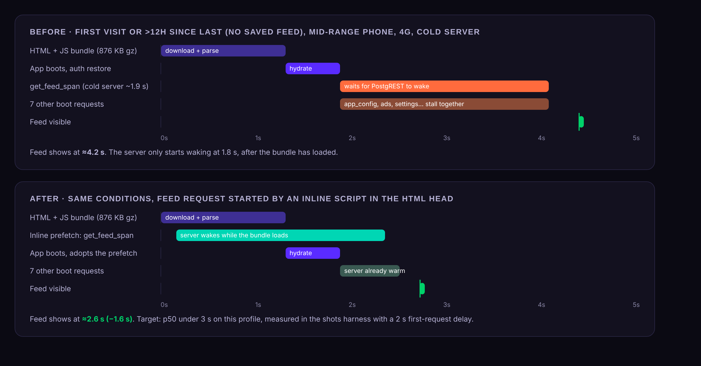
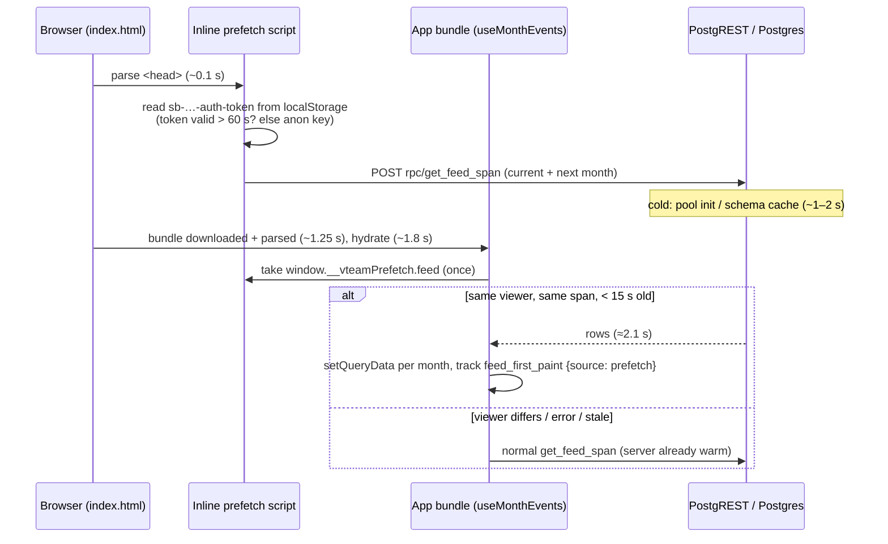
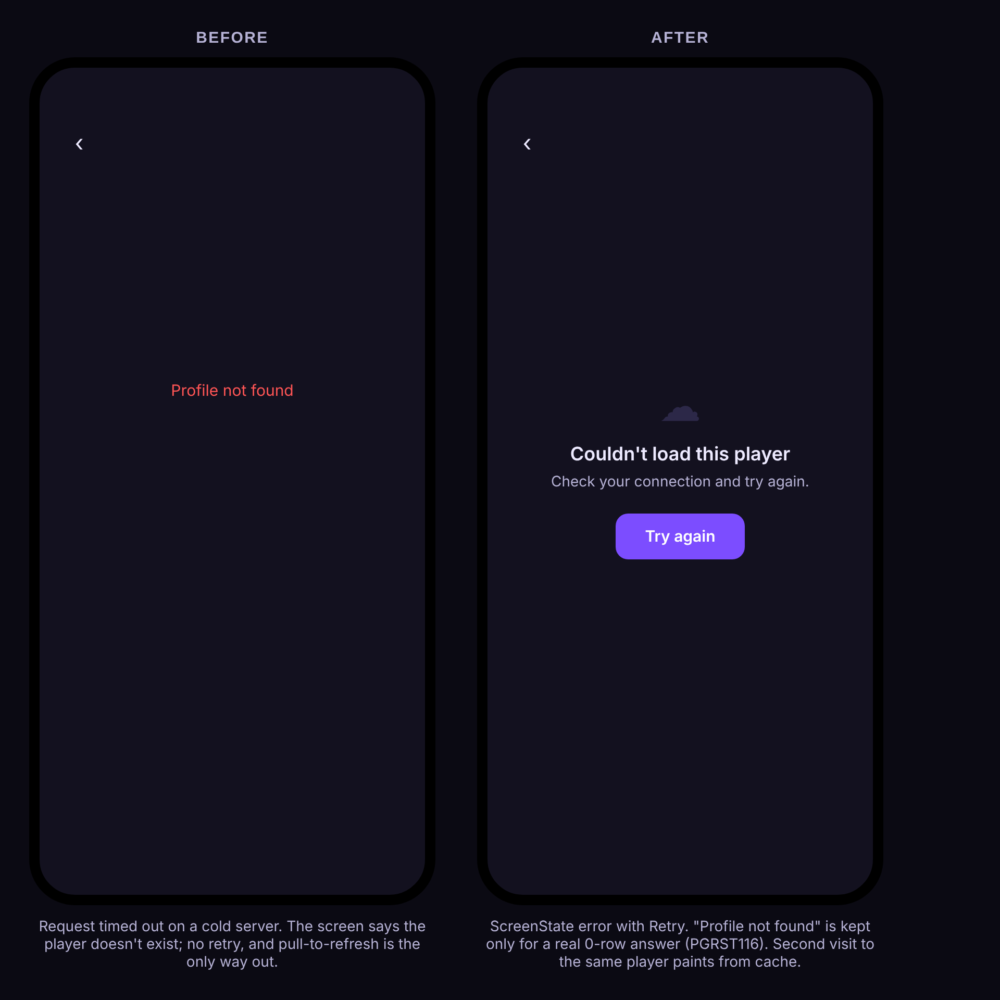
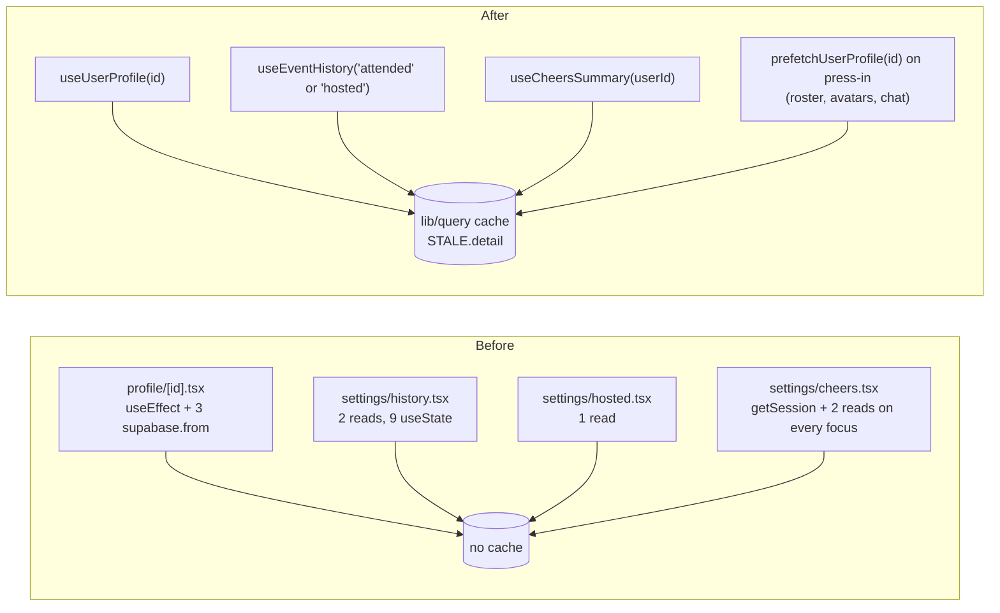
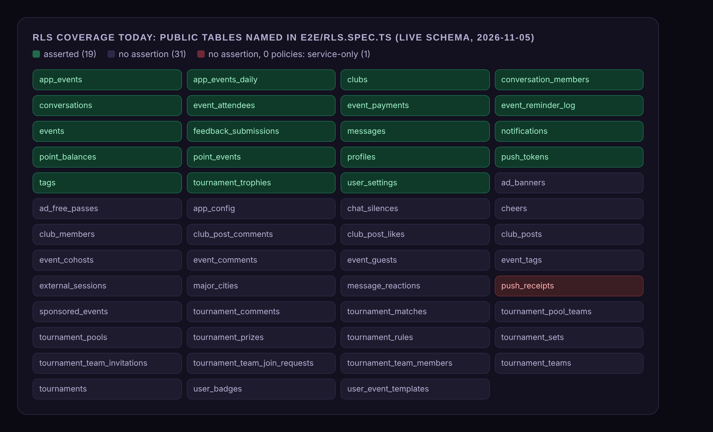
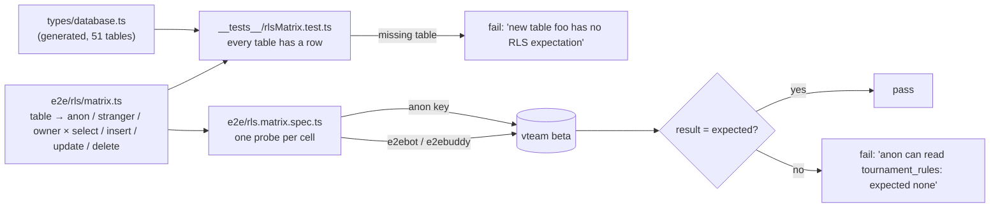

# vteam ideas: 2026-11-05

Three proposals for review. Reply in the run: `approve 1, 3` / `reject 2 because …`.

| # | Idea | Bucket | Size | Verdict |
|---|---|---|---|---|
| 1 | ✅ [#184](https://github.com/bryanw121/vteam/issues/184) Wake the server from the HTML: start the Events feed request before the app bundle loads | Latency | S | Yes: about 1.6 s off every cold first open on a phone, no server change, no keep-warm ping |
| 2 | ✅ [#185](https://github.com/bryanw121/vteam/issues/185) Player profile, history and cheers on `lib/query`: cached back-navigation, prefetch on tap, a real error state | Refactor / code health | M | Yes: removes the last screen-level reads, fixes a false "Profile not found" |
| 3 | ✅ [#186](https://github.com/bryanw121/vteam/issues/186) RLS matrix: every table declares who may read and write it, and CI proves it on beta | Testing | M | Yes: 32 of 51 tables have no RLS assertion today, and a new table would get none |

No new-feature or competitor-gap idea today: the 2026-11-04 set already had one (Club polls, competitor gap).

Images are design mocks and diagrams with made-up data. Sources are next to the PNGs in `ideas/assets/2026-11-05/`.

Checked against every issue and PR (#1–#183, open and closed) and `ideas/log.json`. None of these is planned or in flight. Idea 1 builds on the saved feed snapshot (#78, #79), `get_feed_span` (#83) and the `preconnect` already in `app/+html.tsx`; it is the first `latency` idea in the log and uses the 2026-11-04 baseline. Idea 2 continues the migration `CLAUDE.md` asks for ("older settings/history, settings/hosted and profile/[id] still do; migrate them when you touch them") and is separate from the loading epic #8 (closed). Idea 3 extends `e2e/rls.spec.ts` from #12; it is different from pgTAP function tests (#150, open) and supports the privacy work in #99 / #102.

---

## 1. Wake the server from the HTML: start the Events feed request before the app bundle loads

**Bucket:** latency · **Size:** S · **Pitch:** A tiny inline script in the `<head>` of the web export starts the `get_feed_span` request for the first screen at about 0.1 s, while the 876 KB gz bundle is still downloading. The cold server wakes during the download instead of after it, and `useMonthEvents` adopts the in-flight request instead of sending its own.

### Why
- **The cold server is the biggest cost, and it starts late.** From the 2026-11-04 baseline (live `edge_logs`, Oct 28 – Nov 4): `get_feed_span` server time p50 1.0 s, p90 3.6 s; after more than 15 min idle p50 1.9 s, p90 6.9 s. Traffic is mostly one iPhone web user, so almost every open is cold. Last 24 h (re-measured today): 34 feed loads, p50 0.09 s but p90 2.1 s.
- **The first request leaves at ~1.8 s.** On an emulated mid-range phone (4x CPU, 4G, mocked server) the page loads at ~1.25 s and the first Supabase request goes out at ~1.8 s, so every cold second is added on top. With the real p50 server time the feed shows at ~3.4 s, with p90 ~6.5 s.
- **The saved feed doesn't cover these opens.** The snapshot (#78) paints instantly only if the last visit was under 12 h ago (`SNAPSHOT_MAX_AGE_MS`). First visits, guests from share links and next-day opens all start empty.
- **It is what you asked for:** wake-up-on-open instead of a keep-warm ping, no extra server load (the request is one the app would make anyway, just earlier).

### User stories
- As a player opening vteam in the morning, I see today's games about a second and a half sooner.
- As a guest following a link to the Events tab, the first screen fills before I give up.
- As Bryan, I can see in `app_events` how often the prefetch was used and how long first paint took.

### Acceptance criteria
- [ ] `app/+html.tsx` emits an inline script (≤ 1.5 KB) that, on the Events path (`/`) only, POSTs `rpc/get_feed_span` with the same `p_start` / `p_end` the hook would use for the first screen and stores the promise on `window.__vteamPrefetch.feed` with the viewer id (or `null`) and start time.
- [ ] The span arguments come from one pure function (`utils/feedSpan.ts`) used both by `useMonthEvents` and, stringified at build time, by the inline script; a unit test checks both produce the same arguments for the same clock.
- [ ] Bearer token: the stored access token only if it expires more than 60 s from now, else the anon key. The script never refreshes a token or writes storage.
- [ ] `useMonthEvents` adopts the prefetch once, only if viewer, span match and it is less than 15 s old; otherwise discards it and fetches normally. A failed prefetch never shows an error.
- [ ] Nothing changes when the snapshot already painted the feed (the prefetch then serves as the background refresh).
- [ ] New analytics event `feed_first_paint` `{ ms, source: snapshot | prefetch | fetch, cold }`.
- [ ] **Target:** in the shots harness (emulated phone, 4x CPU, 4G, 2 s delay on the first Supabase request, no snapshot) the feed is visible in **≤ 3.0 s** (today ~4.2 s). On live, p50 `feed_first_paint` for `source != snapshot` drops by ≥ 1 s over two weeks.
- [ ] No hydration change: the script is in `<head>`, renders no markup, and the guest e2e check for React #418 still passes.

### Design
- `app/+html.tsx`: add `<script dangerouslySetInnerHTML={{ __html: FEED_PREFETCH_SCRIPT }} />` after the `preconnect`. `SUPABASE_ORIGIN` and the anon key are already inlined at build time (`EXPO_PUBLIC_*`). Storage key derived from the project ref, the same way supabase-js does.
- `utils/feedSpan.ts` (new, pure): `firstScreenSpan(now)` → `{ p_start, p_end, p_external_updated_since }`, using `monthStartIso` / `monthEndIso` from `utils/monthKeys.ts` and `EXTERNAL_SESSION_MAX_AGE_MS`. `scripts/` builds `FEED_PREFETCH_SCRIPT` from it (no React Native imports, same rule as `api/`).
- `hooks/useMonthEvents.ts`: `fetchFeedSpanRpc` first calls `takeFeedPrefetch(args, viewerId)` (`lib/feedPrefetch.web.ts`; native file returns `null`). `p_external_updated_since` may differ by seconds; compare start/end only.
- `lib/analytics` + `constants/analytics.ts`: `feedFirstPaint`.
- Surfaces: **web only** (mobile and desktop web). Native has no HTML; an equivalent (start the fetch at module load in `app/_layout.tsx`) is a possible follow-up, but native opens are rare today. Guests use the anon key, which is already public.
- Only `/`: an event page from a share link (`/event/<id>`) could prefetch its detail the same way later.

### Test plan
- Unit: `utils/feedSpan.test.ts` (span at month ends, DST, both builds agree); `lib/feedPrefetch.test.ts` (adopt / reject by viewer, span, age, error).
- e2e: in `e2e/guest.spec.ts` (guest shard) assert exactly one `get_feed_span` request on a cold load of `/` and no #418; in a signed-in spec assert the request carries the user's token.
- Measurement: add `scripts/shots/timing.mjs` (emulated Pixel, 4x CPU, Fast 4G, mocked Supabase with a configurable first-request delay) printing feed-visible ms for N=10 runs; record before / after medians in the PR. Live check: the `feed_first_paint` query in `CLAUDE.md`'s metrics section after two weeks.
- No schema change, so nothing to test on beta first.

### Pros and cons
**Pros**
- About 1.6 s off cold first opens on a phone (~4.2 s → ~2.6 s at the cold p50), largest exactly when it hurts (p90 opens).
- No server change, no extra requests, no keep-warm job: the same request, sent earlier.
- Also warms PostgREST for the other 7 boot requests, which today stall together on a cold server.
- Adds a real-user first-paint metric, so later latency work can be judged on live numbers.

**Cons**
- Logic in an inline script is outside React and TypeScript checks; needs the shared pure function and a test to stay in step with the hook.
- Signed-in opens after an hour still wait on the token refresh (~0.5 s); the prefetch then goes out as anon and only warms the server (its rows are thrown away).
- Web only; native users gain nothing yet.
- One more thing to keep in mind when changing the feed RPC's arguments.

**Verdict:** Pros outweigh cons: a small, reversible change for the largest measured delay, and it adds the metric we lack.

### Size, risks, open questions, dependencies
- **Size S** (1 PR, ~200 lines incl. tests).
- Risks: a span mismatch would silently waste the prefetch (caught by `feed_first_paint.source`).
- Open: also prefetch `app_config` (min-version gate) and the event detail on `/event/<id>`? Proposed later, once the numbers are in.
- Depends on nothing; pairs with the bundle budget idea (2026-11-04 #3), which shrinks the other half of the wait.

---

## 2. Player profile, history and cheers on `lib/query`: cached back-navigation, prefetch on tap, a real error state

**Bucket:** refactor · **Size:** M · **Pitch:** Move the four screens that still fetch inside effects onto hooks built on `lib/query`, so another player's profile opens instantly the second time (and prefetches when you press an avatar), a network error shows Retry instead of "Profile not found", and about 25 hand-managed `useState`s go away.

### Why
- **Counted in the repo today** (`main` 625d5ae):

  | File | Lines | `useState` | reads in effects / handlers | `useQuery` |
  |---|---|---|---|---|
  | `app/(app)/profile/[id].tsx` | 379 | 8 | 3 (`profiles`, `cheers` count, `user_badges`) in `useEffect` | 0 |
  | `app/(app)/(tabs)/settings/history.tsx` | 171 | 9 | 2 (attended, hosted) in 2 `useEffect`s | 0 |
  | `app/(app)/(tabs)/settings/hosted.tsx` | 79 | 4 | 1 in `useEffect` | 0 |
  | `app/(app)/(tabs)/settings/cheers.tsx` | 117 | 6 | 2, refetched on every focus, using `supabase.auth.getSession()` | 0 |

- **A real bug:** `profile/[id].tsx` treats any error as a missing player (`setProfile(null)` → "Profile not found"). On a cold server (p90 3.7 s for profile reads, baseline doc) a timeout tells you the player doesn't exist, with no retry.
- **No cache:** back and forth between an event roster and a player re-fetches 3 queries each time; the event page got prefetch-on-intent in #104, the profile didn't.
- **Duplication:** `cheers` and `user_badges` are already read by `hooks/useMyProfile.ts` and `hooks/useBadges.ts` with their own selects; the other-player screen repeats them inline.
- `CLAUDE.md` names these screens as the ones left to migrate.

### User stories
- As a player tapping a teammate in a roster, their profile opens instantly the second time and quickly the first.
- As a player on a weak connection, I see "Couldn't load this player" with Try again, not a claim the player doesn't exist.
- As a developer, profile, history and cheers reads live in hooks I can test and reuse (e.g. Friends #15 needs the same profile read).

### Acceptance criteria
- [ ] New hooks on `lib/query`: `useUserProfile(id)` (profile + cheers count + displayed badges in parallel, one key `queryKey('user', id)`), `useEventHistory(kind)`, `useCheersSummary(userId)`, plus `prefetchUserProfile(id)`.
- [ ] `profile/[id].tsx`, `settings/history.tsx`, `settings/hosted.tsx`, `settings/cheers.tsx` contain no `supabase.` calls for reads and no `useEffect` fetching; they render through `ScreenState`.
- [ ] Error vs missing: `PGRST116` / 0 rows → "Profile not found"; any other error → ScreenState error with Retry.
- [ ] Pull-to-refresh uses `refetch({ force: true })`; `useFocusRefetch` replaces the cheers screen's refetch-on-every-focus (only when stale).
- [ ] Pressing an avatar in the event roster and `ProfileAvatar` links calls `prefetchUserProfile` (same press-in rules as `eventPrefetchProps`).
- [ ] `cheers` / `user_badges` selects shared from `constants/selects.ts` (no inline duplicates).
- [ ] Cache scoped to the user where needed (history, cheers) via `useCacheUserScope`; cleared on sign-out.
- [ ] Shots: the four screens unchanged pixel-wise on the happy path (`npm run shots:compare`), except the new error state.

### Design
- Files: `hooks/useUserProfile.ts`, `hooks/useEventHistory.ts`, `hooks/useCheersSummary.ts` (new); the four screens above; `constants/selects.ts`, `constants/cache.ts` (reuse `STALE.detail`); `components/ProfileAvatar.tsx` / roster rows for prefetch; error copy in `constants/copy.ts`.
- Guests: `profile/[id]` stays readable by guests (anon SELECT on `profiles`, `cheers`, `user_badges` exists); history / hosted / cheers stay account-only (`utils/authGate.ts` unchanged).
- Surfaces: same on native, mobile web and desktop web; Retry button 44 pt.
- Land as 3 small PRs, tests first: (1) `useUserProfile` + `profile/[id]` + prefetch; (2) history + hosted; (3) cheers.

### Test plan
- Unit (Jest): hooks with the fake Supabase client used by `__tests__/useMyProfile.test.tsx`: success, not found, network error, cache hit on second mount, prefetch fills the cache.
- e2e: extend the profile spec to open a player twice and assert one set of requests; route `profiles` to 500 once and assert Try again recovers.
- Shots: `profile/[id]` with a fixture that errors (new `SCREENS` entry `profile-error`), plus the existing four screens for before/after.
- No schema change.

### Pros and cons
**Pros**
- Fixes a user-visible bug (false "Profile not found") on the screens most hit by cold-server timeouts.
- Instant repeat visits and prefetch for player profiles, which every roster and chat links to.
- Removes ~25 `useState`s and 8 inline reads; makes the code match `CLAUDE.md`.
- Gives Friends (#15, #123, #124) and future profile work a ready `useUserProfile`.

**Cons**
- Pure refactor for history / hosted / cheers: little visible change there.
- Touches four screens; a cache-key mistake could show another user's history (guarded by user scope and tests).
- Some churn for open PRs that edit `profile/[id].tsx` (#123/#124 friends); land after or rebase them.

**Verdict:** Pros outweigh cons: small, testable steps that fix a real error state and finish a migration the steering doc already asks for.

### Size, risks, open questions, dependencies
- **Size M** (3 PRs).
- Open: should the own Profile tab and `profile/[id]` share one hero component next? (Not in scope.)
- Coordinate with open PRs #123 / #124.

---

## 3. RLS matrix: every table declares who may read and write it, and CI proves it on beta

**Bucket:** testing · **Size:** M · **Pitch:** A typed matrix (`e2e/rls/matrix.ts`) lists every public table with the expected access for guest, signed-in stranger and owner. A unit test fails when a table in `types/database.ts` has no entry, and the `api` e2e shard runs one generated read / write probe per cell against beta, so a policy change that opens or closes access is caught in the PR that makes it.

### Why
- **Measured on the live schema today:** 51 public tables, 123 policies; all 51 have RLS on. `e2e/rls.spec.ts` (280 lines, #12) names **19 tables**; **32 have no assertion**, including `cheers`, `club_members`, `club_posts`, `event_comments`, `event_guests`, `user_badges`, `ad_free_passes`, `chat_silences` and every tournament child table.
- **Policies rely on expressions nobody tests:** 32 tables carry at least one policy granted to `public` or `anon` (e.g. `user_event_templates` ALL to public, `notifications` INSERT to public, `tournament_*` ALL to public). If the `auth.uid()` check in one of them is wrong, nothing fails.
- **New tables slip through:** recent schema PRs (#115, #122, #125, #132) added tables and policies; the spec is extended by hand only when someone remembers.
- **Privacy work needs it:** #99 / #102 change anon reads and private columns; a matrix makes "guests can't read X" a checked fact, not a review comment.

### User stories
- As Bryan, I know every table's access for guests and other users is written down and checked on each PR.
- As a developer adding a table, CI tells me to declare its access before merge.
- As a player, my private rows (settings, passes, silences, payments) can't become readable by accident.

### Acceptance criteria
- [ ] `e2e/rls/matrix.ts`: one entry per public table: `{ anon: {select, insert, update, delete}, stranger: {...}, owner?: {...}, probe }`, values `'all' | 'own' | 'none' | 'some'` with a one-line reason for anything not `none`.
- [ ] `__tests__/rlsMatrix.test.ts` fails when a table in `types/database.ts` has no entry or an entry names a table that no longer exists.
- [ ] `e2e/rls.matrix.spec.ts` in the `api` shard generates a test per cell: select (rows vs none / own-only), insert of a minimal probe row (must be rejected with 42501 where expected `none`), update / delete against a seeded beta row (0 rows affected and unchanged on re-read).
- [ ] Read-only principle kept: every write attempted is one RLS must reject; allowed writes are asserted with `explain`-free checks only (no inserts that succeed). Owner-allowed writes stay covered by the existing feature e2e specs.
- [ ] Covers all 51 tables; the 3 service-only tables (`push_receipts`, `event_reminder_log`, `app_events_daily`) assert `none` for every role.
- [ ] Runtime of the `api` shard grows by ≤ 60 s.
- [ ] `CLAUDE.md` "Test layers": a policy change updates the matrix.

### Design
- Probes need a minimal valid row per table so the insert reaches RLS rather than a NOT NULL error: `probe` builds it from beta fixtures (`e2ebot` / `e2ebuddy` ids, the seed DM, an `[e2e]` event created in `beforeAll` like `eventsFixtures.ts`).
- Expected values written from today's policies (read from `pg_policies` once, then reviewed by hand; the matrix is the spec, not a dump).
- No app or UI change; no schema change (beta already mirrors live; the drift check keeps them equal).

### Test plan
- The feature is the test. Validate by temporarily breaking a policy on a local Postgres (or reading a known-open table) and seeing the cell fail; never on beta outside `apply_pr_migration`.
- Unit test runs in `npm test`; the e2e spec joins the `api` shard in `.github/workflows/ci.yml`.

### Pros and cons
**Pros**
- Takes RLS coverage from 19 / 51 tables to 51 / 51, and keeps it there automatically for new tables.
- Catches the most damaging kind of bug (data visible or writable by the wrong person) in the PR that causes it.
- Gives #99 / #102 privacy work and future reviews one readable table of who can do what.
- Runs against beta with the accounts CI already has; no new secrets.

**Cons**
- Writing 51 entries and probe rows is real work (~1–2 days), and the matrix must be updated with every policy change.
- `'some'` cells (e.g. events visible only when not private) need a careful probe or they test little.
- More e2e calls against shared beta, on the serialized `api` shard.
- Does not test SECURITY DEFINER RPCs (that is #150's job).

**Verdict:** Pros outweigh cons: 32 untested tables of user data is the largest gap in the test suite, and the matrix stops it from growing.

### Size, risks, open questions, dependencies
- **Size M** (2 PRs: matrix + unit check; generated e2e probes).
- Open: should the unit test also compare policy count per table from a committed `pg_policies` snapshot, to flag changes that forget the matrix?
- Pairs with #150 (pgTAP for functions) and #99.
