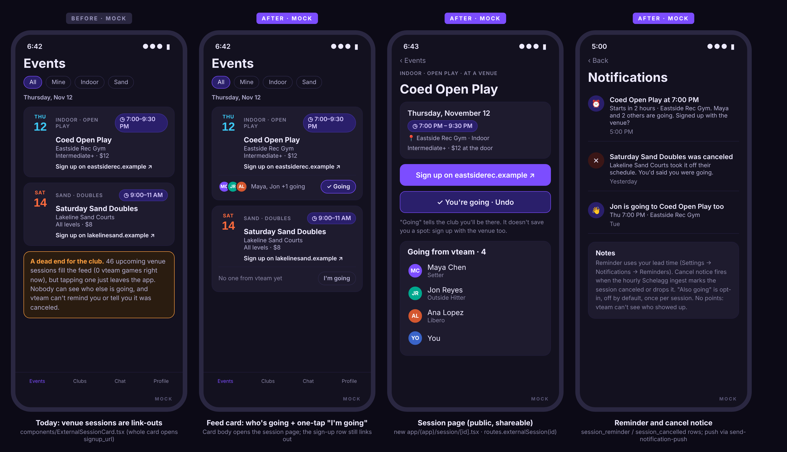
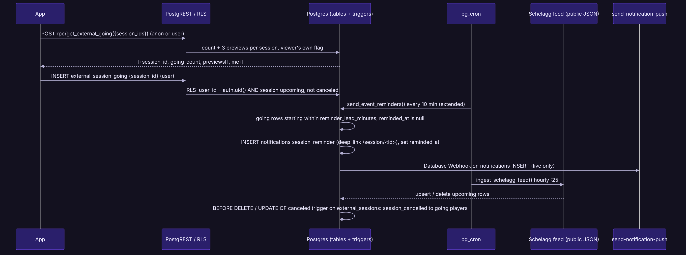
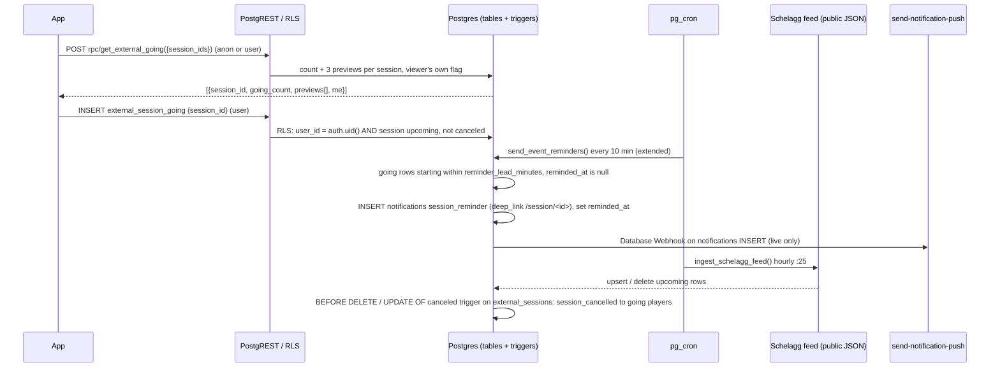
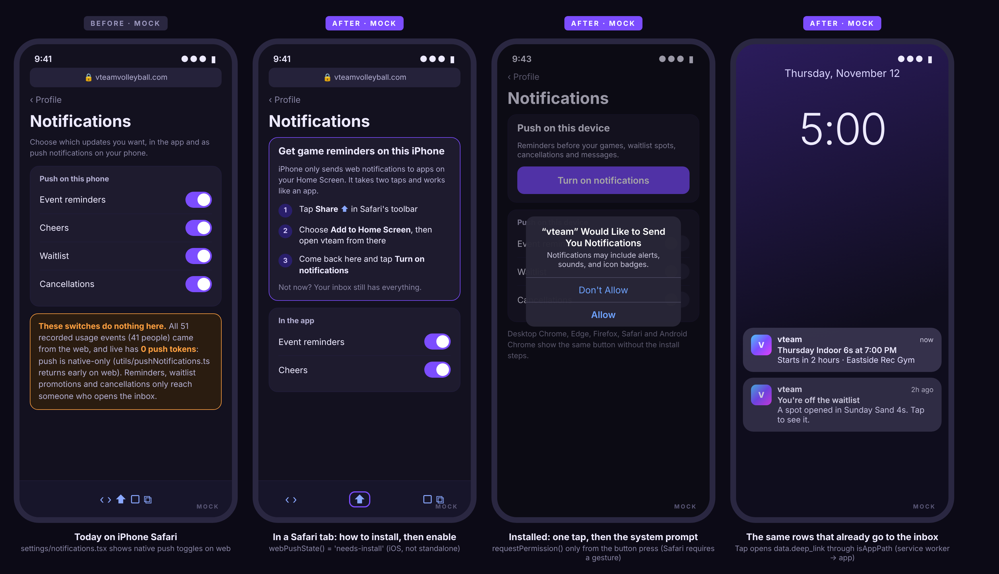
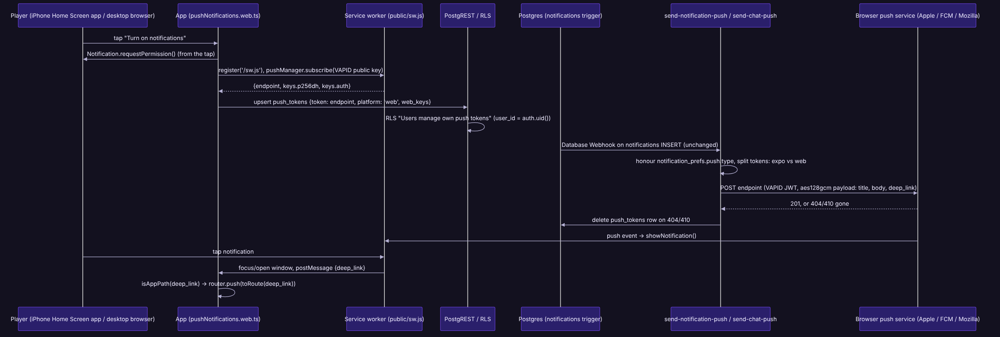
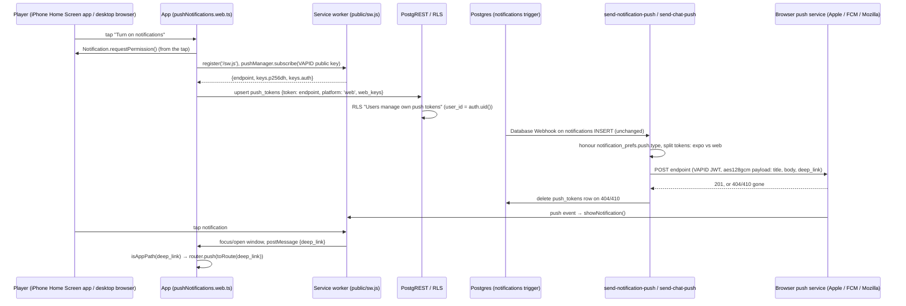
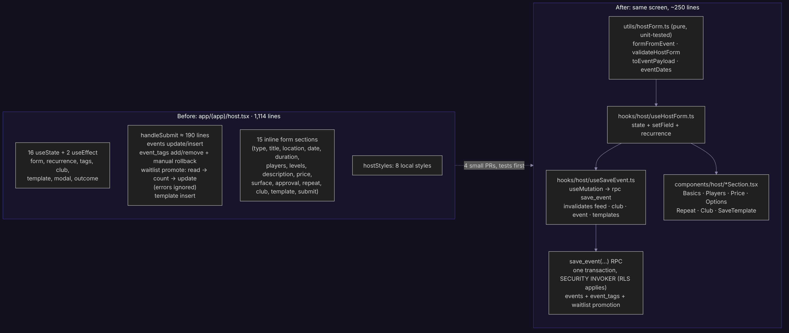
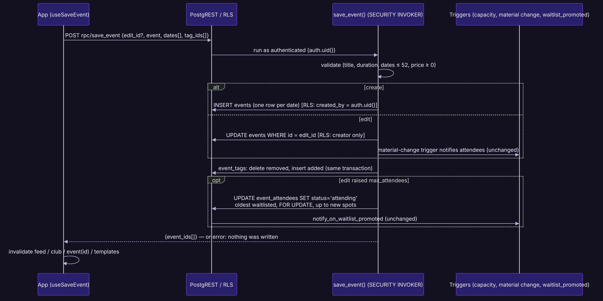
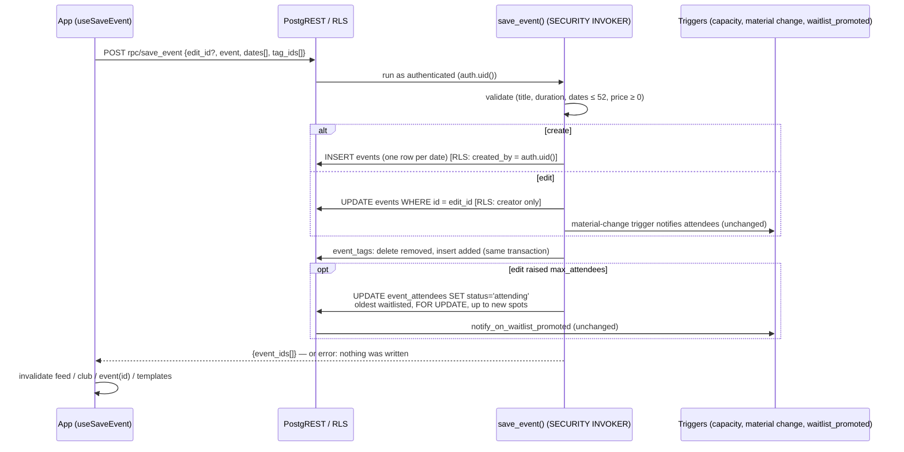

# vteam ideas: 2026-11-06

Three proposals for review. Reply in the run: `approve 1, 3` / `reject 2 because …`.

| # | Idea | Bucket | Size | Verdict |
|---|---|---|---|---|
| 1 | ❌ "I'm going" on venue sessions: see who from vteam is going, get a reminder and a cancel notice | New feature | M | Yes: venue sessions are most of the feed today (46 upcoming vs 0 vteam games), and right now they are dead ends |
| 2 | Push notifications on the web: install on iPhone, one-tap enable, reminders that reach a phone | End-user experience | M | Yes: live has 0 push tokens and all recorded use is web, so no push reaches anyone today |
| 3 | ✅ [#188](https://github.com/bryanw121/vteam/issues/188) Host form in pieces: pure form logic, a save hook, and one transactional `save_event` RPC | Refactor / code health | M | Yes: the biggest screen in the app, with 15 direct writes and a waitlist promotion whose errors are ignored |

Today includes a new-feature idea: the 2026-11-05 set had none (latency, refactor, testing).

Images are design mocks and diagrams with made-up people, venues and data. Sources (HTML, Mermaid) are next to the PNGs in `ideas/assets/2026-11-06/`.

Checked against every issue and PR (#1–#187, open and closed) and `ideas/log.json`. None of these is planned or in flight. Idea 1 builds on the Schelagg ingest (`external_sessions`, `ingest_schelagg_feed()`), `ExternalSessionCard` and the reminder job from #129/#132; it is different from New game alerts (#170, vteam games only) and Friends (#15, #123/#124), which it can later reuse ("friends going"). Idea 2 completes the push work in #129/#132 for web (that design was native-only) and is unrelated to the Calendar sync idea (tabled 2026-11-02). Idea 3 is a refactor of `app/(app)/host.tsx`; it touches the same screen as Club polls (#175, prefilled host form) and the no-show flag (#151/#180) only at their edges, and should land before any new host-form feature.

Live numbers below were read on 2026-11-06 through the Supabase MCP, read-only (counts and `pg_policies` / `cron.job` reads, no writes).

---

## 1. "I'm going" on venue sessions: see who from vteam is going, get a reminder and a cancel notice

**Bucket:** new-feature · **Size:** M · **Pitch:** Venue sessions from Schelagg get an "I'm going" button, a "3 from vteam going" row on the feed card, and their own public page. Going players get the normal reminder before it starts, and a notice if the venue drops it. Going doesn't book anything: the sign-up link to the venue stays front and center.



### Why
- **Venue sessions are the feed right now.** Live today: 46 upcoming `external_sessions` (18 in the next 7 days) and 0 upcoming vteam events (44 events ever). For a pilot user the Events tab is almost all venue sessions.
- **They are dead ends.** `components/ExternalSessionCard.tsx` is one `Pressable` that opens `signup_url`. Nothing on vteam changes after the tap: no one can see that friends from the club are going, nothing reminds you, and when the hourly ingest drops a canceled session the card just disappears.
- **"Who else is going" is the social reason to open a club app.** It is what event rosters (`event_attendees`) already do for vteam games; this brings the same to the sessions people actually play at, without vteam pretending to own them.
- It uses what exists: the reminder job (`send_event_reminders()`, every 10 min, `user_settings.reminder_lead_minutes`), push for every notification row (#132), and the Schelagg ingest that already knows when a session is canceled or gone.

### User stories
- As a player, I tap "I'm going" on Thursday's open play at a venue and see that Maya and Jon from the club are going too.
- As a player who said I'm going, I get a reminder at my usual lead time, with a nudge to sign up with the venue if I haven't.
- As a player, if the venue cancels the session I hear about it from vteam instead of finding an empty gym.
- As a guest following a shared link to a venue session, I can see the details and who from vteam is going, and sign in to say I'm going.

### Acceptance criteria
- [ ] Feed: every `ExternalSessionCard` shows a going row: up to 3 avatars + "Maya, Jon +1 going" (or "No one from vteam yet") and an "I'm going" / "✓ Going" toggle (44pt target, `aria-pressed`). Guests tapping it go through `useRequireSignIn()` and come back.
- [ ] The card body opens the new session page; the "Sign up on …" row still opens `signup_url` (its own pressable, labelled). Keyboard: both are focusable on desktop web.
- [ ] Going previews for the visible feed load in **one** request per feed span (`get_external_going(p_session_ids text[])`), never per card; `useFeedForecasts`-style batching. Mine filter: unchanged in v1 (still never shows venue sessions; see open questions).
- [ ] New public route `/session/[id]` (`routes.externalSession(id)`, id URL-encoded; rewrite in `public/serve.json`; **not** in `authGate`): title, kicker, `TimePill`, venue, level/price, primary "Sign up on …" button, going toggle with Undo, the line "Going tells the club you'll be there. It doesn't save you a spot", and the "Going from vteam" list linking to profiles. If the row no longer exists: "This session is no longer on the venue's schedule" (`ScreenState` empty).
- [ ] Share: the page's share button sends `shareUrl(routes.externalSession(id))`.
- [ ] Reminder: `send_event_reminders()` also sends `session_reminder` to going players at their lead time, once (`reminded_at`), deep link `/session/<id>`; it respects `notification_prefs` like `event_reminder` and appears in Settings → Notifications.
- [ ] Cancel notice: when the ingest sets `canceled = true` or deletes an upcoming session, every going player gets `session_cancelled` (once) before the row goes.
- [ ] Going can only be added for a session that exists, starts in the future and isn't canceled; removing is always allowed. No points are awarded for venue sessions.
- [ ] Guests see counts and avatars (same visibility as `event_attendees` today).

### Design
- **Feed card** (`components/ExternalSessionCard.tsx`): split the single `Pressable` into the card body (→ `router.push(routes.externalSession(id))`, passed in as `onPress` so the card has no navigation logic) and the sign-up row (link out, as today, including the "Checking with the venue…" state). New `components/ExternalGoingRow.tsx` renders avatars + toggle from props.
- **Data**: `hooks/useExternalGoing.ts`: `useQuery(queryKey('external-going', spanKey))` over the feed's visible external ids, plus `useToggleExternalGoing` (`useMutation`, optimistic `setQueryData`, rollback). `useMonthEvents` / `utils/feedItems.ts` unchanged except passing ids up.
- **Session page**: `app/(app)/session/[id].tsx` reads one `external_sessions` row (`EXTERNAL_SESSION_SELECT` in `constants/selects.ts`) and `get_external_going([id])` with full list (`p_full := true`, up to 50). `ScreenHeader`, `ScreenContainer` on desktop (max width), `TimePill`, `Spinner`, `ScreenState`. Add to `SCREENS` in `scripts/shots/screens.mjs` and to the axe baseline flow.
- **Notifications**: `session_reminder`, `session_cancelled` added to `NOTIFICATION_TYPES` / `NOTIFICATION_TYPE_LABELS` ("Venue session reminders", "Venue cancellations") and the `notifications` type check constraint; push comes free through `send-notification-push`.
- **Surfaces**: native (card toggle with haptics-free press, safe areas on the page), mobile web (doc-scroll feed unaffected; page uses `DocScrollView` with `memoryKey 'session:<id>'`), desktop web (sidebar layout, page centered at `ScreenContainer` width, hover states on both card targets).
- **Guests**: page and counts readable by `anon`; toggling needs an account.

### Backend





**Model changes**

| Object | Change | Notes (who can read / write) |
|---|---|---|
| `external_session_going` | new table: `session_id text → external_sessions(id) on delete cascade`, `user_id uuid → profiles(id) on delete cascade`, `created_at`, `reminded_at timestamptz null`, `cancel_notified_at timestamptz null`; PK `(session_id, user_id)`; index `(user_id)` | SELECT: `anon`, `authenticated` (like `event_attendees`). INSERT: own row, session upcoming and not canceled. DELETE: own row. No UPDATE for clients (`reminded_at` is server-written). |
| `get_external_going(p_session_ids text[], p_full boolean default false)` | new SQL function, SECURITY INVOKER, STABLE | Counts, 3 (or 50) previews from `PROFILE_BRIEF_SELECT` columns, `me`. EXECUTE to `anon`, `authenticated`. Caps the array at 200 ids. |
| `send_event_reminders()` | replaced: also sends `session_reminder` | Unchanged schedule (`event-reminders`, */10). |
| `notify_going_on_session_end()` + trigger on `external_sessions` | new BEFORE DELETE and AFTER UPDATE OF canceled (false → true) trigger, upcoming rows only | Writes `session_cancelled` once per going player (`cancel_notified_at`). SECURITY DEFINER, fixed `search_path`, no client EXECUTE. |
| `notifications` type check | widened with `session_reminder`, `session_cancelled` | Drop + recreate in one file = replacement (expand). |
| nightly cleanup (`vclub-maintenance-cleanup`) | also deletes going rows for sessions ended > 90 days ago | Cascade handles deleted sessions. |

**Migration sketch** (`supabase/migrations/<ts>_external_session_going.sql`)
```sql
create table public.external_session_going (
  session_id text not null references public.external_sessions(id) on delete cascade,
  user_id uuid not null references public.profiles(id) on delete cascade default auth.uid(),
  created_at timestamptz not null default now(),
  reminded_at timestamptz,
  cancel_notified_at timestamptz,
  primary key (session_id, user_id)
);
create index external_session_going_user_idx on public.external_session_going (user_id);
alter table public.external_session_going enable row level security;
create policy "Going is public" on public.external_session_going for select to anon, authenticated using (true);
create policy "Mark yourself going" on public.external_session_going for insert to authenticated
  with check (user_id = (select auth.uid()) and exists (
    select 1 from public.external_sessions s
    where s.id = session_id and s.starts_at > now() and not s.canceled));
create policy "Unmark yourself" on public.external_session_going for delete to authenticated
  using (user_id = (select auth.uid()));
-- get_external_going(...), trigger function + triggers, send_event_reminders() replacement,
-- notifications check constraint drop/recreate with the two new types.
```
**Down** (`.down.sql`): drop triggers and `notify_going_on_session_end()`, restore the previous `send_event_reminders()` body and check constraint, drop `get_external_going`, drop table.

**RLS expectations for `e2e/rls.spec.ts`** (and the RLS matrix in #186 if it lands first): anon can read going rows and call `get_external_going`; anon insert rejected; signed-in user can't insert for another `user_id`; can't insert for a past or canceled session (pick one from beta's ingest or skip if none); can't delete someone else's row; can't update `reminded_at`. Read-only: every insert attempted is one RLS must reject.

### Test plan
- **Unit (Jest)**: `ExternalGoingRow` copy ("Maya, Jon +1 going", "No one from vteam yet", own state), the split pressables (`ExternalSessionCard` press targets), `useToggleExternalGoing` optimistic update + rollback, `routes.externalSession` encoding of ids with `:`.
- **pgTAP** (if #150 lands): reminder once at lead time, cancel notice on `canceled` and on delete, no notice for past sessions.
- **RLS**: as above, in the `api` shard.
- **e2e**: `e2e/venueSessions.spec.ts` in the `events` shard: signed-in toggles going on a beta venue session (beta has its own Schelagg ingest), sees the count change, opens the page, undoes; `venueSessions.guest.spec.ts`: guest sees page, tapping going lands on login and returns.
- **Shots / axe**: `session/[id]` with fixture rows in `scripts/shots/fixtures/` (going list, gone session); feed card with going row.

### Pros and cons
**Pros**
- Gives the feed's biggest content type (46 upcoming vs 0 vteam games today) a reason to stay in vteam: who's going, a reminder, a cancel notice.
- Social proof without vteam owning the booking: the venue sign-up link stays the main action, Schelagg stays independent (vteam only reads its feed).
- Reuses the reminder job, push webhook, `ScreenState`/`TimePill` and the share-link machinery, so the new code is mostly one table, one RPC and one screen.
- Makes venue sessions shareable inside the club (`/session/<id>`), which also helps guests arriving from a link.
- Sets up a later "friends going" on venue sessions (#15) and Mine filter support at no extra schema cost.

**Cons**
- "Going" is a claim, not a booking: someone can mark going and never sign up with the venue, and others may assume there's room. The copy has to carry that.
- Adds a cancel-notice trigger on a table the ingest rewrites hourly; a Schelagg mistake (a session briefly missing from the feed) would send a false "canceled" notice. Needs the ingest's "skip a feed older than 12h / never delete when no matching rows" guards to hold.
- Public "who's going to this gym on Thursday" is a mild location-privacy exposure, same as vteam rosters today; some players may not want guests to see it.
- No points or attendance verification, so it doesn't feed the points system, and Mine stays without venue sessions in v1.
- Another surface for the a11y baseline, shots fixtures and e2e on beta, where venue data changes hourly.

**Verdict:** pros outweigh cons. It turns what the feed mostly is today into something the club can do together, for one small table and a screen, and the main risk (false cancel notices) is bounded by guards the ingest already has.

### Size, risks, open questions, dependencies
- **Size:** M (one migration, one RPC, one route, card split, two notification types).
- **Risks:** false cancel notices (above); avatar row adds height to every venue card (keep it one line, 32 px).
- **Open questions:** Should Mine include venue sessions you marked going? (Proposed: yes, as a follow-up once people use it.) Should guests see names or only counts? (Proposed: same as rosters, names.) An opt-in "someone you played with is going" notification (the third inbox row in the mock) is left out of v1.
- **Dependencies:** none blocking. Plays well with #186 (add the table to the RLS matrix), #170 (alert copy), #15 (friends-going reuse), idea 2 (push reaches web users).

---

## 2. Push notifications on the web: install on iPhone, one-tap enable, reminders that reach a phone

**Bucket:** end-user-experience · **Size:** M · **Pitch:** Web users get real push: a manifest and service worker, a "Push on this device" card that walks iPhone Safari users through Add to Home Screen and then asks for permission with one tap, and the existing push edge functions sending standard Web Push alongside Expo. Every notification row that already pushes to the native app (reminders, waitlist, cancellations, chat) reaches web users too.



### Why
- **No push reaches anyone today.** Live `push_tokens` has **0 rows**. All 51 `app_events` rows (41 people) are `platform = web`, and the latency baseline says traffic is mostly one iPhone web user. `utils/pushNotifications.ts` returns early on web ("No-op on web (no push there)").
- **The reminder and alert work only lands in the inbox.** #129/#132 built reminders, waitlist and late-dropout notices and push for every row, and #170 (new game alerts) will add more, but on the web a player only sees them by opening the bell.
- **The web settings screen is misleading.** `app/(app)/(tabs)/settings/notifications.tsx` shows "Push on this phone" switches on web that do nothing.
- **iPhone supports it, with conditions.** Since iOS/iPadOS 16.4, Home Screen web apps can receive Web Push through the standard Push API, Notifications API and a service worker; permission must be requested in response to a direct user action, and the site needs a web app manifest ([WebKit: Web Push for Web Apps on iOS and iPadOS](https://webkit.org/blog/13878/web-push-for-web-apps-on-ios-and-ipados/)). `app/+html.tsx` already has the Apple Home Screen meta tags and `apple-touch-icon`, but no `<link rel="manifest">` and no service worker. Desktop Chrome, Edge, Firefox, Safari and Android Chrome support the same API without installing.
- **No schema rework:** the `push_tokens.platform` check already allows `'web'`; the owner-only RLS policy already fits.

### User stories
- As an iPhone player using vteam in Safari, the app tells me how to add it to my Home Screen so I can get game reminders, and turning them on is one tap after that.
- As a desktop or Android web player, I tap "Turn on notifications" once and get reminders, waitlist spots and messages like the app users do.
- As a player, tapping a notification opens the right game or chat in vteam.
- As a player who turns notifications off in the browser, vteam stops trying and shows me how to turn them back on.

### Acceptance criteria
- [ ] `public/manifest.webmanifest` (name/short_name from `APP_NAME`, `start_url: "/"`, `display: "standalone"`, `background_color`/`theme_color` = `theme.colors.background`, 192/512 and maskable icons) linked from `app/+html.tsx` (a constant, so it stays outside the hydration gate like the title).
- [ ] `public/sw.js` (no build step, < 4 KB): `push` → `showNotification(title, {body, icon, badge, tag, data: {deep_link}})`; `notificationclick` → focus an open vteam window and `postMessage({deep_link})`, or `openWindow(deep_link)` when it starts with `/` and not `//`. No caching or fetch handler in v1.
- [ ] `utils/pushNotifications.web.ts` implements the same exports as native: `webPushState()` (`unsupported` | `needs-install` (iOS Safari, not standalone) | `ask` | `on` | `blocked`), `enableWebPush()` (requests permission **only** from a button press, subscribes with `EXPO_PUBLIC_VAPID_PUBLIC_KEY`, upserts `push_tokens {token: endpoint, platform: 'web', web_keys}`), `disableWebPush()`, and `subscribeToPushTaps` (listens for the worker's message, `isAppPath` → `router.push(toRoute(path))`).
- [ ] Settings → Notifications on web replaces "Push on this phone" with a "Push on this device" card driven by `webPushState()`: install steps for `needs-install`, "Turn on notifications" for `ask`, the per-type switches for `on`, and a short "Notifications are blocked for this site: turn them on in your browser's settings" for `blocked`. Native is unchanged.
- [ ] Sign-out removes this device's web token (same place native tokens are removed).
- [ ] `send-notification-push` and `send-chat-push` send to web tokens through a shared `_shared/webpush.ts` (VAPID, aes128gcm), honour the same `notification_prefs.push.<type>`, and delete a token on 404/410. Payload ≤ 2 KB: title, body, deep_link, tag.
- [ ] One optional nudge: after a signed-in web user's first RSVP, a dismissible line under the join confirmation ("Get a reminder before this game? Turn on notifications") if state is `ask` or `needs-install`; never shown again once dismissed (`seen_banners`).
- [ ] Metrics: `track('web_push_state', {state})` when the card renders, `web_push_enabled` / `web_push_blocked` (add to `ANALYTICS_EVENTS`), so we can see how many install.

### Design
- **Files:** `app/+html.tsx` (manifest link), `public/manifest.webmanifest`, `public/sw.js`, `utils/pushNotifications.web.ts` (new `.web.ts` sibling, per the platform-file convention), `utils/webPushState.ts` (pure: UA, `navigator.standalone` / `display-mode`, `Notification.permission`, `'PushManager' in window`), `components/settings/WebPushCard.tsx`, `app/(app)/(tabs)/settings/notifications.tsx` (renders the card on web via `Platform.select`), `constants/copy.ts` (install steps, blocked text), `constants/analytics.ts`.
- **Env:** `EXPO_PUBLIC_VAPID_PUBLIC_KEY` (public, in `.env.example` and `ci.yml` for beta), edge secrets `VAPID_PUBLIC_KEY`, `VAPID_PRIVATE_KEY`, `VAPID_SUBJECT` (the site URL, `https://vteamvolleyball.com`). Secrets go in the "Not captured by migrations" list in `CLAUDE.md`.
- **Surfaces:** iPhone Safari tab (install steps, Share icon highlighted in the copy), iPhone Home Screen app (permission button; `black-translucent` status bar already set), Android Chrome and desktop browsers (button only; desktop gets hover/focus styles and keyboard access). Native apps: untouched.
- **Guests:** the card is on a signed-in screen; guests never see a permission prompt.
- **Hydration:** all state checks run after mount (the screen is under the client gate); the manifest link is static.

### Backend





**Model changes**

| Object | Change | Notes (who can read / write) |
|---|---|---|
| `push_tokens.web_keys` | new nullable `jsonb` column | `{p256dh, auth}` for web subscriptions; null for Expo tokens. Same owner-only RLS (`Users manage own push tokens`, ALL to authenticated, `user_id = auth.uid()`); service role reads it in the edge functions. |
| `push_tokens_web_keys_check` | new CHECK `platform <> 'web' or (web_keys ? 'p256dh' and web_keys ? 'auth')` | Added `not valid` then validated (table is empty on live). |
| `push_tokens.platform` check | unchanged | Already allows `'web'`. |
| `send-notification-push`, `send-chat-push` | handler change | Split tokens by platform; `_shared/webpush.ts`; delete gone tokens. Handler tests with `stubFetch`. |

**Migration sketch** (`<ts>_push_tokens_web.sql`)
```sql
alter table public.push_tokens add column web_keys jsonb;
alter table public.push_tokens add constraint push_tokens_web_keys_check
  check (platform <> 'web' or (web_keys ? 'p256dh' and web_keys ? 'auth')) not valid;
alter table public.push_tokens validate constraint push_tokens_web_keys_check;
```
**Down:** `alter table public.push_tokens drop constraint push_tokens_web_keys_check; alter table public.push_tokens drop column web_keys;` (expand only; no contract step).

**RLS expectations for `e2e/rls.spec.ts`:** anon can't read or insert `push_tokens`; a signed-in user can't insert a web token with another `user_id`; can't read anyone else's token (the e2e account sees only its own; read-only, inserts are the rejected kind).

### Test plan
- **Unit:** `webPushState()` truth table (iOS Safari tab → `needs-install`, iOS standalone + default → `ask`, granted + subscription → `on`, denied → `blocked`, no PushManager → `unsupported`); `WebPushCard` per state; deep-link guard in the tap handler (rejects `//evil`, `https://…`).
- **Edge (Deno):** `send-notification-push` and `send-chat-push` handler tests: web tokens get a POST to their endpoint with VAPID headers, Expo tokens still batch to Expo, a 410 deletes the token, prefs off sends nothing.
- **e2e:** `e2e/webPush.spec.ts` (signed-in, `events` shard or a new small shard): grant `notifications` permission in the context, stub `PushManager.prototype.subscribe` to return a fixed fake subscription, tap the button, assert the `push_tokens` upsert request body (route-intercepted, never sent to beta), then the switches appear. Service worker registration checked with `page.evaluate(() => navigator.serviceWorker.getRegistration())`.
- **Manual (once):** iPhone Home Screen install → enable → trigger a reminder on live with Bryan's account; Android Chrome; desktop Chrome/Safari.
- **Shots / axe:** settings/notifications in the `needs-install`, `ask`, `blocked` states (shots can force state through a fixture flag).

### Pros and cons
**Pros**
- Makes every notification vteam already writes (reminders, waitlist, cancellations, late dropouts, chat, and #170's alerts later) reach the people actually using vteam, who are on the web; today push reaches 0 devices.
- No new notification logic: one column, a service worker, and a second delivery path in two edge functions that already have tests.
- Removes misleading switches from the web settings screen.
- Puts vteam on the iPhone Home Screen, which also gives a full-screen app feel and a lasting icon for the main pilot user.
- Free and standard (no third-party push vendor); the same VAPID keys work for every browser.

**Cons**
- iPhone users must install to the Home Screen first; many won't, so reach on iOS depends on the install steps landing. Users on iOS < 16.4 can't get it at all.
- Web Push encryption in Deno needs a library (`npm:web-push` or a JSR equivalent) inside the edge runtime; if neither works cleanly there it is a few hundred lines of crypto to own.
- New secrets and a public key to keep in sync between `.env`, CI and edge secrets; beta has no edge functions, so the delivery path is only testable with stubs before live.
- A service worker is long-lived in browsers: a buggy `sw.js` can keep misbehaving until it is replaced, so it must stay tiny and have no fetch handler.
- More notifications can annoy; prefs already exist, but web users get them for the first time all at once.

**Verdict:** pros outweigh cons. The notification system is built and delivers to nobody; this is the step that makes it reach the actual users, at the cost of one column and a small worker.

### Size, risks, open questions, dependencies
- **Size:** M.
- **Risks:** Deno web-push library compatibility (spike first, 1 h); duplicate subscriptions if a user clears site data (endpoint PK dedupes; 410 cleanup handles stale ones).
- **Open questions:** Should the iPhone install steps also appear as a one-time banner on Events for signed-in Safari users, or only in Settings and after the first RSVP? (Proposed: Settings + first RSVP only.) Chat pushes on web: include in v1 (proposed yes, same `send-chat-push`).
- **Dependencies:** builds on #129/#132 (push for every row). Independent of #184/#187 (startup speed). Helps idea 1 and #170 reach web users.

---

## 3. Host form in pieces: pure form logic, a save hook, and one transactional `save_event` RPC

**Bucket:** refactor · **Size:** M · **Pitch:** Split `app/(app)/host.tsx` (the biggest file in the app) into a pure, tested form module, a form-state hook, a `useMutation` save hook and seven section components, and move the save itself into one `save_event` RPC so an event, its tags and waitlist promotion are written in one transaction instead of up to 11 separate requests with hand-written rollback.



### Why
- **Size and shape.** `app/(app)/host.tsx` is 1,114 lines, the largest file under `app/`, `components/`, `hooks/`, `lib/` and `utils/` (next: the Events tab at 1,095). It holds 16 `useState`, 2 `useEffect`, 15 inline form sections (line 620 onward), a local `hostStyles` sheet used 36 times, and `handleSubmit` (lines 322 to ~510).
- **15 direct `supabase.from()` calls** in one screen (`events` ×4, `event_tags` ×4, `event_attendees` ×4, `user_event_templates` ×2, `club_members` ×1), against the conventions (`lib/query` mutations, `invalidates`).
- **Non-atomic saves with special-case UI.** An edit writes `events`, then adds tags, then removes tags, and on a failed remove runs a compensating delete; the result modal has four outcomes (`saved`, `tags-failed`, `tags-uncertain`, `failed`) to explain partial saves. A create inserts all event rows, then tag rows, then the template, each separately.
- **A quiet correctness bug.** When an edit raises `max_attendees`, the screen promotes the waitlist client-side: read attending rows, count, read the oldest waitlisted, update them. None of those three calls checks `error`, and a player joining while the host saves can be over-promoted past the cap, because the count and the update are separate requests. The database already enforces capacity on insert (`trg_event_attendees_capacity`), so the natural home for promotion is the same transaction as the update.
- **Hard to test, hard to extend.** No unit test covers the host form (only `recurrence.test.ts` and `priceInput.test.ts` cover helpers); e2e covers edit flows in `e2e/events.spec.ts`. Club polls (#175) need to open Host prefilled, and any series editing later needs "apply to following": both are much easier against a pure `toEventPayload` and a single RPC.

### User stories
- As a host, when I save an event either everything saves or nothing does, and the app never tells me "saved, but your tags may be wrong".
- As a host who raises the player cap, the right people come off the waitlist exactly once and get the waitlist notice.
- As a developer, I can change one section of the host form, or prefill it from a poll, without reading 1,100 lines.

### Acceptance criteria
- [ ] PR 1 (tests first, no behavior change): `utils/hostForm.ts` with `formFromEvent`, `emptyForm(params)`, `validateHostForm(form, recurrence)`, `toEventPayload(form, {userId, clubId})`, `eventDates(form, recurrence)` moved/extracted from `host.tsx`; `__tests__/hostForm.test.ts` covers price/Venmo rules, unlimited cap, recurrence producing no dates, skill levels, location coordinates, Book-a-court params (`location`, `surface`, `maxAttendees`).
- [ ] PR 2: `hooks/host/useHostForm.ts` (form, recurrence, tags, club, template state, `setField`) and `hooks/host/useHostContext.ts` (owned clubs, tags, templates via `useQuery`); screen behavior identical; e2e `events` shard green.
- [ ] PR 3: `components/host/{Basics,Players,Price,Options,Repeat,Club,SaveTemplate}Section.tsx`, typed `Props` in `types/`; `hostStyles` moved into `constants/styles.ts` (`shared.host*`); `host.tsx` ≤ 300 lines; shots before/after for `host` and `host?edit=` show no pixel change.
- [ ] PR 4 (schema): `save_event(p_edit_id uuid, p_event jsonb, p_dates timestamptz[], p_tag_ids uuid[])` SECURITY INVOKER (RLS applies as the host), one transaction: create → insert one `events` row per date (max 52) + tags; edit → update, diff tags, promote up to the new free spots from the waitlist (`for update skip locked`, oldest first) so `notify_on_waitlist_promoted` fires as today. `hooks/host/useSaveEvent.ts` calls it through `useMutation` with `invalidates: ['feed', 'club', queryKey('event', id), queryKey('templates')]`.
- [ ] After PR 4 the save outcomes are `saved` / `failed` only; the compensation code and `TagWriteError` are deleted; any error from the RPC leaves the event unchanged.
- [ ] Template save stays a separate, non-blocking write (it's a convenience) but goes through `useMutation` and reports its own failure.
- [ ] No route, copy or layout changes visible to users on any surface (native, mobile web, desktop web), apart from the removed partial-save messages.

### Design
- **Files:** `app/(app)/host.tsx` (composition only), `utils/hostForm.ts`, `hooks/host/useHostForm.ts`, `hooks/host/useHostContext.ts`, `hooks/host/useSaveEvent.ts`, `components/host/*Section.tsx` (next to `HostFormSkeleton.tsx` and `TemplatesView.tsx`), `types/host.ts` (section props, `HostFormState`), `constants/styles.ts`.
- **What stays:** `cachedEditSource` seeding (instant edit form from #104), `DatePickerField` / `.web.tsx` split, `LocationPickerField`, the Book-a-court params, the templates view, `useRequireSignIn` behavior (host is account-only in `authGate`).
- **Surfaces:** unchanged on all three; the split keeps each section's own `Platform.select` choices (date picker, switches) local to the section.
- **Order:** land PR 1 → 4 in sequence, each small and independently revertible. PR 4 is expand-only (a new function; the old client path is deleted in the same PR because the web app and native app both call the RPC from the new hook; an old installed native build keeps using direct writes, which still work since nothing is removed).

### Backend (PR 4)





**Model changes**

| Object | Change | Notes (who can read / write) |
|---|---|---|
| `save_event(p_edit_id uuid, p_event jsonb, p_dates timestamptz[], p_tag_ids uuid[]) returns uuid[]` | new plpgsql function, SECURITY INVOKER, `search_path = public` | EXECUTE to `authenticated` only (revoke from `anon`, `public`). Every write is checked by the existing policies: events insert/update by creator, `event_tags` by host, `event_attendees` update by host ("Host can update team assignments"). |
| tables, policies, triggers | unchanged | The function adds no privilege; an invoker function can't do anything the client couldn't. |

**Migration sketch** (`<ts>_save_event.sql`)
```sql
create or replace function public.save_event(
  p_edit_id uuid, p_event jsonb, p_dates timestamptz[], p_tag_ids uuid[] default '{}'
) returns uuid[] language plpgsql security invoker set search_path = public as $$
declare ids uuid[]; free int;
begin
  if coalesce(array_length(p_dates, 1), 0) not between 1 and 52 then raise exception 'save_event: 1 to 52 dates'; end if;
  if p_edit_id is null then
    insert into events (title, description, location, latitude, longitude, event_date, duration_minutes,
                        max_attendees, created_by, club_id, price, venmo_handle, requires_approval, surface)
    select p_event->>'title', ..., d, ..., auth.uid(), ... from unnest(p_dates) d
    returning array_agg(id) into ids;  -- via CTE
  else
    update events set ... where id = p_edit_id;  -- RLS: creator only
    if not found then raise exception 'save_event: not allowed'; end if;
    ids := array[p_edit_id];
    -- promote waitlisted up to free spots (FOR UPDATE SKIP LOCKED, oldest joined_at first)
  end if;
  delete from event_tags where event_id = any(ids) and tag_id <> all(p_tag_ids);
  insert into event_tags (event_id, tag_id) select e, t from unnest(ids) e, unnest(p_tag_ids) t on conflict do nothing;
  return ids;
end $$;
revoke all on function public.save_event(uuid, jsonb, timestamptz[], uuid[]) from public, anon;
grant execute on function public.save_event(uuid, jsonb, timestamptz[], uuid[]) to authenticated;
```
**Down:** `drop function public.save_event(uuid, jsonb, timestamptz[], uuid[]);`

**RLS expectations for `e2e/rls.spec.ts`:** anon can't execute `save_event`; the e2e account calling `save_event` with `p_edit_id` of an event it doesn't host gets an error and changes nothing (read-only: use a beta event hosted by `e2ebuddy`).

### Test plan
- **Unit:** `hostForm.test.ts` (PR 1); `useSaveEvent` builds the right RPC args for create, recurring create, and edit, and maps errors to the single failure message; section components render their fields (snapshot-free, role/label queries).
- **pgTAP** (#150, if landed): save rollback when a tag id is invalid (nothing written), promotion count with 2 free spots and 3 waitlisted, recurring 52-date cap.
- **RLS:** as above, `api` shard.
- **e2e:** existing `events` shard edit flows (`e2e/events.spec.ts`, 7 `host?edit=` flows) must pass unchanged after each PR; add one test that raises the cap on a fixture event with a waitlisted fixture attendee and sees them promoted.
- **Shots:** `npm run shots:compare` for `host` and `host?edit=` after PR 2 and PR 3: expect "no changed screens".

### Pros and cons
**Pros**
- Fixes real failure modes: partial saves, a waitlist promotion whose errors are ignored, and a count-then-update race with players joining; all become one transaction.
- Cuts the largest file in the app to a composition of small, typed pieces with a tested pure core (first unit tests for the host form).
- Deletes code: the compensating tag rollback, `TagWriteError`, two partial-save outcomes and their copy.
- Unblocks host-form features that are approved or likely: prefilled Host from club polls (#175), series "apply to following" later, and anything that needs to build an event payload outside the screen.
- Brings the screen onto `lib/query` mutations and `constants/styles.ts`, matching `CLAUDE.md`.

**Cons**
- Four PRs of churn on a screen hosts use for every game, with no visible feature at the end; regressions are possible in the less-tested paths (recurring create, templates, Book-a-court params).
- Moves save logic into plpgsql, which is harder to read and test than TypeScript without pgTAP (#150 still open).
- Old native builds keep the direct-write path until they update, so for a while there are two save paths in production (both correct, but two to reason about).
- Conflicts with any in-flight PR touching `host.tsx` (none open today; #180 no-show doesn't touch it), so it should go before new host-form work, which delays that work a little.

**Verdict:** pros outweigh cons. It removes an actual data-integrity bug and the most error-prone code path in the app, and makes the next two planned host-form features cheaper; the churn is contained by landing tests first and four small PRs.

### Size, risks, open questions, dependencies
- **Size:** M (four small PRs; PR 4 is the only schema change).
- **Risks:** behavior drift during the split (mitigated by PR 1 tests and shots compare); RPC argument mapping errors on recurring create (unit test on args).
- **Open questions:** Should the template save join the transaction (proposed: no, it's optional and should never block a game)? Should `tournament/create.tsx` (879 lines, similar pattern) follow the same split afterwards (proposed: separate issue if this goes well)?
- **Dependencies:** none blocking. Land before #175's prefill work; pgTAP (#150) makes PR 4 easier to test but isn't required.
