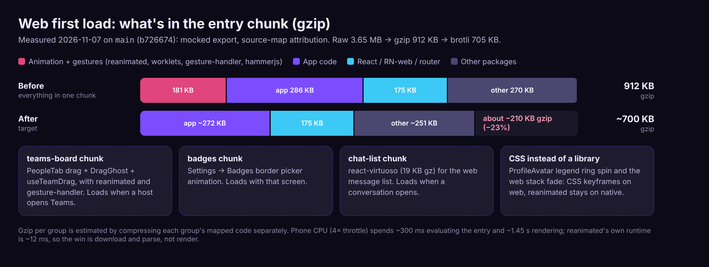
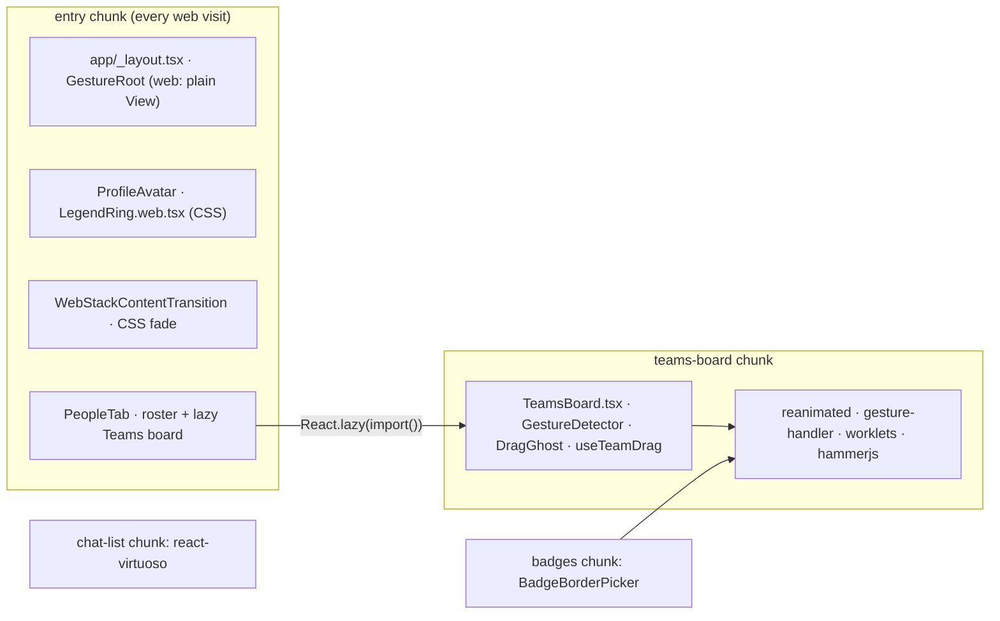
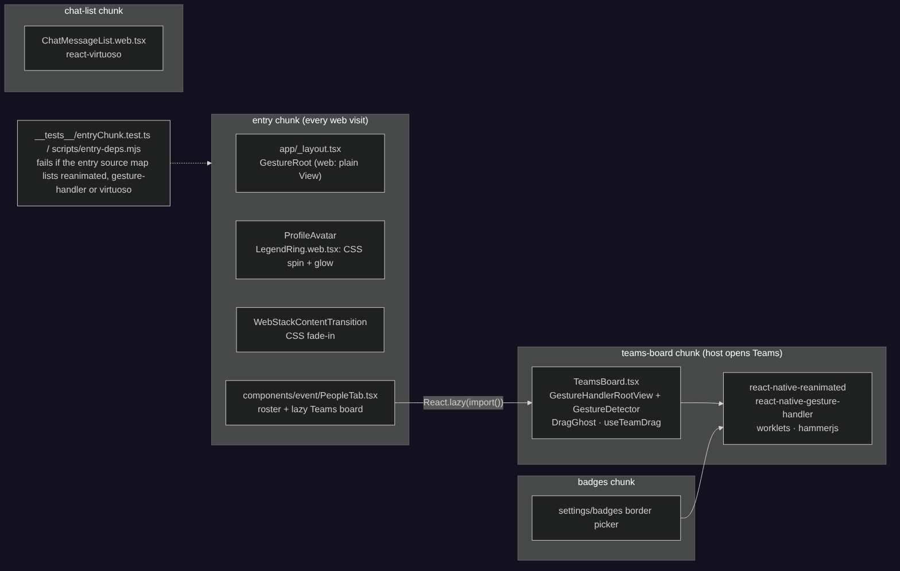
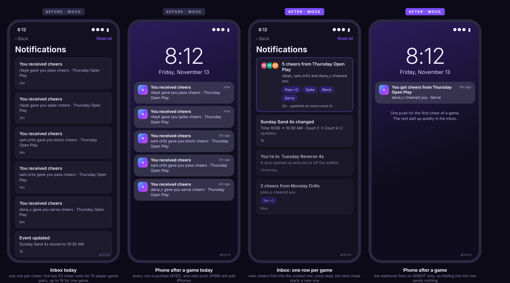
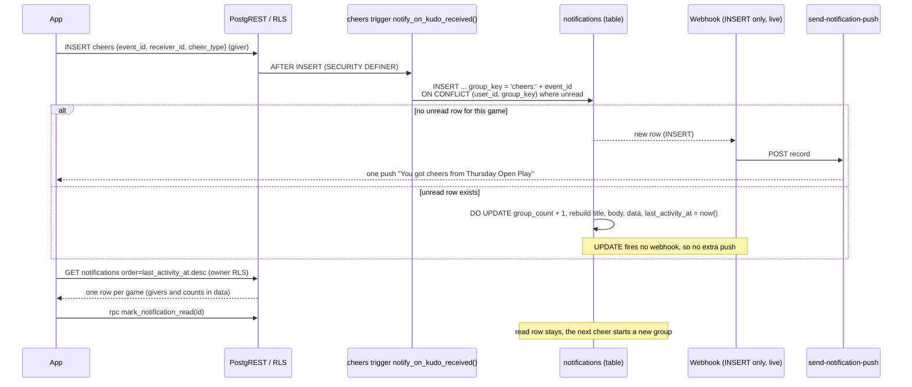
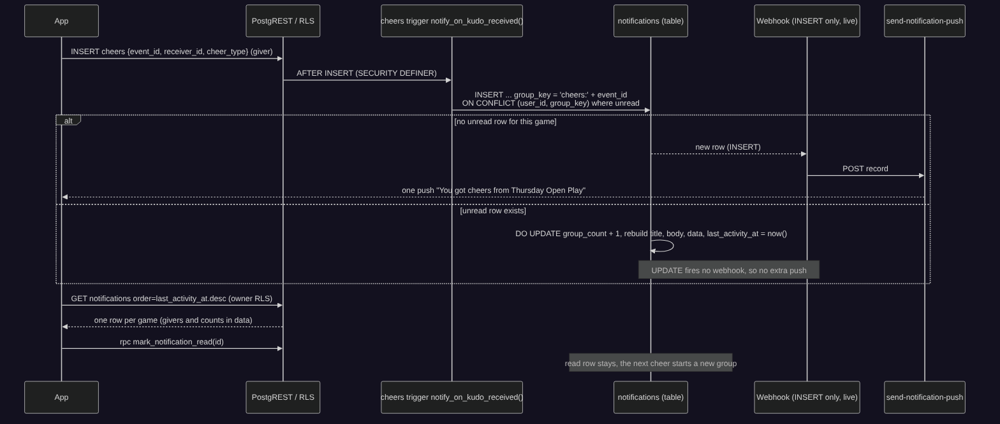
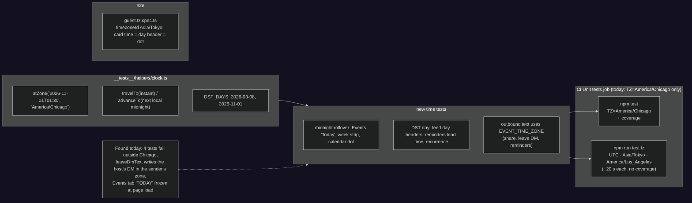

# vteam ideas: 2026-11-07

Three proposals for review. Reply in the run: `approve 1, 3` / `reject 2 because …`.

| # | Idea | Bucket | Size | Verdict |
|---|---|---|---|---|
| 1 | ✅ [#193](https://github.com/bryanw121/vteam/issues/193) Lighter first load on the web: animation and gesture libraries out of the entry chunk | Latency | M | Yes: 20% of the first-load JS (181 KB gzip) is libraries that only the Teams board, the badge picker and one avatar ring use |
| 2 | ✅ [#194](https://github.com/bryanw121/vteam/issues/194) One notification per game for cheers (and one per event for edits), with one push | End-user experience | M | Yes: live has 53 cheer rows for 15 player-game pairs (up to 18 for one game), each one a push |
| 3 | ✅ [#195](https://github.com/bryanw121/vteam/issues/195) Time-zone safety net: unit tests in four zones, clock helpers, one event time zone | Testing | S | Yes: the suite only passes in Chicago today (4 tests fail elsewhere), and it found a real bug in the host's leave DM |

Today has no new-feature idea: the 2026-11-06 set already had one (new-feature, rejected).

Images are design mocks and diagrams with made-up people, games and data. Sources (HTML, Mermaid) are next to the PNGs in `ideas/assets/2026-11-07/`.

Checked against every issue and PR (#1–#192, open and closed) and `ideas/log.json`. Idea 1 is the fix side of the bundle work: it is not the Web bundle budget idea (2026-11-04, still proposed, a CI size guard) and not #184 (start the feed request from the HTML); it complements both and adds only a narrow "these libraries stay out of the entry" check. Idea 2 changes how existing notification rows are written; it pairs with #189 (web push), which will otherwise multiply today's pushes, and with #170 (new game alerts), which already plans grouping per host/club. Idea 3 widens `npm run test:timezones` (exists, covers one file, not in CI) and fixes what it finds; no overlap with #150 (pgTAP) or #186 (RLS matrix).

Measurements on 2026-11-07: a mocked web export of `main` (b726674) built in this run, source-map attribution, Chromium with 4× CPU throttling; the unit suite run under four `TZ` values; live counts through the Supabase MCP, read-only.

---

## 1. Lighter first load on the web: animation and gesture libraries out of the entry chunk

**Bucket:** latency · **Size:** M · **Pitch:** Every web visit downloads and parses Reanimated, Gesture Handler, worklets and hammerjs, but on web they only power the host's Teams drag board, the badge border picker, one animated avatar ring and a 240 ms fade. Load the first two on demand, draw the last two with CSS, and lazy-load the chat list too. The first-load JS drops by about 210 KB gzip (−23%).



### Why
- **Measured on `main` today:** `entry-*.js` is **3.65 MB raw, 912 KB gzip, 705 KB brotli** (1,703 modules). Source-map attribution of what is inside:

  | Group | Raw | Gzip (est.) |
  |---|---|---|
  | App code | 1,049 KB | 286 KB |
  | **react-native-reanimated (648) + gesture-handler (199) + worklets (58) + @egjs/hammerjs (26)** | **930 KB** | **181 KB** |
  | react-native-web | 283 KB | 78 KB |
  | react-dom | 168 KB | 53 KB |
  | expo-router | 149 KB | 42 KB |
  | react-virtuoso (chat thread only) | 61 KB | 19 KB |

- **Who imports them:** only 7 files. `app/_layout.tsx` (`GestureHandlerRootView`), `components/WebStackContentTransition.tsx` (a `FadeIn` on web), `components/ProfileAvatar.tsx` (the Legend border spin/glow), `components/event/PeopleTab.tsx` + `DragGhost.tsx` + `hooks/event/useTeamDrag.ts` (host team drag), `app/(app)/(tabs)/settings/badges.tsx`. No library pulls them in on web (checked expo-router, react-navigation, react-native-screens, react-native-svg).
- **The entry is re-downloaded a lot:** 28 merges to `main` in the last 7 days, each a new entry hash, so a returning visitor re-fetches all of it about 4 times a day. Baseline doc (2026-11-04): traffic is mostly one iPhone web user, and on an emulated phone the page load alone is ~1.25 s before the first Supabase request.
- **Phone profile (4× CPU):** the entry takes ~75 ms to parse (background) and ~300 ms to evaluate, then ~1.45 s rendering. Reanimated's own runtime on the Events cold path is ~12 ms. So the gain is **download + parse/evaluate of 25% fewer bytes**, not render. Honest estimate: −0.15 s on fast LTE (10 Mbps), −0.5 to −0.9 s on a slow phone network (1.6–3 Mbps), and ~−60 ms of evaluate on a mid-range phone, on every cold or post-deploy load.

### User stories
- As a player opening vteam on my phone after a deploy, the Events tab shows sooner because the app downloads less.
- As a host, the Teams drag board still works exactly as before; it loads (with a spinner) the first time I open it.
- As a developer, CI tells me if a change pulls the animation libraries back into the first load.

### Acceptance criteria
- [ ] The web entry chunk contains no module from `react-native-reanimated`, `react-native-worklets`, `react-native-gesture-handler`, `@egjs/hammerjs` or `react-virtuoso` (checked from the source map).
- [ ] Entry gzip ≤ 720 KB (from 912 KB) on the mocked export; brotli ≤ 560 KB (from 705 KB). Numbers in the PR description, before and after.
- [ ] Cold first load on an emulated phone (4× CPU, 1.6 Mbps / 150 ms RTT, brotli-served export): Events feed visible at least 0.5 s sooner at the median of 5 runs. Same harness on desktop: no slower.
- [ ] Teams drag board (host), Settings → Badges and a chat thread behave as today on web and native; each shows a `Spinner` while its chunk loads and an inline retry if the chunk fails.
- [ ] The Legend border ring still spins and glows on web (CSS) and on native (Reanimated, unchanged).
- [ ] Web stack screens still fade in; no hydration warning (#418) in the guest e2e spec.
- [ ] Native bundles unchanged in behaviour (Reanimated and Gesture Handler stay statically imported there).

### Design
- **`components/GestureRoot.tsx` / `GestureRoot.web.tsx`**: native exports `GestureHandlerRootView`; web exports a plain `View` (flex 1). `app/_layout.tsx` uses `GestureRoot`. The lazily loaded Teams board wraps itself in its own `GestureHandlerRootView` on web, so gestures don't depend on the root.
- **Teams board** (`components/event/PeopleTab.tsx`, 680 lines): move the drag board (team columns, `GestureDetector`, `DragGhost`, `useTeamDrag`) into `components/event/TeamsBoard.tsx`. On web, `PeopleTab` renders it through `React.lazy(() => import('./TeamsBoard'))` + `Suspense` with `Spinner label="Loading teams"`; native imports it directly (a `TeamsBoardLoader.tsx` / `.web.tsx` pair keeps the branching out of `PeopleTab`). Metro already emits split chunks for `import()` (see `officialPdf`, `deliverPdf` today).
- **Badges**: the animated border picker in `settings/badges.tsx` moves to `components/profile/BadgeBorderPicker.tsx`, lazy on web the same way.
- **ProfileAvatar**: the Legend ring animation moves to `components/profile/LegendRing.tsx` (Reanimated, native) and `LegendRing.web.tsx` (CSS `animationKeyframes` rotate 3.2 s linear + opacity pulse 2 s, both supported by react-native-web styles; honours `prefers-reduced-motion`). `ProfileAvatar` keeps its API.
- **WebStackContentTransition** (web-only path): keyed `View` with a 240 ms CSS opacity keyframe instead of `Animated.View entering/exiting`. The exit fade (180 ms) is dropped; nobody sees it under the instant native-stack swap on web.
- **Chat list**: `components/ChatMessageList.web.tsx` loads `react-virtuoso` lazily inside the conversation screen (19 KB gzip).
- **Guard**: `scripts/entry-deps.mjs` reads the built entry's source map and fails if it lists any of the five packages; run in CI's Web build job after `build:web` (seconds; no browser). If the Web bundle budget idea (2026-11-04) is approved later, this becomes one of its rules.
- **Surfaces**: native unchanged; mobile and desktop web load less up front. Guests benefit equally (they never see the Teams board).





### Backend
None.

### Test plan
- **Before/after numbers** in the PR: entry raw/gzip/brotli and per-package attribution (the script used for this proposal becomes `scripts/entry-deps.mjs --report`).
- **Timing**: extend `scripts/shots/cold-open-flow.mjs` with `--first-visit --throttle phone` (4× CPU, 1.6 Mbps / 150 ms RTT, brotli on the static server), median of 5; run on both refs locally.
- **Unit**: `__tests__/entryDeps.test.ts` for the source-map check (fixture map); a render test that `PeopleTab` shows the spinner then the board (mocked `import()`); `LegendRing.web` renders with the keyframe styles.
- **e2e**: the tournament/teams flows already open the host board; add an assertion that the board appears after the lazy load. Guest spec still checks for hydration error #418.
- **Shots/axe**: no new screens; `event-people` (host) and `settings-badges` comparisons must be unchanged after the chunk loads.
- Can be checked entirely on the mocked export; nothing touches beta or live.

### Pros and cons
**Pros**
- About 210 KB gzip less on every cold and post-deploy load, measured, for 28 deploys a week.
- Small, mechanical change in 7 files; native code paths keep their imports.
- The guard keeps the win: the next `import Animated from 'react-native-reanimated'` in a shared component fails CI with a clear message.
- Sets the pattern (lazy feature chunks) for the scorekeeper (92 KB raw) and tournaments (137 KB raw) later.

**Cons**
- The gain is network and parse time, not render: on fast Wi-Fi it is ~0.1–0.2 s, and it does nothing for the cold Supabase wait (#184 and #187 cover that).
- The first open of Teams, Badges or a chat thread on web waits for a small chunk (one extra request).
- Two web/native file pairs (`GestureRoot`, `LegendRing`) and one loader pair to keep in sync.
- CSS keyframes in react-native-web styles are less familiar than Reanimated; the spin must be checked by eye.

**Verdict:** Pros outweigh the cons: a fifth of the first-load JS serves features most visits never open, and moving it costs a few small files and one guard.

**Risks / open questions:** Does anything in the Teams board rely on the root-level `GestureHandlerRootView` on web (spike: run the board under its own root)? Should the scorekeeper and tournament screens also go lazy in the same PR (+~60 KB gzip) or wait for Expo Router async routes? **Dependencies:** none; lands independently of #184/#187.

---

## 2. One notification per game for cheers (and one per event for edits), with one push

**Bucket:** end-user-experience · **Size:** M · **Pitch:** When five teammates cheer you after a game, you get one inbox row, "5 cheers from Thursday Open Play", that keeps counting, and one push, not five. Host edits to the same event fold the same way: "Sunday Sand 4s changed: time, court (2 updates)".



### Why
- **Live, read-only (2026-11-07):** `cheers_received` is the most common notification: **53 rows for 15 (player, game) pairs, 3.5 per game on average and up to 18 for one game**. Each row reads "You received cheers / <user> gave you <type> cheers · <game>". `event_material_change` has 34 rows for 26 pairs (up to 3 per event).
- **Every row is pushed**: the `send_notification_push` webhook fires on each `notifications` INSERT (#132). Today few phones have push, but #189 (web push, approved) turns it on for iPhone home-screen users, so a lively game would buzz someone's phone a dozen times in a few minutes.
- **Cheers are the social reward loop** (points, badges `cheers_received` tiers): a single row that grows ("rileyk, sam.ortiz and dana_v") feels better than a wall of identical rows that buries waitlist and cancellation notices.
- The trigger is one function, `public.notify_on_kudo_received()` (`trg_kudos_received` on `cheers`), so the change is small and server-side.

### User stories
- As a player, after a game I see one row per game with who cheered me and for what, and my phone buzzes once.
- As a player who already read the row, a late cheer shows up as a new unread row (and one push), so I don't miss it.
- As a player whose game was edited twice, I see one "changed" row listing what changed.
- As a player with old notifications, my existing pile of cheer rows collapses into one row per game too.

### Acceptance criteria
- [ ] A cheer for a receiver who has an **unread** cheers row for the same event updates that row (count, givers, cheer types, `last_activity_at`) instead of inserting; otherwise it inserts a new row.
- [ ] Title: "N cheers from <event title>" (N ≥ 2) or "You got cheers from <event title>"; body lists up to 3 givers ("rileyk, sam.ortiz and 2 others cheered you"); `data` has `event_id`, `deep_link`, `givers` (ids, max 10), `cheer_counts` ({type: n}).
- [ ] Only the INSERT is pushed (webhook unchanged), so one push per game per unread stretch. `notification_pref_enabled(..., 'cheers_received')` still applies.
- [ ] `event_material_change` folds the same way per event while unread, with "(n updates)" and the changed fields.
- [ ] Inbox and bell popup order by `last_activity_at desc`; the unread count counts rows, so it drops accordingly.
- [ ] Rows written before the migration collapse client-side (`groupNotifications`, same rules); tapping a collapsed group marks all its ids read.
- [ ] Inbox rows show up to 3 giver avatars and cheer-type chips (`Chip` tint variant), 44pt row targets, readable at Extra large text size.
- [ ] No client can insert or update `notifications` (RLS unchanged: owner SELECT only; reads marked via `mark_notification_read`).

### Design
- **Client**: `app/(app)/notifications.tsx` and `components/NotificationPopup.tsx` render through a new `components/NotificationRow.tsx` (the inline row JSX moves out of both), which shows avatars + chips when `data.givers` / `data.cheer_counts` exist. `hooks/useNotifications.ts` orders by `last_activity_at` (falls back to `created_at` until types are regenerated) and runs `groupNotifications()` from new pure `utils/notificationGroups.ts` (legacy rows); `markRead(group)` marks every id in the group (new `mark_notifications_read(p_ids uuid[])` RPC, owner-checked, or a loop over the existing RPC for ≤ 20 ids).
- **Copy**: titles/bodies in `constants/notifications.ts` for the client fallback; the server writes the same strings.
- **Surfaces**: native and mobile web inbox (full screen), desktop web bell popup; push unchanged. Guests have no inbox.
- **No new routes.** Deep link stays `/event/<id>`.

### Backend





**Model changes**

| Object | Change | Notes (who can read / write) |
|---|---|---|
| `notifications.group_key` | new `text null` | Written by triggers only. Owner can read (existing `notifications_select_own`). |
| `notifications.group_count` | new `int not null default 1` | Same. |
| `notifications.last_activity_at` | new `timestamptz not null default now()`; backfilled `= created_at` | Same. Index `(user_id, last_activity_at desc)`. |
| `notifications_open_group_uidx` | partial unique index `(user_id, group_key) where read_at is null and group_key is not null` | Target of `ON CONFLICT`. |
| `notify_on_kudo_received()` | replaced: upsert by `'cheers:'||event_id`, rebuilds title/body/data from `cheers` for that receiver and event since the row's `created_at` | SECURITY DEFINER, fixed `search_path`, no client EXECUTE (as today). |
| `event_material_change` writer | same upsert with `'event_change:'||event_id`, merges `data.changed_fields` | Whichever function writes it today (found with `pg_proc` search in the PR). |
| `mark_notifications_read(p_ids uuid[])` | new RPC (optional) | SECURITY INVOKER-style owner check `user_id = auth.uid()`; `authenticated` only. |

**Migration sketch** (`<ts>_group_notifications.sql`, additive):
```sql
alter table notifications add column group_key text, add column group_count int not null default 1,
  add column last_activity_at timestamptz not null default now();
update notifications set last_activity_at = created_at;
create unique index notifications_open_group_uidx on notifications (user_id, group_key)
  where read_at is null and group_key is not null;
create index notifications_user_activity_idx on notifications (user_id, last_activity_at desc);
create or replace function public.notify_on_kudo_received() ... -- insert ... on conflict (user_id, group_key) where read_at is null and group_key is not null do update ...
```
**Down** (`.down.sql`): restore the previous `notify_on_kudo_received()` / material-change bodies, drop the two indexes, drop the three columns (`-- contract:` not needed: the down only runs on beta rollback).

**RLS expectations** (`e2e/rls.spec.ts`): a signed-in user still cannot insert or update `notifications` (including `group_count`); cannot read another user's grouped row; `mark_notifications_read` with someone else's id changes nothing.

### Test plan
- **pgTAP / beta**: apply via `beta_meta.apply_pr_migration`; as e2ebuddy give e2ebot three cheers → exactly one unread row with `group_count = 3`; mark read, cheer again → a second row. (If #150 lands first, as a pgTAP test.)
- **Unit**: `utils/notificationGroups.test.ts` (legacy collapse, read/unread boundaries, ordering), `NotificationRow` render (avatars, chips, Extra large), `useNotifications` marks a whole group read.
- **Edge**: `send-notification-push` handler test asserting an UPDATE payload is ignored (defensive, in case a webhook is ever added for UPDATE).
- **e2e**: `reminders.spec.ts` (`other` shard): cheers flow shows one grouped row. Shots: fixtures with 5 cheer rows for one event in `scripts/shots/fixtures/index.mjs`; `notifications` screen compare before/after.

### Pros and cons
**Pros**
- One push per game instead of up to 18, before #189 puts web push on iPhones.
- The inbox stays readable: waitlist, cancellations and reminders aren't buried under identical cheer rows.
- A richer cheer row (who and what) makes the reward feel bigger at no extra cost.
- Server-side, one trigger function and an index: every client (old native builds included) benefits.
- The `group_key` mechanism is ready for #170 (new game alerts already plan grouping) instead of each feature inventing its own.

**Cons**
- Changes a live trigger on a table that pushes to real people; a bug could silence cheers notifications (mitigated by beta tests and the down migration).
- Old native builds show the grouped row with the old layout (title and body only), which still reads fine.
- A cheer that arrives while the row is unread is silent on the phone; someone who wants every cheer pushed loses that.
- Two orderings (`created_at` vs `last_activity_at`) until types are regenerated and every client uses the new column.

**Verdict:** Pros outweigh the cons: the data shows the noise is real and growing with push, and the fix is a contained server change with a clean rollback.

**Risks / open questions:** Should the first push wait ~2 minutes to include more names (needs a delayed job; not in v1)? Group edits for longer than "while unread"? **Dependencies:** best before or with #189; independent of #170 but #170 should reuse `group_key`.

---

## 3. Time-zone safety net: unit tests in four zones, clock helpers, one event time zone

**Bucket:** testing · **Size:** S · **Pitch:** CI runs the unit suite only with `TZ=America/Chicago`, so date bugs hide behind the runner's clock. Run it in three more zones, add helpers for "it's 11:58 PM" and DST days, and put the event time zone in one constant. Running it today already finds a real bug.



### Why
- **Ran the suite in four zones today (1,294 tests):** Chicago passes; **UTC and Los Angeles fail 3, Tokyo and London fail 4**. Failures: `leaveSubtitle`, `leaveDmText` ×2 (`__tests__/leaveConsequences.test.ts`), `railTimeLabel` (`__tests__/MyEventsRail.test.tsx`).
- **One is a real bug:** `leaveDmText` (`utils/leaveConsequences.ts:136`) writes the DM that goes **to the host** in the leaving player's device time zone: a player whose phone is set to another zone tells the host "Left Thursday Indoor Reverse 4s (Fri 1:00 AM)" for a 7 PM game. Share text (`utils/eventShare.ts`) and reminders already write times in a fixed zone; this one doesn't.
- **One more found by reading:** `app/(app)/(tabs)/(main)/index.tsx` computes `TODAY`, `REF_WEEK` and `REF_MONTH` once at module load (lines 51–56). A web app left open past midnight (common for an iPhone home-screen app) keeps "Today" on yesterday: the Today button, the week strip highlight and the "Today" day header are a day off until reload.
- **The zone is spelled out five times:** `SHARE_TIME_ZONE` (constants/share.ts), `REMINDER_TIME_ZONE` (constants/notifications.ts), `AUSTIN_TZ` (utils/courts.ts and e2e/schelaggMock.ts), `TIME_ZONE` (scripts/shots/fixtures/time.mjs).
- **History:** #47/#50 (calendar dot on the UTC day) was this class of bug; `npm run test:timezones` was added then but covers one file and isn't in CI. 122 `new Date()` / `Date.now()` call sites in 60 app files, and only 10 test files use fake timers.

### User stories
- As a host, a leave note always shows the game's real local time.
- As a player who leaves the app open overnight, "Today" is today in the morning.
- As a developer, a date bug fails CI on my PR, whatever zone my machine or the runner is in.

### Acceptance criteria
- [ ] `npm run test:tz` runs the whole Jest suite under `UTC`, `Asia/Tokyo` and `America/Los_Angeles` (no coverage); CI's Unit tests job runs it after `npm test` (~20 s per zone measured locally; 3 parallel steps or one job).
- [ ] The 4 failing tests pass in all zones: tests pin their fixtures to an instant (`...Z`) or set the zone explicitly; no test depends on the runner's zone unless it says so.
- [ ] `leaveDmText` and `leaveSubtitle`'s host-facing text use `EVENT_TIME_ZONE`; the player-facing subtitle keeps device time (decide in review, see open questions).
- [ ] One `EVENT_TIME_ZONE` in `constants/` replaces `SHARE_TIME_ZONE`, `REMINDER_TIME_ZONE` and `AUSTIN_TZ` (old names re-exported for one release, then removed); e2e and shots import or mirror it with a test that they match.
- [ ] `__tests__/helpers/clock.ts`: `atZone(local, zone)`, `travelTo(instant)` (fake timers + `setSystemTime`), `nextLocalMidnight()`, `DST_DAYS` (2026-03-08, 2026-11-01).
- [ ] New tests: Events "today" rolls over at local midnight and on app foreground (`hooks/useToday.ts` replaces the module constants); feed day headers and calendar dots on the DST days; reminder lead time across the DST change; weekly `utils/recurrence.ts` keeps 7 PM across DST.
- [ ] One guest e2e (`e2e/timezone.guest.spec.ts`, `timezoneId: 'Asia/Tokyo'`, mocked feed like `schelaggMock.ts`): card time, day header and calendar dot agree.

### Design
- `package.json`: `"test:tz": "for tz in UTC Asia/Tokyo America/Los_Angeles; do TZ=$tz jest --silent || exit 1; done"` (replaces `test:timezones`). CI: one extra step in the existing `unit` job.
- `constants/time.ts`: `EVENT_TIME_ZONE = 'America/Chicago'` (pilot region; per-event or per-region zones later read from the same place). Exported through the `constants` barrel; `api/` keeps importing only React-free files (unit test already checks).
- `hooks/useToday.ts`: returns the local date key, re-renders at the next local midnight (one timer) and on `AppState` active / `visibilitychange`. The Events tab uses it instead of `TODAY` / `REF_WEEK` / `REF_MONTH` (week/month page indexes computed from it).
- No UI change, no new routes, no backend.

### Backend
None.

### Test plan
This idea is the test plan: the matrix in CI, the clock helpers, the new unit tests above, one guest e2e spec added to the `other` shard in `ci.yml`. Shots harness already pins `America/Chicago`; add a `--tz` flag so a reviewer can capture the feed in another zone.

### Pros and cons
**Pros**
- Turns 4 hidden failures and 1 real host-facing bug into fixes on day one, with evidence.
- Fixes the overnight "Today" bug that a home-screen web app hits daily.
- One time-zone constant instead of five makes the planned second region a one-line change.
- Cheap in CI (~1 minute added to an existing job) and no secrets, network or beta.

**Cons**
- Adds about a minute to every PR's unit job.
- Some tests become slightly more verbose (explicit instants or zones).
- Doesn't cover native-only date pickers (`DatePickerField.tsx`); that needs the Maestro flows (#166).
- A fixed `EVENT_TIME_ZONE` is still wrong for an event in another region until events store their own zone.

**Verdict:** Pros outweigh the cons: the matrix already found a bug that reaches hosts, and it costs a minute of CI and a small helper file.

**Risks / open questions:** Should the leaving player's own subtitle also use the event zone (it is shown on their phone)? Run the matrix only on PRs that touch `utils/`, `hooks/`, `components/` to save the minute? **Dependencies:** none; touches the Events tab lightly (coordinate with #176 search, which adds to its header).
