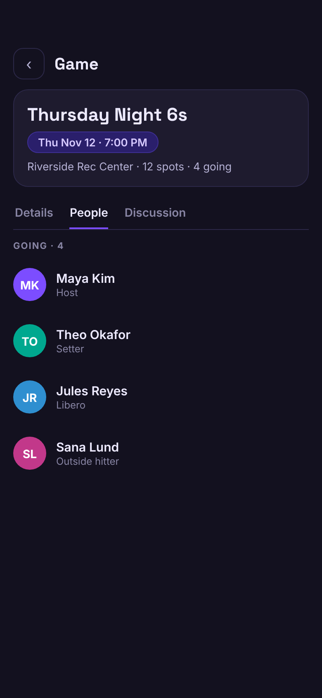
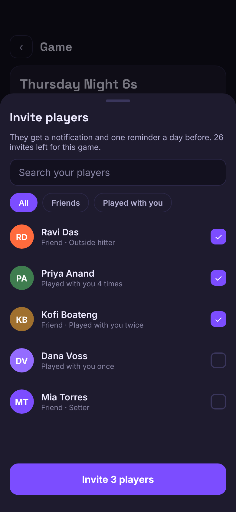
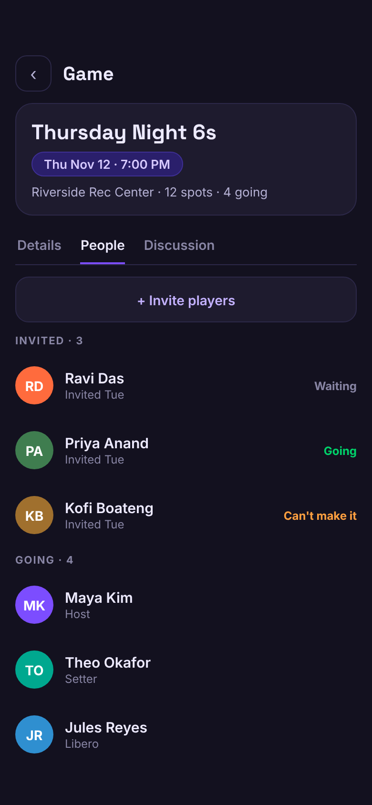
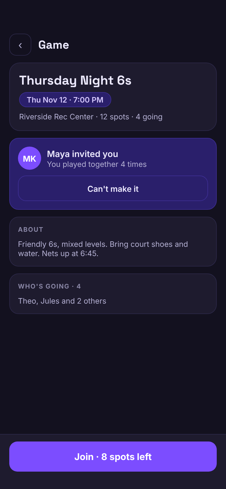
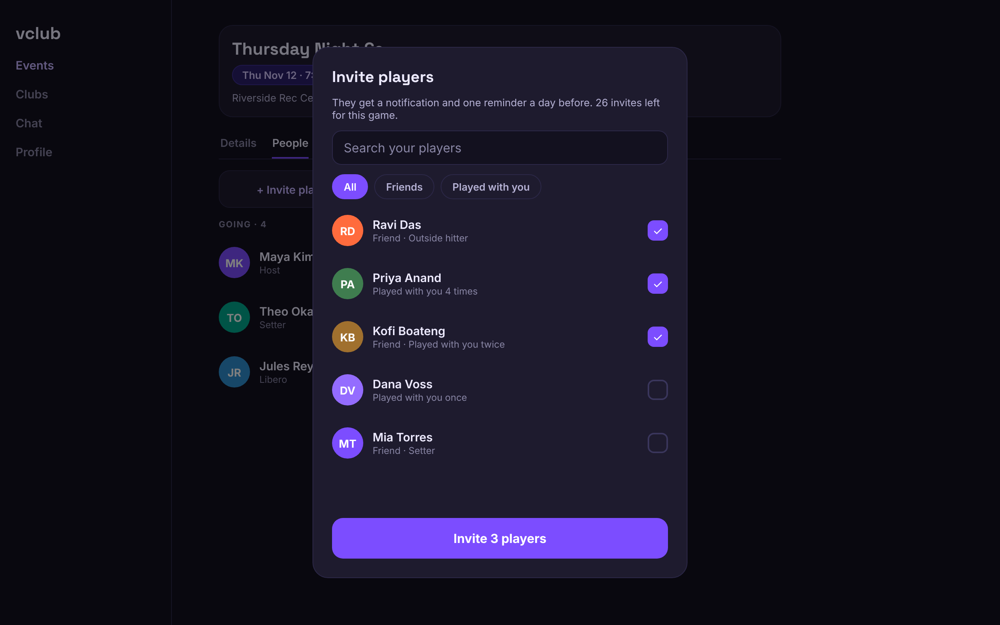
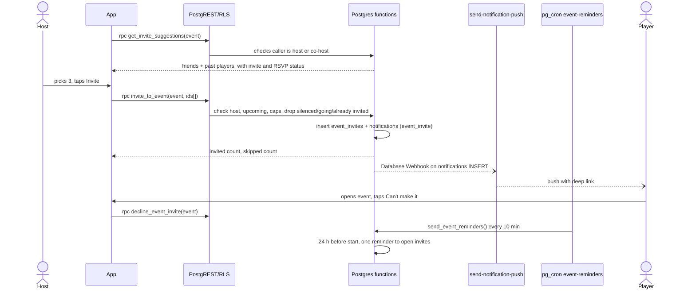
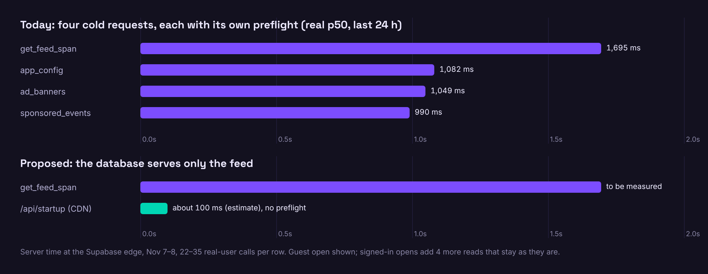
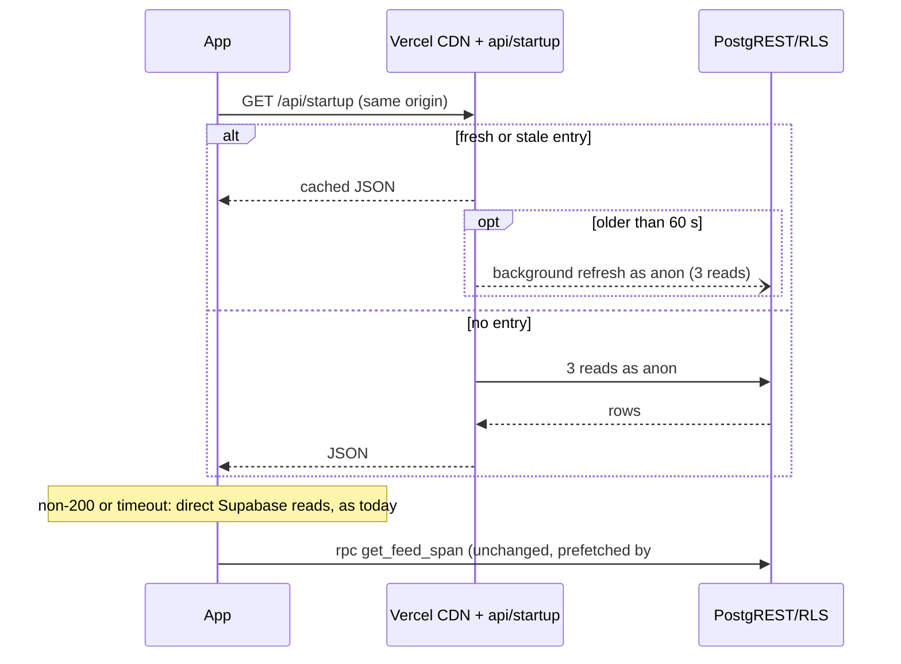
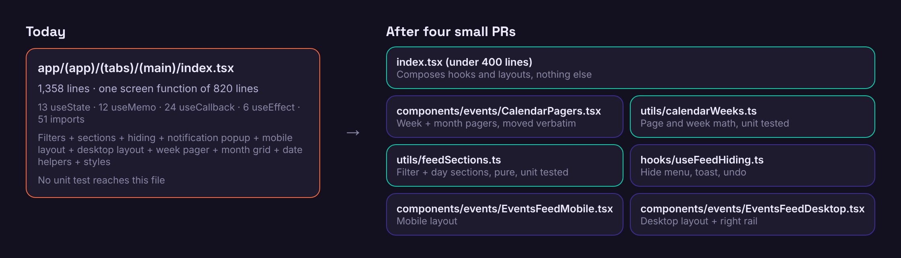

# vteam ideas: 2026-11-08

Today's three: one competitor gap (the 11-07 batch had no new feature or competitor gap, so today includes one), one latency, one refactor.

<!--IDEA-->
## 1. Invite players: hosts ask their regulars to a game, and see who answered

**Bucket:** competitor-gap · **Size:** M · **Builds on:** #15 (friends), #129 (reminders). **Different from** #170 (automatic alerts to followers): this is one host choosing specific people for one game.

**Pitch:** A host taps Invite players, picks from friends and people who have played their games, and each one gets a personal invite with one reminder. The host sees Waiting, Going or Can't make it.

### Why

- A game can only be filled today by posting it and hoping, or by sharing a link outside the app. `events` has no invitation table; the only invites in the schema are `tournament_team_invitations`.
- Games are thin on the live database: 44 events ever, 64 attendee rows (1.45 per event, median 0.5), and 0 upcoming right now across 32 profiles. The people a host already knows are the easiest players to bring back.
- [Spond](https://www.spond.com/invites-reminders/) is built around this: admins invite members to an event and "can set automatic reminders, for participants who have not answered either 48 hours after the invite went out, or 48 hours before the event starts."
- Most of the pieces exist: friends (#15), the roster, `BottomSheet`, the notification pipeline with deep links.

### User stories

- As a host or co-host, I can invite up to 30 people to my game without leaving the event page.
- As a host, I can see who I already invited and what they answered, so I don't chase people twice.
- As a player, I get one invite and at most one reminder, and I can say I can't make it in one tap.
- As a player, I am never invited by someone I have silenced.

### Mocks

Before, the sheet, the roster after inviting, and what the invited player sees (fictional people):

### Design

- **Host side:** `components/event/PeopleTab.tsx` gets an **Invite players** button (hosts and co-hosts, upcoming, not cancelled) and an **Invited** section above Going. New `components/event/InvitePlayersSheet.tsx` on `BottomSheet`: search, All / Friends / Played with you chips (`Chip`), multi-select rows, sticky confirm.
- **Player side:** new `components/event/InviteCard.tsx` at the top of `DetailsTab.tsx` when you have an open invite. Joining uses the existing `JoinFooter` RSVP, so approval, waitlist and paid flows stay as they are. **Can't make it** calls `decline_event_invite`.
- **Hook:** `hooks/event/useEventInvites.ts` on `lib/query` (`queryKey('eventInvites', id)`), mutation invalidates it. Types in `types/index.ts`.
- **Notification:** new type `event_invite` in `NOTIFICATION_TYPES` (with a label and a setting, so it can be turned off), `data.deep_link` = `routes.event(id)`. Copy: "Maya invited you to Thursday Night 6s".
- **Reminder:** one nudge 24 h before start to anyone still waiting, added to `send_event_reminders()`, recorded in `reminded_at`.
- **Routes:** none new (sheet on the existing event route), so no `authGate` or `serve.json` change.
- **Guests:** never see the button or card; RLS gives `anon` nothing.
- **Surfaces:** native and mobile web use the bottom sheet with 44pt rows and safe-area padding on the confirm button; search input stays 16px so iOS doesn't zoom. Desktop web shows it as a centered 480px dialog with keyboard focus on search and Esc to close.

### Backend

**Model changes**

| Object | Change | Notes incl. who can read/write |
|---|---|---|
| `event_invites` | New table: `event_id`, `invitee_id`, `invited_by`, `created_at`, `declined_at`, `reminded_at`; PK `(event_id, invitee_id)`, index on `(invitee_id)` | SELECT: the invitee, and the event's host/co-hosts. No client INSERT/UPDATE/DELETE. `anon`: nothing |
| `invite_to_event(uuid, uuid[])` | New RPC, SECURITY DEFINER | `authenticated`. Host/co-host, upcoming, not cancelled. Max 30 per event, 60 a day per host. Skips silenced, attending, waitlisted, already invited |
| `decline_event_invite(uuid)` | New RPC, SECURITY DEFINER | `authenticated`, own invite only; stops the reminder |
| `get_invite_suggestions(uuid)` | New RPC, SECURITY DEFINER, STABLE | `authenticated`, host/co-host. Friends plus attendees of the caller's games in the last 180 days; only public profile fields |
| `notifications_notification_type_check` | Add `event_invite` | Replaces the constraint, additive |
| `send_event_reminders()` | Add the invite nudge | Replacement; informational only |

**Migration sketch** (`<timestamp>_event_invites.sql`): create table, enable RLS, two SELECT policies, three functions, revoke from `public, anon`, grant to `authenticated`, drop and re-add the check constraint with the new value, `create or replace` the reminder function.
**Down:** restore the previous `send_event_reminders()` and check constraint, drop the three functions and the table.

**RLS expectations** (`e2e/rls.spec.ts`, plus an `event_invites` row in `e2e/rls/matrix.ts`: guest read none, guest insert none, no client insert): a non-host can't call `invite_to_event`; a user reads only invites addressed to them or for games they host; nobody writes the table directly.

### Test plan

- **Unit:** suggestion sorting and status labels; `useEventInvites` optimistic update and rollback.
- **Database:** caps, silenced skip and reminder-once logic in the pgTAP suite if #150 has landed, otherwise in `e2e/rls.spec.ts` on beta.
- **e2e:** new `e2e/invites.spec.ts` in the events shard: `e2ebot` invites `e2ebuddy`, the roster shows Waiting, cleanup in `afterAll` under the `[e2e <tag>]` prefix.
- **Screens:** add `event-invite-sheet` and `event-invited` to `scripts/shots/screens.mjs`, with fixtures for the new table and RPCs; axe runs on them automatically.

### Acceptance criteria

- [ ] Hosts and co-hosts can invite up to 30 people per game from the People tab; other players and guests see no button
- [ ] Suggestions list friends and people who played the host's games in the last 180 days, and show who is already invited or going
- [ ] Silenced, attending, waitlisted and already-invited people are skipped, and the host is told how many were skipped
- [ ] An invited player gets one notification that opens the event, with a Join path and Can't make it
- [ ] Players still waiting get exactly one reminder 24 h before start; declining stops it
- [ ] `event_invite` can be turned off in notification settings
- [ ] RLS matrix and spec pass; expand-only migration with `.down.sql`, tested on beta first

### Pros and cons

#### Pros
- Gives hosts a way to fill a game inside the app, which matters with a median of under one attendee row per event.
- Reuses friends, `BottomSheet`, the notification pipeline and the RSVP flow, so most of the build is one table and three RPCs.
- A named invite is more likely to get an answer than a feed post, and the host finally sees who said no.
- Feeds the friend graph's value: friends become useful at the moment a host needs players.
- Sets up later work: club invites and "invite last week's players" use the same table.

#### Cons
- `push_tokens` has 0 rows on live, so until #189 ships invites only reach people who open the app.
- With 32 profiles and 6 hosts ever, the suggestion list will be short for most hosts for now.
- Adds a new way to send people notifications; the caps and off switch have to work on day one.
- Overlaps in spirit with #170, so a player could get an alert and an invite for one game unless we suppress the alert (small extra rule).
- Touches `PeopleTab.tsx`, already 740 lines, and a cron function that notifies real people.

**Verdict:** Pros outweigh the cons if the goal is more full games; it is worth landing right after #189 so invites reach phones.

**Risks:** invite spam (caps, silences, off switch). **Open questions:** should an invite skip host approval on `requires_approval` games? (Proposed: no, for v1.) **Dependencies:** #189 for phone delivery; coordinate with #170.

<!--IDEA-->
## 2. Startup config from the CDN: three small reads stop waiting on a cold database

**Bucket:** latency · **Size:** S

**Pitch:** The update check and the ad lists are public, nearly static and read on every open. Serve them together from one Vercel edge response so a cold database only has to answer the feed.

### Why

Real-user server time at the Supabase edge, last 24 hours (Nov 7–8, read-only logs, browsers only):

| Request | Calls | p50 | p90 | Max |
|---|---|---|---|---|
| `rpc/get_feed_span` | 35 | 1,695 ms | 2,875 ms | 12,026 ms |
| `app_config` (one row) | 24 | 1,082 ms | 2,081 ms | 11,032 ms |
| `ad_banners` | 22 | 1,049 ms | 1,745 ms | 7,522 ms |
| `sponsored_events` | 22 | 990 ms | 2,034 ms | 7,338 ms |

- These three reads take about a second to return almost nothing, because each waits for the same cold connection as the feed. In the burst of Nov 8 01:20 UTC, `app_config` took 11.0 s, `ad_banners` 7.5 s and the feed 12.0 s.
- Each one is preceded by a CORS preflight: 29 `OPTIONS` for 24 `GET`s on `app_config`, 28 each for the two ad tables.
- `hooks/useMinVersion.ts` and `hooks/useFeedAds.ts` read them separately. #184 already moved the feed request earlier; this removes the three that race it. The baseline doc (`claude/latency-baseline-2026-11-04.md`) lists them among the 8 boot requests, and the cold stall as the main cost.
- No keep-warm ping: when the CDN entry is stale, a real open refreshes it in the background.

### User stories

- As a player opening the app after a while, ad slots and the update prompt don't arrive a second or more after the feed.
- As the owner, a cold open costs the database one or a few requests instead of up to eight.

### Design

- **New `api/startup.ts`** (Edge, same pattern as `api/forecast.ts`), with parsing in `api/_lib/startup.ts`. Reads the three public tables with the anon key already used by `api/event-page.ts` and returns `{ appConfig: [...], banners: [...], sponsored: [...] }`. Same RLS as today, since it queries as `anon`.
- **Cache:** `Cache-Control: public, s-maxage=60, stale-while-revalidate=86400`.
- **Stale ads:** the payload includes `starts_at` / `ends_at`, and the client filters by the current time, so a stale response never shows an expired ad.
- **New `lib/startupConfig.ts`:** one `useQuery(queryKey('ads', 'startup'), ...)` fetch of `${WEB_ORIGIN}/api/startup`, deduped between the two hooks. Same-origin on web, so no preflight.
- **Fails open:** a non-200 or a 1.5 s timeout falls back to the current direct Supabase reads. That also covers CI's `serve dist`, which has no functions.
- **`useMinVersion`** moves onto it and stops being an effect-based `supabase.from()` read. The `ads` snapshot prefix keeps working unchanged for returning visitors.
- **Surfaces:** web gets the full gain. Native uses the same URL (as forecast does) and keeps the fallback. No visual change on any surface. No new app route; `api/` isn't in `serve.json`.
- **Guests:** same data as today; they are the biggest winners, going from 4 Supabase requests to 1 on open.

### Backend

No database change.

**Model changes:** none. RLS on the three tables is unchanged, so `e2e/rls/matrix.ts` needs no update.

### Test plan

- **Unit:** `__tests__/startupApi.test.ts` (shape, cache headers, upstream failure answers 502) in the style of `eventPage.test.ts`; `__tests__/startupConfig.test.ts` (window filter, timeout fallback). The existing import check keeps `api/` free of React Native.
- **e2e:** in `e2e/guest.spec.ts`, route `/api/startup` to fixtures and assert no request reaches `/rest/v1/app_config` or the ad tables; route it to 404 and assert the fallback runs and ads still render.
- **Shots:** answer `/api/startup` in the harness, as `/api/forecast` is; no screens to add, and no pixels should change.
- **Measure before and after:** the table above from `edge_logs`; after shipping, `x-vercel-cache` HIT rate and response time in a Playwright run against production, plus the `cold-open-flow.mjs` request count. Can't be fully tested on beta, because CI has no functions; the fallback path can.

### Acceptance criteria

- [ ] Guest open makes 1 Supabase REST request instead of 4 (counted in the mocked export); signed-in open makes 3 fewer
- [ ] No `OPTIONS` for these three reads on web
- [ ] `/api/startup` p50 under 150 ms on a CDN hit, measured from a browser, against 990–1,082 ms today
- [ ] Feed `origin_time` p50 from `edge_logs` compared over one week before and after, and reported on the issue
- [ ] An expired banner never shows, even from a day-old cached response
- [ ] Endpoint failure or a 1.5 s timeout falls back with no visible error
- [ ] Update prompt still appears on a below-minimum version

### Pros and cons

#### Pros
- Backed by a real number: about 1 s p50 and up to 11 s for reads that return one or two rows.
- Small change that copies an existing pattern (`api/forecast.ts`) and needs no migration.
- Guests drop from 4 requests to 1, and three preflights go away.
- A stale open still refreshes the entry in the background, which starts the database a little earlier without any scheduled ping.
- Moves `useMinVersion` off an effect-based read, in line with the conventions.

#### Cons
- The feed itself may not get faster; whether fewer competing requests help it is a hypothesis this change will test.
- With today's traffic the CDN entry is often stale, so a stale copy is what most opens will see (fine for this data, but ad changes can lag until the next open).
- Adds a second path to the same data, plus a fallback to maintain.
- Admin ad edits take up to a minute to appear.
- Log sample is small (22–35 calls in a day, mostly one person).

**Verdict:** Pros outweigh the cons: it is cheap, safe to fail, and clears three of the slowest needless reads, though the headline feed number may not move.

**Risks:** CDN caching an error (only 200s get the long cache). **Open questions:** should the `user_settings` and ad-free reads get batched next? **Dependencies:** none; builds on #184.

<!--IDEA-->
## 3. Events screen in pieces: the app's largest file becomes six tested parts

**Bucket:** refactor · **Size:** M (four small PRs)

**Pitch:** Split the 1,358-line Events tab into calendar components, pure section logic, a hiding hook and two layouts, with no change on screen.

### Why

- `app/(app)/(tabs)/(main)/index.tsx` is the largest file in `app/`, `components/`, `hooks/`, `lib/` and `utils/`: 1,358 lines, 51 imports, 13 `useState`, 12 `useMemo`, 24 `useCallback`, 6 `useEffect`.
- `EventsScreen` is one 820-line function (lines 91–910) with separate mobile (line 519) and desktop (line 686) returns.
- The calendar code (`usePager`, `WeekStripContent`, `MonthGridContent`, `WeekPager`, date helpers, lines 912–1324) lives in the same file.
- The rules for what a player sees (filter, region, hidden items, day sections, lines 247–286) can only run by mounting the screen. No unit test imports this file; the 116 files in `__tests__/` cover the helpers around it.
- Each selected day or week swipe re-renders the whole screen function. Search (#176) will add more state to this function unless it is split first.
- #188 does the same for the host form; #185 did it for profile.

### User stories

- As a developer, I can change the calendar or the feed without reading 1,358 lines.
- As a player, nothing changes, except that selecting a day re-renders less.

### Design

Four PRs, each independently shippable, behaviour unchanged:

1. **Calendar:** move `usePager`, `WeekStripContent`, `MonthGridContent` and `WeekPager` to `components/events/CalendarPagers.tsx`, and page and week math (`weekForIdx`, `idxForWeek`, `monthForIdx`, `idxForMonth`, `getWeekStart`, `getWeekDays`, `offsetDate`, `buildMarkedDates`) to `utils/calendarWeeks.ts`, with tests first. Keep bubble-phase gestures and `SWIPE_NAVIGATION.calendar` exactly as they are.
2. **Sections:** extract lines 247–286 into pure `buildFeedSections(events, { filter, surface, region, hiddenIdx, revealed, userId })` in `utils/feedSections.ts`, with tests first using the fixtures in `feedItems.test.ts`.
3. **Hiding:** `hooks/useFeedHiding.ts` takes the hide target, toast, undo and reveal state (lines 119–122, 288–317).
4. **Layouts:** `components/events/EventsFeedMobile.tsx` and `EventsFeedDesktop.tsx`, each memoized, receiving props from a slim `index.tsx`. Keep `useDocScrollMemory('tab:events', ...)` and `TourTarget`s in place.

No new routes. Guest behaviour and all three surfaces are unchanged, and the ad path still reads through `useAdsEnabled` + `planFeedAds`. New component props go in `types/`. Native layering stays because the same components are moved rather than rewritten.

### Test plan

- **Unit, added before each move:** `calendarWeeks.test.ts` (DST days via `helpers/clock.ts`, runs under `test:tz`) and `feedSections.test.ts` (each filter, region mismatch, hidden and revealed items, going and hosted items never hidden).
- **Regression:** `npm run shots:compare` on `events-feed` mobile and desktop must show no difference for each PR, plus `e2e/events.spec.ts`, `surfaces.spec.ts` and `scrollRestore.spec.ts`.
- **Native:** existing Maestro flows if #166 has landed, else a manual tap-through of the week and month views.
- **Render count:** a one-off React Profiler run on the mocked export before and after PR 4, reported on the issue. No target is promised.

### Acceptance criteria

- [ ] `index.tsx` is under 400 lines and contains no calendar math or section rules
- [ ] `buildFeedSections` and `calendarWeeks` have unit tests that pass in all four time zones
- [ ] Shots compare shows no change on the Events screens, mobile and desktop
- [ ] `e2e/events`, `surfaces` and `scrollRestore` pass without edits
- [ ] Gesture layering and `SWIPE_NAVIGATION` behaviour are unchanged
- [ ] Each PR changes one thing and could be reverted alone

### Pros and cons

#### Pros
- Puts the app's busiest screen under unit tests for the first time, including the rules for what a player sees.
- Makes #176 search and later feed work smaller and less risky.
- Should reduce re-rendering when picking a day or filter, on the screen every user opens first.
- Low user risk: shots compare gives a pixel check per PR.
- Follows the approach already approved for profile (#185) and the host form (#188).

#### Cons
- No user sees a difference, and it takes time from features while the app needs players.
- Conflicts with any in-flight work on the file, so it needs sequencing with #176.
- Moving gesture code risks subtle native regressions, and native coverage is still thin until #166 lands.
- Memoized layouts need stable props; a mistake there could add re-renders or stale UI.
- More files to navigate for what is one screen.

**Verdict:** Pros outweigh the cons if #176 is coming soon; do PRs 1 and 2 first, since they carry most of the value at the least risk.

**Risks:** stale closures while moving hooks (tests and e2e). **Open questions:** do it before or after #176? (Proposed: before.) **Dependencies:** sequence with #176; helped by #166.
