# vteam ideas: 2026-11-09

Today's three: end-user experience, latency, testing. The 11-08 batch included a competitor gap, so today has no new feature or competitor gap.

<!--IDEA-->
## 1. Account basics that work: a password reset that lands where it should, and changing your username

**Bucket:** end-user-experience · **Size:** M · **Depends on:** nothing open. Fills the "Coming soon" card on Settings → Account.

**Pitch:** A reset link always opens the "set a new password" form, an expired one says so, and players can finally change their username from Account.

### Why

- These are the only two real requests in `feedback_submissions` on live (the other two of four are test entries): one says clicking reset password "just logs me in", one asks to change their username.
- **Web link can miss the form.** `app/(auth)/login.tsx:94` asks Supabase to return to `Linking.createURL('/(auth)/reset-password')`. If that URL is not on the Auth allow-list, [Supabase sends the person to the Site URL](https://supabase.com/docs/guides/auth/redirect-urls), and the recovery session is created on the home page. Only `reset-password.tsx` listens for `PASSWORD_RECOVERY`, so they arrive signed in with no form. I can't read the Auth allow-list with the tools here. All 5 accounts that ever asked for a reset have signed in since (consistent with the report, not proof).
- **Native link cannot work.** The link is `vteam://…`, `detectSessionInUrl` is off on native (`lib/supabase.ts:48`), and the only code that reads tokens from a URL is the social sign-in flow (`lib/socialAuth.ts`). The screen waits forever.
- **Expired links hang.** Run against the mocked web export, `/reset-password#error_code=otp_expired` stays on "verifying link…" with no timeout (before screenshot below).
- Settings → Account (`settings/account.tsx`, 71 lines) says "Coming soon" and there is no username field anywhere after sign-up.
- The `profiles` update policy limits rows, not columns, so a client can already set any free username through the API with no format rule. `register.tsx:68` checks availability with `.ilike`, where `_` is a wildcard: `a_b` is reported taken if `axb` exists.

### User stories

- As a player who forgot my password, I tap the email link on any device and get the new password form.
- As a player with an old link, I'm told it expired and can send a new one right there.
- As a player, I can change my username from Account and see if a name is free before saving.
- As a player, I know a former username of mine can't be grabbed by someone else right away.

### Mocks

Account today, and after (fictional people):

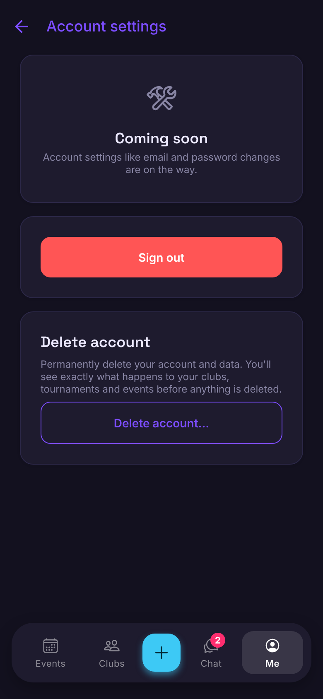
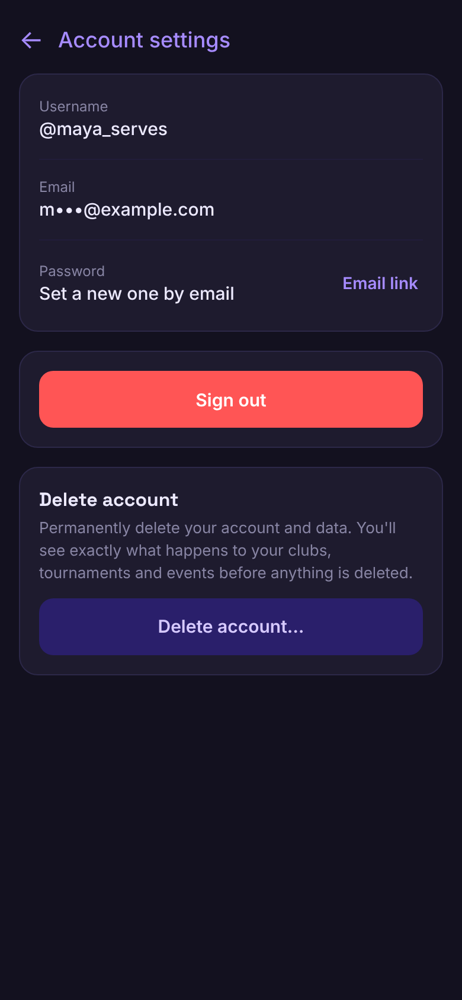
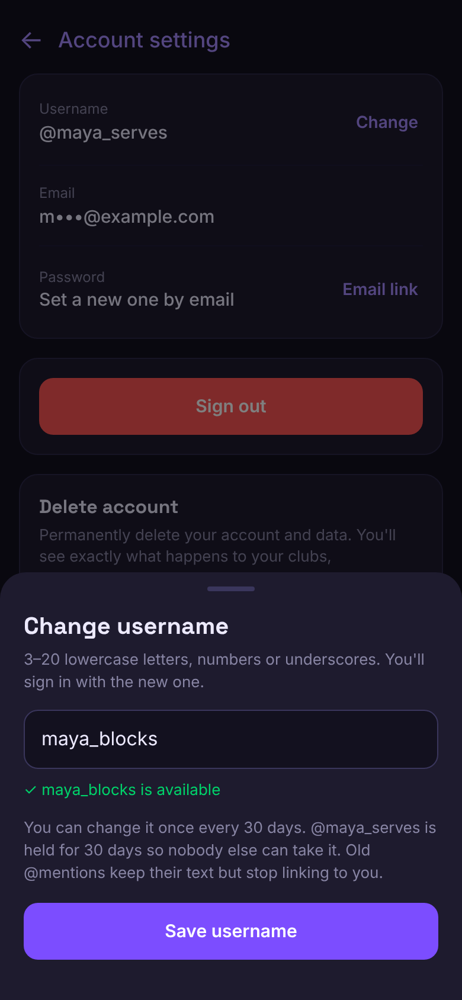
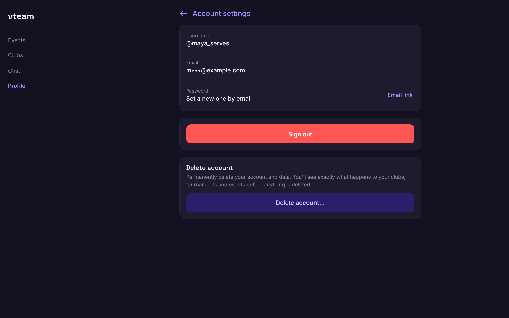

Reset: the form every valid link reaches, then an expired link today and after:

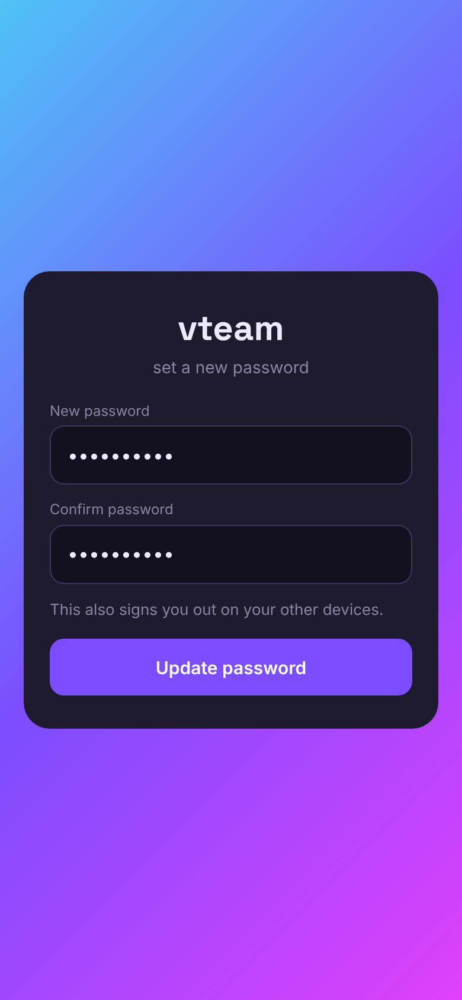
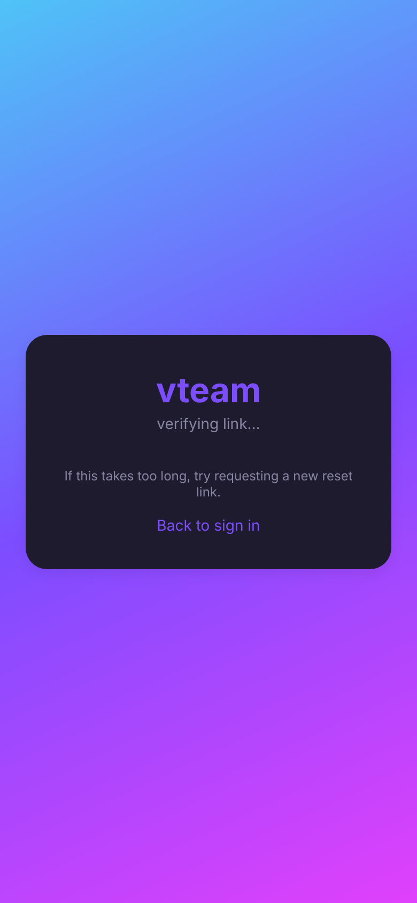
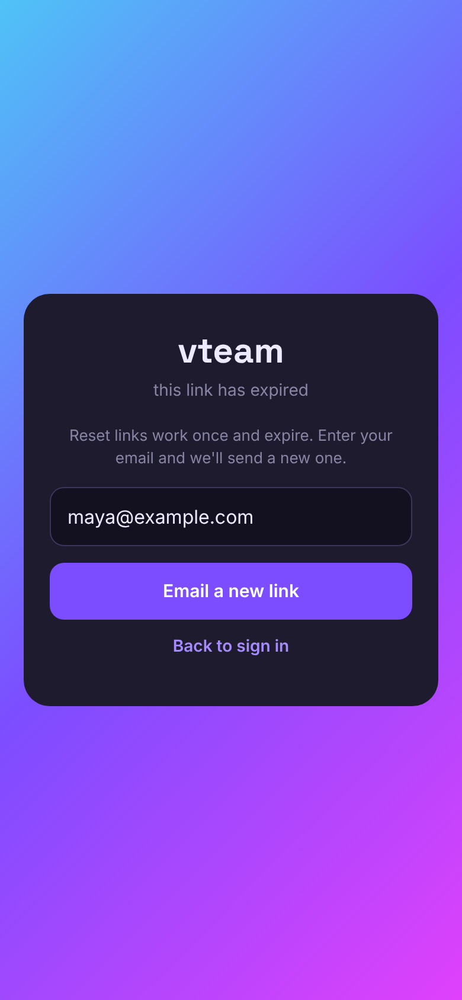

### Design

**Reset**
- Always send an https link: `shareUrl('/reset-password')` (`constants/share.ts`), so native users finish in the browser and there's no deep link to parse. Same choice as share links (#130). `routes.resetPassword()` is a new builder.
- New pure `utils/recoveryLink.ts`: reads `type=recovery` and `error_code` from the URL hash. Called in `lib/supabase.ts` *before* `createClient`, because the client consumes the hash on start and a listener attached later can miss `PASSWORD_RECOVERY`.
- `app/_layout.tsx`: when a recovery link was detected, go to `routes.resetPassword()` on any path. This covers the allow-list fallback, so the fix doesn't depend on dashboard settings.
- `reset-password.tsx`: new expired state with email field; after success `signOut({ scope: 'others' })`. A 10 s timeout replaces the endless "verifying".
- Manual: add `https://vteamvolleyball.com/reset-password` to the Auth allow-list.

**Username**
- `settings/account.tsx` replaces "Coming soon" with a Username / Email / Password card (`shared.card`). Password's **Email link** reuses the reset email. The screen moves to `useMyProfile` data, dropping its effect-based read.
- New `components/profile/ChangeUsernameSheet.tsx` (`BottomSheet`): debounced availability from `username_available`, save via `change_username`, invalidates `profile` keys.
- Rule for new names: `^[a-z0-9_]{3,20}$`. The 5 of 34 existing usernames that don't fit keep working until changed. `register.tsx` uses the same check, fixing the wildcard bug.
- Friends, rosters and chat use ids, so they follow automatically. Text `@mentions` written earlier are resolved by name (`CommentRow.tsx`, `chat/[id].tsx`) and stop linking; the sheet says so.
- Guests never reach Account (already in `authGate`). Desktop uses the same card inside `ScreenContainer`; native and mobile web use the sheet with 44pt targets and 16px inputs.

### Backend

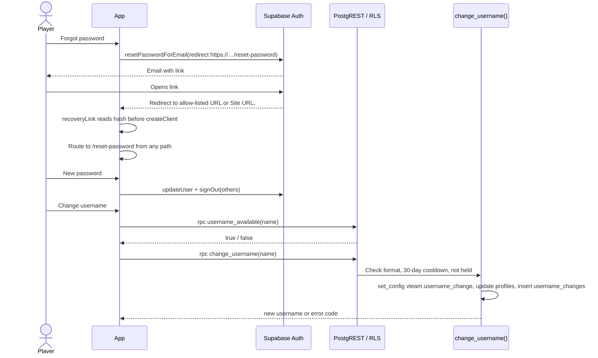

**Model changes**

| Object | Change | Notes (who can read/write) |
|---|---|---|
| `username_changes` | New table: `user_id` (FK profiles, ON DELETE CASCADE), `old_username`, `new_username`, `changed_at` | Owner SELECT. No client writes. Rows drive the cooldown and the 30-day hold |
| `username_available(text)` | New function, SECURITY DEFINER | anon + authenticated. Boolean only; exact lowercase match, includes held names |
| `change_username(text)` | New function, SECURITY DEFINER | authenticated only. Returns `invalid`, `taken`, `cooldown` |
| `profiles_guard_username` | BEFORE UPDATE OF username trigger | Rejects unless the function set `vteam.username_change` locally. Sign-up is INSERT, unaffected. No deployed client writes username (checked), so expand-safe |

Migration sketch: create table with RLS and the policy, the two functions with `search_path` fixed and `REVOKE EXECUTE FROM public`, then the trigger. `.down.sql`: drop trigger, functions, table in that order.

RLS expectations for `e2e/rls.spec.ts`: signed-in user cannot PATCH their own `username`; anon cannot call `change_username`; nobody inserts into `username_changes` directly. New row in `e2e/rls/matrix.ts`.

### Test plan

- Unit: `utils/recoveryLink` (recovery, expired, ordinary hash), username format, sheet states.
- RLS (`api` shard): expectations above.
- E2E (`other` shard): `login.guest.spec.ts` opens `/#…type=recovery` and an expired link with Auth routed; `profile.spec.ts` drives the sheet with the RPC routed, because `e2ebot`'s real username must not change.
- Shots: add `settings-account-change-username` and `reset-password-expired` to `SCREENS`; `settings-account` already exists.

### Acceptance criteria

- [ ] A recovery link opened on any path shows the new password form
- [ ] Native users get an https link and can finish in the browser
- [ ] An expired or used link shows the expired state with a resend, within 10 s at most
- [ ] Setting a new password signs out other devices
- [ ] Account shows username, email and password rows; "Coming soon" is gone
- [ ] A username can be changed once per 30 days and the old one is held for 30 days
- [ ] A direct API update of `username` is rejected
- [ ] Sign-up uses the same availability check, with no wildcard matches

### Pros and cons

**Pros**
- Answers the only two real pieces of user feedback in the table.
- Removes a dead end at the worst moment: someone locked out of their account.
- Closes a gap where any client can set any username through the API.
- The https link removes a whole class of native deep-link problems.
- Replaces a "Coming soon" card that makes the app look unfinished.

**Cons**
- 5 people have ever asked for a reset, so the volume is small.
- Native users leave the app to reset, which is slightly clumsier than an in-app form.
- Username changes break old `@mention` links and anyone's memory of the old handle.
- The new table and guard trigger add one more thing `delete_account` and the RLS matrix must cover.
- The allow-list step lives in the dashboard, outside migrations, and is easy to forget on a new project.

**Verdict:** Pros win: small, and it fixes real reports where the failure locks people out.

### Open questions

- 30-day cooldown and 30-day hold: right lengths?
- The feedback also says first and last name are "just for profile". Should people get a separate display name, or is the current real-name-first display enough? Left out here.

<!--IDEA-->
## 2. Profile opens with 16 requests, not 25: stop loading a tab nobody is looking at

**Bucket:** latency · **Size:** S · **Pairs with:** #216 (which removes three more startup reads) and idea 3 below.

**Pitch:** Opening Profile on a phone also loads the whole Events tab, and four small reads are sent twice. Removing them cuts the finish from 4.4 s to 2.8 s on a slow server.

### Why

Measured today on the mocked export at 390×844, signed in, counting reads to Supabase:

- **Profile 25 reads, Events 16, Chat 7, Tournaments 9, guest Events 6.** The counts were identical over 3 runs.
- On a phone, `(main)/_layout.tsx:52` always starts with the Events tab mounted, even when the page is `/profile`. That sends `get_feed_span`, `external_programs`, `ad_banners`, `sponsored_events` and the forecast coordinate read for a hidden screen. CLAUDE.md's "Fetch on demand" rule says not to.
- Four reads repeat on every profile open (see chart). `user_settings` and the avatar repeat on every Events open too.
- With each request held 1 s (the real p50 in the 11-04 baseline) and 10 at a time (the PostgREST pool max), Profile finished in **4.39–4.46 s before, 2.79–2.84 s after**. "After" is simulated by letting those 9 requests through without waiting.
- In the baseline all boot requests stall together on a cold server, so fewer in the burst means less time queued.
- **Limits of the gain:** returning web users already paint Profile from the device in about 0.5 s, so this speeds up the fresh data and first visits. Events finishes at 2.8 s either way (16 → 14 requests), and Profile was 26 of 194 loads in the baseline.

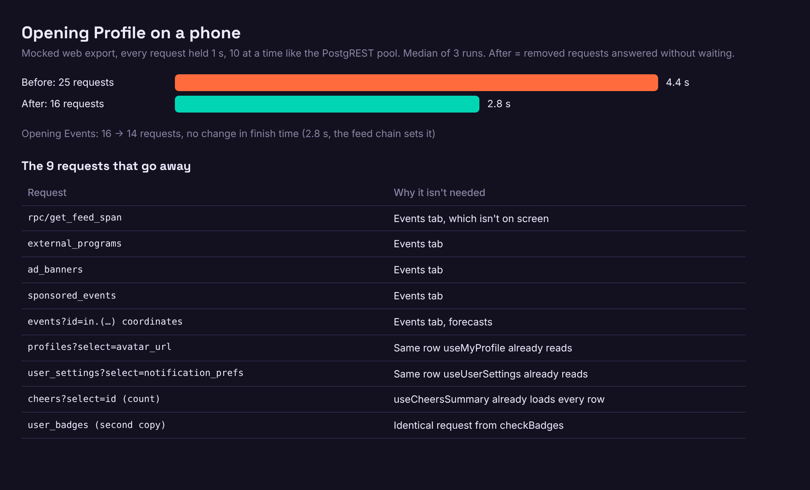

### User stories

- As a player opening my profile from a bookmark or link, I see up-to-date numbers sooner.
- As the app on a cold server, I don't queue reads for screens nobody asked for.

### Design

No backend change, nothing new on screen.

- `app/(app)/(tabs)/(main)/_layout.tsx`: start `mountedTabs` with the active tab rather than `EVENTS_TAB_INDEX`. The neighbor prefetch after 2 s stays.
- `app/_layout.tsx:50`: avatar prefetch takes its path from the `useMyProfile` result instead of its own `profiles` read.
- `hooks/useMyProfile.ts:89` + `hooks/useUserSettings.ts:23`: add `notification_prefs` to `SETTINGS_SELECT`; both read one `settings` query.
- `hooks/useMyProfile.ts:188`: take the cheer total from the rows `hooks/useCheersSummary.ts:12` already loads.
- `hooks/useBadges.ts:52` + `utils/badges.ts:170`: `checkBadges` reads through the same `lib/query` key.
- Native uses the same layout, so the first fix applies there too. Guests are unaffected.

### Test plan

- Unit: `mountedTabs` starts from the active tab; `useMyProfile` merges prefs from the shared query; cheers total from rows.
- Before/after: rerun the 1 s / 10-at-a-time run on the mocked export, and `scripts/shots/cold-open-flow.mjs`. No beta needed.
- Real users: compare `edge_logs` request counts per Profile open before and after.
- `scrollRestore.spec.ts` and `profile.spec.ts` stay green: both depend on tabs mounting.

### Acceptance criteria

- [ ] Opening `/profile` at phone width sends at most 16 reads (25 today) and no `get_feed_span`
- [ ] Opening `/` signed in sends at most 14 reads (16 today)
- [ ] Mocked run at 1 s per request and pool 10: Profile finishes within 3.0 s (4.4 s today)
- [ ] Switching to Events from Profile still loads the feed, with the existing skeleton
- [ ] Notification switches still save and show correctly

### Pros and cons

**Pros**
- 36% fewer requests on Profile with no schema change or new code paths.
- Measured gain of 1.6 s on the slow-server path.
- Enforces a rule already in CLAUDE.md rather than adding a new mechanism.
- Less load on a Micro instance with a 10-connection pool.

**Cons**
- Most Profile opens by returning web users already paint from the device, so many people won't notice.
- Going to Events after a cold Profile now starts its feed load at that moment.
- Sharing `settings` makes `useMyProfile` depend on `useUserSettings`' query shape.
- The 1.6 s comes from a simulated pool, and live results will vary.

**Verdict:** Pros win narrowly: cheap, low-risk, and it stops waste, though the visible gain is limited to fresh data and first visits.

### Risks and dependencies

Mount order bugs on native (Pager at a non-zero page with Events unmounted); test on a device. Touches `useMyProfile`, which #217 does not. Order with #216 doesn't matter.

<!--IDEA-->
## 3. Startup guard: CI fails when the first screens get slower or send more requests

**Bucket:** testing · **Size:** S · **Protects:** #184, #187, #193, #216, idea 2. **Different from** the proposed web bundle budget (11-04) and `entry-deps.mjs`: those watch JS size, this watches what the screens do.

**Pitch:** A check on every PR opens the first screens against a slow mocked server, and fails if paint time or the request count goes over budget.

### Why

- A lot of recent work exists to make cold starts fast (snapshots #187, HTML prefetch #184, entry chunk #193), and CI protects only the entry chunk. `scripts/shots/cold-open-flow.mjs` measures the paint but runs by hand: nothing in `.github/` or `package.json` calls it.
- Request counts creep without anyone noticing: about 10 boot requests in the 11-04 baseline, 16 on Events today. New features add reads to first screens (#217 is about to reshuffle that screen).
- The count is a stable signal: identical across 3 runs per screen (16/16/16, 25/25/25). Paint varied by 170 ms in 3 runs (419–585 ms over 4 screens), well inside a 1.5 s budget.
- That script has a bug that would hide regressions: it waits until 1.5 s to take a screenshot, then measures, so it always reports at least 1.5 s (5 runs, 1,542–1,594 ms). Without the wait the real paint is about 0.5 s.
- Four reads sent twice (idea 2) went unnoticed. A duplicate check would have caught them.

### User stories

- As Bryan, I find out on the PR that a change slowed the first screens, not from a slow phone later.
- As a contributor, the failure names the requests I added.

### Mocks

An illustration of the job summary with today's numbers (not a screen in the app):

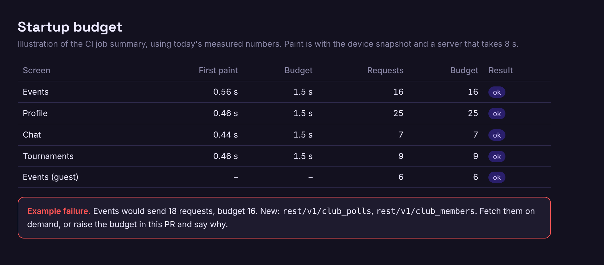

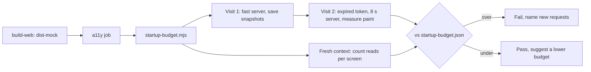

### Design

No app or backend change.

- `scripts/shots/cold-open-flow.mjs`: fix the 1.5 s floor (take the screenshot after timing), export the measuring function.
- New `scripts/shots/startup-budget.mjs`: for Events, Profile, Chat, Tournaments (signed in) and Events (guest), records paint, the sorted list of reads, and any exact duplicate.
- New `scripts/shots/startup-budget.json`: `{ screen: { paintMs, requests, allowedDuplicates, requestList } }`, updated with `npm run startup:baseline`, like the a11y baseline.
- `.github/workflows/ci.yml`: one step in the `a11y` job (already has the mock export and Chromium), summary to `$GITHUB_STEP_SUMMARY`. About 30 s (each run took 20–30 s here).
- Rules: requests over budget or a new duplicate fails at once. Paint over budget retries once, then fails. Lowering is automatic with the script; raising needs a line in the PR saying why, same rule as the a11y baseline. A new first-screen read therefore always shows up in review.
- Writes are not counted, and fixtures can award a badge on Profile (2 writes in this mock).

### Test plan

- `scripts/shots/shots.test.mjs` gains comparison cases: over budget, new duplicate, paint retry, lowered budget.
- Prove it: on a branch, add one read to Events and confirm the failure names it. Revert #184's script tag and confirm paint or request order fails.
- Run 10 times on CI before making it required, to check for false failures.

### Acceptance criteria

- [ ] Every PR reports paint and read counts for the five entries
- [ ] One extra read on a first screen fails the PR and names the request
- [ ] A duplicate read not already allowed fails the PR
- [ ] Paint is measured without the 1.5 s floor
- [ ] 10 consecutive CI runs on an unchanged commit produce no false failure
- [ ] Adds no more than 60 s to the `a11y` job, and uses no secrets or Supabase

### Pros and cons

**Pros**
- Guards several weeks of cold-start work with one step.
- Request counts are deterministic, so false failures are unlikely.
- Fixes a measurement bug that would have hidden regressions.
- Runs on the mock: no beta load and no e2e concurrency queue.
- Makes every new startup read a visible review decision.

**Cons**
- The mock measures request order and client paint, not the real server.
- Budgets need raising whenever a legitimate first-screen feature lands, a small tax on PRs.
- Paint timing on shared CI runners can be noisy, hence the retry and wide budget.
- Fixtures must keep pace with new tables or a screen could paint without its real data.

**Verdict:** Pros win: small cost, and it's the missing protection for work already paid for.

### Risks and dependencies

If idea 2 lands first, baseline is 16 / 14; otherwise the first baseline is 25 / 16 and shrinks with it.
