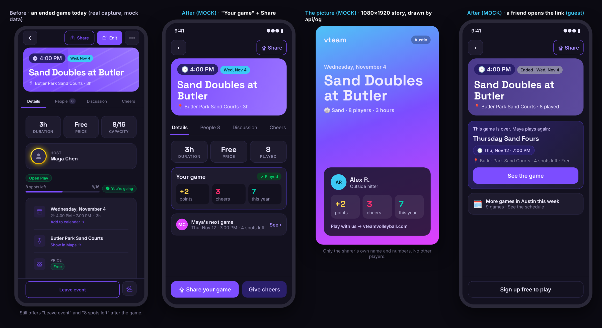
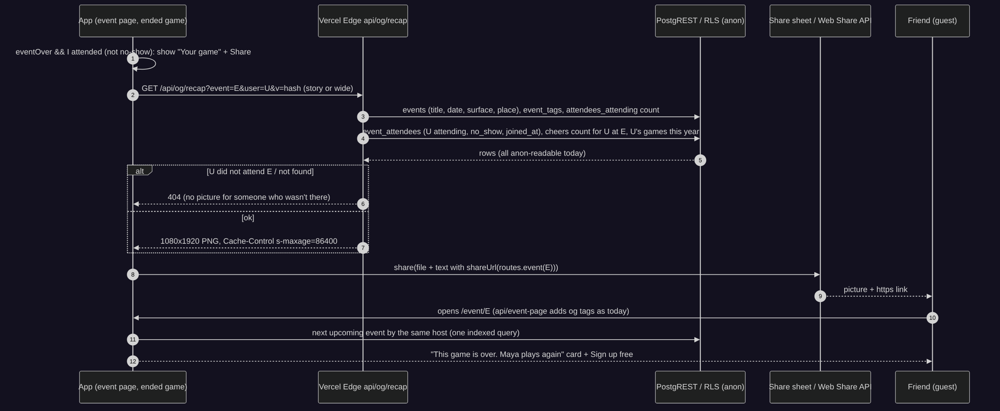
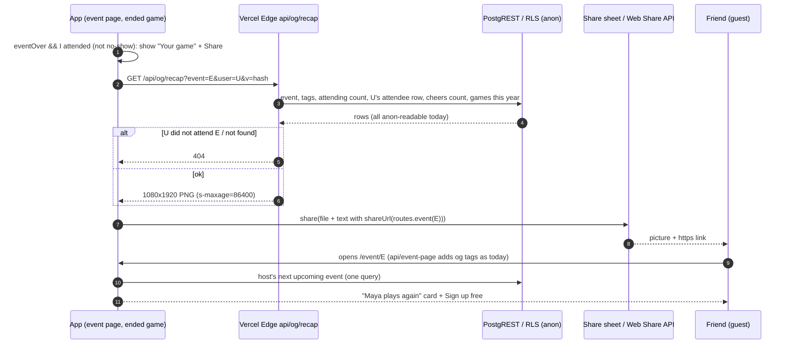
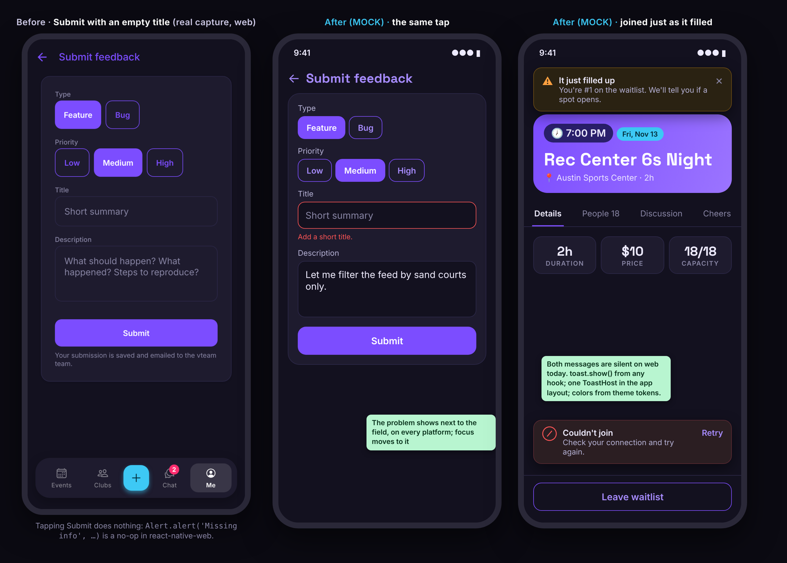
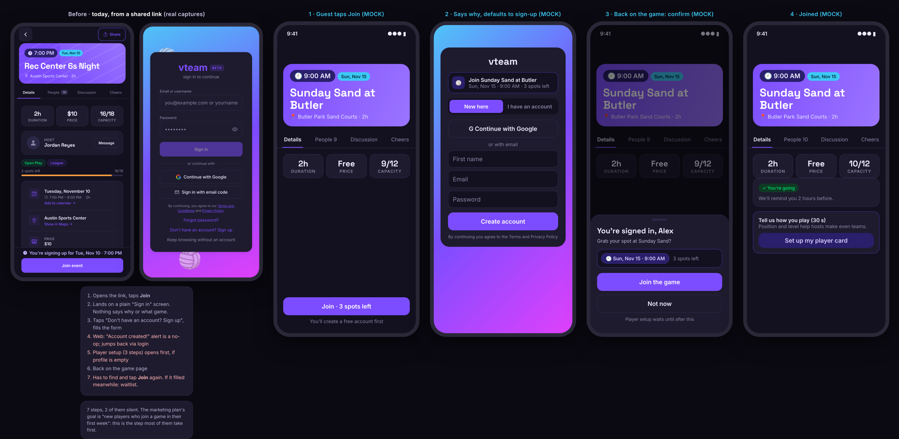
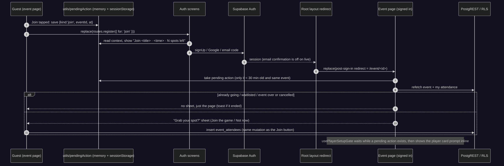

# vteam ideas: 2026-11-10

Today's three: a competitor gap, a refactor, and end-user experience. The 11-09 batch had no new feature or competitor gap, so today includes one.

Mock data is fictional (the `scripts/shots` fixtures and invented names). "Before" images are real captures of `main` (0788c91) from the mocked web export.

**Also found while measuring (not ideas, but they need a call):** see [Side findings](#side-findings) at the end. Two are security gaps on live.

<!--IDEA-->
## 1. Game recap card: after a game, share a picture of it, with a link to the host's next one

**Bucket:** competitor-gap · **Size:** M · **Depends on:** nothing open. Reuses the link-preview stack from #130 (`api/og`, `@vercel/og`, `shareUrl`).

**Pitch:** When a game ends, every player who was there gets a "Your game" card on the event page with **Share**: a story-sized picture (game, place, their points, cheers and games this year) and a link. A friend who opens the link sees "This game is over. Maya plays again" with the host's next game.

### Why

- **Competitors turn every finished session into a post.** Strava's share stickers put a run on an Instagram story in two taps ([Tom's Guide](https://www.tomsguide.com/wellness/fitness/stop-screenshotting-your-runs-this-hidden-strava-feature-looks-much-cleaner-on-instagram)). Playtomic lets players publish match results to its community ([help: publish your match results](https://intercom.help/getplaytomic/en/articles/5757530-how-to-publish-your-match-results-to-the-playtomic-community)). Apple Sports added shareable game cards for iMessage and social ([MacRumors](https://macrumors.com/2025/04/18/apple-sports-app-game-card-sharing)). vteam gives a player nothing to show after a game.
- **It fits the marketing plan.** The plan (Vteam project, `vteam-marketing-strategy-2026-11-07`) has no budget and counts "new players who join a game within their first week". Players posting their own games is the cheapest channel there is, and the link lands on a page that points at the next game.
- **The plumbing exists.** `api/og/event.tsx` (246 lines) already draws event cards with `@vercel/og` from `theme`, and `api/_lib/eventPreview.ts` reads events with the anon key. A recap is one more route, not a new system.
- **The ended-game page is unfinished today.** On a game that ended six days ago the Details tab still says "8 spots left" and shows **Leave event** and **+1 guest** (before capture below): `JoinFooter` is rendered whatever `isEventOver(event)` says (`EventDetailScreen.tsx:411`). The recap card replaces that footer.
- **Evidence it would be used, and its limit:** 64 attendances on live so far; the busiest months were April (27 attendances, 9 players) and August (21, 14 players). Volume is low, so this is a growth bet, not a response to demand.

### User stories

- As a player who just played, I can share a picture of my game to Instagram Stories, Messages or anywhere, with a link that opens the game.
- As a player, my picture shows only my own name and numbers, never other players.
- As a friend who opens the link, I see that the game is over and the host's next game, and can sign up from there.
- As a host, people who see my players' posts land on my next game.

### Mocks

Left: real capture of an ended game today. Then MOCKs: the "Your game" card replacing the footer, the 1080×1920 picture, and the page a friend sees from the link (guest).

### Design

- **Event page (ended game)**, `components/event/EventDetailScreen.tsx`: when `eventOver`, render a new `RecapFooter` instead of `JoinFooter` (fixes the Leave / spots-left leftovers for everyone). For an attendee who was `attending` and not `no_show`: **Share your game** + **Give cheers** (opens the Cheers tab). For anyone else: no footer for signed-in non-attendees, **Sign up free to play** for guests.
- **"Your game" card** (`components/event/YourGameCard.tsx`) at the top of Details for attendees: points (own `point_events` row for this event, or the pending rule while the award job hasn't run: "+2 after the host's 2-hour window"), cheers received at this event, games this year. One hook `useMyGameRecap(eventId)` on `lib/query` (`queryKey('event', id, 'recap', userId)`, `STALE.detail`).
- **"<Host>'s next game" card** (`components/event/HostNextGame.tsx`): one query, the host's soonest upcoming, uncancelled event (`events?created_by=eq.<host>&event_date=gt.now&order=event_date&limit=1`, `EVENT_CARD_LIST_SELECT`). Shown on ended games to everyone, guests included. Falls back to "More games in Austin this week" (links to the feed) when the host has none.
- **The picture**, `api/og/recap.tsx` (Edge, `@vercel/og`, fonts from `public/og-fonts`, colors from `theme`): `?event=<uuid>&user=<uuid>&format=story|wide&v=<hash>`. Reads with the anon key only what guests can already read: the event (title, date, surface, place), the user's public profile (first name + last initial, position, avatar), their `event_attendees` row (must be attending, not `no_show`, joined before the end), cheers received at this event (count), and their attended games this calendar year (count). Points use one shared pure rule `pointsForEvent(tags)` (2, or 5 for Tournament) moved from the SQL comment into `utils/points.ts` so app and picture agree. 404 if the user wasn't there; `s-maxage=86400`.
- **Sharing**, `utils/shareRecap.ts` (+ `.web.ts`): native downloads the PNG with `expo-file-system` and opens `expo-sharing` (new dependency, SDK 54 version) with the text `eventShareMessage` + `shareUrl(routes.event(id))`. Web uses `navigator.share({ files, text })` where `navigator.canShare({ files })` is true (iOS Safari, Android Chrome), otherwise downloads the image and copies the link (toast "Link copied").
- **Metrics:** `recap_shown`, `recap_shared` (`{ target: 'native' | 'web-share' | 'download' }`), and `recap_link_opened` when an `/event/<id>?r=1` link is opened (the share text adds `r=1`), in `ANALYTICS_EVENTS`.
- **Routes / guests:** no new route. Event pages are already public; `public/serve.json` and `vercel.json` already rewrite `/event/<id>`. Add `/api/og/recap` next to `/api/og/event` (Edge functions need no rewrite).
- **Surfaces:** native uses the system share sheet; mobile web uses Web Share with files; desktop web downloads the image and copies the link (no share sheet), buttons with hover states and keyboard focus.
- **Ads:** the card and footer live only on the event page; nothing touches the feed or Profile.

### Backend

No schema, RLS, RPC, cron or trigger change. One new Vercel Edge function reads anon-readable rows.

| Object | Change | Notes (who can read / write) |
|---|---|---|
| `api/og/recap.tsx` | New Vercel Edge function | Public GET; reads with the anon key only; no secrets beyond the existing `SUPABASE_URL` / `SUPABASE_ANON_KEY` |
| `events`, `event_attendees`, `cheers`, `profiles`, `event_tags` | Read only | Already anon-readable (RLS matrix rows unchanged) |
| `point_events` | Read own row in the app only | Owner-only SELECT, unchanged; the picture uses the shared rule instead |

RLS expectations: none change. `e2e/rls.spec.ts` keeps asserting that guests can't read `point_events`; add one assertion that `cheers.giver_id` stays hidden from anon, since the picture counts cheers.

### Test plan

- **Unit:** `pointsForEvent` (2 vs 5, matches `award_event_points`), `recapEligibility` (attending, not no-show, joined before end), the picture's copy builder (`buildRecapMeta`, name as "First L.", no other players), `shareRecap` fallbacks (canShare true/false), `HostNextGame` query builder. `api/og/recap` handler test like `__tests__/eventPage.test.ts` (404 for non-attendee, cache headers). The api import-purity test covers the new file.
- **e2e:** `events` shard, `e2e/recap.spec.ts`: fixture event in the past with the e2e account attending, open it, see "Your game", tap Share (stub `navigator.share`), assert the image URL and text; as a guest, open the same event and see the next-game card.
- **Shots:** add `event-past-recap` (pastSand, signed in) and `event-past-guest` (pastSand, guest) to `scripts/shots/screens.mjs`, with an `/api/og/recap` handler in the harness answering a fixture PNG.
- **Manual:** share to Instagram Stories on iPhone (web and native) and to Messages on Android; render the picture locally with `npm run og:render`.

### Acceptance criteria

- [ ] An ended game never shows Join, Leave, +1 guest or "N spots left".
- [ ] Attendees who were not no-shows see "Your game" with points, cheers and games this year, and a Share button.
- [ ] Share opens the native sheet (native), Web Share with the image (supported browsers), or downloads the image and copies the link (others).
- [ ] The picture shows only the sharer's own name and numbers; the endpoint returns 404 for anyone who wasn't attending.
- [ ] The shared text links to `shareUrl(routes.event(id))`; opening it as a guest shows the host's next game (or the week's games) and a sign-up button.
- [ ] `recap_shown` / `recap_shared` / `recap_link_opened` are recorded.
- [ ] Works on iOS, Android, mobile web and desktop web; axe baseline unchanged for the new screens.

### Pros and cons

**Pros**
- Turns every finished game into free, player-made marketing, the plan's main gap.
- Each shared link lands on a page that sells the next game, so a post can turn into a sign-up.
- Fixes a real leftover: ended games still offer Leave and "8 spots left".
- Little new infrastructure: one Edge route on the existing `@vercel/og` setup, no schema change.
- Makes points and cheers visible right after the game, when they mean the most.

**Cons**
- Low volume today (a handful of games a month), so it may be months before it shows any effect.
- Adds a native dependency (`expo-sharing`) and two share paths to maintain (native, Web Share, plus a download fallback).
- Instagram Stories sharing from the web relies on the OS share sheet; some browsers (desktop, older Android) only get a download.
- The picture URL can render any attendee's recap if someone guesses the IDs. The data is public already, but a picture is easier to pass around than a roster.
- Another image style to keep in step with the theme.

**Verdict:** Pros outweigh the cons. It is a small, schema-free build on infrastructure that already exists, it fixes the ended-game footer, and it gives players a reason to post about vteam. Its value depends on people actually sharing, which `recap_shared` will tell within a month.

### Risks and open questions

- Should points show in the picture at all, or only cheers and games (points mean little to a friend)?
- Allow sharing only within, say, 14 days of the game, or forever?
- Opt-out: a player who doesn't want their recap renderable could get a "Hide my recaps" switch later; the 404 rule already limits it to attendees.

<!--IDEA-->
## 2. Messages that show up on the web: replace 54 silent `Alert.alert` calls with one toast and inline errors

**Bucket:** refactor · **Size:** M · **Depends on:** nothing open. Touches files #188 (host form) and #217 (Events screen) also touch, but not the same lines; land either order.

**Pitch:** `Alert.alert` does nothing in a browser, and 54 calls in the app use it, including "it just filled, you're on the waitlist" and every join error. Route all of them through one `toast` API (and inline field errors for forms), then make a test fail on any new `Alert` import.

### Why

- **react-native-web's `Alert.alert` is a no-op.** The repo knows it: `utils/notify.ts` and `utils/confirm.ts` both say so in their comments. But 54 calls still use it directly (`grep -rn "Alert.alert(" app components hooks utils lib`, excluding those two files):

  | File | Calls | What a web user misses |
  |---|---|---|
  | `hooks/event/useEventAttendance.ts` | 9 | "It just filled" after joining, every join/leave/approve error, "Event full" for hosts |
  | `app/(app)/club/[id].tsx` | 8 | "Name required", upload and save errors |
  | `components/ClubPostCard.tsx` | 6 | "Too long", post/comment errors |
  | `components/profile/useAvatarUploader.ts` | 4 | avatar upload errors |
  | `app/(app)/club/create.tsx` | 4 | validation and save errors |
  | `app/(app)/(tabs)/settings/feedback.tsx` | 3 | "Missing info": Submit just does nothing |
  | 15 other files | 20 | profile save, cheers, co-hosts, payments, teams, comments, "Account created!" on sign-up, chat report |

- **Web is where the users are.** The live logs for the last day are almost all one iPhone browser (CriOS) plus one native build; the baseline doc says the same. So the silent path is the common path.
- **Three ways to say one thing.** Besides raw `Alert.alert`: `notifyInfo` / `notifyError` (47 uses, `window.alert` on web, which blocks the page and looks like a system error), and six screens that each keep their own `Toast` state (`profile/index.tsx`, `profile/[id].tsx`, the Events screen (twice), `EventDetailScreen.tsx`, `ad-free.tsx`, `friends.tsx`).
- **The `Toast` itself predates the theme.** `components/Toast.tsx` hardcodes light backgrounds (`#FFF0F0`, `#F0FFF4`, `#F3F0FF`) on a dark app, against the "never hardcode colors" rule.

### User stories

- As a player on the web, when my join fails or the game fills as I join, I'm told, the same as on the app.
- As someone filling a form (feedback, club, post), I see what's missing next to the field instead of a button that does nothing.
- As a developer, I call `toast.show(...)` from any hook or mutation without adding state to the screen, and CI stops me from adding a silent alert.

### Mocks

Left: real capture of Submit feedback (tapping Submit with an empty title does nothing on web). Middle: MOCK of the inline error. Right: MOCK of the two toasts that are silent on web today.

### Design

- **`lib/toast.ts`** (module-level, like `lib/query`): `toast.show({ message, title?, variant: 'error' | 'warning' | 'success' | 'info', action?: { label, onPress } })`, `toast.error(e, fallback)` (maps network errors to `NETWORK_ERROR_MESSAGE`, everything else to `GENERIC_ERROR_MESSAGE` unless it is a known user-facing message), and a tiny subscribe API. Queue of one: a new toast replaces the current one. No context provider, so hooks and `useMutation` `onError` can call it.
- **`components/ToastHost.tsx`**, mounted once in `app/(app)/_layout.tsx` (and in `(auth)/_layout.tsx` for sign-in errors): renders the existing `Toast` look with theme colors (add `theme.colors.toastErrorBg` / `toastWarningBg` / `toastSuccessBg` / `toastInfoBg` tokens), `accessibilityRole="alert"` / `aria-live="polite"`, safe-area top inset, swipe or ✕ to dismiss, stays above the tab bar and the desktop sidebar.
- **Forms get inline errors, not toasts:** `settings/feedback.tsx`, `club/create.tsx`, `club/[id].tsx` edit mode, `ClubPostCard` composer: `errors` state per field rendered under the `Input` (it already supports an error prop on register/login), first invalid field focused.
- **Migration, in small PRs (each behaviour-only, no layout changes elsewhere):**
  1. `lib/toast.ts` + `ToastHost` + tokens; `notifyInfo` / `notifyError` reimplemented on top of it (their 47 callers switch for free, `window.alert` goes away).
  2. Event flows: `useEventAttendance`, `useEventComments`, `useEventCheers`, `useCohosts`, `useEventTeams`, `useEventPayments`, `EventDetailScreen` / `DetailsTab` (19 calls; the screen's own Toast state moves to `toast.show`).
  3. Clubs and posts: `club/[id]`, `club/create`, `ClubPostCard`, `clubs.tsx` (19 calls, inline errors for the forms).
  4. The rest: profile, avatar, feedback, account, register, chat (16 calls) and the six per-screen Toast states.
  5. Guard: `__tests__/noSilentAlerts.test.ts` (same style as `textSizeFloor.test.ts`) fails if any file outside `utils/confirm.ts` imports `Alert` from `react-native`. Destructive confirms stay on `confirmDestructive` / `ConfirmDialog` (9 uses, unchanged).
- **Copy:** messages shared by 2+ places move to `constants/copy.ts` (`EVENT_JUST_FILLED_*` is already there).
- **Surfaces:** native gets toasts instead of modal alerts for errors (less blocking), keeping native `Alert` only where a choice is needed (via `confirmDestructive`); mobile web gets messages for the first time; desktop web shows the toast top-center within `ScreenContainer` width.

### Test plan

- **Unit:** `lib/toast` (replace, auto-hide timing with fake timers, `toast.error` mapping), `ToastHost` render with `@testing-library/react-native` (role alert, action button), `noSilentAlerts.test.ts`. Existing hook tests that mock `Alert` (`tournamentHooks.test.tsx` style) switch to asserting `toast.show`.
- **e2e:** `other` shard: in `e2e/profile.spec.ts`, submit feedback with an empty title and expect the inline error; in `events` shard, route the join insert to a 500 and expect "Couldn't join".
- **Shots:** add `settings-feedback-errors` (tap Submit with nothing filled) to `scripts/shots/screens.mjs`. The axe job checks the toast has a name and live region.
- **Rollout check:** after step 1, run `npm run shots:compare` on Events, event detail and Profile to confirm nothing else moved.

### Acceptance criteria

- [ ] No file outside `utils/confirm.ts` imports `Alert` from `react-native`, enforced by a unit test.
- [ ] `notifyInfo` / `notifyError` no longer call `window.alert`; they show the toast.
- [ ] On web: joining a game that fills shows "It just filled up"; a failed join shows "Couldn't join" with Retry.
- [ ] Feedback, club create/edit and post composer show inline field errors and focus the first one.
- [ ] One `ToastHost`; the six per-screen Toast states are gone; toast colors come from theme tokens.
- [ ] Screen readers announce toasts (role alert / aria-live); axe baseline does not grow.

### Pros and cons

**Pros**
- Fixes real, silent failures for the main audience (iPhone web), starting with joins and waitlists.
- Collapses three messaging patterns into one API that hooks can call without screen state.
- The guard test stops the bug class from coming back.
- Small, mechanical PRs that are easy to review and revert.
- Removes hardcoded colors from `Toast` and the page-blocking `window.alert`.

**Cons**
- Touches about 25 files; overlaps with #188 and #217 cause some merge friction.
- A toast is easier to miss than a modal; important errors on native lose some weight (mitigated by keeping confirms modal and using the warning style).
- Inline errors need small layout changes in four forms, which the shots compare will flag.
- A module-level toast bus is one more global, though it matches how `lib/query` already works.

**Verdict:** Pros clearly outweigh the cons: it is mostly mechanical work that fixes failures web users hit today, and the guard makes the fix permanent.

### Risks and dependencies

- Land step 1 first; steps 2–4 can go in parallel after it. Coordinate step 2 with #217 if that refactor is in flight.
- No e2e spec handles browser dialogs today (`page.on('dialog')` appears nowhere), so dropping `window.alert` breaks no test.

<!--IDEA-->
## 3. Finish the join you started: a guest who taps Join is signed up and back on the game with one tap to confirm

**Bucket:** end-user-experience · **Size:** S–M · **Depends on:** #223 (account basics) touches `register.tsx` too; idea 2 above removes the silent "Account created!" alert. Either can land first.

**Pitch:** When a guest taps **Join**, remember it. The sign-up screen says which game it's for and opens on "New here". After the account exists they land back on the game with a "Grab your spot?" sheet, before player setup.

### Why

- **It's the path the marketing plan counts on.** The plan's funnel is "tap a link, land on vteamvolleyball.com, grab a spot", and the success number is "new players who join a game within their first week".
- **Today the intent is dropped** (traced in code, captures below):
  1. Guest taps **Join event** → `useEventAttendance.run` calls `requireSignIn()`, which only saves the page path (`utils/authGate.ts` `setPostSignInRedirect`) and opens **login**, not register.
  2. The login screen says "sign in to continue": nothing about the game. Sign-up is a text link at the bottom.
  3. After `signUp`, `register.tsx:107` calls `Alert.alert('Success', 'Account created!')` (silent on web) and `router.replace(routes.login())`; the root layout then bounces the new session to the saved path.
  4. `usePlayerSetupGate` sees an empty profile and pushes `/welcome` (three steps) before they see the game again.
  5. Back on the game they have to tap **Join** again. If the last spot went meanwhile, they're waitlisted.
- **New accounts are the minority but the growth.** 34 accounts on live, 4 created in the last 30 days; email confirmation is effectively off (16 accounts confirmed within 5 seconds of creation), so the session exists immediately and the flow can resume in place.

### User stories

- As a guest who taps Join, I see which game I'm signing up for on the sign-up screen.
- As a new player, after creating my account I'm back on the same game and can grab my spot in one tap.
- As a returning player who signs in from Join, the same happens.
- As a new player, player setup comes after I've joined, not before.

### Mocks

Left: real captures of a guest on an event and the login screen it opens, with today's seven steps. Then MOCKs 1–4 of the new flow.

### Design

- **`utils/pendingAction.ts`** (pure + storage like `authGate.ts`): `setPendingAction({ kind: 'join', eventId, title, startsAt, at })`, `peekPendingAction()`, `takePendingAction(eventId)`; memory plus `sessionStorage` on web (survives the Google full-page redirect, same reason as the redirect key); expires after 30 minutes; cleared on sign-out. Only `join` for now; `kind` leaves room for "message host" or "join club".
- **`useRequireSignIn`** gains an optional action: `requireSignIn({ action })`. `useEventAttendance.run` passes `{ kind: 'join', ... }` for join / join-waitlist / request. Guests now go to **register** when there is a pending join (login when there isn't).
- **Auth screens** (`app/(auth)/register.tsx`, `login.tsx`): if `peekPendingAction()` has a join, show a context card ("Join Sunday Sand at Butler · Sun, Nov 15 · 9:00 AM · 3 spots left", from the cached event, no new request) and a two-way switch **New here / I have an account** (each still its own route, so deep links keep working). The "Account created!" alert and the `replace(routes.login())` go away: with a session, the root layout redirect already takes them back.
- **Event page** (`EventDetailScreen.tsx`): on mount when signed in, `takePendingAction(id)`. If the player is not already attending/waitlisted/pending and the event is not over or cancelled, open a `BottomSheet` ("You're signed in, Alex. Grab your spot?" with the time pill and spots left, **Join the game** / **Not now**). Join uses the same `self.mutate('join')` as the button, so paid, approval and waitlist rules are unchanged. No auto-join without a tap: price and approval rules need a visible confirm.
- **`usePlayerSetupGate`** waits while `peekPendingAction()` is set, and after a join shows the setup as an inline card on the event ("Tell us how you play (30 s)") instead of pushing `/welcome` over the game.
- **Metrics:** `join_intent_saved`, `join_intent_resumed` (`{ outcome: 'joined' | 'not_now' | 'skipped_full' | 'expired' }`) in `ANALYTICS_EVENTS`, so the funnel from guest Join to RSVP is measurable.
- **Guests / routes:** no new route; `routes.register()` gains an optional `{ for: 'join' }` param for copy only. Nothing account-only changes in `authGate.ts`.
- **Surfaces:** same sheet on native and mobile web (`BottomSheet`); desktop web shows it as a centered dialog via the same component; Google / Apple sign-in on web returns through the full-page redirect and still finds the action in `sessionStorage`.

### Backend

None. No schema, RLS, RPC or function change; the join itself is the existing `event_attendees` insert.

### Test plan

- **Unit:** `pendingAction` (expiry, event mismatch, sign-out clears, sessionStorage fallback when blocked), the sheet's decision function (`shouldOfferJoin(status, event, now)`: already going, waitlisted, ended, cancelled, full → waitlist copy), `usePlayerSetupGate` waiting on a pending action, register/login context card rendering.
- **e2e:** `other` shard, `e2e/join-intent.guest.spec.ts`: guest opens a fixture event, taps Join, lands on register with the game's title; signs in with the e2e account through the "I have an account" switch; lands back on the event with the sheet; taps Join the game; sees You're going; cleans up the RSVP in `afterAll`. (No real sign-up in CI, to keep beta clean.)
- **Shots:** add `register-join-context` (pending action seeded through `sessionStorage` in the harness) and `event-join-intent-sheet` to `scripts/shots/screens.mjs`.

### Acceptance criteria

- [ ] A guest's Join opens sign-up with the game's title, time and spots left; "I have an account" switches to sign-in with the same context.
- [ ] After sign-up or sign-in (email, username, Google, Apple, email code) the player lands on the same game with the "Grab your spot?" sheet.
- [ ] Joining from the sheet follows the same paid / approval / waitlist rules as the Join button.
- [ ] No sheet if they're already going, waitlisted or pending, the game is over or cancelled, or more than 30 minutes passed.
- [ ] Player setup no longer opens on top of the game during this flow; it shows as a card after the join.
- [ ] `join_intent_saved` and `join_intent_resumed` are recorded with the outcome.

### Pros and cons

**Pros**
- Targets the exact step the marketing plan depends on: link → account → spot.
- Cuts the flow from seven steps (two silent) to four taps, and stops losing the spot to the waitlist while setup runs.
- Client-only, no schema change, reuses the existing join mutation, sheet and redirect storage.
- Adds funnel metrics, so the effect on first-week joins can actually be measured.

**Cons**
- Another piece of cross-screen state (pending action) to keep consistent with the redirect key.
- Defaulting to sign-up could annoy returning players who arrive through Join (mitigated by the one-tap switch).
- Moving player setup after the join may lower setup completion; the inline card has to earn the taps.
- With 4 new accounts a month, the improvement will be hard to see in numbers for a while.

**Verdict:** Pros outweigh the cons: it is a small, client-only change on the most important path for new players, with metrics to check it.

### Risks and open questions

- Should a free, no-approval game auto-join after sign-up (zero taps) instead of asking? The sheet is safer and keeps paid/approval rules visible; auto-join could be a follow-up if `not_now` turns out rare.
- Should "Message host" and "Join club" use the same mechanism in the same PR? Proposed: join only, to keep it small.

<!--SIDE-->
## Side findings

Found while measuring today, read-only on live (`rmelsdqgrpfjzqisycdl`). Not proposed as ideas; each probably wants its own issue.

1. **Points can likely be collected for games a player never went to (security).** `event_attendees` has one INSERT policy, `auth.uid() = user_id`, no trigger checks the event date, and `authenticated` has INSERT on `joined_at`. `award_event_points()` pays anyone `attending` and not no-show whose `joined_at` is before the game ended. So a client could insert itself into any finished game with a backdated `joined_at` and be paid 2 points (5 for a Tournament tag) on the next 15-minute run; 46 events would be over 90 points, close to the 100-point ad-free pass. Not tested (no writes allowed here). Fix sketch: a BEFORE INSERT trigger that refuses joins once the event has started (except host-added rows) and sets `joined_at = now()` for client inserts, plus revoking column INSERT on `joined_at`.
2. **Anyone signed in can create a tournament in any club (security).** The only INSERT policy on `tournaments` is `created_by = auth.uid()`; nothing checks club ownership. And there is no DELETE policy, so `saveTournament`'s cleanup (`app/(app)/tournament/create.tsx:748`) silently deletes nothing if the rules insert fails, leaving a tournament without rules. Live has 0 clubs and 0 tournaments today, so nothing is affected yet. Fix sketch: a `create_tournament` SECURITY DEFINER RPC (club owner check, both inserts in one transaction), the same shape as #188's `save_event`.
3. **Ended games still offer Leave, +1 guest and "N spots left"** (`JoinFooter` ignores `isEventOver`). Idea 1 fixes this; it could also be a one-line fix on its own.
