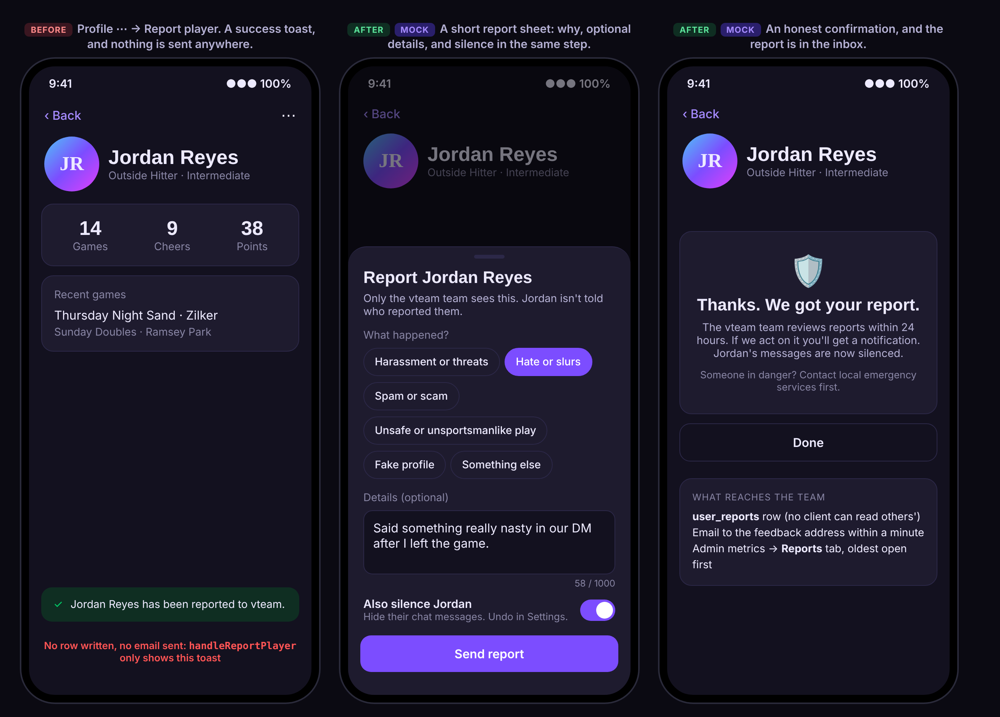
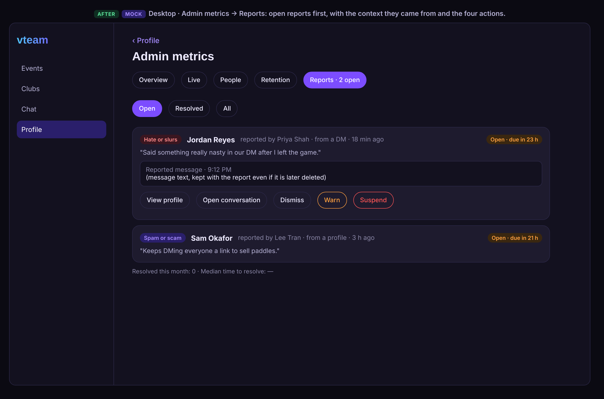
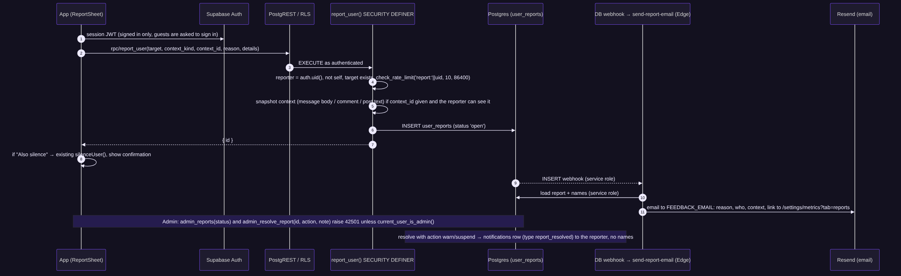
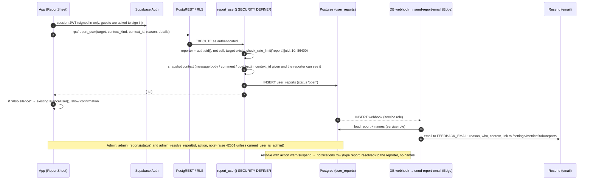
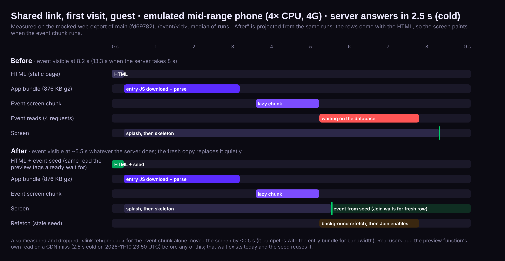
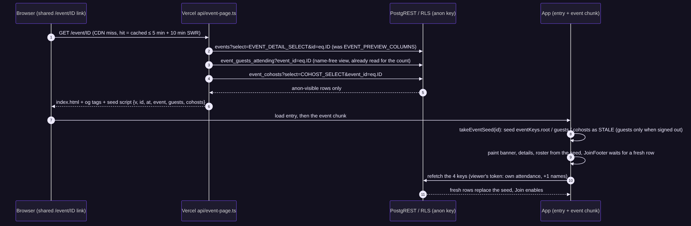
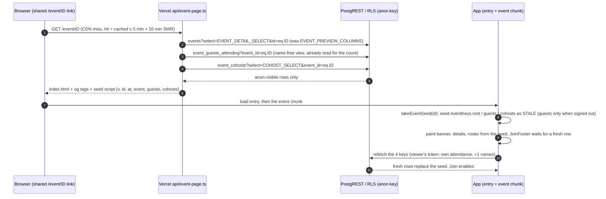
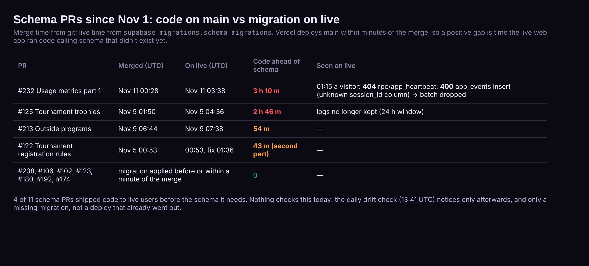
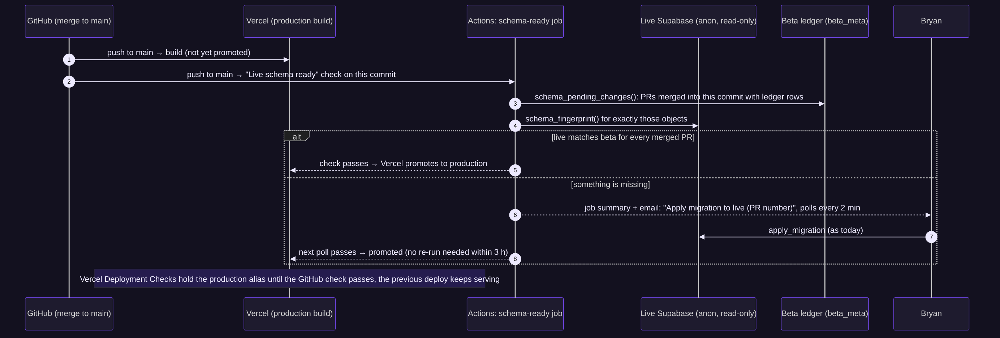
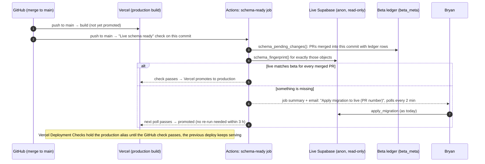

# vteam ideas: 2026-11-11

Today's three: end-user experience, latency, and testing. The 11-10 batch included a competitor gap, so today has no new feature or competitor gap.

Mock data is fictional (invented names). Latency numbers are measured on a mocked web export of `main` (fd69782) and on live's logs (read-only); the deploy gaps come from git and live's migration history.

<!--IDEA-->
## 1. Reports that reach someone: "Report player" sends a real report, and the team sees it within the hour

**Bucket:** end-user-experience · **Size:** M · **Depends on:** nothing open. Reuses `check_rate_limit` (on live since 11-08), `current_user_is_admin()`, the Admin metrics screen (#238), the `send-feedback-email` pattern (Resend) and `useSilencedUsers`. Related: #99 (store-launch privacy fixes), #11 (rate limiting).

**Pitch:** Both "Report player" buttons in the app show a success toast and send nothing. Replace them with a short sheet (why, optional details, "also silence") that writes a private report, emails the team, and lands in a Reports tab under Admin metrics with dismiss / warn / suspend.

### Why

- **Today a report is a fake success.** `app/(app)/profile/[id].tsx:101` `handleReportPlayer()` is one line: `showToast("… has been reported to vteam.")`. `app/(app)/chat/[id].tsx:287` is literally named `submitStubDmReport` and does the same after a confirm. The bad-word prompt in DMs ("This player may be unsportsmanlike. Would you like to report this user?", `chat/[id].tsx:718`) funnels people into that stub. A player who reports harassment is told it worked and nobody ever sees it.
- **The stores require a working one.** Apple's App Review Guideline 1.2 (User-Generated Content) asks apps with user content for "a mechanism to report offensive content and timely responses to concerns" and "the ability to block abusive users" ([App Review Guidelines](https://developer.apple.com/app-store/review/guidelines/)). vteam has DMs, club chat, comments, club posts and profiles; Silence covers blocking, reporting is the missing half. Store launch is the point of #99.
- **The pieces exist.** Rate limiting (`check_rate_limit`, migration `20261028120200`), admin checks (`current_user_is_admin()`), an admin screen with tabs (`settings/metrics`, `VIEW.metrics.tab`), a server-side email path (`supabase/functions/send-feedback-email`, Resend), notifications with push.
- **Scale is small, so one person can review by email.** Live has a handful of active players; a table + email + one admin tab is enough, no moderation vendor.

### User stories

- As a player, when someone harasses me in a DM or on their profile, I can report them in a few taps and know a person will read it.
- As a player, I can silence them in the same step so I stop seeing their messages right away.
- As a player, the person I report is never told who reported them.
- As the admin (Bryan), I get an email within a minute of a report and can review it, with the reported message kept even if it is later deleted, and close it with dismiss / warn / suspend.
- As a guest, tapping Report asks me to sign in (as other account-only actions do).

### Mocks

### Design

- **`components/ReportSheet.tsx`** (`BottomSheet`, props `{ target: ProfileBrief, context: { kind: 'profile' | 'dm' | 'message' | 'event_comment' | 'club_post', id?: string }, onDone }`): reason `Chip`s (Harassment or threats, Hate or slurs, Spam or scam, Unsafe or unsportsmanlike play, Fake profile, Something else; keys and labels in `constants/reports.ts`), details `TextInput` (optional, 1000 chars, 16px), "Also silence <first name>" switch (on by default for DMs, off on profiles), **Send report**. After success: a confirmation inside the sheet ("We review reports within 24 hours…", plus a line to contact emergency services first if someone is in danger). Errors via `toast.error("Couldn't send the report", e, retry)`.
- **Entry points:** profile ⋯ menu (`profile/[id].tsx`, replaces `handleReportPlayer`), DM header menu and the bad-word prompt (`chat/[id].tsx`, replaces `submitStubDmReport` / `confirmReportDmUser`), and a new **Report message** item in the message long-press menu (club and DM; context = message id). Comments and club posts get the same item in a follow-up PR (same sheet, kinds already in the enum).
- **Hook:** `hooks/useReportUser.ts` → `useMutation(rpc('report_user'))`; the silence option calls the existing `silenceUser`. Metric `report_sent` (`{ kind, reason }`, no ids) in `ANALYTICS_EVENTS`.
- **Admin:** `MetricsTab` gains `'reports'` (`VIEW.metrics.tab`, `utils/urlViews.ts`), `ReportsPanel` in `components/metrics/` reads `admin_reports(p_status)` through `hooks/useAdminMetrics.ts` (cache prefix `admin`, never snapshotted), shows open first with "due in N h" (24 h target), the context snapshot, links to the profile/conversation, and **Dismiss / Warn / Suspend** via `admin_resolve_report`. The tab label shows the open count. Suspend in v1 = set `profiles.suspended_at` is out of scope; v1 records the decision and the admin acts by hand (silence-for-all / delete content) until a later suspension issue. Warn sends the reported user a `moderation_warning` notification with fixed copy.
- **Reporter feedback:** resolving with warn or suspend sends the reporter a `report_resolved` notification ("We took action on your report. Thanks for keeping games friendly."); dismiss sends nothing. No names either way.
- **Routes / guests:** no new route (`/settings/metrics?tab=reports` is already account-only and admin-gated server-side). Guests never see the menu items that need an account; `useRequireSignIn` if reached.
- **Surfaces:** sheet is a `BottomSheet` on phones (native + mobile web), centered dialog width on desktop; chips are 44pt; keyboard: Tab through chips, Enter sends. Admin tab is a desktop-first list that still works at 390px.

### Backend

**Model changes**

| Object | Change | Notes (who can read / write) |
|---|---|---|
| `user_reports` (new) | `id uuid pk`, `reporter_id uuid → profiles ON DELETE SET NULL`, `target_id uuid → profiles ON DELETE CASCADE`, `context_kind text check in (…)`, `context_id uuid null`, `context_snapshot text null` (≤ 2000), `reason text check in (…)`, `details text null` (≤ 1000), `status text default 'open' check in ('open','dismissed','warned','suspended')`, `resolved_by uuid null → profiles SET NULL`, `resolved_at`, `resolution_note`, `created_at` | RLS on, **no policies** for anon/authenticated: clients can't read, insert, update or delete. Only the functions below and the service role. |
| `report_user(p_target, p_kind, p_context_id, p_reason, p_details)` (new) | SECURITY DEFINER, `set search_path = public` | EXECUTE to `authenticated` only. `reporter = auth.uid()`, refuses self-reports, unknown target, bad reason; `check_rate_limit('report:'||uid, 10, 86400)` and at most 1 open report per reporter+target+context; snapshots the message/comment/post text only if the reporter can read it (member of the conversation / event / club). Returns `{ id }`. |
| `admin_reports(p_status text)`, `admin_resolve_report(p_id, p_action, p_note)` (new) | SECURITY DEFINER | Raise 42501 unless `current_user_is_admin()`; resolve inserts the notifications. |
| `notifications.type` check + `NOTIFICATION_TYPES` | add `report_resolved`, `moderation_warning` | Written by `admin_resolve_report`; pushed by the existing webhook. `deep_link`: `/` and `/settings/notifications`. |
| `send-report-email` edge function (new) | Database Webhook on `user_reports` INSERT (live only, like `send_notification_push`) → Resend to `FEEDBACK_EMAIL` | Same trust model as `send-feedback-email`; handler tests with `_shared/testing.ts`. Add to `ALLOWED` in `scripts/schema-drift.mjs` only for the webhook trigger, as for push. |
| `delete_account` | reporter → SET NULL (report kept), target → CASCADE | New FKs follow the account-deletion rule in CLAUDE.md. |

Migration sketch (`20261112xxxxxx_user_reports.sql`): `create table public.user_reports (…)`; `alter table … enable row level security`; `revoke all on public.user_reports from anon, authenticated`; the three functions with `revoke execute … from public, anon` and `grant execute on function report_user(…) to authenticated`; `alter table notifications drop constraint notifications_type_check, add constraint … check (type in (…, 'report_resolved', 'moderation_warning'))` (a replacement, passes migration safety).
Down (`.down.sql`): drop the three functions, drop `user_reports`, restore the old type check (fails safely if rows of the new types exist: delete them first in the down).

**RLS expectations** (`e2e/rls.spec.ts` + `e2e/rls/matrix.ts` row for `user_reports`): guest and e2ebot SELECT return 0 rows / error; direct INSERT is rejected for both; `rpc('report_user')` as guest → 401/42501; as e2ebot against e2ebuddy → `{ id }` once (cleanup through a beta-only service call in `afterAll`, or a dedicated `[e2e]` reason note), self-report → error; `admin_reports` as e2ebot → 42501.

### Test plan

- Unit: `ReportSheet` (reason required, 1000-char limit, silence switch calls `silenceUser`, success/failure), `useReportUser`, the `profile/[id]` and `chat/[id]` menus no longer contain the stub (a test that greps for `submitStubDmReport` / "has been reported to vteam" fails if it returns).
- Edge: `send-report-email/handler.test.ts` (only fresh rows, service-role read, no destination from the request, 503 without `RESEND_API_KEY`).
- RLS: as above, in the `api` shard.
- e2e (`e2e/report.spec.ts`, signed-in shard): open e2ebuddy's profile → Report → pick a reason → Send → confirmation; DM header → Report with silence on → messages hidden.
- Shots: add `report-sheet` (profile, sheet open), `report-sent`, and `metrics-reports` (fixture admin, two open reports) to `scripts/shots/screens.mjs`; fixtures in `scripts/shots/fixtures/metrics.mjs`.

### Acceptance criteria

- [ ] No code path shows "reported" without a `user_reports` row being written (both stubs removed).
- [ ] Report from a profile, a DM header, the DM bad-word prompt and a message long-press, with reason, optional details and an optional silence.
- [ ] Reported message text is kept with the report even if the sender deletes the message.
- [ ] The reported person can't see the report or who sent it; no client can read `user_reports`.
- [ ] At most 10 reports per reporter per day; duplicates for the same target and context are refused politely.
- [ ] An email with reason, people and context reaches the feedback address within a minute (live).
- [ ] Admin metrics has a Reports tab with open count, oldest first, and Dismiss / Warn / Suspend; resolving notifies the reporter (warn/suspend) and the target (warn).
- [ ] Guests are asked to sign in; works on native, mobile web and desktop web; axe baseline doesn't grow.

### Pros and cons

| Pros | Cons |
|---|---|
| Fixes a false success: today a harassment report vanishes while the player is told it was sent. | One more server surface to keep safe (a write RPC, a webhook, an email path). |
| Meets the store's UGC rule before launch (#99) instead of risking a rejection round. | Commits Bryan to reading reports within 24 h; the copy promises it. |
| Small: one table, three functions, one sheet, one admin tab; reuses rate limits, admin checks, Resend and Silence. | "Suspend" is only recorded in v1; acting on it is still manual until a suspension feature exists. |
| Gives the bad-word prompt a real destination, and real data on how often it fires. | Reports can be weaponized (pile-ons); mitigated by rate limits and one open report per reporter+target+context, not eliminated. |
| Snapshots keep evidence when people delete messages. | Stores message text a second time (privacy policy needs one line about reports). |

**Verdict:** Pros clearly outweigh the cons: a fake success on a safety action is the worst kind of bug, and the store rule makes it required anyway.

### Risks and open questions

- Privacy policy (`constants/legal.ts`) needs a sentence that reports and the reported content are kept for moderation; how long (proposal: 1 year after resolution)?
- Should the "Also silence" switch default on for profile reports too?
- Comments and club posts in this PR or the follow-up?

<!--IDEA-->
## 2. Shared event links open with the game already on screen: the event comes inside the page

**Bucket:** latency · **Size:** S–M · **Depends on:** nothing open. Builds on #130 (`api/event-page.ts`), #193 (event screen is a lazy chunk) and the seeding pattern from the snapshot work (#184). Independent of #216 / #225 (would join #225's startup guard as a new screen).

**Pitch:** A shared `/event/<id>` link already makes Vercel read the event before it sends the HTML (for the preview tags). Read the full anon-visible event there instead of the preview columns and put it in the page as a JSON seed; the app paints the event from it the moment the event chunk runs and refreshes it in the background. A guest opening a link stops waiting on the database a second time.

### Why (measured)

- **First visits from a link wait twice for a cold database.** Live logs, 2026-11-10 23:50 UTC: the preview function's read (`events?select=id,title,event_date…` + `event_guests_attending` HEAD) took **2.5 s**; 3.6 s later the app's own four reads for the same event (`events`, `event_guests`, `event_cohosts`, `event_comments`) took **8.1–8.8 s** each (`edge_logs.response.origin_time`).
- **The app can't ask until its second chunk runs.** Mocked export, guest, `/event/<id>`, emulated mid-range phone (4× CPU, 4G), median of 3 runs: page load 3.3 s, event chunk requested 3.7 s, first event read sent **5.2 s**, event visible **5.7–6.0 s** with an instant server, **8.2 s** with a 2.5 s server and **13.3 s** with an 8 s server (scratch script on the `scripts/shots` harness; numbers in the chart).
- **Preloading the chunk alone doesn't help:** `<link rel=preload>` for `EventDetailScreen-*.js` moved first paint by under 0.5 s (it competes with the 876 KB gz entry bundle), so the fix is the data, not the chunk.
- **Links are the growth path.** The marketing plan (Vteam project, `vteam-marketing-strategy-2026-11-07`) and #227 (recap cards) both send new people to `/event/<id>`; that's the first screen most new players will ever see.

### User stories

- As someone who taps a game link in a group chat, I see the game (when, where, who's going) as soon as the app has loaded, even when the server is slow to wake.
- As a signed-in player opening a link, I see the game right away and my own status (going / waitlisted) and the Join button as soon as the fresh copy lands.
- As a host, links I share look fast to the people I invite.

### Design

- **`api/_lib/eventPreview.ts`:** `fetchEventPreview` reads `EVENT_DETAIL_SELECT` (instead of `EVENT_PREVIEW_COLUMNS`) plus `event_cohosts?select=COHOST_SELECT` in the same parallel round, and the guest rows from `event_guests_attending` (already queried for the count: switch the HEAD count to a GET of `GUEST_PUBLIC_SELECT`, count = length). Still the anon key: the seed contains exactly what a guest's page shows. `buildEventMeta` keeps working off the bigger row. `constants/selects` stays React-Native-free (already tested).
- **`api/event-page.ts`:** `injectEventSeed(html, seed)` adds `` and U+2028 in titles and comments, body bytes unchanged); `eventSeed` (id mismatch, too old, taken once); `useEventData` seeds as stale and refetches; `JoinFooter` hidden until fresh.
- Measurement, before and after: commit the scratch script as `scripts/shots/event-link-flow.mjs` (guest, phone throttling, `--delay 0 | 2500 | 8000`), with a mode that pipes the mocked export's `event/[id].html` through `injectEventSeed` with fixture rows so the static harness reproduces Vercel. Add `/event/<id>` (guest, first visit) to #225's startup guard once it lands.
- Shots: `event-details-seeded` (seeded, server delayed: shows the event, footer pending).
- Real users: compare `event_first_paint` p50 for `source = 'seed'` vs `network` after a week.
- Beta first: deploy to a Vercel preview pointed at beta and open a link with Supabase idle.

### Acceptance criteria

- [ ] On the mocked export with phone throttling, a guest's first visit to `/event/<id>` shows the event title and place by **≤ 5.8 s with an 8 s server delay** (today 13.3 s) and no later than today with no delay (5.7–6.0 s).
- [ ] The seed contains only anon-readable data (no +1 names, no private columns); a unit test asserts the selects used are the guest ones.
- [ ] Join / Leave / host actions never act on seeded data: they appear only after a fresh read.
- [ ] A seed older than 30 min, for another id, or malformed is ignored; nothing breaks without one.
- [ ] `event_first_paint` recorded with its source.

### Pros and cons

| Pros | Cons |
|---|---|
| Takes 2.5–8 s off the first screen new players see, exactly when the server is coldest. | The HTML gets bigger (a typical event with 12 attendees ≈ 6–10 KB gz more); capped at 64 KB. |
| No extra round trip: the function already waits on Supabase for the preview tags. | A CDN-cached seed can be up to 15 min old; needs the "fresh before Join" rule to be safe. |
| Small and contained: one function, one helper, one hook change; no schema. | A second way data reaches the event screen (seed vs fetch) to keep in mind when changing `EVENT_DETAIL_SELECT`. |
| Measurable with the existing harness and a new `event_first_paint` metric. | Web only; native links don't benefit (they don't have this problem in the same way). |
| Pairs with #227 (recap cards) and sharing, which all land on this page. | If the select ever includes something guests shouldn't see, it would now be in cached HTML too (mitigated by the anon key and a test). |

**Verdict:** Worth it: a few hours of work for the largest remaining first-visit delay, with no schema and no keep-warm ping.

### Risks and open questions

- Do we also seed the first page of comments? (Adds size; comments load behind their own spinner today. Proposal: no.)
- Should the preview function's cache window shrink (e.g. `s-maxage=60`) now that it carries more of the page? Costs more cold reads.

<!--IDEA-->
## 3. Schema first, then code: hold the production deploy until live has the merged migration

**Bucket:** testing · **Size:** S · **Depends on:** the drift tooling (`scripts/schema-drift.mjs`, `schema_fingerprint()`, beta's ledger). Related: #157 (job health), #225 (startup guard).

**Pitch:** Vercel deploys `main` the moment a PR merges, but the PR's migration reaches live whenever it is applied by hand. In 4 of the last 11 schema PRs the live web app ran code for 43 minutes to 3 hours against a schema that didn't have what it called. Add a "Live schema ready" GitHub check on every push to `main` and make Vercel wait for it before promoting to production.

### Why (measured)

- **It just happened.** #232 merged 2026-11-11 00:28 UTC; its migration `usage_sessions` was applied to live at 03:38 UTC. At 01:15 UTC a real visitor's app got **404 on `rpc/app_heartbeat`** and **400 on the `app_events` insert** (the `session_id` column didn't exist yet), and `lib/analytics` drops a batch the server rejects, so that visit's usage data is gone (edge logs, read-only).
- **It's a pattern, not a one-off.** #125 (trophies) ran 2 h 46 m ahead, #213 (outside programs) 54 m, #122's second part 43 m. The other seven were applied before the merge.
- **Nothing catches it in time.** The drift check knows when "PR #N is merged but its migration is not on live yet" (`scripts/schema-drift.mjs:133`), but it runs on PRs, on pushes inside the Web build job (not tied to the deploy), and daily at 13:41 UTC. It reports after the deploy, and nothing holds the deploy.
- **The fix is supported by the platform.** Vercel Deployment Checks hold a production deployment's promotion until chosen GitHub checks pass ([Vercel docs](https://vercel.com/docs/deployment-checks), [changelog](https://vercel.com/changelog/block-vercel-deployment-promotions-with-github-actions)); the previous deploy keeps serving meanwhile.
- **Expand-only migrations make the order safe:** applying first never breaks the running code (CLAUDE.md "Expand, then contract"), so "schema, then code" is always the right order.

### User stories

- As a player, the web app never calls a function or column that isn't on the server yet, so nothing I do on the day of a release silently fails.
- As Bryan, if I merge before applying a migration, I'm told at once which migration to apply, and the deploy goes out by itself once I have.
- As Bryan, a PR without schema changes deploys exactly as fast as today.

### Design

- **`scripts/schema-drift.mjs --ready <sha>`** (new mode, same code): reads beta's ledger (`schema_pending_changes()`), keeps entries whose PR is merged and whose merge commit is an ancestor of `<sha>` (GitHub API, as it already does for PR state), compares only those objects' fingerprints with live, and exits 0 when they match. Read-only on both projects, anon/public functions only, as today.
- **`.github/workflows/schema-ready.yml`** on `push: main`: job "Live schema ready". Runs the mode; on mismatch it writes the job summary ("Apply `<file>` from #N to live, then this check passes by itself"), then polls every 2 minutes for up to 3 hours (`timeout-minutes: 190`), passing as soon as live matches. After 3 h it fails (GitHub emails), and re-running the job after applying is the recovery. Cheap: one `node` process, no install beyond `npm ci --omit=dev` of the script's deps (or none: it uses `fetch`).
- **Vercel:** Project → Settings → Deployment Checks → require "Live schema ready" for Production. Documented in CLAUDE.md under "Environments & Deployment" ("Schema changes" step 3 becomes: apply to live before or right after merging; the deploy waits for it).
- **Scope guard:** the check only looks at merged PRs that own ledger rows, so pure code PRs pass in seconds; a closed PR's leftovers on beta are the daily drift job's business, not this check's.
- **Optional, same PR:** `lib/analytics` keeps a rejected batch once for retry after 60 s when the error is 404/PGRST202 or 42703 (unknown function/column) instead of dropping it, so a short gap loses no data. Everything else still drops.

### Backend

No schema change. A new CI workflow, a new mode for an existing read-only script, and a Vercel project setting.

### Test plan

- Unit (`__tests__/schemaDriftReady.test.ts` or the script's own test): with a fake ledger and fingerprints, passes for no ledger rows, passes when live matches, fails naming the PR and file when it doesn't, ignores open/closed PRs and merged PRs not in `<sha>`'s history.
- Dry run on a throwaway branch protected like `main`? Not possible without deploying; instead: merge one tiny additive migration PR (e.g. the next real schema PR) with the migration deliberately applied 5 minutes after merging, and confirm Vercel shows the production deploy "waiting for checks", then promotes on its own.
- The existing `schema-drift.yml` daily job stays as is.

### Acceptance criteria

- [ ] Every push to `main` gets a "Live schema ready" check; a commit without pending migrations passes in under a minute.
- [ ] A merged PR whose migration isn't on live keeps its production deploy unpromoted, with a summary naming the migration and PR, and is promoted automatically within 2 minutes of the migration being applied (within 3 h).
- [ ] The check never writes to either database (read-only functions, anon keys).
- [ ] CLAUDE.md's migration steps describe the new order.
- [ ] (Optional) analytics keeps one batch for retry on unknown-function/column errors.

### Pros and cons

| Pros | Cons |
|---|---|
| Removes a real, repeated failure (4 of 11 schema PRs, up to 3 h) with evidence from this week. | A forgotten migration now delays the release instead of breaking it quietly; it still needs Bryan to act. |
| Uses what exists: the ledger, the fingerprints, the drift script, a Vercel setting. | Adds a required check to every deploy; if GitHub or Supabase is down, deploys wait. |
| No effect on code-only PRs. | Polling burns up to 3 h of Actions minutes in the rare bad case. |
| Makes "schema, then code" a guarantee rather than a habit, which matters more once native builds ship. | Native app releases aren't covered (store builds are gated by review time anyway). |
| Optional retry stops analytics losing data in short gaps. | Needs a one-time Vercel setting that lives outside the repo (documented, but not reviewable in a PR). |

**Verdict:** Pros outweigh the cons: small, measurable, and it turns a gap that has already cost live users failed requests into one that cannot reach them.

### Risks and open questions

- Is Deployment Checks available on the current Vercel plan? (Docs list it for all plans with the GitHub integration; confirm in project settings.)
- 3 hours enough, or fail sooner (30 min) and rely on re-run?
- Should the same check also gate `supabase functions deploy` when edge functions land with #172?
