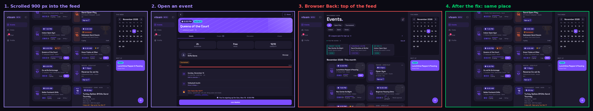
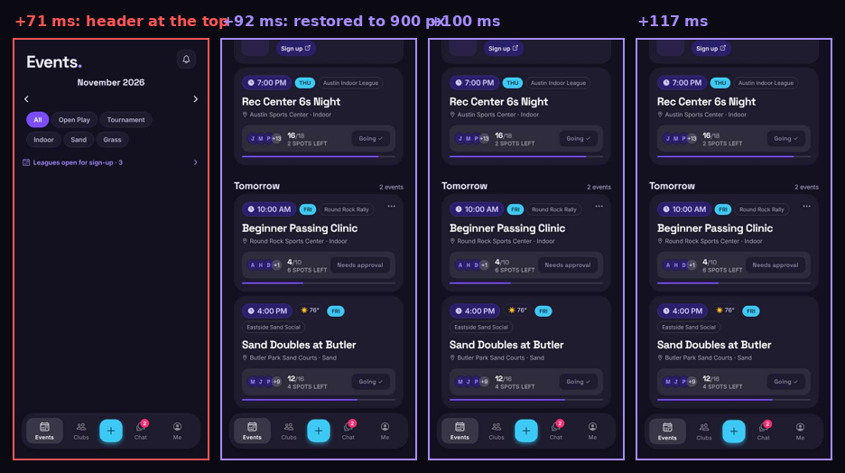
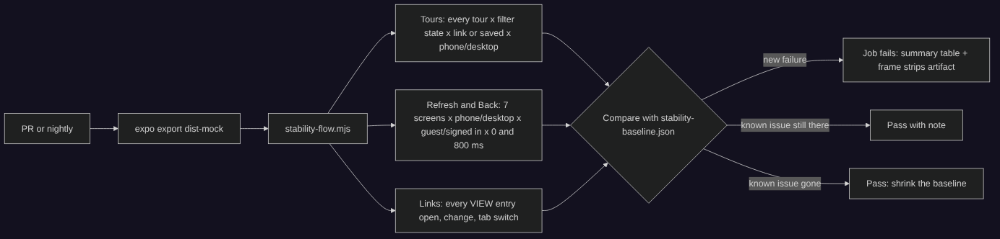
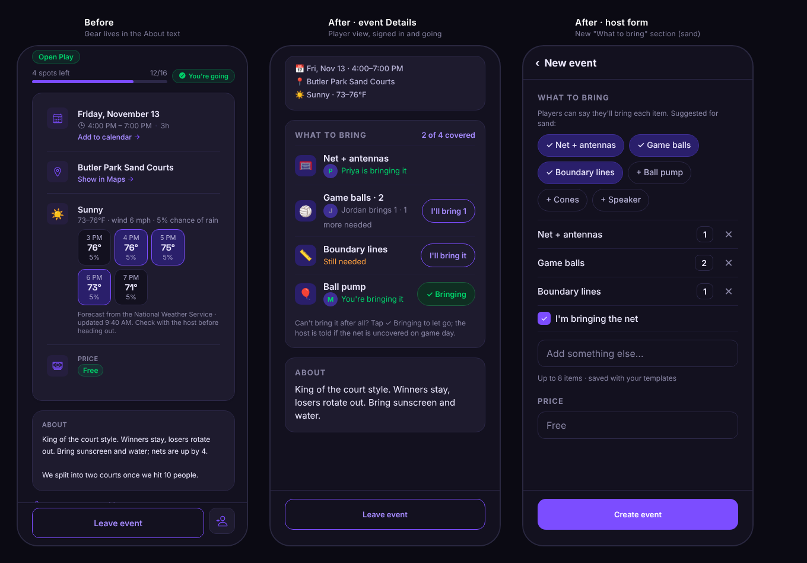
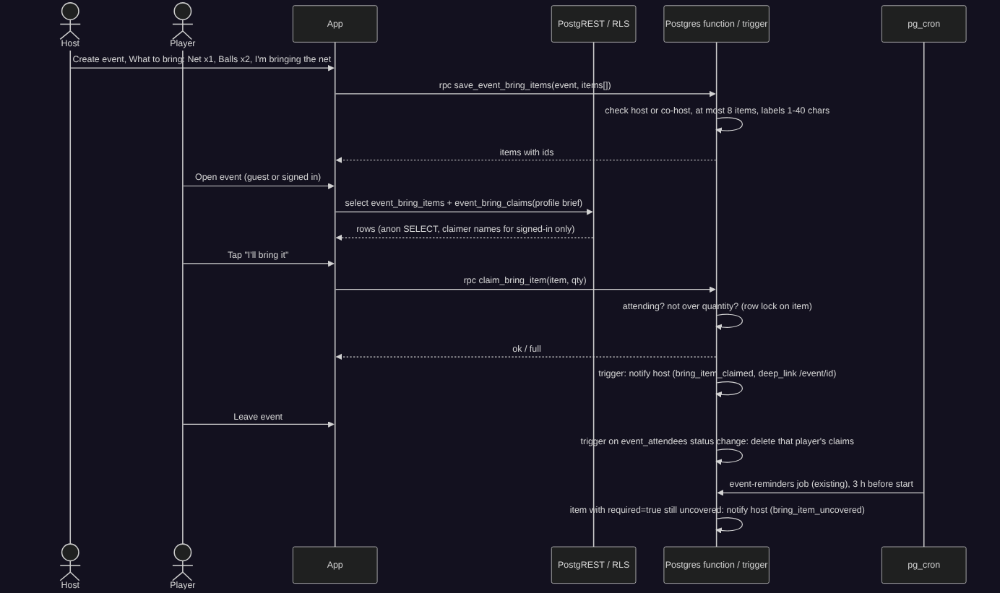

# vteam ideas: 2026-11-12

Today's three: a fix for the worst health-check finding (end-user experience), moving the health check into CI (testing), and a competitor gap (the 11-11 batch had no new feature or competitor gap).

All checks ran on a mocked web export of `main` (7b18c7d) with the preinstalled Chromium through `scripts/shots/` (fixture data only, nothing touched a database). Mock people are the shots fixtures' invented players.

## Health check

| Check | Result |
|---|---|
| 1. Tours never skip a step | **Passed.** The intro tour walked 1 → 6 with a spotlight on every step in 128 runs: from Profile's "Take the tour" with all 12 type × surface filter states, each set from a link and as the saved filter, on phone (390×844) and desktop (1280×860); from the Austin banner as a guest with 4 filter states × link/saved × both viewports; all at 0 ms and again with every Supabase response delayed 800 ms. (The scorekeeper tours start on the live match and example scoresheet, not from Profile or the banner, so they weren't walked.) |
| 2. No flicker on refresh or Back | **2 issues, 2 minor.** See below. |
| 3. Shareable links round-trip | **Passed.** 13 links covering every `VIEW` entry (feed, event, tournament, tournaments view/host, leagues, clubs, book, profile, badges, feedback, metrics, login), phone and desktop: values shown and kept in the address, a changed chip/tab followed in the address, and Events, Clubs and Profile kept their view across phone tab switches. Book's surface chip change wasn't exercised: the mock has no court calendars, so the chips don't render. |

Refresh / Back findings (7 screens × phone/desktop × guest/signed in × reload/Back, at 0 ms and 800 ms):

- **Fail (worst): desktop web, Back from an event page puts the Events feed back at the top.** Scrolled 900 px into the feed → open an event → browser Back → offset 0, every run (guest and signed in, 0 ms and 800 ms). → **Idea 1.**
- **Fail: Tournaments shifts by 294 px on load.** Club tournaments ("On vteam · 2") arrive above "Around Austin" and push it down: phone layout-shift 0.247 at 831 ms (1293 ms with the slow server), desktop 0.109 (250 px). The 0.1 "poor" line for CLS is crossed on both.
- Minor: phone web, Back to Events paints one frame (+71 ms) of the Events header at the top with the feed hidden, then the restored offset at +92 ms. The hide in `useDocScrollMemory` covers only the feed, not the header and chips above it. Folded into idea 1.
- Minor: event page on reload: the header's Share button appears late and shifts the hero 64 px (0.041 desktop, 0.076 phone), then skeleton → content moves 8 px (0.045–0.087).
- Noise: desktop Events reload 0.011 (sidebar labels settle 6–12 px); phone signed-in Events rail moved 36 px (0.036) in 1 of 3 runs.
- Not covered today: Clubs and Chat fixtures are too short to scroll; Back on Tournaments, the event page and the club page found no in-app link in view after scrolling.

<!--IDEA-->
## 1. Back to the same place on desktop: the Events feed keeps its scroll after an event page

**Bucket:** end-user-experience · **Size:** S · **Depends on:** nothing open. Touches #217 (Events screen in pieces); land first or rebase into it.

**Pitch:** On desktop web, opening a game from the Events feed and pressing Back drops you at the top of the feed every time. Give the desktop feed the same scroll memory Profile and Clubs already have, hide the whole phone screen (not just the feed) until its offset is back, and add the e2e case so it stays fixed.

### Why

- **Measured, every run.** Desktop 1280×860, signed in and guest, 0 ms and 800 ms server delay: feed scrolled to 900 px → open an event → browser Back → 0 px. Frames:



- **Root cause.** `app/(app)/(tabs)/(main)/index.tsx` (1,393 lines) has three scroll containers. Narrow web uses doc-scroll with `useDocScrollMemory('tab:events', …)` (line 247). Desktop (`if (!isMobile)`, line 564) renders a plain `ScrollView` (line 570) with no `memoryKey`, so the browser's Back remounts the tab screens and the new ScrollView starts at 0. `DocScrollView` already has the ScrollView-mode memory (`components/DocScrollView.tsx`, used by Profile's `tab:profile:<section>` and Clubs' `tab:clubs`), but Events can't use it because it needs `scrollRef` for scroll-to-day and `DocScrollView` doesn't forward its ref.
- **The phone flash.** In `useDocScrollMemory` the `visibility: hidden` goes on `feedContentRef` only. `EventsHeader`, the filter chips and the leagues link sit above it, so for one frame the header paints at the top before the window jumps to the remembered offset:



- Desktop is where hosts plan the week (sidebar layout ≥768 px); scrolling past a dozen cards to find your place again after every game page is the friction #250 fixed for Profile.

### User stories

- As a player on a laptop, after checking a game and pressing Back, I'm where I was in the feed.
- As a player on a phone browser, Back to Events never shows the top of the feed first.

### Design

- `components/DocScrollView.tsx`: wrap in `forwardRef` and expose the inner `ScrollView` ref (`useImperativeHandle` returning the ScrollView, so `scrollTo`/`getScrollableNode` keep working). No behaviour change for existing callers.
- `app/(app)/(tabs)/(main)/index.tsx` desktop branch: `<ScrollView ref={scrollRef} …>` → `<DocScrollView ref={scrollRef} docScroll={false} memoryKey="tab:events" …>`, keeping `onScroll` (load-more), `refreshControl` and `contentContainerStyle`. Same key as narrow web is fine: only one mode is active at a time, and resizing across the breakpoint already resets.
- `restoreWhenReady` tries for 30 frames (~0.5 s). With the device snapshot (`utils/feedSnapshot.ts`) the first months are there on remount; when they aren't (a snapshot older than 12 h), keep hiding until the feed has its first sections, capped by the existing 400 ms reveal timer, so it never stays hidden.
- `hooks/useDocScrollMemory.ts`: hide the screen root instead of only the feed. The Events screen passes its outer `View` (line 729) as the node to hide, keeping `feedContentRef` for `isShown`. Add an optional `hideRef` parameter so Profile/Clubs (already correct: their whole content is inside the hidden node) are unchanged.
- Native: untouched (the code paths are web-only; native keeps offsets itself). Guests: same as signed in.

### Test plan

- e2e `e2e/scrollRestore.spec.ts` (already in the CI shard with `profile.spec.ts`): add a desktop `test.describe` (1280×860) "browser Back returns to the same place on Events": scroll the inner feed to ≥800 px, open an `event-card`, `goBack()`, poll the feed's `scrollTop` ≥ y − 5. Add the phone case for Events (Pixel 7) with a check that the first frame after Back is not at 0: sample `window.scrollY` and the header's `getBoundingClientRect().top` on `requestAnimationFrame` from `popstate`, and assert no visible frame has the header at the top while the remembered offset is > 0.
- Unit: `__tests__/docScrollView.test.tsx` (new): the forwarded ref exposes `scrollTo`.
- `scripts/shots/screens.mjs`: add `events-back-desktop` (route `/`, actions: scroll, tap card, browser back) so `shots:compare` shows the restored frame.
- Idea 2's stability check covers it from then on.

### Acceptance criteria

- [ ] Desktop web: feed scrolled ≥ 800 px → event → Back (browser or the header's back) → within 1 px of the same offset, guest and signed in.
- [ ] Phone web: Back to Events never paints a frame with the header at the top when the remembered offset is > 0.
- [ ] Profile and Clubs scroll restore unchanged (existing `scrollRestore.spec.ts` cases pass).
- [ ] Scroll-to-day on the desktop calendar still works (it uses `scrollRef`).
- [ ] The new e2e cases fail on today's `main` and pass with the fix.

### Pros and cons

| Pros | Cons |
|---|---|
| Fixes a bug that happens on every desktop visit that opens a game | Touches the 1,393-line Events screen that #217 is splitting; one of the two PRs rebases |
| Reuses `DocScrollView`'s tested memory instead of a fourth copy | `forwardRef` on `DocScrollView` changes its type for every caller (compile-checked) |
| Also removes the one-frame phone flash, the same class as #250 | Hiding the whole screen on Back can show an empty frame for up to 400 ms on a slow device |
| Small (S), web-only, no backend, no data risk | Desktop-only users are a minority of players (most are on phones) |

**Verdict:** Pros outweigh the cons: it's a small, contained fix for a visible bug that hits every desktop session, with a regression test.

<!--IDEA-->
## 2. Stability check in CI: today's tour, flicker and link checks run on every PR

**Bucket:** testing · **Size:** M · **Depends on:** nothing open. Complements #225 (startup guard: request counts and timings), the axe job (#131) and `e2e/tour.guest.spec.ts`. Idea 1 should land first, or start in the baseline.

**Pitch:** Move this run's three browser checks (tours never skip, no jump or layout shift on refresh/Back, shareable links round-trip) into `scripts/shots/stability-flow.mjs`, run it in the a11y job on the mocked export, and fail a PR that adds a new finding. Known findings live in a small baseline that can only shrink, like the axe baseline.

### Why

- **The bugs Bryan found by hand were in this class.** #249 (a tour skipped a step when a filter hid its target) and #250 (Profile painted at the wrong offset and jumped) passed every test. Today's run found two more the suite misses: desktop Events loses its scroll on Back (idea 1), and Tournaments shifts 294 px on load (CLS 0.247).
- **The pieces exist.** `scripts/shots/` already serves the export with every Supabase call mocked (`serveDist`, `installSupabaseMock`, fixtures), and the a11y job already downloads `dist-mock` and runs two flows (`badge-artwork-flow.mjs`, `chat-unread-flow.mjs`) before axe. Today's scripts are about 350 lines total and ran without network or secrets.
- **Today they only run in a scheduled task**, so a regression is found a day later, after merge, and only if this task runs.

### Design



- **`scripts/shots/stability-flow.mjs`** `--dist dist-mock [--out stability-report] [--full] [--only tours,scroll,links]`:
  - *Tours*: walks every entry in `TOURS` whose first step has a `tab` or that a screen can start (`intro` today; `scorekeeper`/`scorekeeperExample` through their screens), reading "N of M" from `tour-card` and requiring a visible `tour-spotlight` box each step, for every type × surface state from a link and from `vteam.feedFilters`, phone and desktop, signed in (Profile → `take-tour`) and guest (banner). PR mode: the 12 link states + 4 saved states on both viewports; `--full` (nightly) adds the rest and the 800 ms delay.
  - *Refresh/Back*: for `SCROLL_SCREENS` (Events, Profile, Clubs, Chat, Tournaments, an event, a club; listed next to `SCREENS` in `screens.mjs` with each one's child link testID so Back is always exercised), scroll partway, then reload and Back. A page-side sampler (60 ms) records `scrollY`/inner `scrollTop`, document height, splash, spinners and `layout-shift` entries with their source nodes. Findings: first painted offset ≠ final (Back), final ≠ scrolled (Back), any shift > 0.01 after the splash, content that drops, a spinner after content. Saves a frame strip (CDP screencast) for each.
  - *Links*: one case per `VIEW` entry, written next to it in a `LINK_CASES` table (link, what must be on screen, one change and the address it must produce, tab switch on phones). `__tests__/stabilityCases.test.ts` fails when a `VIEW` key has no case, as `rlsMatrix.test.ts` does for tables.
- **Baseline:** `scripts/shots/stability-baseline.json` (`check → screen → viewport → finding kind → max value`). Today it would hold Tournaments' shift (0.25 / 0.11) and the event page's Share shift (0.08), each with an issue link. A new finding or a bigger value fails; a smaller one passes with a note and `npm run stability:baseline` writes the smaller file (same rules as `a11y-baseline.json`: never raised to get a PR through).
- **CI:** a step in the `a11y` job after `chat-unread-flow.mjs` (the export and Chromium are already there), reports into the job summary (screen, viewport, finding, numbers, link to the frame strip in the uploaded `a11y-report` artifact). Nightly `--full` in `.github/workflows/mobile-browsers.yml`'s schedule or a new `stability-nightly.yml` that opens no issues, only fails (GitHub emails the owner).
- Fixtures: make the Clubs list and a chat conversation long enough to scroll (`scripts/shots/fixtures/index.mjs`, 10 more clubs, 30 more messages) so those screens are covered.

### Test plan

- `scripts/shots/stability.test.mjs` (node:test, like `a11y.test.mjs`): the analyzer on recorded sample arrays (a jump, a late shift, a dropped section, a clean run) and the baseline diff.
- Prove it catches the known bugs: run against `main` before idea 1 (desktop Back fails) and against the commit before #250's fix (Profile jump fails), and against #249's parent (tour gap fails). Record those in the PR.
- Time budget: PR mode under 5 minutes in the a11y job (today's full matrix took ~10 min per delay with 3–4 contexts on this sandbox).

### Acceptance criteria

- [ ] `node scripts/shots/stability-flow.mjs --dist dist-mock` runs offline and writes `stability-report/index.html` + `summary.md` with frame strips.
- [ ] Fails on #249's and #250's parents and on today's desktop Events Back; passes on today's `main` with the baseline.
- [ ] Every `VIEW` entry and every tour has a case (unit test enforces).
- [ ] CI step in the a11y job adds under 5 minutes; nightly runs `--full` with the 800 ms delay.
- [ ] README in `scripts/shots/` documents findings, the baseline and how to reproduce one locally.

### Pros and cons

| Pros | Cons |
|---|---|
| Catches the bug class that slipped past every test (#249, #250, today's two) before merge | Layout-shift thresholds on a shared CI runner can be noisy; the baseline and a 0.01 floor must be tuned or it becomes a flaky gate |
| Reuses the mocked harness and the a11y job: no secrets, no beta traffic | Adds 4–5 minutes to the a11y job on every PR |
| Turns the shareable-link rules into an enforced table next to `VIEW` | Another baseline file to maintain; screens that can't scroll in fixtures need fixture work first |
| Frees this daily task to look for new problems instead of re-running fixed ones | Mock data differs from live (no real slow images or fonts), so some real-device jumps won't show |

**Verdict:** Pros outweigh the cons: the checks already work and found real bugs today; putting them in front of merges is cheap, as long as the baseline keeps the noisy ones from blocking.

<!--IDEA-->
## 3. What to bring: hosts list the net and balls, players say "I'll bring it"

**Bucket:** competitor-gap · **Size:** M · **Depends on:** #188 (host form in pieces, `save_event` RPC) if it lands first: the items save inside it; otherwise a separate RPC after the event save. Uses the existing `send_event_reminders()` job and `NOTIFICATION_TYPES`.

**Pitch:** Outdoor games depend on someone bringing the net. Let the host list what the game needs (net, balls, lines, pump), and let anyone going claim an item with one tap, so the game page shows what's covered and the host hears before game day if the net isn't.

### Why

- **Competitors have it.** TeamSnap's [Assignments](https://www.teamsnap.com/blog/teamsnap-features/take-advantage-of-the-assignments-feature-for-team-events) let a team list what each event needs and have people sign up for it, and made it free for all teams ([announcement](https://www.teamsnap.com/blog/announcements/assignments-now-free-for-all-users)). Spond's [Tasks in events](https://help.spond.com/app/en/articles/140050-tasks-in-events) lets an organiser add tasks to an event that members can take. SportMember pairs its activity calendar with [task assignment](https://www.sportmember.co.uk/en/online-calendar-for-sports-clubs-efficient-registration-amp-communication/activity-calendar-with-ride-sharing-and-task-assignment). Adapted for pickup volleyball: it's about gear, per game, and claimed by whoever is going.
- **vteam hosts already write this as free text.** The fixture sand game's About says "Bring sunscreen and water; nets are up by 4." A sand or grass game without a net doesn't happen; today nobody can tell from the page whether someone is bringing it, and the host finds out at the court.
- **Fits what's there:** sand/grass surface on events, the forecast work for outdoor games (#165), `send_event_reminders()` for a day-of nudge.

### User stories

- As a host of an outdoor game, I add "Net + antennas", "2 balls" and "Lines" when I create it (suggested by surface), and mark the net as mine.
- As a player going to the game, I tap "I'll bring it" on an item, and my reminder says "You're bringing: Lines".
- As a host, if a required item has no one 3 hours before start, I get a notification and can bring it or message the group.
- As a guest, I can see what's needed and covered; tapping "I'll bring it" asks me to join first (the join-intent flow from #229).
- As a player who leaves the game, my claims are released automatically.

### Mocks



Desktop uses the same card inside the event page's Details column (no layout change).

### Design

- **Event page:** `components/event/BringListCard.tsx` in `DetailsTab.tsx` after the date/location/weather card. Rows: item, quantity, who (avatars + names for signed-in viewers, "1 of 2 covered" for guests), and a 44 pt button: "I'll bring it" / "I'll bring 1" (quantity > 1) / "✓ Bringing" (tap to let go, with an Undo toast). Only attendees (attending, not waitlisted) can claim; others see the button disabled with "Join to bring something". Header count "2 of 4 covered"; the card is hidden when the event has no items.
- **Host form:** a "What to bring" section in `app/(app)/host.tsx` (or `components/host/` after #188): suggestion chips by surface from `constants/bringItems.ts` (sand/grass: net + antennas, balls, lines, pump, cones; indoor: balls, pump, speaker), free text (40 chars), quantity 1–6, "required" (default on for the net), "I'm bringing it" for the host. Max 8 items. Saved into templates (`user_event_templates.bring_items` jsonb).
- **Feed card:** none in v1 (open question: a small "Net needed" chip on outdoor cards within 48 h).
- **Hook:** `hooks/event/useEventBringList.ts` (`useQuery(queryKey('event-bring', id), …, { staleMs: STALE.detail })`, realtime on `event_bring_claims` for that event via `useRealtimeChannel`), mutations `claimItem` / `releaseItem` with optimistic `setQueryData`. Metrics `bring_item_claimed` / `bring_item_released` (`{ surface }`, no ids).
- **Reminders:** `send_event_reminders()` appends "You're bringing: Lines" to the claimer's reminder body.
- **Notifications:** one new type `bring_item_uncovered` (host and co-hosts, once per event, `deep_link` `/event/<id>`), sent by the same job 3 h before start when a required item has no claim. Entry in `NOTIFICATION_TYPES` + the check constraint + a switch in Settings → Notifications.
- **Account deletion / leaving:** claims cascade on `profiles` delete; a trigger on `event_attendees` deletes a player's claims when they stop attending.

### Backend



```mermaid
sequenceDiagram
  actor Host
  actor Player
  participant App
  participant API as PostgREST / RLS
  participant Fn as Postgres function / trigger
  participant Cron as pg_cron
  Host->>App: Create event, What to bring: Net x1, Balls x2, I'm bringing the net
  App->>Fn: rpc save_event_bring_items(event, items[])
  Fn->>Fn: check host or co-host, at most 8 items, labels 1-40 chars
  Fn-->>App: items with ids
  Player->>App: Open event (guest or signed in)
  App->>API: select event_bring_items + event_bring_claims(profile brief)
  API-->>App: rows (anon SELECT, claimer names for signed-in only)
  Player->>App: Tap "I'll bring it"
  App->>Fn: rpc claim_bring_item(item, qty)
  Fn->>Fn: attending? not over quantity? (row lock on item)
  Fn-->>App: ok / full
  Player->>App: Leave event
  Fn->>Fn: trigger on event_attendees status change: delete that player's claims
  Cron->>Fn: send_event_reminders() (existing job)
  Fn->>Fn: reminder adds "You're bringing: Net"; host gets bring_item_uncovered if a required item has no one
```

**Model changes**

| Object | Change | Notes (who reads / writes) |
|---|---|---|
| `event_bring_items` | new table: `id uuid pk`, `event_id → events on delete cascade`, `label text check 1–40`, `quantity smallint check 1–6 default 1`, `required bool default false`, `position smallint`, `created_at` | SELECT: anon + authenticated (like `event_tags`). No client writes: only `save_event_bring_items` |
| `event_bring_claims` | new table: `item_id → event_bring_items on delete cascade`, `user_id → profiles on delete cascade`, `quantity smallint check ≥1`, `created_at`, pk `(item_id, user_id)` | SELECT: authenticated only (names are for signed-in users, like +1 guests). No client writes |
| `event_bring_coverage` | new view (`security_invoker = false`, columns `item_id`, `claimed`) | anon + authenticated: counts only, so guests see "1 of 2" without names |
| `save_event_bring_items(p_event uuid, p_items jsonb)` | new SECURITY DEFINER RPC | authenticated; host or co-host of a not-cancelled event; replaces the list in one transaction, keeping claims on items whose id is kept |
| `claim_bring_item(p_item uuid, p_quantity int)` / `release_bring_item(p_item uuid)` | new SECURITY DEFINER RPCs | authenticated; caller must be `attending`; `select … for update` on the item so two claims can't exceed `quantity`; rate limit via `check_rate_limit` (60/h) |
| `event_attendees_release_bring_claims` | new AFTER UPDATE/DELETE trigger on `event_attendees` | deletes the user's claims for that event when status leaves `attending` |
| `send_event_reminders()` | replaced (same signature) | adds the "You're bringing" line and the `bring_item_uncovered` notification (deduped through `event_reminder_log` with a kind column, or a new `event_bring_alert_log`) |
| `notifications_type_check` | constraint replaced | adds `bring_item_uncovered` |
| `user_event_templates.bring_items` | new nullable jsonb column | owner-only like the rest of the row |

Migration sketch (`supabase/migrations/<ts>_event_bring_items.sql`): create the two tables and the view, enable RLS, `create policy … for select to anon, authenticated using (true)` on items, `to authenticated` on claims, `revoke insert, update, delete` from anon and authenticated on both, the three functions (`grant execute … to authenticated`), the trigger, the constraint replacement, the template column. `.down.sql`: drop trigger, functions, view, tables, column, and restore the previous constraint and `send_event_reminders()` body. All additive (expand only).

RLS expectations: `e2e/rls/matrix.ts` rows `event_bring_items: { anonSelect: 'all', anonInsert: 'none', why: 'what a game needs shows on the public event page' }`, `event_bring_claims: { anonSelect: 'none', anonInsert: 'none', owner: { column: 'user_id', ownRowsOnly: false, noInsertAsOther: true } }`; `e2e/rls.spec.ts`: a guest can't call `claim_bring_item` (42501), the e2e account can't claim on an event it isn't attending, and can't call `save_event_bring_items` for someone else's event.

### Test plan

- Unit: `utils/bringList.ts` (pure: coverage counts, button state per viewer, suggestions per surface) in `__tests__/bringList.test.ts`.
- pgTAP (#150's harness, if landed): over-claim refused under concurrency, release on leave, cascade on account deletion, reminder line text.
- RLS: the matrix rows and `rls.spec.ts` cases above (`api` shard).
- e2e: `e2e/bringList.spec.ts` (signed-in shard): host creates an outdoor event with two items under the `[e2e <tag>]` prefix, the buddy-free path: e2e account joins, claims, sees "✓ Bringing", leaves, claim gone; guest view shows counts without names (`bringList.guest.spec.ts`).
- Shots: fixtures for `event_bring_items` / claims on `sundaySand`; screens `event-bring-list` (signed in) and `event-bring-list-guest`, `host-create-bring`.

### Acceptance criteria

- [ ] Host can add up to 8 items (suggested by surface) when creating or editing an event and in templates.
- [ ] Attending players claim and release items in one tap; a claim never exceeds the item's quantity.
- [ ] Guests see items and coverage counts, not names; tapping claim starts the join-intent flow.
- [ ] Leaving the event (or deleting the account) releases the player's claims.
- [ ] Claimers' reminder lists what they're bringing; hosts get one `bring_item_uncovered` notification 3 h before start for uncovered required items (push honours the new switch).
- [ ] No card when an event has no items; 44 pt targets; works on native, mobile web, desktop web.
- [ ] Migration has its `.down.sql`, tested on beta through `apply_pr_migration`; RLS matrix rows added.

### Pros and cons

| Pros | Cons |
|---|---|
| Solves a real failure for outdoor games (no net, no game) that the About text can't track | Two tables, three RPCs, a trigger and a reminder change: M-sized backend for a small UI |
| Proven in TeamSnap and Spond; nothing similar in vteam or the venue sessions | Another section in an already long host form (#188 should land first) |
| Gives players a light way to help the host, and the host a heads-up before game day | Indoor games rarely need it, so it's mostly for sand/grass hosts |
| Reuses reminders, notifications, join-intent and realtime instead of new infrastructure | Claim-then-forget is possible; the only nudge is the reminder line |
| Template support means regular hosts set it once | Changes `send_event_reminders()`, which every reminder depends on (needs pgTAP or careful beta testing) |

**Verdict:** Pros outweigh the cons for outdoor hosts, who are a large share of Austin's games; keep v1 to the event card, host section and reminder line, and leave the feed chip for later.
