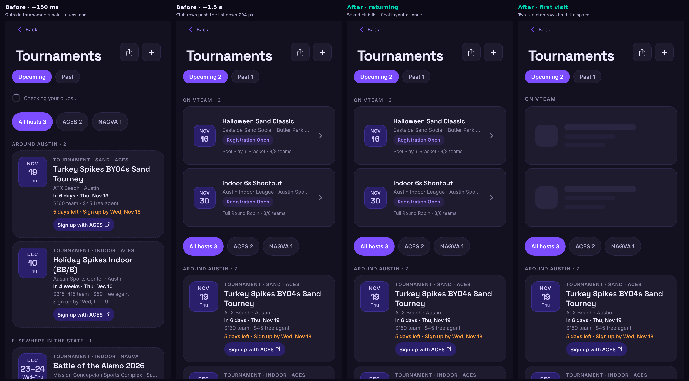
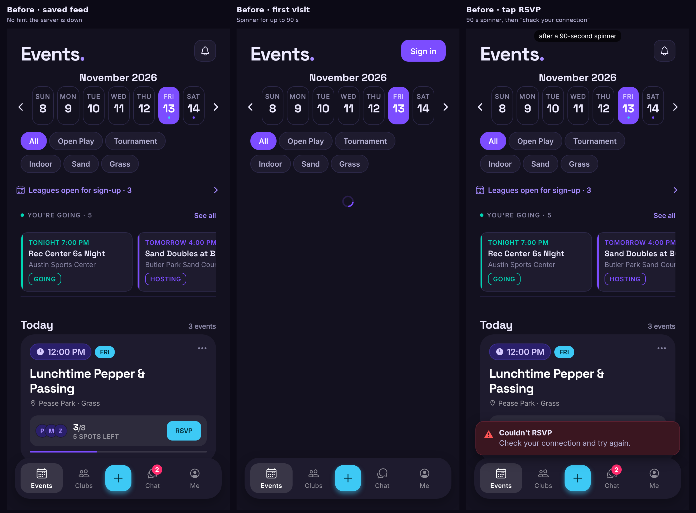
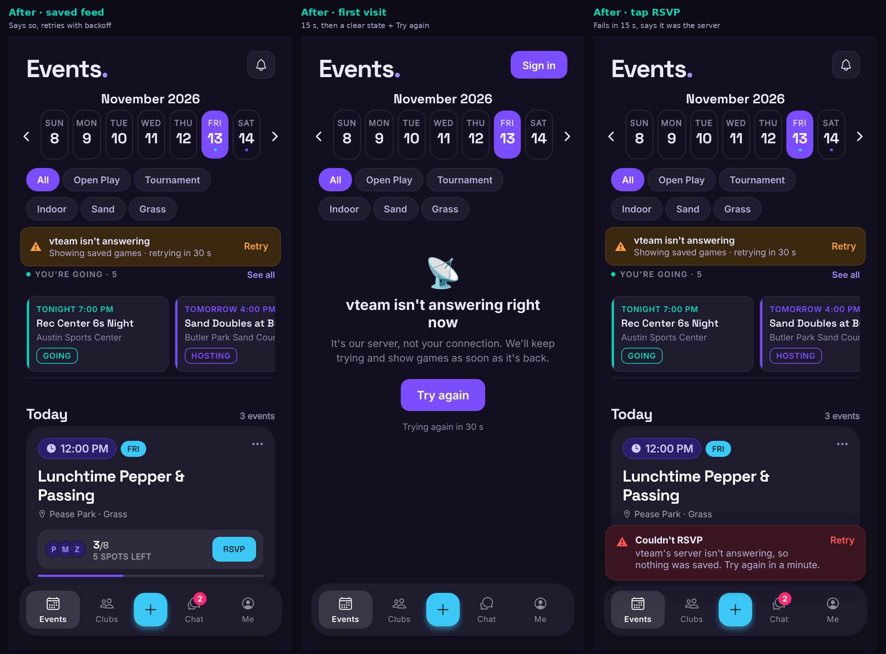
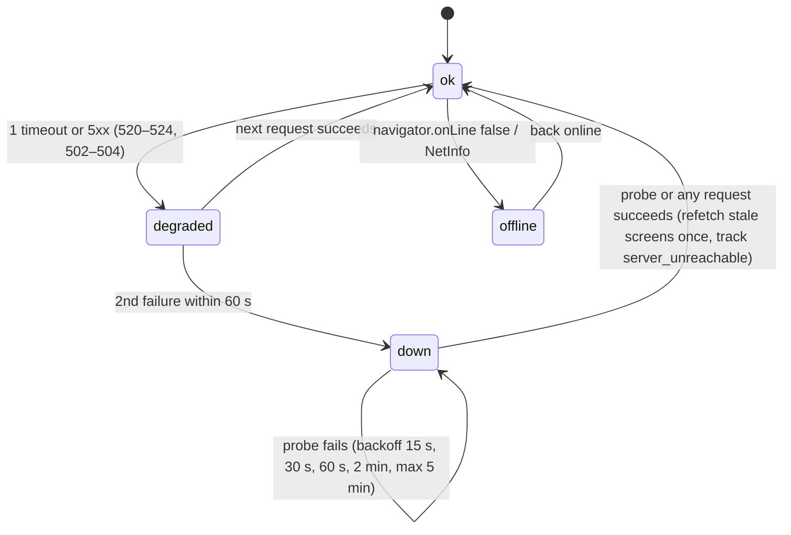
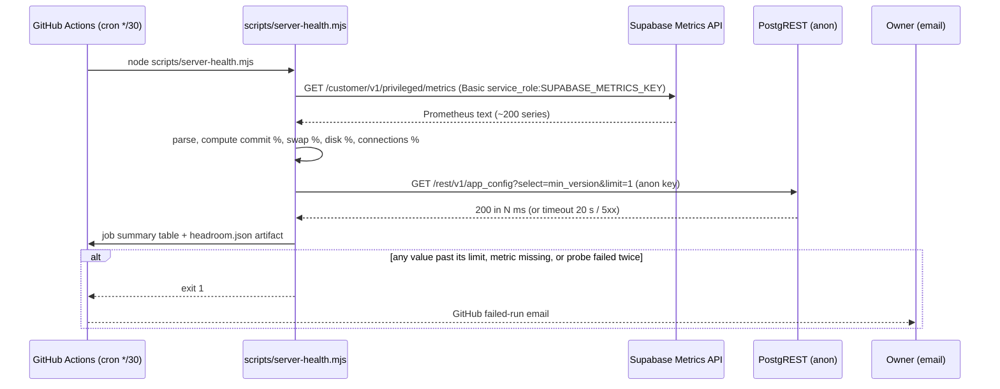

# vteam ideas: 2026-11-13

Today's three: a fix for the worst health-check findings (end-user experience), a latency idea grounded in yesterday's 3 h 40 min outage, and a testing/monitoring idea from the same outage. No new feature or competitor gap today: the 11-12 batch had one (What to bring).

All browser checks ran on a mocked web export of `main` (8d6d1f0) with the preinstalled Chromium through the repo's own `scripts/shots/stability-flow.mjs --full` (now in CI since #259), fixture data only. Server numbers are read-only reads of live's edge logs and `pg_stat_statements`. Mock people are the shots fixtures' invented players.

## Health check

| Check | Result |
|---|---|
| 1. Tours never skip a step | **Passed.** 128 walks of the intro tour (Profile's "Take the tour" with all 12 type × surface states from a link and saved; Austin banner as a guest), phone and desktop, 0 ms and 800 ms server: 1 → 6 every time with a spotlight on each step. |
| 2. No flicker on refresh or Back | **2 issues (1 new vs the baseline).** 88 cases. **New:** club page, phone, Back with a slow server paints at 0 px for one frame, then 1,322 px (signed in) / 617 px (guest). Same swap Bryan accepted at 0 ms on 11-13, but the baseline only has the 0 ms key, so **last night's `stability-nightly` (`--full`) run failed** (18:06 UTC, 0fd6390) and will fail every night. **Known, still open:** Tournaments shifts 294 px when club tournaments arrive (CLS 0.247 phone @800 ms, 0.109–0.122 desktop): the worst visible one. → **Idea 1.** |
| 3. Shareable links round-trip | **Passed.** 28 cases over every `VIEW` entry, phone and desktop, including tab switches on phone. |

Other numbers:

- **Fixed since yesterday** (#260): Events Back on desktop now restores (259 px miss → 0) and the phone one-frame flash is gone (794 → 0); desktop Events reload shift 0.011 → 0; phone event-page reload 0.093 → 0. 7 baseline entries can shrink (`npm run stability:baseline`).
- Event page reload: the header Share button arrives late and moves 64 px (CLS 0.041 desktop), skeleton → content 8 px (0.045–0.087 @800 ms). Unchanged, in the baseline.
- Not exercised: 32 cases (Clubs/Chat fixtures too short to scroll; no child link partway down on the event page).
- **Server since the Micro upgrade** (edge logs, 02:50–18:30 UTC today): `get_feed_span` p50 200 ms / p90 366 ms (was p90 3.6 s on 11-04), profile reads p50 ~50 ms, no response over 1 s. The cold-server problem is gone for now; the client is the slow part again.

<!--IDEA-->
## 1. Tournaments stops jumping, and the club page comes back without a flash

**Bucket:** end-user-experience · **Size:** S · **Depends on:** nothing open. Builds on #250/#260 (same scroll-memory hide) and #259 (stability baseline).

**Pitch:** On Tournaments the outside list paints from the device, then your clubs' tournaments land on top and shove everything down 294 px. Keep the club list on the device too and hold its space while it loads. Give the club page the same whole-screen hide that fixed Events on Back, which also turns last night's red nightly check green.

### Why

- **Measured** (stability flow, signed in, reload): phone with an 800 ms server, one shift of **0.247** at +1,025 ms: `[tournaments-list] "All hosts 3 · ACES 2 · NAGVA 1 · AROUND AUSTIN"` moved **294 px**; desktop 0.109–0.122 (250 px) at 0 ms and 800 ms. Google's "poor" line for CLS is 0.1. Three days running.

- **Root cause.** `app/(app)/tournaments.tsx` renders outside programs (`useExternalPrograms`, key prefix `external-programs`, which is in `SNAPSHOT_PREFIXES`) as the `FlatList` footer, so they paint from localStorage at once. The club list (`useTournamentList`, key `tournaments:list:<user>`) is **not** snapshotted: a one-line "Checking your clubs…" header (≈40 px) holds its place, then the "On vteam · 2" header and two 136 px rows replace it above the footer.
- **Club page Back** (`app/(app)/club/[id].tsx`, `DocScrollView memoryKey="club:<id>"`, phone doc-scroll): the restore hides only the scroll content, so the page paints at 0 px for one frame (+59 ms), then jumps to 1,322 px. At 0 ms this is accepted in `stability-baseline.json`; the `@slow` variant isn't, so `stability-nightly.yml` failed at 18:06 UTC today and will keep failing. #260 fixed the identical problem on Events with `useDocScrollMemory(…, hideRef)`.

### User stories

- As a club member opening Tournaments, the list I see first is the list that stays.
- As a player coming back from a game to a club page, I land where I was without seeing the top flash by.

### Design

- `lib/querySnapshot.ts`: add `'tournaments:list'` to `SNAPSHOT_PREFIXES` (matches `tournaments:list:<user>` via `startsWith(p + SEP)`, not tournament detail keys). It is per viewer and only ever shown to that viewer (`useCacheUserScope` drops it on a viewer change), and a member's club tournaments are no more private than their clubs on Profile. Snapshot only the next 60 days of upcoming plus the latest 20 past (trim in a `snapshotShape` for that key) so the 200-row read doesn't bloat storage.
- `app/(app)/tournaments.tsx`: replace the "Checking your clubs…" line with `ClubTournamentsSkeleton` (new, `components/tournament/`): the "On vteam" header plus 2 skeleton rows at `TournamentRow`'s height (first visit only; returning viewers have the snapshot). If fewer come back, the extra rows collapse; nothing is ever inserted above content already on screen. The error retry row keeps its place.
- `components/DocScrollView.tsx`: new optional `hideRef` prop, passed to `useDocScrollMemory` (doc-scroll) and used by the ScrollView-mode hide. `app/(app)/club/[id].tsx` passes its root `View` ref, so the header and cover are hidden with the content until the offset is back (still capped at 400 ms).
- Native: unchanged (snapshots are web-only; native keeps offsets itself). Guests: unchanged (no club list; their outside list never shifted).
- Follow-up, not in scope: the event page's late Share button (64 px).

### Test plan

- Unit: `__tests__/querySnapshot.test.ts`: `tournaments:list:<id>` is a snapshot key, `tournament:<id>` is not, and the trim keeps upcoming + 20 past.
- Stability: after the fix, `npm run stability:baseline` removes `scroll/tournaments` (all 4 keys) and `scroll/club`, and the 7 entries #260 already improved. Add a first-visit (no snapshot) Tournaments case to `SCROLL_SCREENS` in `scripts/shots/stabilityCases.mjs` so both paths are covered.
- e2e: `e2e/scrollRestore.spec.ts` gets a phone club-page Back case with a 800 ms route delay.
- Startup budget: Tournaments' `paintMs` should drop for a returning viewer; run `npm run startup:baseline`.

### Acceptance criteria

- [ ] Tournaments, returning viewer, phone and desktop, 0 ms and 800 ms: no layout shift above 0.01 after the splash.
- [ ] Tournaments, first visit: total CLS under 0.1 on both viewports.
- [ ] Club page, phone, Back at 0 ms and 800 ms: first painted offset equals the restored one.
- [ ] `stability-nightly.yml` passes; the baseline only shrinks (tournaments and club entries removed).
- [ ] The club tournament snapshot is dropped on sign-out / viewer change (existing `useCacheUserScope` test extended).

### Pros and cons

| Pros | Cons |
|---|---|
| Fixes the worst open visible finding (CLS 0.247, 294 px) that has shown up three days running | One more per-viewer snapshot to keep correct (privacy rule, size trim) |
| Turns last night's red nightly check green without accepting a new baseline entry | Skeleton rows are a guess on first visit: a member of no tournament clubs sees 2 rows collapse (below everything else, but still motion) |
| Reuses #260's `hideRef` and the existing snapshot machinery: ~80 lines, no backend | A snapshot can show a cancelled club tournament for the second until the refetch lands |
| Tournaments paints complete for returning members, ahead of tomorrow's Texas AO weekend traffic | Doesn't touch the event page's 64 px Share shift (left for later) |

**Verdict:** worth it. Small, measured, and it fixes both the worst open finding and a nightly check that is failing right now.

<!--IDEA-->
## 2. When the server stalls: 15-second timeouts, saved screens that say so, and no request pile-up

**Bucket:** latency · **Size:** M · **Depends on:** nothing open. Builds on the device snapshots (#184 era), `lib/toast` (#228) and usage tracking (#232).

**Pitch:** During yesterday's outage every request waited **90 seconds** before failing, a returning player saw their saved feed with no hint that nothing would work, a first-time visitor saw a spinner for a minute and a half, and one browser kept sending heartbeats and token refreshes into the dead server the whole time. Put a time limit on every request, notice when the server is down, say so in one calm bar, back off, and recover by itself.

### Why

- **Outage, 22:45–02:30 UTC Nov 12–13** (edge logs, read-only): requests with origin time over 30 s per hour went 8 → 41 → **546 → 1,138** → 78 → 0; hourly p50 origin time **90,021 ms** at the peak. `app_heartbeat` p50 90,020 ms over 1,868 calls; `auth/v1/token` 118 calls, p50 19.5 s / p90 90 s; all from **one IP** (3 user agents), i.e. one person's open tabs kept every request pending for 90 s and started a new one every minute.
- **What players saw** (mocked export, every Supabase request hanging): a returning viewer gets the saved feed with no sign of trouble; tapping RSVP spins until the request dies, then says "Check your connection and try again", which is wrong, their connection is fine. A first-time visitor sees the Events spinner indefinitely.

- **Code.** `lib/supabase.ts` passes no `global.fetch`, so supabase-js uses `fetch` without a timeout. `lib/query.ts` has no timeout or backoff; focus refetches fire against a dead server. `lib/analytics.ts` heartbeats every 60 s (`HEARTBEAT_MS`) regardless of failures. `lib/toast.ts`'s `isNetworkError` lumps timeouts with being offline.
- **Latency framing.** Today's normal p90 is under 400 ms, so a 15 s limit costs nothing on a healthy day and turns a 90 s wait into 15 s on a bad one; the snapshots already make the feed paint instantly, this makes the rest of the app honest about it.

### User stories

- As a player opening vteam while the server is down, I see my saved games and a line saying vteam isn't answering, instead of a feed that silently won't work.
- As a first-time visitor during an outage, I get a clear message within 15 seconds and a Try again button, not a minute-long spinner.
- As a player whose RSVP fails, I'm told it was the server and nothing was saved, so I know to try again rather than check my Wi-Fi.
- As the owner, a stuck server isn't hammered by heartbeats and refetches from every open tab.

### Design

- `utils/serverHealth.ts` (new, pure, unit-tested): the state machine above, `classify(response | error)` → `ok | timeout | server | offline | client` (4xx and RLS errors never count), `nextProbeDelay(n)`.
- `lib/serverHealth.ts` (new, module-level like `lib/toast`): holds the state, `subscribe`, `useServerHealth()`, runs the probe while `down` (`GET /rest/v1/app_config?select=min_version&limit=1` with the anon key: tiny, anon-readable, already read at startup), pauses while the page is hidden.
- `lib/supabase.ts`: `global: { fetch: timedFetch }`, which adds an `AbortController` timeout (15 s REST reads and RPCs, 20 s writes and `auth/v1/token`, none for Storage uploads) and reports each outcome to `lib/serverHealth`. Realtime is untouched.
- `lib/query.ts`: while `down`, skip focus/interval refetches (`useFocusRefetch`, `refetchMs`); explicit `refetch({ force: true })` still runs. On `down → ok`, refetch the stale keys of mounted queries once.
- `lib/analytics.ts`: heartbeat and flush skip while `down` (the buffer is kept, capped as today); one `server_unreachable` {ms, cause, screen} event on recovery (add to `ANALYTICS_EVENTS`).
- `lib/toast.ts`: `toast.error` says `SERVER_DOWN_MESSAGE` ("vteam's server isn't answering, so nothing was saved. Try again in a minute.") for timeouts and 5xx, `NETWORK_ERROR_MESSAGE` only when offline. New strings in `constants/copy.ts`.
- `components/ServerStatusBar.tsx` (new): one warning-tinted bar (`toastWarningBg`, `warning`), role `alert` once, "vteam isn't answering · Showing saved games · retrying in 30 s" + Retry (44 pt); "You're offline" variant. Rendered once in `app/(app)/_layout.tsx` at the top of the content column (all screens, all three surfaces, under the safe area); on Events it replaces the existing `FEED_STALE_NOTICE` row while `down`.
- `components/ui/ScreenState.tsx`: when the error is a server-down error and there is no data, show the "vteam isn't answering right now" empty state with Try again and the next retry time, instead of the generic error.
- Guests: identical. Native: same code (NetInfo for offline). No backend change.

### Test plan

- Unit: `__tests__/serverHealth.test.ts` (transitions, classification: 401/403/406/PGRST errors never count, backoff sequence); `__tests__/timedFetch.test.ts` (abort at the limit, no limit for Storage uploads); `toast.error` message by cause.
- Shots: new `scripts/shots/outage-flow.mjs` on the mocked export: (a) returning viewer, every Supabase route hangs → bar visible ≤ 16 s, feed still shown; (b) first visit → server-down state ≤ 16 s; (c) RSVP → toast with `SERVER_DOWN_MESSAGE` ≤ 21 s; (d) count Supabase requests over 5 simulated minutes (`page.clock`): heartbeats ≤ 1 while down, probes follow the backoff; (e) un-hang → bar gone, feed refetched once. Run it in CI's `a11y` job after the stability flow.
- e2e: `e2e/outage.spec.ts` (guest shard): route Supabase to 522 and check (b) and recovery.
- a11y: the bar and the state are in the axe run via a `SCREENS` entry with `?mock=outage`.

### Acceptance criteria

- [ ] No Supabase request from the app waits longer than 15 s (reads) / 20 s (writes, token refresh); uploads are exempt.
- [ ] With the server hanging, a returning viewer sees the status bar within 16 s and keeps the saved feed; a first visit shows the server-down state within 16 s.
- [ ] A failed write during an outage says it was the server, not the connection.
- [ ] While down: 0 heartbeats and 0 analytics flushes; probes follow 15 s → 5 min backoff; focus refetches are skipped.
- [ ] Recovery is automatic: bar disappears and visible screens refetch once within one probe interval; `server_unreachable` recorded with its duration.
- [ ] Healthy-server behaviour unchanged: startup budget and stability flow pass with no new findings.

### Pros and cons

| Pros | Cons |
|---|---|
| Directly answers yesterday's outage: 90 s waits become 15 s, and players are told the truth | A timeout can cut off a legitimately slow request (a cold Supabase after idle took ~10 s pre-Micro); 15/20 s leaves room, but needs watching via `server_unreachable` |
| Stops one tab's heartbeats and refetches piling onto a struggling server (1,868 heartbeats from one IP) | Touches the request path every screen uses (`lib/supabase`, `lib/query`): a bug there affects everything, so it needs the outage flow in CI |
| Fixes a wrong message ("check your connection") that sends players to debug their Wi-Fi | One more global bar to keep calm: false positives on flaky phone networks would annoy (mitigated by needing 2 failures) |
| No backend, no new tables; testable entirely on the mocked export | Doesn't prevent outages (idea 3 is for that) and does nothing for the native apps' AsyncStorage gap (no snapshots there yet) |

**Verdict:** worth it. The outage showed exactly what happens without it, the cost is bounded to the client, and it makes every future incident shorter for players.

<!--IDEA-->
## 3. Server headroom watch: hear about memory, disk and connections days before the server freezes

**Bucket:** testing · **Size:** S · **Depends on:** a new repository secret (a dedicated Supabase Secret API key). Builds on #157 (job health) and the 11-12 outage root cause doc.

**Pitch:** Yesterday's outage was visible for a week before it happened: committed memory sat at 1.26–1.36 GB against a 1.4 GB cap. Nothing watches that. A 30-minute GitHub workflow reads Supabase's Metrics API for live, checks memory commitment, swap, disk and connections against limits, probes the REST API, and fails (emailing you) with a table when anything crosses a line.

### Why

- **Root cause doc (`claude/outage-2026-11-12-root-cause.md`):** committable memory hit 1.42 GB at 1:32 PM CT and 1.53 GB at 3:32 PM against a 1.4 GB limit; the freeze followed at 3:44 PM and lasted 3 h 40 min. CPU was 97% idle, traffic was two or three people: nothing in the app could have shown it coming.
- **What we have today doesn't catch it.** `job-health.yml` runs every 3 hours and needs the database to answer (`public.job_health()`), so it fails only once the server is already frozen, at best 3 hours in. `feed-freshness.yml` pages after about three missed imports. Neither sees headroom.
- **Now on Micro:** usage 1.19 of 1.88 GB (63%) after the move; the doc's own follow-up is "if it stays above about 80%, move to Small" and "consider an alert reading the commitment metric". This is that alert.
- **Supabase supports it:** every project exposes a Prometheus endpoint at `https://<ref>.supabase.co/customer/v1/privileged/metrics` with HTTP Basic auth (`service_role` + a Secret API key) refreshed every minute ([Metrics API docs](https://supabase.com/docs/guides/observability/metrics)).

### User stories

- As the owner, I get an email when live's memory commitment passes 80%, days before it can freeze, with the number and the fix (move up a compute size).
- As the owner, when live stops answering, I hear within 30 minutes, not after players tell me.

### Design

- `scripts/server-health.mjs` (new): `HEADROOM` limits in one map, e.g. memory commitment (`node_memory_Committed_AS_bytes / node_memory_CommitLimit_bytes`) warn 80% / fail 90%; available RAM < 10%; swap used > 70%; data disk (`node_filesystem_avail_bytes` for the data mount) used > 80%; backends > 80% of `max_connections`; REST probe > 10 s or non-2xx on two tries 60 s apart. A metric name that is missing fails the run ("metric missing: …") so a renamed series never passes silently. Pure parsing and judging (`parsePrometheus`, `judge`) exported for tests, like `scripts/job-health.mjs`'s `evaluate`.
- `.github/workflows/server-health.yml` (new): `*/30` cron + `workflow_dispatch`, 3-minute timeout, `node scripts/server-health.mjs --project live`; writes the table to `$GITHUB_STEP_SUMMARY` and uploads `headroom.json` (90-day retention) so trends can be read back.
- Secrets: a dedicated Secret API key for live created in Project Settings → API Keys ("ci-metrics"), stored as repository secret `SUPABASE_METRICS_KEY`; never logged (`::add-mask::`). The key could read data, so it is used only for the metrics endpoint, and the workflow has `permissions: contents: read`. Beta is skipped (Free org, no real users); `--project beta` works when a key is set.
- Warnings (80–90%) make the run fail with a "warning" label in the summary rather than pass quietly, since a failed run is the only alert channel; at most one email per 30 minutes while it lasts.
- No schema change, no app change. Add a line to CLAUDE.md under "Job health".

### Model changes

| Object | Change | Notes |
|---|---|---|
| Repository secret `SUPABASE_METRICS_KEY` | New | Secret API key for live, used only against `/customer/v1/privileged/metrics`; rotatable on its own |
| `.github/workflows/server-health.yml` | New | Cron every 30 min; read-only; no database writes |
| Database | None | Reads only the Metrics API and one anon REST read |

### Test plan

- Unit: `__tests__/serverHealth.script.test.ts` with a fixture Prometheus payload: parsing (labels, NaN, comments), each limit's pass/warn/fail, missing-metric failure, probe retry rule, and that the summary never contains the key.
- Replay: a fixture shaped like 11-12 at 1:32 PM CT (commit 1.42 of 1.4 GB, swap 95%) must fail with "memory commitment 101%"; today's Micro numbers (63%) must pass.
- First run by hand (`workflow_dispatch`) after adding the secret; confirm the metric names on live and adjust `HEADROOM` if Supabase names differ.

### Acceptance criteria

- [ ] `server-health.yml` runs every 30 minutes on live and shows commit %, RAM, swap, disk, connections and probe latency in the job summary.
- [ ] Any value past its limit, a missing metric, or two failed probes fails the run (GitHub emails the owner).
- [ ] The 11-12 replay fixture fails; the current Micro fixture passes.
- [ ] The secret never appears in logs or the summary.
- [ ] CLAUDE.md "Job health" mentions the new check and its limits.

### Pros and cons

| Pros | Cons |
|---|---|
| Would have warned about yesterday's outage days in advance (commit at 90–97% of the cap all week) | Adds a powerful secret to GitHub Actions; a dedicated, rotatable key and read-only workflow limit the blast radius |
| Catches a frozen server within 30 minutes even when the database can't run `job_health()` | Metrics API is in beta: names may change (the missing-metric rule turns that into a loud failure, not a silent pass) |
| Tiny: one script, one workflow, no schema or app change | 48 runs a day of Actions minutes (~1 min each, well inside the free tier for a public repo or Pro) |
| Gives the right compute-size decision data (the doc's "move to Small above 80%") | Email is the only channel; no phone push unless Bryan routes GitHub emails to one |

**Verdict:** worth it. It is the alert the outage write-up asked for, cheap to run, and the only check that sees trouble before players do.
