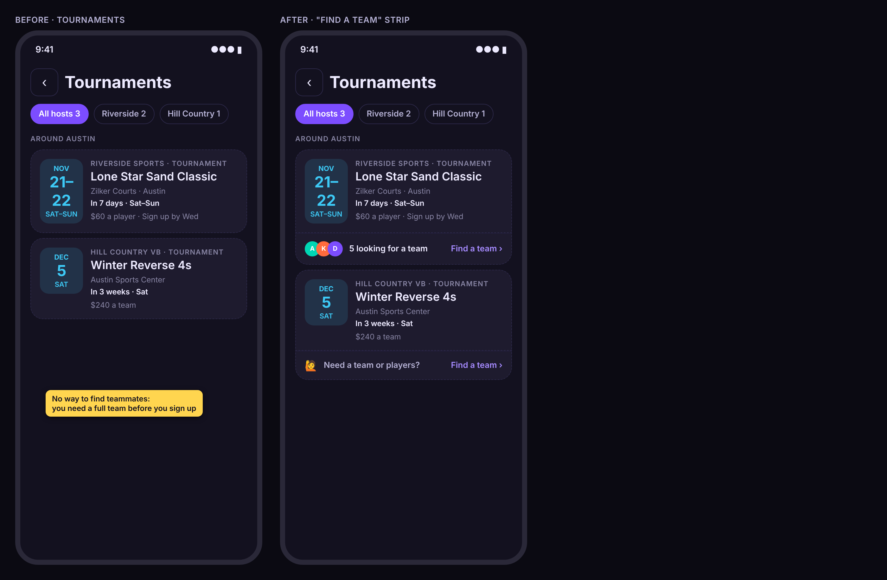
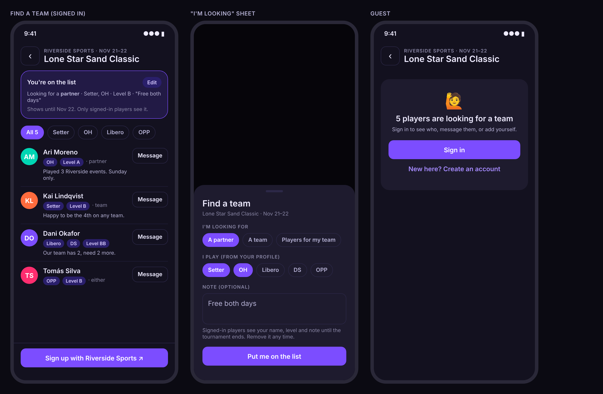
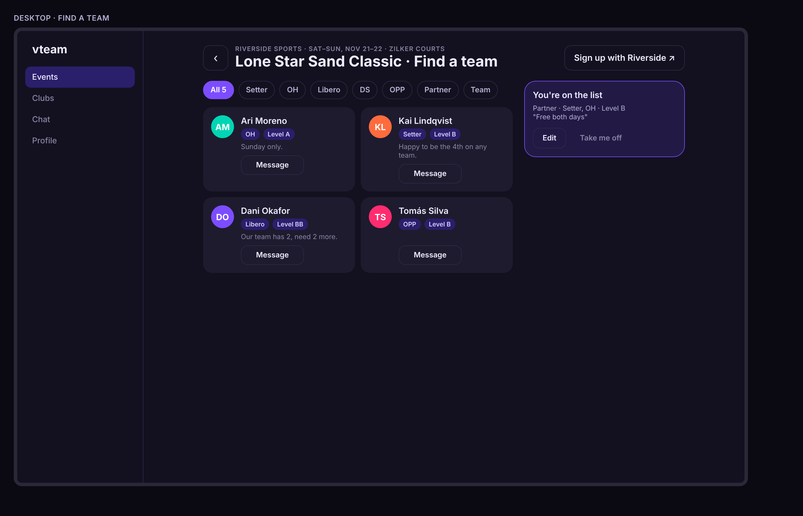
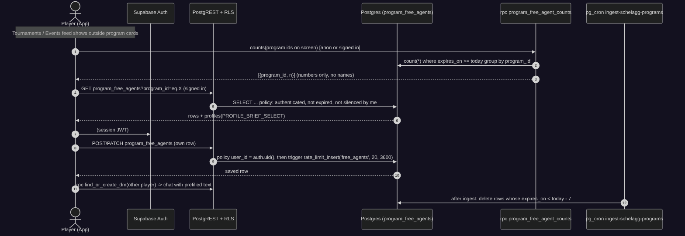
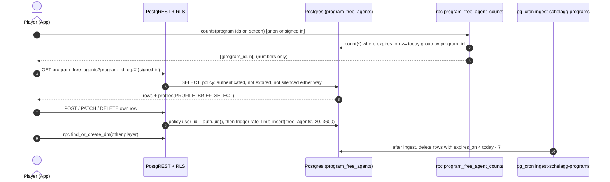
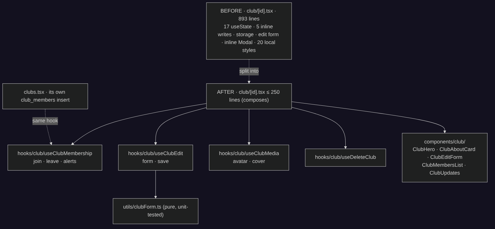
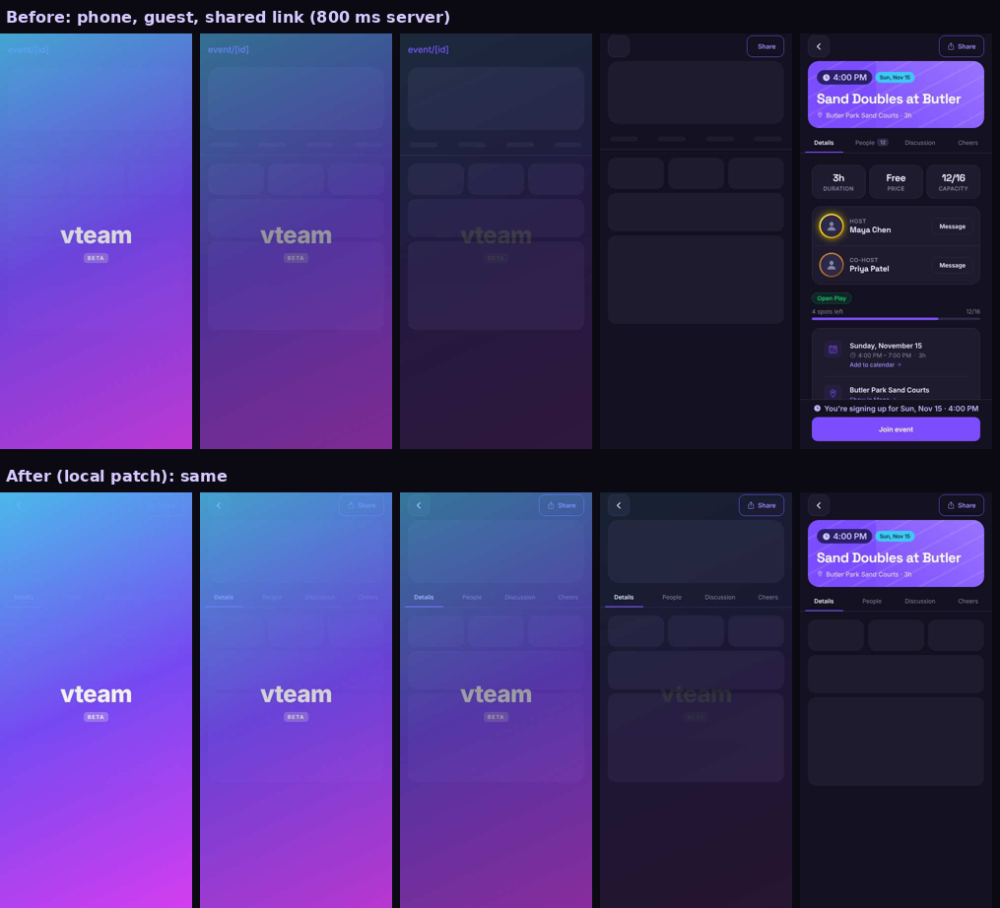
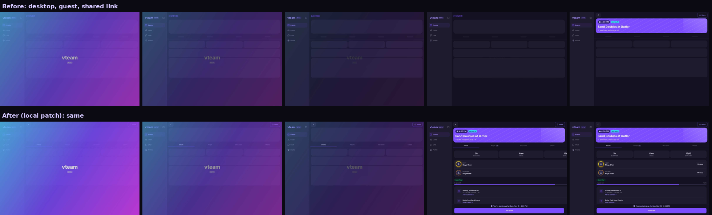

# vteam ideas: 2026-11-14

Today's three: a **competitor gap** (the 11-13 batch had no new feature or competitor gap, so today includes one), a **refactor**, and an **end-user-experience** fix found while running the health check.

All browser checks ran on a mocked web export of `main` (424b50d) with the preinstalled Chromium, through the repo's own `scripts/shots/stability-flow.mjs --full` plus a one-off scan of every `SCREENS` route for raw route names in visible text. Fixture data only. Server numbers are read-only `pg_stat_statements` reads on live. Mock people and tournaments are invented.

## Health check

| Check | Result |
|---|---|
| 1. Tours never skip a step | **Passed.** 128 walks of the intro tour (Profile's "Take the tour" under all 12 type × surface states from a link and saved; Austin banner as a guest), phone and desktop, 0 ms and 800 ms server: 1 → 6 every time with a spotlight on each step. |
| 2. No flicker on refresh or Back | **Passed** (no finding beyond `stability-baseline.json`). 92 cases. 7 known findings, all on the event page (below). Improved: phone event reload 0.093 → 0.019 (the baseline can shrink). Yesterday's club and Tournaments findings (#288/#292) are gone. |
| 3. Shareable links round-trip | **Passed.** 30 cases over every `VIEW` entry, phone and desktop, including tab switches on phone. |

Other findings (not regressions; one becomes Idea 3):

- **New, not covered by any check: the event page shows the raw route name `event/[id]` as a header** while its lazy chunk loads, on phone and desktop, signed in and as a guest, 0 ms and 800 ms servers (visible text from ~270 to ~490 ms after navigation in the mock; on a real phone it lasts as long as the chunk download). Every other route in `SCREENS` (36) is clean. → **Idea 3**.
- Event page reload, known: desktop guest header row arrives late and pushes the page down 64 px (CLS 0.041); the skeleton is replaced 8 px lower for signed-in viewers (0.045 desktop, 0.087 phone @800 ms); the stats row reflows on phone (0.019).
- Not exercised: 32 cases (Clubs/Chat fixtures too short to scroll; no child link partway down on the event page), same as yesterday.
- Server: the busiest statement on live is Realtime's WAL poll (21k calls, 5.9 ms mean); the app's own RPCs and cron jobs are all under 250 ms mean. The server isn't the slow part today.

<!--IDEA-->
## 1. Find a team: players looking for a tournament or league team, right on the card

**Bucket:** competitor-gap · **Size:** M · **Depends on:** nothing open. Builds on the Schelagg programs feed (`external_programs`, `ExternalProgramCard`), DMs (`find_or_create_dm`) and the rate-limit triggers (#11).

**Pitch:** Outside tournaments and leagues (NAGVA, ACES, ASSC, the Texas Asian Olympics) need a full team or a partner before you can sign up, and vteam can't sign you up anyway. Give each card a **Find a team** strip: players put themselves on a per-tournament list ("partner", "team", or "players for my team", with positions, level and a note), and signed-in players browse it and tap **Message**.

### Why

- **It's the one thing vteam can add to outside programs.** The card only links out (`components/ExternalProgramCard.tsx`): no RSVP, no roster. The hard part for a solo player is finding teammates before the deadline, and that happens today in group chats.
- **Competitors treat it as core.** Volo runs individual / free-agent sign-ups and places free agents onto teams ([How do individual / free agent registrations work?](https://help.volosports.com/support/solutions/articles/29000049627), [I'm a solo player](https://help.volosports.com/support/solutions/articles/29000049628-i-m-a-solo-player-free-agent-can-i-still-play-)); OpenSports lets organizers assign free agents to teams ([OpenSports](https://opensports.net/blog/view-registrations-and-assign-free-agents-to-teams-on-the-web)); rec departments keep "player & team finder" directories ([UBC Rec](https://recreation.ubc.ca/intramurals/free-agent-single-participants/free-agent-directory/)). vteam is not the organizer, so the adaptation is a **finder list** that ends in a DM, not team assignment.
- **The data is already there:** `external_programs` has `kind`, `individual_price` vs `team_price`, `registration_deadline`, `ends_on`, and the app already groups it per region (`programsForRegion`). Profiles already carry position and level.

### User stories

- As a solo player, I put myself on the list for a tournament in three taps, so captains short a player can find me.
- As a captain with 2 of 4, I filter the list to Setters and message one before the deadline.
- As a guest, I see that 5 people are looking, and sign up to see who.
- As anyone on the list, I'm off it automatically when the tournament ends, and can remove myself any time.

### Design

- **Strip on the card:** `components/programs/FreeAgentStrip.tsx` under `ExternalProgramCard` (same joined-card pattern as `LiveScoresLink`, `shared.externalCardJoined`), for `kind in ('tournament','league')` whose `ends_on` (or `starts_on`) is today or later. Text: "N looking for a team · Find a team ›" with up to 3 initials, or "Need a team or players? Find a team ›" when N = 0. Shown in the Events feed, `/tournaments` and `/leagues`.
- **Counts in one call:** `useFreeAgentCounts(programIds)` → `rpc program_free_agent_counts(p_ids text[])` once per list (like `get_friends_going`), cache prefix `free-agents`, `STALE.programs`. Guests get counts too (numbers only).
- **New route** `/find-a-team/<program id>` (`app/(app)/find-a-team/[programId].tsx`, `routes.findATeam(id, { pos, want })`, public, `VIEW.findATeam` with `pos` and `want` codecs so filters are in the URL; rewrite in `public/serve.json`; `SCREENS` entry). Header: program kicker, title, dates. Signed in: your card ("You're on the list" / **I'm looking**), position and want chips, the list (`ScreenState`), sticky **Sign up with <org>** footer (the organizer link, as on the card). Guest: `SignInPrompt` variant with the count; tapping **I'm looking** goes through `useRequireSignIn()` and comes back.
- **I'm looking sheet** (`BottomSheet`): want (`partner` / `team` / `players`), positions (prefilled from profile, `POSITIONS`), level from profile (read-only, links to edit), note ≤ 200 chars. Save is `useMutation` with optimistic insert; remove has Undo via `toast`.
- **Message:** `find_or_create_dm` (already 30 new DMs / hour), then `routes.chat(id, { draft })` with "Hi! Saw you're looking for a team for <title>." in the composer (not sent).
- **Hiding and safety:** rows of players you silenced, or who silenced you, are left out (policy below). "Report player" from the row's ⋯ (existing `ReportSheet`, kind `free_agent`).
- **Surfaces:** phone list + sheet; desktop two-column grid with your card in a right rail (≥768 px), `ScreenContainer`; native the same screen with `useSafeAreaInsets` on the footer. Chips and Message buttons are ≥44 pt.
- **Metrics:** `free_agent_listed {want}`, `free_agent_messaged {}`, `find_a_team_opened {surface}` (no ids).

### Backend

**Model changes**

| Object | Change | Notes (who reads / writes) |
|---|---|---|
| `program_free_agents` | new table: `id uuid pk`, `program_id text not null`, `user_id uuid not null → profiles on delete cascade`, `want text check in ('partner','team','players')`, `positions text[] not null default '{}'`, `note text check (char_length(note) <= 200)`, `program_title text`, `expires_on date not null`, `created_at`, `updated_at`; `unique (program_id, user_id)`; index `(program_id, expires_on)` | SELECT: `authenticated` where `expires_on >= current_date` and neither side silenced the other (`chat_silences`). INSERT/UPDATE/DELETE: own rows only (`user_id = auth.uid()`). No anon access. `program_title` / `expires_on` are copied at insert (from `external_programs`, by a BEFORE INSERT trigger that also refuses unknown or finished programs) so a row outlives the feed row's deletion. |
| `program_free_agent_counts(p_ids text[])` | new SQL function, SECURITY DEFINER, `stable` | EXECUTE to `anon, authenticated`; returns `(program_id, n)` only; at most 100 ids. |
| trigger `rate_limit_free_agents` | `before insert … rate_limit_insert('free_agents', '20', '3600')` | Same pattern as posts and comments. |
| `ingest_schelagg_programs()` | one added statement at the end: `delete from program_free_agents where expires_on < current_date - 7` | No new cron job, so no new `EXPECTATIONS` entry. |
| `user_reports` kind check | add `free_agent` | Report from a row. |

Account deletion: the FK is `on delete cascade`, so `delete_account` needs no change. Points, notifications: none.

Migration sketch `20261115120000_program_free_agents.sql` (expand only): create table, indexes, RLS + 4 policies, the BEFORE INSERT trigger function `program_free_agents_fill()` (looks up `external_programs`, sets `program_title`, `expires_on = coalesce(ends_on, starts_on)`, raises if missing or past), the rate-limit trigger, the counts function + grants, `create or replace` of `ingest_schelagg_programs()` with the prune line, and the report kind check replaced. `.down.sql`: drop function and table, restore the previous `ingest_schelagg_programs()` body and kind check.

**RLS expectations** (`e2e/rls.spec.ts` + a row in `e2e/rls/matrix.ts`): guest can't select or insert; e2ebot can insert its own row and not one for `e2ebuddy`; e2ebot can't update e2ebuddy's row; an expired row is invisible; the counts RPC answers a guest with numbers and no `user_id`.

### Test plan

- Unit: `utils/freeAgents.ts` (strip copy, which programs get a strip, filter by position/want, sort: newest first, your row first), URL codecs in `__tests__/urlState`.
- RLS: the rows above; `__tests__/rlsMatrix.test.ts` will fail until the matrix has the table.
- e2e (`e2e/findATeam.spec.ts`, signed-in shard; guest part in `shareableLinks.guest.spec.ts`): add, edit, remove yourself; guest sees count and the sign-in prompt; Message opens a DM with the draft. Fixture program row on beta comes from beta's own Schelagg ingest; the spec skips if none is upcoming.
- Shots: `find-a-team`, `find-a-team-guest`, `find-a-team-sheet` in `scripts/shots/screens.mjs` with fixture rows; `tournaments` screen re-baselined (strip added). Stability: add `/find-a-team/<id>?pos=setter` to `LINK_CASES`.
- Startup budget: the counts call is one more read on Events and Tournaments; raise `requests` by 1 with a line in the PR, or fold the counts into `get_feed_span` later.

### Acceptance criteria

- [ ] Outside tournaments and leagues that haven't ended show a Find a team strip with the right count (one counts call per list).
- [ ] A signed-in player can add, edit and remove themselves in under 15 s; the row disappears after the program ends.
- [ ] Signed-in players see names, positions, level, note and a Message button; guests see only the count and a sign-in prompt.
- [ ] Silenced players don't see each other's rows; Report works from a row.
- [ ] Filters live in the URL; a shared link opens the same filter.
- [ ] No new cron job; the ingest prunes old rows; job health stays green.
- [ ] RLS spec and matrix cover the table; a11y and stability baselines don't grow.

### Pros and cons

| Pros | Cons |
|---|---|
| Fills the gap players hit before every outside tournament: finding a partner or a 4th, which no card can do today. | A finder list needs people on it: on a small pilot many tournaments will show "0 looking" for a while. |
| Turns the read-only Schelagg cards (the app's biggest content source) into a reason to sign up and to DM. | Another public-ish list of people: needs the silence and report hooks from day one, and a moderation eye on notes. |
| Small backend: one table, one function, one line in an existing ingest; no new cron, no notifications. | Rows reference a feed id that can disappear; the fill trigger copies title and end date to cope, which is denormalized data. |
| Ends in an existing DM flow with existing rate limits, so no new messaging surface. | Adds one read to Events and Tournaments startup (budget line), unless folded into the feed RPC. |
| Works for vteam's own tournaments later (same table with a `tournament_id`), and for leagues. | Organizers might prefer their own free-agent flow; vteam's list can't place anyone on a team. |

**Verdict:** worth it. It's the only interactive thing vteam can add to outside programs, at a small schema cost, and it gives guests a concrete reason to make an account.

**Open questions:** Should captains get a nudge ("2 new setters looking for <title>") as a notification type later? Show the strip on vteam's own club tournaments too (where join requests already exist)?

<!--IDEA-->
## 2. Club page in pieces: one membership hook, an edit hook, and sections under 250 lines

**Bucket:** refactor · **Size:** M (3 small PRs) · **Depends on:** nothing open. Same recipe as Events (#217) and the host form (#188).

**Pitch:** `app/(app)/club/[id].tsx` is now the app's largest file (893 lines). Reads moved to `lib/query` (`hooks/useClub.ts`), but the screen still does every write itself, holds 17 `useState`s, keeps its own styles and an inline `Modal`, and joining a club is written twice (here and in the Clubs list). Split it the way the Events screen and host form were split.

### Why (file paths and counts)

- `app/(app)/club/[id].tsx`: **893 lines**, the largest in `app/` + `components/` + `hooks/` (next: `tournament/create.tsx` 879, `chat/[id].tsx` 757). 17 `useState`, 2 `useMutation`, **5 inline writes** (`club_members` insert/delete l.142–143, `clubs` update l.252, `clubs` delete l.307, `set_club_game_alerts` l.181) and 2 storage calls (l.242–244), a local `StyleSheet.create` with ~20 styles (convention: `shared.*`), and an inline `<Modal>` for delete (convention: `ConfirmDialog`).
- **Duplicated join:** `app/(app)/(tabs)/(main)/clubs.tsx` l.85–95 has its own `club_members` insert with its own optimistic update; the club page has another with different invalidation. A fix to one (e.g. a member cap, a join notification) has to be made twice.
- Club polls (#175), game alerts (#170) and the club location card all landed in this file in the last two weeks; tournaments-in-clubs (#299, #282) is next. Each lands faster in a 200-line screen with tested hooks.
- `components/ClubPostCard.tsx` (526 lines) also inserts `club_posts` and `club_post_comments` directly (l.99, l.276): part 3 moves those into `hooks/club/useClubPostWrites.ts`.

### User stories

- As a developer adding club tournaments, I add a section component and a hook, not 150 lines to a screen.
- As a player, joining from the Clubs list or the club page behaves the same (same optimistic count, same toast on failure).

### Design

- **Part 1 (pure, tests first):** `utils/clubForm.ts`: `clubFormFromClub`, `validateClubForm` (name length, metro required), `clubUpdateColumns`, `mediaPath(kind, clubId, ext)`; `__tests__/clubForm.test.ts`. No UI change.
- **Part 2 (hooks):** `hooks/club/useClubMembership.ts` (join, leave, alerts; optimistic on both `club:<id>` and the `clubs` list key; `toast.error` on failure) used by **both** the club page and `ClubCard` in `clubs.tsx`; `useClubEdit` (form state + save through `clubUpdateColumns`), `useClubMedia` (resolve avatar/cover URIs, pick + upload + remove old file), `useDeleteClub`. Unit tests with the existing fake Supabase client used by `__tests__/useClub.test.ts`.
- **Part 3 (sections):** `components/club/ClubHero`, `ClubAboutCard`, `ClubEditForm`, `ClubMembersList`, `ClubUpdates` (posts + composer buttons), props typed in `types/club.ts`; styles to `shared.club*`; delete uses `ConfirmDialog` (drops one of the 21 inline `Modal`s). `ClubPostCard` writes move to `useClubPostWrites`.
- Screen ends ≤ 250 lines, composing hooks and sections. `DocScrollView memoryKey`, `useFocusRefetch`, guest behavior (Join → `useRequireSignIn`) unchanged.

### Test plan

- Unit: `clubForm.test.ts`, `useClubMembership.test.ts` (optimistic count both keys, rollback on error), `useClubEdit.test.ts`.
- Shots: `npm run shots:compare` on `club-detail`, `club-detail-guest`, `club-poll-composer`, `clubs`: no pixel change expected except the delete dialog (now `ConfirmDialog`; add a `club-delete-dialog` screen).
- Existing e2e for clubs and the stability flow's club refresh/Back cases must stay green (baseline has no club entry today; keep it that way).
- `__tests__/noSilentAlerts` and `textSizeFloor` keep passing.

### Acceptance criteria

- [ ] `app/(app)/club/[id].tsx` ≤ 250 lines; no `supabase.` call in it.
- [ ] One join path (`useClubMembership`) used by the club page and the Clubs list.
- [ ] No local `StyleSheet` in the screen; delete uses `ConfirmDialog`.
- [ ] `ClubPostCard` has no direct `supabase.from` writes.
- [ ] Screenshots unchanged except the dialog; stability flow passes with no new club finding.

### Pros and cons

| Pros | Cons |
|---|---|
| Biggest file in the app becomes the smallest kind: a composing screen, like Events and Host. | Three PRs of churn in a file with frequent feature work (#299 tournaments may touch clubs). |
| Removes a real duplication: two joins with different optimistic logic. | Moving styles to `shared.*` grows `constants/styles.ts` again (already large). |
| Writes become unit-testable hooks with the fakes that already exist. | Mostly invisible to players; the payoff is in later features. |
| Unblocks club tournaments and club follow-ups (#282) as sections. | Risk of subtle regressions in upload/delete paths that e2e doesn't cover (storage isn't on beta-like fixtures). |

**Verdict:** worth it, in three small PRs: the duplicated join and untested writes are the bug sources, and club features keep landing here.

<!--IDEA-->
## 3. Event links open clean: no "event/[id]" header, and the header row is there from the first frame

**Bucket:** end-user-experience · **Size:** S · **Depends on:** nothing open. Follows #193 (event screen lazy on web) and #244 (event inside the page).

**Pitch:** On the web, the first thing a shared event link shows (after the splash) is a stack header reading **event/[id]**, the raw route name, then the back/Share row pops in and pushes the page 64 px. Hide the stack header for the route in the layout (not only inside the lazy screen), draw the real header row and tab bar in the loading skeleton, and add a check so a raw route name on screen fails CI.

### Why (evidence)

- **Scan of every `SCREENS` route** (40, phone and desktop, signed in and guest, 0 ms and 800 ms server): only `/event/<id>` shows `event/[id]` in visible text, on all 4 combinations, ~270–490 ms after navigation in the mock. On a phone network it shows for as long as the event chunk downloads, which is longest on a **shared link** (cold, no idle preload): the first impression for a guest.
- **Root cause:** `app/(app)/_layout.tsx` l.222 and l.307 register `event/[id]` with `{ headerBackTitle, gestureEnabled }` but no `headerShown: false`. Only `EventDetailScreen` sets `headerShown: false` (via `<Stack.Screen>` inside the screen), and on web that screen is a lazy chunk (`components/event/EventDetailRoute.web.tsx`). Until it loads, Expo Router's default header renders with the route name as its title. The fallback (`EventDetailFallback`) also has no header row, so when the screen arrives its back/Share row is inserted above the skeleton.
- **Stability numbers** (known, in the baseline): desktop guest reload: `div "Share" moved -64 px, height 64` (CLS 0.041); skeleton tab strip is a fixed 44 px (`shared.skeletonTabs`) while `EventTabBar` is taller and grows with text size.
- **Patched locally to check** (3 lines in the layout, header + real tab bar in the fallback, not pushed): `event/[id]` text **never** appears (0 of 4 combinations); desktop guest reload CLS **0.041 → 0.016**; the remaining 8 px shift for signed-in viewers (host's Edit / ⋯ arriving) is unchanged and is part of this idea.

### User stories

- As someone tapping a game link a friend sent, I see the game page's own header (back, Share) from the first frame, never a code-like title.
- As a host, my Edit and ⋯ buttons don't nudge the page when they appear.

### Design

- `app/(app)/_layout.tsx`: `headerShown: false` on both `event/[id]` registrations (desktop and mobile stacks). Audit the other `Stack.Screen`s whose screen hides its own header (`tournament/[id]`, `scores/*`, `search`, `leagues`, `tournaments`) and register `headerShown: false` in the layout for each, so none depends on the screen mounting first.
- `components/event/EventDetailRoute.web.tsx`: the fallback renders `EventHeaderActions` (back works through `router`, Share uses the seed's title and date) above the skeleton; `EventDetailScreen` already renders the same row, so the row stays put across the swap.
- `components/event/EventDetailSkeleton.tsx`: render `EventTabBar` (labels static, `pointerEvents="none"`, no badge) instead of the 44 px placeholder, so the strip has the real height at every text size. Remove `shared.skeletonTabs` / `skeletonTab` if unused.
- `EventHeaderActions`: reserve the host controls' width/height (`minHeight` on the row, and render Edit / ⋯ space when `canManage` is still unknown) so the 8 px shift when they arrive goes away; confirm in the PR with the stability frames.
- Native: unchanged (the screen isn't lazy there, and the header floats over the banner); the layout option is harmless on native.

### Test plan

- **New check in `scripts/shots/stability-flow.mjs`**: `rawRoute`: for every `SCREENS` route (phone + desktop, guest + signed in, 0 and 800 ms), sample `document.body.innerText` every 50 ms for 3 s and fail on `/\[[a-zA-Z]+\]|\((tabs|main|app|auth)\)/`. Baseline empty; PR mode runs the event, tournament and club routes.
- Stability baseline: `npm run stability:baseline` after the fix; expected to drop the desktop guest event entry and, with the reserved host row, the 8 px entries.
- Unit: a test that every `Stack.Screen` in `app/(app)/_layout.tsx` whose route file sets `headerShown: false` also sets it in the layout (string scan, like `swipeNavigation.test.ts`).
- Shots: `event-guest`, `event-details` unchanged after load.

### Acceptance criteria

- [ ] No raw route name (`[id]`, `(tabs)`) is ever visible on any screen in the mocked export, phone or desktop, at 0 or 800 ms; enforced by the stability flow.
- [ ] The event page's back/Share row is on screen from the first post-splash frame on web.
- [ ] Event page reload CLS ≤ 0.02 on desktop and phone (guest and signed in, 0 and 800 ms); the baseline shrinks accordingly.
- [ ] Skeleton tab strip matches the real tab bar at Default and Extra large text.

### Pros and cons

| Pros | Cons |
|---|---|
| Fixes a visible bug on the path guests arrive by (shared links), measured and reproduced. | The fallback now imports `EventHeaderActions` into the entry chunk (small, but `entry-deps.mjs` must stay green). |
| Three of the four changes were verified locally: the title disappears and CLS halves. | Reserving space for host buttons shows an empty gap for non-hosts until data loads, or needs a small layout trick. |
| The new raw-route check catches the whole class (any route registered without `headerShown: false`). | Another stability check adds ~1 min to the full nightly run. |
| Shrinks the last entries in the stability baseline. | The 8 px host-row shift's root cause still needs confirming in the PR. |

**Verdict:** worth it: small, measured, and it's the first frame a guest sees from a shared link.
