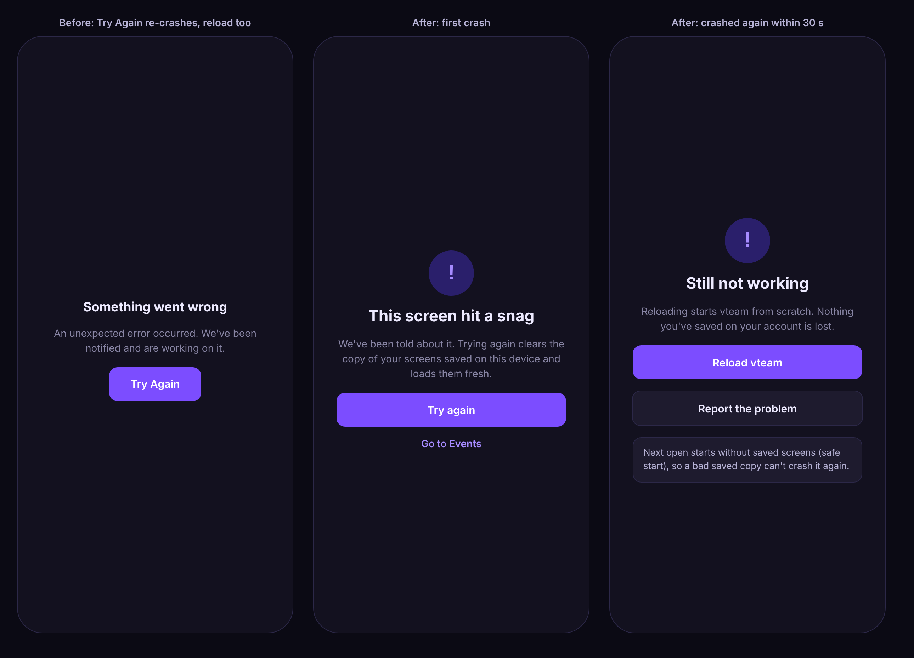
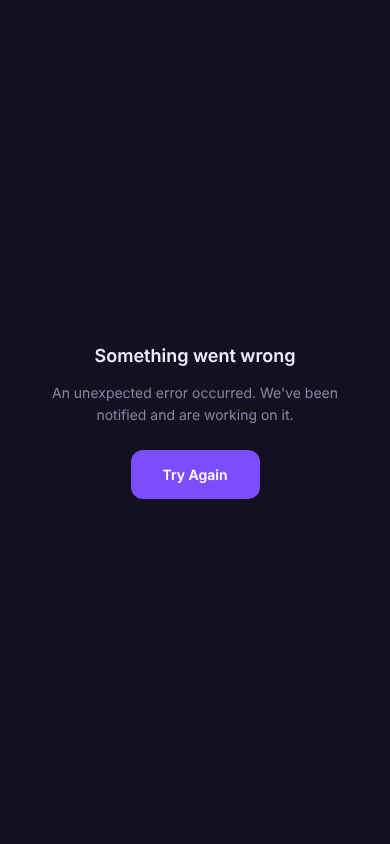
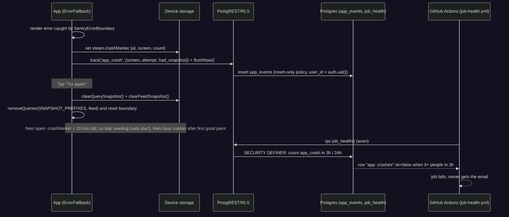
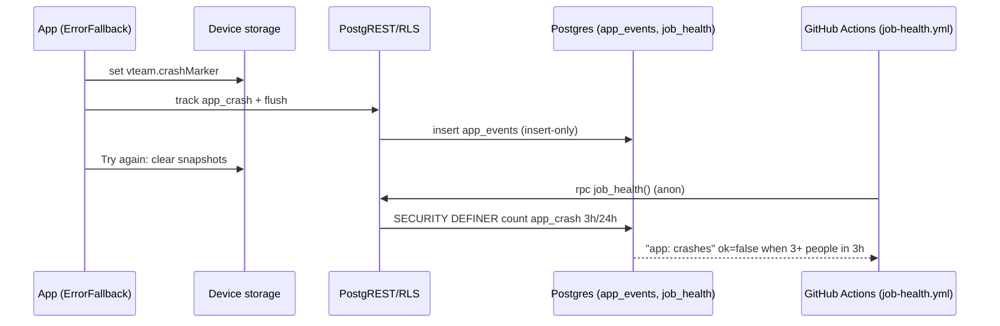
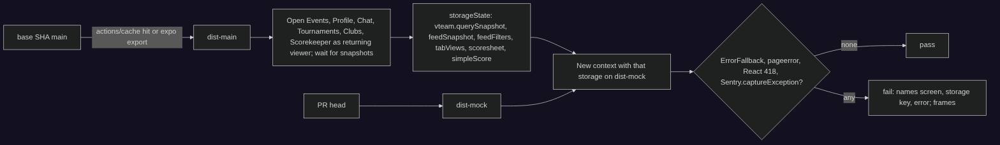
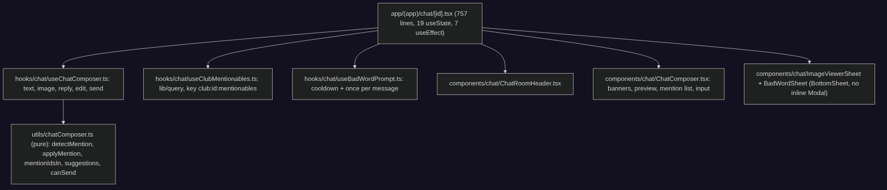

# vteam ideas: 2026-11-15

## Health check

Full stability run on today's `main` (778246a), mocked export, phone 390×844 and desktop 1280×860, signed in and guest, with and without an 800 ms delay on every Supabase response: 500 cases in 706 s.

- **Tours:** passed. Intro tour from Profile and the Austin banner, every Events type and surface chip from a link and saved: "1 of N" … "N of N" with a spotlight every step (128 cases).
- **Refresh and Back:** passed. No new jump, layout shift, vanishing content or returning spinner (92 cases). Known: event page Price row shifts 0.019 on phone reload (baseline). Improved: event page on desktop reload now 0 (was 0.016 in the baseline; run `npm run stability:baseline`).
- **Links:** passed. Every `VIEW` link keeps its values, changes follow into the address, phone tabs keep their views (32 cases).
- **Raw route names:** passed. No "event/[id]" or "(tabs)" on any route (248 cases).
- Not exercised: Clubs and Chat reload/Back (the fixtures don't make those pages scroll) and Back on Tournaments and the event page (no child link partway down): 32 cases.
- Extra probe (feeds idea 1): a wrong-shape saved `badges` or `trophies` entry crashes Profile, and both Try Again and a full reload crash again.

## 1. A crash never sticks: the error screen clears saved data, gets you back, and tells us

**Bucket:** end-user-experience · **Size:** M (schema: one function replaced)

**Pitch:** when a screen crashes, "Try again" clears the copy of your screens saved on this device and actually recovers; a second crash offers a reload, the next open starts without saved data, and a crash spike emails Bryan within 3 hours.

**Why**
- On Nov 13 (from 3:54 AM CT) Events crashed on open for returning signed-in web players: a saved `ads:feed` copy in its old shape (Sentry VCLUB-P). Players stayed stuck until the fix shipped or their storage was cleared; nothing in vteam's own alerts noticed (availability review, Nov 13).
- Measured today on `main` (mocked export, phone, signed in): give one saved entry the wrong shape (`badges:<me>` or `trophies:<me>` in `vteam.querySnapshot`) and Profile shows "Something went wrong". **Try Again crashes again (1/1), and a full page reload crashes again too (1/1)**, because the crashed tree never rewrites the snapshot, which lives 7 days. The same wrong shape in `cheers:received` does not crash, so this depends on which reader trips.
- `components/ErrorFallback.tsx` only calls `resetError()`: the poisoned cache entries are still in memory and on the device, so the same render throws again. It has no way back to Events and uses hardcoded sizes (`padding: 48`, `lineHeight: 22`) and a raw `TouchableOpacity`.
- vteam has no crash count of its own: `job_health()` watches cron, feeds, points and pg_net, not the app. Sentry emails exist, but the Nov 13 crash ran for hours.

Measured before (real export, poisoned `badges` entry, after Try Again and after reload):

**User stories**
- As a returning player whose saved data no longer fits the new build, one tap on Try again gets me my screen back.
- As a player who crashes twice, I can reload vteam (web) or restart it (native) and the next open can't crash on the same saved copy.
- As Bryan, I get an email when several people crash within 3 hours, without waiting for someone to tell me.

**Acceptance criteria**
- [ ] With a wrong-shape `badges` or `trophies` entry in `vteam.querySnapshot`, Profile crashes once; Try again shows Profile with fresh data (mocked export, phone and desktop).
- [ ] Try again clears `vteam.querySnapshot` and `vteam.feedSnapshot` and removes the in-memory entries under `SNAPSHOT_PREFIXES` and the feed before resetting the boundary.
- [ ] A second crash within 30 s shows "Still not working" with Reload vteam (web: `location.assign('/')`; native: reset the root navigator to Events after clearing the cache) and Report the problem (`routes.feedback('bug')`).
- [ ] A crash writes `vteam.crashMarker`; an open less than 10 min after it skips seeding snapshots (safe start) and clears the marker after the first screen paints.
- [ ] `app_crash` {screen (pattern, never an id), attempt, had_snapshot, app_version} is recorded and flushed at once (not after 10 s), and is in `ANALYTICS_EVENTS`.
- [ ] `job_health()` returns a row `app: crashes`; `scripts/job-health.mjs` fails when 3+ distinct people or devices crashed in the last 3 h. No error text, ids or user data in the row.
- [ ] Fallback uses theme tokens, `Button`, and is announced (`accessibilityRole="alert"` on the title); Go to Events uses `routes.app()`.

**Design**
- `lib/crashRecovery.ts` (new): `noteCrash(screen)`, `recoverFromCrash()` (clear both snapshots, `removeQueries` per prefix), `crashedRecently()` and the marker read/write (localStorage on web, memory on native).
- `components/ErrorFallback.tsx`: two states (first crash / repeat), copy in `constants/copy.ts` (`CRASH_COPY`). Both boundaries (`SentryErrorBoundary.tsx` / `.web.tsx`) call `noteCrash` from `componentDidCatch` and pass the attempt count.
- `lib/querySnapshot.ts` `startQuerySnapshot()` and `utils/feedSnapshot.ts` `readFeedSnapshot()` return nothing while `crashedRecently()`.
- `lib/analytics.ts`: `track('app_crash', …)` then `flush()`; the server-down pause still applies.
- Surfaces: same screen on native, phone web and desktop web (centered, max-width 420 on desktop). Guests get the same recovery; their snapshot is the guest one.

**Backend**

| Object | Change | Notes |
| --- | --- | --- |
| `public.job_health()` | replaced: adds an `app: crashes` row | SECURITY DEFINER, anon/authenticated EXECUTE as today; returns counts only (crashes 24h, people 3h) |
| `app_events` | none | `app_crash` is a new event name; insert-only for clients as today |
| `scripts/job-health.mjs` | `EXPECTATIONS['app: crashes']` | fail at 3+ people in 3 h |

Migration sketch: `create or replace function public.job_health()` with the existing body plus
`return query select 'app: crashes', count(distinct coalesce(user_id::text, anon_id)) filter (where created_at > now() - interval '3 hours') < 3, max(created_at), count(*)::int, count(*) || ' crashes from ' || count(distinct coalesce(user_id::text, anon_id)) || ' people in 24h' from public.app_events where name = 'app_crash' and created_at > now() - interval '24 hours';`
`.down.sql`: the previous definition verbatim. RLS: no change; `e2e/rls.spec.ts` keeps asserting guests can't read `app_events` and adds that `job_health()` as anon returns the `app: crashes` row with no text beyond counts.

**Test plan**
- Unit: `lib/crashRecovery` (clears both keys, marker window, attempt counting), `ErrorFallback` states.
- Browser: `scripts/shots/crash-recovery-flow.mjs` (CI `a11y` job): poison `badges`, open Profile, expect the fallback, Try again, expect Profile; poison twice, expect Reload; reload, expect safe start (no seeded entries) and Profile.
- e2e `metrics.spec.ts`: `app_crash` insert is sent at once.
- Job health: `--expectations-only` passes with the new entry.

**Pros and cons**

| Pros | Cons |
| --- | --- |
| Turns the Nov 13 failure (hours stuck) into one tap. | A crash that isn't caused by saved data still crashes after Try again; it only gets the reload path. |
| Safe start makes a bad snapshot unable to crash the next open, whatever the cause. | Safe start makes that one open slow on a cold server (no saved screens). |
| vteam hears about crash spikes itself, in the same email as other job failures. | A schema change to `job_health()` for one row; the function grows. |
| Small, mostly one component and one lib file. | Doesn't stop the bug; idea 2 does that. |

**Verdict:** worth it: the measured behavior today is "stuck for up to 7 days", and the fix is small.

**Risks / open questions:** native has no snapshots yet, so there it is mainly the metric and the friendlier screen. Threshold of 3 people in 3 h may be noisy with e2e; exclude `metrics_excluded_users`. **Depends on:** nothing; pairs with idea 2.

---

## 2. Upgrade check: every PR opens on a device that last ran `main`

**Bucket:** testing · **Size:** M

**Pitch:** CI loads the base branch's web build as a returning player, keeps everything it saved on the device, then opens the PR's build with that storage and fails on any crash, so a changed saved shape can't ship again.

**Why**
- The Nov 13 crash came from data the *previous* build saved (`ads:feed`, pre-#280 shape) read by the new build. Every CI check today starts from empty storage: unit tests, e2e, axe, startup budget and the stability flow all open a fresh browser, so this class is invisible to them.
- The rule "bump `VERSION` when a snapshotted read changes shape" (CLAUDE.md) is enforced by memory only. 13 prefixes are snapshotted (`SNAPSHOT_PREFIXES`), plus device keys for feed snapshot, feed filters, tab views, recent searches, the scoresheet and simple score.
- Measured today: a wrong-shape `badges` or `trophies` entry crashes Profile and survives reload (idea 1). A diff-blind reviewer can't see that a select or mapper change altered a cached shape.

**User stories**
- As Bryan, a PR that changes what a returning player has saved fails CI with the screen and storage key that crashed, before it reaches players.
- As a contributor, I see whether my change needs a snapshot `VERSION` bump without reading `lib/querySnapshot.ts`.

**Acceptance criteria**
- [ ] `scripts/shots/upgrade-flow.mjs --before <dist> --after <dist>`: signed in and guest, phone and desktop, visits Events, Profile, Chat, Tournaments, Clubs, Leagues, Scorekeeper and Simple score on the before build, waits until `vteam.querySnapshot` and `vteam.feedSnapshot` are written, saves `storageState`.
- [ ] Opens the same screens (and reload) on the after build with that storage; fails on the error boundary text, any `pageerror`, React error #418, or a `Sentry.captureException` call (hooked on `window`).
- [ ] The job summary names screen, viewport, the storage keys present, the first error line, and a frame.
- [ ] CI: the `a11y` job gets the base's `web-dist-mock` artifact from the latest successful `main` run for the merge base (actions: read), falling back to building it in a worktree; skipped with a notice only if both fail.
- [ ] Proven on history: before = the commit before #280, after = #280, fails on Events; after = #296 passes.
- [ ] Runs in under 3 minutes in CI.

**Design**
- New script reuses `launchChromium`, `serveDist` (two servers), `installSupabaseMock` and the fixtures' `defaultNow` / `TIME_ZONE`, so both builds read the same mocked data. Mock rows are the same, so only the saved shapes differ.
- `.github/workflows/ci.yml`: step "Upgrade check" after "Stability check"; `gh run list --branch main --commit <base> --workflow ci.yml` → `actions/download-artifact` with `run-id`.
- Docs: a line under "Cold start on web" and "Test layers" in CLAUDE.md.

**Test plan:** `scripts/shots/upgrade.test.mjs` for the pure parts (finding which storage keys differ, result → markdown); the history proof above run once in the PR description; CI timing recorded.

**Pros and cons**

| Pros | Cons |
| --- | --- |
| Catches the exact failure that took Events down on Nov 13, on every PR. | Mocked data: a shape change only on rows the fixtures don't have goes unseen. |
| Uses the existing harness and the artifact main already builds: no second export most of the time. | Adds ~2–3 min to the `a11y` job. |
| Makes the snapshot `VERSION` rule checkable instead of remembered. | Native (AsyncStorage, scoresheet) isn't covered; web only. |
| Also covers device keys outside snapshots (filters, tab views, scorekeeper). | The base artifact lookup needs `actions: read` and can miss on old bases (falls back to a build). |

**Verdict:** worth it: it is the missing test layer for a real, costly outage, and most of the machinery exists.

**Risks / open questions:** a PR that intentionally bumps `VERSION` passes trivially (correct). **Depends on:** none; idea 1's fallback text is the crash signal either way.

---

## 3. Chat room in pieces: composer, mentions and the bad-word prompt out of a 757-line screen

**Bucket:** refactor · **Size:** M (three PRs)

**Pitch:** `app/(app)/chat/[id].tsx` becomes a ~250-line screen over a composer hook, a cached mentions hook, a bad-word-prompt hook and three components, with the send rules unit-tested instead of checked by reading the source text.

**Why**
- `app/(app)/chat/[id].tsx` is the 2nd largest file in the app: **757 lines, 19 `useState`, 7 `useEffect`, 37 inline `style={{…}}` objects**.
- It still reads in an effect: `supabase.from('club_members')…` for @mention candidates on every club chat open, uncached and unbounded (CLAUDE.md: new code never calls `supabase.from()` for reads inside effects).
- The send rules (no draft restore after a failed send; restore image + reply when the upload fails; edit rollback) live inside `handleSend`, and `__tests__/chatSendWiring.test.ts` checks them by searching the file's text for `await sendMessage(trimmed || null` — any rename breaks the test without breaking behavior, and real regressions pass.
- The header is hand-built (CLAUDE.md: `ScreenHeader`), the back button has no accessibility label, the image-preview remove button is 20×20 with no label, and two inline `Modal`s (image viewer, bad-word prompt) break the "BottomSheet, no inline Modal" rule. The reply and edit banners are two near-identical 25-line blocks.

**User stories**
- As a club member, @mention suggestions show instantly when I reopen a club chat (cached), and stay right after someone joins (invalidated with the club).
- As a screen-reader user, the back, remove-image and send controls say what they do.
- As a developer, I can change the composer and run a test that sends, fails and retries.

**Acceptance criteria**
- [ ] `utils/chatComposer.ts` (pure, unit-tested): `detectMention`, `applyMention`, `mentionIdsIn`, `mentionSuggestions`, `canSend`.
- [ ] `hooks/chat/useChatComposer.ts`: text, image, reply, edit, sending; `send()` keeps today's rules; `chatSendWiring.test.ts` replaced by a hook test with the `useMessages` fakes (failed send leaves the composer empty; failed upload restores text, image, reply; failed edit restores the edit).
- [ ] `hooks/chat/useClubMentionables.ts` on `lib/query` (`queryKey('club', clubId, 'mentionables')`, `STALE.detail`, limited to the columns used); no `supabase.from` left in the screen.
- [ ] `hooks/chat/useBadWordPrompt.ts` with the cooldown and once-per-message rules, unit-tested.
- [ ] `components/chat/ChatRoomHeader.tsx` (on `ScreenHeader` or its back row), `ChatComposer.tsx` (one banner component for reply and edit), image viewer and bad-word prompt on `BottomSheet` / full-screen viewer without inline `Modal`.
- [ ] Screen under 300 lines; no visual change in `npm run shots:compare` except the a11y labels; axe baseline for chat unchanged or lower; `e2e/chat.spec.ts` and `chat-unread-flow.mjs` pass.

**Design / landing:** PR 1 pure utils + composer hook + tests (screen calls the hook, no UI change). PR 2 mentionables + bad-word hooks. PR 3 components, header and sheets, with before/after shots. Native, phone web and desktop web render the same components; the web message list (`ChatMessageList.web.tsx`, lazy chunk) is untouched.

**Test plan:** unit tests above; `e2e/chat.spec.ts` (send, reply, edit, react in the seed DM); shots compare for `chat/[id]`; stability flow already covers routes.

**Pros and cons**

| Pros | Cons |
| --- | --- |
| Removes the last read-in-effect from a high-traffic screen and caches mentions. | Mostly invisible to players; the payoff is in later chat work. |
| Send rules get real tests instead of a text search. | Composer focus and keyboard behavior are easy to regress on iOS; e2e runs on web only. |
| Fixes small a11y gaps and two rule breaks (header, inline Modal). | Three PRs of churn in a file other work may touch. |
| Unlocks per-conversation drafts and message-level Report (listed as "still to come" in Reports). | Mention cache can be briefly stale after a join until the club is invalidated. |

**Verdict:** worth it, in three small PRs: the screen is the next-largest, still breaks two conventions, and its one test checks text instead of behavior.

**Risks / open questions:** keep `useMessages` untouched. **Depends on:** none in flight (#299 doesn't touch chat).
