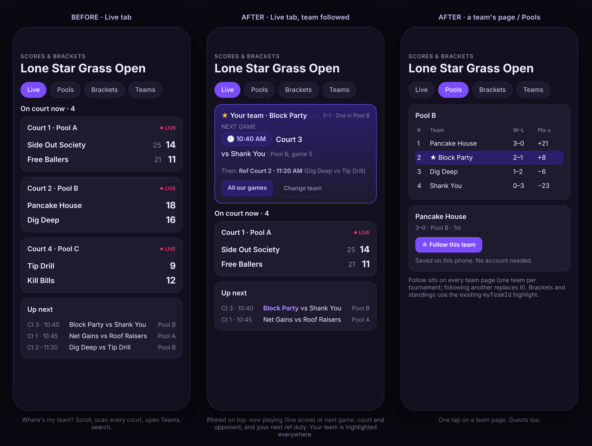
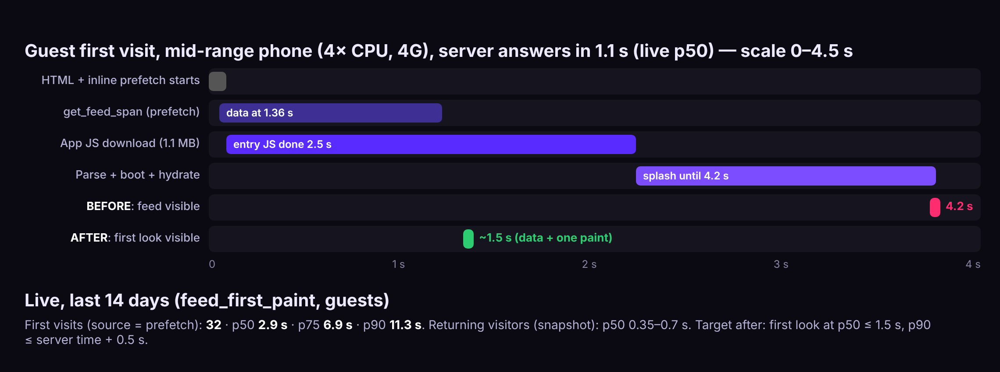
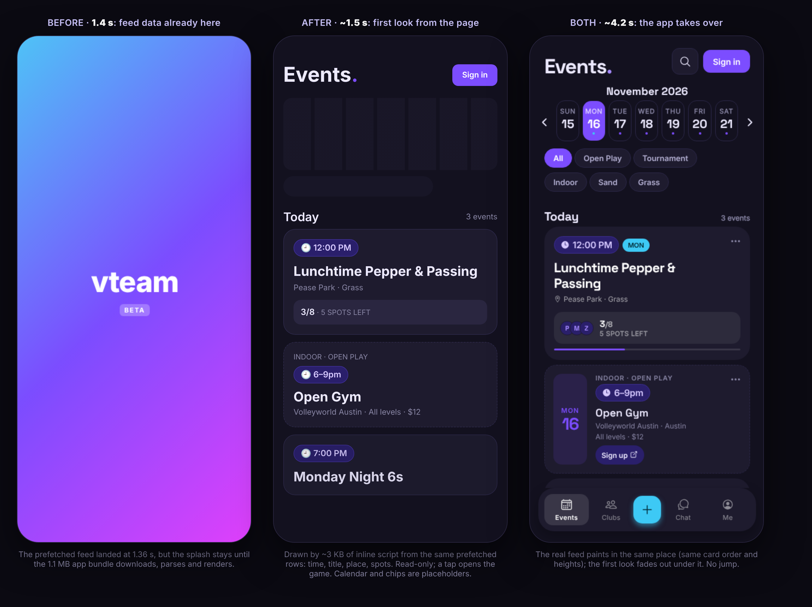
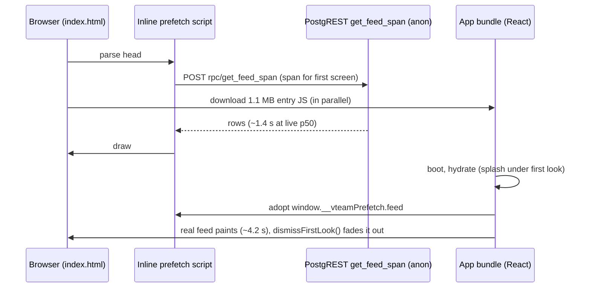
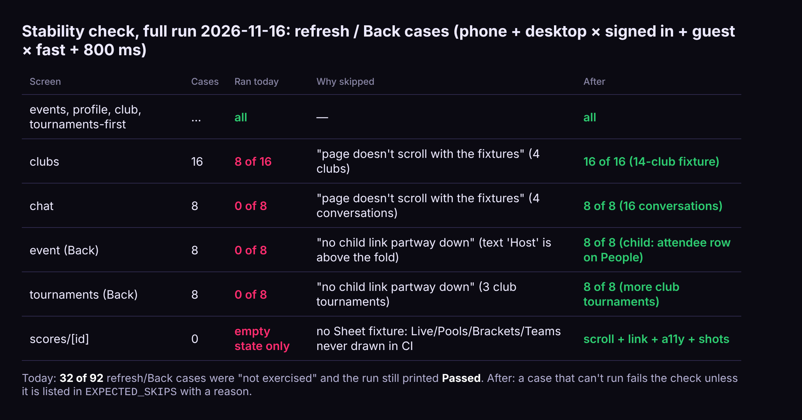

# vteam ideas: 2026-11-16

## Health check

Full stability run (`scripts/shots/stability-flow.mjs --full`) on today's `main` (512e7e5), mocked export, phone 390×844 and desktop 1280×860, signed in and guest, with and without an 800 ms delay on every Supabase response: **500 cases in 650 s, passed.**

- **Tours:** passed. Intro tour from Profile and the Austin banner, every Events type and surface chip from a link and saved: no gaps, spotlight every step (128 cases).
- **Refresh and Back:** passed. No new jump, layout shift, vanishing content or returning spinner (92 cases). Known: event page Price row shifts 0.019 on reload (baseline). Improved: event page, desktop, reload with 800 ms delay now 0 (baseline 0.016; run `npm run stability:baseline`).
- **Links:** passed. Every `VIEW` link keeps its values, changes follow into the address, phone tabs keep their views (32 cases).
- **Raw route names:** passed (248 cases).
- **Not exercised: 32 of the 92 refresh/Back cases**, again (same as Nov 15): Clubs and Chat "don't scroll with the fixtures" (4 clubs, 4 conversations), and Back on the event page and Tournaments has "no child link partway down". The run still prints "Passed". Idea 3 closes this.

## 1. Follow your team: "Next game: Court 3 at 10:40" pinned on the scores page

**Bucket:** competitor-gap · **Size:** S (device-only, no backend)

**Pitch:** on a tournament's Scores & brackets page, one tap on a team's page makes it "your team": the Live tab then opens with your team's live score or next game (time, court, opponent), its next ref duty and its pool place, and your team is highlighted in Up next, Pools and Brackets. Guests too, saved on the device.

**Why**
- Tournament apps all lead with this. Tournify: "users have the option to follow their favourite teams or players. They receive push notifications about their matches, for example when a new result is in or when a match is about to begin" ([Tournify help](https://help.tournifyapp.com/en/articles/9088065-use-the-android-ios-app)). LeagueApps Play: followers "will be able to see team details, schedules, and standings; as well as receive push notifications for any game changes" ([LeagueApps](https://support.leagueapps.com/hc/en-us/articles/29806301873303)).
- vteam's scores page is where guests actually engage: in the last 14 days `/scores/[id]` had 28 screen views (24 as guests) and `/scores/[id]/keep` 8, more than Tournaments (5), Clubs (2) or event pages (3) (live `app_events`).
- The Texas Asian Olympics Sheet had 56 teams, 4 divisions and 220 matches. Today a player finds their next game by scanning every court card and the Up next list, or by Teams → search → their page, again after every 30 s refresh scrolls.
- Half the plumbing exists: `StandingsTable` and `BracketView` already take `myTeamId` and draw a "mine" highlight (used by vteam's own tournaments), and `teamDetail(state, name)` in `utils/sheetScores.ts` already returns each team's games including ref rows.

**User stories**
- As a player at a tournament, I tap "Follow this team" once and every time I open the scores I see where and when we play next.
- As a parent or friend watching (often a guest), I follow the team I came for without an account.
- As a team that refs, I see our next ref duty before the desk has to call us.

**Acceptance criteria**
- [ ] A team's page (Teams tab, `SheetTeamsView`) has **Follow this team** / **Following ★** (44 pt target); one team per tournament, following another replaces it.
- [ ] The followed team is stored per program id on the device (`vteam.followedTeams`, `{ [programId]: teamName }`; web localStorage in try/catch, native AsyncStorage), never on the server and never in the URL; cleared on sign-out is not needed (no account data).
- [ ] With a followed team, the Live tab opens with **Your team**: live score if on court (same set display as the court card), otherwise the next game (time pill, court, opponent, pool/round); the next ref duty from `ref_team`; record and pool place. Finished tournament: final place and "All our games".
- [ ] The followed team is highlighted in Up next (name in `primaryText`), Pools (`myTeamId`) and Brackets (`myTeamId`); the team's name gets a ★ in court cards.
- [ ] If the followed name is no longer in the Sheet (renamed), the card says so with **Pick your team** and the stored entry is dropped.
- [ ] Pure rules (`followedTeamCard(state, name)`: now / next / ref / place) in `utils/sheetScores.ts`, unit-tested with a fixture state (on court, between games, eliminated, finished, unknown name).
- [ ] Metric `scores_team_followed` {program org} (never the team name).
- [ ] Works at Extra large text and 320 px width; screen readers hear "Your team, Block Party. Next game 10:40 AM, Court 3, versus Shank You."

**Design**
- `app/(app)/scores/[id]/index.tsx`: read `useFollowedTeam(programId)` (new hook in `hooks/useFollowedTeam.ts`, device storage like `lib/scoresheet/teamStore.ts`); render `<FollowedTeamCard>` (new, `components/programs/FollowedTeamCard.tsx`) above "On court now"; pass `myTeamId={followed}` to `StandingsTable` and `BracketView` (team names are the ids there).
- `components/programs/SheetTeamsView.tsx`: Follow button under the team header.
- No new route; `/scores/<id>?view=teams&team=…` already opens a team page. "All our games" uses `openTeam(followed)`.
- Guests: same as signed-in (no account needed). Surfaces: native (AsyncStorage), mobile web, desktop web (card sits above the courts in the centered column).

**Backend:** none in v1. A v2 push ("You're up on Court 3 in 15 minutes") needs a server poll of the Sheet and a signed-in follower table; left as an open question, not in this issue.

**Test plan**
- Unit: `followedTeamCard` cases; storage parse of a bad saved value.
- Shots: a Sheet fixture for `/scores/<id>` (shared with idea 3) with a followed team in storage; add the screen with and without a followed team to `SCREENS`.
- e2e (`e2e/liveScores.spec.ts` or a new spec in the guest shard, routing the Sheet URL to a fixture): follow from the team page, reload, card shows, change team.

**Pros and cons**
- Pros
  - Directly serves the one place guests are using vteam right now (scores pages), with a feature every tournament app has.
  - Small and safe: device-only, no schema, no new route; reuses `myTeamId`, `teamDetail` and the existing ref rows.
  - Makes the next Sheet tournament feel like an app worth installing, a natural moment to offer sign-in for push later.
  - Answers the question people ask the desk most ("when are we up?").
- Cons
  - Only matters on tournament days that run on the Sheet: so far one (Nov 14–15); value depends on getting more organizers onto it.
  - No push in v1, which is the part competitors lead with; the page must be open.
  - A device-only follow doesn't carry across phone and laptop.
  - Team names are the ids; a desk renaming a team drops the follow (handled, but annoying).
- **Verdict:** pros outweigh cons: an S-size, no-backend change on vteam's most-used guest screen, and it sets up push as a clear next step.

**Open questions:** push in v2 (signed-in follow + a cron that polls `LIVE_SCORE_SHEETS` every 2–5 min only on tournament days)? **Dependencies:** none; pairs with idea 3's Sheet fixture.

## 2. First look for first visits: draw today's games from the page while the app loads

**Bucket:** latency · **Size:** M (web only, no backend)

**Pitch:** on a guest's first visit the feed data arrives at ~1.4 s but the splash stays until ~4.2 s while the 1.1 MB app bundle loads. Let the inline prefetch script draw a read-only "first look" (header, Today, the first 3 game cards) the moment the data lands, then fade it out under the real feed.

**Why**
- Live, last 14 days, `feed_first_paint` for guests on a first visit (`source = prefetch`): **32 opens, p50 2.9 s, p75 6.9 s, p90 11.3 s, max 34 s**. Returning visitors with a snapshot: p50 0.35–0.7 s. First visits are the new people we most want to keep.
- Measured today on the mocked export, guest first visit, 390×844, 4× CPU, 4G (150 ms RTT, 9 Mbps), Supabase answering in 1.1 s (live p50), 3 runs each: feed data back at **1.33–1.36 s**, entry JS done at **2.47–2.51 s** (1.12 MB transferred), DCL 2.84–2.92 s, **cards visible at 4.21–4.42 s**. With a 3 s server: data at 3.2 s, cards at 4.2–4.5 s. So for first visits the app boot, not the server, is the wait: the rows sit unused for ~2.9 s.
- The CDN experiment (#216) can't fix this: `/api/startup` fell back to Supabase in 20 of 38 CDN-arm reads since Nov 13 (direct p50 0.36 s vs fallback 1.7 s), and Vercel's docs say function-response caches are keyed per deployment and per region and "may be evicted" when rarely requested ([Vercel CDN cache](https://vercel.com/docs/caching/cdn-cache), [purge](https://vercel.com/docs/caching/cdn-cache/purge)), so a low-traffic app with several deploys a day rarely hits a warm copy.

(Before and takeover frames are real screenshots of the mocked export; the middle one is the mock.)

**User stories**
- As someone opening a vteam link for the first time, I see today's games in about a second and a half, not a purple screen for four.
- As a first-time visitor who taps a game in the first look, I land on that game.

**Acceptance criteria**
- [ ] Guest first visit to `/` (no snapshot), mocked export, 4× CPU + 4G, 1.1 s server: first look visible by **≤ 1.7 s** (from 4.2 s); the real feed still paints by ≤ 4.5 s; measured by a new `scripts/shots/first-look-flow.mjs` and added to `startup-budget.json` as `firstLookMs`.
- [ ] Live target: `feed_first_paint` gains `first_look_ms`; p50 for first visits ≤ 1.5 s, p90 ≤ server time + 0.5 s, read from `app_events` two weeks after release.
- [ ] The first look is drawn outside the React root (a fixed `div#first-look` appended to `body`, `aria-hidden` until it's the only content, then a live region "Loading the rest of vteam"), so hydration is untouched: the guest e2e still sees no React #418.
- [ ] It shows only for `/` without a valid snapshot or token-bearing viewer (the same condition as the prefetch using the anon key) and only when the rows arrive before the app's first feed paint; never for signed-in returning viewers (their snapshot already paints at ~0.4 s).
- [ ] Cards: time (America/Chicago, same strings as `TimePill`), title, venue · surface, spots left for vteam events; outside sessions as "venue · Open Play"; the first day with games, max 3 cards; text escaped (no innerHTML from data).
- [ ] Tapping a card is a plain link to `/event/<id>` (outside sessions: no link); Sign in links to `/login`.
- [ ] When the app's feed first paints (`noteFeedFirstPaint` in `useMonthEvents`), it fades the first look out over 150 ms and removes it; layout shift ≤ 0.01 (stability check).
- [ ] Inline script stays under 5 KB gz added to `index.html`; colors come from `theme` values inlined at build time (no hex literals in the source).
- [ ] Desktop (≥ 768 px): first look uses the sidebar-width offset and centered column, or is skipped if the layout can't match (decide in the PR with screenshots).

**Design**
- `utils/feedPrefetchScript.ts`: after the promise resolves, call a small `drawFirstLook(rows)` that's also built from a pure, unit-tested `firstLookModel(rows, now)` (`utils/firstLook.ts`, shared logic with `utils/feedItems.ts` for normalizing outside sessions; `.toString()`-inlined like `feedSpanArgs`).
- `app/+html.tsx`: inline the first-look CSS (generated from `theme` at build), already inlines the prefetch.
- `lib/feedPrefetch.web.ts`: export `dismissFirstLook()`; `useMonthEvents` calls it when it adopts the prefetch and paints; `app/_layout.tsx` also removes it on any non-`/` route change and after 15 s as a safety net.
- Metric: `feed_first_paint` adds `first_look_ms` (null when not shown).
- Native: unchanged (no HTML shell). Mobile web and desktop web as above.

**Backend:** none. **Model changes:** none.

**Test plan**
- Unit: `firstLookModel` (day pick, max 3, time strings in Chicago across DST, escaping, outside sessions).
- Shots: `first-look-flow.mjs` (timings above, frames at first look and takeover); stability check gains a `first-visit` scroll case for `/` with `fresh: true` (layout shift at takeover).
- e2e guest spec: first visit shows `#first-look`, it's gone once `event-card` shows, no #418.
- Measure before/after on the mocked export now; live via `feed_first_paint.first_look_ms` (no beta test needed: no schema).

**Pros and cons**
- Pros
  - Targets the slowest real path: first visits, p50 2.9 s and p90 11.3 s, from people who've never seen vteam.
  - Uses data the page already fetched; no new request, no server, no keep-warm.
  - Measured locally: ~4.2 s → ~1.5 s to first content on a mid-range phone.
  - Independent of Supabase cold starts once the rows are back, and of Vercel CDN caching (which doesn't stay warm here).
- Cons
  - A second, tiny renderer of the card: two places to keep in sync with `EventCard` (mitigated by one pure model and a shots check, but real upkeep).
  - Read-only first look for ~2.7 s: taps on filters or the calendar do nothing until the app is up (they're drawn as placeholders).
  - Risk of a visible swap if heights differ (budgeted by the layout-shift check).
  - Helps web guests only; native and returning players already paint fast.
  - When the server is the slow part (p90 11 s), it shows nothing sooner; it only removes the client wait.
- **Verdict:** pros outweigh cons: the biggest measured wait for new visitors is client boot after the data is already in hand, and this removes most of it with no backend change; keep the model shared to contain the upkeep.

**Open questions:** desktop: match the sidebar layout or skip? Show the first look also on `/event/<id>` link opens (#244 already inlines the event)? **Dependencies:** #184 (prefetch), #225 (startup budget).

## 3. No silent skips: every stability case runs, and a case that can't run fails

**Bucket:** testing · **Size:** S

**Pitch:** today's full stability run "Passed" while 32 of its 92 refresh/Back cases never ran, two days in a row. Give Clubs, Chat, Tournaments and the event page fixtures and child links that make every case run, add a Sheet fixture so the scores screen is actually drawn in CI, and make "not exercised" a failure unless the case is listed with a reason.

**Why**
- Full run today: 8 Clubs and 8 Chat cases skipped "doesn't scroll with the fixtures" (`buildFixtures` has 4 clubs and 4 conversations), 8 event-page and 8 Tournaments Back cases skipped "no child link partway down" (`SCROLL_SCREENS` child `{ text: 'Host' }` sits above the fold; 3 club tournaments). Same 32 on Nov 15.
- These are the screens the flicker bug class lives on (#250, #254, #288): Chat and Clubs have never been checked for refresh/Back flicker in CI.
- The scores screen (`/scores/[id]`, vteam's most-viewed guest screen after Events this fortnight) has no Sheet fixture: `LINK_CASES` notes "No Sheet URL in the mock, so the scores screen draws its empty state", so its Live, Pools, Brackets and Teams views are never screenshotted, scanned by axe or stability-checked.

**User stories**
- As Bryan, when the stability check says "Passed", every case it lists actually ran.
- As a developer changing Chat, Clubs or the scores page, CI tells me if I introduced a jump on refresh or Back.

**Acceptance criteria**
- [ ] `scripts/shots/fixtures/index.mjs`: 14 clubs (fictional, varied membership), 16 conversations (DMs and groups with last messages), 6 club tournaments: Clubs, Chat and Tournaments scroll on phone and desktop.
- [ ] `SCROLL_SCREENS`: Clubs gets a child (`club-card` last), event gets a child partway down (an attendee row on People, `?tab=people`), Tournaments' child resolves.
- [ ] A Sheet fixture (`scripts/shots/fixtures/sheetScores.mjs`, fictional teams, 2 divisions, pools + a bracket, one match live) served for the Sheet URL by the shots mock (`EXPO_PUBLIC_TEXASAO_SCORES_URL` pointed at a mock origin in the mock export), with `/scores/<id>` (each view) in `SCREENS`, a scroll case, and the existing link case asserting real content.
- [ ] `stability-flow.mjs`: a case that is not exercised fails the run unless listed in `EXPECTED_SKIPS` (`stabilityCases.mjs`, case → reason); `__tests__/stabilityCases.test.ts` checks every entry has a reason. Summary shows "Not exercised: 0".
- [ ] Full run: 92 → 92 refresh/Back cases exercised (0 skipped), still passing or with real findings fixed/baselined with a reason; a11y baseline updated for the new screens through `npm run a11y:baseline` only.
- [ ] PR mode stays under its current CI time (+60 s max).

**Design**
- Files: `scripts/shots/fixtures/index.mjs`, new `fixtures/sheetScores.mjs`, `lib/supabaseMock.mjs` (route the Sheet origin like `/api/forecast`), `stabilityCases.mjs`, `stability-flow.mjs`, `screens.mjs`, `a11y-baseline.json`, `startup-budget.json` only if request counts change (more fixture rows don't add requests).
- No app code changes, except adding `testID`s if a child has none.

**Backend:** none.

**Test plan:** run `stability-flow.mjs --full` before/after (32 → 0 skipped), `npm run a11y`, `npm run shots:compare` for Clubs/Chat/Tournaments (list length changes only), and the Jest test for `EXPECTED_SKIPS`.

**Pros and cons**
- Pros
  - Turns a false "Passed" into a real one: 35% of the refresh/Back matrix starts running.
  - Covers Chat and Clubs, never flicker-checked, and the scores page, never drawn in CI at all.
  - The Sheet fixture is reused by idea 1 and any future Sheet work (scorekeeper).
  - Small, test-only, no risk to players.
- Cons
  - More fixture rows can shift existing screenshots and a11y counts (one baseline refresh).
  - Longer full runs (more scrollable pages; nightly, not per-PR).
  - Real findings may surface on Chat/Clubs and need fixing before this lands green.
- **Verdict:** pros outweigh cons: a check that skips a third of its cases silently gives false confidence on exactly the bug class it was built for, and the fix is a test-only S.

**Dependencies:** #255 (stability check). Pairs with idea 1.
