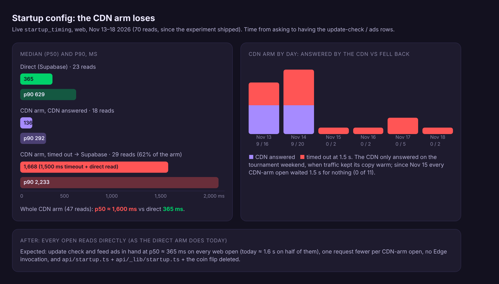
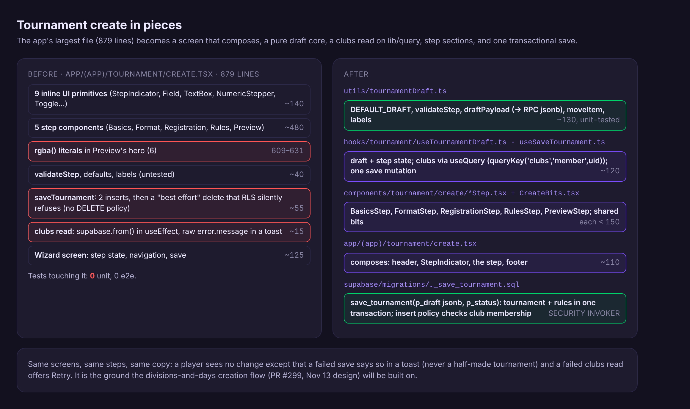
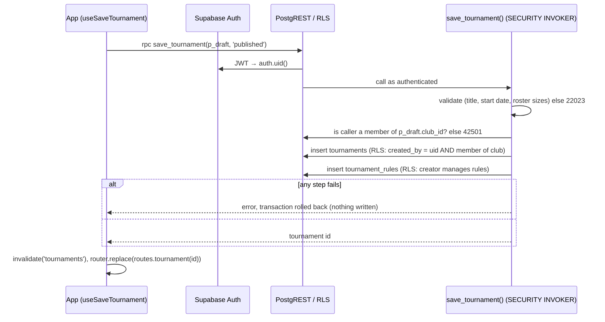
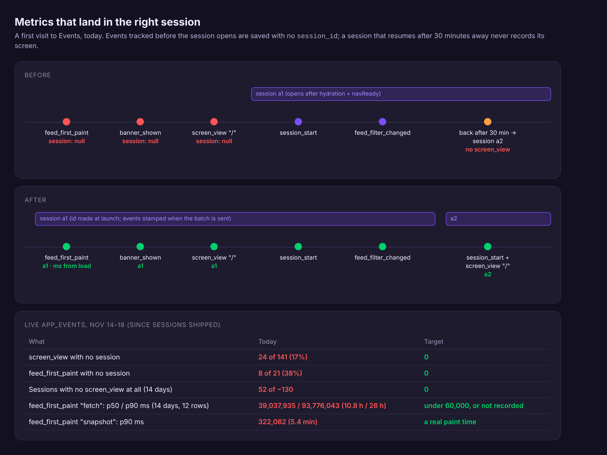

# vteam ideas: 2026-11-18

## Health check

Full stability run (`scripts/shots/stability-flow.mjs --full`) on today's `main` (512e7e5), mocked export, phone 390×844 and desktop 1280×860, signed in and guest, with and without an 800 ms delay on every Supabase response: **500 cases in 647 s, passed (0 new findings).**

- **Tours:** passed. Intro tour from Profile and the Austin banner, every Events type and surface chip from a link and saved: no gaps, spotlight every step (128 cases).
- **Refresh and Back:** passed. No new jump, layout shift, vanishing content or returning spinner (92 cases). Known (baseline, 6): the event page's Price row shifts 0.019 (phone) / 0.016 (desktop) on reload, with and without the delay.
- **Links:** passed. Every `VIEW` link keeps its values, changes follow into the address, phone tabs keep their views (32 cases).
- **Raw route names:** passed (248 cases).
- **Still not exercised: 32 of the 92 refresh/Back cases** (Clubs and Chat don't scroll with the fixtures; Back on the event page and Tournaments has no child link partway down), same as Nov 15–16. Nov 16's idea 3 ("No silent skips") covers it and is still waiting for your call.

Today has no new-feature or competitor-gap idea (Nov 16 had one). The stability checks already run in CI (`scripts/shots/stability-flow.mjs`, #255), so that idea isn't proposed again.

## 1. End the startup CDN experiment: direct reads win, by 1.3 seconds

**Bucket:** latency · **Size:** S (client + delete an Edge function, no schema)

**Pitch:** #216 shipped a coin flip (half of web opens read the update check and feed ads from the CDN-cached `/api/startup`, half straight from Supabase) "kept only if faster". The numbers are in: the CDN arm is slower, and since Nov 15 it has not answered once. Every open reads directly, and `/api/startup` goes.

**Why (live `startup_timing`, Nov 13–18, 70 reads)**
- Direct: **p50 365 ms**, p90 629 ms (23 reads).
- CDN arm: the CDN answered 18 times (p50 136 ms) and timed out 29 times (62%), which costs the 1,500 ms timeout plus the direct read: **p50 1,668 ms**, p90 2,233 ms. Whole arm: p50 ≈ 1,600 ms.
- By day: the CDN answered 9 of 16 on Nov 13 and 9 of 20 on Nov 14 (the Texas Asian Olympics weekend), then **0 of 11 since Nov 15**. With 25 people a week, the CDN copy is never warm: `s-maxage=60` expires, and Vercel's edge doesn't keep a stale copy for a site this quiet, so the Edge function itself has to wake the database, which is the very wait it was meant to avoid. The DB side is not the cost: the `app_config` and `ad_banners` reads take 0.1 ms in `pg_stat_statements`.
- This also settles a question for later latency work: a CDN cache in front of Supabase doesn't help at today's traffic.



**User stories**
- As anyone opening vteam on the web, the update notice and the feed's ads (when there are any) are there as soon as the server answers, not 1.5 s later.
- As Bryan, I stop paying for an Edge function and an experiment that has given its answer.

**Acceptance criteria**
- [ ] `fetchStartupConfig` always reads directly (`readDirect`), with no arm, no `/api/startup` fetch and no 1.5 s timeout; `useStartupConfig(part)` and its cache keys (`startup:version`, `ads:startup`) are unchanged, so no snapshot `VERSION` bump.
- [ ] `startup_timing` keeps being sent with `arm: 'direct'` for two weeks, so the after numbers are visible with the query in CLAUDE.md; then it can go (follow-up note in the PR).
- [ ] Deleted: `api/startup.ts`, `api/_lib/startup.ts`, `pickStartupArm` and the `vteam.startupArm` override, the CDN half of `__tests__/startupConfig.test.ts`, and the shots mock's `/api/startup` 404 handler.
- [ ] CLAUDE.md "Startup config from the CDN (#216)" becomes a short "Startup config" note with the result (CDN p50 1.6 s vs direct 365 ms at this traffic, Nov 2026) so nobody tries it again without more traffic.
- [ ] Target: on live, `startup_timing` p50 ≤ 400 ms and p90 ≤ 700 ms over the first week, measured with the SQL in CLAUDE.md.
- [ ] Startup budget (`scripts/shots/startup-budget.mjs`) passes with the same or fewer requests.

**Design**
- `lib/startupConfig.ts`: drop `startupArm`, `readCdnOnce`, `readCdn`, `CDN_TIMEOUT_MS`; `fetchStartupConfig(part)` = `readDirect(part)` + `track`.
- `utils/startupConfig.ts`: keep `isStartupConfig` and `feedAdsFrom` (the client still re-checks ad windows); drop `pickStartupArm`.
- `types/`: drop `StartupArm`.
- Native: unchanged in behaviour (native already read directly whenever the arm was direct; the coin flip ran there too, with the same 1.5 s cost on a miss).
- No route, guest or RLS change.

**Test plan**
- Unit: `fetchStartupConfig` never calls `fetch` for `/api/startup`; version reads only `app_config`, ads only the two ad tables (existing tests keep that).
- `npm run startup:baseline` unchanged or lower; `scripts/shots/cold-open-flow.mjs --delay 8000` still paints in under a second.
- After merge: the CLAUDE.md query on live for 7 days.

**Pros and cons**
- Pros:
  - Measured: about 1.3 s sooner for the update check and ads on half of web opens, and one request fewer each time.
  - Removes an Edge function, a timeout path and a random arm: less code, less to reason about when debugging startup.
  - Closes #216 the way it was approved ("kept only if faster"), with the numbers written down.
  - Zero risk to data, no schema, no snapshot shape change.
- Cons:
  - Small user-visible gain: the update check and ads don't block the feed, and live has no ads running today.
  - If traffic grows a lot, a CDN copy could win again; the code would have to be brought back from git.
  - 47 CDN-arm samples is a small sample (though the 0 of 11 since Nov 15 is unambiguous).
- **Verdict:** pros win: it's an S cleanup the experiment asked for, and it stops a guaranteed 1.5 s wait on half of opens.

**Risks / open questions:** none blocking. Dependencies: #216 (closed), #225 budget.

---

## 2. Tournament create in pieces: a pure draft core, a clubs hook, and one transactional save

**Bucket:** refactor · **Size:** M (3 small PRs, one schema change, expand only)

**Pitch:** `app/(app)/tournament/create.tsx` is now the app's largest file (879 lines, 0 tests). Split it the way the host form was split (#188): pure draft rules with unit tests, a hook for state and the clubs read on `lib/query`, one component per step, and a `save_tournament` RPC that writes the tournament and its rules in one transaction. Same screens; it's the ground the divisions-and-days creation flow (Nov 13 design, PR #299) will be built on.

**Why**
- Size and shape: 879 lines holding 9 UI primitives (~140 lines), 5 step components (~480), validation and defaults (~40, untested), the save (~55) and the wizard (~125). Next largest is `components/event/PeopleTab.tsx` at 741.
- **The save can leave a half-made tournament.** `saveTournament` inserts `tournaments`, then `tournament_rules`; if the second insert fails it "undoes" with `supabase.from('tournaments').delete()`, but live has **no DELETE policy on `tournaments`** (only "creator can insert tournaments"), so the delete silently removes 0 rows and a tournament without rules (a half-empty page) stays, possibly published.
- **Any signed-in user can create a tournament in any club**: the insert policy checks only `created_by = auth.uid()`, not the club. The screen only offers clubs you belong to, but PostgREST doesn't care.
- Conventions it breaks: the clubs list is read with `supabase.from()` inside `useEffect` (CLAUDE.md: new code never does), a failed read shows the raw `error.message` in a toast, 6 `rgba(...)` colour literals in the Preview hero (lines 609–631), types inline.
- Inconsistent with the host form: events attach to clubs you **own** (`useHostContext`), tournaments to clubs you're a **member** of.
- Live has 0 tournaments and 0 clubs today, so it changes nothing for anyone now and is cheap to do before the new flow lands on top.



**User stories**
- As a club owner creating a tournament, either it's saved whole or I'm told it wasn't, never a half-made one.
- As a developer building divisions and days, I change one step component and the pure draft rules, with tests, not an 879-line screen.

**Acceptance criteria**
- [ ] `utils/tournamentDraft.ts` (pure): `DEFAULT_DRAFT`, `validateStep`, `draftPayload(draft, status)` (the jsonb the RPC takes, incl. bracket type only for bracket formats, Venmo only when priced, tiebreakers/third place only when changed), `moveItem`, labels; `__tests__/tournamentDraft.test.ts` covers each step's validation and the payload.
- [ ] `hooks/tournament/useTournamentDraft.ts` (draft, step, next/back) and `useSaveTournament.ts` (`useMutation`, invalidates `tournaments`); the clubs list is a `useQuery` (`queryKey('clubs', 'member', userId)`, `STALE.feed`) with `ScreenState` Retry on failure, toasts via `toast.error`, never a raw message.
- [ ] `components/tournament/create/{Basics,Format,Registration,Rules,Preview}Step.tsx` + `CreateBits.tsx` (StepIndicator, Field, TextBox, NumericStepper, Toggle), each under 150 lines; props types in `types/tournament.ts`; styles in `shared.*` / `tournamentStyles`; Preview's `rgba` literals become theme tokens.
- [ ] `app/(app)/tournament/create.tsx` under 150 lines, only composing.
- [ ] `save_tournament(p_draft jsonb, p_status text) returns uuid`: one transaction; refuses guests (42501), a club the caller isn't a member of (42501), a missing title / start date (22023), min roster > max (22023); `tournament_rules` written in the same call.
- [ ] The tournaments insert policy also requires club membership (replacement of the policy, so direct inserts can't target other clubs).
- [ ] Screens look identical before/after (`npm run shots:compare` on `/tournament/create` shows no diff, or only the token colour change in Preview).

**Design**
- PR 1: pure core + tests (no behaviour change). PR 2: hook + sections (no behaviour change; `shots:compare`). PR 3: `save_tournament` + policy (schema, expand only) and the hook switches to it.
- `/tournament/create` stays account-only in `utils/authGate.ts`; no route changes. Native / mobile web / desktop: same wizard; nothing layout-related changes.

**Backend**



| Object | Change | Notes |
| --- | --- | --- |
| `public.save_tournament(jsonb, text)` | new function | SECURITY INVOKER, `authenticated` only (revoke from anon/public); every write still goes through RLS |
| policy "creator can insert tournaments" on `tournaments` | replaced | `with check (created_by = auth.uid() and exists (select 1 from club_members m where m.club_id = tournaments.club_id and m.user_id = auth.uid()))` |
| `tournaments`, `tournament_rules` | no column change | |

Migration sketch `…_save_tournament.sql`: `create function public.save_tournament(...)` (validate, membership check, `insert … returning id`, insert rules with `coalesce` defaults), `revoke all … from public, anon; grant execute … to authenticated;`, `drop policy … ; create policy …` (replacement, passes migration safety). `.down.sql`: `drop function public.save_tournament(jsonb, text);` and recreate the old policy (`with check (created_by = auth.uid())`).

RLS expectations (`e2e/rls.spec.ts`, `e2e/rls/matrix.ts` row for `tournaments`): guest can't call `save_tournament` (42501 / permission denied); e2e user can't insert a tournament for a club they're not in (rejected); the e2e user's own draft in a test club works only inside the e2e fixture's club.

**Test plan**
- Unit: `tournamentDraft.test.ts` (validation per step, payload shape), `tournamentHooks.test.tsx` extended for `useSaveTournament` (mutation calls the RPC once, toasts on error).
- RLS: the two rejections above in the `api` shard. Beta first via `beta_meta.apply_pr_migration`.
- Shots: `/tournament/create` (add to `SCREENS` if missing) compare before/after; a11y unchanged.

**Pros and cons**
- Pros:
  - Fixes a real data bug (half-made tournaments: the rollback delete can't work under today's RLS) and an RLS gap (tournaments in clubs you're not in).
  - Turns the largest, untested file into tested pure rules and small sections, the proven #188 pattern.
  - Makes the divisions-and-days creation flow (#299 + Nov 13 design) a change to a few small files instead of a rewrite of one big one.
  - Brings the screen in line with conventions (`lib/query`, toasts, tokens, types in `types/`).
- Cons:
  - Nobody creates tournaments on live yet (0 tournaments, 0 clubs), so no player feels it today.
  - Three PRs and a schema change for a screen that will change again when the new flow lands.
  - Tightening the insert policy could surprise someone who relied on creating a tournament for a club they're not in (no such rows exist).
  - Touches tournament code while #299 is open (it only adds migrations, so no file conflict expected).
- **Verdict:** pros win: two latent correctness bugs plus a cleaner base right before tournament creation is redesigned; the cost is moderate and every step is behaviour-preserving.

**Open questions:** should tournaments, like events, be limited to clubs you **own**? (Proposed: keep "member" to match today's screen; switching is a one-line policy change.) Dependencies: #299 (lands independently), #282.

---

## 3. Metrics that land in the right session: first screens, first paints and resumed visits counted

**Bucket:** testing (monitoring) · **Size:** S–M (client only)

**Pitch:** the usage metrics Bryan reads every day are quietly off. Events tracked before the session opens are saved with no session, a visit that resumes after 30 minutes never records its screen, and `feed_first_paint` reports hours instead of milliseconds for anyone who opens Events later in a visit. Fix the three in `lib/analytics.ts` / `useMonthEvents`, and add tests so the numbers stay trustworthy.

**Why (live `app_events`)**
- Since Nov 14: **24 of 141 `screen_view`s (17%)** and **8 of 21 `feed_first_paint`s (38%)** have no `session_id`. `track()` stamps `session?.id ?? null` when an event is buffered, and the session only opens in `startUsageTracking`, in an effect after the app hydrates and the router is ready, so the first screen, the banner and the first paint of a visit fall outside it.
- In the last 14 days **52 of ~130 sessions have no `screen_view` at all**. Two causes: the first one above, and `noteScreen` skipping a screen equal to the last one noted, so a session reopened after 30 minutes away (`openSession`) on the same tab never says where it is.
- `feed_first_paint` with source `fetch`: **p50 39,037,935 ms (10.8 h)**, p90 26 h (12 rows); `snapshot` p90 322,062 ms (5.4 min). `ms` is `performance.now()` since navigation start, but it's recorded the first time the feed is wanted, which for someone who lands on `/scores` or leaves the tab open is hours later.
- Admin metrics (Overview, People, Retention, the guest → signed in → RSVPed funnel) group by session and first screen, and latency decisions (like idea 1) read `feed_first_paint`. Wrong inputs lead to wrong calls.



**User stories**
- As Bryan reading Admin metrics, every session shows where it started and every first-paint time is a real paint time.
- As whoever ships the next latency change, `feed_first_paint` before/after can be trusted.

**Acceptance criteria**
- [ ] Events buffered before the first session opens are sent with that session's id (stamped at flush when `session` is null; the first session id is created at module load, `session_start` still sent when tracking starts).
- [ ] When a new session opens (launch, after 30 min away, account change), the current screen is recorded again as its first `screen_view`.
- [ ] `feed_first_paint` gets `landing: true|false`; `ms` is since navigation start only when Events is the landing screen, otherwise since the feed was first wanted (first `useMonthEvents` mount); never above 60 s for a landing paint unless the server really took that long.
- [ ] Unit (`__tests__/analytics.test.ts`): a `track` before `startUsageTracking` is flushed with the session id; a session reopened after 30 min hidden re-sends the current screen; `noteScreen` still dedupes within a session.
- [ ] e2e (`e2e/metrics.guest.spec.ts`, already in shard 2): on a fresh guest visit to `/`, every intercepted insert row has a non-null `session_id`, the first `screen_view` is `/`, and `feed_first_paint.ms` < 30,000.
- [ ] Target on live, first week after deploy: 0 rows with null `session_id` on web (query below), 0 sessions without a `screen_view`, `feed_first_paint` p90 < 15 s.
- [ ] CLAUDE.md "Usage metrics" notes the landing flag and that rows before Nov 2026's fix may lack a session.

```sql
select name, count(*) filter (where session_id is null) no_session, count(*)
from app_events where created_at > now() - interval '7 days' group by 1 order by 3 desc;
```

**Design**
- `lib/analytics.ts`: `pendingSessionId` made with `randomId()` at module load; `openSession(cold)` uses it for the first session; `flush` maps `session: null` to it; `openSession` calls `noteScreen`'s re-send (`screen` reset, then the last pattern recorded again).
- `hooks/useMonthEvents.ts`: `trackFirstPaint` takes the moment the feed was first wanted and whether Events was the landing route (`currentScreen()` null or `/` at first mount).
- No backend change: `app_events` and its insert-only RLS stay as they are; props stay flat and small.

**Test plan**
- Unit and e2e above. `scripts/shots/startup-budget.mjs` unchanged (no new requests; same batched insert).
- Live check with the SQL above a week after merge.

**Pros and cons**
- Pros:
  - Measured problem with a clear cause in two small files; fixes 17–38% of first-of-visit events and 40% of sessions with no screen.
  - Makes the admin funnel, retention and latency numbers trustworthy, which every future data-driven idea leans on.
  - Locked in by a unit test and an e2e assertion in an existing shard.
  - No schema, no user-visible change, no new requests.
- Cons:
  - Invisible to players.
  - Older rows stay as they are; comparisons across the fix date need a caveat.
  - Stamping at flush assumes buffered events belong to the first session, which is wrong only for an event buffered across a 30-minute hide (rare; the batch flushes on hide anyway).
- **Verdict:** pros win: it's small, and the metrics are how every other idea gets judged.

**Open questions:** none. Dependencies: #232 (sessions), #238 (admin metrics).
