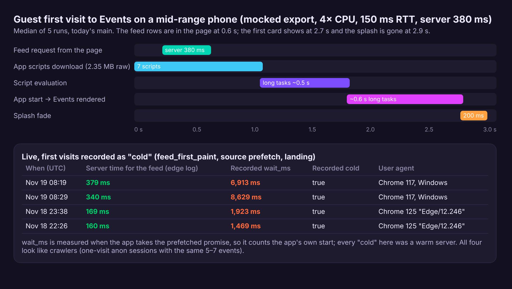
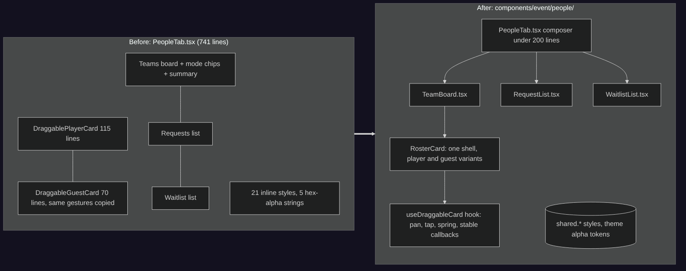
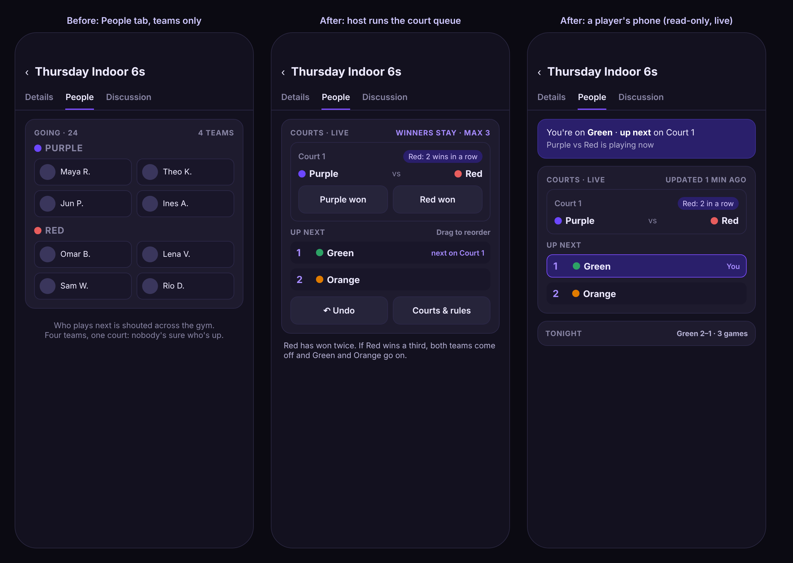
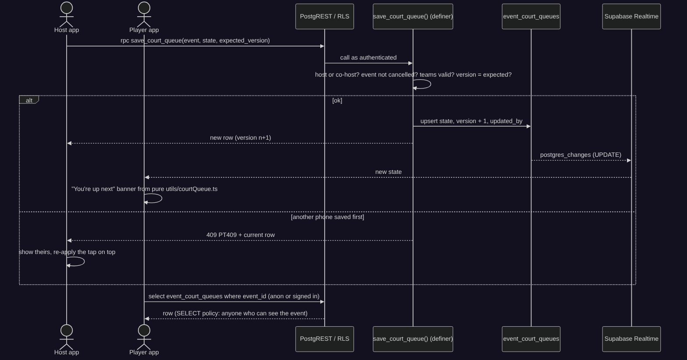
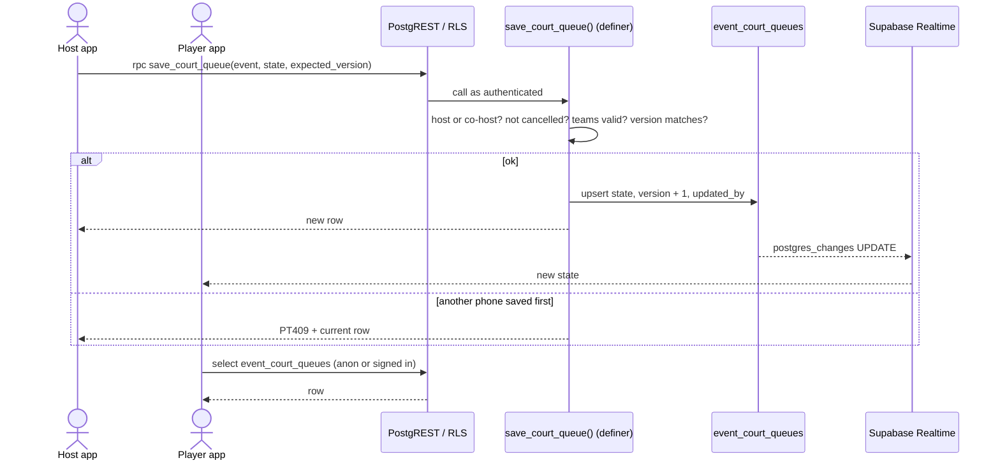

# vteam ideas: 2026-11-19

## Health check

Full stability run (`scripts/shots/stability-flow.mjs --full`) on today's `main` (ec6e828), mocked export, phone 390×844 and desktop 1280×860, signed in and guest, with and without an 800 ms delay on every Supabase response: **500 cases in 638 s, passed (0 new findings).**

- **Tours:** passed. Intro tour from Profile and the Austin banner, every Events type and surface chip from a link and saved: no gaps, spotlight every step (128 cases).
- **Refresh and Back:** passed. No new jump, layout shift, vanishing content or returning spinner (92 cases). Known (baseline, 6): the event page's Price row shift on reload, unchanged.
- **Links:** passed. Every `VIEW` link keeps its values, changes follow into the address, phone tabs keep their views (32 cases).
- **Raw route names:** passed (248 cases).
- **Still not exercised: 32 of the 92 refresh/Back cases** (Clubs and Chat don't scroll with the fixtures; Back on the event page and Tournaments has no child link partway down), same as Nov 15–18. Nov 16's idea 3 ("No silent skips") covers it and is still waiting for your call.

Nov 18 had no new-feature or competitor-gap idea, so today has one (idea 3). The stability checks already run in CI (#255), so that idea isn't proposed again.

## 1. First visits: the server answers in 0.4 s, the phone draws at 2.9 s. Measure the app's start, and keep feature code out of the first load

**Bucket:** latency · **Size:** M (client + build layout + one shots script, no schema)

**Pitch:** Since #184 the page asks for the feed before the app loads, and live shows that request answering in 160–380 ms. But the first-visit metric reports 1.5–8.6 s and marks those visits `cold`, because `wait_ms` is taken when the app picks the promise up, after its own scripts have loaded and run. On an emulated mid-range phone the feed rows are in the page at 0.6 s and the first card shows at 2.7 s: the time is the app's start, not the server. Record the two separately, keep crawler visits out of the number, and move ~230 KB of scorekeeper, tournament, admin-metrics and legal code out of the scripts every first visit loads.

**Why (measured today)**
- Live, the four first visits recorded since #326 (`feed_first_paint`, `source=prefetch`, `landing=true`): server time for `rpc/get_feed_span` in the edge logs was **379, 340, 169, 160 ms**, while `wait_ms` recorded **6,913, 8,629, 1,923, 1,469 ms**, all `cold: true`. Code: `hooks/useMonthEvents.ts` `trackFirstPaint` computes `Date.now() - prefetchAt` at the time the hook takes the promise, so it includes download and evaluation of the app.
- All four look like crawlers: one-visit anon sessions with the same 5–7 events (`session_start`, `banner_shown`, `feed_filter_changed`, `startup_timing`, `feed_first_paint`), user agents "Chrome 117 Windows" and "Chrome 125 … Edge/12.246". They aren't `navigator.webdriver`, so analytics stays on. So the only first-visit numbers we have are about bots, and they blame the server.
- Local, mocked export, guest first visit to `/`, 4× CPU, 150 ms RTT, compressed-size download, server 380 ms, median of 5: feed request answered **0.61 s**; scripts downloaded **1.04 s**; app's first own request **1.76–1.90 s**; first card in the DOM **2.68 s**; splash gone **2.88 s**. Long tasks: ~0.5 s of script evaluation, ~0.6 s rendering Events.
- First load is 7 scripts, **2,346 KB raw** (`node scripts/entry-deps.mjs --dist dist-sm --report`). `__common` alone is 1.23 MB: Metro puts any module two async routes share there, and `index.html` loads it up front. Today that includes code no first screen uses: the scorekeeper engine and layout (`lib/scoresheet/*`, `useScoreMatch`, 19 files, 100 KB source), tournaments (`hooks/tournament/api.ts`, `lib/tournamentBracket.ts`, standings, `utils/sheetScores.ts`, 12 files, 83 KB), admin metrics (24 KB) and the Terms/Privacy text (`constants/legal.ts`, 23 KB): **232 KB of the 1,374 KB of app source in the first load (17%)**.

**User stories**
- As someone opening a vteam link for the first time on a phone, the games show sooner, because the app loads only what the first screen needs.
- As Bryan, `feed_first_paint` tells me how long the server took and how long the app took, for people only, so the next latency fix aims at the right one.

**Acceptance criteria**
- [ ] The inline prefetch script (`utils/feedPrefetchScript.ts`) records when its response arrived (`doneAt`) on `window.__vteamPrefetch.feed`; `feed_first_paint` sends `server_ms` (response − request start) and `boot_ms` (app took it − request start) for prefetch, and `cold` is `server_ms > 1000`. `wait_ms` stays for two weeks with a note, then goes.
- [ ] `feed_first_paint` and `session_start` carry `bot: true` when the user agent matches a short list (`utils/botAgent.ts`: headless, known crawler tokens, "Edge/12." on Chrome, Chrome major more than 12 versions behind the current one). The admin Overview and the CLAUDE.md queries leave `bot` rows out. Nothing is blocked; it is a label.
- [ ] Feature chunks: the scorekeeper screens, tournament detail/create, admin metrics and the legal pages each re-export one lazy screen module per area through `lazyChunk` (like `EventDetailRoute.web.tsx`), so a module shared inside an area stays in that area's chunk instead of `__common`.
- [ ] `scripts/entry-deps.mjs` gains `BANNED_APP_PATHS` (`lib/scoresheet/`, `hooks/useScoreMatch`, `hooks/tournament/`, `lib/tournament`, `utils/sheetScores`, `components/metrics/`, `utils/metrics`, `constants/legal`) and fails CI when one reaches the first-load scripts.
- [ ] Targets, measured with the new `scripts/shots/first-visit-flow.mjs` (the run above: guest, `/`, 4× CPU, 150 ms RTT, server 380 ms, median of 5): first-load scripts **≤ 2,100 KB raw** (from 2,346) and first card **≤ 2.5 s** (from 2.68). The script joins CI's `a11y` job with a budget in `scripts/shots/startup-budget.json` (`firstVisitMs`), lowered freely, raised only with a reason in the PR.
- [ ] Startup budget, upgrade check and stability flow pass unchanged.

**Design**
- `utils/feedPrefetchScript.ts`: `p.then(r => { slot.doneAt = Date.now(); return r })`, no change to what is fetched.
- `lib/feedPrefetch.web.ts`: `feedPrefetchTiming()` returns `{ at, doneAt }`; `hooks/useMonthEvents.ts` `trackFirstPaint` sends `server_ms`, `boot_ms`.
- `utils/botAgent.ts` (pure, unit-tested) + one line in `lib/analytics` adding `bot` to `session_start` and `feed_first_paint`.
- Feature chunks: `components/scoresheet/ScorekeeperRoutes.web.tsx` (exports every scorekeeper screen), `components/tournament/TournamentRoutes.web.tsx`, `components/metrics/MetricsRoutes.web.tsx`, `components/legal/LegalRoutes.web.tsx`; each `app/` route file becomes a two-line `lazyChunk` re-export on web, unchanged on native (`.web.tsx` variant, like the event route). Each area's chunk is preloaded when the browser is idle after first paint only for routes linked from the current screen (not all of them).
- Only one lazy chunk may import Reanimated/Gesture Handler: none of these areas imports them (checked by the existing `entry-deps` rule).
- Guests: no change. Native: no change (bundle is local).

**Test plan**
- Unit: `botAgent` cases (real iPhone Safari, Android Chrome, desktop Chrome/Edge current: false; the four live agents above, HeadlessChrome, Googlebot: true); `trackFirstPaint` sends `server_ms`/`boot_ms`.
- `scripts/entry-deps.mjs` test for `BANNED_APP_PATHS`.
- `scripts/shots/first-visit-flow.mjs` before/after on the PR; `npm run startup:baseline`; stability flow (`--only routes,links`) for the moved routes (no "scorekeeper/[id]" flash while a chunk loads).
- After merge: `feed_first_paint` on live with `bot` excluded for 14 days; compare `server_ms` against edge-log origin times.

**Pros and cons**
- Pros:
  - Fixes a metric that blames the server for the app's own start, and has done so on every first visit recorded since #326.
  - Takes 17% of the app source out of every first visit; a guard keeps it out.
  - Crawler visits stop shaping first-visit, funnel and "people" numbers in Admin metrics.
  - No schema, no data risk; the feature-chunk pattern already exists for the event page.
- Cons:
  - The gain is modest (about 0.2 s at 4× CPU by this estimate); most of the 2.9 s is react-dom, react-native-web and expo-router, which this doesn't touch.
  - Four more lazy route wrappers: opening the scorekeeper, a tournament or admin metrics the first time costs one more chunk request (~100–300 ms).
  - A user-agent list goes stale and will misjudge a few visits.
  - Overlaps Nov 16's "First look for first visits" (still proposed): that draws today's games from the page; this one measures and trims. They stack.
- **Verdict:** worth it, mainly for the measurement: the speed gain is small, but without it the next latency idea targets the wrong side.

**Size:** M · **Risks:** a lazy route flashing its file name (covered by the stability flow's raw-route cases) · **Open questions:** drop crawler visits from analytics entirely instead of labelling them? · **Dependencies:** none; complements Nov 16 #2.

## 2. People tab in pieces: one draggable roster card, a team board and two lists out of the app's largest file

**Bucket:** refactor · **Size:** M (client only)

**Pitch:** `components/event/PeopleTab.tsx` is now the largest file in the app (741 lines). It holds two near-copies of the same drag-and-pin card (player 115 lines, guest 70 lines, identical gesture code), the team board, the requests list and the waitlist, with 21 inline style objects and 5 hex-alpha strings (`teamColor + '18'`). Split it into a gesture hook, one card shell, and three sections, before the next feature on that tab (idea 3) grows it further.

**Why**
- Size: 741 lines, largest of 400+ files (next: `useMonthEvents.ts` 685, `EventDetailScreen.tsx` 607).
- Duplication: `DraggablePlayerCard` (lines 47–161) and `DraggableGuestCard` (163–235) repeat the same `cbRef` / `stableStart…stableTogglePin` callbacks, `Gesture.Pan()` chain, long-press vs `minDistance(5)` split, tap-to-pin and spring style. A fix to drag behaviour today has to be made twice; the guest card already differs (no `paid` / no-show / skill line).
- Conventions: 21 `style={{…}}` objects and colour strings built from tokens plus alpha (`theme.colors.error + '18'`, `teamColor + '14'`), against "shared styles in `constants/styles.ts`" and "never hardcode colors".
- Tests: only `__tests__/rosterMessaging.test.tsx` renders it (menu, paid badge, no-show); no test covers drag, pin or the waitlist order.
- This file lives in the event page's lazy chunk (Reanimated and Gesture Handler are allowed there only, #193), so new files must stay inside that chunk: worth doing once, deliberately.

**User stories**
- As a host, dragging and pinning players and +1s behaves the same for both (one code path), and fixes land in both.
- As a developer, adding a section to People (court queue, idea 3) means one new component, not more lines in a 741-line file.

**Acceptance criteria**
- [ ] `hooks/event/useDraggableCard.ts`: pan/tap gestures, spring scale/opacity, stable callbacks, web vs native activation; returns `{ panGesture, tapGesture, animStyle }`.
- [ ] `components/event/people/RosterCard.tsx`: one shell (`avatar`, `title`, `subtitle`, `badges`, `pinned`, corner control); `PlayerRosterCard` and `GuestRosterCard` are thin variants.
- [ ] `TeamBoard.tsx` (going + teams, mode chips, summary chips, drop zones, randomize/save), `RequestList.tsx`, `WaitlistList.tsx`.
- [ ] `PeopleTab.tsx` ≤ 200 lines, its props unchanged (so `EventDetailScreen.tsx` and `rosterMessaging.test.tsx` don't change); every new file ≤ 250 lines.
- [ ] Inline styles moved to `shared.*`; alpha colours become tokens (`theme.colors.errorTint`, `errorLine`, `successTint`, `subtextTint`) and a `teamTint(color, strength)` helper in `constants/events.ts` beside `TEAM_COLORS`.
- [ ] No visual change: `npm run shots:compare` shows no diff on the event People tab (host and guest fixtures), and the a11y baseline doesn't grow.
- [ ] `node scripts/entry-deps.mjs` still passes (the new files are reachable only from the event chunk).

**Design**
- Mechanical move in two PRs: (1) hook + card shell, both cards on it; (2) sections + styles. Each PR keeps `PeopleTab`'s props and test IDs (`team-mode-random`, `team-shuffle`, `roster-no-show-badge`, …).
- No route, data or guest change. Native, mobile web and desktop render the same components.

**Test plan**
- First (before moving code): add `__tests__/peopleTab.test.tsx` covering the waitlist numbering (profiles then guests), requests shown only to hosts, team summary chips, and the guest card's "+1" line; it must pass before and after.
- Unit: `teamTint`, `useDraggableCard` web vs native activation (mock gesture builder).
- Shots: event People tab as host and as guest added to `SCREENS` if not there; `shots:compare` before/after.
- e2e: existing teams/roster specs unchanged.

**Pros and cons**
- Pros:
  - Removes ~70 lines of copied gesture code; drag fixes land once.
  - Brings the largest file under the size of every other screen and onto `shared.*` and tokens.
  - Adds the first tests for waitlist order and host-only requests.
  - Makes room for the court queue (idea 3) without growing the file.
- Cons:
  - No user-visible change.
  - Gesture code is the riskiest to move: a regression shows only on a real phone (long-press to drag), which CI doesn't exercise; needs a manual check on iOS web and Android.
  - Four new tokens for what are today one-off tints.
  - Two PRs of churn on a file nobody is currently changing.
- **Verdict:** worth it if idea 3 is approved (it's the natural first step); otherwise lower priority than features.

**Size:** M · **Risks:** drag/long-press regressions on touch · **Open questions:** keep `DragGhost.tsx` where it is? (yes, proposed) · **Dependencies:** none.

## 3. Court queue for open play: who's on, who's next, winners stay

**Bucket:** competitor-gap · **Size:** M–L (schema + client)

**Pitch:** Open play with more teams than courts runs on shouting: who's next, did Red already win twice? The host taps "Red won" on the People tab; vteam rotates the teams by the night's rule (winners stay up to N, or both off) and every player sees, live on their phone, which court they're on or how many games until they're up. It uses the teams vteam already makes.

**Why (competitors)**
- PodPlay's open play ("Paddle Rack") keeps a queue per court; when a match ends the next players move on automatically, with "2 on / 2 off" rules, and "Challenge Court" lets winners stay always or for a set number of wins ([PodPlay docs](https://docs.podplay.app/pro-system/tournaments/running-an-open-play)).
- PickleQ (with DUPR) lets players "follow the queue, view upcoming matches and court assignments, and track standings" from their phones, and promises nobody waits more than two rotations ([DUPR post](https://www.dupr.com/post/pickleq-streamlines-open-play-and-dupr-match-reporting)).
- Courtside king-of-the-court rotation (winners stay, losers to the back of the line) is the standard single-court format ([Skedge](https://skedge-web.web.app/resources/king-of-the-court)).
- These are pickleball tools; nothing in vteam's volleyball set (Reclub, OpenSports, Meetup, TeamSnap, Spond) shows a live rotation. vteam already has teams per event (`event_attendees.team_number`, guests too, balanced or random), Simple score, and realtime.

**User stories**
- As a host running open play with 4 teams on 1 court, I start the queue after making teams, tap the winner after each game, and the next team is called without me tracking it.
- As a player, I open the game on my phone and see "You're on Green · up next on Court 1", updating by itself.
- As a host, I can drag the queue to fix an order, undo a wrong tap, and change the rule (winners stay max 1–5, always, or both off) or the number of courts (1–4) mid-night.
- As a guest with the link, I can watch the courts (read only).

**Acceptance criteria**
- [ ] People tab shows a **Courts** card once teams are saved and the event has started (or within 30 min of start), for host/co-hosts: **Start court queue** (courts 1–4, rule), then per court "<A> won / <B> won", Up next (drag to reorder), Undo, Courts & rules, End.
- [ ] Rotation rules in pure `utils/courtQueue.ts` (unit-tested): winner stays and streak +1, loser to the back; at the streak limit both go to the back (winner first); "both off" puts both back every game; teams that sat out longest go on first when a court frees; Undo restores the previous state exactly.
- [ ] Players see the card read-only plus a banner for their own team ("On Court 1 now" / "Up next on Court 1" / "2 games until you're up"); guests see the card without the banner.
- [ ] Live: another phone's change shows within 2 s (realtime), and a refetch on focus covers a missed event.
- [ ] Two hosts tapping at once: the second save gets the current state back (version check) and its tap is re-applied on top or dropped with a toast.
- [ ] Tonight's tally per team (wins–losses, games) under the card; nothing is written to points, profiles or kudos.
- [ ] Metrics: `court_queue_started` {courts, rule}, `court_queue_result` (no ids), `court_queue_ended` {games}.
- [ ] Works on native, mobile web and desktop (desktop: the card sits beside the team board).

**Design**
- Screens: `components/event/people/CourtQueueCard.tsx` (needs idea 2 or adds to `PeopleTab.tsx`), `CourtQueueSetupSheet.tsx` (BottomSheet), `YourCourtBanner.tsx`. Copy in `constants/copy.ts` (`COURT_QUEUE_COPY`).
- Hooks: `hooks/event/useCourtQueue.ts` (`useQuery(queryKey('court-queue', eventId))`, `useRealtimeChannel('court-queue:' + id, …)`, `useMutation` with optimistic `setQueryData` and rollback).
- Teams come from saved `team_number`s on attendees and guests (`assignments` in `useEventTeams`); team names/colours from `TEAM_COLORS` / `TEAM_COLOR_NAMES`.
- No new route; the event link with `?tab=people` already opens it.

**Backend**

**Model changes**

| Object | Change | Notes (who can read / write) |
| --- | --- | --- |
| `event_court_queues` | new table: `event_id` uuid PK → `events` ON DELETE CASCADE, `courts` smallint 1–4, `rule` text (`stay_max` / `both_off`), `stay_max` smallint 1–5 null, `state` jsonb (`on_court`, `queue`, `streaks`, `history` capped at 200), `version` int, `started_at`, `ended_at`, `updated_at`, `updated_by` uuid → `profiles` ON DELETE SET NULL | SELECT: `anon` + `authenticated` where the event is visible (same as `event_attendees`). No INSERT/UPDATE/DELETE policy: writes only through the RPC. |
| `save_court_queue(p_event uuid, p_state jsonb, p_expected int)` | new function, SECURITY DEFINER, `authenticated` only | Checks `auth.uid()` is creator or co-host (42501), event not cancelled, team numbers in `p_state` exist on the event (22023), JSON shape and sizes; compare-and-set on `version` (PT409 with the current row). Rate limit 120/min per user (`enforce_rate_limit`). |
| `end_court_queue(p_event uuid)` | new function, same checks | sets `ended_at`; the row stays for the night's tally. |
| `supabase_realtime` publication | add `event_court_queues` | Realtime respects the SELECT policy. |

Migration sketch (`<ts>_event_court_queues.sql`): create table + check constraints, enable RLS, two SELECT policies, the two functions with `revoke all … from public, anon; grant execute … to authenticated`, `alter publication supabase_realtime add table`. Down (`.down.sql`): `alter publication … drop table`, drop functions, drop table. Expand only. `delete_account`: `updated_by` is SET NULL, nothing to add. RLS matrix row: guest read yes, guest insert no, own-rows-only n/a, no direct writes.

RLS expectations for `e2e/rls.spec.ts`: guest can select a queue row for a public event; guest `insert`/`update` rejected; signed-in non-host `rpc('save_court_queue')` → 42501; host save with a stale version → PT409.

**Test plan**
- Unit: `utils/courtQueue.ts` (1–4 courts, stay max 1/3/always, both off, undo, reorder, a team removed mid-night, odd team count) and the banner text.
- RLS: the four expectations above + `e2e/rls/matrix.ts` row (`api` shard).
- e2e (`e2e/courtQueue.spec.ts`, signed-in shard): host fixture event with 4 saved teams → start → "Red won" ×3 → Green and Orange on; a second context as guest sees the change.
- Shots: event People tab with a running queue (host and guest) in `SCREENS`, fixture row in `scripts/shots/fixtures/`.
- Android Maestro: not needed (no native-only code).

**Pros and cons**
- Pros:
  - Solves a real open-play problem on the court, during the game, where vteam isn't used today.
  - Builds on what exists (teams, realtime, People tab); no new route.
  - A reason for every player at the game to open vteam on their phone, guests included, which feeds sign-ups.
  - Pickleball tools treat this as a headline feature; none of the volleyball apps above have it.
- Cons:
  - Only useful when teams outnumber courts and a host is willing to tap after each game; many vteam games are one court, two teams.
  - A host's phone in hand during play: if they forget to tap, the queue is wrong and players trust it less than shouting.
  - New table, two functions, realtime and a version check: the largest backend piece in weeks, for a feature we can't measure demand for yet.
  - Realtime connections for everyone on the People tab at a busy open play (one Micro instance).
- **Verdict:** worth a first version for hosts who run 3+ teams; ask one or two Austin hosts first, and land idea 2 before it.

**Size:** M–L · **Risks:** realtime load, stale state if the host stops tapping (show "updated N min ago") · **Open questions:** let any player tap a result (host approves)? a "You're up next" push (one per player per game, `group_key`)? · **Dependencies:** idea 2 (recommended), teams (#149).
