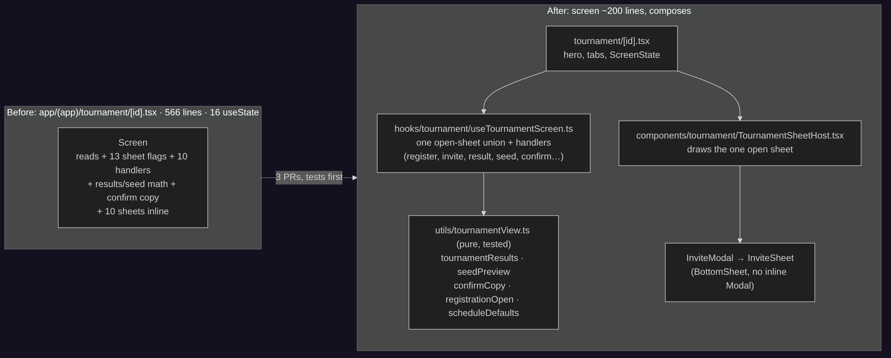
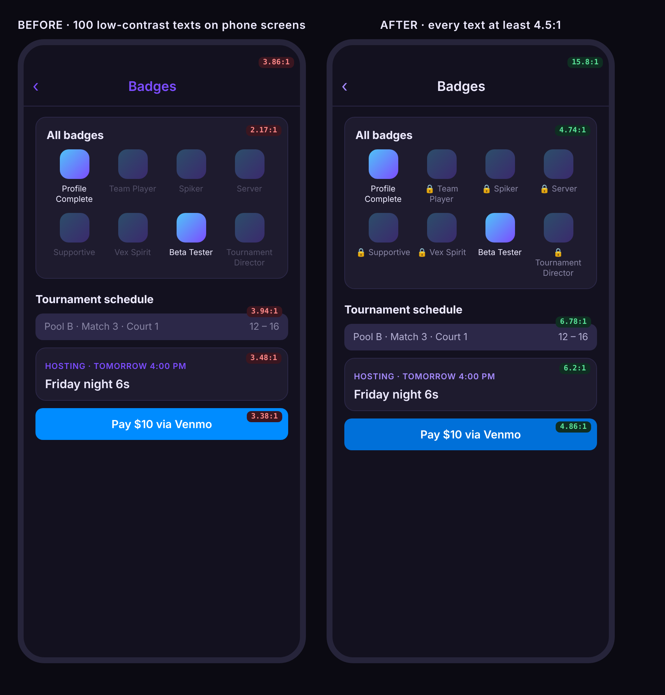
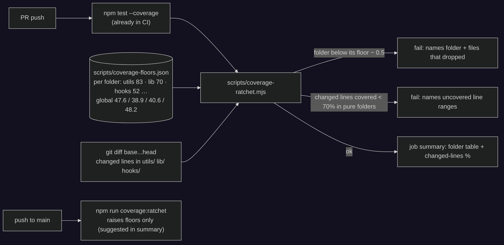

# vteam ideas: 2026-11-20

## Health check

Full stability run (`scripts/shots/stability-flow.mjs --full`) on today's `main` (c83a081, after #341 desktop feed by day), mocked export, phone 390×844 and desktop 1280×860, signed in and guest, with and without an 800 ms delay on every Supabase response: **508 cases in 828 s, passed (0 new findings).**

- **Tours:** passed. Intro tour from Profile and the Austin banner, every Events type and surface chip from a link and saved: no gaps, spotlight every step (128 cases).
- **Refresh and Back:** passed. No new jump, layout shift, vanishing content or returning spinner (92 cases). Known (baseline): the event page's Price row shift on phone reload (0.019), unchanged. **Improved:** the event page on desktop no longer shifts on reload (0.016 → 0); the baseline can shrink with `npm run stability:baseline` in the next PR that touches it.
- **Links:** passed. Every `VIEW` link keeps its values, changes follow into the address, phone tabs keep their views (32 cases).
- **Raw route names:** passed (256 cases).
- **Still not exercised: 32 of the 92 refresh/Back cases** (Clubs and Chat don't scroll with the fixtures; Back on the event page and Tournaments has no child link partway down), same as Nov 15–19. Nov 16's idea 3 ("No silent skips") covers it and is still waiting for your call.

Nov 19 had a competitor-gap idea, so today has no new-feature idea. Nothing failed, so there's no fix idea; today is refactor, end-user experience and testing.

## 1. Tournament page in pieces: one open-sheet state, pure results, and a sheet host out of a 566-line screen

**Bucket:** refactor · **Size:** M (client only, 3 PRs, no schema)

**Pitch:** `app/(app)/tournament/[id].tsx` is now the largest screen in the app (566 lines) and the last big one that doesn't "only compose". It holds 16 `useState`s (13 of them say which sheet is open or which row is busy), ten async handlers, the seeding math for the bracket preview, the confirm-dialog copy and ten sheets drawn inline. Split it the way the host form, club page, chat room and People tab were split: pure results in a tested module, one hook that owns "which sheet is open" as a single union, and a sheet host component. The screen drops to about 200 lines, and the bracket seeding preview gets its first tests.

**Why (counted today)**
- `app/(app)/tournament/[id].tsx`: 566 lines, 16 `useState`, 10 handlers (`submitRegister`, `acceptInvite`, `sendInvite`, `sendJoinRequest`, `runConfirmed`, `generate`, `seedBracket`, `submitResult`, `pickForFreeAgent`, `pickForMovingPlayer`), a 30-line `results` `useMemo` that builds the bracket seed preview (pool → tier → label maps, `avoidPoolRematches`), and `confirmCopy` for four confirm kinds.
- The seed preview and confirm copy run on every organizer's tournament page and have no test: unit coverage of `app/` is **1% of 2,513 lines** (Jest coverage today), and `__tests__/tournamentResults.test.ts` covers `lib/tournamentResults` but not this screen's math.
- Ten sheets mean ten flags that can be true at once (`showRegister`, `showInvite`, `requestingTeam`, `assigningFreeAgent`, `movingPlayer`, `showPrize`, `showAnnouncement`, `resultMatch`, `showSeeds`, `confirm`); nothing stops two from opening. One union makes "one sheet at a time" a type.
- `components/tournament/InviteModal.tsx` is an inline `Modal` (`presentationStyle="pageSheet"`), which CLAUDE.md says to replace with `BottomSheet`.
- The next tournament work (embed widget, divisions in the UI from #299, #282's player pinning) all lands in this screen.

**User stories**
- As an organizer, the tournament page behaves exactly as today (no visible change), but only one sheet can ever be open.
- As a developer adding divisions or the embed share sheet, I change a 200-line screen and a tested pure module, not a 566-line file.

**Acceptance criteria**
- [ ] `utils/tournamentView.ts` (pure, no React Native): `tournamentResults({ tournament, teams, matches, pools, tiebreakers, isCreator })` (tables, overall, podium, seedPreview, poolMatchesLeft, bracketExists), `confirmCopy(confirm, ctx)`, `isRegistrationOpen(tournament, now)`, `defaultScheduleConfig(tournament)`. Moved verbatim, then covered by `__tests__/tournamentView.test.ts` (seed preview with 2 and 3 pools, rematch avoidance, no preview once a bracket game is played or for non-creators, each confirm kind's copy, deadline edge).
- [ ] `hooks/tournament/useTournamentScreen.ts`: `const [sheet, setSheet] = useState<TournamentSheet | null>` where `TournamentSheet` (in `types/`) is a union (`register`, `invite`, `joinRequest {team}`, `assignFreeAgent {team}`, `movePlayer {player}`, `prize`, `announcement`, `result {match}`, `seeds`, `confirm {…}`), plus the handlers and the busy ids (`invitingId`, `acceptingInviteId`). Returns `teamActions` ready for `TeamsTab`.
- [ ] `components/tournament/TournamentSheetHost.tsx` draws the one open sheet; `InviteModal` becomes `InviteSheet` on `BottomSheet`.
- [ ] `app/(app)/tournament/[id].tsx` under 250 lines; no `useState` for sheets left in it.
- [ ] `__tests__/useTournamentScreen.test.tsx`: opening a sheet closes the previous one; a successful register / result / join request closes its sheet; a failed one keeps it open.
- [ ] No visible change: `npm run shots:compare` on `tournament-*` screens shows no diff; a11y and stability baselines unchanged; `e2e/tournaments*.spec.ts` green.

**Design**
- Files: `app/(app)/tournament/[id].tsx` (composes), new `utils/tournamentView.ts`, `hooks/tournament/useTournamentScreen.ts`, `components/tournament/TournamentSheetHost.tsx`, `components/tournament/InviteSheet.tsx` (replaces `InviteModal.tsx`), `types/tournament.ts` (or `types/index.ts`) for `TournamentSheet`.
- Guest and outside-club behavior stays in the screen's `canAct` / `publicAction` (#282) and is passed into the hook, so the public read-only page is unchanged.
- Surfaces: no change on native, mobile web or desktop web; `InviteSheet` uses `BottomSheet`, which already handles all three.
- Landing: PR 1 pure module + tests (screen imports it); PR 2 the hook + host + its test; PR 3 `InviteSheet`. Each PR runs `shots:compare` for the tournament screens.

**Backend:** none.

**Test plan**
- Unit: `tournamentView.test.ts`, `useTournamentScreen.test.tsx` (renderHook with a fake `useTournamentActions`).
- e2e: existing tournament specs in their current shards; no new spec.
- Shots: `tournament-*` entries already in `scripts/shots/screens.mjs`; add `tournament-invite` (sheet open) so the BottomSheet swap is captured and scanned by axe.

**Pros and cons**
- Pros:
  - The screen every tournament feature touches drops from 566 to ~200 lines, like host, club, chat and People before it.
  - The bracket seed preview, which decides who plays whom, gets tests for the first time.
  - "One sheet at a time" becomes a type, not a convention across 10 flags.
  - Removes the last inline `Modal` in the tournament screens.
  - Pure module can be reused by the embed widget (`get_public_tournament`) without React.
- Cons:
  - No user-visible gain; it costs review time for three PRs.
  - Moving code risks subtle behavior changes (e.g. a sheet that used to stay open on failure); needs the hook test to pin them.
  - `InviteSheet` on `BottomSheet` changes the native presentation (page sheet → slide-up sheet), a small visible difference on iOS.
  - Overlaps with whoever picks up #282's player pinning; land first or coordinate.
- **Verdict:** worth it: the tournament page is where the next three features land, and the seed preview is real logic with no tests; the cost is a moderate, low-risk move.

**Risks / open questions / dependencies:** keep #282 (open) in mind; `InviteModal`'s FlatList should become `BottomSheet`'s scroll. Size M.

## 2. Readable everywhere: fix the 366 low-contrast texts, six causes make 95% of them

**Bucket:** end-user-experience (accessibility) · **Size:** S–M (client only, no schema)

**Pitch:** axe's colour-contrast rule is the only serious finding left in the a11y baseline, and it's accepted **366 times** across screens (phone + desktop). On phone screens today it's 100 texts, and six causes make 95 of them: settings headers drawn in `primary` (3.86:1), locked badge names at 50% opacity (2.17:1), `subtext` on raised rows and chips (3.94:1), `primary` used for small caps labels on cards (3.06–3.65:1), the Venmo button (3.38:1) and the purple team colour as text. Fix them at the token and component level, shrink the baseline, and add a token test so new pairs can't slip under 4.5:1.

**Why (measured today)**
- `scripts/shots/a11y-baseline.json`: only one rule, `color-contrast`, **366 nodes** accepted. Worst screens: Badges (30 desktop + 22 phone), Events feed (27 / 26 guest), tournament schedule (18) and teams (14).
- Axe on every `SCREENS` entry, phone, today's export, grouped by colour pair (100 nodes; the 5 not listed are one-offs):

| Count | Text / background | Ratio | Where | Cause |
|---|---|---|---|---|
| 23 | `#7C4DFF` on `#13111F` | 3.86 | Settings headers (Badges, History, Cheers, Hidden in feed, Submit feedback…) | `headerTintColor: theme.colors.primary` in `app/_layout.tsx`, `app/(app)/_layout.tsx` (×2), `app/(app)/(tabs)/_layout.tsx` also colours the stack header **title** on web |
| 20 | `#535069` on `#1E1B2E` | 2.17 | Locked badge names | `BadgeIcon` label `opacity: earned ? 1 : 0.5` over `subtext` |
| 26 | `#8885A4` on `#2C2848` / `#2A1F6B` / `#21273C` / `#1C2A33` | 3.94–4.18 | Tournament match rows, team chips, history counts | `subtext` on raised surfaces (it's 4.5:1 only on `card` and `background`) |
| 20 | `#7C4DFF` on cards and tints | 2.54–3.65 | HOSTING / date caps on cards, week-strip day names, position tags, "You" | `primary` as small text instead of `primaryText` |
| 3 | `#FFFFFF` on `#008CFF` | 3.38 | Pay via Venmo | brand blue fill |
| 3 | `#6C47FF` on dark | 2.94–3.53 | Purple team name | `TEAM_COLORS[0]` used as text |
- Contrast isn't cosmetic for vteam: most players are on phones, outdoors at sand and grass courts; low-contrast captions are what fails first in sunlight. WCAG 2.1 AA (1.4.3) asks 4.5:1 for text under 18.66px bold / 24px.

**User stories**
- As a player checking a schedule courtside in the sun, I can read match numbers, scores and dates.
- As a player with low vision, every label meets WCAG AA, so locked badges, settings titles and tags are readable.
- As Bryan, a new screen that uses `primary` or `subtext` on the wrong surface fails a test, not a manual review.

**Acceptance criteria**
- [ ] Stack headers: `headerTintColor: theme.colors.primaryText` and `headerTitleStyle: { color: theme.colors.text }` in all four stacks (back arrow stays violet, title is near-white, 15.8:1).
- [ ] `BadgeIcon`: locked labels use `subtext` at full opacity with a small lock glyph (4.74:1); the icon stays dimmed, so locked still reads as locked.
- [ ] New token `subtextOnRaised` (= `subtextStrong`, `#B5B1D4`, ≥6.7:1 on `border` / `primarySoft`) used for secondary text inside raised rows: tournament match rows, team chips, settings history counts, the no-show note.
- [ ] Every text use of `theme.colors.primary` (card caps, week strip day names, position tags, "You" pill, tournament create step labels) moves to `primaryText`; `primary` stays for fills, borders and icons ≥ 24px.
- [ ] `venmoFill` token `#0070D9` (white 4.86:1) for Pay via Venmo; team names as text use a lightened `teamInk(n)` (each ≥ 4.5:1 on `card`) while chips keep the fill colour.
- [ ] `__tests__/contrastTokens.test.ts`: a table of allowed (text token, surface token) pairs, each asserted ≥ 4.5:1 with the WCAG formula; adding a pair below fails.
- [ ] a11y baseline shrinks: phone color-contrast nodes from 100 to ≤ 15 and total from 366 to ≤ 60, committed with `npm run a11y:baseline` (or CI's `a11y-baseline.next.json`).
- [ ] `shots:compare` posted on the PR for Badges, Settings, Events feed, tournament schedule and event Details.

**Design**
- `constants/theme.ts`: add `subtextOnRaised`, `venmoFill`; doc comments stating which surfaces each text token is safe on.
- `constants/events.ts`: `TEAM_INK` (text-safe variants of `TEAM_COLORS`), `teamInk()` next to `teamColor()`.
- Components: `components/BadgeIcon.tsx`, the four stack layouts, `components/EventCard.tsx` / `RowEventCard` caps, `components/events/WeekStrip*`, tournament `ScheduleTab` / `TeamCard` / `TeamsTab`, `components/event/VenmoButton` (or the DetailsTab block), settings history.
- Native: header title colour changes there too (it was violet on iOS/Android as well); no layout change. Desktop web: same tokens, no layout change.

**Backend:** none.

**Test plan**
- Unit: `contrastTokens.test.ts`; existing `textSizeFloor` untouched.
- a11y: CI's axe job is the measure; baseline committed smaller.
- Visual: `npm run shots:compare` before/after; stability baseline unchanged.
- Android Maestro flows find by text and testID, so colour changes don't affect them.

**Pros and cons**
- Pros:
  - Fixes the single remaining serious axe rule for ~95% of its phone nodes with token-level changes, not 100 one-off edits.
  - Directly helps the main use: reading the app outdoors on a phone.
  - The token test stops regressions at the cheapest point (unit test, no browser).
  - Baseline shrinks, so the a11y job catches new contrast issues instead of hiding them under a 366-node allowance.
- Cons:
  - Visible change to the brand look: settings titles stop being violet, small caps labels get lighter violet.
  - Touches many files at once (≈15–20), so the PR is broad even if each change is a token swap.
  - Some of the 366 are desktop-only and in gradients/overlays axe can't judge well; the remaining few may need case-by-case calls.
  - Team ink colours drift from the team fill colours, so a team's name and chip are not the exact same hue.
- **Verdict:** pros clearly win: it's mostly a token swap with a test guarding it, and readability is the app's core job courtside.

**Risks / open questions:** do you want settings titles near-white (proposed) or `primaryText` violet (6.9:1)? Both pass. Dependencies: none.

## 3. Coverage that only goes up: per-folder floors and changed-lines coverage on every PR

**Bucket:** testing · **Size:** S (one script, one JSON file, one CI step, no schema)

**Pitch:** CI's only coverage guard is a global floor in `package.json` (35 / 28 / 30 / 36 statements / branches / functions / lines) that now sits **12 points below** today's numbers (47.6 / 38.9 / 40.6 / 48.2). A PR could delete or skip the tests for half of `utils/` and still pass, because the global average hides it. Replace the single floor with per-folder floors that rise automatically and a changed-lines check on the pure folders, so the pure logic stays tested as new code lands.

**Why (measured today, `npm test -- --coverage`)**

| Folder | Lines covered | Branches |
|---|---|---|
| `utils/` | 89.5% (2,295 / 2,564) | 82.5% |
| `lib/` | 86.3% (2,545 / 2,950) | 74.6% |
| `constants/` | 82.1% | 44.0% |
| `contexts/` | 80.2% | 57.6% |
| `hooks/` | 48.7% (1,829 / 3,757) | 36.4% |
| `components/` | 19.8% (817 / 4,128) | 18.4% |
| `app/` | 1.0% (25 / 2,513) | 0.4% |
| **total** | **48.2%** | **38.9%** |

- The floor was last set on Nov 13 (#274); coverage has grown since, and CLAUDE.md says to raise it when it grows, which is manual and hasn't happened.
- The global floor lets ~1,950 covered lines go uncovered before failing; `utils/` could fall from 89% to ~15% and the job stays green.
- The refactors of the last two weeks (host form, tournament create, chat, People tab) all moved logic into pure `utils/` and `lib/` modules precisely so it could be tested; nothing in CI checks that the moved code actually is.

**User stories**
- As Bryan, a PR that adds a pure rule (`utils/`, `lib/`, `hooks/`) without tests fails with the uncovered line ranges named.
- As Bryan, coverage never quietly slides: when a folder grows its coverage, its floor rises with it.

**Acceptance criteria**
- [ ] `scripts/coverage-floors.json`: per top folder (`utils`, `lib`, `hooks`, `contexts`, `constants`, `components`, `app`) and global, lines and branches, set 0.5 below today's numbers.
- [ ] `scripts/coverage-ratchet.mjs` (reads `coverage/coverage-summary.json` and `coverage/lcov.info`): fails when a folder is below its floor, naming the folder and the files whose coverage fell most vs. the base build; `--update` raises floors to current − 0.5 and never lowers them.
- [ ] Changed lines: for files changed vs. the PR base in `utils/`, `lib/`, `hooks/` (excluding `*.web.ts`, `api/`), executable changed lines must be ≥ 70% covered; the summary lists uncovered ranges per file. Other folders are reported only.
- [ ] CI's unit job runs it after `npm test --coverage` and writes a table to the job summary (alongside `coverage-summary.mjs`); `jest.coverageThreshold` stays as a last-resort global floor, raised to current − 2.
- [ ] Pushes to `main` print the suggested `--update` floors in the summary; raising them is a one-line commit in the next PR (no bot commits to `main`).
- [ ] A test of its own: `__tests__/coverageRatchet.test.ts` on small fixture summaries/lcov (folder below floor, changed lines uncovered, update never lowers).
- [ ] CLAUDE.md "Test layers" updated (`npm run docs:check`).

**Design**
- No app code changes. New `scripts/coverage-ratchet.mjs` (pure functions exported for the test), `scripts/coverage-floors.json`, a step in `.github/workflows/ci.yml` after the existing coverage summary, `package.json` scripts `coverage:check` and `coverage:ratchet`.
- Base diff: `git diff --unified=0 origin/<base>...HEAD` (CI already fetches the base for drift checks); lcov line hits come from Jest's default reporters (add `lcov` to `coverageReporters` if missing).

**Backend:** none.

**Test plan**
- Unit: `coverageRatchet.test.ts`.
- Dry run on the last five merged PRs' heads (local): which would have failed and why, posted in the PR description so the 70% bar is checked against real history before it's enforced.
- CI: the step itself runs on every PR; start with `--warn-only` for one day if the dry run shows false alarms.

**Pros and cons**
- Pros:
  - Closes a 12-point gap where real test loss goes unnoticed.
  - Per-folder floors protect the parts that are meant to be tested (`utils/`, `lib/` at 86–90%) from being averaged away by untested screens.
  - Changed-lines check nudges every new pure rule to come with its test, matching how the recent refactors were designed.
  - Small: one script, no app or schema change, runs in the existing job (~seconds after Jest).
- Cons:
  - Another way for a PR to go red; a 70% bar on changed lines will sometimes flag glue code that isn't worth a test.
  - Coverage measures execution, not assertions; it can be gamed with shallow tests.
  - Floors that only rise need a manual one-line bump (or they lag), and a big refactor that moves code between folders may need a floor adjusted in the same PR.
  - Doesn't help `components/` and `app/` (20% / 1%), which are better covered by shots, axe and e2e anyway.
- **Verdict:** worth it: cheap, no product risk, and it protects the pure-module testing the last month of refactors was built for; start the changed-lines check as a warning for a day to tune it.

**Risks / open questions:** 70% vs 80% for changed lines; whether `hooks/` should be in the changed-lines set from day one (48.7% today). Dependencies: none.
