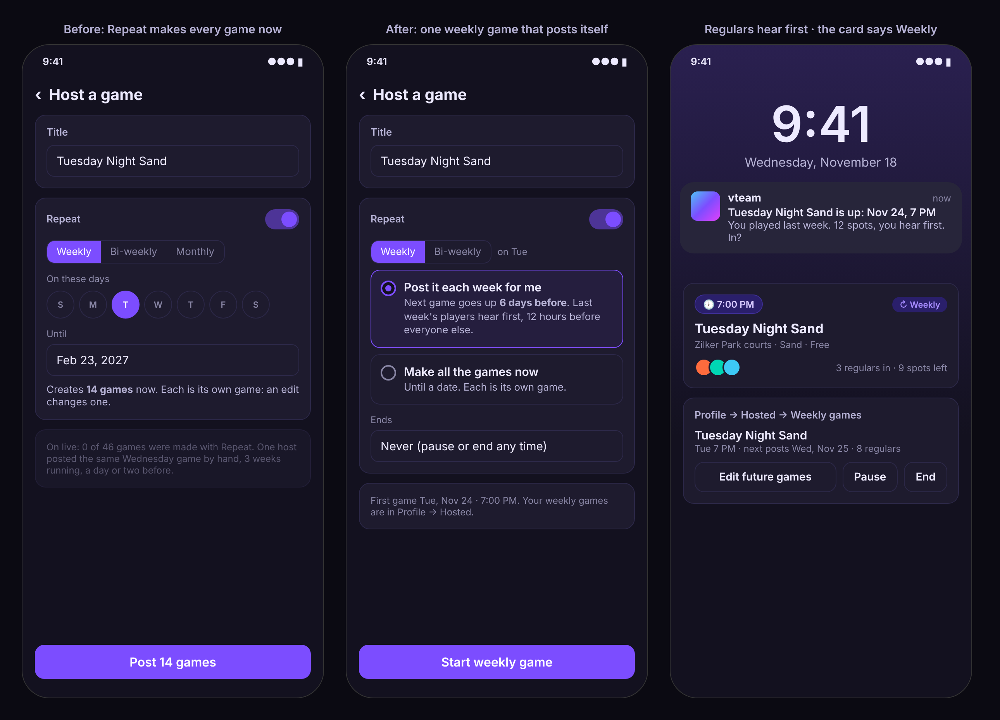
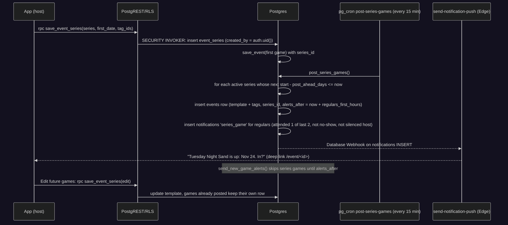
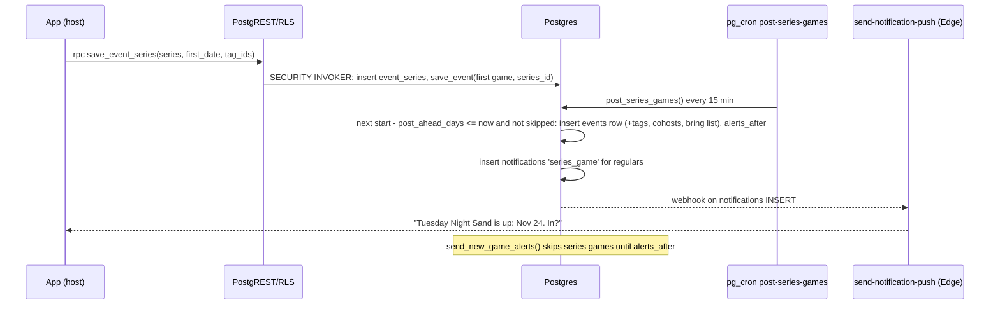
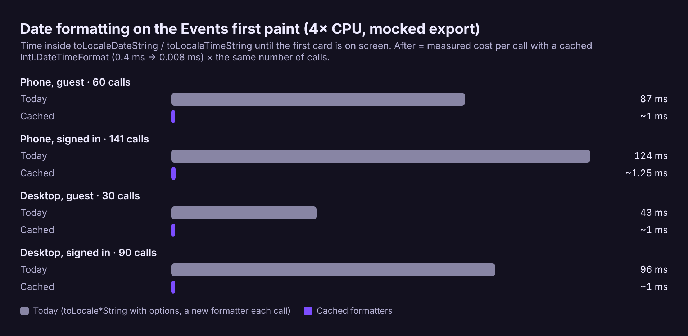
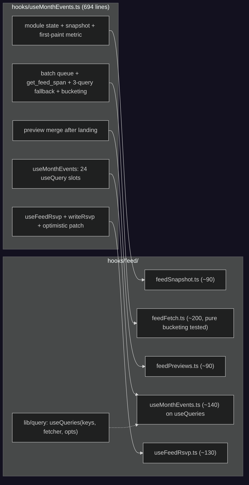

# vteam ideas: 2026-11-21

## Health check

Full stability run (`scripts/shots/stability-flow.mjs --full`) on today's `main` (c83a081, after #341 desktop feed by day), mocked export, phone 390×844 and desktop 1280×860, signed in and guest, with and without an 800 ms delay on every Supabase response: **508 cases in 645 s, passed (0 new findings).**

- **Tours:** passed. Intro tour from Profile and the Austin banner, every Events type and surface chip from a link and saved: no gaps, spotlight every step (128 cases).
- **Refresh and Back:** passed (92 cases). Known (baseline, unchanged): the event page's Price row shifts on reload, 0.019 on phone and 0.016 on desktop guest (5 cases, with and without delay). Nothing improved since yesterday.
- **Links:** passed. Every `VIEW` link keeps its values, changes follow into the address, phone tabs keep their views (32 cases).
- **Raw route names:** passed (256 cases).
- **Still not exercised: 32 of the 92 refresh/Back cases** (Clubs and Chat don't scroll with the fixtures; Back on the event page and Tournaments has no child link partway down), same as Nov 15–20. Nov 16's idea 3 ("No silent skips") covers it.
- First visit (`first-visit-flow.mjs`, guest, 4× CPU): feed answered 625 ms, scripts 1,067 ms, app's first request 2,058 ms, first card 3,341 ms (budget 3,500). Passed.

Nov 20 had no new-feature or competitor-gap idea, so today has one (idea 1). Nothing failed, so there's no fix idea; the other two are latency and refactor.

## 1. Weekly games that post themselves: one series, posted 6 days ahead, last week's players hear first

**Bucket:** competitor-gap · **Size:** M (schema + cron + host form + Hosted screen)

**Pitch:** Hosts of a standing weekly game set it up once. vteam posts each week's game a few days before (6 by default), copies tags, co-hosts and What to bring, and tells last week's players first ("Tuesday Night Sand is up: Nov 24, 7 PM. In?"), 12 hours before the general new-game alerts go out. "Edit future games" changes the series, Pause skips weeks, End stops it. Today's Repeat ("make 14 games now") stays as the other option.

**Why**
- **Nobody uses Repeat; hosts repost by hand.** On live, 0 of 46 events were created with Repeat (no save made more than one row). One host posted the same Wednesday game three weeks running by hand, each time one or two days before (created Aug 10, 18, 25 for Aug 12, 19, 26), averaging 7.3 players, and 6 players came to 2 or more of them. That is the pattern this automates.
- Repeat makes every game at once: 14 cards in the feed for months ahead, and each is its own row, so a time or price change has to be made 14 times. Posting a few days ahead keeps the feed about this week.
- **Competitors:** Reclub's organizer tools set weekly activities on a schedule, and the system "will create the activity weekly and auto invite your club members" ([Reclub: Automate weekly activities](https://pickleball.reclub.co/videos/v/automate-weekly-activities)). OpenSports has a recurring event creator (repeat frequency, weekdays, skip dates) ([OpenSports: Create recurring events](https://opensports.ca/blog/create-recurring-events-on-opensports)). vteam adapts this to a small player base: no auto-RSVP (a game should never fill with people who didn't tap), but the regulars hear first.
- Builds on what exists: `save_event` (#188) writes the game, `send_new_game_alerts()` (#170) already finds "players who went to 2+ of a host's games", notifications push via the webhook, and the no-show flag (#151) keeps no-shows out of "regulars".

**User stories**
- As a host of a weekly game, I set it up once and it shows up each week without me remembering to post it.
- As a host, I change the time or price once ("Edit future games") and every game not yet posted follows; I can skip a week (holiday) or pause the series.
- As a regular, I get "It's up. In?" the moment next week's game is posted, before it goes out to everyone.
- As any player, the card says "Weekly", so I know it happens every week.

**Acceptance criteria**
- [ ] Host form, create only: with Repeat on, two options: **Post it each week for me** (weekly or bi-weekly, one weekday, ends never or on a date; default) and **Make all the games now** (today's behavior, monthly stays here).
- [ ] Saving a series creates the series row and its first game in one call (`save_event_series`), or nothing.
- [ ] Every 15 minutes, any active series whose next game starts within `post_ahead_days` (default 6, host-adjustable 1–13) gets that game posted, once (unique `(series_id, event_date)`), with the template's columns, tags, co-hosts and What to bring list. A skipped date is not posted. Posting stops after `ends_on` or when paused or ended.
- [ ] At posting, regulars (attending, not a no-show, at either of the series' last two games, not silenced by or silencing the host, not the host) get one `series_game` notification + push with `deep_link` to the game. At most one per player per game.
- [ ] `send_new_game_alerts()` leaves a series game out until `alerts_after` (posted + `regulars_first_hours`, default 12), then treats it as usual; regulars already told are not alerted again.
- [ ] Profile → Hosted lists **Weekly games** (title, day and time, when the next one posts, how many regulars) with **Edit future games** (opens the host form on the template), **Skip a date**, **Pause / Resume**, **End**. Ending never cancels games already posted.
- [ ] Editing a posted game offers "This game" (today) or "This and future games" (also updates the template).
- [ ] Cards and the event page show a **Weekly** chip for games with a `series_id`; guests see it too.
- [ ] Co-hosts can see the series on the event page ("Weekly · posted by vteam"); only the series owner manages it.
- [ ] Account deletion: series of a deleted host are ended (`delete_account` handles the FK or it is ON DELETE CASCADE; games already posted follow today's rules).
- [ ] Metrics: `series_created` {cadence, post_ahead_days}, `series_game_posted` (server), `series_paused`, `series_ended`.

**Design**
- Host form: `components/host/RepeatSection.tsx` gets the two options; `utils/hostForm.ts` adds `seriesFromForm(form, recurrence)`; `hooks/host/useSaveEvent.ts` calls `save_event_series` when "Post it each week" is picked; `HostRecurrence` (types) gains `mode: 'series' | 'all'`, `postAheadDays`, `regularsFirstHours`.
- Hosted: `app/(app)/(tabs)/settings/hosted.tsx` (still on `supabase.from()` in an effect; moves to `useQuery` as part of this) adds a "Weekly games" section from a new `hooks/useMySeries.ts` (cache prefix `series`, user-scoped). Edit future games: `routes.host({ series: id })`.
- Cards: `components/EventCard.tsx` / `RowEventCard` show `Chip` "Weekly" when `series_id` is set (`EVENT_CARD_LIST_SELECT` and `get_feed_span` add `series_id`). Event page: `EventHero` adds the chip.
- Notification: `NOTIFICATION_TYPES` gains `series_game` ("<title> is up: <day>, <time>. In?"), plus its push switch in Settings → Notifications and the check constraint.
- Routes: no new public route; `routes.host({ series })` (account-only like host). Guests see the chip, nothing else.
- Surfaces: native and mobile web use the existing host form sheet patterns (44pt targets on the options); desktop web shows the same card in the host column.

**Backend**

**Model changes**

| Object | Change | Notes (who can read / write) |
| --- | --- | --- |
| `event_series` | new table: `id`, `created_by` → profiles (cascade), `club_id` (nullable), `template` jsonb (event columns as `save_event` takes them), `tag_ids` uuid[], `cohost_ids` uuid[], `bring_items` jsonb, `cadence` ('weekly','biweekly'), `weekday` 0–6, `start_time` time, `time_zone` (America/Chicago), `first_date` date, `ends_on` date null, `post_ahead_days` 1–13 default 6, `regulars_first_hours` 0–48 default 12, `skip_dates` date[], `status` ('active','paused','ended'), `created_at`, `updated_at` | Owner-only RLS (select/update where `created_by = auth.uid()`); insert only through `save_event_series`; no anon access. Co-hosts don't read it (the chip comes from `events.series_id`). |
| `events.series_id` | new nullable column → `event_series` ON DELETE SET NULL, unique `(series_id, event_date)` partial index | Publicly readable like the rest of `events`. |
| `events.alerts_after` | new nullable timestamptz | Server-set; null = today's behavior. |
| `save_event_series(p_series jsonb, p_event jsonb, p_tag_ids uuid[], p_edit_id uuid)` | new RPC, SECURITY INVOKER, `authenticated` | Creates series + first game via `save_event`, or updates the template (future games only). Refuses a club the caller doesn't own (42501), like `save_event`. |
| `set_series_status(id, status)`, `skip_series_date(id, date)` | new RPCs, invoker, owner only via RLS | |
| `post_series_games()` | new SECURITY DEFINER function, no client EXECUTE | Posts due games, writes `series_game` notifications; idempotent through the unique index. |
| pg_cron `post-series-games` | every 15 min | **Entry in `EXPECTATIONS` in `scripts/job-health.mjs`** (e.g. 45 min). Runs on beta too (only test accounts). |
| `send_new_game_alerts()` | replace: `and (e.alerts_after is null or e.alerts_after <= now())`, window measured from `coalesce(alerts_after, created_at)`, skip players already sent `series_game` for that event | |
| `notifications_type_check` | add `series_game` | |
| `delete_account` | end the person's series before deleting (or rely on cascade + SET NULL) | |

Migration sketch (`<ts>_event_series.sql`): create table + RLS + indexes, add the two `events` columns, the RPCs and `post_series_games()`, replace `send_new_game_alerts()`, update the check constraint, `cron.schedule('post-series-games', '*/15 * * * *', ...)`, add `series_id` to `get_feed_span`'s output. `.down.sql`: unschedule the job, restore the previous `send_new_game_alerts()` and `get_feed_span` bodies and check constraint, drop the RPCs and function, drop the `events` columns, drop the table. All additive, so it is safe for the deployed app (expand only).

RLS expectations (`e2e/rls.spec.ts` + matrix row for `event_series`): guest reads none; e2ebot reads only its own series; e2ebot can't update e2ebuddy's series; direct insert into `event_series` is refused; `post_series_games` isn't executable by anon or authenticated; `events.series_id` is readable by anon.

**Test plan**
- Unit: `utils/series.ts` (pure): `nextOccurrence(series, now)` across DST (both `DST_DAYS`), bi-weekly parity, skip dates, `ends_on`, posting window; `seriesFromForm`. Runs under `npm run test:tz`.
- Database: a pgTAP-style SQL test on beta through `apply_pr_migration`: posting twice in the same window creates one game; a paused series posts nothing; regulars exclude no-shows, the host and silenced players.
- RLS: as above, in the `api` shard.
- e2e (`e2e/hostSeries.spec.ts`, signed-in shard): create a series under the `[e2e <tag>]` prefix, see the first game with the Weekly chip, pause and end it from Hosted, clean up in `afterAll`.
- Shots: add `host-series` (Repeat with "Post it each week"), `settings-hosted-series` and a feed fixture game with `series_id` to `scripts/shots/screens.mjs` / fixtures; axe and stability pick them up.

**Pros and cons**
- Pros:
  - Matches what the one repeat host on live already does by hand, and removes the "did I post this week?" chore.
  - Regulars hear first, which rewards showing up and fills the game with people who come back; no-shows are left out for free.
  - The feed stays about the coming week instead of carrying 14 copies of one game.
  - "Edit future games" fixes the biggest flaw of today's Repeat (14 separate rows).
  - Reuses `save_event`, the new-game alert logic, push and job health; no new client data path for guests.
- Cons:
  - A schema change plus a new cron job: more moving parts that can fail silently (mitigated by job health, but it's one more thing).
  - Evidence is thin: 46 events, one repeat host. It may help a handful of hosts for now.
  - A host who stops showing up can leave a ghost game posted weekly; needs an "End if nobody joined 2 weeks running" rule or a reminder (open question).
  - Two Repeat modes make the host form a little longer.
  - "This game / This and future games" on edit adds a choice every series host will see.
- **Verdict:** worth it. It turns the one real repeat pattern on live into a set-and-forget feature for the hosts who keep vteam's games going, and "regulars hear first" is a reason for players to keep coming back; the cost is one well-guarded cron job.

**Size:** M. **Risks:** duplicate posts (unique index), DST times (series stores local time + zone), ghost series. **Open questions:** auto-end after N empty weeks? Should regulars get a reserved window (only they can join for 12 h) rather than only hearing first? Club-owned series (any club owner manages)? **Dependencies:** none open; touches `save_event` (#188), new game alerts (#170), no-shows (#151).

## 2. Date labels at 1/50th the cost: one cached formatter module instead of 58 `toLocale*String` calls

**Bucket:** latency · **Size:** S (client only, 1 PR, no schema)

**Pitch:** Every date and time label in the app is drawn with `date.toLocaleDateString('en-US', { … })`, which builds a new ICU formatter on every call. On a 4× slower phone that costs about 0.4 ms a call; a cached `Intl.DateTimeFormat` costs 0.008 ms. The Events first paint makes 60 such calls for a guest and 141 for a signed-in player: 87 ms and 124 ms of main thread before the first card. Put the formats in one module (`utils/dateFormat.ts`) with formatters built once, move the 58 call sites to it, and add a test that stops new ones.

**Why (measured today)**
- Mocked export, 4× CPU, every `Date.prototype.toLocale*String` wrapped and timed until the first card + 1.5 s:

| Surface | Calls | Time in them | Top format |
| --- | --- | --- | --- |
| Phone, guest | 60 | 87 ms | `{weekday:'short', month:'short', day:'numeric'}` ×42 |
| Phone, signed in | 141 | 124 ms | same ×88, `{hour:'numeric', minute:'2-digit'}` ×33 |
| Desktop, guest | 30 | 43 ms | `{month:'long', year:'numeric'}` ×19 |
| Desktop, signed in | 90 | 96 ms | `{hour, minute}` ×39 |

- Micro-benchmark in the same page: `toLocaleDateString('en-US', opts)` 0.39–0.45 ms per call vs `cachedFormatter.format(d)` 0.004–0.010 ms (×50–100).
- A CPU profile of the guest first visit puts `weekMonthLabel` (70 ms) and `dayLabel` (35 ms) among the top self-time functions in `__common`, next to React's own work.
- 58 call sites in 35 files (`utils/metrics.ts` 6, `utils/index.ts` 3, `utils/eventShare.ts` 3, `DetailsTab` 3, `MyEventsRail` 3, `MessageBubble` 3, …); `weekMonthLabel` (`utils/monthKeys.ts`) runs on every `CalendarPagers` render, and the two `dayLabel`s (`utils/index.ts`, `utils/feedDays.ts`) are near-copies.
- Scrolling the feed makes no calls (measured), so the gain is on first paint and on screens that open: the event page, chat, Profile history. It's about 3% of the 3.3 s first card on a mid-range phone: small, but nearly free.

**User stories**
- As a player on a mid-range phone, Events, the event page and chat open a little sooner because labels don't each rebuild a formatter.
- As a developer, there's one place to find "Fri, Nov 13" vs "November 2026" vs "7:00 PM", so labels stay consistent.

**Acceptance criteria**
- [ ] `utils/dateFormat.ts` (pure, no React Native, importable from `api/`): named formats (`dayShort` "Fri, Nov 13", `monthYear` "November 2026", `time` "7:00 PM", `dateTime`, …) built lazily once per (format, timeZone) and reused; `EVENT_TIME_ZONE` / `SHARE_TIME_ZONE` variants for text shown to others.
- [ ] All 58 `toLocaleDateString` / `toLocaleTimeString` / `toLocaleString(date)` calls in `app/`, `components/`, `hooks/`, `utils/`, `lib/` go through it; the two `dayLabel`s become one.
- [ ] Output is byte-identical: a unit test runs each format against fixed instants in the four `test:tz` zones and compares with today's `toLocale*` output (written before the move).
- [ ] `__tests__/noAdHocDateFormat.test.ts` fails when a file outside `utils/dateFormat.ts` calls `toLocale(Date|Time)String(` with options or constructs `Intl.DateTimeFormat`.
- [ ] Measured with today's script (`scripts/shots/` timing run, 4× CPU): time in date formatting on the Events first paint ≤ 5 ms in all four rows above (from 43–124 ms); `first-visit-flow` `cardMs` not worse.
- [ ] No visible change: `shots:compare` shows no diff on feed, event, chat, Profile, metrics screens.

**Design**
- `utils/dateFormat.ts` exports `formatDate(kind, date, { timeZone? })` over a `Map<string, Intl.DateTimeFormat>`; formats are a const record so call sites name a format instead of passing options.
- Call sites: mechanical replacement; `utils/monthKeys.ts` `weekMonthLabel`, `utils/index.ts` `dayLabel` / `formatEventDate`, `utils/feedDays.ts`, `utils/eventShare.ts` (keeps `SHARE_TIME_ZONE`), `utils/metrics.ts` (keeps America/Chicago days), components listed above.
- Hermes (native) supports `Intl.DateTimeFormat`; the same cache helps there too.
- Surfaces: all three, no visual change.

**Backend:** none.

**Test plan**
- Unit: `dateFormat.test.ts` (golden outputs in four zones, DST days), the guard test, existing `utils` tests unchanged.
- Timing: add the wrapper from today's run as `--intl` to `scripts/shots/first-visit-flow.mjs` (reports `intlMs`), run before and after on the PR.
- Shots: `shots:compare` on the affected screens.

**Pros and cons**
- Pros:
  - Measured: 43–124 ms of main thread off the Events first paint on a 4× phone, and the same per-call saving on every other screen that opens.
  - One module for date wording; ends the two near-identical `dayLabel`s and ad-hoc options in 35 files.
  - The guard keeps it fixed; `api/` (link previews) can use the same formats.
  - Small, mechanical, no schema, easy to review with golden tests.
- Cons:
  - About 3% of the 3.3 s first card: players won't notice it on its own.
  - Touches 35 files for a small gain; risk of a subtle wording change (golden tests cover it).
  - A cached formatter fixes the time zone at creation; a device changing zones mid-session keeps the old one unless the cache is keyed by zone (it is, for explicit zones; the device default needs a reset on zone change or keying by `Intl.DateTimeFormat().resolvedOptions().timeZone`).
- **Verdict:** worth it as a small, safe PR: a measured, guarded saving on every screen for a mechanical change; not a headline speed-up.

**Size:** S. **Risks:** wording drift (golden tests), device zone change (key by zone). **Dependencies:** none; complements #331 (app start).

## 3. Feed hook in pieces: `useQueries` in `lib/query`, and the 694-line `useMonthEvents` split into fetch, previews, snapshot and RSVP

**Bucket:** refactor · **Size:** M (client only, 3 PRs, no schema)

**Pitch:** `hooks/useMonthEvents.ts` is now the largest file in the app (694 lines). It holds five concerns: module state and the device snapshot with the first-paint metric, a micro-batched fetch queue with `get_feed_span` and the three-query fallback, the preview merge that waits for writes to land, the hook itself, and the card RSVP mutation (`useFeedRsvp`). The hook reads months through **24 fixed `useQuery` calls** with an `eslint-disable rules-of-hooks`, because `lib/query` has no `useQueries`. Add `useQueries` to `lib/query`, then split the file into `hooks/feed/` modules under 200 lines each. Every first paint, feed refresh and card RSVP goes through this file, and the next feed work (series chip, per-city feed, desktop days) lands here.

**Why (counted today)**
- `hooks/useMonthEvents.ts`: 694 lines; three module-level mutable variables (`requestedMonths`, `lastPreviews`, `feedOwner`) plus `queue`, `feedRpcEnabled`, `firstPaintTracked`; 9 top-level functions; `useFeedRsvp` (lines 581–694) is an unrelated concern used only by `app/(app)/(tabs)/(main)/index.tsx`.
- The 24-slot loop (lines 473–482) is the only `rules-of-hooks` disable in `app/`, `components/`, `hooks/`, `lib/`. Each render runs 24 `useQuery` hooks, most with a `null` key.
- `__tests__/useMonthEvents.test.tsx` already has 28 tests (606 lines) over the public behavior, so the split can be moved under them with no test changes.
- Bucketing (`bucketFeed`) and span planning are pure but not exported, so they're only tested through the hook with a mocked Supabase.

**User stories**
- As a player, the feed behaves exactly as today.
- As a developer adding the Weekly chip or another feed source, I change a 200-line fetch module with pure, tested bucketing, not a 694-line file with module state.

**Acceptance criteria**
- [ ] `lib/query.ts`: `useQueries<T>(keys: (string | null)[], fetcher: (key, i) => Promise<T>, opts)` returning one `QueryResult` per key, keyed subscriptions, same dedupe and stale rules as `useQuery`; unit tests in `__tests__/query.test.ts` (key list grows/shrinks, dedupe across two hooks, failed refetch keeps data).
- [ ] `hooks/feed/feedFetch.ts`: queue, `fetchFeedSpan` (RPC, fallback), exported pure `bucketFeed` / `spanFor` with direct unit tests.
- [ ] `hooks/feed/feedPreviews.ts`: `hydratePreviewsWhenLanded`; `hooks/feed/feedSnapshot.ts`: seed, schedule, `trackFirstPaint`; `hooks/feed/feedState.ts`: the module state and `__resetFeedState`.
- [ ] `hooks/feed/useMonthEvents.ts` (~140 lines) on `useQueries`, no `rules-of-hooks` disable; `hooks/feed/useFeedRsvp.ts`. `hooks/useMonthEvents.ts` re-exports for one release, then imports move.
- [ ] Each new file under 200 lines; `useMonthEvents.test.tsx` passes unchanged at each step.
- [ ] No behavior change: startup budget (`startup-budget.mjs`) request counts identical, `first-visit-flow` and `cold-open-flow` within noise, stability and upgrade checks green, `shots:compare` no diff on feed screens.

**Design**
- PR 1: `useQueries` in `lib/query` + tests; `useMonthEvents` switches to it (the only change in the hook).
- PR 2: move fetch, previews, snapshot, state into `hooks/feed/` verbatim; export and test the pure parts.
- PR 3: `useFeedRsvp` to its own file; imports updated in `app/(app)/(tabs)/(main)/index.tsx`; drop the re-export.
- Open question to settle in PR 2: the "function not deployed" branch of the RPC fallback. `get_feed_span` is on live and beta, and since #289 a timeout no longer falls back; the network-error fallback stays unless Bryan wants it gone.
- Surfaces: none visible.

**Backend:** none.

**Test plan**
- Unit: `query.test.ts` for `useQueries`; new `feedFetch.test.ts` (bucketing by local month, tournaments spanning months, external rows, empty months); existing `useMonthEvents.test.tsx` unchanged.
- Shots: startup budget, first visit, cold open, upgrade check (snapshot keys unchanged, so no `VERSION` bump).
- e2e: existing feed specs in their shards.

**Pros and cons**
- Pros:
  - The hottest client path (first paint, refresh, RSVP) becomes five small files with the pure parts tested directly.
  - `useQueries` removes the only hook-rules exception and is reusable (tournament lists, per-day forecasts).
  - Fewer hooks per feed render (1 instead of 24).
  - Makes idea 1's Weekly chip and future feed sources a small change.
- Cons:
  - No user-visible gain; the speed effect of 24 → 1 hook is likely too small to measure.
  - `useQueries` is new core infrastructure in `lib/query`; a subtle bug there affects every feed read (mitigated by tests and the unchanged 28 hook tests).
  - Moves code with careful ordering comments (preview merge, owner reset); a verbatim move must keep them intact.
- **Verdict:** worth it, after the tournament page split (Nov 20) or alongside: it's the next largest file, already well tested, and the next feed features land in it; low risk with the existing tests as the net.

**Size:** M. **Risks:** `useQueries` subscription bugs; module-state ordering. **Dependencies:** none; pairs with idea 1.
