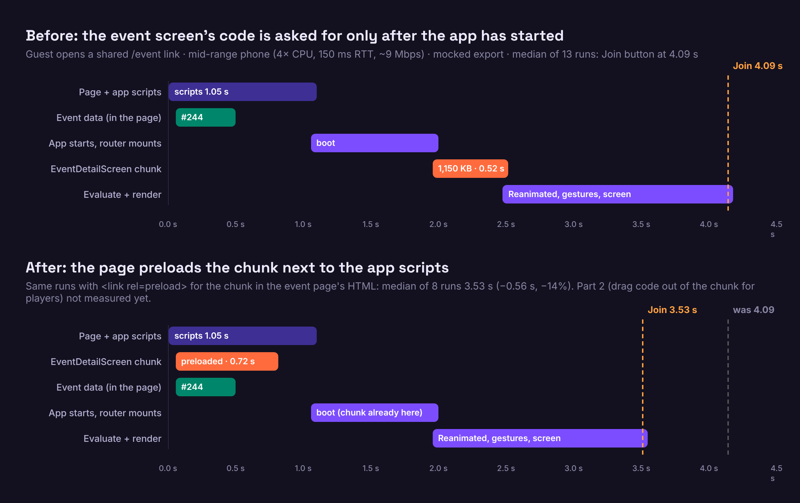
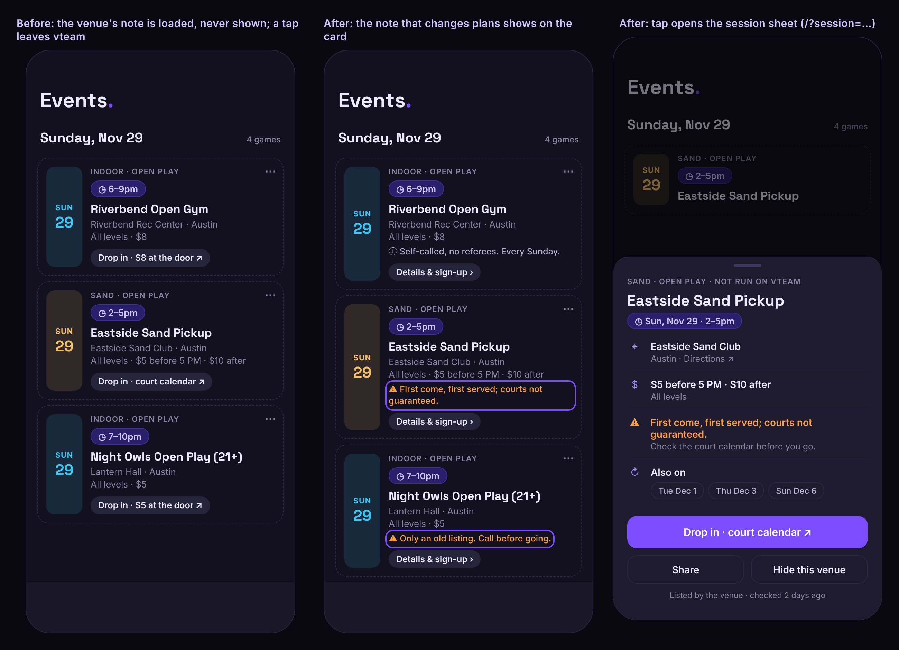
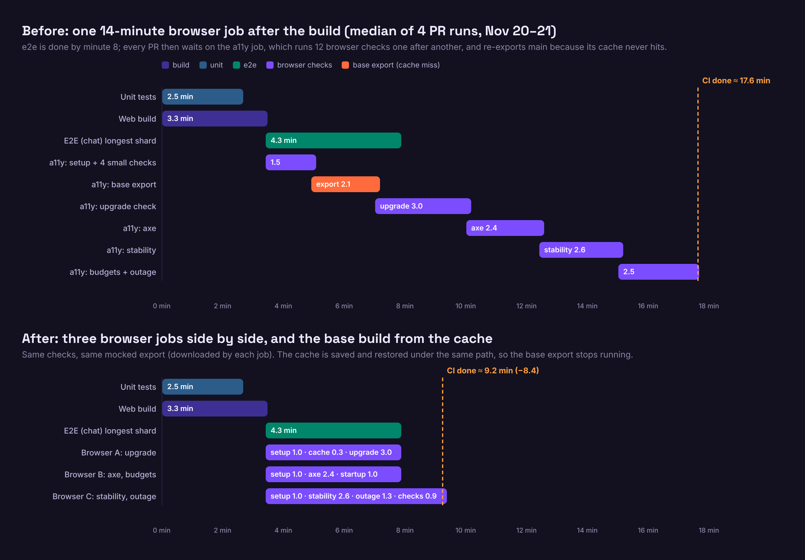

# vteam ideas: 2026-11-22

## Health check

Full stability run (`scripts/shots/stability-flow.mjs --full`) on today's `main` (c831c08, after #346 feed hook in pieces), mocked export, phone 390×844 and desktop 1280×860, signed in and guest, with and without an 800 ms delay on every Supabase response: **508 cases in 686 s, passed (0 new findings).**

- **Tours:** passed. Intro tour from Profile and the Austin banner, every Events type and surface chip from a link and saved: no gaps, spotlight every step (128 cases).
- **Refresh and Back:** passed (92 cases). Known (baseline, unchanged): the event page's Price row shifts on reload, 0.019 on phone (in and guest, with and without delay) and 0.016 on desktop guest at 800 ms. **Improved again:** desktop signed-in reload 0.016 → 0; the baseline can shrink with `npm run stability:baseline` in the next PR that touches it.
- **Links:** passed. Every `VIEW` link keeps its values, changes follow into the address, phone tabs keep their views (32 cases).
- **Raw route names:** passed (256 cases).
- **Still not exercised: 32 of the 92 refresh/Back cases** (Clubs and Chat don't scroll with the fixtures; Back on the event page and Tournaments has no child link partway down), same as Nov 15–21. Nov 16's idea 3 ("No silent skips") covers it.
- Extra today, keyboard on desktop (signed in and guest Events, Profile; 40 Tab presses each): every stop had a visible focus ring, and Escape closed both sheets tried (city picker, hide menu) with focus moved into them. Nothing to fix.
- Data note for Skelly (not vteam): one live outside session is titled **"50 pm)"** (Katy Sports Center, Reclub source): a parse slip in Skelly's feed. vteam shows it as is.

Nov 21 had a competitor-gap idea, so today has no new-feature idea. Nothing failed, so there's no fix idea; today is latency, end-user experience and testing.

Measured along the way (for the record, not proposed): Metro `inlineRequires` on the web build (A/B, 7 interleaved first visits each: 3.39 s → 3.57 s, no gain) and loading the Profile/Clubs/Chat screens lazily in the pager (8 each: 3.32 s → 3.21 s, within noise). After the scripts arrive the main thread is 100% busy until the first card (2.5 s at 4× CPU): about 0.45 s is expo-router evaluating the layout trees inside its first render and ~1.4 s is React rendering, with no single hot spot.

---

## 1. Shared event links 0.6 s sooner: the page asks for the event screen's code itself

**Bucket:** latency · **Size:** S (part 1: one build step + `api/event-page.ts`), part 2 M (optional)

**Pitch:** A guest opening a shared `/event/<id>` link waits for the app to start before the browser even asks for the event screen's 1.15 MB chunk. Have the event page's HTML preload that chunk next to the app scripts. Measured: the Join button shows **0.56 s sooner (4.09 s → 3.53 s, −14%)** on a mid-range phone. Part 2 keeps Reanimated and Gesture Handler (about half the chunk) out of the page for everyone who isn't dragging players into teams.

**Why**
- Shared links are how vteam reaches new players, and new players are guests: 47 guests vs 5 signed-in people used vteam in the last 14 days (`app_events`, bots excluded). A guest on a shared link has nothing saved on the device.
- Measured on the mocked export with the `first-visit-flow` setup (4× CPU, 150 ms RTT, ~9 Mbps, 380 ms server), guest opening `/event/<sundaySand>`:
  - Today: scripts done at 1.05 s, the app starts and mounts the router at ~1.9 s, and only then requests `EventDetailScreen-<hash>.js` (1,150 KB raw / 242 KB gzip), which arrives at ~2.45 s; Join visible at **4.09 s** (median of 13 runs; 3.75–4.80 s).
  - With `<link rel="preload" as="script">` for that chunk in the page's `<head>` (injected by the test harness): the chunk starts at 30–80 ms and is in by ~0.75 s, before the app needs it; Join at **3.53 s** (median of 8; 3.35–3.91 s).
- The event data already comes inside the page (#244) and the feed preloads the chunk when idle (`preloadWhenIdle` in `EventDetailRoute.web.tsx`), but a link opened cold has no feed before it.
- Part 2 evidence: in an unminified export, modules matching Reanimated cover ~1.5 MB of the chunk's 2.7 MB and Gesture Handler ~0.24 MB. They are there for the People tab's team drag (`useTeamDrag`, `useDraggableCard`, `RosterCard`'s `GestureDetector`, `DragGhost`), which only hosts and co-hosts use, and only while making teams; `useTeamDrag` is called for every viewer in `EventDetailScreen.tsx`.

**User stories**
- As a guest tapping a game link a friend sent, I see the game and its Join button sooner.
- As a host sharing my game in a group chat, the people I send it to see it load quickly.

**Acceptance criteria**
- [ ] The production build records the event chunk's path (`scripts/event-chunk.mjs` after `expo export`, writing `dist/event-chunk.json` `{ "src": "/_expo/static/js/web/EventDetailScreen-<hash>.js" }`), and fails the build if no such chunk exists.
- [ ] `api/event-page.ts` injects `<link rel="preload" as="script" href="…">` into the `<head>` it already rewrites (pure helper next to `injectHeadTags`, unit-tested); `vercel.json` includes `dist/event-chunk.json` in the function bundle. A missing file logs once and serves the page without the link (never a 500).
- [ ] No other route gets the preload (Events first visits don't download 1.15 MB they may never use).
- [ ] Target: Join on a guest's first visit to an event link **≤ 3.6 s** at the median on the CI phone profile (today 4.09 s), checked by a new `scripts/shots/event-link-flow.mjs` in CI's browser job with a budget file like `first-visit-budget.json` (serves the harness HTML through the same injection helper, so it can't drift from the function).
- [ ] Part 2 (separate PR, only if part 1 lands and the numbers say it's worth it): players and guests get a plain roster card; the drag pieces (`useTeamDrag`, `useDraggableCard`, `DragGhost`, the gesture `RosterCard`) load through `lazyChunk` when a host or co-host opens People. `scripts/entry-deps.mjs` gains a check that Reanimated stays out of `EventDetailScreen`'s chunk. Target: chunk ≤ 600 KB raw, Join ≤ 3.2 s.
- [ ] Real users: `screen_view` for `/event/[id]` gets a `first_paint_ms` (or a new `event_first_paint` {source: seed | fetch, ms}) so the gain shows on live, not only in CI.

**Design**
- Build: `package.json` `build:web` runs `scripts/event-chunk.mjs` after the export (Vercel's `buildCommand` already runs `build:web`).
- Function: `api/event-page.ts` → `preloadTag(src)` + insert before `</head>`, beside the `og:*` tags and the #244 seed. Nothing changes for native or for in-app navigation (the idle preload stays).
- Desktop and mobile web both benefit (desktop is network-bound on slow Wi-Fi; on fast desktops the gain is smaller). Native: no change.
- Guests: the main beneficiaries; nothing account-specific is in the page.
- Part 2: `components/event/people/RosterCard.tsx` splits into `RosterCardPlain` (TouchableOpacity) and `RosterCardDraggable` (lazy); `EventDetailScreen` stops wrapping itself in `GestureHandlerRootView` unless the drag chunk is loaded (CLAUDE.md "Bundle size" rule: only one lazy chunk may import Reanimated, so the drag chunk replaces the event screen as that chunk; the chat list keeps virtuoso).

**Backend:** none (Vercel function and build only).

**Test plan**
- Unit: `__tests__/eventPage.test.ts` gets cases for the preload tag (present, escaped, absent when the file is missing, only one tag).
- Unit: `scripts/event-chunk.mjs` against a fixture `dist` (finds the chunk, fails on none or two).
- CI: `scripts/shots/event-link-flow.mjs` (5 runs, budget with headroom like `first-visit-flow`), in the browser job.
- Before/after: run the flow on `main` and the branch, interleaved (the A/B above is the method).

**Pros and cons**
- Pros:
  - Measured, not estimated: −0.56 s (−14%) for the exact visitors vteam is trying to win (guests on shared links).
  - Tiny change in one function vteam already owns for links (#130, #244); no app code for part 1.
  - Part 2 also lightens every event open inside the app (the idle preload downloads less) and drops gesture code for 90% of viewers.
  - Adds a CI budget for event links, which today have none (startup budget covers tab screens only).
- Cons:
  - A guest who bounces before the app starts downloads 242 KB gzip they didn't use (only on event links, where they almost always do).
  - The build now depends on a chunk name pattern (`EventDetailScreen-`); a rename in `lazyChunk` breaks it (the build step fails loudly, which is the point, but it's one more moving part).
  - Event links are rare today (3 event page views in 14 days; no upcoming vteam games on live), so the win only shows once hosts share games again.
  - Part 2 touches the drag code from #332, which has the most interaction logic on the page.
- **Verdict:** pros outweigh cons for part 1: half a second for the growth path at the cost of a build step and ~30 lines; decide on part 2 after part 1's numbers.

**Risks / open questions:** Safari honours `rel=preload as=script` (yes, since 11.1) but warns in the console if the preload isn't used within a few seconds, so keep it event-only. **Dependencies:** none; builds on #244 (seed in the page) and #193 (lazy event chunk).

---

## 2. Outside sessions say what the venue says: the note on the card, and a details sheet before you leave vteam

**Bucket:** end-user-experience · **Size:** M (client only, no schema)

**Pitch:** 88 of the 102 upcoming outside sessions carry a note from the venue ("First come, first served; courts not guaranteed", "Only source is a third-party listing from August. Call before going.", "Self-called, no referees"). vteam loads it and never shows it. Show it on the card, and make a tap open a session sheet (time, venue with directions, price and level, the full note, the other dates it runs, the sign-up button, Share and Hide) instead of throwing the player straight onto another site.

**Why**
- **Loaded, never shown:** `EXTERNAL_SESSION_SELECT` (`constants/events.ts`) selects `note`, and `get_feed_span` returns it, but `ExternalSessionCard.tsx` renders title, venue, level and price only; no file reads `session.note`.
- **On live right now:** 102 upcoming outside sessions, 88 with a note, 61 with a price, 99 with a level; 33 distinct titles across 24 venues (most repeat weekly). Some notes change whether a trip is worth it (courts not guaranteed, call first, check the city page for skipped dates).
- **Outside sessions are what visitors see:** live has 0 upcoming vteam games, so the Events feed is outside sessions and leagues. In the last 14 days 32 people opened Events but only 4 opened any outside link (`outside_link_opened`), and 58 of 72 guest sessions saw a single screen.
- **One tap leaves vteam:** the whole card opens the venue's page (`useOutsideSessionLink.open()`), so a curious tap ("what is this?") becomes a page on Reclub or LeagueApps, and the player has to come back to compare. A sheet answers "is this for me?" in vteam and keeps the venue check ("Checking with the venue…") on the button that actually leaves.

**User stories**
- As a player deciding where to play tonight, I see "courts not guaranteed" before I drive there.
- As a guest, I tap a session and see the price, level, where it is and when else it runs, without leaving vteam.
- As a player, I share a session with a friend and the link opens the same sheet.
- As a player, I sign up on the venue's site with one more tap, and vteam still checks the session wasn't cancelled first.

**Acceptance criteria**
- [ ] `ExternalSessionCard` shows `note` under the price line, 2 lines max, `subtextStrong`; the existing "not confirmed lately" line keeps priority and its warning colour. The signup pill reads **Details & sign-up ›** (no ↗: the card no longer leaves vteam).
- [ ] Tapping the card opens `OutsideSessionSheet` (`components/events/OutsideSessionSheet.tsx`, on `BottomSheet`): kicker (surface · type · "Not run on vteam"), title, `TimePill` with date, venue + city with **Directions** (maps search link from venue + city, same helper as `utils/clubLocation.ts`), price and level, the full note, **Also on** (up to 4 later dates of the same source + title + venue from the loaded months, each opening its own sheet), the primary button with `signup_label` that runs `useOutsideSessionLink.open()` (venue check, Cancelled/Moved dialog as today), **Share** (`ShareLinkButton`), **Hide** (the existing hide menu entries for this session and its venue), and a footer "Listed by <host> · checked N days ago" from `verified_at` (`sessionConfirmation` wording).
- [ ] The sheet is in the URL: `VIEW.events.session` (`text` codec, uuid check) → `/?session=<id>`; a shared link opens the sheet on top of the feed. If the id isn't in the loaded months, one read by id (`EXTERNAL_SESSION_SELECT`, anon SELECT already exists); unknown, past or deleted ids show the feed and a toast "That session isn't listed anymore".
- [ ] Desktop: the same sheet as a centered panel (max width 520) over the day-split feed; keyboard: Escape closes, focus moves into the sheet (checked by the e2e).
- [ ] Search results (`/search`) open the same sheet for outside sessions.
- [ ] Metrics: `outside_session_opened` {surface, has_note, source: card | search | link}; `outside_link_opened` gains `from: 'sheet'`. Success measure: share of Events visitors who open a sheet or a link, before vs after (today 4 of 32 in 14 days).
- [ ] Copy (kicker, "Also on", footer, toast) in `constants/copy.ts`; text sizes from `theme.font`; checked at Extra large text.

**Design**
- Files: `components/ExternalSessionCard.tsx` (note line, `onPress` → open sheet via a callback prop; no navigation inside the card), `components/events/OutsideSessionSheet.tsx` (new), `utils/outsideSession.ts` (pure: `alsoOn(session, items)`, `directionsUrl(venue, city)`, `listedLine(session, now)`), `utils/urlViews.ts` (`VIEW.events.session`), `app/(app)/(tabs)/(main)/index.tsx` + `EventsFeedDesktop` (hold `useUrlParam('session', …)`, render the sheet once), `app/(app)/search.tsx`.
- Guests: everything works signed out (data is public); Hide asks to sign in as today.
- Native: same sheet; Directions opens the maps app via `Linking`.
- Ads: the sheet is a feed overlay, not a card, so ad slots are untouched.
- Schelagg tenet: nothing new is fetched from organizers; the note and dates are already in the mirror.

**Backend:** none (reads columns already selected; anon SELECT exists).

**Test plan**
- Unit: `utils/outsideSession.ts` (alsoOn: same source/title/venue only, later dates, max 4, skips cancelled; directionsUrl encoding; listedLine wording by age), `VIEW.events.session` codec (bad ids fall back), `ExternalSessionCard` renders the note and calls `onOpen`.
- e2e: `e2e/outsideSession.guest.spec.ts` (shard `other`): open a card → sheet with note → Escape closes; `/?session=<id>` opens the sheet; signup button still goes through the venue check (route the Schelagg check).
- Stability: add a `LINK_CASES` entry for `?session=` (required by `__tests__/stabilityCases.test.ts` for every `VIEW` key).
- Shots: fixture notes on two outside sessions in `scripts/shots/fixtures/`; add `events-session-sheet` to `SCREENS` (phone + desktop); axe runs on it automatically.

**Pros and cons**
- Pros:
  - Uses data vteam already loads for 88% of outside sessions; no schema, no new feed.
  - Warnings that change plans (courts not guaranteed, call first) reach players before they drive.
  - Keeps a curious tap inside vteam and gives outside sessions a shareable vteam link, which is the only kind of game vteam has on live right now.
  - Puts Hide and Share one tap away for the items most visitors see.
- Cons:
  - One more tap to reach a venue's sign-up for players who already know the session.
  - Notes are free text from Skelly; a bad note ("50 pm)"-style slips) now shows on cards. Mitigated by the 2-line cap, but quality depends on Skelly.
  - Cards get taller by up to two lines, so fewer fit on a phone screen.
  - A new URL param and sheet on the busiest screen: more cases for stability, tours and scroll memory to keep right.
- **Verdict:** pros outweigh cons: the information is already paid for and matters to the decision; the extra tap is the cost, and the metrics will show if it hurts.

**Risks / open questions:** should the card keep a direct "↗" for repeat players (a second tap target breaks the one-target card rule in `FeedItemShell`)? Proposal: no, measure first. **Dependencies:** none; related to #339 (city), Nov 6's rejected "I'm going on venue sessions" (this adds no RSVP).

---

## 3. CI in half the time: three browser jobs side by side, and an upgrade-check cache that actually hits

**Bucket:** testing · **Size:** S (workflow only)

**Pitch:** Every PR waits ~17.6 minutes for CI, and 14 of them are one browser job running 12 checks in a row after the build. Split it into three parallel jobs and fix the base-build cache, which has never hit since #320: **CI done in ~9–10 minutes**, same checks.

**Why**
- **Measured on the last 4 green PR runs (Nov 20–21):** Unit 2.2–2.7 min, Web build 3.0–4.2, e2e shards 1.1–4.4 (all done by minute ~8), **Accessibility (axe) 13.3–14.6 min**, finishing at 17–18 min. Steps inside that job (two runs): base export 122–133 s, upgrade check 178–179 s, axe 142–144 s, stability 155–159 s, startup budget 57–58 s, outage 75–76 s, four small browser checks 57–63 s, setup ~45 s.
- **The cache never hits:** the job restores `dist-mock-<base sha>` into `path: dist-base/`, but `main` saves it from `path: dist-mock/`. `actions/cache` versions entries by path, so the restore misses even with the exact key: on run 44950354226 the log says `Cache not found for input keys: dist-mock-0edcef3…, dist-mock-` although the push run for 0edcef3 ran "Keep this build for upgrade checks" successfully. Every PR re-exports `main` (~2 min).
- The checks don't depend on each other; they share only the downloaded `web-dist-mock` artifact.
- PRs here merge by auto-merge once checks are green (this routine's flow), so CI time is the time from push to live.

**User stories**
- As the developer (or Claude driving a PR), I get CI's answer in about 10 minutes instead of 18.
- As a reviewer reading a failure, I see which group failed from the job name, not from a 14-minute log.

**Acceptance criteria**
- [ ] Cache fix: "Keep this build for upgrade checks" copies `dist-mock/` to `dist-base/` and saves `path: dist-base/` under `dist-mock-${{ github.sha }}`; the restore is unchanged. The next PR's log shows `Cache restored from key: dist-mock-<base sha>` and the export step is skipped.
- [ ] `.github/actions/browser-setup/action.yml` (composite): node, `npm ci`, Playwright cache, `install-playwright-deps.sh`, download `web-dist-mock`.
- [ ] Three jobs after `build-web`, each with its own report artifact and job summary:
  - **Browser: upgrade** (PR only): cache restore (export fallback), `upgrade-flow.mjs`.
  - **Browser: axe and budgets**: axe vs baseline, startup budget, first visit.
  - **Browser: flows**: stability, outage, badge artwork, feed city, chat badge, crash recovery.
- [ ] The job named **Accessibility (axe)** stays, as a tiny aggregator that `needs` all three and fails if any failed (the same pattern as `Playwright E2E`), so branch protection and auto-merge keep working with no settings change. `main` pushes still save the cache (from the flows job, which has the export).
- [ ] Target: PR CI wall time ≤ 10.5 min at the median over the next 10 PR runs (today 17.6), measured from the Actions API like above; the PR description lists before/after per job.
- [ ] Timing checks (startup budget, first visit) run on their own runner, never next to stability in the same job, so CPU contention can't push them over budget.
- [ ] `npm run docs:check` / CLAUDE.md "Test layers" updated to name the three jobs.

**Design**
- Only `.github/workflows/ci.yml` and the new composite action change; no script changes.
- Each job uploads `a11y-report-<group>`; the aggregator merges nothing (the summaries already go to each job's page).
- Later (not in this PR): `stability-flow.mjs --shard i/n` if stability ever becomes the long pole.

**Backend:** none.

**Test plan**
- Open the PR and check: three jobs start together after the build; the upgrade job restores from the cache on the second push; a deliberately failing check in one group (temporary commit on a scratch branch) fails the aggregator and blocks merge; all artifacts present.
- Compare wall time on the PR's own runs and the next 10 PRs.

**Pros and cons**
- Pros:
  - About 8 minutes off every PR run and every push to `main`, with no check removed or weakened.
  - Fixes a silent bug (a cache that never hits) that costs ~2 minutes per PR on its own.
  - Timing budgets run on a runner by themselves, so fewer false "over budget" results.
  - Failures are easier to read: the failing group is the job name.
- Cons:
  - More runner minutes: three setups instead of one (~+2 min of runner time per run), which counts against the account's Actions minutes if the repo is private.
  - Three more jobs in the PR checks list, and one more file (the composite action) to keep in step with `ci.yml`.
  - The aggregator pattern has to stay right, or a failing group could merge (covered by the scratch-branch test above).
- **Verdict:** pros outweigh cons: halving the wait on every PR for ~2 extra runner minutes is a good trade, and the cache fix alone pays for one of the setups.

**Risks / open questions:** if Actions minutes are tight, the flows job could run the four small checks inside the axe job instead (same wall time). **Dependencies:** none; builds on #317 (upgrade check) and #255 (stability in CI).
