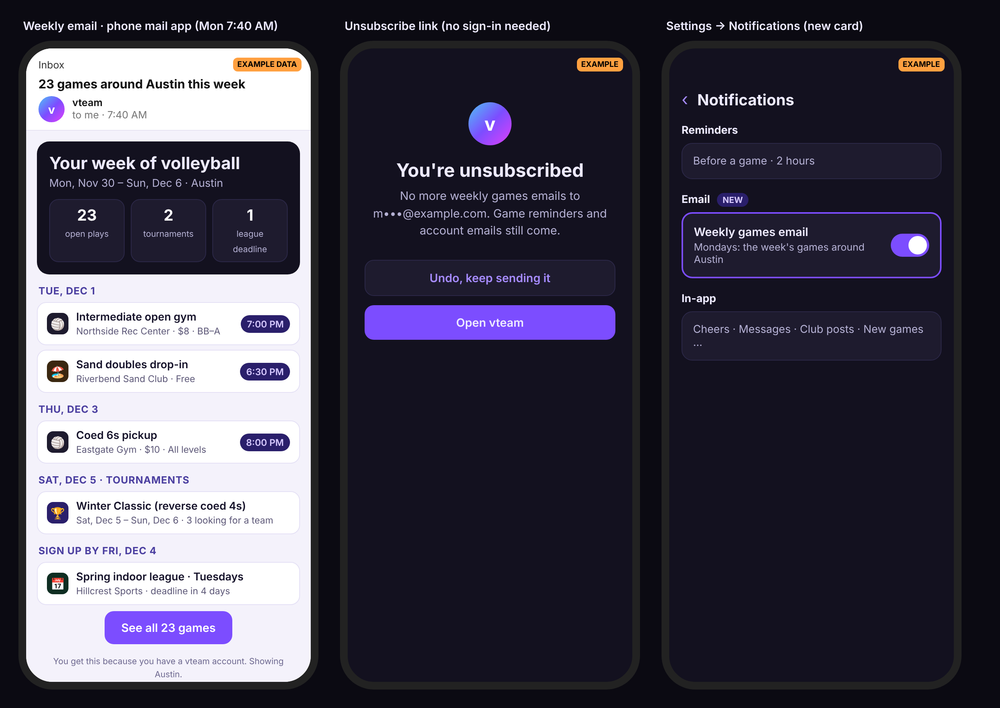
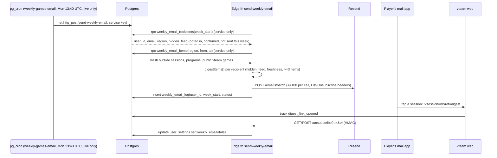
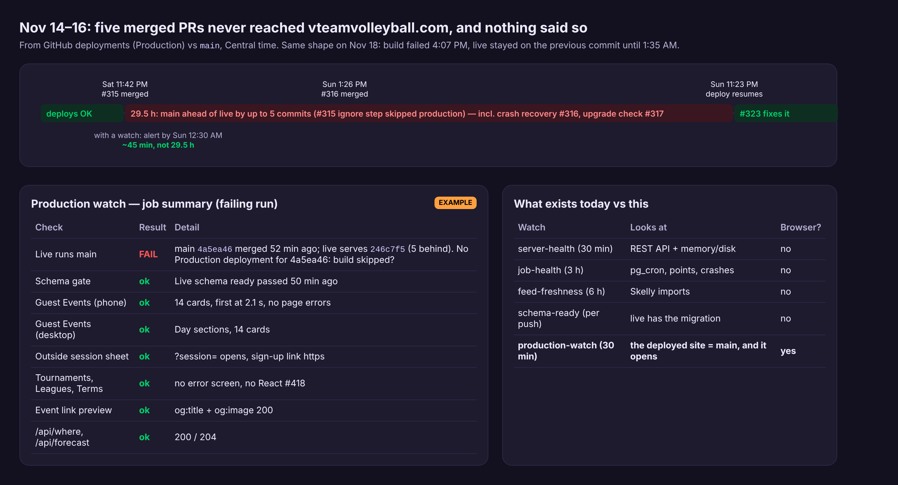
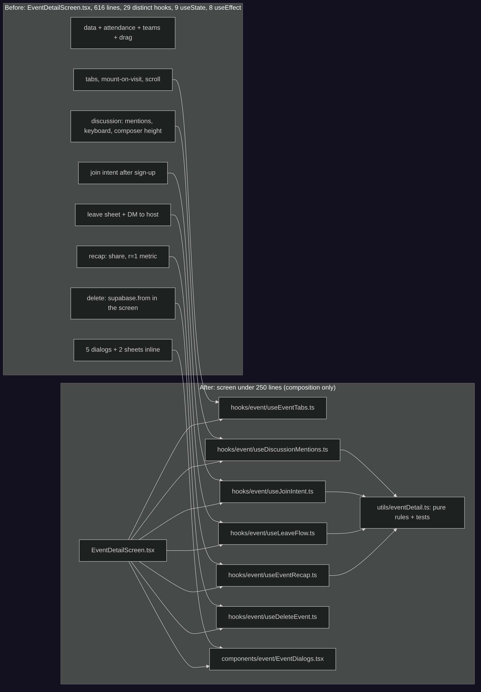

# vteam ideas: 2026-11-23

## Health check

Full stability run (`scripts/shots/stability-flow.mjs --full`) on today's `main` (0fcc79b, after #351 outside-session sheet and #352 event-chunk preload), mocked export, phone 390×844 and desktop 1280×860, signed in and guest, with and without an 800 ms delay on every Supabase response: **512 cases in 627 s, passed (0 new findings).**

- **Tours:** passed. Intro tour from Profile and the Austin banner, every Events type and surface chip from a link and saved: no gaps, spotlight every step (128 cases).
- **Refresh and Back:** passed (92 cases). Known (baseline): the event page's Price row shifts once on reload, now **only with the 800 ms delay** (0.019 on phone signed in and guest, 0.016 on desktop guest). **Improved:** the no-delay reload is 0 on phone (was 0.019) and desktop (was 0.016) (since yesterday's run on c831c08; not traced to one PR); the baseline can shrink with `npm run stability:baseline` in the next PR that touches it.
- **Links:** passed. Every `VIEW` link keeps its values (including the new `?session=`), changes follow into the address, phone tabs keep their views (32 cases).
- **Raw route names:** passed (260 cases).
- **Still not exercised: 32 of the 92 refresh/Back cases** (Clubs and Chat don't scroll with the fixtures; Back on the event page and Tournaments has no child link partway down), unchanged since Nov 15; Nov 16's idea 3 covers it.

Nov 22 had no new-feature or competitor-gap idea, so today has one (idea 1). Today is competitor gap, testing and refactor.

Context measured along the way (live, read-only, last 21 days, bots excluded): 35 people opened vteam; 29 of them were guests who landed on Events, and 3 opened sign-in. Live has **0 upcoming vteam games and 101 upcoming outside sessions**, 34 accounts (4 new in 30 days) and 1 RSVP in 60 days. So what keeps people coming back today is the outside schedule, and the people with accounts never hear about it unless they open the app. Idea 1 is aimed at exactly that.

---

## 1. A weekly games email: "23 games around Austin this week", every Monday

**Status (review, Nov 23): tabled.** Current users haven't opted in to email, and Bryan doesn't want to email them right now.

**Bucket:** competitor-gap · **Size:** M

**Pitch:** Every Monday morning, each signed-in player gets one short email: the week's open plays, tournaments and league deadlines around their city (outside sessions from Skelly plus any vteam games), grouped by day, each linking to that session's sheet in vteam. One switch in Settings → Notifications, a one-click unsubscribe in the email.

**Why**
- **Heylo** sends exactly this: "Each week, upcoming events in the group are aggregated into an automatically generated email newsletter" with each event's name, attendee preview and a sign-up button, sent on Monday mornings by default ([Heylo: Email newsletters](https://www.heylo.com/help/email-newsletters)). Club apps use it because members don't open an app "to check"; they open email.
- vteam's content today is the outside schedule: **101 upcoming outside sessions vs 0 upcoming vteam games** on live. The app is the best Austin volleyball schedule there is, but only for people who open it.
- People who have accounts barely come back: 35 people in 21 days, 5 of them signed in; 34 accounts total. Push reaches almost nobody (native apps aren't in the stores yet, web push needs opt-in and an installed app on iPhone). Every account has an email.
- The pieces already exist: Resend with the verified `vteamvolleyball.com` domain (`send-feedback-email`), the city rules (`useFeedCity` / `utils/feedRegion.ts`), session freshness (`utils/externalFreshness.ts`), and shareable links that open a session's sheet (`/?session=<id>`, #348) or a day (`/?day=…`).

**User flow**
1. Monday 7:40 AM Central, Maya gets "23 games around Austin this week" from vteam.
2. She scans it: a summary strip (open plays, tournaments, deadlines), then up to 10 sessions grouped by day ("Tue, Dec 1"), each with time, venue, price and level; tournaments with their days and how many are looking for a team; leagues whose sign-up closes this week.
3. She taps "Coed 6s pickup": vteam opens on Events with that session's sheet (`/?session=<id>&ref=digest`), with Directions and the venue's sign-up.
4. "See all 23 games" opens Events on that week. "Change city" opens the city picker. "Unsubscribe" turns it off in one tap without signing in (with Undo).

**User stories**
- As a player who signed up once, I hear about this week's games without remembering to open the app.
- As a player in another covered city, the email shows my city.
- As someone who doesn't want it, I stop it with one tap from the email or one switch in Settings.

**Acceptance criteria**
- [ ] Every signed-in account with a confirmed email gets at most one email per Monday (Chicago week), only when its city has at least 3 items that week; never on beta.
- [ ] Content: summary counts, up to 10 sessions/games ordered by day then time (vteam games first within a day, then sessions the viewer's friends are going to (later), then the rest), outside tournaments starting this week, leagues whose deadline is this week. Every date shows its weekday. Sessions hidden by `hidden_feed` (venue, item, surface) and sessions failing the freshness rules are left out.
- [ ] Each item links to its vteam view (`/?session=<id>`, `/event/<id>`, `/tournaments?host=…`, `/leagues?host=…`) with `ref=digest`; opening one records `digest_link_opened` {kind}.
- [ ] Settings → Notifications has a "Weekly games email" switch (on by default), saved in `user_settings`.
- [ ] Every email has `List-Unsubscribe` + `List-Unsubscribe-Post: List-Unsubscribe=One-Click` and a footer unsubscribe link that works without signing in (signed token), with an Undo.
- [ ] The Privacy Policy lists Resend and the weekly email; a one-time banner tells signed-in players it's coming, with a link to the switch.
- [ ] `job_health()` reports the job (weekly expectation in `EXPECTATIONS`), and a send failure for more than 10% of recipients fails the run.
- [ ] Plain-text alternative in every email; HTML passes a basic dark-mode check (Gmail, Apple Mail).

**Design**
- **Settings:** `app/(app)/(tabs)/settings/notifications.tsx` gets an "Email" section with `WeeklyEmailCard` (`components/profile/WeeklyEmailCard.tsx`), reading and writing `user_settings.weekly_email` through `useUserSettings()`. Guests never see it (account-only screen).
- **Landing:** the links are ordinary shareable links; `?ref=digest` is a new `VIEW.feed.ref` codec (`oneOf(['digest'])`, dropped from the address after the metric is recorded). No new route in the app.
- **Unsubscribe page:** served by the edge function itself (small HTML, theme colours inlined), so it needs no app route, no `serve.json` rewrite and no sign-in.
- **Email rendering:** pure `supabase/functions/_shared/digest.ts` (`digestItems(rows, now, region)`, `renderDigestHtml`, `renderDigestText`), sharing copy with the app via a small `utils/digestCopy.ts` that stays free of React Native (like `utils/eventShare.ts`). Light background with the brand violet so it reads in light-mode clients; the summary band uses `background`/`card`.
- **Surfaces:** email on phone and desktop clients (single 600 px column, 44 px tap rows); Settings switch on native, mobile web, desktop web as every other card there.

**Backend**

| Object | Change | Notes (who can read/write) |
| --- | --- | --- |
| `user_settings.weekly_email` | new `boolean not null default true` | owner read/write (existing owner-only RLS) |
| `weekly_email_log` | new table `(user_id, week_start date, status, sent_at)`, PK `(user_id, week_start)`, `on delete cascade` | no client access (RLS on, no policies); service role only |
| `weekly_email_recipients(date)` | new SECURITY DEFINER function | EXECUTE revoked from anon/authenticated; reads `auth.users.email` (confirmed only) |
| `weekly_email_items(text, timestamptz, timestamptz)` | new SECURITY DEFINER function | service only; public columns of rows anon can already read |
| cron `weekly-games-email` | new job, live only | `ALLOWED` entry in `scripts/schema-drift.mjs` like `kudos-reminders` (it emails real people); `EXPECTATIONS` entry (8 days) in `scripts/job-health.mjs` |
| Edge fn `send-weekly-email` | new | secrets `RESEND_API_KEY` (exists), `DIGEST_SIGNING_KEY` (new), `DIGEST_FROM` (`vteam <games@vteamvolleyball.com>`) |
| `NOTIFICATION` copy | `constants/copy.ts` | — |

Migration sketch (`20261124120000_weekly_email.sql`): `alter table user_settings add column weekly_email boolean not null default true;` `create table weekly_email_log (...)`; enable RLS; the two functions with `revoke execute ... from public, anon, authenticated`. Down: drop the functions, the table and the column. Expand-only. The cron job is created by hand on live after merge (like `kudos-reminders`), so beta never sends.

RLS expectations (`e2e/rls.spec.ts` + matrix row for `weekly_email_log`): guest and signed-in can't read or insert `weekly_email_log`; both get 42501 calling `weekly_email_recipients` / `weekly_email_items`; a player reads and updates only their own `user_settings.weekly_email`.

**Test plan**
- Deno handler tests (`send-weekly-email/handler.test.ts`, fakes in `_shared/testing.ts`): skips recipients with < 3 items, respects `hidden_feed`, batches by 100, logs each send, never re-sends in the same week, bad/expired HMAC → 400 page, one-click POST unsubscribes, Resend 5xx marks the run failed past 10%.
- Unit (`__tests__/digestCopy.test.ts`): weekday on every date, Chicago week boundaries across DST (`DST_DAYS`), item ordering, plain-text version.
- RLS: matrix row + the three expectations above.
- Shots: `settings-notifications` gains the card; a fixture-rendered email HTML snapshot via `npm run og:render`-style script for review.
- Manual on live before turning the cron on: send to Bryan only (`weekly_email_recipients` filtered by an `only` arg).

**Pros and cons**
- Pros:
  - Reaches every account, not just the few with push; the content (101 sessions) already exists and is refreshed hourly.
  - Copies a proven pattern (Heylo's Monday newsletter) for a pilot whose main problem is people not coming back.
  - Every link lands on a shareable vteam view, so returning players see the app, not a venue site.
  - Measurable: `digest_link_opened` per item kind; one switch to stop.
  - Built from existing pieces (Resend domain, freshness rules, city rules, `?session=` links).
- Cons:
  - Email deliverability is new territory: SPF/DKIM/DMARC for bulk-ish sending, spam-folder risk; a bad first impression can't be unsent.
  - Default-on for existing accounts is a judgement call; it needs the banner and a Privacy Policy line, and some people will find it annoying.
  - Another live-only job and edge function to keep healthy (and a new secret).
  - Mostly outside sessions today, which vteam doesn't control; a stale or wrong session goes straight to an inbox (freshness rules reduce, not remove, that).
  - Small audience (34 accounts) means slow feedback on whether it works.
- **Verdict:** worth it: it's the cheapest way to bring back the people who already signed up, and it uses content vteam already has; start with Bryan-only sends, then turn the cron on.

**Risks / open questions:** default on, or ask on next open? Send time (Mon 7:40 AM vs Sun evening)? Include friends' games once there are some? Resend's free tier (100/day, 3,000/month) is enough for now.
**Dependencies:** #348 (session sheet links), #339 (city), feedback email setup. **Parallel:** independent of open work.

---

## 2. Production watch: know within the hour when vteamvolleyball.com isn't running main, or doesn't open

**Bucket:** testing · **Size:** S–M

**Pitch:** A GitHub Actions job every 30 minutes that checks two things nothing checks today: that the site live is the build of the latest `main` (allowing for the schema gate), and that a guest can actually open it in a real browser (Events with cards, an outside session sheet, Tournaments, Leagues, an event link preview), on phone and desktop.

**Why**
- **Nov 14–16: 5 merged PRs never reached production for 29.5 hours** (GitHub deployments vs `main`): #315's Vercel ignore step skipped production builds from Sat 11:42 PM until #323 on Sun 11:23 PM, including the crash recovery (#316) and upgrade check (#317). It was found by hand.
- **Nov 18:** the production deployment of `d9fbd80` (#325) failed at 4:07 PM; live stayed on the previous commit until 1:35 AM (9.5 h).
- Every existing watch looks at the database or the API: `server-health` (REST + memory, 30 min), `job-health` (pg_cron, 3 h), `feed-freshness` (6 h), `schema-ready` (per push). None opens the deployed site, so a broken build, a skipped deploy, a broken `vercel.json` rewrite or a crash on first open (like Nov 13's for signed-in players) goes unnoticed until someone opens the app.
- The deployment data is already in GitHub (`repos/…/deployments` + statuses), so the "is live = main" half needs no new infrastructure.

**User stories**
- As Bryan, I get an email within an hour when a merged PR isn't live, with why (skipped, failed, waiting on the schema gate).
- As Bryan, I get an email when the live site stops opening for guests, before a player tells me.

**Acceptance criteria**
- [ ] `.github/workflows/production-watch.yml` runs every 30 minutes (and on demand), read-only: GitHub API with `GITHUB_TOKEN` and anonymous browser visits to vteamvolleyball.com.
- [ ] **Live is main:** the web build carries its commit (`<meta name="vteam-build" content="<sha>">` in `app/+html.tsx`, from `EXPO_PUBLIC_BUILD_SHA` set to `VERCEL_GIT_COMMIT_SHA` in `build:web`; a constant, so no hydration change). The job fails when `main`'s head is older than 40 minutes and live serves another commit, unless that commit's **Live schema ready** check is still pending (then it waits, up to that check's 3 h); the summary names the cause: no Production deployment (skipped), deployment `failure` (with its log link), or deployed but not served.
- [ ] **Guest smoke** (Playwright, phone 390×844 and desktop 1280×860): `/` shows at least one card or the empty state within 20 s; no `ErrorFallback`, no `pageerror`, no React #418; `/?session=<first card's id>` opens the sheet with an https sign-up link; `/tournaments`, `/leagues`, `/terms` render; `/event/<latest public event>` returns `og:title` and an `og:image` that answers 200; `/api/where` 200 and `/api/forecast` 200/204.
- [ ] A failure is retried once 60 s later before the run fails (like `server-health`); the job summary has the table and a screenshot artifact of any failed step.
- [ ] Analytics stay clean: the browser runs with `navigator.webdriver` (analytics off) and is never signed in.
- [ ] CLAUDE.md's "Job health" section lists it.

**Design**
- `scripts/production-watch.mjs`: pure `judgeDeploy({ head, deployments, statuses, checks, servedSha, now })` (unit-tested with the Nov 15 and Nov 18 histories as fixtures) + the browser steps reusing `scripts/shots/lib` helpers where they fit (no mock: real site).
- `scripts/build-sha` step: `build:web` exports `EXPO_PUBLIC_BUILD_SHA=${VERCEL_GIT_COMMIT_SHA:-local}`; `app/+html.tsx` renders the meta. Also useful for Sentry and `app_version` later.
- No app UI change; no schema change.

**Test plan**
- Unit (`__tests__/productionWatch.test.ts`): `judgeDeploy` on recorded histories (Nov 15 skipped → fail at +40 min; Nov 18 failure → fail; schema gate pending → pass until it ends; normal 4–6 min deploy → pass).
- Run the workflow by hand on the PR branch (`workflow_dispatch`) against live and check the summary.
- `__tests__/html.test.tsx` (or the existing `+html` test) asserts the meta is rendered.

**Pros and cons**
- Pros:
  - Would have caught both real incidents this month within ~45 minutes instead of 29.5 h and 9.5 h.
  - The only check that opens the real site the way a guest does; catches broken builds, rewrites, API routes and first-open crashes.
  - No new services or secrets; read-only against live (anon reads, like `feed-freshness`).
  - The build sha in the page helps every future "which version is this player on?" question.
- Cons:
  - ~1,400 browser runs a month on Actions minutes (about 2 min each, ~3,000 min/month); fine for a public repo, a cost on a private one (could drop to hourly).
  - Real-site checks can flake on network blips (mitigated by one retry, but some false emails will happen).
  - Guest-only: a crash that only hits signed-in players (Nov 13) still needs `job_health`'s crash alert.
  - Adds a small build-time env var and a meta tag that must stay out of the hydration-sensitive tree.
- **Verdict:** worth it: small, and it closes the one gap that has bitten twice in ten days.

**Risks / open questions:** private or public repo minutes? Signed-in smoke with a dedicated live test account (in `metrics_excluded_users`) as a follow-up?
**Dependencies:** none; complements `server-health.yml` and `schema-ready.yml`.

---

## 3. Event screen in pieces: join intent, leave, recap, mentions and delete out of a 616-line screen

**Bucket:** refactor · **Size:** M (3 small PRs)

**Pitch:** `components/event/EventDetailScreen.tsx` is the busiest screen in the app (616 lines, 29 distinct hooks, 9 `useState`, 8 `useEffect`, 5 dialogs and 2 sheets inline) and still deletes events with `supabase.from()` inside the screen. Move each flow into its own hook with pure, tested rules, and the dialogs into one host component, leaving a screen under 250 lines that only composes.

**Why**
- It's the largest file in `components/` and the screen guests reach from every shared link. Every recent event feature landed in it: join intent (#229), leave sheet (#171), recap (#227), court queue (#333), bring list; each added state and effects to the same component.
- What it holds today (line ranges in today's file): tab mounting and scroll (≈140–175), discussion mentions + keyboard + composer height (≈173–225), join intent after sign-up (≈240–275), delete with a direct `supabase.from('events')` write (≈280–300), recap share + `?r=1` metric (≈303–355), leave sheet + DM to host (≈355–400), five dialogs and two sheets (≈555–615).
- One `setState` anywhere (opening the leave sheet, typing a deny reason) re-renders the whole screen including the Pager's tabs. Splitting state into the hooks/components that own it narrows that.
- The same move worked four times already: Events screen (#217), host form (#188), People tab (#332), chat room (#318); the CLAUDE.md conventions ask for "one hook per concern" and no `supabase.from()` in screens.

**User stories**
- As a developer adding an event feature (check-in, series, payments), I add a hook and a section, not more state to a 616-line screen.
- As a player, nothing changes, except that typing in a dialog no longer re-renders the tabs behind it.

**Acceptance criteria**
- [ ] `EventDetailScreen.tsx` under 250 lines, composing hooks and components only; no `supabase` import.
- [ ] New hooks in `hooks/event/`: `useEventTabs` (mount-on-visit, scroll claims), `useDiscussionMentions` (mentionable users, username map), `useJoinIntent` (pending action, offer/setup stages, metrics), `useLeaveFlow` (frozen consequences, reason, DM), `useEventRecap` (share state, `recap_link_opened` once), `useDeleteEvent` (`useMutation` + `invalidate`, `forgetDeletedEvent`).
- [ ] `components/event/EventDialogs.tsx` renders the five dialogs + two sheets from one `open` union state (`{ kind: 'deny' | 'guest' | 'delete' | 'leave' | 'joinIntent' | null }`).
- [ ] Pure rules in `utils/eventDetail.ts` (mentionable users, join-intent stage, recap eligibility glue) with unit tests; existing tests (`eventHooks`, `eventDetailSeed`, `joinAction`, `LeaveSheet`, `leaveConsequences`, `pendingAction`, `headerAction`) pass unchanged.
- [ ] Shots: every `event-*` screen in `scripts/shots/screens.mjs` is pixel-identical before/after (`npm run shots:compare`); stability, startup budget and the event-link budget unchanged.
- [ ] e2e event specs pass unchanged.

**Design**
- PR 1 (tests first): `utils/eventDetail.ts` + tests; `useDeleteEvent`, `useEventRecap` extracted.
- PR 2: `useJoinIntent`, `useLeaveFlow`, `useDiscussionMentions`.
- PR 3: `useEventTabs` + `EventDialogs` with the union state; screen under 250 lines.
- No route, schema, guest-behaviour or surface change; the web lazy chunk (`EventDetailRoute.web.tsx`) and the preload from #347 keep working since the entry module is the same (`scripts/event-chunk.mjs` checks).

**Test plan:** new unit tests for each pure rule and a hook test per extracted hook (`@testing-library/react-native` `renderHook`, as in `eventHooks.test.tsx`); `npm run shots:compare` on the `event-*` screens; stability (`--only scroll` on the event page), startup and event-link budgets; e2e event shard.

**Pros and cons**
- Pros:
  - The busiest screen becomes readable, and the next event feature has an obvious place to go.
  - Removes the last `supabase.from()` write from a screen in `components/event/`.
  - Narrower re-renders when dialogs and sheets open (their state moves out of the screen).
  - First tests for join intent and recap glue, which only e2e covers today.
- Cons:
  - No visible change for players; costs review time on a screen that works.
  - Touches the guest entry screen from shared links: a mistake there is costly (mitigated by shots compare, event-link budget and e2e).
  - Three PRs in a row on one file can conflict with any event feature in flight.
  - More files to navigate (seven new modules).
- **Verdict:** worth it, as three small PRs: the pattern is proven four times and this is the screen most features still land in.

**Risks / open questions:** keep `useTeamDrag` in the screen (web chunk boundary) — yes for now.
**Dependencies:** none open; follows #332's People tab split.
