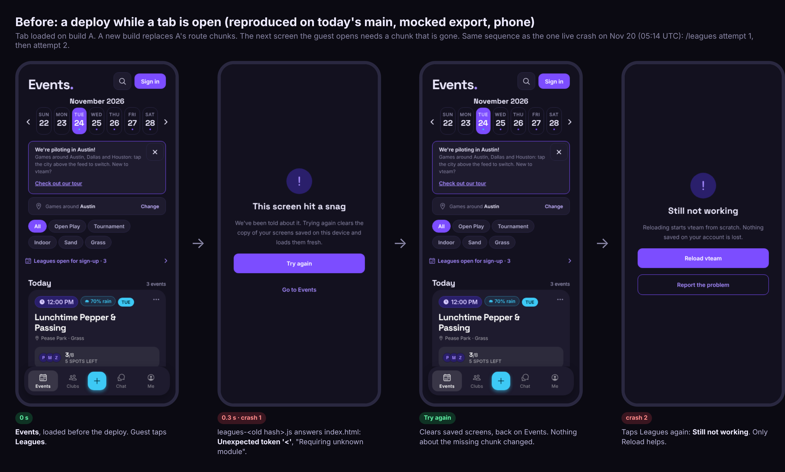
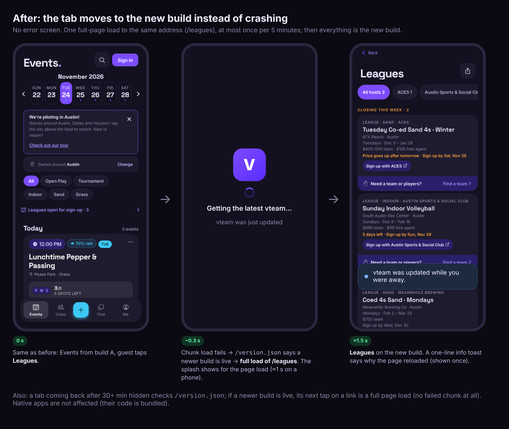
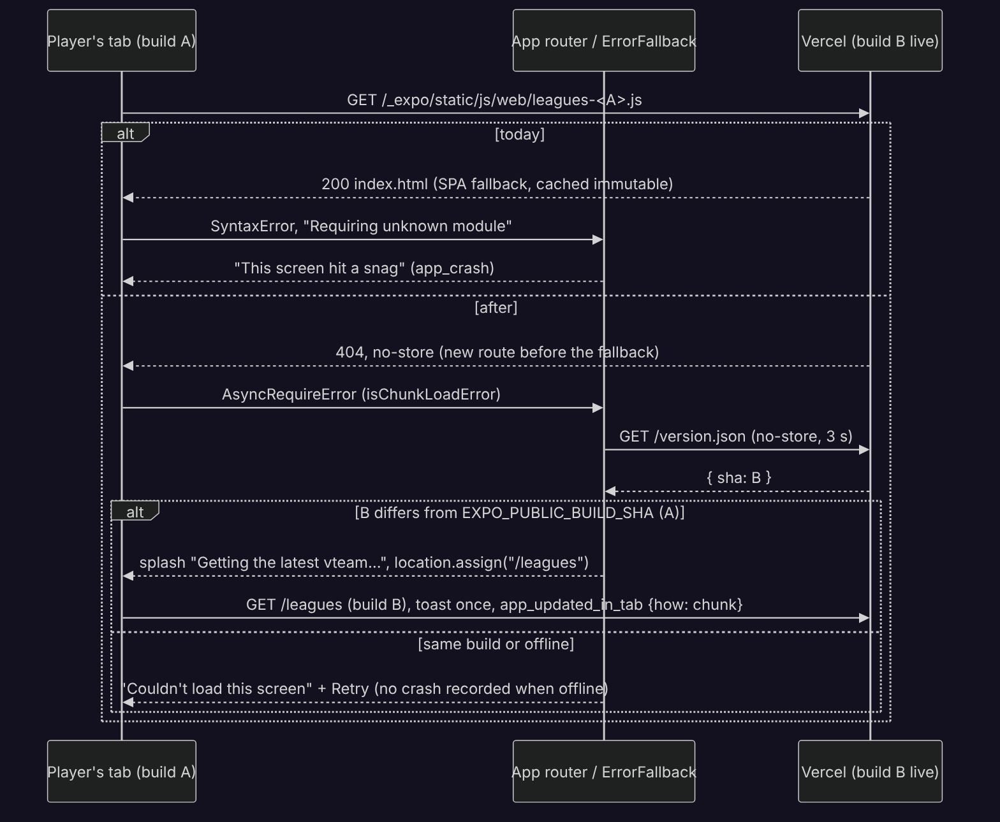
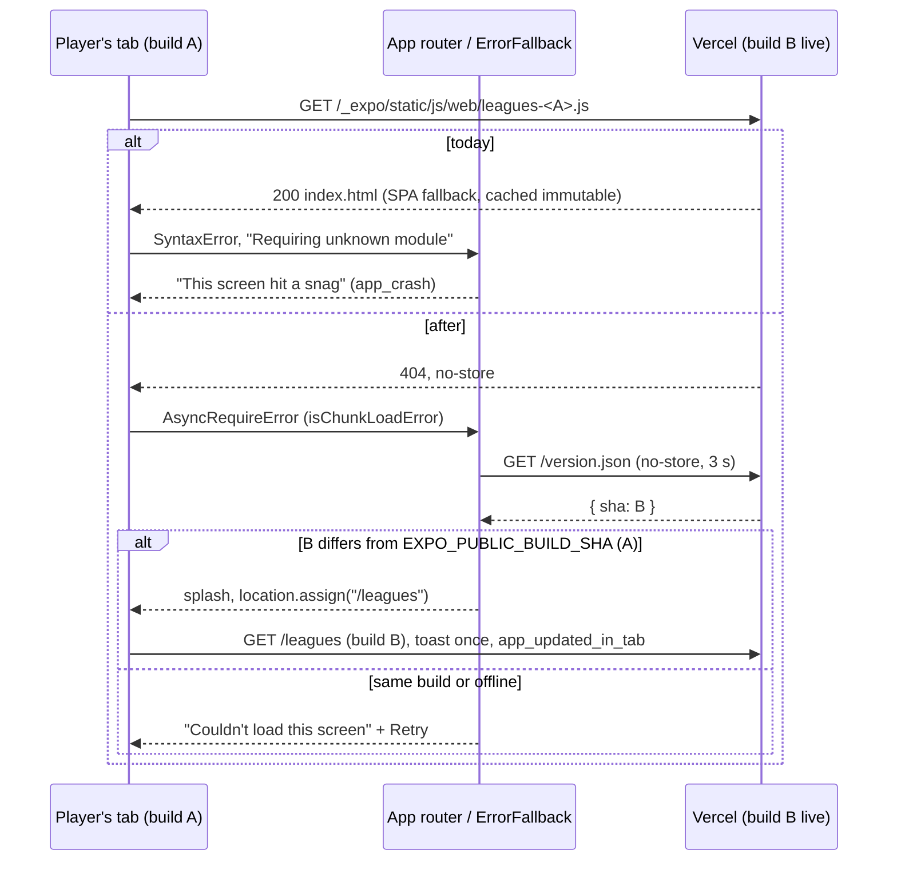
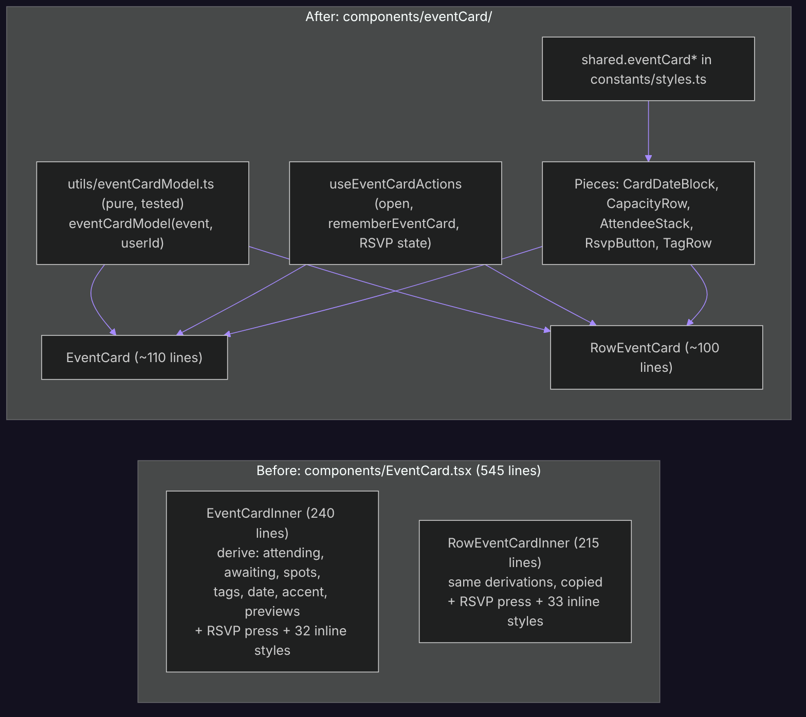
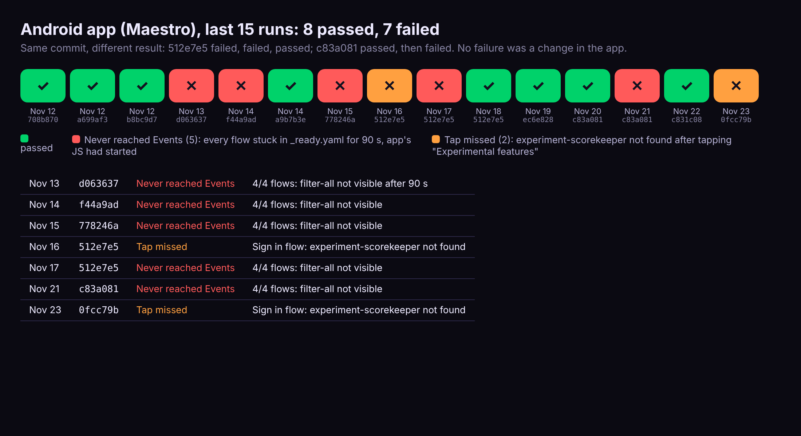

# vteam ideas: 2026-11-24

## Health check

Full stability run (`scripts/shots/stability-flow.mjs --full`) on today's `main` (cf3f20c, after #356 event screen in pieces), mocked export, phone 390×844 and desktop 1280×860, signed in and guest, with and without an 800 ms delay on every Supabase response: **512 cases in 709 s, passed (0 new findings).**

- **Tours:** passed. Intro tour from Profile and the Austin banner, every Events type and surface chip from a link and saved: no gaps, spotlight every step (128 cases).
- **Refresh and Back:** passed (92 cases). Known (baseline): the event page's Price row shifts once on reload: 0.019 on phone (signed in and guest, with and without the delay) and 0.016 on desktop without the delay; desktop with the delay is **0 today (was 0.016)**. Yesterday it was the other way round (no-delay 0, delay 0.016–0.019), so this shift is timing-dependent rather than fixed; the baseline still covers it.
- **Links:** passed. Every `VIEW` link keeps its values, changes follow into the address, phone tabs keep their views (32 cases).
- **Raw route names:** passed (260 cases).
- **Still not exercised: 32 of the 92 refresh/Back cases** (Clubs and Chat don't scroll with the fixtures; Back on the event page and Tournaments has no child link partway down), unchanged since Nov 15.
- **Beyond the three checks (live data):** the only `app_crash` ever recorded on live (Nov 20, 05:14 UTC, guest, /leagues, then a second crash 2 s later) **reproduces on today's main**: a tab opened before a deploy crashes on the first screen whose code it hasn't loaded yet. Idea 1 is the fix.

Nov 23 had a competitor-gap idea, so today has no new-feature/competitor idea. Today is end-user experience, refactor and testing.

---

## 1. A deploy never crashes an open tab: move to the new build instead of "This screen hit a snag"

**Status (review, Nov 24): approved → #359.** Build requested.

**Bucket:** end-user-experience · **Size:** S–M

**Pitch:** When vteam ships while someone has the site open, the next screen they open needs code from the old build that no longer exists, and they get the crash screen twice. Instead, the app notices "there's a newer vteam", does one full page load to the same address, and shows the screen.

**Why**
- **The only real crash on live is this one.** `app_crash` has 2 rows since #316 (Nov 15), both from one guest on Nov 20: tab opened at 03:34 UTC, three deploys landed (#338 03:55, #335 04:29, #337 04:58), the phone woke at 05:13 (`server_unreachable` cause `network`, 22 s), at 05:14 they tapped **Leagues** → crash (attempt 1) → Try again → crash (attempt 2, 2 s later) → reload → Leagues worked and they opened a league.
- **Reproduced on today's main.** Web routes are lazy chunks (`dist/_expo/static/js/web/leagues-<hash>.js`, 61 files); only the layouts load up front. Simulating a deploy (old chunk answered the way `vercel.json` answers a missing file: `/.*` → `index.html`, 200) gives `Unexpected token '<'` + `Requiring unknown module "793"` → **"This screen hit a snag"** in 0.3 s, then **"Still not working"** on the next tap, phone and desktop. Answering 404 instead gives `AsyncRequireError: Loading module …leagues-….js failed` and the same two screens. "Try again" can't help: it clears saved data, but the chunk is still gone.
- **It happens on most days.** `main` deployed 2–14 times a day this month (50 merges since Nov 13). Every visitor who keeps vteam open in a tab (or on an iPhone home-screen web app) across one of them is exposed on their next unvisited screen.
- **It also pollutes monitoring:** `job_health()` fails at 3+ crashing people in 3 h; a busy evening plus a deploy would email the owner about a crash that is really a deploy.
- **Side effect worth fixing:** `vercel.json` gives every `/_expo/static/*` response `cache-control: immutable` and then falls back to `index.html` for a missing file, so a browser can keep an HTML page cached as "the leagues chunk" for a year.

**User stories**
- As a player who left vteam open in a tab, when I come back and tap something after an update, the screen opens (maybe after one quick reload), never an error.
- As the owner, a crash alert means a crash, not a deploy.

**Acceptance criteria**
- [ ] A tab on build A, after build B is live, opening any screen whose chunk it hasn't loaded lands on that screen on build B, with no error screen, no `app_crash`, phone and desktop, signed in and guest.
- [ ] At most one automatic reload per 5 minutes per tab (`sessionStorage`); if the reload doesn't fix it, today's crash screen shows (no loop).
- [ ] Offline (version check fails): "Couldn't load this screen" with Retry, recorded as `screen_load_failed` {cause: 'network'}, not `app_crash`.
- [ ] A missing `/_expo/static/*` or `/assets/*` file answers **404 with `cache-control: no-store`**, never `index.html`.
- [ ] A tab back after 30+ min hidden checks `/version.json` once; if a newer build is live, the next in-app navigation is a full page load to the destination (no failed chunk at all).
- [ ] After an automatic reload, one info toast: "vteam was updated while you were away." (once).
- [ ] Metric `app_updated_in_tab` {how: 'chunk' | 'resume', screen (pattern)}.
- [ ] Native unaffected (no-op files).

**Design**
- **Know the running build:** `build:web` exports `EXPO_PUBLIC_BUILD_SHA` from `buildSha()` (already in `scripts/build-version.mjs`, which writes `dist/version.json`) before `expo export`, so the app and `version.json` agree. `utils/appVersion.ts` gets `currentBuildSha()`.
- **Pure rules** in `utils/staleBuild.ts`: `isChunkLoadError(e)` (`AsyncRequireError`, `/Loading module .* failed/`, `/Requiring unknown module/`, `SyntaxError: Unexpected token '<'`), `reloadAllowed(lastAt, now)` (5 min), `isNewerBuild(running, served)`.
- **Web side** `lib/staleBuild.web.ts` (+ no-op `lib/staleBuild.ts`): `servedBuild()` (`fetch('/version.json', { cache: 'no-store' })`, 3 s timeout, through no Supabase code), `reloadInto(path, how)` (marks `vteam.updateReload` in sessionStorage, `track` + `flush`, `location.assign(path)`), `onResumeCheck()` wired where `lib/analytics` opens a new session after 30 min hidden, and `takeUpdateToast()` read once in `app/(app)/_layout.tsx`.
- **Error boundary:** `components/ErrorFallback.tsx` checks `isChunkLoadError(error)` **before** `noteCrash()`; if so it renders `UpdatingScreen` (the splash, "Getting the latest vteam…") and runs the check → reload, else falls through to today's flow. `SentryErrorBoundary.web.tsx` tags these `stale_build` instead of reporting them as crashes.
- **Resume path:** when a newer build is known, `app/(app)/_layout.tsx` listens for the next pathname change (`usePathname`) and does `location.assign` of it. Typed form text is never lost: the host form, chat composer and feedback form opt out (`useBlocksUpdateReload()`), and the reload waits until the next navigation away from them.
- **`vercel.json`:** after `{ "handle": "filesystem" }`, add `{ "src": "/(_expo/static|assets)/.*", "status": 404, "headers": { "cache-control": "no-store" } }` before the `/.*` fallback.
- **Surfaces:** web only (phone browsers, home-screen web apps, desktop). Native bundles its JS; nothing changes there. Guests and signed-in players behave the same; nothing is account-specific.
- **Copy** in `constants/copy.ts` (`UPDATE_COPY`).

**Backend:** none in Supabase (no schema, RLS or functions). The only server change is the Vercel route above. `job_health()` needs no change: these stop being `app_crash`.

**Test plan**
- Unit: `__tests__/staleBuild.test.ts` (error classification for both shapes, the 5-minute guard, newer-build compare), `ErrorFallback` test (chunk error → no `noteCrash`, renders the updating screen).
- Browser: `scripts/shots/deploy-skew-flow.mjs` in CI's **Browser: flows** job (the reproduction above, made a check): load `/`, then make the route chunks answer as a missing file (both HTML-200 and 404 shapes) and serve a `version.json` with another sha; tap Leagues; assert no "hit a snag", the URL is `/leagues`, the Leagues sections render, `app_crash` isn't sent, `app_updated_in_tab` is. Second case: resume after 31 min hidden with a newer `version.json`, then tap a link: document navigation, no chunk error. Third: offline: "Couldn't load this screen", no reload loop.
- Production watch (`scripts/production-watch.mjs`): one request to `/_expo/static/js/web/missing-<random>.js` must be 404 and not `immutable`.
- Unit test that `vercel.json` has the 404 route before the fallback.

**Pros and cons**

| Pros | Cons |
| --- | --- |
| Fixes the only real crash live has recorded, with a reproduction that becomes a CI check. | A reload costs the player ~1 s and resets in-memory state (scroll, open sheets) on that one tap. |
| Crash alerts and `app_crash` counts mean crashes again, not deploys. | Adds a build-time env var and a `version.json` fetch on resume (one tiny request per 30+ min). |
| Stops caching `index.html` as a JS chunk for a year. | The resume path needs an opt-out for screens with typed text; missing one would lose a draft. |
| Lets you keep merging many times a day without thinking about open tabs. | Vercel route header precedence must be checked on the real deploy (production watch covers it). |
| Small: one pure module, one web module, one boundary branch, one route. | Doesn't help a tab whose chunk fails for other reasons (bad CDN); those still show today's screen. |

**Verdict:** pros clearly win: it's the one crash real players have hit, the fix is small and testable, and the cost is a one-second reload that only happens after a deploy.

**Risks / open questions:** Vercel Skew Protection (Pro plan) would also serve old chunks; this design doesn't need it. Should the resume check also run on `focus` for tabs that never go 30 min hidden? (Proposed: no, the chunk path covers them.)
**Dependencies:** builds on #316 (crash recovery) and #353 (`version.json`, production watch).

---

## 2. Event cards in one piece: one card model for both layouts, and 65 inline styles into the stylesheet

**Status (review, Nov 24): approved → #360.** Build requested.

**Bucket:** refactor · **Size:** M

**Pitch:** `components/EventCard.tsx` (545 lines) holds two cards, `EventCard` (phone feed, search, history, hosted, club page, recap) and `RowEventCard` (desktop feed), that each compute the same things in their own copy. Pull the shared logic into a pure, tested `eventCardModel`, the tap and RSVP handling into one hook, the repeated parts into small components, and the 65 `style={{…}}` objects into `shared.*`.

**Why**
- **Copied logic:** **79 non-trivial lines are identical** between `EventCardInner` (lines 82–323) and `RowEventCardInner` (329–545): who's attending, the "awaiting" label, attendee count, spots left, fill ratio, type and skill tags (filter + sort, written twice), date parts, accent colour, previews/overflow, the press handler (`rememberEventCard` + `routes.eventFrom`) and the RSVP button's try/finally. A rule change (e.g. +1 guests in the count, a new tag category) has to be made twice; missing one shows different numbers on phone and desktop for the same game.
- **Busy file:** 40 commits ever, **16 since Oct 1** (most recently #341, which added `hideDate` to only the row card).
- **Off-convention:** **65 inline style objects** (32 + 33) and 28 hard-coded sizes (`borderRadius: 20`, `padding: 14`, `gap: 14`…), against "shared styles in `constants/styles.ts`" and "never hardcode spacing". Props types are written inline in the component (two near-identical blocks), against "types live in `types/`".
- **Untested core:** the only test is `__tests__/eventCardRsvp.test.tsx` (the RSVP button). The derivations a player reads ("5 spots left", "Waiting for host") have no unit test.
- **It unlocks** later card work (Ads' sponsored label, the friends line, weather) being added in one place, and lets `ExternalSessionCard` / `ExternalProgramCard` reuse `CardDateBlock` and `TimePill` rows.

**User stories**
- As a developer, a change to how a card counts players or labels a game is one edit with a unit test, and both layouts follow.
- As a player, phone and desktop say the same thing about the same game.

**Acceptance criteria**
- [ ] `utils/eventCardModel.ts` (pure, no React Native): `eventCardModel(event, userId)` returns `{ isAttending, awaiting, attendeeCount, spotsLeft, isFull, fillRatio, typeTags, skillTags, dateParts, accent, isTournament, previews, overflow }`; `__tests__/eventCardModel.test.ts` covers each (full, unlimited, waitlisted, +1s, tournament tag, no tags, a DST date via `__tests__/helpers/clock.ts`).
- [ ] `useEventCardActions(event, { from, onRsvp, rsvpPending })` holds the press and RSVP state; `eventCardRsvp.test.tsx` keeps passing unchanged.
- [ ] Pieces in `components/eventCard/`: `CardDateBlock`, `CapacityRow`, `AttendeeStack`, `RsvpButton`, `TagRow`; `EventCard` and `RowEventCard` each under 130 lines; `components/EventCard.tsx` re-exports both so the 7 importers don't change.
- [ ] No `style={{` with literal sizes or colours left in the card files; styles in `shared.eventCard*`; props types in `types/eventCard.ts`.
- [ ] **No visible change**: `npm run shots:compare` shows no changed screen for Events (phone and desktop), search, history, hosted, club, event recap; a11y and startup budgets unchanged; stability passes.
- [ ] Two small PRs: (1) model + tests + hook, cards switched to them; (2) pieces + styles.

**Design**
- Files: `utils/eventCardModel.ts` (moves `isAttendingRow`, `awaitingLabel`, `isTournament`, `numeralColor`, `parseEventDate` out of the component), `hooks/useEventCardActions.ts`, `components/eventCard/*`, `types/eventCard.ts`, `constants/styles.ts` (`eventCard`, `eventCardRow`, `eventCardDate`, …).
- `parseEventDate` keeps its exact output (device time zone, `12:00 PM`); it moves as-is and gets a test, so #342's formatter rules are untouched.
- Keep `memo` on both exports; the model is computed with `useMemo` keyed on `event` and `userId`, so the desktop feed's day sections don't redo tag sorting on every scroll-driven render.
- No route, guest, schema or copy changes; all three surfaces render the same pixels.

**Backend:** none.

**Test plan:** unit (model, hook), the existing RSVP test, `shots:compare` before/after on the affected screens (expect zero diffs), the a11y and startup budgets, stability (`SCROLL_SCREENS` includes Events). e2e unchanged (`event-card` testID kept).

**Pros and cons**

| Pros | Cons |
| --- | --- |
| One place for the card rules players read (spots, waiting, attending); phone and desktop can't disagree. | Touches the most-viewed component; a slip shows on every feed card (mitigated by zero-diff screenshots). |
| First unit tests for those rules. | Two PRs of churn with no user-visible gain on their own. |
| 65 inline styles → shared styles and tokens, per the conventions. | Moving styles to `StyleSheet` can change tiny rendering details (rounding) that the screenshot diff must catch. |
| Smaller files make the next card feature (ads, friends, weather) a one-place change. | Re-exports keep importers stable but leave one more indirection to know about. |

**Verdict:** worth it: the duplication is real (79 identical lines in a file changed 16 times in 8 weeks) and screenshot diffs make it safe, but it's maintenance, so it can wait behind idea 1.

**Risks / open questions:** Should `ExternalSessionCard` adopt `CardDateBlock` in the same PR? (Proposed: no, a follow-up.)
**Dependencies:** none; independent of the open PR #358.

---

## 3. An Android nightly you can trust: 7 of the last 15 runs failed, none because of the app

**Status (review, Nov 24): approved → #361.** Build requested.

**Bucket:** testing · **Size:** S–M

**Pitch:** The Maestro run on the Android emulator (#166's flows) fails about every other night, and the same commit passes and fails. Make each failure say what was on screen (in the log, since artifacts can't be read from a phone or a cloud session), fix the two causes we can see, and only then call a red run "the app is broken".

**Why**
- **Last 15 runs of `android-app.yml`: 8 passed, 7 failed.** Same commit, different result: `512e7e5` failed Nov 16, failed Nov 17, passed Nov 18; `c83a081` passed Nov 20, failed Nov 21.
- **Two failure modes, read from the job logs:**
  - **"Never reached Events" (5 runs: Nov 13, 14, 15, 17, 21):** all four flows fail in `_ready.yaml`: `Assertion is false: id: filter-all is visible` after the 90 s wait, each after its own `launchApp: clearState`. The app's JS had started (`ReactNativeJS: Running "main"` in logcat) and logged no error, so something sat over or in front of Events for 6 minutes. Since four cold launches all fail, it's emulator-wide state (a system "isn't responding" dialog, no network on the emulator's Wi-Fi, or beta not answering), not a timing race in one flow. The failing boots also took longer (16 `sys.boot_completed` polls vs 13).
  - **"Tap missed" (2 runs: Nov 16, 23):** `04-sign-in.yaml` taps `"Experimental features"` right after `scrollUntilVisible` with no wait, then `experiment-scorekeeper` isn't found: the tap lands while the list is still moving (or under the tab bar), so Profile never opens the screen.
- **Today nobody can tell which:** the failure step only greps logcat for `ReactNativeJS|FATAL|AndroidRuntime`; Maestro's screenshots are only in the artifact, and artifact downloads are blocked from cloud sessions (blob storage), so the reason a run failed is invisible without a laptop. No issue was ever filed for these 7 failures, which is what a nightly that cries wolf turns into.

**User stories**
- As the owner, a red Android night means the app is broken on Android, and the email says what was on screen.
- As whoever fixes it, the job log has the screen's visible text, the focused window and the app's log, without downloading anything.

**Acceptance criteria**
- [ ] On any failed flow the job writes to the log **and** `$GITHUB_STEP_SUMMARY`: the flow, the failing step, the focused window (`dumpsys window | grep mCurrentFocus`), the visible texts and resource ids (`uiautomator dump`, parsed by `e2e/android/describe-screen.mjs`), any ANR / "isn't responding" in `dumpsys activity`, whether the emulator has network (`ping -c1` to the beta host via `adb shell`), and the app's last 40 `ReactNativeJS` lines (all levels).
- [ ] `_ready.yaml` dismisses Android system dialogs ("Wait", "Close app", "OK" on "System UI isn't responding" / "Pixel Launcher isn't responding") as well as "Allow", and waits for the launcher to be idle once before the first flow (`e2e/android/warmup.sh`: boot + `input keyevent 82` + until `mCurrentFocus` is the launcher, 120 s).
- [ ] A warm-up launch before the suite: open the app, wait up to 180 s for `filter-all`, and if it never comes, print the screen description and fail as **"environment: app never reached Events"** (a distinct summary line), not as four flow failures.
- [ ] `04-sign-in.yaml`: `scrollUntilVisible` with `centerElement: true`, then `assertVisible` on the Experimental screen's title before tapping `experiment-scorekeeper` (an id the flow already uses).
- [ ] An environment failure gets one automatic re-run of the job (it died before any test body ran, which the repo's rules allow once); a flow failure never does.
- [ ] Ten consecutive green nights before the work is called done (tracked in the PR), and the failure table above gets a "fixed by" column.

**Design**
- `.github/workflows/android-app.yml`: the `script:` line calls `e2e/android/run.sh` (one file instead of a 400-character line), which runs warm-up, the flows, and on failure `e2e/android/describe-screen.mjs` (pure parser of `uiautomator` XML → text list, unit-tested in `__tests__/androidDescribe.test.ts`). The re-run is a second job `rerun-on-environment` that triggers `actions_run_trigger` for the same workflow only when the first job's output says `environment` (once: it checks `github.run_attempt`).
- `e2e/android/flows/_ready.yaml`: add the dialog dismissals; keep the 90 s wait for later flows (warm-up absorbs the cold one).
- `e2e/android/flows/04-sign-in.yaml`: the scroll/assert change above.
- Keep everything else (API 34, KVM step, beta, fixture event).

**Backend:** none. Beta is only read through the app, as today.

**Test plan:** unit test for the XML parser; run the workflow on demand (`workflow_dispatch`) 5 times on the PR branch with the warm-up and dialog handling, then compare with the 15-run table; make the warm-up fail on purpose once (wrong app id) to see the environment summary.

**Pros and cons**

| Pros | Cons |
| --- | --- |
| Turns a coin-flip nightly into a signal, so a real Android break (the only check of the native app) gets noticed. | The root cause of "never reached Events" is still a hypothesis until the new diagnostics capture one; the first PR might only explain it. |
| Failure reasons readable in the log and summary, from a phone or a cloud session. | Warm-up adds ~1–2 minutes to each run. |
| The scorekeeper tap fix is one-line and certain. | One automatic re-run can hide an emulator problem that keeps getting worse (mitigated: the summary still says "environment"). |
| Small, contained to `e2e/android/` and one workflow. | Emulator behaviour changes with GitHub's runner images; this needs a look again when they bump. |

**Verdict:** pros win: it's cheap, it makes the only native-app check trustworthy before the iOS flows copy it, and the diagnostics pay off even if the first fix guess is wrong.

**Risks / open questions:** If beta itself was asleep on those nights, the fix is on the beta side (the web e2e would have hit it too); the network line in the summary will say. Should the nightly email only on two failures in a row? (Proposed: no, fix the cause first.)
**Dependencies:** #166 (Maestro flows); do it before the iOS flows reuse `_ready.yaml`.
