# vteam ideas: 2026-11-25

## Health check

Today's `main` (35d6bc2, after #374 the Party invite event page), mocked export, phone 390×844 and desktop 1280×860, signed in and guest, with and without an 800 ms delay on every Supabase response. Full stability run (`scripts/shots/stability-flow.mjs --full`): **528 cases in 718 s, 5 new findings (2 bugs).** Plus a UX/UI consistency pass over all 93 `SCREENS` entries on phone and desktop (186 shots, computed styles read from the page).

- **Tours:** passed. Intro tour from Profile and the Austin banner, every Events type and surface chip, from a link and saved: no gaps, spotlight on every step (128 cases).
- **Refresh and Back: 2 bugs.**
  - **The event page forgets where you were.** Phone, guest: scroll the event to the host (300 px), tap the host, then Back: the event comes back at **0 px**, with and without the delay (`event:guest:back`, 297 → 0). Reproduced by hand: 20 samples over 2 s after Back, all 0. This case ran for the first time today: before #374 the "Host" label wasn't partway down, so the check had skipped it since Nov 15. Idea 1 is the fix.
  - **Tournaments shifts once on reload (guest):** CLS **0.033** on phone, **0.018** on desktop (with and without the delay), 0.6 s after the splash: the host chips row (`All hosts 4 · ACES 3 · NAGVA 1`) changes height by 40 px and the cards below move. Not today's fix; the leading suspect is the chips row wrapping before the Outfit font arrives (one line once it does).
  - The event page's Price-row shift that was in the baseline since Nov 15 didn't show today (that row moved in #374).
- **Links:** passed. Every `VIEW` link keeps its values, changes follow the address, phone tabs keep their views (32 cases).
- **Raw route names:** passed (276 cases).
- **Still not checked: 30 of the 92 refresh/Back cases.** Clubs and Chat don't scroll with the fixtures, Tournaments has no child link partway down, and on the event page **signed in, tapping the host does nothing because the fixture viewer is the host**. Idea 1 adds a signed-in child for the event page.
- **UX/UI: 9 inconsistencies.** The worst:
  - **Back looks and works 7 different ways, and 5 of them are under 44 pt.** Event 44×44 white pill ✓, chat 44×44 ✓, club cover 36×36 circle, settings and other native-header screens 30×30 arrow (19 screens), tournament create 32×34, host form 32×26 chevron, and `ScreenHeader`'s "‹ Back" **50×24** (16 screens; `hitSlop` does nothing on the web). Notifications and Create club opened from a link have **no Back at all**. Back is 44 of the 210 sub-44-pt controls on phone, the largest single source.

  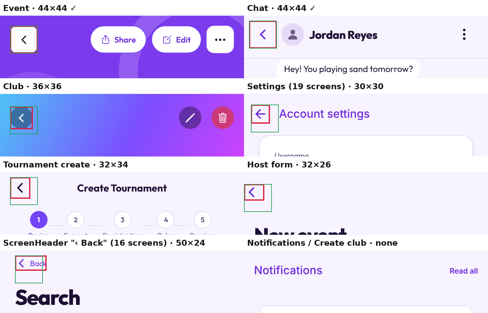

  Further inconsistencies:
  - **Screen titles: 6 styles.** `ScreenHeader` 34 px Outfit ExtraBold in ink (Search, Tournaments, Leagues, Make teams, Find a team, Scorekeeper, Terms); the native stack header's **18 px / 500 system-ui in purple** (15 shots: Account, Notification settings, History, Badges ×2, Feedback ×2, Hidden, Experimental, Admin metrics ×4, the Notifications inbox and Create club); host form "New event." 32/700; welcome 26/700; auth 28 px (34 on desktop); Clubs/Chat at 34 without a Back row.
  - **Font family:** those 15 screens' titles are in the system font, while the theme says "Outfit everywhere" (Party invite, #369).
  - **The main action has 7 filled shapes:** ink pill 40 pt (Join on cards) and 54 pt (Sign in, Create account), purple 48/radius 24 (Create in the menu), purple 39 pill (Clubs Create), purple 50/radius 12 (Post poll), purple 44/radius 10 (Send in discussions), purple 38/radius 12 (guest "Sign in or sign up" on Events).
  - **Guest sign-in:** the Events header's "Sign in or sign up" is a 73×38 purple button with radius 12; the sign-in screen it opens uses a 54 pt ink pill.
  - **Dead ends:** Notifications and Create club have no Back when opened from a link or after a reload (the native header hides it with no history); every `ScreenHeader` screen falls back to `routes.app()`.
  - **Tap targets on phone:** 210 controls under 44 pt: Back (44), Events type and surface chips 32 pt tall (All, Open Play, Tournament, Indoor, Sand, Grass), "Add to calendar" 79×28 and "More" 33×28 on the event page, the feed's ⋯ hide button 38×38.
  - **Inline `Modal`s:** CLAUDE.md says `BottomSheet` / `ConfirmDialog` only, but 17 files outside them render `<Modal>` themselves, including three that are confirm dialogs (`DeleteEventDialog`, `DenyRequestDialog`, `AddGuestDialog`) plus `ClubPostCard`, `ReactionPicker`, `InviteModal`, `AvatarUploader`, `CohostsDialog`, `ImageViewer`, `host/BasicsSection`, `HostResultModal`, `AnchorOptionsMenu`, `LocationPickerField`, `NotificationPopup`, `chat.tsx`, `settings/feedback.tsx`, `settings/badges.tsx`.
  - **Font sizes off the token scale:** 29, 30, 36, 40, 48, 96 and 110 px on 22 screens (mostly emoji and icons: the 110 px 🏆 on tournament pages, 40 px avatar initials, 96 px scores on Simple score).
  - **Code scan:** clean otherwise. Hex/rgba literals only in avatar and badge artwork (8 files), no raw `fontSize` numbers, no `ActivityIndicator` outside `Spinner`, no `react-native` `Text`, no `Alert`.

Nov 24 had no new-feature or competitor idea, so today has one (idea 2). Today: a fix for the worst stability finding (end-user experience), a competitor gap, and the UX/UI consistency check in CI (testing), which starts with the worst consistency finding: Back.

---

## 1. The event page comes back where you left it

**Bucket:** end-user-experience · **Size:** S

**Pitch:** Scroll down an event, tap the host or a player, come back: today you're at the top of the page and have to find your place again. Give the event page the same scroll memory as Events, Profile, Clubs and the club page.

**Why**
- **Measured today:** phone web, guest, event scrolled to 297–300 px → tap the host → Back → **0 px**, every sample for 2 s, with and without an 800 ms server delay (stability `event:guest:back`, and by hand).
- **Root cause:** the event's Details and People tabs scroll the document through `DocScrollView` (`components/event/DetailsTab.tsx:133`, `components/event/PeopleTab.tsx:108`) **without a `memoryKey`**. The browser's Back remounts the screen, and without a key `utils/scrollMemory.ts` has nothing to restore. The club page passes `memoryKey={`club:${id}`}` (`app/(app)/club/[id].tsx:124`); the event page never did.
- **Why it shows now:** #374 put the host card partway down the page, so the stability check's child link ("Host") is finally below the fold. The bug is older; it was hidden behind a skipped case (one of the 32 "not exercised" since Nov 15).
- **It is the busiest round trip on the event page:** People tab → a player's profile → Back, and Details → host → Back. Most players are on phone web (CLAUDE.md, "Messages: toasts").

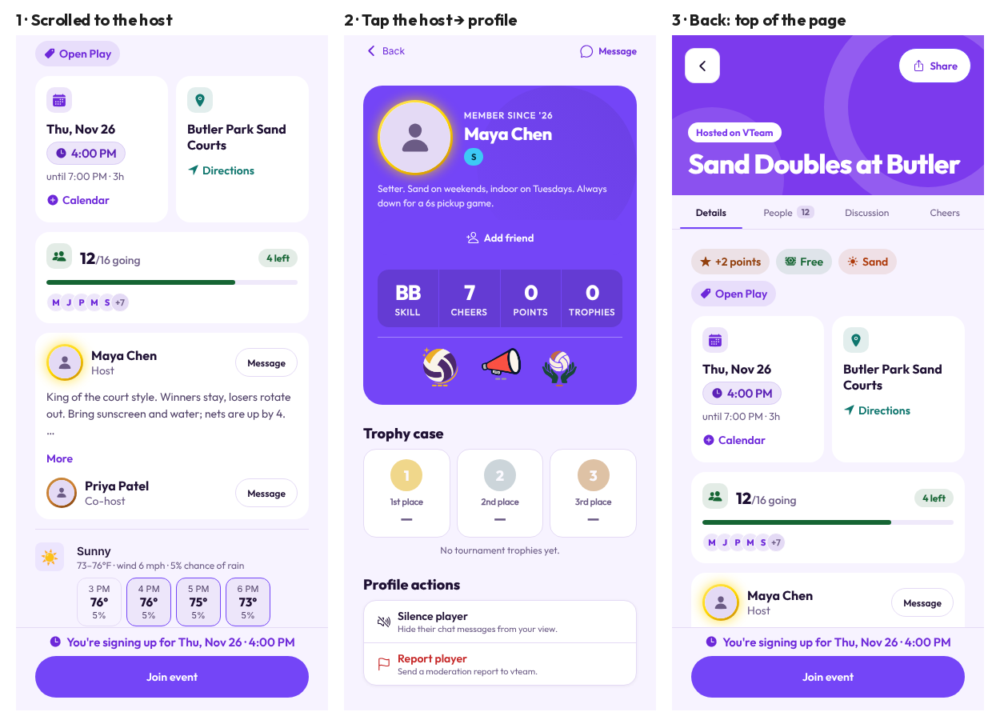

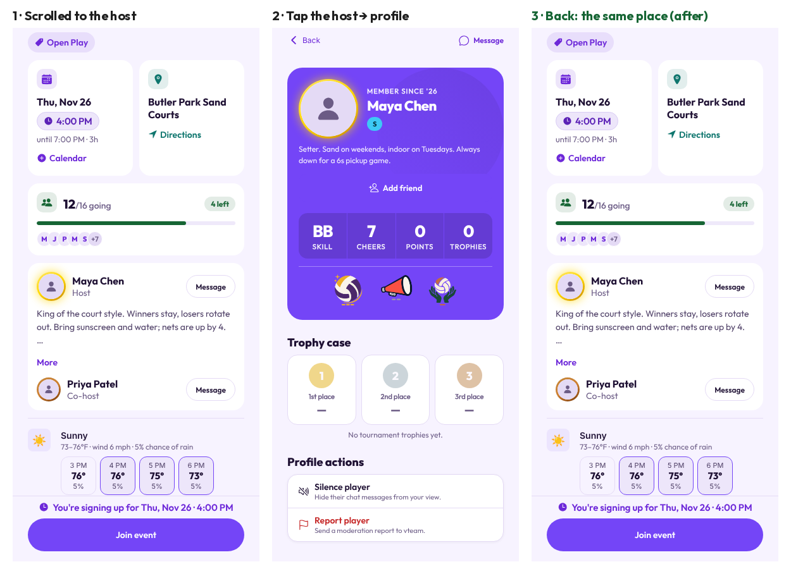

**User stories**
- As a player reading an event, when I check out the host or someone on the roster and come back, I'm at the same spot on the same tab.
- As a guest who opened a shared link, the same.

**Acceptance criteria**
- [ ] Event page, phone and desktop web, signed in and guest, Details and People: scroll partway, open a profile, Back → within 8 px of where you left (`OFFSET_TOLERANCE`), never painted at 0 first (no jump), with and without an 800 ms delay.
- [ ] Each tab remembers its own offset (`event:<id>:details`, `event:<id>:people`); switching tabs inside the page still starts the other tab at its own remembered offset or the top.
- [ ] A different event opens at the top (keys are per event).
- [ ] Reload of the event page keeps today's behaviour (top), like Profile and Clubs.
- [ ] Matches Profile and the club page in the way it comes back: hidden until restored (at most 400 ms), then shown at the offset.
- [ ] Stability check: `event:guest:back` passes; a new signed-in child (a People row) runs instead of being skipped; the 5 findings from today leave or stay out of the baseline (the Tournaments shift is tracked separately).
- [ ] Native unchanged (the stack keeps the screen mounted there).

**Design**
- `components/event/DetailsTab.tsx` and `components/event/PeopleTab.tsx`: pass `memoryKey={eventScrollKey(id, 'details' | 'people')}` to their `DocScrollView`. `eventScrollKey` is a one-line builder in `hooks/event/keys.ts`, next to the event's query keys.
- Discussion keeps its own list (it scrolls to the newest comment); no change.
- Nothing else: `DocScrollView` already does hide-until-restored, the module-level map, and the clear on sign-out.
- **Guard:** `scripts/shots/stabilityCases.mjs` gets a signed-in event case whose child is a People row (`/event/<id>?tab=people`, child `testIdPrefix: 'roster-'` or a player name), because the fixture viewer hosts `sundaySand` and the host tap is a no-op for them. Add a `__tests__/scrollMemoryKeys.test.ts` that fails when a file renders `<DocScrollView` without `memoryKey` and isn't on a short allow-list (sheets, short screens), so the next long screen can't forget it.
- **Surfaces:** phone web and desktop web (desktop scrolls the same document); native unaffected.
- Reuses: `DocScrollView`, `utils/scrollMemory.ts`, `useDocScrollRefocus`, the stability harness.

**Test plan**
- Unit: `scrollMemoryKeys.test.ts` (above).
- Stability: `event:guest:back` and the new `event:in:back` (People row) in PR mode; `--full` adds the 800 ms delay.
- e2e: extend `e2e/scrollRestore.spec.ts` (covers Profile today) with the event page, guest, phone.
- Screens: none new (`event-details`, `event-people` already in `SCREENS`).

**Pros and cons**
- Pros:
  - Fixes a measured, reproducible regression on the most visited stack screen, in two lines of app code.
  - Same mechanism as Profile, Clubs, the club page and Events, so it adds no new pattern.
  - The signed-in child case closes one of the 30 unexercised stability cases.
  - The allow-list test stops the next long screen from shipping without scroll memory.
- Cons:
  - A per-event key adds two entries to the in-memory map per event visited (cleared on sign-out; tiny).
  - The allow-list test is a source scan; a screen that legitimately shouldn't remember needs a line in it.
  - It doesn't fix the Tournaments shift found today; that needs its own look.
- **Verdict:** clearly worth it: an S fix for a bug players hit on every profile round trip, plus a guard for the whole class.

**Risks / open questions:** none significant. **Dependencies:** none.

---

## 2. Check in at the court: "I'm here" for players, a live head count for hosts, and no-shows in one tap

**Bucket:** competitor-gap · **Size:** M (schema)

**Pitch:** From 30 minutes before a game until it ends, players tap **I'm here** on the event. The host sees "9 of 12 here" on People and can check in anyone who forgot. After the game, the people who never checked in are listed with one button to mark them as no-shows, using the no-show flag vteam already has.

**Why**
- **Competitors do it.** OpenSports organizers check attendees in from the roster ([How to check-in event attendees](https://opensports.net/blog/how-to-check-in-attendees-at-your-sports-and-fitness-event-through-opensports)), can let a volunteer do it ([let an assistant check in players](https://opensports.ca/blog/how-to-let-a-volunteerassistant-check-in-players)), and tie it to their no-show handling ([Manage No-Shows](https://opensports.ca/blog/manage-no-shows-and-encourage-reliable-attendance)). Spond's coaches register attendance per event ([Register attendance](https://help.spond.com/app/en/articles/131887-register-attendance-and-download-history)).
- **vteam already has the back half.** #151 lets hosts flag no-shows (`set_no_show()`, window from the start to 2 h after the end) and `award_event_points()` skips flagged players. What's missing is how the host knows who didn't come: today they scan the roster from memory, at the court, with the game running.
- **It makes points honest without extra work:** the no-show list writes itself from check-ins; the host only confirms it.
- **Hosts get a live count** at the court ("are we waiting on anyone?") without a group chat.
- It fits with the court queue (#333): the host is already on the People tab during the game.

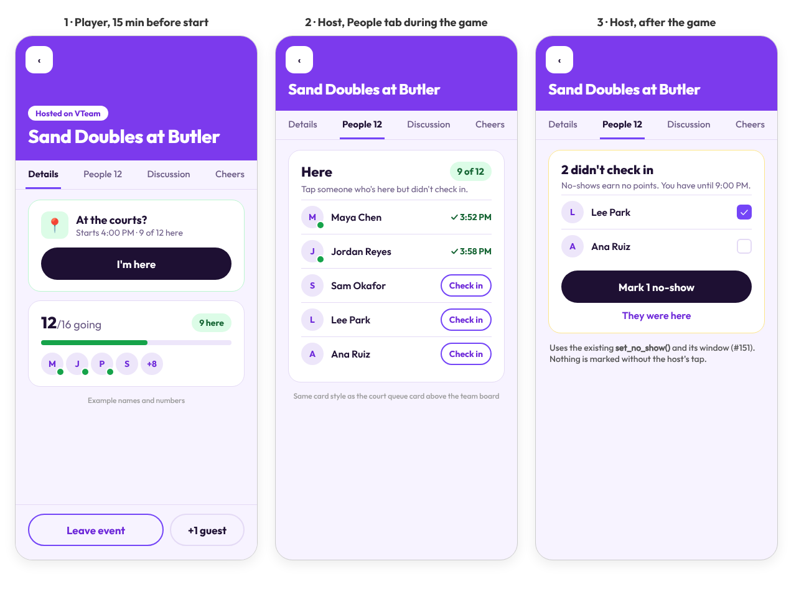

Consistent with: the People tab's court queue card and the event page's Party invite cards (white card, 20 radius, ink pill for the one main action).

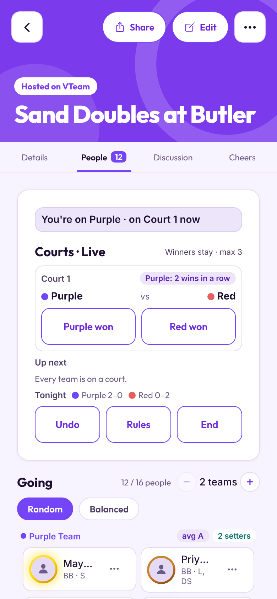

**User flow**
1. 3:45 PM, a player opens the event (or the "You're going" rail): a card at the top of Details says "At the courts? · Starts 4:00 PM · 9 of 12 here" with **I'm here**.
2. Tap → the card turns into "You're checked in · 3:52 PM" (optimistic), the Who's in card shows "10 here" and a green dot on their avatar.
3. The host's People tab shows **Here · 10 of 12** above the team board: checked-in players with their time, the rest with **Check in**.
4. After the end, the host's card becomes "2 didn't check in", both ticked, **Mark 2 no-shows** (or untick, or "They were here"). It closes with the no-show window (end + 2 h).

**User stories**
- As a player, I tap once when I arrive so the host knows I'm here.
- As a host, I see who's here without counting heads, and check in someone whose phone is in their bag.
- As a host, after the game I confirm no-shows from a short list instead of remembering.
- As a player who didn't check in but played, the host can check me in later (until end + 2 h), so I keep my points.

**Acceptance criteria**
- [ ] **I'm here** shows only to attending players (not waitlisted, not guests), from start − 30 min to the end, on Details (phone and desktop), and is gone otherwise.
- [ ] One tap checks in (optimistic, toast only on failure through `toast.error`); a second tap does nothing (idempotent); there is no "check out".
- [ ] Hosts and co-hosts see **Here · N of M** on People and can check in any attending player from start − 30 min until end + 2 h (`NO_SHOW_GRACE_MS`).
- [ ] After the end, hosts and co-hosts see "N didn't check in" with each name ticked; **Mark N no-shows** calls the existing `set_no_show()` per player; unticked players stay unflagged. Nothing is ever marked automatically.
- [ ] Players see their own check-in; the "N here" count is visible to anyone who can see the roster; **who** checked in and when is visible only to the event's attending players, hosts and co-hosts (never to guests: it says who is at a place right now).
- [ ] Live: the host's count updates within 2 s of a check-in (realtime `checkins:<event>`).
- [ ] Matches existing patterns: card and ink pill like the Details cards and the court queue card; `Chip`-style "N here" pill like "4 left"; feedback like the court queue's optimistic saves; no `ConfirmDialog` for checking in (reversible by the host until end + 2 h) but **Mark N no-shows** uses the same wording as the roster's "Mark as no-show".
- [ ] Metrics: `checkin` {by: self | host, minutes_from_start}, `checkin_noshows_marked` {count}.
- [ ] Points and no-shows behave exactly as today when nobody checks in.

**Design**
- **Screens / components:** `components/event/CheckInCard.tsx` (Details, top, player), `components/event/people/CheckInCard.tsx` (People, above `CourtQueueCard`, host), the after-game list in the same card. `EventWhoIsIn` gains an optional "N here" pill and green dots on avatars.
- **Hook:** `hooks/event/useCheckIns.ts` on `lib/query` (`queryKey('event', id, 'checkins')`, `STALE.detail`), realtime through `useRealtimeChannel('checkins:<id>', …)`, mutation `checkIn(userId?)` with `onMutate` optimistic insert.
- **Pure rules:** `checkInWindow(event, now)` in `hooks/event/derive.ts` next to `noShowWindow` (opens start − 30 min, player button closes at the end, host closes at end + 2 h), `notCheckedIn(attending, checkins)`.
- **Copy:** `CHECKIN_COPY` in `constants/copy.ts`.
- **Routes:** none new; `?tab=people` already exists.
- **Guests:** no button; Who's in shows only the count.
- **Surfaces:** native, mobile web and desktop web identical (cards in the existing columns; desktop's People column already holds the court queue card).
- **Later (not in this issue):** "Remind me to check in" push at start − 15 min using the reminder job; a QR on the host's phone.

**Backend**

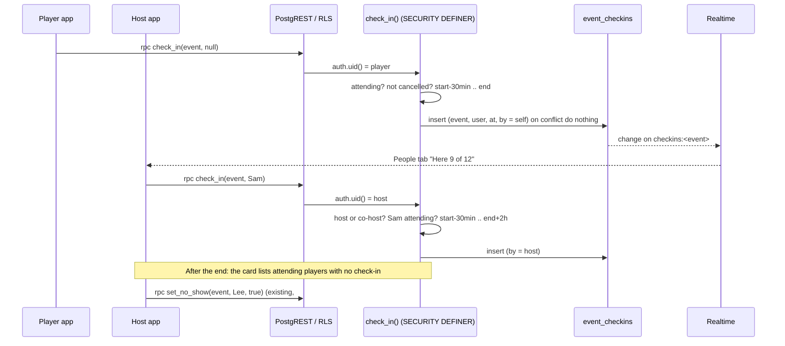

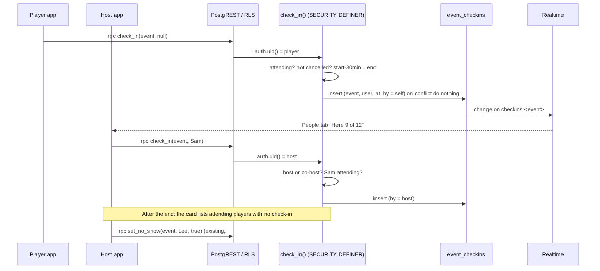

**Model changes**

| Object | Change | Notes (who reads / writes) |
| --- | --- | --- |
| `event_checkins` | new table: `event_id` → events ON DELETE CASCADE, `user_id` → profiles ON DELETE CASCADE, `checked_in_at timestamptz default now()`, `checked_in_by uuid` → profiles ON DELETE SET NULL, PK (event_id, user_id) | SELECT: the row's user, the event's host and co-hosts, and attending players of that event (`authenticated` only). No INSERT/UPDATE/DELETE policies: written only by `check_in()`. Realtime publication on. |
| `check_in(p_event uuid, p_user uuid default null)` | new RPC, SECURITY DEFINER, `authenticated` | Self: caller attending, not cancelled, start − 30 min ≤ now < end. For someone else: caller host/co-host, target attending, until end + 2 h (42501 / 22023 otherwise). `on conflict do nothing`. Rate limit 120 / minute per user (`enforce_rate_limit`). |
| `event_checkin_count(p_event uuid)` | new RPC, SECURITY DEFINER returning only an int, `anon` + `authenticated` | Count only, so guests and non-attendees see "9 here" without names. |
| `delete_account` | no change needed | Both FKs cascade / set null. |

Migration sketch (`supabase/migrations/2026112xxxxxxx_event_checkins.sql`): create table + RLS + 3 select policies, the two functions with `revoke execute … from public` then grants, `alter publication supabase_realtime add table event_checkins`. **Down:** drop the functions, remove from the publication, drop the table. Expand-only, safe for older app builds (nothing reads it).

**RLS expectations** (`e2e/rls.spec.ts`, `e2e/rls/matrix.ts` row): guest SELECT → 0 rows; guest `check_in` → 401/42501; e2e account can't insert directly (no policy); `check_in` for another user by a non-host → 42501; `event_checkin_count` works for anon.

**Test plan**
- Unit: `checkInWindow` and `notCheckedIn` with DST days (`__tests__/helpers/clock.ts`), the card states.
- RLS: matrix row + the four probes above (`api` shard).
- e2e (signed-in shard): create an event starting now under `[e2e <tag>]` in `beforeAll`, check in, see the count, host view; delete in `afterAll`.
- Shots: add `event-checkin` (Details at start − 15 min) and `event-people-checkin` (host, after the end) to `SCREENS` with fixture rows; the alignment and a11y jobs pick them up.

**Pros and cons**
- Pros:
  - Turns the no-show flag (#151) from a memory test into a one-tap confirmation, so points stay fair with less effort.
  - Hosts get a live head count at the court, which today needs a group chat.
  - Small, contained schema: one table, two functions, no change to existing rows or points.
  - Matches OpenSports and Spond, which hosts coming from them expect.
  - Builds on the People tab hosts already use during games (court queue).
- Cons:
  - Another thing to tap at the court; if players don't build the habit, the after-game list is long and hosts may stop trusting it (mitigated: nothing is automatic, and hosts can check people in).
  - Location-like data (who is at a place now): needs the tight SELECT policy above, and must never reach guests.
  - Adds a realtime channel per open event around game time (one more subscription on People).
  - Does nothing for outside sessions (no RSVP there).
- **Verdict:** worth it: modest build, and it makes an existing feature (no-shows and points) usable in practice, but ship it with the reminder push soon after or check-in rates will be low.

**Risks / open questions**
- Should the player button open at start − 30 min or − 60 min? (Mock: 30.)
- Should check-in be required for points later? (Not in this issue.)

**Dependencies:** #151 (shipped), #333 (court queue card placement).

---

## 3. UX/UI consistency in CI, starting with one 44-pt Back on every screen

**Bucket:** testing · **Size:** M (two PRs)

**Pitch:** Today's consistency pass becomes a repo script, `scripts/shots/ui-consistency-flow.mjs`, run on every PR with a baseline that only shrinks. Its first rule to reach zero is Back: one `BackButton` with a 44 pt target, on every stack screen, in the Party invite look.

**Why**
- **Measured today on 93 screens × 2 viewports:** 7 Back shapes (5 under 44 pt, including `ScreenHeader`'s 50×24 on 16 screens), 6 title styles, 15 screens still on the native stack header in the system font, 7 filled shapes for the main action, 210 sub-44-pt controls on phone, two screens without Back from a link (Health check above).
- **Nothing checks this today.** Axe checks contrast and labels; the alignment flow checks a few anchors' heights; the stability flow checks motion. A new screen can ship a new header, Back or button shape and every check passes. The last four PRs (#369–#374) restyled Events, the event page, auth and the splash; settings, notifications and create screens kept the old look, and only a manual pass found it.
- **Back is the most used control in the app** and the largest group of small tap targets (44 of 210).

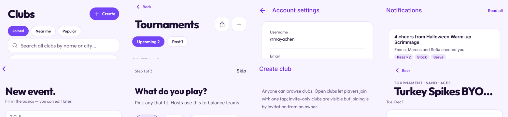

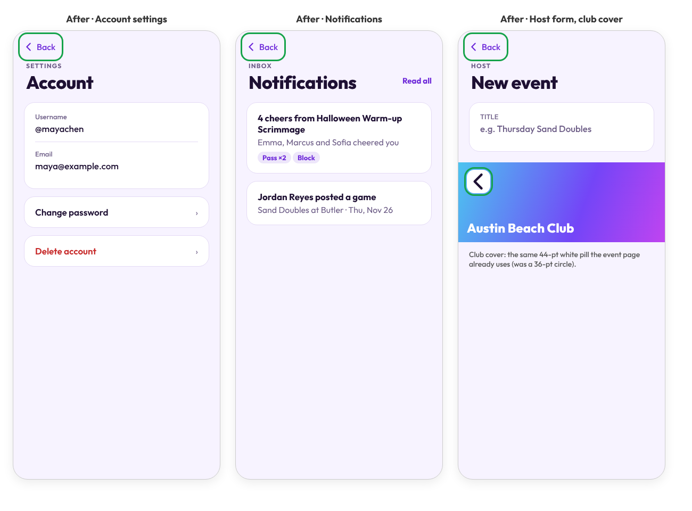

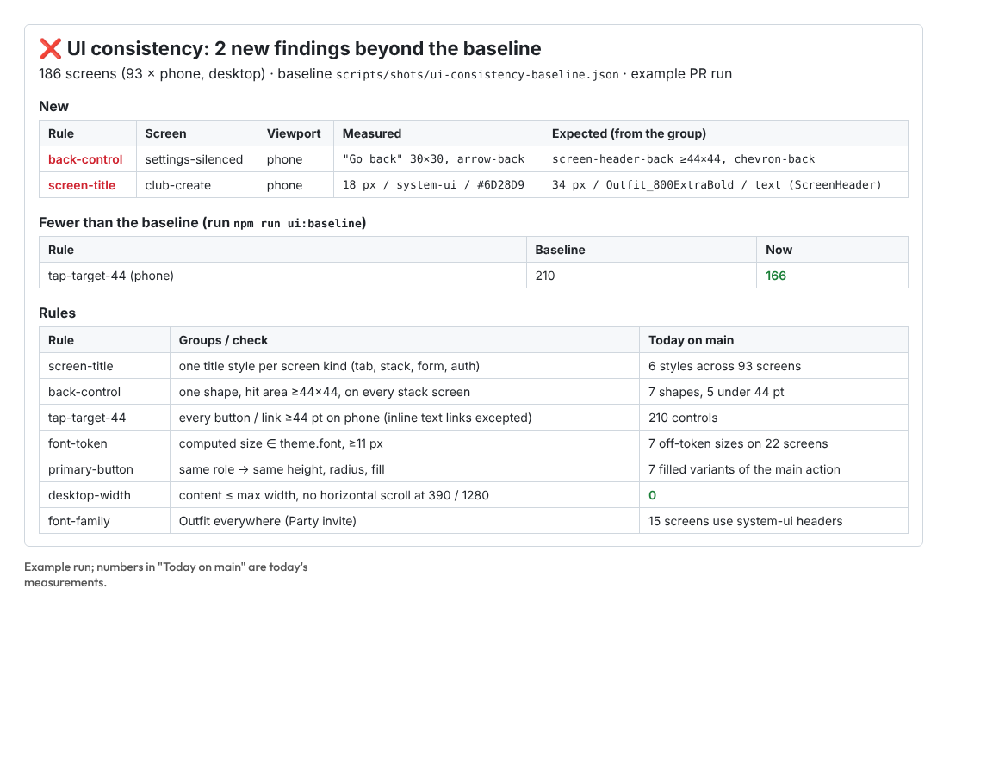

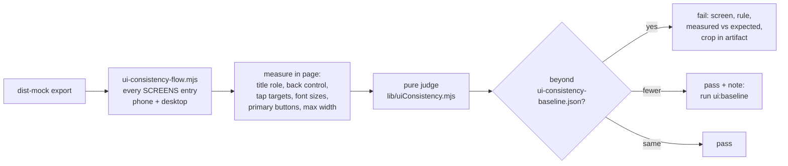

**User stories**
- As a player, Back is in the same place, the same size and works the same way on every screen.
- As the owner, a PR that adds a new header style, a small Back or an off-token font fails with the screen and the numbers, instead of me finding it by hand.

**Acceptance criteria**
- PR A: the check
  - [ ] `scripts/shots/ui-consistency-flow.mjs --dist dist-mock` visits every `SCREENS` entry (phone and desktop) through `visitScreens` and measures: title (role `header` / `screen-title`: font family, size, weight, colour), Back (`screen-header-back` or label /^back/: size, icon, position), every button and link's hit box on phone, every text's computed size against `theme.font`, filled primary buttons (height, radius, fill), content width on desktop and horizontal overflow at 390 and 1280.
  - [ ] Rules and their groups live in pure `scripts/shots/lib/uiConsistency.mjs` with `uiConsistency.test.mjs` (like `alignment.mjs`): `screen-title`, `back-control`, `tap-target-44`, `font-token`, `font-family`, `primary-button`, `desktop-width`.
  - [ ] `scripts/shots/ui-consistency-baseline.json` (screen → viewport → rule → count): a count above it or a rule new to a screen fails; fewer passes with a note. `npm run ui:baseline` rewrites it; it only shrinks (same policy as `a11y-baseline.json`).
  - [ ] Job summary lists each new finding with measured vs expected and the help line; failing crops in an artifact.
  - [ ] Runs in **Browser: flows** (CI's shortest of the three browser jobs per #349), ≤ 3 min added.
  - [ ] Inline-text links and chips marked `allowSmallTarget` (with a reason) are exempt from `tap-target-44`.
- PR B: one Back
  - [ ] `components/ui/BackButton.tsx` with two looks: `plain` (chevron + "Back", 44 pt tall, ≥ 44 wide, on the page) and `overlay` (44×44 white pill, as the event page has it today); `ScreenHeader` uses `plain`; event, club and chat covers use `overlay`.
  - [ ] Every settings screen, admin metrics, Notifications and Create club move to `ScreenHeader` (added to `HEADERLESS_STACK_ROUTES`); host form and tournament create use `BackButton`.
  - [ ] Every stack screen has a Back that works from a cold link (fallback `routes.app()` or the screen's parent tab), including Notifications and Create club.
  - [ ] `back-control`, `screen-title` (stack screens) and `font-family` reach 0 in the baseline; `tap-target-44` drops by at least 44.
  - [ ] Matches the event page's Back in size and the `ScreenHeader` title in type on every changed screen (before/after crops in the PR).

**Design**
- PR A only adds files under `scripts/shots/`, a `package.json` script and a CI step; no app change.
- PR B: `components/ui/BackButton.tsx` (+ export from `components/ui`), `ScreenHeader` uses it; `HEADERLESS_STACK_ROUTES` grows by the settings, metrics, notifications and club create routes; each of those screens renders `<ScreenHeader kicker="Settings" title="Account" onBack={…} />` (titles shortened under a kicker, like the mock); `app/(app)/_layout.tsx` drops their `title` / `headerBackTitle` options; `__tests__/headerlessRoutes.test.ts` already checks the list.
- Reuses: `ScreenHeader`, `IconButton` sizing (44), `shared.screenHeader*`, theme tokens, `visitScreens`, the a11y baseline's diff and summary code (`lib/a11yBaseline.mjs`).
- Surfaces: native gets the same header (no native stack header on those screens any more, so iOS swipe-back still works through the stack, `gestureEnabled: SWIPE_NAVIGATION.back`); mobile web and desktop web identical.

**Test plan**
- `uiConsistency.test.mjs` for the judge (groups, tolerances, exemptions).
- CI: the new step in Browser: flows; the alignment flow keeps checking tab titles; stability's raw-route check covers the headerless list.
- Shots compare (`npm run shots:compare`) on PR B for every changed screen.

**Pros and cons**
- Pros:
  - Makes Bryan's daily consistency check automatic and permanent: a regression fails the PR that causes it.
  - Uses the harness and baseline pattern that already work (axe, stability, alignment), so little new machinery.
  - PR B fixes the most-used control on 40+ screens and 44 small tap targets, and finishes the Party invite look on settings.
  - The baseline gives a visible to-do list (titles, buttons, chips) that shrinks PR by PR.
- Cons:
  - Heuristic measurements (which text is the title, what is a primary button) will need tuning; early false positives cost PR time.
  - Another ~2–3 min browser step in CI.
  - PR B touches ~22 screens at once; a visual mistake spreads widely (mitigated by shots compare and the new check itself).
  - Native loses the platform header on settings screens (title animation, long-press back menu on iOS).
- **Verdict:** worth it: the check turns a recurring manual finding into a guard, and Back is the right first rule to drive to zero because it's on every stack screen and most of it is under 44 pt.

**Risks / open questions**
- Should chips (32 pt tall) be exempt, or grow to 44? (Proposed: exempt for now, with `allowSmallTarget`, revisit.)
- Keep "Back" text in the plain look, or icon only? (Mock: text, as `ScreenHeader` has it.)

**Dependencies:** #349 (browser job layout), the alignment flow (#371). Supersedes nothing.
