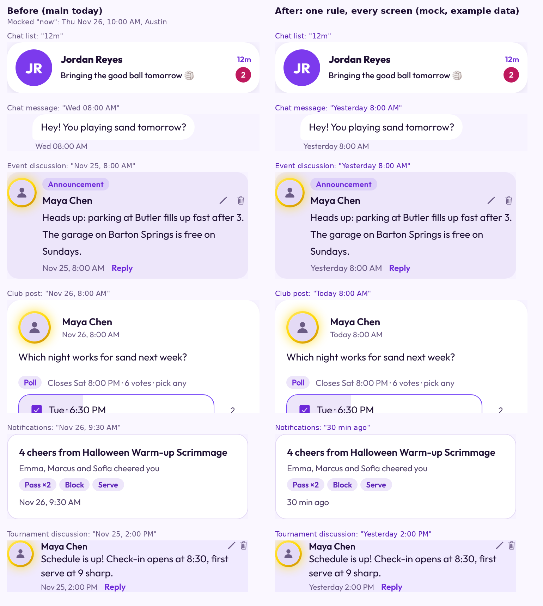
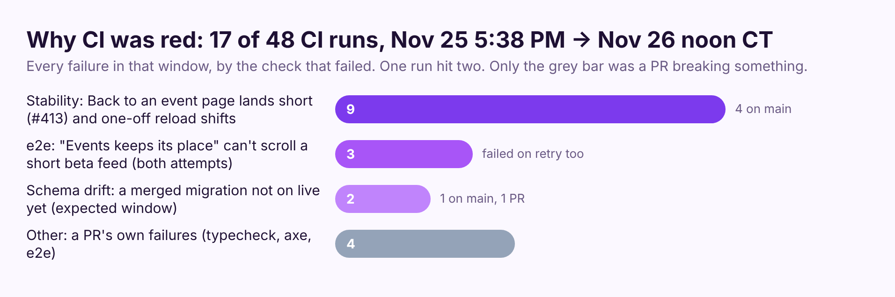
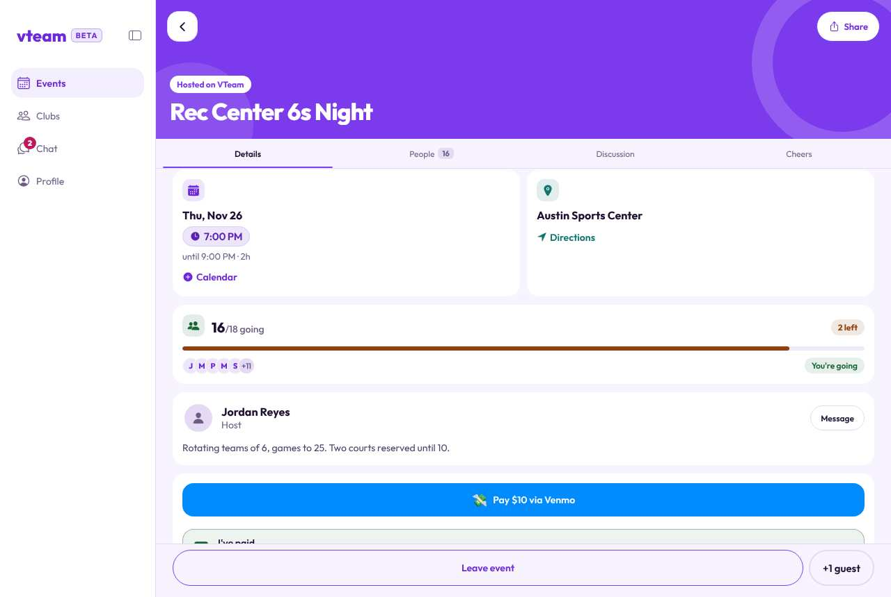
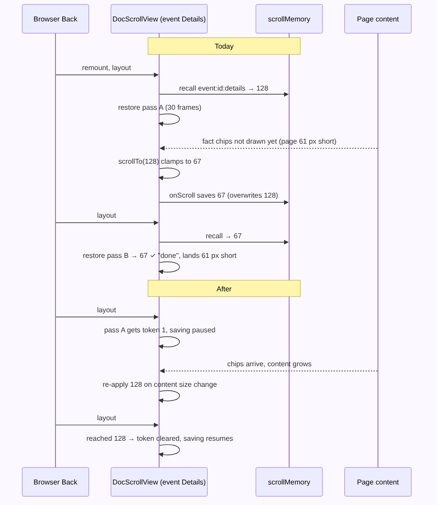
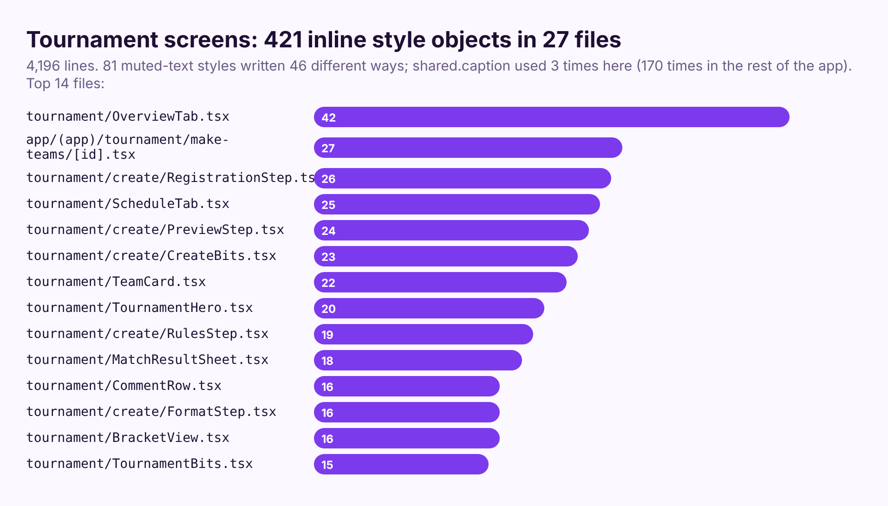

# vteam ideas: 2026-11-26

## Health check

Today's `main` (9a4d182d, after #405 Tournaments: Party invite layout), mocked export, phone 390×844 and desktop 1280×860, signed in and guest, with and without an 800 ms delay on every Supabase response. Full stability run (`scripts/shots/stability-flow.mjs --full`): **548 cases in 769 s, 1 finding (a known bug).** Plus the repo's UI consistency check over all `SCREENS` (188 screen × viewport pairs), a date-label scan of every screen, a muted-text style read on 9 screens, and a code scan for how delete and remove behave.

- **Tours:** passed. Intro tour from Profile and the Austin banner, every Events type and surface chip, from a link and saved: no gaps, spotlight on every step (128 cases).
- **Refresh and Back: 1 bug, already filed as #413.** Desktop, signed in, 800 ms delay: scroll the event page to 128 px, open a profile, Back → **67 px** (61 px short; `event:in:back:d800`). The same bug made **9 of the last 48 CI runs red** (4 of them on `main`). Idea 1 fixes its root cause. CI also caught three one-off reload shifts in the last day that didn't reproduce locally (event page CLS 0.139 phone / 0.084 desktop on Nov 26 03:06 UTC; Tournaments 0.017; Events 0.036).
- **Links:** passed (32 cases). **Raw route names:** passed (280 cases).
- **Still not checked:** 24 refresh/Back cases skip, as before (Clubs and Chat don't scroll with the fixtures; Tournaments has no child link partway down).
- **UX/UI: 5 inconsistencies.** The repo's UI check is clean beyond its baseline (back-control, screen-title, font-family, font-token, button-shape and page-overflow are all 0; 45 known phone tap targets under 44 pt remain). The worst of what it doesn't measure:
  - **"When" is written 5 ways, and 64 of 150 dates on screen have no weekday.** Chat list `12m`, chat bubble `Wed 08:00 AM` (leading zero, and "today" means "within 24 h", not the calendar day), event and tournament comments `Nov 25, 8:00 AM`, club posts `Nov 26, 8:00 AM` (its own copy of the comment formatter), notifications `Nov 26, 9:30 AM`. On the same club post card the poll says `Closes Sat 8:00 PM`. Idea 2.

  

  Further inconsistencies:
  - **Deleting what you wrote:** event and tournament comments ask "Delete comment?" (`confirmDestructive`); a chat message (`ReactionPicker` → `deleteMessage`), a tournament prize (`OverviewTab` → `deletePrize`) and your profile photo (`AvatarUploader` → `uploader.remove`) go on one tap with no confirm and no Undo.
  - **Muted text in tournament screens:** 81 inline muted-text styles written 46 ways (11, 12 and 13 px; regular, medium and semibold), `shared.caption` used 3 times there against 170 times elsewhere. Idea 3.
  - **Tab labels:** inactive tabs are 13 px on a tournament, 12 px on an event and a club page.
  - **Colour literals:** `ReactionPicker.tsx` falls back to `'#EF4444'` four times (`theme.colors.error ?? '#EF4444'`), the only hex left outside artwork, Venmo blue and image scrims.
  - **Copy:** admin metrics says "Kudos given"; everywhere players look it is "Cheers".
- **Data note (no action):** live `feed_first_paint` has 4 iOS rows reading ~7.7 days; they carry no `landing` or `app_version`, so they come from a native build older than #326, not today's code.

Nov 25 had a competitor-gap idea, so today has no new-feature or competitor idea. Today: the worst finding's fix as part of a CI-trust idea (testing), the date labels (end-user experience), and the tournament screens' styles (refactor).

---

## 1. A red check means this PR broke something

**Bucket:** testing · **Size:** M · Builds on #413 (approve → I add this design to #413 and build it there, plus one PR for the CI parts)

**Pitch:** In the last 26 hours 17 of 48 CI runs were red and only 4 of them were a PR breaking something. Fix the three causes: the event page's Back landing 61 px short (#413, a real bug players hit too), an e2e spec that needs beta's feed to be long, and the drift check failing in the minutes between a merge and its live migration.

**Why**
- **Measured:** CI runs Nov 25 5:38 PM → Nov 26 noon CT: 48 completed, 17 failed. Stability check 9 (4 on `main`; most often `event desktop back:not-restored 61`), `e2e/scrollRestore.spec.ts` "Events keeps its place" 3 (failed on its retry too, also on #394, #392 and #375 just before the window), schema drift 2 (merged PR's migration not on live yet: #399 on `main`, and a PR run during #366's window), other 4. One run hit two.

  

- **#413, root cause read from the code:** `DocScrollView`'s `handleLayout` starts a `restoreWhenReady` pass every time the view goes from hidden to shown, and the event Details tab is shown more than once while it loads. Passes overlap. One runs while the fact chips row isn't drawn (exactly 61 px short), `scrollTo(128)` clamps to 67, and `handleScroll` saves **67 over 128** because nothing stops saving during a restore. The next pass recalls 67, reaches it and reports done. Reproduced today locally (`event:in:back:d800`).

  

- **scrollRestore e2e:** it wheels the desktop feed 1,200 px and expects more than 100 px of scroll, and on phone scrolls to 900 px and expects more than 220. Both depend on how many games beta happens to have that day (the e2e account's events and the Schelagg import). When the feed is short the page can't scroll, and the retry fails the same way.
- **Drift:** `evaluate()` in `scripts/schema-drift.mjs` treats "merged, migration not on live" as an error right away. That window is expected for minutes after every schema PR merges, and the **Live schema ready** check (polls 3 h) and the Vercel gate already own it.

**User stories**
- As a player on desktop web, when I go Back to an event, I'm where I was, not 61 px up.
- As Bryan (or the agent driving a PR), a red check names something this PR broke, so I fix it instead of re-running.

**Acceptance criteria**
- [ ] `restoreWhenReady` returns a cancel function; `DocScrollView` keeps one restore at a time per view (a new pass for the same offset keeps the running one; a new offset cancels it).
- [ ] While a restore runs, `handleScroll` doesn't save; it saves again once the target is reached, the user scrolls (wheel, touch, key) or 1.5 s pass.
- [ ] A restore that is clamped re-applies when the content grows (`onContentSizeChange`), instead of giving up after 30 frames.
- [ ] Unit test (`__tests__/scrollMemory.test.ts`): two overlapping passes with a page 61 px short then full height end at 128, and memory still holds 128.
- [ ] Stability `event desktop back` (with and without delay) passes 20 of 20 local runs; CI's PR mode runs that case 3 times.
- [ ] `e2e/scrollRestore.spec.ts` Events cases create their own 8 games over the next 3 days in `beforeAll` (`eventsFixtures.ts`, `[e2e <tag>]` prefix, deleted in `afterAll`) and wait for the page to be at least two screens tall before scrolling.
- [ ] Drift: a merged PR whose migration isn't on live is a **notice** for 3 h after `merged_at` (the Live schema ready window), an error after that. The daily drift job and every other rule are unchanged.
- [ ] Over the 3 days after merge: no CI run red from these three causes (checked with the same tally script, kept in `scripts/ci-failures.mjs --since`).

**Design**
- `utils/scrollMemory.ts`: `restoreWhenReady(...)` gains `cancelled?: () => boolean` and returns `cancel()`; new pure `restoreState()` (target, token) used by the view. Unit-testable without a browser.
- `components/DocScrollView.tsx`: `restoring` ref holds `{ y, cancel }`; `handleLayout` reuses a running pass for the same `y`; `handleScroll` skips saving while `restoring.current`; `onContentSizeChange` re-applies. `hooks/useDocScrollMemory.ts` (document mode) gets the same guard so phone and desktop behave alike.
- How it flows, before and after:

  

- No visual change, no new screens. Native is untouched (DocScrollView memory is web-only).
- `scripts/schema-drift.mjs`: `evaluate({ …, mergedAt })` puts merged-not-on-live under `notes` while `now - mergedAt < 3 h`; `prStates()` already reads the PR, so `merged_at` costs no new request.
- `scripts/ci-failures.mjs` (small, `gh api` only): tallies failed CI runs by failing step and known test name, so the 3-day check and later health checks use the same numbers.

**Backend:** none.

**Test plan:** unit (`scrollMemory`, `schema-drift` evaluate with `mergedAt`), stability-flow `--only scroll` 20× locally, e2e `scrollRestore.spec.ts` in its existing shard, CI tally after 3 days.

**Pros and cons**
- Pros:
  - Fixes a bug players hit (Back on desktop lands short) along with the flake, from the cause the #413 notes pointed at.
  - About two thirds of the last day's red runs go away; a red check means something again, and auto-merge stops waiting on re-runs.
  - Removes the e2e spec's dependence on beta's data, the pattern other specs already follow.
  - Keeps every safety net: Live schema ready and the daily drift job still fail on a migration left off live.
- Cons:
  - Touches `DocScrollView`, used by every long screen: a mistake shows up everywhere (mitigated by the stability run, which covers 7 screens × 2 sizes × 2 viewers).
  - Pausing saves during a restore means a scroll made in the first moments of a restore is ignored until the user's own wheel/touch is seen.
  - 8 more beta events per run of that spec (deleted afterwards, but a cancelled run can leave them, as with other fixtures).
  - The drift notice window is a timer: a migration applied 3 h late still turns CI red then.
- **Verdict:** pros win clearly: it fixes a real bug and the most common false red at once, with small, tested changes.

**Risks / open questions:** whether the event Details tab should also reserve the chips row's height (the other fix #413 lists); left out unless the stability case still fails.
**Dependencies:** #413 (this is its design). #414 touches the drift fingerprint, not `evaluate()`; no conflict.

---

## 2. Every "when" reads the same: Today 8:00 AM, Yesterday, Mon, Sat, Nov 14

**Bucket:** end-user-experience · **Size:** S

**Pitch:** Chat, comments, club posts and notifications each write the time something happened their own way, and most leave out the weekday. One label, used everywhere: `now`, `12 min ago`, `Today 8:00 AM`, `Yesterday 2:00 PM`, `Mon 10:00 AM`, `Sat, Nov 14`.

**Why**
- **Measured today** (every `SCREENS` entry on phone): 150 dates on screen, **64 without a weekday**; outside admin, Terms and leagues' ranges they are all "when was this written" stamps: event discussion 5/5, tournament discussion 3/4, club posts 4/4, notifications 8/8, the program sheet's "checked Nov 26", tournament announcements.
- **Five formatters for one job:** `timeAgo` (`utils/chatUtils.ts`: `12m`, `3h`, `2d`, `Nov 14`), `formatTime` in `components/MessageBubble.tsx` (`08:00 AM`, `Wed 08:00 AM`, `Nov 14`; "today" means within 24 h, so last night 11 PM reads as a time today), `formatCommentTime` (`utils/index.ts`, 7 callers), `formatPostTime` (`components/ClubPostCard.tsx`, a copy of it), `formatShortTime` (`utils/notificationUtils.ts`).
- **Bryan's rule:** every date shows its day of the week, and less reading. "Yesterday 8:00 AM" needs no date math; "Nov 25, 8:00 AM" does.

**User stories**
- As a player reading a club post or a comment, I can tell at a glance whether it was this morning, yesterday or last week.
- As a player scanning chat and notifications, the same moment is written the same way on both.

**Acceptance criteria**
- [ ] One pure `whenLabel(iso, now, form)` in `utils/dateFormat.ts`, calendar days in the viewer's zone:
  - `full` (under a message, comment, post, notification): under 1 min `Just now`; under 1 h `12 min ago`; same day `Today 8:00 AM`; previous day `Yesterday 2:00 PM`; within 6 days `Mon 10:00 AM`; older `Sat, Nov 14`; another year `Sat, Nov 14, 2025`.
  - `short` (chat list, where the row is narrow): `now`, `12m`, `9:30 AM`, `Yesterday`, `Mon`, `Sat, Nov 14`.
- [ ] Used by chat list, chat bubbles, event and tournament comments, club posts and comments, notifications, tournament announcements and the program sheet's "checked"; `formatPostTime`, `formatShortTime`, `MessageBubble.formatTime` and `timeAgo`'s date branch are deleted.
- [ ] Times have no leading zero (`8:00 AM`), as on event cards (`TimePill`).
- [ ] The date scan (kept as `scripts/shots/lib/dateLabels.mjs` and run by the UI check as a `date-weekday` rule) finds 0 player-facing dates without a weekday or Today/Yesterday; admin metrics and legal text are listed exceptions.
- [ ] `__tests__/whenLabel.test.ts` covers each band, midnight and DST edges in four time zones (`npm run test:tz`, `__tests__/helpers/clock.ts`).
- [ ] Labels go through the cached formatters (`utils/dateFormat`, #342); `noAdHocDateFormat.test.ts` stays green.
- [ ] Matches the existing poll line ("Closes Sat 8:00 PM") and event cards in weekday style.

**Design**
- `utils/dateFormat.ts`: `whenLabel` (pure, `now` passed in so tests and the shots clock agree). Callers pass `Date.now()` at render; lists already re-render on new data, so no ticking timer (a label may say "12 min ago" for a while, as chat's `12m` does today).
- Files: `utils/chatUtils.ts`, `components/MessageBubble.tsx`, `utils/index.ts` (`formatCommentTime` becomes a wrapper, then its 7 callers move), `components/ClubPostCard.tsx`, `utils/notificationUtils.ts`, `components/programs/ProgramSheet.tsx`, `components/tournament/CommentRow.tsx`.
- Same text style as today (`shared.caption` sizes stay); no layout change; works the same on native, phone web and desktop. Guests see the same labels where they can read comments.
- Accessibility: the full date and time stays available as `accessibilityLabel` ("Wednesday, November 25, 8:00 AM") so screen readers aren't left with "Yesterday".

**Backend:** none.

**Test plan:** unit `whenLabel` (bands, zones, DST), UI consistency `date-weekday` rule with baseline 0 for player screens, `shots:compare` for the 7 screens (stamps only change), e2e: `chat.spec.ts` and the comment specs look for message text, not stamps (checked).

**Pros and cons**
- Pros:
  - Fixes 64 dates without a weekday across 7 kinds of screen in one change, matching Bryan's "every date shows its day".
  - Less reading: "Yesterday 8:00 AM" instead of working out what Nov 25 was.
  - Four formatters deleted; fixes chat's "today means 24 h" mistake.
  - The date-weekday rule keeps new screens consistent.
- Cons:
  - Relative labels go stale on a screen left open (fine for minutes and days; "12 min ago" can be an hour old until the next render).
  - A wider label ("Yesterday 2:00 PM") on narrow rows; the chat list uses the short form for that reason.
  - Changes text in screenshots and any e2e or a11y baseline that captured a stamp.
- **Verdict:** pros win: small, pure, testable, and it's a visible consistency fix on screens players read every day.

**Risks / open questions:** should notifications older than a week drop the time (just `Sat, Nov 14`)? Proposed: yes, as above.
**Dependencies:** none.

---

## 3. Tournament screens on the stylesheet: 421 inline styles into `ts`

**Bucket:** refactor · **Size:** M (4 PRs, after #409 and #412 merge)

**Pitch:** The tournament screens are the most-changed part of the app this month and the least consistent in code: 421 inline style objects, 348 hard-coded spacing numbers and muted text written 46 ways. Move them into `components/tournament/tournamentStyles.ts` (`ts`) and `shared.*`, screen-identical first, then one pass that puts muted text on the app's three caption roles.

**Why**
- **Counts** (`components/tournament/**`, `app/(app)/tournament/**`: 27 files, 4,196 lines): 421 `style={{…}}` objects; 348 literal gap, margin and padding numbers against 27 uses of `theme.spacing`; 31× `style={{ flex: 1 }}`; the same 3-property caption written out 10 times.

  

- **Inconsistency it causes:** 81 muted-text styles in 46 variants (11/12/13 px, three weights); `shared.caption` is used 3 times here and 170 times elsewhere. Inactive tab labels are 13 px here and 12 px on events and clubs.
- **Churn:** 10 commits to these files this month, and #401/#402/#404/#409/#412 are all tournament work; each new screen copies the nearest inline style. #360 did the same move for event cards (65 inline styles) with zero screenshot diffs.
- **Speed:** inline objects are new every render; the schedule and teams tabs render a row per match and team.

**User stories**
- As a player, tournament pages look like the rest of vteam (same captions, same tab labels).
- As whoever builds the next tournament feature, there's a named style to reach for instead of a copied object.

**Acceptance criteria**
- [ ] PRs 1–3 (pure moves, grouped: Overview + Hero + TeamCard; Schedule + Bracket + MatchResultSheet + CommentRow; create wizard + make-teams): every inline style with only constant values moves to `ts.*` or an existing `shared.*`; `shots:compare` shows **zero changed screens** for each.
- [ ] Spacing numbers become `theme.spacing` where a token equals them; others stay as named `ts` entries (no pixel changes in PRs 1–3).
- [ ] PR 4: muted text uses `shared.caption` (12), `shared.captionStrong` or a new `shared.meta` (11, for "Starts / Reg. closes" labels); tournament tab labels match event tabs (12 px). Before/after crops of each changed screen in the PR.
- [ ] Remaining inline styles are only ones that depend on props or state (e.g. team colour), ≤ 60 in total.
- [ ] A unit test in the style of `textSizeFloor.test.ts` counts `style={{` in these folders and fails above the new count (shrink-only).
- [ ] UI consistency, a11y and stability baselines unchanged by PRs 1–3.

**Design**
- `components/tournament/tournamentStyles.ts` grows from 29 lines into sections per screen; anything used outside tournaments (rows, chips) goes to `constants/styles.ts`.
- Starts after #409 and #412 merge (they change 15 tournament files), one PR at a time, each merged before the next starts, so no tournament feature PR has to rebase across all four.
- No routes, data or behaviour change; native, phone web and desktop render the same styles.

**Backend:** none.

**Test plan:** typecheck, unit tests, `npm run shots:compare -- --before main --after HEAD` on the 11 tournament `SCREENS` entries (zero diffs for PRs 1–3), UI consistency (`font-token` stays 0), the new inline-style count test.

**Pros and cons**
- Pros:
  - The most active feature area gets the same captions and tab labels as the rest of the app.
  - Future tournament screens reuse named styles; reviewers read layout, not repeated objects.
  - Zero-diff PRs make it safe to review: the screenshots prove nothing moved.
  - Fewer objects per render on long match and team lists.
- Cons:
  - Has to wait for #409 and #412 and will still touch files Bryan is working in; any parallel tournament PR rebases once.
  - No new capability for players; only PR 4 is visible, and only slightly.
  - Four PRs of review time for a code-health gain.
  - `ts` becomes a long file (it may need splitting per screen later).
- **Verdict:** worth it, sequenced after the open tournament PRs: the area is growing fast, and every week of copying inline styles makes it harder.

**Risks / open questions:** land PR 4 (visible caption change) or keep the exact sizes? Proposed: land it, with crops.
**Dependencies:** after #409, #412.
