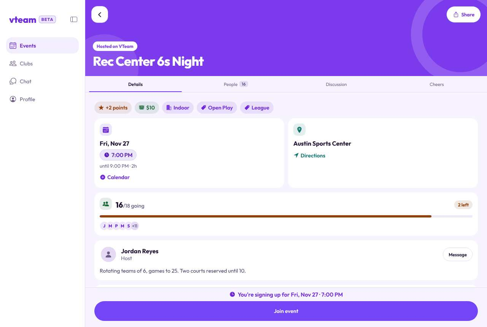
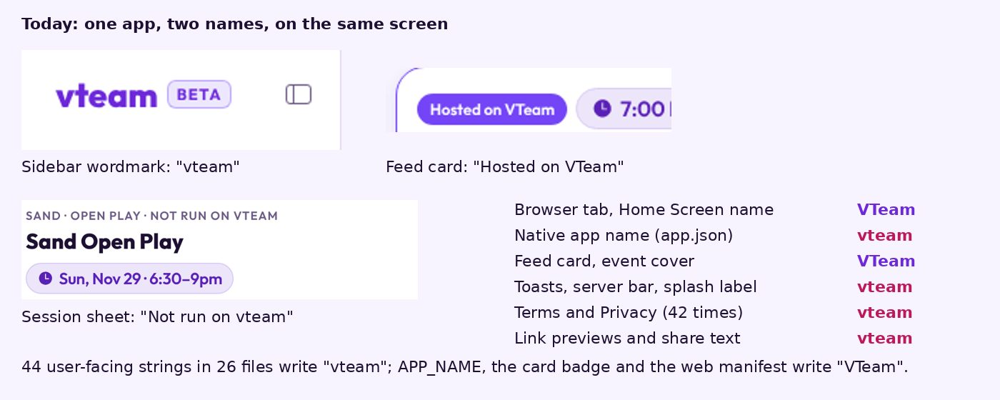
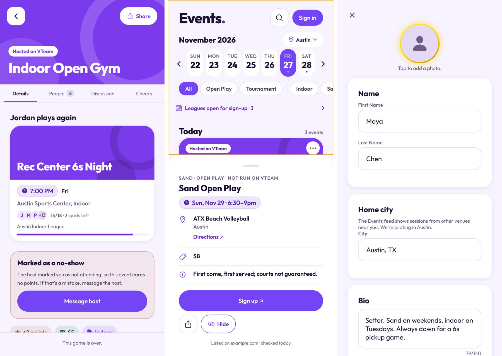
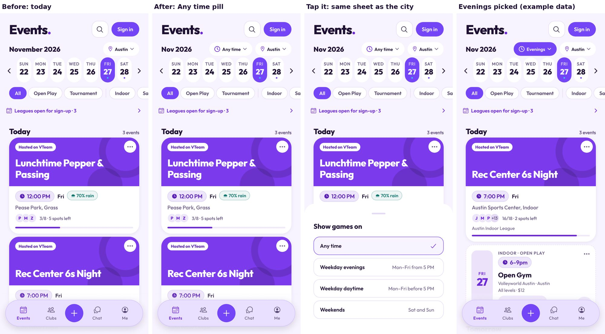
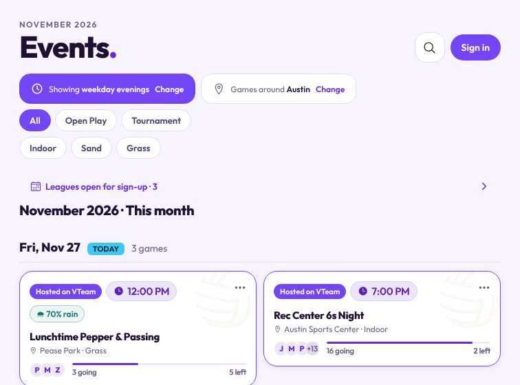

# vteam ideas: 2026-11-27

## Health check

Today's `main` (5ac0f59, after #418 static tab title), mocked export, phone 390×844 and desktop 1280×860, signed in and guest, with and without an 800 ms delay on every Supabase response. Full stability run (`scripts/shots/stability-flow.mjs --full`): **554 cases in 806 s, 3 findings.** The repo's UI consistency check over all `SCREENS` (192 screen × viewport pairs), a first-screen measurement on Events, a code scan, and a look at CI and job health.

- **Tours:** passed (every Events type and surface chip, from a link and saved, intro from Profile and the Austin banner).
- **Refresh and Back: #413 now fails every time.** Desktop, signed in: event page scrolled to 128 px, open a profile, Back → **67 px**, with and without delay. It failed in 2 of 2 local PR-mode reruns, and it made **4 of the last 6 CI runs on `main` red** (Nov 27 00:20, 00:58, 01:41, 16:52 UTC). The full run also saw a guest variant once (left at 97 px, came back at **0 px**), which didn't reproduce in the reruns. The fix is yesterday's idea 1 (waiting for your review), so it isn't proposed again; approving it turns CI green again.

  
- **Links:** passed. **Raw route names:** passed.
- **4 screens never reach the state they are named for, and every check passes them anyway.** In today's CI run on `main` and locally, `events-feed-link`, `events-session-sheet`, `event-past-recap` and `profile-edit-link` (7 screen × viewport pairs) log "ready text not found", and the screenshots, axe and the UI check judge whatever was on screen. One of them hides a real gap: **"Also on" is missing from outside session sheets on phones in the last week of every month.** Idea 1.
- **Job health has been red 4 runs in a row** (Nov 26 03:47 → Nov 27 13:11 UTC). Live is all green; all 5 failures are on **beta** (`sample-app-online` 56 failed runs in 24 h, `new-game-alerts` 10, `event-reminders` 8, `award-event-points` 3, `prune-rate-limits` 3). Most likely these are runs from before #414 slowed beta's timers (merged Nov 27 00:20 UTC); they leave the 24-hour window around 00:30 UTC Nov 28. I couldn't confirm it: this session's Supabase connection has no access to beta's organization. If the first job-health run after that is still red, run `scripts/beta-cron-schedules.sql` on beta (prompt in the review page).
- **UX/UI: 4 inconsistencies.** The repo's UI check: 192 judged, 0 new, 0 fewer than the baseline. Beyond what it measures:
  - **The app has two names.** "Hosted on VTeam" on feed cards and the event cover, `VTeam` in the browser tab and Home Screen name, and **"vteam" in 44 other strings in 26 files** (toasts, the server bar, the splash label, the session sheet's "Not run on vteam", share text, link previews, Terms and Privacy 42 times, the native app name). Desktop shows the "vteam" wordmark and "Hosted on VTeam" side by side. Idea 3.

    
  - **Colour literals:** `ReactionPicker.tsx` still falls back to `'#EF4444'` 4 times; `notifications.tsx:120` gives badge notifications a `'#FFD700'` border with no token.
  - **Copy:** admin metrics still says "Kudos given"; players see "Cheers".
  - **First screen on phones:** a guest sees one full card (the first starts at 327 px of 844; cards are 253–274 px tall); signed in, the first card starts at 476 px. Not a bug, noted as context for idea 2 (which adds no height).
- **Usage (live, last 14 days, crawlers left out):** 36 people, 150 sessions; 45 of 55 guest sessions and 56 of 94 signed-in sessions opened one screen. Feed first paint p50 239 ms from the device copy, 966 ms on a first visit.
- **Checked and dropped:** a latency idea. A CPU profile of a guest's first visit (4× CPU) put ~8% of script time in react-native-web compiling styles, so I built a test export that compiles the 570 shared styles lazily: first card 2,973/2,969 ms eager vs 2,975/2,910 ms lazy (median of 7, twice, interleaved). Within noise, so not proposed. Live's slowest database work is Realtime's change polling (55 s a day in total), also too small to matter.

Nov 26 had no new-feature or competitor idea, so today has one (idea 2). Today: the screen-check fix (testing), a "when can you play" filter (competitor gap), and one app name (end-user experience).

---

## 1. Screens that prove what they show: a shots screen that never gets ready fails, and the four stale ones are fixed

**Bucket:** testing · **Size:** M · Different from 2026-11-16's "No silent skips" (stability cases); this is the `SCREENS` harness that screenshots, axe and the UI check share.

**Pitch:** Four screens in `scripts/shots/screens.mjs` never reach their ready text, so every check has been judging the wrong state. Make a missed ready state an error, fix the four, and fix the real gap one of them found: "Also on" disappears at the end of each month on phones.

**Why**
- **Measured:** CI run 46037266703 (main, Nov 27) and today's local run both log `ready text not found` for 7 screen × viewport pairs, then report "UI consistency: 192 judged, 0 new". `visitScreen` in `scripts/shots/capture.mjs` records `result.ready = false` and carries on; no caller looks at it.

  

- **`event-past-recap`** (left): the viewer is marked a no-show on `E.pastIndoor`, the same event `event-details-noshow` uses (#151), so the screen shows "Marked as a no-show" and **the recap card (#227, "Your game") has had no screenshot, axe or UI coverage**.
- **`events-session-sheet`** (middle): no "Also on". On phones the feed loads only the months of the current week (`feedSpanArgs` in `utils/feedFirstSpan.ts`), so from Nov 22 to Nov 30 the next weekly session (Dec 4) isn't loaded, and `alsoOn()` only looks at loaded rows. **A real gap for players:** in the last week of every month, phones never show next month's dates in "Also on" (desktop loads 4 months and is fine). The check passes earlier in the month, so it depends on the date the run happens.
- **`events-feed-link`**: ready text "Lunchtime Pepper" is a grass open-play game, which `?type=tournament&surface=sand` hides.
- **`profile-edit-link`** (right): ready text "Maya" is an input's value, which `getByText` never matches.

**User stories**
- As a player on a phone looking at an outside session on Nov 28, I see "Also on Fri, Dec 4", like I would on Nov 10.
- As Bryan, a green axe, UI or screenshot check means each screen was checked in the state its name says.

**Acceptance criteria**
- [ ] `visitScreen` pushes `ready text not found: "<text>"` into `result.errors` when a screen's `ready` doesn't appear; `a11y.mjs`, `ui-consistency-flow.mjs`, `alignment-flow.mjs` and `capture.mjs` exit 1 on any such error, naming the screen and viewport in the job summary.
- [ ] `SCREENS` entries may use `readyTestId` (a `testID` that must be visible) instead of `ready` text; `profile-edit-link` uses the first-name input's.
- [ ] `event-past-recap` gets its own past game where the viewer attended and wasn't flagged (`E.pastRecap`), and shows "Your game".
- [ ] `events-feed-link` waits for something that filter does show (a sand tournament fixture in the current week).
- [ ] "Also on": when the loaded feed ends less than 4 weeks after the session, the sheet reads up to 3 later dates for the same `source_id`, title and venue (one `external_sessions` read, anon SELECT already allowed, cached `STALE.feed`), merged with the loaded rows. Phones show the same "Also on" as desktop on every day of the month.
- [ ] A nightly run of `capture.mjs --all` at two fixed clocks (the 10th and the 28th of a month, `--now`) catches anything else that depends on the date.
- [ ] All `SCREENS` reach their ready state in CI (0 errors), and the a11y and UI baselines are refreshed for the screens that now show their real state (counts only move with a note in the PR).

**Design**
- `scripts/shots/capture.mjs`: `visitScreen` error on a ready miss; `readyTestId`; `--now <iso>` passed into `defaultNow`. `scripts/shots/screens.mjs`: the four entries. `scripts/shots/fixtures/index.mjs`: `E.pastRecap`, a sand tournament this week.
- `hooks/useOutsideSessionSheet.tsx` + new `hooks/useAlsoOn.ts`: `alsoOnNeedsRead(sessionStart, loadedEnd)` (pure, in `utils/outsideSession.ts`) decides the read; `alsoOn()` unchanged, run over loaded + read rows. Same sheet, same "Also on" rows: nothing new on screen.
- `.github/workflows/stability-nightly.yml` gets the two-clock capture step (no new workflow).

**Backend:** none (a read the anon policy already allows).

**Test plan:** unit (`alsoOnNeedsRead`, merge and dedupe with loaded rows), the harness itself on the mocked export at the two clocks, `e2e/` unchanged.

**Pros and cons**
- Pros:
  - Closes a gap players hit every month on phones, found by the checks themselves.
  - The recap card gets screenshot, axe and UI coverage again (it has had none since #151's fixture).
  - A green check means the screen was in the right state, so the next stale `ready` fails the PR that caused it instead of hiding for weeks.
  - Small and mechanical: one harness rule, four entries, one read.
- Cons:
  - The first runs after it may fail on screens whose ready text drifted elsewhere (that is the point, but it costs a fix-up PR).
  - The a11y and UI baselines move for the screens that now show their real state; those PRs need a line explaining it.
  - One more request when a phone opens a sheet near month end (cached, only then).
  - A nightly step adds about 4 minutes to the nightly job.
- **Verdict:** worth it: it fixes a monthly player-facing gap and makes three existing checks trustworthy, for a small change.

---

## 2. Games when you can play: a "When" pill on Events

**Bucket:** competitor-gap · **Size:** S–M

**Pitch:** One pill next to the city: Any time, Weekday evenings, Weekday daytime or Weekends. The feed, calendar dots and week strip show only games that fit, and the link carries it (`/?when=weekend`). The same three buckets players already pick for new game alerts.

**Why**
- **Competitors:** Meetup added time filters to search, and later a "Starting soon" filter, so people see only events they can make ([New Search Filters on Meetup](https://www.meetup.com/blog/new-search-filters-on-meetup/), ["Starting Soon" filter](https://www.meetup.com/blog/why-the-new-happening-now-search-filter-is-a-game-changer/)). Playtomic's match model leaves filling to sharing links ([match model](https://help.playtomic.com/en/articles/5713889-a-general-overview-the-match-model)); a time filter is the cheaper half of "find a game I can make".
- **vteam already has the buckets:** `GAME_ALERT_TIME_BUCKETS` (`constants/gameAlerts.ts`) and `game_alert_matches()` (weekday evenings from 5 PM, Chicago). Today they only filter alerts, not the feed people look at.
- **Live:** 17 outside sessions in Austin in the next 7 days (a holiday week), 15 of them starting at 5 PM or later. 10 of 36 people changed a feed filter in the last 14 days, so the filters are used. Desktop shows 4 months of games, where "Weekends" is a real cut.
- **No extra height:** it sits in the row the city pill already uses, so the first card stays at 327 px on a guest's phone (Bryan's "clean until needed": one pill, choices in a sheet).

**User stories**
- As a player with a day job, I pick Weekday evenings once and the feed, calendar and week strip show only games I can make, on every visit.
- As a player, I share `/?when=weekend` with a friend and they see the same list.
- As a guest, it works without an account (saved on the device like the other filters).

**Flow (phone)**
1. Events shows "Any time" next to "Austin".
2. Tap it: the same sheet as the city, with four rows (Any time ✓, Weekday evenings · Mon–Fri from 5 PM, Weekday daytime · Mon–Fri before 5 PM, Weekends · Sat and Sun).
3. Pick Weekday evenings: the sheet closes, the pill turns purple and reads "Evenings", the address becomes `/?when=weekday_evening`, and day headers count only evening games.
4. A day with none says so, with "Show all times" (the existing empty-day pattern).

Desktop: a second pill beside "Games around Austin · Change", in the same style:

**Acceptance criteria**
- [ ] `VIEW.feed.when`: `oneOf(['any', 'weekday_evening', 'weekday_day', 'weekend'], 'any')`; the default stays out of the URL; a link's value shows for that visit only, like `type` and `surface`.
- [ ] `StoredFeedFilters` gains `when`; `parseFeedFilters` drops unknown values (old saved filters keep working).
- [ ] Pure `matchesWhen(startsAt, when)` in `utils/feedWhen.ts` uses the same rule as `game_alert_matches()` in `EVENT_TIME_ZONE` (5:00 PM is evening, 4:59 PM is daytime, Saturday and Sunday are weekend); labels from `GAME_ALERT_TIME_BUCKETS`.
- [ ] Applies to vteam games, outside sessions and outside tournaments (a multi-day tournament fits if any of its days does), calendar dots and week-strip dots. Games you're going to or hosting still show, as with hidden items.
- [ ] Matches the city pill in look (same pill, icon size, chevron, 44 pt target) and the city sheet in behaviour (`BottomSheet`, same row component, ✓ on the current one, closes on pick).
- [ ] `feed_filter_changed` with `filter: 'when'` (not on restore).
- [ ] Works on phone web, desktop web and native; text fits at Extra large on a 320 px phone (the month label may shorten to "Nov 2026" there).

**Design**
- New `components/events/FeedWhen.tsx` (`FeedWhenPill`, `FeedWhenSheet`) built from `FeedCity.tsx`'s pill and rows; rendered beside `FeedCityLine` in `EventsHeader.tsx` (phone) and the desktop header row.
- `app/(app)/(tabs)/(main)/index.tsx` reads `useUrlParam('when', VIEW.feed.when)` with the tab rule (`{ tab: 'events' }`); the filter runs where type and surface already run (`utils/feedSections.ts` / `utils/feedDays.ts`), so `EventsFeedMobile` and `EventsFeedDesktop` need no change.
- `constants/copy.ts`: `FEED_WHEN_COPY` (pill labels: Any time, Evenings, Daytime, Weekends).
- `e2e/tour.guest.spec.ts`: add a `when=weekend` filter state (the tour must not skip a step under it).
- No backend.

**Test plan:** unit (`matchesWhen` with DST days via `__tests__/helpers/clock.ts`, `parseFeedFilters`, URL codec), `LINK_CASES` entry (required per `VIEW` key), `SCREENS`: `events-feed-when` and `events-feed-when-sheet`, `e2e/shareableLinks.guest.spec.ts` case, tour spec filter state.

**Pros and cons**
- Pros:
  - Answers "what can I make?" in one tap, saved for next time, with no account.
  - Reuses the alert buckets, so a player's alert filter and feed filter mean the same thing.
  - Shareable link and no extra height on the first screen.
  - No backend, no new data, all pure logic that is easy to test.
- Cons:
  - With 17 outside games a week, a filter can make the list look thin; the empty-day line has to make "Show all times" obvious.
  - One more saved filter to forget about ("why don't I see Saturday games?"); the pill must read clearly when it's on.
  - The phone header gets tighter (month, two pills); at Extra large text it may need the short month label.
  - Fixed buckets: someone free Tuesday 7 PM only isn't served exactly.
- **Verdict:** worth it as a small build: clear player value, no new data or backend, and it reuses existing buckets and components.

---

## 3. One name everywhere: VTeam (or vteam), never both

**Bucket:** end-user-experience · **Size:** S

**Pitch:** The app calls itself "VTeam" on cards, the event cover, the browser tab and the Home Screen, and "vteam" in 44 other strings, Terms and Privacy, link previews and the native app's name. Pick one (#367 chose VTeam), put every sentence on `APP_NAME`, and add a test so a third spelling can't come back.

**Why**
- **Measured:** 44 user-facing string literals in 26 files write "vteam" (14 in `constants/copy.ts`; also `UpdateRequiredScreen`, scorekeeper, tournaments, leagues, share text, the splash's accessible label); `constants/legal.ts` 42 times; `api/` link previews 20; `app.json` `name: "vteam"`. `APP_NAME = 'VTeam'` (since #345), `HOSTED_ON_VTEAM` (#367) and `public/manifest.webmanifest` say "VTeam". On desktop the sidebar wordmark reads "vteam" above cards that say "Hosted on VTeam" (image in the health check).
- A player who adds vteam to their Home Screen sees "VTeam" under the icon and "vteam" in the app's own messages.

**User stories**
- As a player, the app's name is spelled the same on every screen, in shared links and in the Terms I agree to.

**Acceptance criteria**
- [ ] Bryan picks the spelling (default: **VTeam**, as #367 chose; the logo wordmark is artwork and stays as drawn).
- [ ] Every user-facing string builds the name from `APP_NAME` (`constants/copy.ts`), including `legal.ts`, share text (`utils/eventShare.ts`, `utils/outsideShare.ts`), link previews (`api/`), the splash's accessible label and `UpdateRequiredScreen`.
- [ ] `app.json` `name` and `public/manifest.webmanifest` match `APP_NAME` (a unit test reads both).
- [ ] `__tests__/appName.test.ts` fails on a string literal containing `vteam` / `VTeam` / `Vteam` as a word in `app/`, `components/`, `constants/`, `utils/`, `hooks/`, `lib/`, `api/`, except identifiers, URLs, storage keys (`vteam.*`), domains and the `APP_NAME` definition itself.
- [ ] `TERMS_VERSION` is not bumped (the name's spelling isn't a material change), unless Bryan says otherwise.
- [ ] Screens with the name (`events-feed`, `event-details`, `terms`, `privacy`, splash) look the same apart from the spelling in `shots:compare`.

**Design**
- Text only: no layout, component or token change. `api/` already may import `constants/copy` only if it stays free of React Native (it is; the unit test that checks `api/` imports covers it).
- Native app display name changes with the next store build; web changes on deploy.

**Test plan:** the new unit test, the existing `api/` import test, `shots:compare` on the screens above.

**Pros and cons**
- Pros:
  - The app reads as one product; the name players type and share is the one they see.
  - Ends the drift for good: one constant and a test.
  - Small, text-only, easy to review.
  - Settles a brand question before marketing (the Nov 7 plan's posts and videos) uses either spelling.
- Cons:
  - Needs Bryan's call on the spelling first; the docs and marketing plan say "vteam".
  - Touches Terms and Privacy wording, which some people prefer to change only with a version bump.
  - The native app's Home Screen name changes only with the next store build, so web and native differ until then.
  - The test needs an allowlist for ids and URLs, which will need occasional upkeep.
- **Verdict:** worth it: a small, low-risk change that removes the most visible copy inconsistency left, once the spelling is decided.
