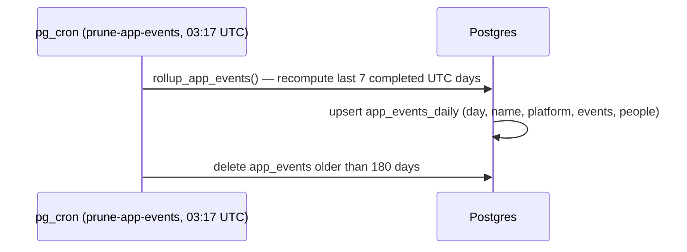

Big landing day: points, ads and the 100-point ad-free pass, event reminders with push for every notification, "I've paid" for paid events, club home courts, and Terms acceptance tracking all merged, and every migration is on live with types regenerated.

## Shipped

**Features**

- Points: players who stay on as attending get 2 points (open play) or 5 (tournament) up to ~15 minutes after the event ends; tournament team members get 5 when it completes. A new Points stat shows on your own and other players' profiles (#100)


```mermaid
sequenceDiagram
  participant Cron as pg_cron (award-event-points, :07/:22/:37/:52)
  participant Fn as award_event_points() (definer)
  participant DB as Postgres
  participant App as App (profile)
  Cron->>Fn: run
  Fn->>DB: ended, non-cancelled events: attendees still attending<br/>(5 if tagged Tournament, else 2); completed tournaments: approved team members (5)
  Fn->>DB: insert point_events (ON CONFLICT DO NOTHING)
  DB->>DB: AFTER INSERT trigger apply_point_event() updates point_balances
  App->>DB: usePointsBalance: select point_balances (anon readable)
```

| Object | Change | Notes |
| --- | --- | --- |
| `point_events` | added | append-only ledger; owner SELECT only, no client writes; unique per user+event/tournament+reason |
| `point_balances` | added | per-user total, `balance >= 0`; readable by everyone incl. guests |
| `apply_point_event()` + trigger | added | keeps balances in sync; no client EXECUTE |
| `award_event_points()` / cron `award-event-points` | added | idempotent; every 15 min; no client EXECUTE |

- Ads: house banners and sponsored events in the Events feed. The soonest sponsored event gets a promoted slot after the 2nd item, a banner goes after the 5th and then every 10th; sponsored events also keep their date slot with a "Sponsored" label. Admin-managed via SQL for now (#101). No ad rows exist in the screenshot fixtures, so nothing ad-related shows below.

| Object | Change | Notes |
| --- | --- | --- |
| `ad_banners` | added | title, body, https image/link, active window; everyone reads rows in window; admin-only writes |
| `sponsored_events` | added | event + window; same read/write rules; separate table so hosts can't self-sponsor |
| `current_user_is_admin()` | added | definer check of `profiles.is_admin`; signed-in EXECUTE |

- Go ad-free: Profile → Go ad-free spends 100 points for 30 days without ads (renewing extends from the current end date); disabled with "You need N more points" when short (#103)

```mermaid
sequenceDiagram
  participant App as App (Settings → Go ad-free)
  participant RPC as redeem_ad_free() (definer)
  participant DB as Postgres
  App->>RPC: rpc redeem_ad_free()
  RPC->>DB: per-user advisory lock; lock point_balances row FOR UPDATE
  alt balance < 100
    RPC-->>App: ok false, insufficient_points
  else
    RPC->>DB: insert point_events (-100, redeem_ad_free)
    RPC->>DB: upsert ad_free_passes.ad_free_until (+30 days from max(now, current))
    RPC-->>App: ok true
  end
  App->>DB: get_ad_free_status() → useAdsEnabled() hides all ad surfaces
```

| Object | Change | Notes |
| --- | --- | --- |
| `ad_free_passes` | added | `user_id → ad_free_until`; owner SELECT only, no client writes |
| `ad_free_offer()` | added | price source: 100 points / 30 days; anon + signed-in |
| `get_ad_free_status()`, `redeem_ad_free()` | added | signed-in only |

- Event reminders and push for every notification: players get an inbox row and push 1h / 2h / day before events they're going to (Settings → Notifications → Reminders), every notification type is now pushed via a new edge function, tapping a push opens its link, and hosts get a "dropped out" notice when an attending player leaves within 24h (#132, with #152 enabling `pg_net` for the webhook)


```mermaid
sequenceDiagram
  participant Cron as pg_cron (event-reminders, every 10 min)
  participant DB as Postgres
  participant WH as DB webhook (notifications INSERT)
  participant Edge as send-notification-push
  participant Expo as Expo Push API
  participant App as App (native)
  Cron->>DB: send_event_reminders()
  DB->>DB: attending, within lead time, not cancelled, no event_reminder_log row
  DB->>DB: insert event_reminder_log + notifications (event_reminder)
  Note over DB: AFTER DELETE on event_attendees within 24h → late_dropout to host + co-hosts
  DB-->>WH: INSERT on notifications (any type)
  WH->>Edge: POST row
  Edge->>DB: notification_prefs.push.<type>, push_tokens
  Edge->>Expo: title, body, data.deep_link (chat_mention skipped)
  Expo-->>App: push; tap → isAppPath → open deep link
```

| Object | Change | Notes |
| --- | --- | --- |
| `notifications_notification_type_check` | changed | adds `event_reminder`, `late_dropout` |
| `user_settings.reminder_lead_minutes` | added | 60 / 120 / 1440, default 120; owner-only like the rest of the row |
| `event_reminder_log` | added | dedupe; RLS on, no client access |
| `event_reminder_text()`, `send_event_reminders()` | added | definer; no client EXECUTE |
| `notify_host_on_late_dropout()` + trigger on `event_attendees` | added | best effort, never blocks a leave |
| `events_event_date_idx` | added | partial index for the reminder scan |
| cron `event-reminders` | added | every 10 min |
| extension `pg_net` (#152) | added | needed by Database Webhooks |
| edge function `send-notification-push` | added | honours per-type push prefs |

- "I've paid": on paid events, attendees can tick "I've paid" under the Venmo button; hosts and co-hosts see Paid pills and an "N of M marked paid" count on People. Free events show none of this (#115)


| Object | Change | Notes |
| --- | --- | --- |
| `event_payments` | added | `(event_id, user_id, paid_at)`; read by self + event creator/co-hosts; insert self only on paid events while on the roster; delete own; no anon; cleared when the RSVP is removed |

- Club home court: club create/edit gets an optional "Home court" Places search (curated venues as quick picks) that pre-fills the metro, and the club page shows a Home court card with "Open in Maps" (#116)


| Object | Change | Notes |
| --- | --- | --- |
| `clubs.location_name`, `location_address`, `latitude`, `longitude`, `place_id` | added | nullable, with range/length checks; existing club RLS applies |

**Fixes**

- Scroll position on web: going back to Profile, Clubs or the Events feed (including the iPhone browser swipe-back) now lands where you were instead of the top (#154)
- Native apps: swipe-back and swiping between tabs are off (they kept navigating by accident); tapping tabs and back buttons works as before, and `SWIPE_NAVIGATION` brings either gesture back. Web unchanged (#153)
- Readable secondary text: the grey `subtext` colour is slightly lighter so small captions, counts and timestamps meet 4.5:1 contrast; this is the small change on every screen (#147)


**Under the hood**

- Terms acceptance: new accounts now record `terms_accepted_at` and `terms_version` (Google sign-ups fall back to 2026-10-27); existing accounts stay empty (#109, types #155)

| Object | Change | Notes |
| --- | --- | --- |
| `profiles.terms_accepted_at`, `profiles.terms_version` | added | nullable; set by `handle_new_user` |
| `handle_new_user()` | changed | also sets the two columns; fixed `search_path` |

- Usage metrics now keep daily totals forever: a new `app_events_daily` table is filled by `rollup_app_events()` before the 180-day prune, with a backfill (#143, types #144)



| Object | Change | Notes |
| --- | --- | --- |
| `app_events_daily` | added | kept forever; RLS on, no client access |
| `rollup_app_events(p_days)` | added | invoker, no client EXECUTE |
| cron `prune-app-events` | changed | rolls up before deleting |

- Club creation: dropped the leftover "Admins insert clubs" policy, so the rule is simply "any signed-in user creates clubs as themselves" — no change for users (#142)

| Object | Change | Notes |
| --- | --- | --- |
| policy `clubs."Admins insert clubs"` | removed | the open signed-in insert policy remains |

- `types/database.ts` regenerated from live after the merges (#144, #148, #155)

Screenshots: 58 screen/size combos changed (all touched by #147's colour change); 8 most relevant shown. Ads, points balances, ad-free status and payment rows aren't in the screenshot fixtures yet, so those render empty.

## Closed issues
- #4 Points system: award points after events end [p1]
- #5 Ads support: banner ads + sponsored events in the feed [p1]
- #6 Payments for paid events: Venmo redirect + 'I've paid' toggle (p0), Stripe (p1)
- #13 Club creation: allow non-hardcoded geocoded locations
- #14 Use points to remove ads [p1]
- #98 Add Terms & Privacy Policy, with agreement line at sign-up
- #129 Event reminders with one-tap "Can't make it" + push delivery for every notification

## In progress
- #120 badge art (admin-only AI art): ready for review, mergeable
- #122 tournament registration rules, #125 trophies/tie rules/third-place match: drafts; #122 is behind main, #125 has merge conflicts
- #123 friends (+ #124 "friends going", stacked on it): drafts, waiting on the migration on beta
- #102 privacy (username login server-side, private columns), #106 account deletion, #108 rate limiting (both stacked on #102): drafts, waiting on their migrations on beta

## Needs you
- Push delivery (#152): if not done yet, in the live Supabase dashboard install the Database Webhooks integration and create webhook `send_notification_push` (table `notifications`, Insert, Edge Function `send-notification-push`, service-role auth header). Without it no notification pushes go out
- #132: on iOS and Android dev builds, check a reminder push arrives and tapping it (cold start and backgrounded) opens the event, and that a chat push opens its conversation
- #147: copy `a11y-baseline.next.json` from a CI `a11y-report` artifact into `scripts/shots/a11y-baseline.json` to lock in the lower contrast counts (baseline is still the original)
- Carried over: set `RESEND_API_KEY` and `OPENAI_API_KEY`
