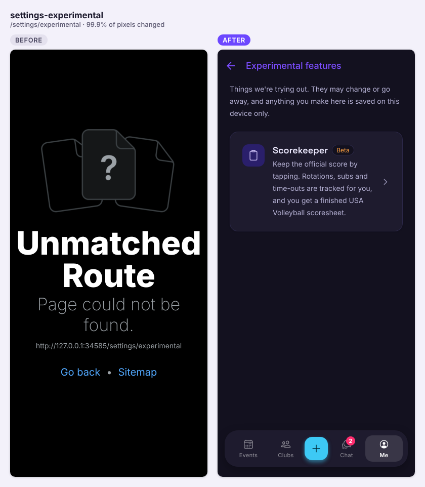
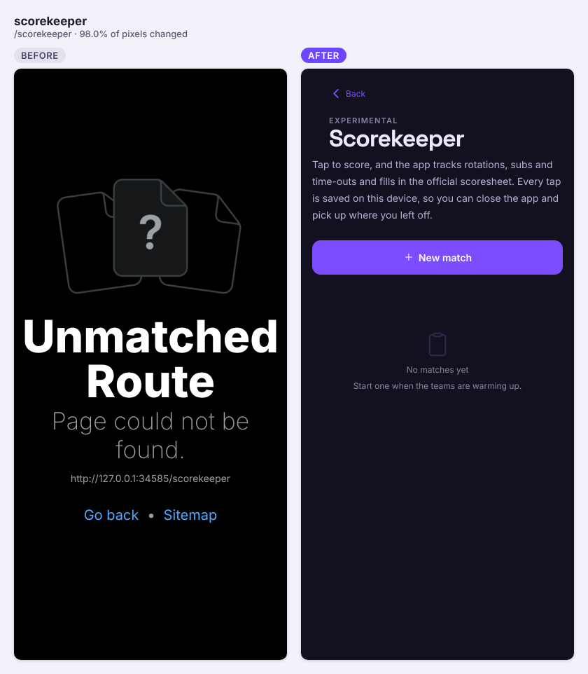
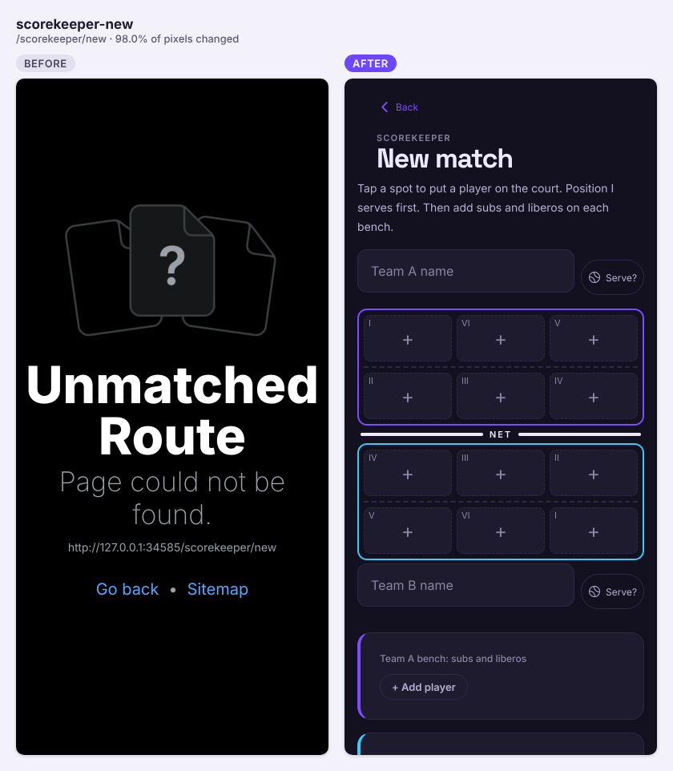
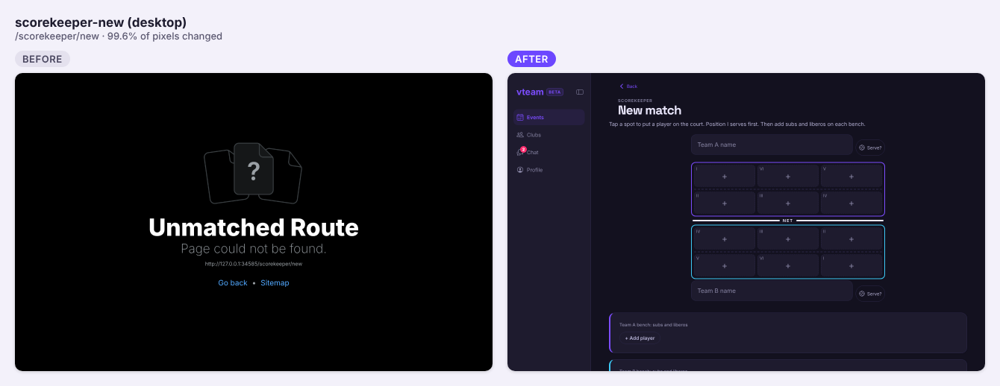
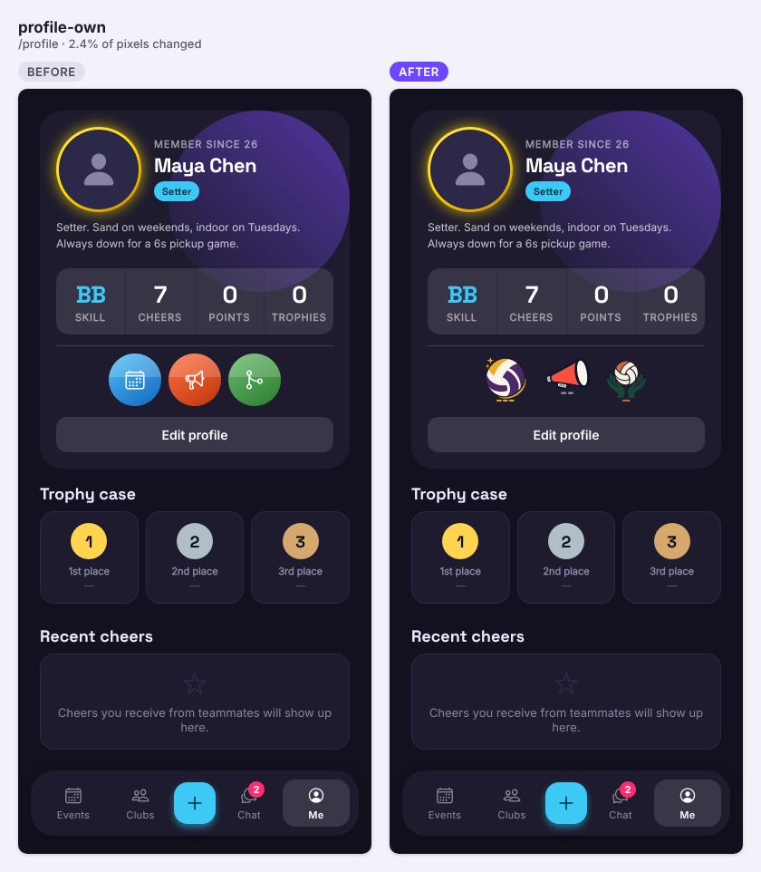
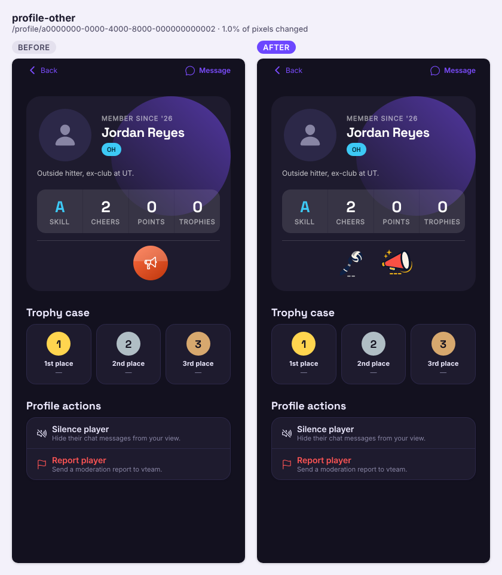
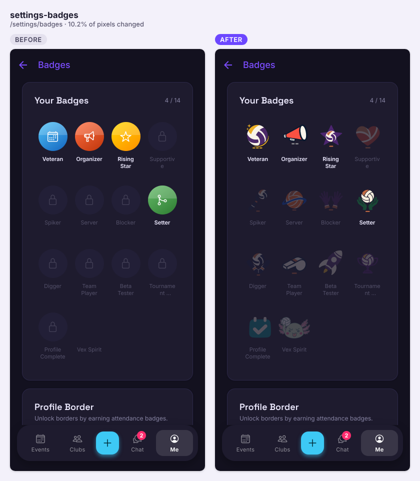
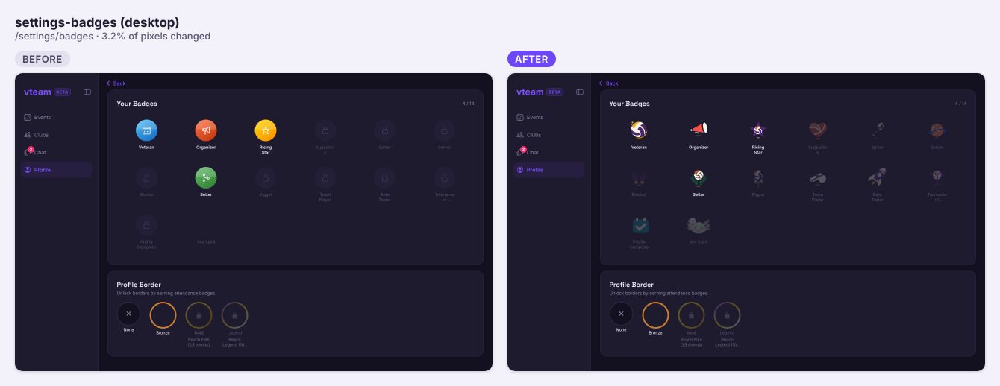

The Scorekeeper landed and grew fast: tap-to-score USAV matches, NAGVA formats, the official USA Volleyball PDF and a guided copy-to-paper walkthrough, plus the approved badge artwork and new VTeam icon.

## Shipped

**Features**

- Profile → **Experimental features**, with its first experiment: a **Scorekeeper** that fills in the USA Volleyball scoresheet as you tap. Drawn court lineups, subs, liberos, time-outs with a countdown, cards, undo/redo and an editable timeline; rule breaks are recorded with a warning rather than refused. Matches live on the device and survive the app or tab closing. Adds `expo-print` (loaded on demand). No database changes (#158)

All three are new pages (they didn't exist before). The New match screenshot shows today's end state, including the later Scorekeeper PRs below.

- Scorekeeper: tapping a court spot on New match offers the team's bench players as one-tap picks (#161)
- Scorekeeper: NAGVA formats: sets starting at 4–4, per-set caps, and a match clock with the 2-minute warning, "End on time" and next-point-wins on a tie. Quick setups for NAGVA pool play and bracket; older saved matches keep working (#163)
- Scorekeeper: **Official USA Volleyball form (PDF)** button fills the real two-set USAV scoresheet (downloads on web, print/share sheet on phones); sets 3+ continue on extra copies, overflow goes to Remarks. Also a new "1 set" format (#164)
- Scorekeeper: **Copy to paper (guided)** walks through the paper form section by section with a highlighted map and resumes where you left off; saved teams (starting six + bench) for one-tap setup; and a Match details card to fill in the header after the match (#167)
- Badges: approved artwork for all 36 badge tiers (35 new, Vex unchanged), locked badges preview tier 1 dimmed; new Volleyball V favicon and touch icon, and the native app icon is prepared for the next native build. No schema or data changes (#168)

**Fixes**

- Scoresheet: roster entries (libero/captain markers) no longer wrap onto a second line (#162)
- Scoresheet: the official PDF and Copy to paper now mark the form per the 2025–27 USAV Indoor Scoring Instructions: X through S/R, X in box 1 for the receiving team's first server, checks on served boxes, circled exit scores, T-bars instead of a circled final point, penalty points slashed and circled, captain in the circle (#169)

No backend changes today: no migrations, functions or RPCs.

## In progress
- #120 badge art (admin-only AI art): ready for review, now has merge conflicts with main after #168
- #122 tournament registration rules (behind main), #125 trophies/tie rules/third-place match (conflicts): drafts
- #123 friends (+ #124 "friends going", stacked on it): drafts
- #102 privacy (conflicts), #106 account deletion, #108 rate limiting (both stacked on #102): drafts

## Needs you
- On a phone: score a few rallies in the Scorekeeper, force-quit, reopen and Resume (the one unchecked test in #158)
- #168: the native app icon only ships with the next native build; Android adaptive layers and store submission are still to do
- Carried over: create the `send_notification_push` Database Webhook on live if not done yet, check reminder/chat push taps on iOS and Android dev builds (#132), and set `RESEND_API_KEY` and `OPENAI_API_KEY`
