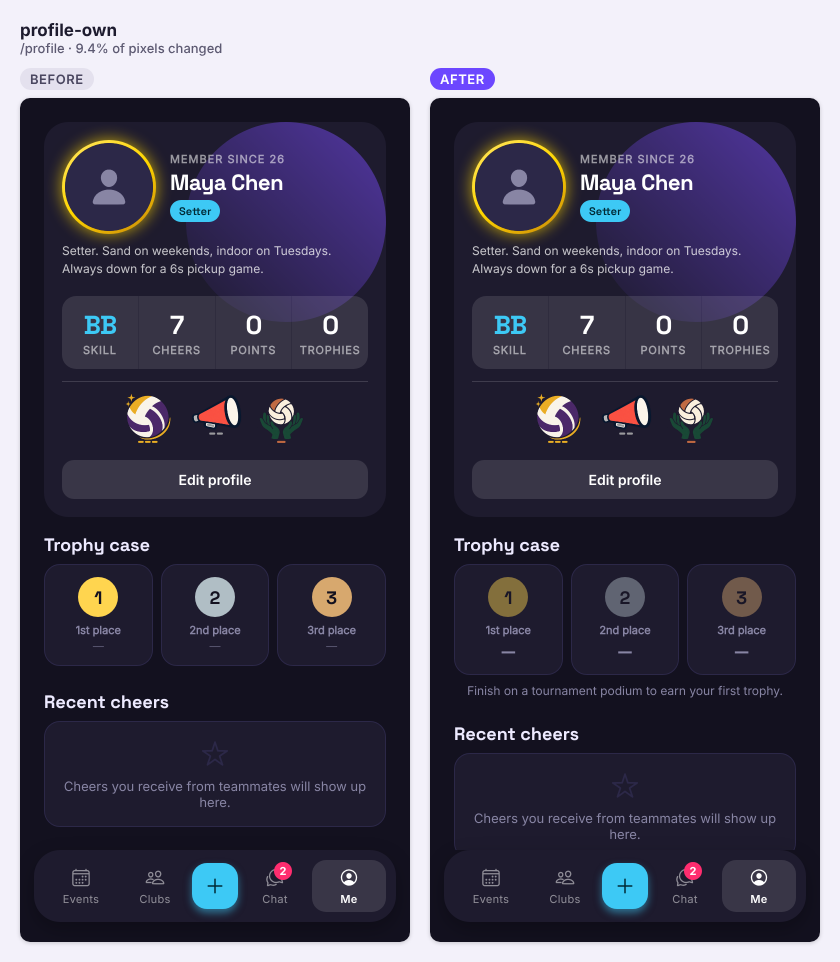
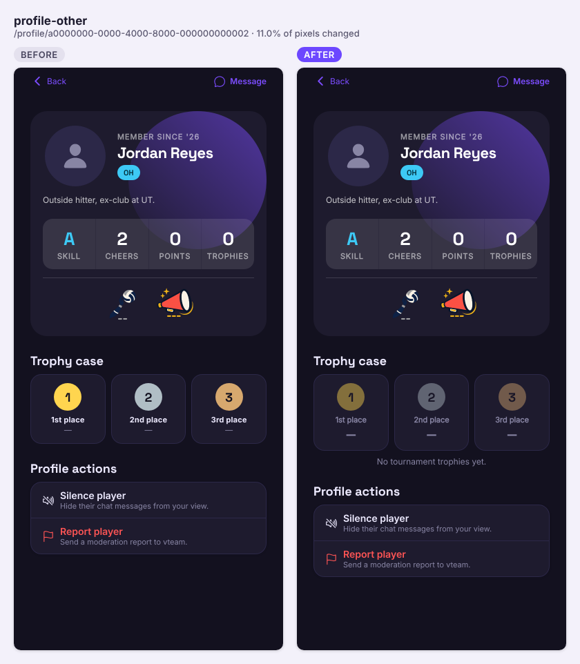
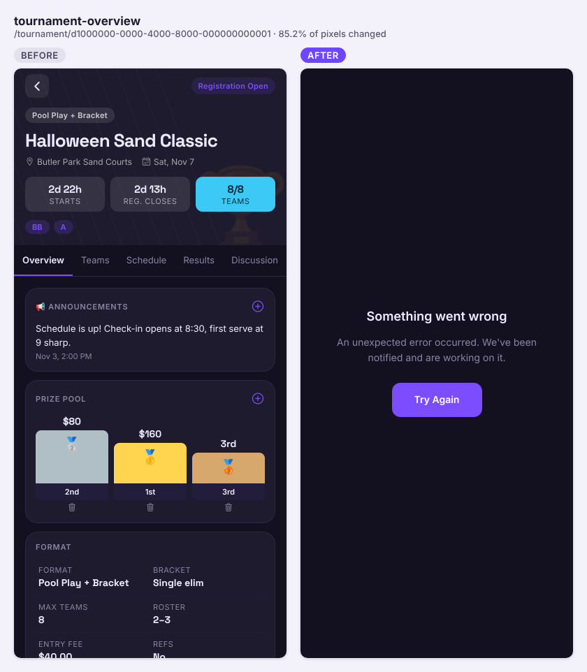
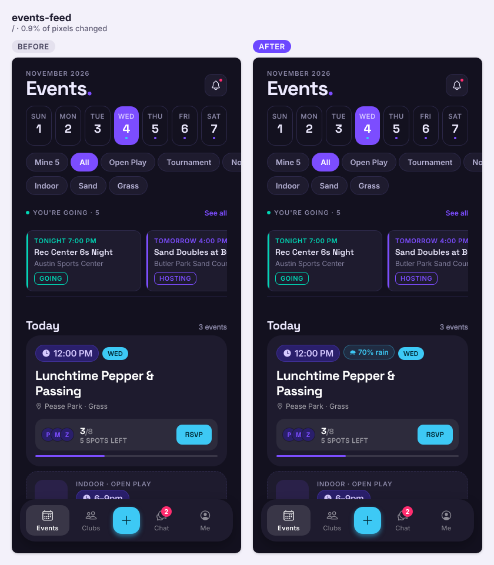
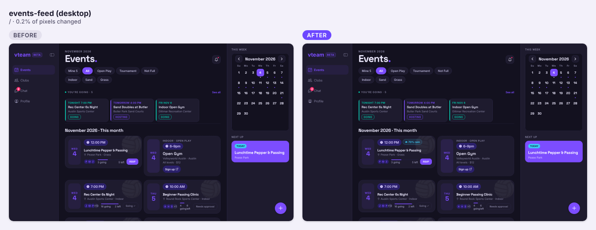
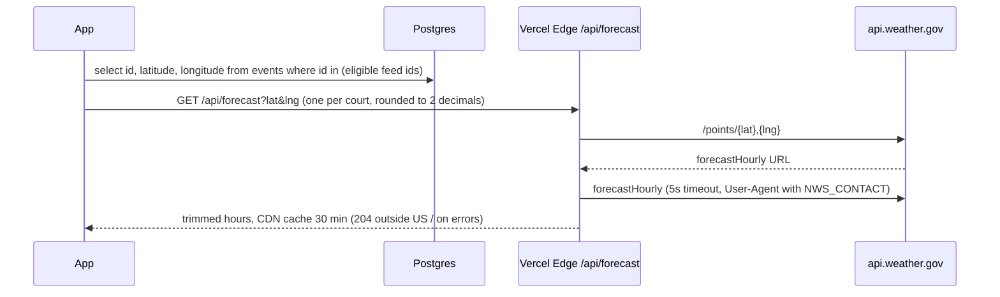
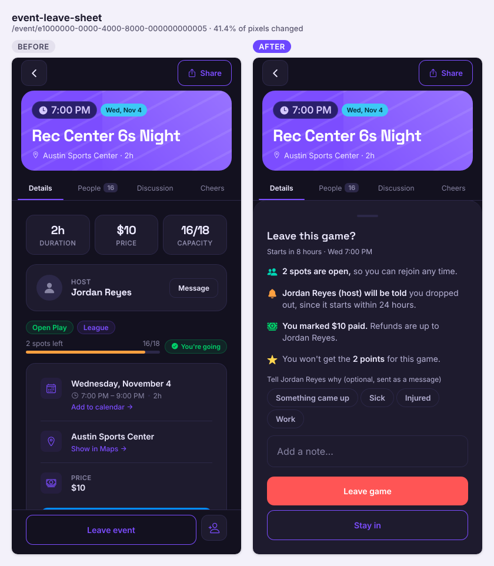
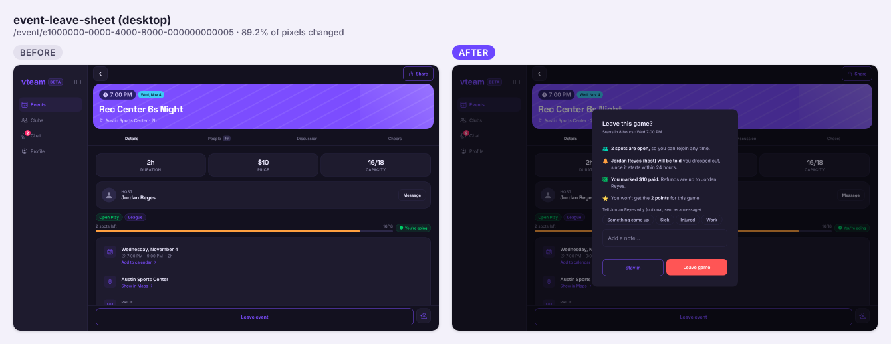
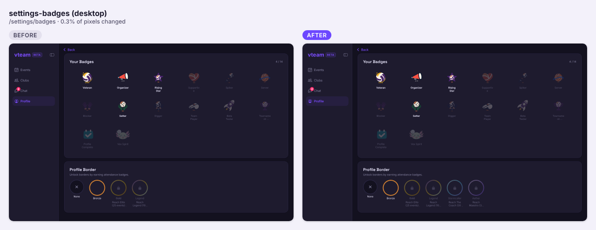

Nine PRs landed: tournaments now enforce registration rules and award trophies, outdoor games show the weather, leaving a game explains what it costs, and a batch of accessibility and chat-badge fixes.

## Shipped

**Features**

- Tournaments: hosts set **Tie Rules** (order of the four tiebreakers) and can add a **third-place match**; finishing a tournament records 1st/2nd/3rd (ties for 3rd allowed) **trophies on every podium player's profile**, visible to everyone. Profiles show a real trophy count and a trophy case (#125)





The tournament page shows "Something went wrong" in the screenshot harness only: its mock `tournament_rules` rows lack the new `tiebreakers` column, and the Overview's Scoring Rules card calls `rules.tiebreakers.map` (all five tournament tabs failed the same way). On a real database the column is `NOT NULL` with a default, and before the migration the app falls back to defaults, so this should be harness-only.

```mermaid
sequenceDiagram
  participant App
  participant PG as Postgres (complete_tournament, SECURITY DEFINER)
  participant Cron as pg_cron award-event-points
  App->>App: record final (and 3rd-place match) → engine computes podium
  App->>PG: rpc complete_tournament(tournament_id, podium)
  PG->>PG: check caller is organizer, lock row, validate podium teams
  PG->>PG: status = 'completed'; rewrite tournament_trophies for podium members
  PG-->>App: ok (if RPC missing → app just sets status)
  Cron->>PG: award_event_points() gives 5 pts to approved teams of completed tournaments
  App->>PG: select tournament_trophies (profiles, anon + authenticated)
```

| Object | Change | Notes |
|---|---|---|
| `tournament_rules.tiebreakers` (text[]) | added | NOT NULL, default head-to-head → set ratio → point diff → points scored; CHECK 1–4 of those |
| `tournament_rules.third_place_match` (bool) | added | NOT NULL default false |
| `tournament_trophies` | added | place 1–3 per player, with title/date/team-name snapshot; unique per tournament + player; RLS public read (anon, authenticated), no client writes |
| `complete_tournament(uuid, jsonb)` | added | SECURITY DEFINER, organizer only, EXECUTE for authenticated; re-callable after a corrected final |

- Tournaments: registration rules are now **enforced in the database**, not just the app: deadline, published status, club membership, skill levels and roster size; past `max_teams` a team is **waitlisted** and the earliest waitlisted team is promoted when one leaves. Captains can no longer approve their own team or mark it paid. The Teams tab gets a Waitlist section and the Overview says when registration is closed (#122)

```mermaid
sequenceDiagram
  participant App
  participant RLS as Postgres triggers
  App->>RLS: insert tournament_teams
  RLS->>RLS: BEFORE INSERT: published, before deadline, club member, captain, skill level
  RLS->>RLS: advisory lock; over max_teams → status waitlisted
  App->>RLS: insert tournament_team_members
  RLS->>RLS: BEFORE INSERT: same checks + roster < max_roster_size (team row locked)
  App->>RLS: update tournament_teams (captain)
  RLS->>RLS: BEFORE UPDATE: only organizer may change status/approval/paid/seed/lock
  App->>RLS: delete / withdraw a registered team
  RLS->>RLS: AFTER: promote earliest waitlisted team
```

| Object | Change | Notes |
|---|---|---|
| `tournament_registration_check()` | added | shared rule check; SECURITY DEFINER, no client EXECUTE |
| `tournament_team_before_insert` / `_before_update` triggers | added | registration rules, waitlist, organizer-only fields |
| `tournament_member_before_insert` trigger | added | deadline, membership, skill level, roster cap |
| `tournament_promote_waitlist_on_delete` / `_on_update` triggers | added | auto-promote from waitlist; organizer and service role exempt |

- Weather on outdoor games: sand and grass events within 7 days show a forecast chip next to the time ("☀️ 78°", "🌧 70% rain", "🔥 97°") and an hourly row on the event page, from the National Weather Service. Indoor games show nothing (#178)






- Leaving a game now opens a sheet that says what it costs (spots left, approval needed to rejoin, the host being told inside 24h, refunds, the points you'll miss) with optional reason chips and a note that's sent to the host as a DM (#179)




- Two new profile borders, **Stormcaller** and **Aether**, unlocked at tier 3 of the communication and setting cheers badges (#174)



| Object | Change | Notes |
|---|---|---|
| `profiles_selected_border_check` | changed | `selected_border` now also allows `storm` and `aether` |

**Fixes**

- Chat tab badge no longer shows a ghost unread count after you've read everything: mark-read retries, then recounts once the server has it, and the badge refreshes on app foreground (#181)
- Accessibility: every loading spinner has a name (new `Spinner` primitive), switches and the host form's date/time selects are labelled, border swatches are real radios, and pinch zoom works on mobile web again (#182)
- The web browser tab now reads **VTeam** instead of "Untitled" (#173)

**Under the hood**

- Edge functions are split into testable handlers with 54 Deno tests in a new CI job, plus a daily check that live's deployed functions match `main` (skipped until a `SUPABASE_ACCESS_TOKEN` secret exists). `places-proxy` no longer echoes request errors that could contain the Maps key (#177)

## Closed issues
- #171 Leave with a heads-up: a sheet that says what leaving costs, and an optional note to the host
- #165 Weather on outdoor games: forecast chip on sand and grass cards, hourly row on the event
- #146 Chat unread badge: clears on open, increments live, never shows a ghost count
- #140 a11y: badges border picker radios need aria-checked
- #139 a11y: label host create/edit time selects and switches
- #138 a11y: label the notification-settings switches (and the discussion announcement switch)
- #137 a11y: label ActivityIndicator spinners (unnamed role=progressbar)
- #136 a11y: allow pinch zoom on mobile web (drop user-scalable=no, keep touch-action: manipulation)
- #135 a11y: give the web document a <title> (every screen)

## In progress
- #180 no-show flag (schema): conflicts with main; its migration must be on live before or at merge, since event pages will select the new column
- #123 friends (schema): conflicts with main; #124 "friends going" is stacked on it
- #120 admin-only AI badge art (schema): conflicts with main
- #102 privacy, #106 account deletion, #108 rate limiting: drafts (#108 has conflicts)

## Needs you
- #122, #125 and #174 add migrations. Both tournament PRs said their SQL was "not applied anywhere yet" when written. If not done: apply each up SQL to live, run `select beta_meta.complete_pr(<n>);` on beta, and regenerate `types/database.ts` (it is still hand-edited, marked `TODO regenerate from beta`)
- #125: un-skip the trophy e2e tests (`e2e/tournament-flow.spec.ts`, `e2e/rls.spec.ts`) once the migration is on beta
- #178: set `NWS_CONTACT` in Vercel (NWS asks for a contact in the User-Agent)
- #177: add a `SUPABASE_ACCESS_TOKEN` secret to turn on the functions drift check (it will then flag all five functions for one redeploy from main), and decide #172's open question: approve each deploy or deploy automatically
- Shots harness: add `tiebreakers` / `third_place_match` to the mock `tournament_rules` fixture so tournament screenshots (and their axe scans) render again
