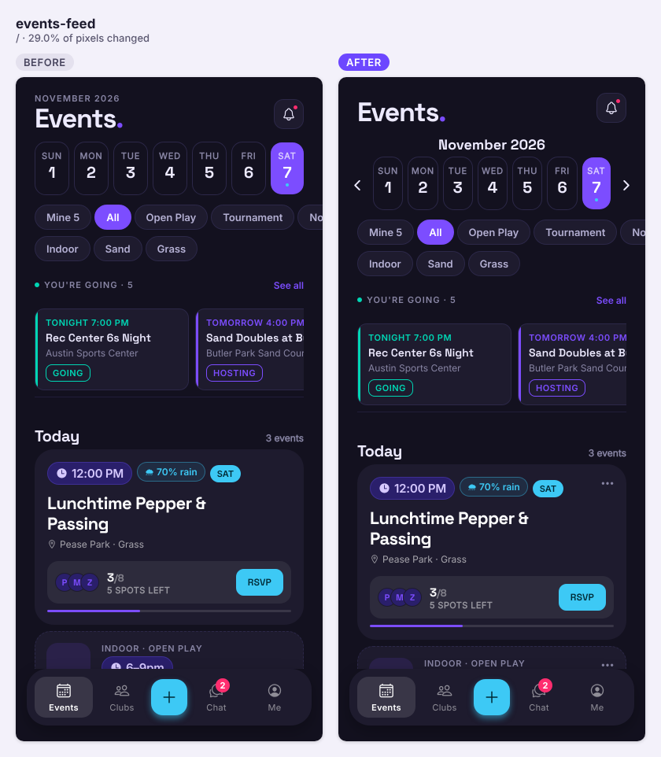
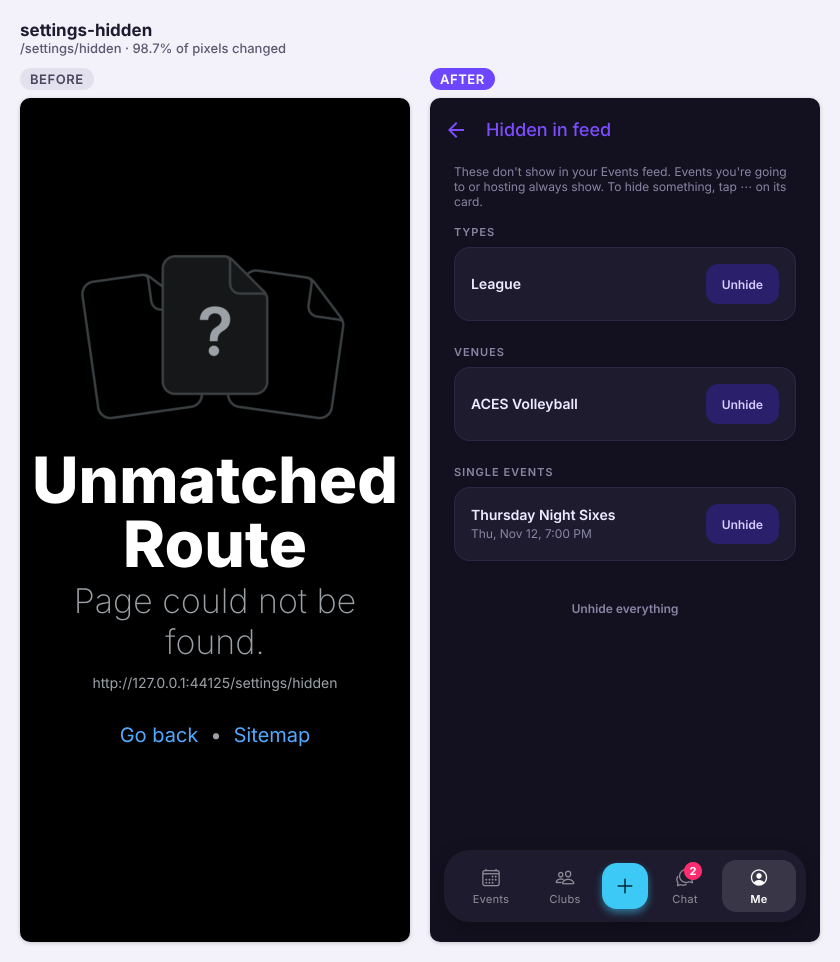
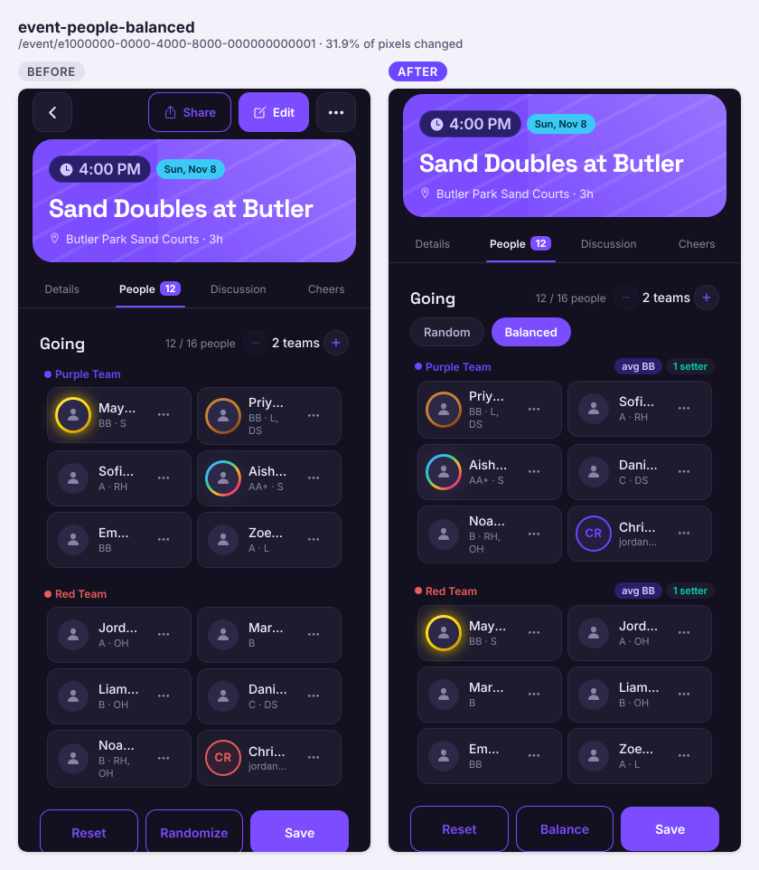
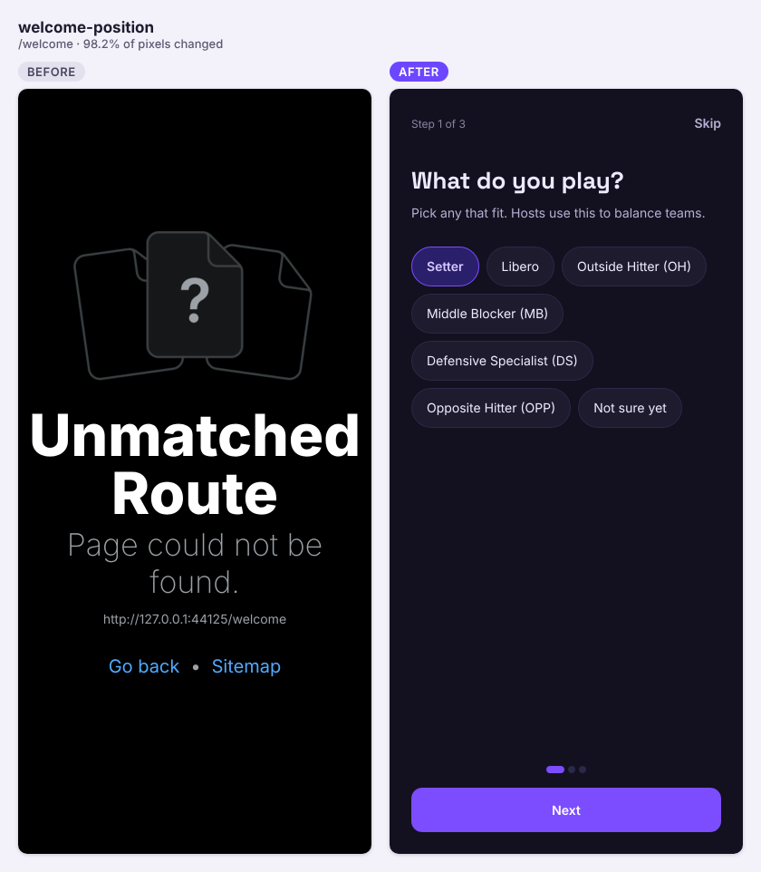
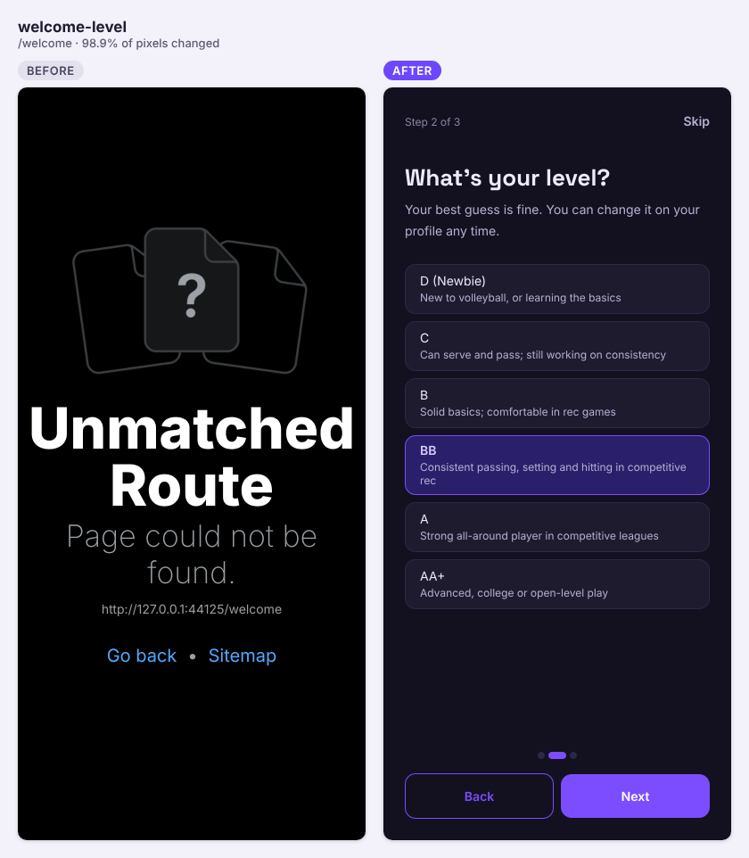
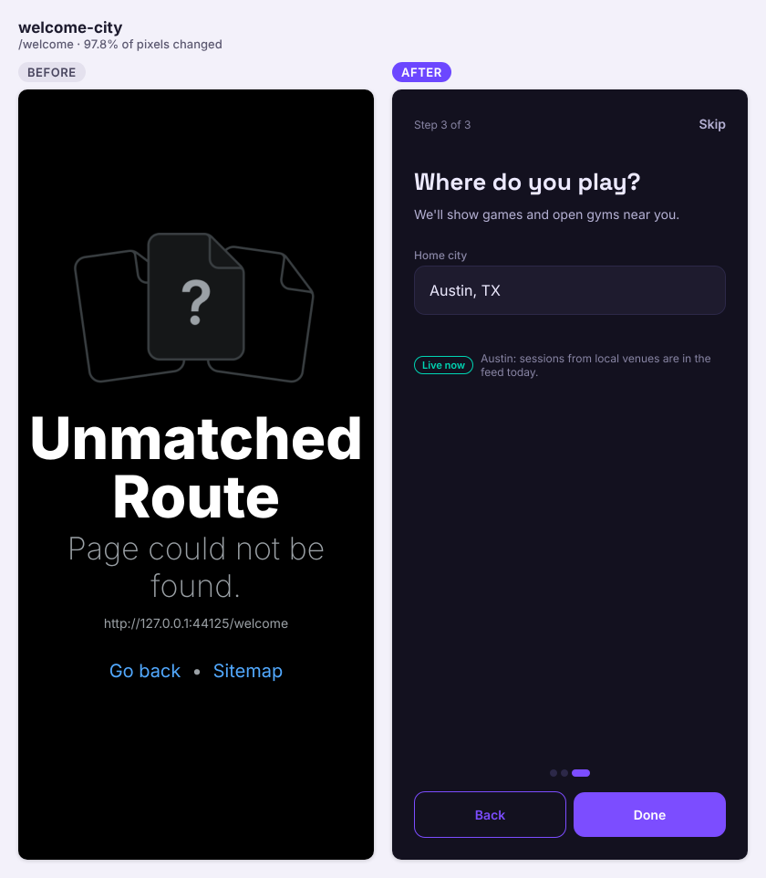
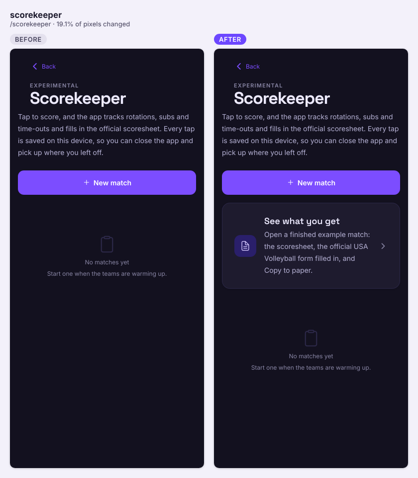

A big day: eleven PRs landed, including hiding things from the feed, balanced teams, a player setup after sign-up, a new week strip and a lighter, faster web first load.

## Shipped

**Features**

- Events week strip: a month label above the days, ‹ › arrows beside them, and a Today button in the header once you leave this week (#190). Swiping the strip to change weeks is now off, kept behind a flag (#191)

  

- Hide things from the Events feed: a ⋯ menu on each card hides that item, its venue, its host or its type, with Undo. Each day shows "N hidden · Show", and Profile → Hidden in feed lists and unhides everything. Events you're going to, waitlisted for or hosting always show (#192)

  | Object | Change | Notes |
  |---|---|---|
  | `user_settings.hidden_feed` (jsonb, default `[]`) | added | Array of `{kind, key, label, until?}` entries, at most 500 (check constraint). Owner-only, covered by the existing `user_settings` RLS; the server never acts on it |

  

- Balanced teams: hosts can pick Random or Balanced under Going. Balanced splits by skill level, spreads the setters and keeps pinned players; the team headers show "avg BB" and setter counts. Client-only, no schema change (#199)

  

- Player setup after sign-up: three skippable steps (position, level, home city), offered once to players with all three empty, then back to the page they were on (#201)

  
  
  

- Scorekeeper: an "Open the example" card opens a finished sample match (scoresheet, official USAV form, Copy to paper); a 6-step guided tour on the live match screen with a ? to replay it; the Hall field is gone (#205)

  

**Fixes**

- Time zones: the "Today" on the Events tab now rolls over at midnight if the web app is left open, and the leave note to the host uses the event's time zone instead of the player's device zone. The whole unit suite now also runs in UTC, Tokyo and Los Angeles in CI (#196)
- Player profiles, History, Hosted and Cheers now load through the shared cache: going back paints instantly, a network error shows Retry instead of "Profile not found", and profiles start loading when you press or hover a player (#198)

**Under the hood**

- Lighter web first load: Reanimated, Gesture Handler and react-virtuoso moved out of the first-load scripts (−251 KB gzip, −27%). The event screen and chat message list now load as separate chunks, the event screen preloaded when the browser is idle (#197)
- First-time web visitors: the page itself starts the Events feed request before the app bundle loads, and the app reuses it when the span and viewer match. A new `feed_first_paint` metric records whether the first rows came from the device, the prefetch or a normal fetch (#200)

  ```mermaid
  sequenceDiagram
    participant HTML as index.html (inline script)
    participant PG as Postgres (get_feed_span)
    participant App as App bundle (useMonthEvents)
    HTML->>HTML: feedSpanArgs(now, wide) for the first screen
    HTML->>PG: POST rpc/get_feed_span (stored token if valid 60 s+, else anon key)
    Note over HTML: promise left on window.__vteamPrefetch.feed
    App->>App: bundle loads, hydrates
    App->>HTML: take prefetch once (span + viewer match, under 15 s old)
    alt match
      PG-->>App: feed rows
    else no match or failed
      App->>PG: normal get_feed_span fetch
    end
    App->>App: track feed_first_paint {source, ms, cold}
  ```

- RLS matrix: every public table (all 51) now declares who may read and write it, and about 130 CI probes check it on beta; a unit test fails when a table has no row. Tests only (#202)

## Closed issues
- #195 Time-zone safety net: unit tests in four zones, clock helpers, one event time zone
- #193 Lighter first load on the web: animation and gesture libraries out of the entry chunk
- #186 RLS matrix: every table declares who may read and write it, and CI proves it on beta
- #185 Player profile, history and cheers on lib/query: cached back-navigation, prefetch on tap, a real error state
- #184 Wake the server from the HTML: start the Events feed request before the app bundle loads
- #156 Player card setup after sign-up: position, level, home city in three skippable steps
- #149 Balanced teams: split by skill level and spread the setters

## In progress
- #206 Scorekeeper: real form on screen, guided example, clearer Copy to paper (CI green, awaiting review)
- #204 elemental communication and setter borders (CI green, awaiting review)
- #203 one notification per game for cheers, one push (schema; CI green, awaiting merge)
- #180 no-show flag (schema): its migration still needs to be on beta
- #123 friends (schema) and #124 "friends going" (stacked on it)
- #120 admin-only AI badge art (schema): needs the `OPENAI_API_KEY` function secret
- #102 privacy, #106 account deletion, #108 rate limiting: drafts

## Needs you
- Sign off on the skill-level hint wording in player setup (table in #201)
- Decide whether e2e may use a disposable or third fixed test account so #201's setup flow gets an e2e test
