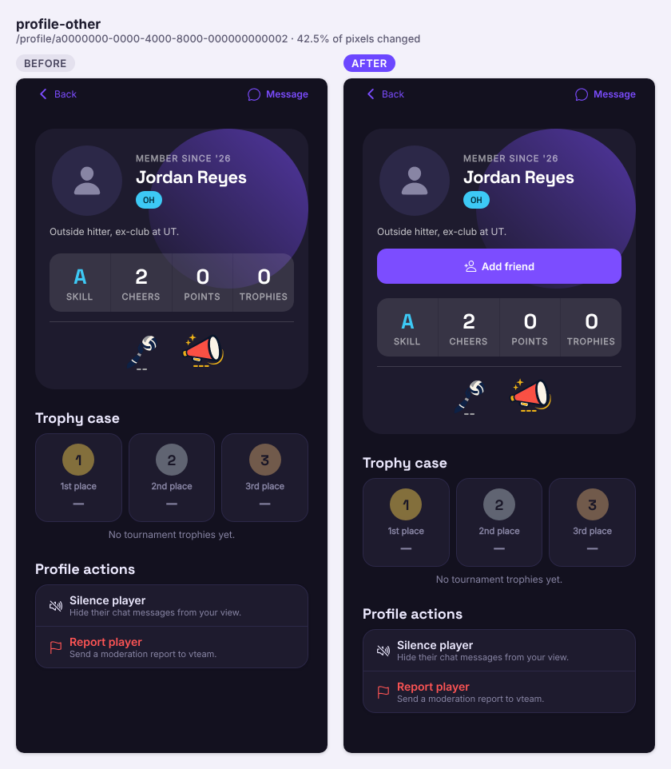
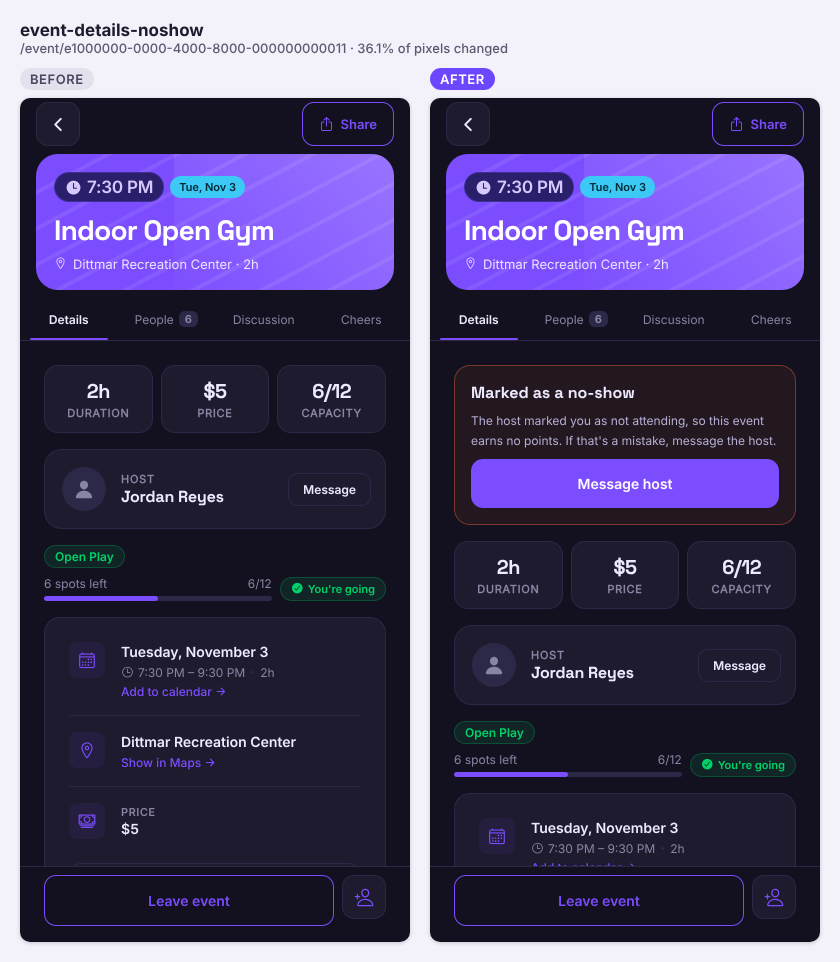

Seven PRs landed: friends, a no-show flag for hosts, a privacy pass that stops username login exposing emails, and a live scoresheet in the Scorekeeper.

## Shipped

**Features**

- Friends: send, accept or decline requests, unfriend, and mark up to 10 private best friends. There's a button on other players' profiles, a Settings → Friends list, and new request and accepted notifications (#123)

  

  | Object | Change | Notes |
  |---|---|---|
  | `friend_requests` | added | Pending requests, at most one per direction. Signed-in users read only pending requests they're part of, so a decline is never shown to the sender. No client writes, no guest access |
  | `friendships` | added | One row per direction, with `is_best_friend`. Owner reads their own rows only. No client writes, no guest access |
  | `send_friend_request`, `respond_friend_request`, `cancel_friend_request`, `remove_friend`, `set_best_friend` | added | SECURITY DEFINER, signed-in users only. The only way to change the tables |
  | `get_friends_going(uuid[])` | added | SECURITY INVOKER, so RLS limits it to the caller's friends |
  | `friend_pair_lock`, `friend_accept` | added | Internal helpers, not callable by clients |
  | `notifications_notification_type_check` | changed | Adds `friend_request` and `friend_accepted` |

  ```mermaid
  sequenceDiagram
    participant App
    participant PG as Postgres (send_friend_request)
    participant Inbox as notifications
    App->>PG: rpc send_friend_request(user)
    PG->>PG: lock the pair
    alt they already asked you
      PG->>PG: friend_accept: two friendships rows
    else new request
      PG->>PG: refuse if they silenced you (42501)
      PG->>PG: refuse over the limits (PT429)
      PG->>PG: insert friend_requests
      PG->>Inbox: friend_request row, if their in-app switch is on
    end
  ```

- "Ana and 2 friends going" on event cards and event pages, best friends named first. One call for the whole feed, skipped for guests and people with no friends (#124)
- No-show flag: from the start of a game until 2 hours after it ends, a host or co-host can mark an attending player as a no-show from the roster ⋯ menu, and undo it. Only flagged players miss out on points, which now pay at end + 2 hours. The flagged player sees a card with Message host (#180, closes #151)

  

  | Object | Change | Notes |
  |---|---|---|
  | `event_attendees.no_show`, `no_show_marked_at`, `no_show_marked_by` | added | Publicly readable like the rest of the row; the app shows flags only to hosts, co-hosts and the flagged player. Written only by `set_no_show` |
  | `set_no_show(event, user, value)` | added | SECURITY DEFINER, signed-in users. Checks host or co-host, not cancelled, inside the window, target attending |
  | `guard_no_show_columns()` + trigger `event_attendees_guard_no_show` | added | Rejects any other insert or update of those columns |
  | `award_event_points()` | changed | Event points need end + 2 hours passed and no flag. Tournament points unchanged |

  ```mermaid
  sequenceDiagram
    participant Host as App (host)
    participant PG as Postgres
    participant Cron as pg_cron award-event-points
    Host->>PG: rpc set_no_show(event, player, true)
    PG->>PG: check host/co-host, window, attending
    PG->>PG: set no_show, marked_at, marked_by
    Cron->>PG: award_event_points() every 15 min
    PG->>PG: pay attendees after end + 2h, skip flagged
  ```

- Scorekeeper, live scoresheet: the official form fills in under the court as you score. New marks are tinted, Undo leaves a dashed outline and Redo writes them back; phones zoom to the latest mark (#211)
- Scorekeeper, real form on screen: the scoresheet screen now draws the official USA Volleyball form, with Enlarge for phones, fewer buttons and a 4-step tour on the example. Copy to paper shows each step on the real form, zoomed in (#206)

  No screenshots for #206 and #211: the compare covers only the Scorekeeper home and New match screens, which didn't change.

**Fixes**

- Scorekeeper: the back buttons on the home and New match screens now work after a web refresh or deep link, and a new test catches any `router.back()` without a history check (#208)

**Under the hood**

- Privacy (#99 part 1, #102):
  - Username login now runs on the server, so a username can no longer be turned into an email address. Every failed sign-in gets the same answer
  - Closed a hole where anyone with a conversation id could add themselves to it
  - Chat photos are private to the conversation
  - Notification switches, admin status and denial reasons moved off public rows
  - Signed-out visitors no longer see +1 names or who gave a cheer

  | Object | Change | Notes |
  |---|---|---|
  | `login-with-username` | added (edge function) | Called signed out. Resolves the email with the service role and returns only a session |
  | `get_email_by_username` | changed | EXECUTE revoked from all clients; only the edge function uses it |
  | `rate_limits`, `check_rate_limit`, `enforce_rate_limit` | added | No client access; functions run as service role only |
  | `prune-rate-limits` | added (cron) | Hourly at :41, deletes old windows |
  | "Can insert self as member" on `conversation_members` | removed | Joins go through SECURITY DEFINER functions |
  | `user_settings.notification_prefs` | added | Owner-only home for notification switches |
  | `app_admins`, `is_app_admin()` | added | No client read of the table; the check runs server-side |
  | `event_attendee_denials` | added | Denial reason, readable by that attendee, the host and co-hosts |
  | `profiles_keep_private_columns_private`, `event_attendees_keep_denial_private` triggers | added | Move values old builds still write to the legacy public columns |
  | `notification_pref_enabled` | changed | Reads the private settings |
  | `event_guests` SELECT policy | changed | +1 names for signed-in users only |
  | `event_guests_attending` | changed (view) | No names, same headcount; readable by guests |
  | `cheers` grants | changed | Guests can't read `giver_id` |
  | `chat-images` bucket, `can_read_chat_image()` | changed / added | Private bucket; only the uploader or a member of a conversation with that uploader's message can read |

  ```mermaid
  sequenceDiagram
    participant App as App (login)
    participant Edge as login-with-username
    participant PG as Postgres
    participant Auth as Supabase Auth
    App->>Edge: POST username, password
    Edge->>PG: check_rate_limit per username and per IP
    alt over limit
      Edge-->>App: 429 (padded to the minimum time)
    else allowed
      Edge->>PG: get_email_by_username (service role)
      Edge->>Auth: password grant (forwards the caller's IP if a secret key exists)
      Edge-->>App: session only, or generic 401 (padded)
      App->>App: supabase.auth.setSession
    end
  ```

## Closed issues
- #151 No-show flag: hosts mark who didn't come, and only they miss out on points

## In progress
- #213 Outside leagues and tournaments from Schelagg: draft, migration first, CI failing for now
- #210 e2e sign-in limit fix: no failing checks, behind main
- #209 Regenerate `types/database.ts` from live: e2e failing on the new sign-in limit, which #210 addresses
- #207 Skill level hints: no failing checks, behind main
- #204 Elemental communication and setter borders: no failing checks, behind main
- #203 One notification per game for cheers and edits: merge conflict
- #120 Admin-only AI badge art: merge conflict
- #108 Server-side rate limiting: draft, its migration still needs applying on beta
- #106 In-app account deletion: draft, its migration still needs applying on beta, CI failing

## Needs you
- For #102, in Supabase on live: create publishable and secret API keys if the project has none, then turn on Authentication → Rate Limits → IP Address Forwarding. Until both are done, Auth counts every username sign-in as one IP. Skip if already done; the PR doesn't record it.
