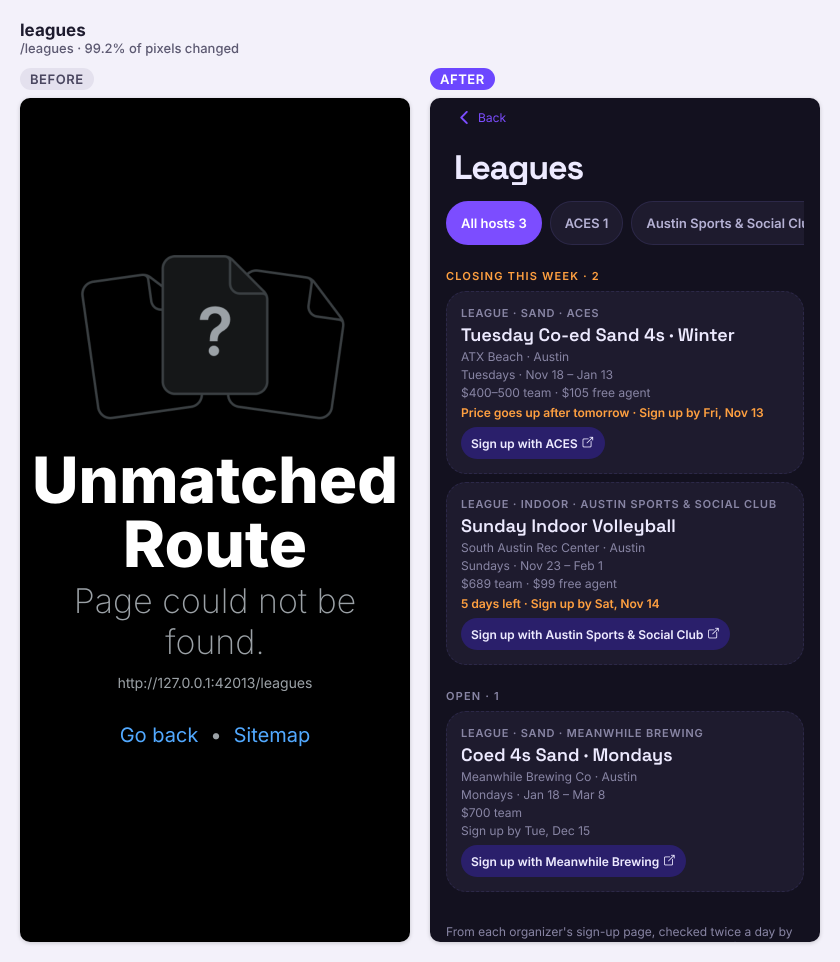
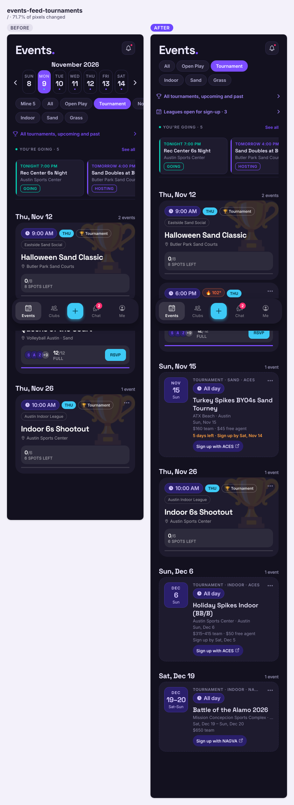
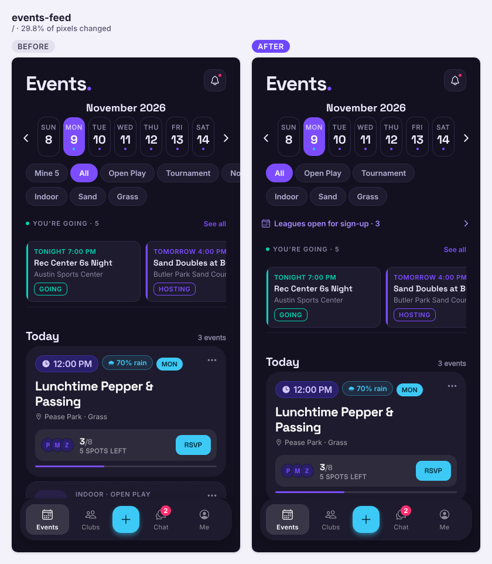
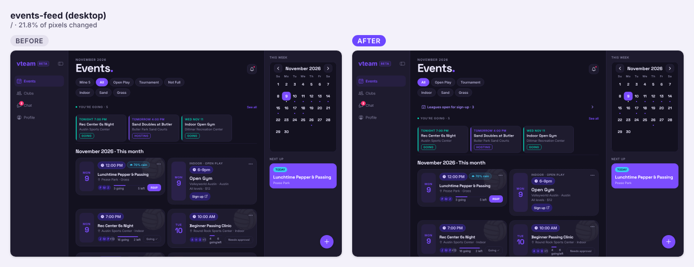
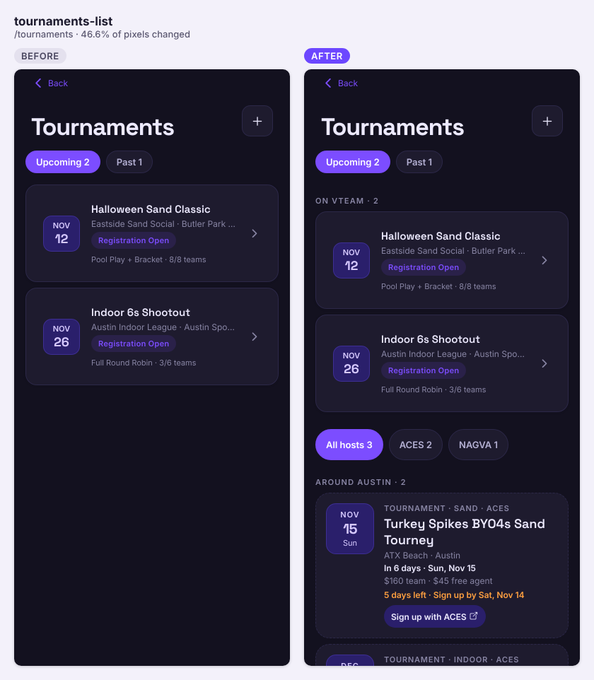
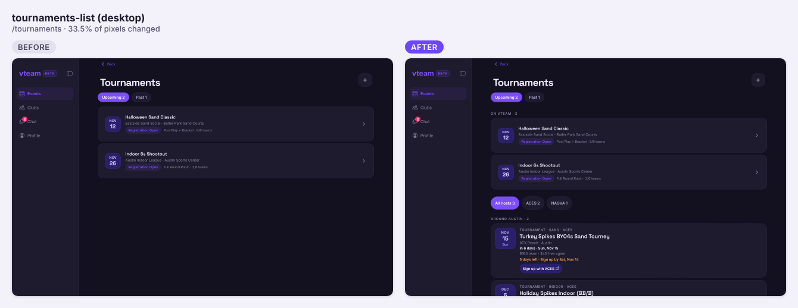
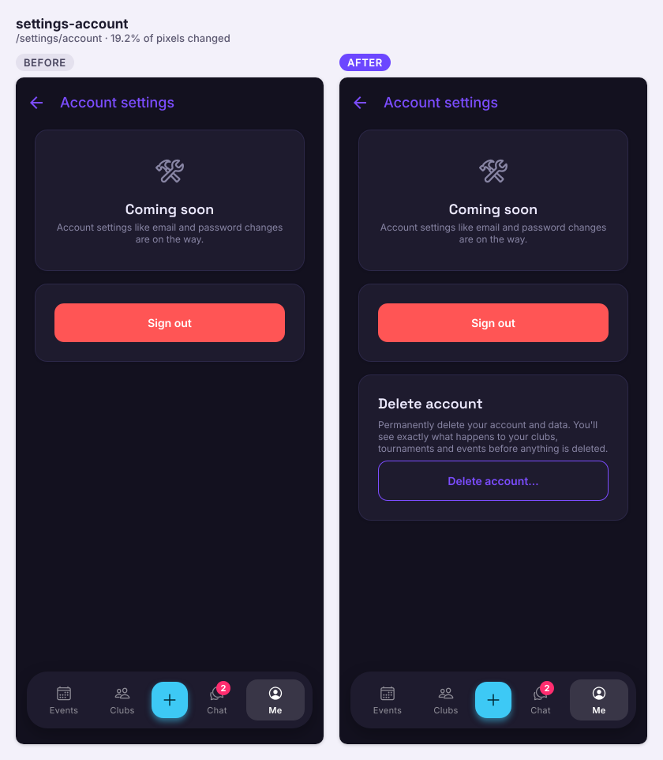

Ten PRs landed: outside leagues and tournaments from Schelagg, a tournament-first Tournament filter, in-app account deletion, and fixes for the sign-in limit that kept tripping CI.

## Shipped

**Features**

- Outside leagues and tournaments: leagues and tournaments run by ACES, Austin Sports & Social Club, Meanwhile, NAGVA and the Texas Asian Olympics now come in from Schelagg every 2 hours. They show in the Events feed (linking out to the organizer, no RSVP), in new "Around Austin" and "Elsewhere in the state" sections on Tournaments, and on a new Leagues page sorted by sign-up deadline, with host filters. Guests see them too (#213, closes #212)

  

  | Object | Change | Notes |
  |---|---|---|
  | `external_programs` | added | Mirror of Schelagg's `programs.json`. Anyone, guests included, can read; no write policies, only the import writes |
  | `external_programs_starts_on_idx` | added | Index on `starts_on` |
  | `ingest_schelagg_programs()` | added | Fixed URL, EXECUTE revoked from every client role. Skips a feed older than 18 h, never deletes on an empty feed, https links only |
  | `schelagg_safe_date(text)` | added | Helper: a malformed date becomes null instead of failing the import |
  | cron `ingest-schelagg-programs` | added | Every 2 hours at :40 |

  ```mermaid
  sequenceDiagram
    participant Cron as pg_cron (every 2h :40)
    participant PG as Postgres ingest_schelagg_programs()
    participant S as Schelagg programs.json
    participant App
    Cron->>PG: run import
    PG->>S: GET (http extension, fixed URL)
    S-->>PG: programs
    PG->>PG: skip if feed > 18h old
    PG->>PG: upsert valid rows (https links only)
    PG->>PG: delete rows no longer in feed (never on empty feed)
    App->>PG: select external_programs (anon RLS)
    PG-->>App: rows, grouped by region in the app
  ```

- Events → Tournament filter: no calendar, no day cutoff, just every upcoming tournament by date, including ones elsewhere in Texas. Outside tournament cards always state their days (#219)

  

- Events filters trimmed to All · Open Play · Tournament: Not Full and Mine are gone, and the "You're going" rail's See all now expands in place. A "Leagues open for sign-up" link sits under the filters (#218, #213)

  
  

- Tournaments screen: outside tournaments show without waiting for the club list (cold open 16.4 s → 1.6 s in the delay test), and cards get a date block covering every day plus "In 6 days" (#221)

  
  

- In-app account deletion (#99 part 2): Settings → Account → Delete account shows exactly what happens to each club, tournament and upcoming event (handed over or deleted/cancelled), asks you to confirm it's you if your sign-in is over 10 minutes old, then deletes everything in one transaction. Public `/delete-account` page for Google Play (#106)

  

  | Object | Change | Notes |
  |---|---|---|
  | `cheers.giver_id` | changed | Now nullable, `ON DELETE SET NULL`: kudos stay with recipients after the giver deletes their account |
  | `get_account_deletion_preview()` | added | Signed-in users only; returns the plan and its hash |
  | `delete_account(user, plan_hash)` | added | SECURITY DEFINER, service_role only. Locks the profile, refuses if the plan changed, hands over or deletes, deletes from `auth.users` last |
  | `account_deletion_plan`, `club_successor`, `account_is_being_deleted` | added | Internal helpers, no client EXECUTE |
  | edge function `delete-account` | added | Checks sign-in within 10 min (JWT `amr`), calls `delete_account`, removes files after commit |

  ```mermaid
  sequenceDiagram
    participant App
    participant PG as Postgres
    participant Fn as Edge fn delete-account
    App->>PG: rpc get_account_deletion_preview()
    PG-->>App: plan + hash
    App->>Fn: delete (typed DELETE, hash)
    Fn->>Fn: last sign-in > 10 min? 403 reauth_required
    Fn->>PG: delete_account(user, hash) [service role]
    PG->>PG: lock profile, recompute plan
    alt hash differs
      PG-->>Fn: plan_changed
      Fn-->>App: 409, screen reloads the list
    else same
      PG->>PG: hand over / delete / cancel, delete auth user last
      Fn->>Fn: remove avatar, chat photos, club avatars
      Fn-->>App: ok, sign out
    end
  ```

- Outside sessions a venue stopped confirming get a note ("Couldn't recheck with the venue since Nov 6"); scraped ones over a week stale leave the feed. A new workflow emails you when a Schelagg import stops (#214)

**Fixes**

- Tournament filter shows a spinner, not "nothing matches", while outside tournaments load (#222)
- Sign-in limit now counts only failed attempts, so successful sign-ins (and CI) no longer use it up. No schema change (#215)

  ```mermaid
  sequenceDiagram
    participant App
    participant Fn as Edge fn login-with-username
    participant PG as Postgres
    App->>Fn: username + password
    Fn->>PG: per-IP check_rate_limit (every attempt)
    Fn->>PG: read failed-attempt counter
    alt counter used up
      Fn-->>App: 429
    else
      Fn->>Fn: resolve username, sign in
      opt failure
        Fn->>PG: check_rate_limit (count the failure)
      end
      Fn-->>App: session or generic error
    end
  ```

**Under the hood**

- e2e reuses the shard's saved session instead of signing in again (#210)
- Schema drift check retries a busy beta instead of failing (#220)

## Closed issues

- #212 Outside leagues and tournaments from Schelagg (external_programs)

## In progress

- #207 Skill level hints from published league definitions: open, awaiting review
- #204 Elemental communication and setter borders: open, awaiting review
- #203 One notification per game for cheers (schema): open, awaiting review
- #120 Admin-only AI badge art (schema): open, awaiting review
- #108 Server-side rate limiting for DMs, search, comments, feedback: draft

## Needs you

- #106: confirm its migration is on live and `delete-account` is deployed to live, types regenerated, and `beta_meta.complete_pr(106)` run (its PR body said it was still unapplied on beta)
- #106: add `https://vteamvolleyball.com/delete-account` to the Google Play Data safety form
- #213: confirm the migration is on live, types regenerated from live, and `beta_meta.complete_pr(213)` run on beta
- #215: confirm `login-with-username` was redeployed to live and beta
