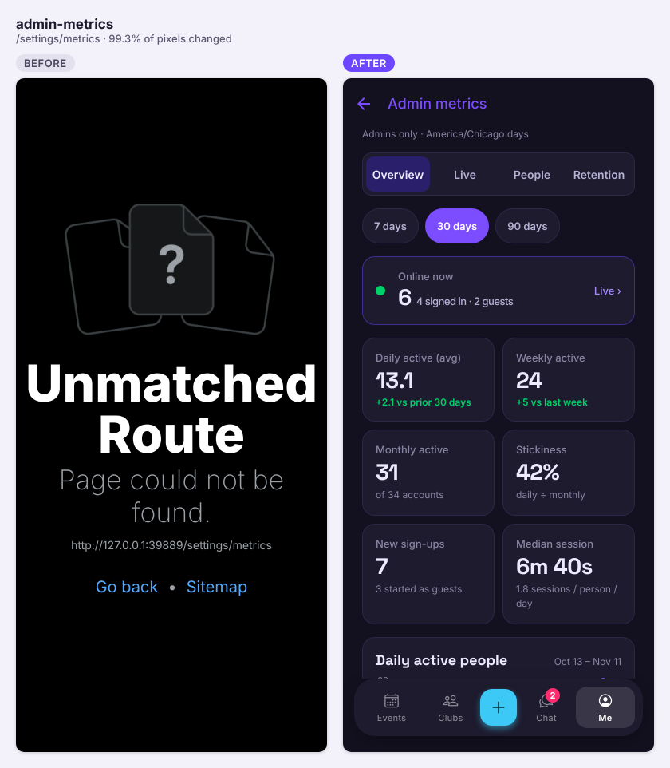
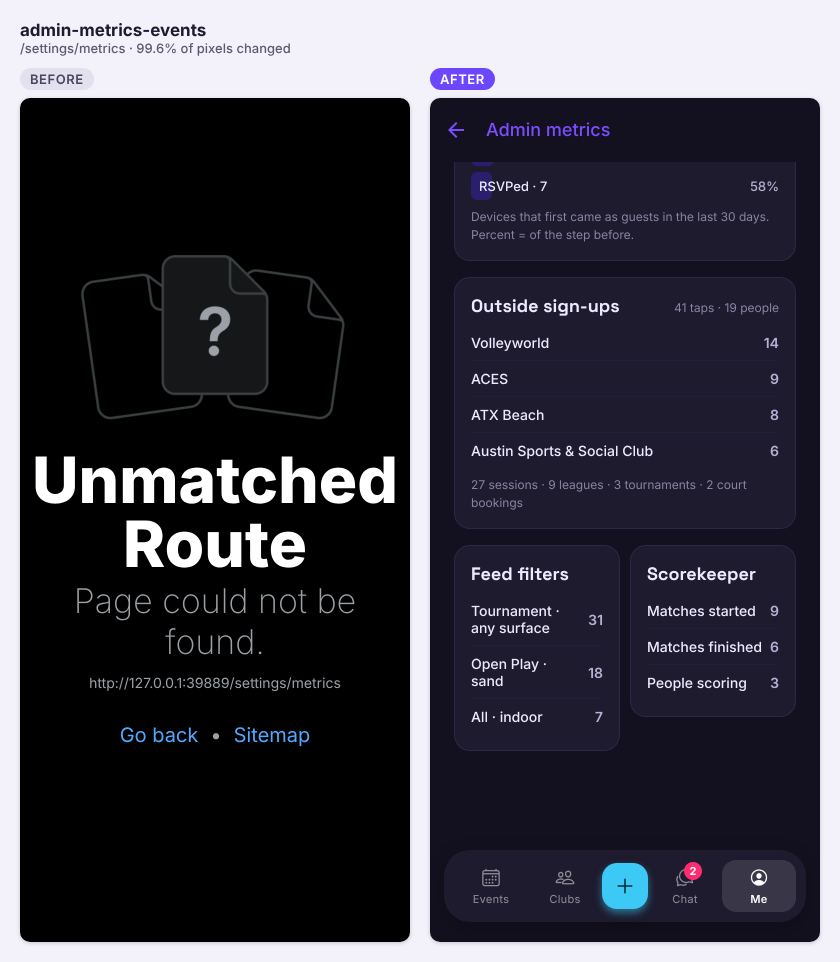
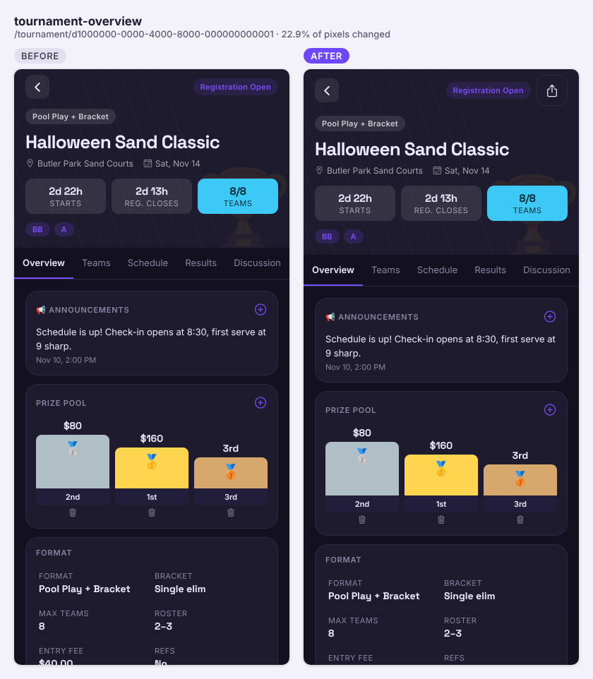
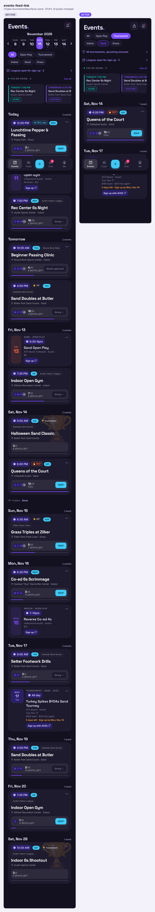
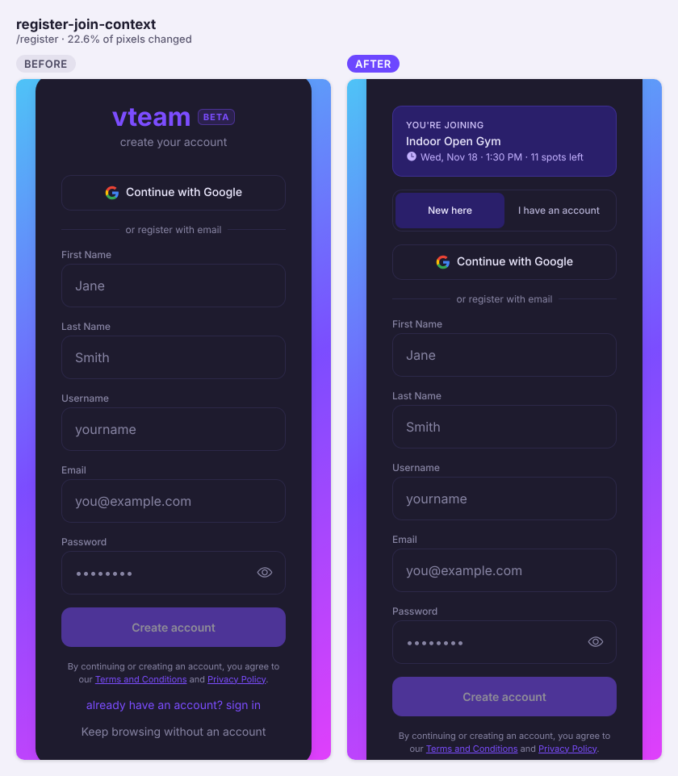
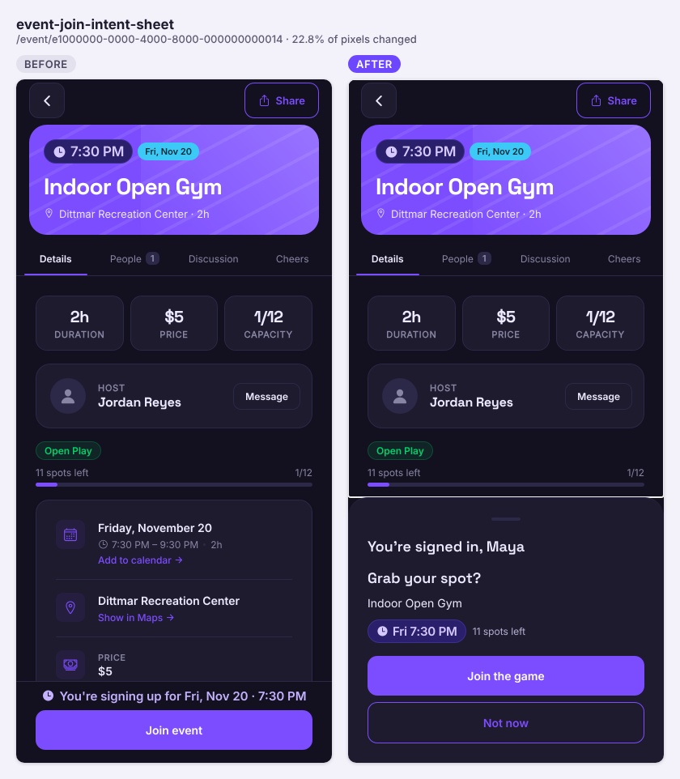
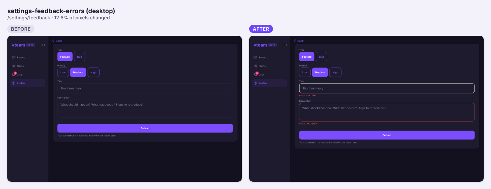
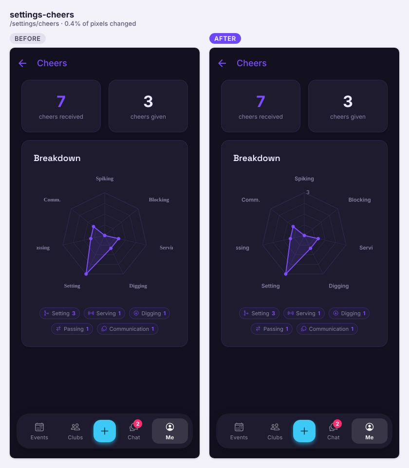

Big day: ten PRs landed: the admin Metrics dashboard (parts 2 and 3), shareable links for every screen, guests finishing their join after sign-up, toasts instead of silent alerts, and a lighter Profile load. #247's migration still needs applying to live.

## Shipped

**Features**

- Admin metrics dashboard: Profile → Admin metrics (admins only) with Overview, Live, People and Retention tabs and a per-person view; every number comes from admin-only server functions (#238)

  

  | Object | Change | Notes |
  |---|---|---|
  | `admin_metrics_overview(from, to)` | added | Online now, daily/weekly/monthly active, stickiness, sign-ups, sessions, platforms, top screens, action counts, feed → event → RSVP funnel. SECURITY DEFINER, `authenticated` only, raises 42501 unless `current_user_is_admin()` |
  | `admin_online_now()` | added | Online by platform and screen, last hour, today's peak. Same admin check |
  | `admin_retention(weeks)` | added | Weekly sign-up cohorts active at weeks 1/2/4/8, plus guests who later signed in. Same admin check |
  | `admin_users(search, sort, limit, offset)` | added | The People list. Same admin check |
  | `admin_user_activity(user)` | added | One person: platforms, 35-day activity, last 10 sessions as screen types. Same admin check |
  | `app_version_key(text)` | added | Internal helper, no client EXECUTE |

  ```mermaid
  sequenceDiagram
    participant App as App (Admin metrics)
    participant PG as Postgres admin_* functions
    App->>PG: rpc admin_metrics_overview / admin_online_now / admin_retention / admin_users / admin_user_activity
    PG->>PG: current_user_is_admin()? else raise 42501
    PG->>PG: aggregate app_sessions, app_events, app_online_samples (America/Chicago days)
    PG-->>App: one jsonb per screen
    loop every 15 s while Live is open
      App->>PG: rpc admin_online_now()
    end
  ```

- Usage metrics part 3: records outside-link taps, event shares, feed filter changes and Scorekeeper matches; Overview gains Guest → sign-up → RSVP, Outside sign-ups, Feed filters and Scorekeeper cards (#239)

  

  | Object | Change | Notes |
  |---|---|---|
  | `admin_metrics_events(from, to)` | added | Counts `outside_link_opened`, `share_tapped`, `feed_filter_changed`, `scorekeeper_match` and the guest funnel. SECURITY DEFINER, `authenticated` only, admin check |

- Shareable screens: every filter, tab, day and search is in the URL, so a copied link opens the same view; share buttons on Tournament, Tournaments, Leagues, filtered Events and your Profile. Also fixes phone browsers sharing Events from any tab, `/clubs` and `/chat` getting stuck on phones, and a blank `/settings` (#241)

  
  

- Finish the join you started: a guest who taps Join goes to sign-up with the game shown, then lands back on it with a "Grab your spot?" sheet; nothing is joined without the tap (#234, closes #229)

  
  

**Fixes**

- Messages that show up on the web: one app-wide toast replaces silent `Alert.alert` calls across event flows, with Retry on failed joins/leaves (#235)
- Forms say what's missing under the field (feedback, create/edit club, club posts); deleting an event comment now works on the web; the rest of the alerts become toasts (#242)

  

- Charts say what they measure: y-axis numbers and first/last dates on metrics charts, ring values on the cheers radar (#246)

  

- Admin metrics leaves test accounts (e2ebot / e2ebuddy) out of the action counts; Messages (30 days) should drop from 739 to 131 on live (#247)

  | Object | Change | Notes |
  |---|---|---|
  | `metrics_excluded_users` | added | `user_id` → profiles (cascade), `reason`, `added_at`. RLS on, no client grants: service-only. Seeded with the e2e accounts |
  | `admin_metrics_overview(from, to)` | changed | Same signature and shape; action counts skip excluded accounts |

**Under the hood**

- Profile opens with 14 reads instead of 25, Events 14 instead of 16: tabs mount only when opened, `user_settings` and cheers read once. Profile's last read finishes at 4.68 s (from 6.49 s), short of the 3.0 s target (#230, closes #224)
- CI survives the runner's Ubuntu mirror going down: system packages try each mirror, then check Chromium's libraries with `ldd` (#240)

## Closed issues

- #229 Finish the join you started: a guest who taps Join is signed up and back on the game with one tap to confirm
- #224 Profile opens with 16 requests, not 25: stop loading a tab nobody is looking at

## In progress

- #237 AA contrast for purple text (#134): open, awaiting review
- #233 Background job health check every 3 hours (#157, schema): open, migration on beta
- #231 Password reset that lands on the form, plus an Account card (#223, schema): open, migration on beta
- #207 Skill level hints (#156 follow-up): open, no activity since Nov 8
- #204 Elemental communication and setter borders: open, awaiting review
- #203 One notification per game for cheers, one push (#194, schema): open, no activity since Nov 7
- #120 Admin-only AI badge art (#10, schema): open, migration on beta
- #108 Server-side rate limiting (#11): draft

## Needs you

- Apply #247's migration `20261112090000_metrics_excluded_users.sql` to live, regenerate `types/database.ts` if it differs, then run `select beta_meta.complete_pr(247);` on beta. The post-merge CI run on main failed its schema drift check for this.
- Sign off on the built Admin metrics screens (#238) and the new Overview cards (#239); both PRs list your approval as pending.
