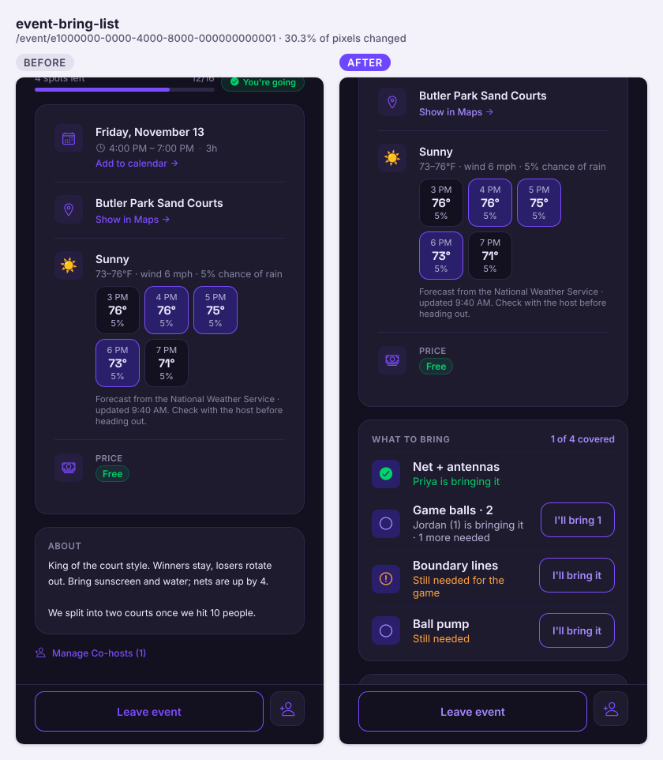
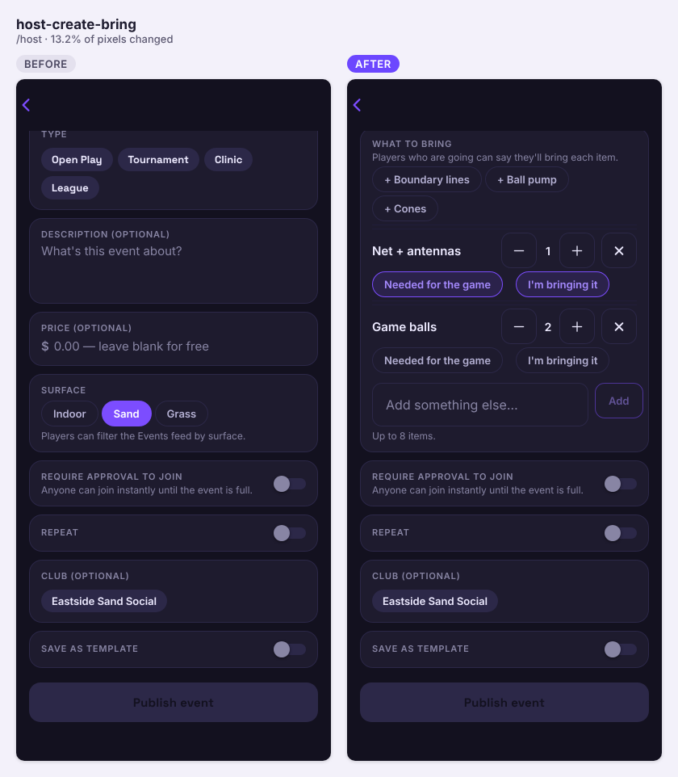
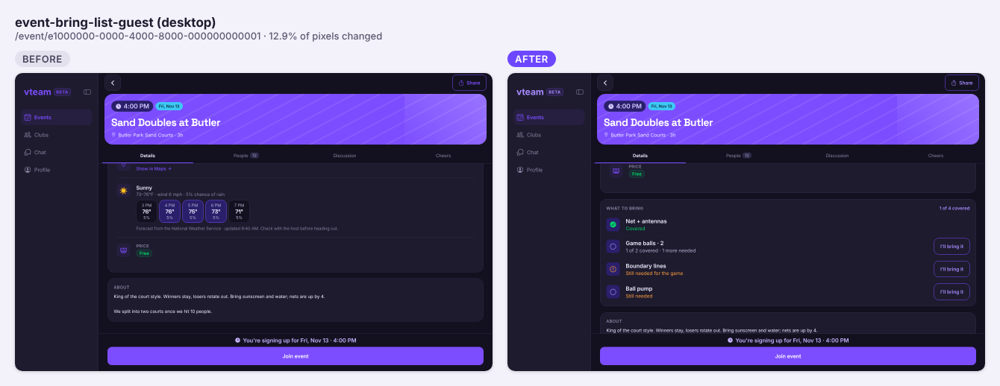
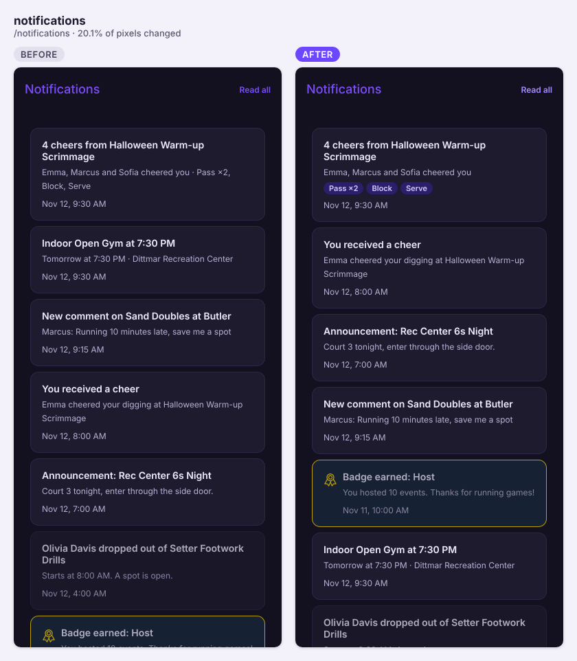
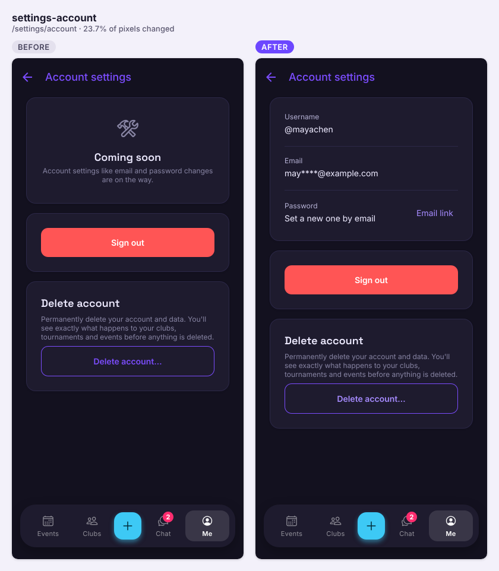
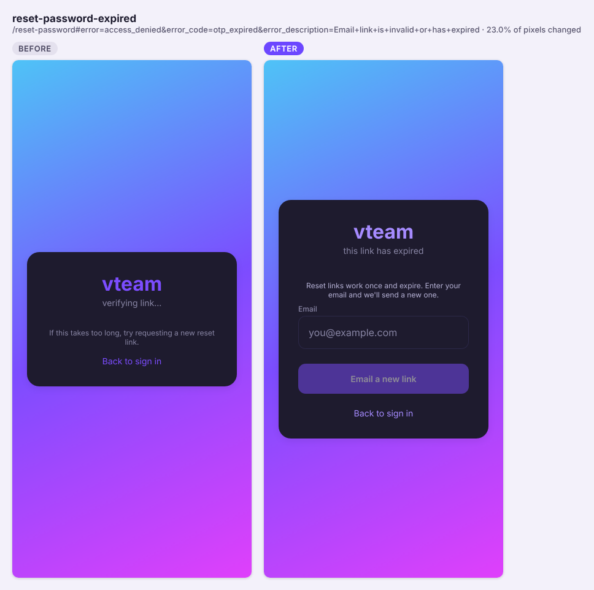
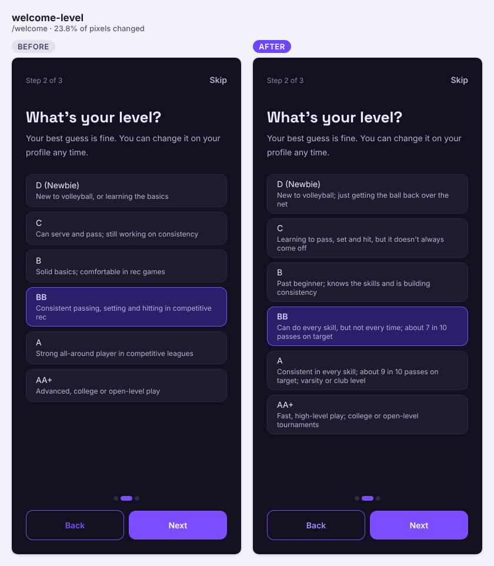
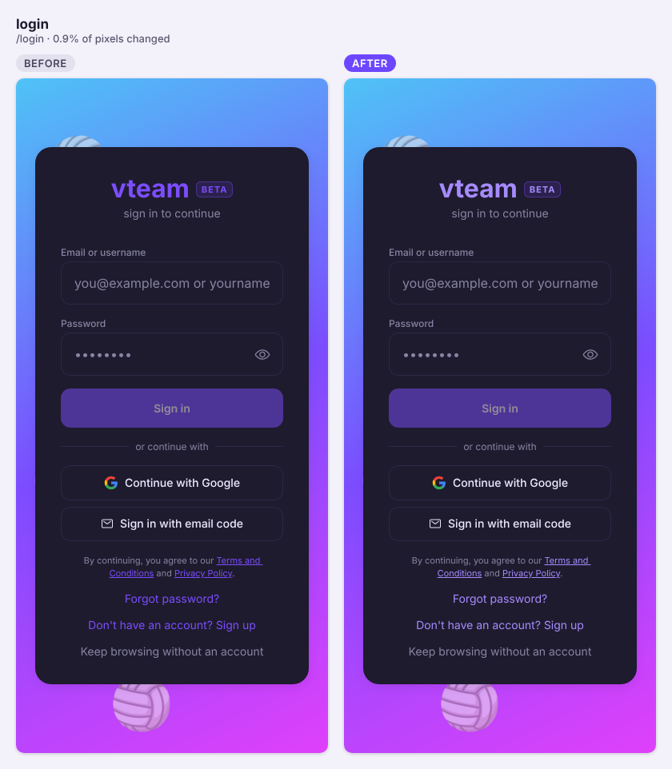

Eighteen PRs landed: What to bring for games, grouped cheer notifications, live scores and scorekeeping for the Texas Asian Olympics, a password reset that works, and rate limits. #258's migration is not on live yet, so member search is broken there until it is applied.

## Shipped

**Features**

- What to bring: hosts list the gear a game needs (net, balls, lines), players who are going tap "I'll bring it", the reminder says what they're bringing, and hosts hear 3 hours before start when a required item has no one (#257, closes #256)

  
  
  

  | Object | Change | Notes |
  |---|---|---|
  | `event_bring_items` | added | The host's list (label, quantity, required). Anyone can read; no client writes |
  | `event_bring_claims` | added | Who is bringing how many. Signed-in users read; no client writes |
  | `event_bring_alert_log` | added | Once-per-event host alert dedupe. Service-only |
  | `user_event_templates.bring_items` | added | Lists saved in host templates |
  | `get_event_bring_list(event)` | added | Items, counts, and claimer names for signed-in callers only. anon + authenticated |
  | `save_event_bring_items(event, items)` | added | Host/co-host, at most 8 items. authenticated |
  | `claim_bring_item` / `release_bring_item` | added | Attending players or host/co-host; row lock so claims never exceed the quantity; rate limited |
  | `event_attendees_release_bring_claims` | added | Trigger: leaving a game releases your claims |
  | `send_event_reminders()` | changed | Adds "You're bringing: …" and the uncovered-item host alert |
  | `notifications` type check | changed | Adds `bring_item_uncovered` (with a Settings → Notifications switch) |

  ```mermaid
  sequenceDiagram
    participant App
    participant PG as Postgres (SECURITY DEFINER)
    participant Cron as pg_cron event-reminders
    App->>PG: rpc claim_bring_item(item, qty)
    PG->>PG: attending or host? lock item row, cap at what's left
    PG-->>App: updated list
    Note over App,PG: player leaves → trigger releases their claims
    Cron->>PG: send_event_reminders()
    PG->>PG: reminder + "You're bringing: …"
    PG->>PG: 3 h before start, required item unclaimed → bring_item_uncovered to host (once, alert log)
  ```

- One notification per game for cheers (and one per event for edits), with one push: later cheers fold into the unread row ("5 cheers from Thursday Open Play"), with cheer-type chips in the inbox (#203, closes #194)

  

  | Object | Change | Notes |
  |---|---|---|
  | `notifications.group_key`, `group_count`, `last_activity_at` | added | Written by triggers; owner reads |
  | `notifications_open_group_uidx` | added | Partial unique `(user_id, group_key)` while unread; the `ON CONFLICT` target |
  | `notifications_user_activity_idx` | added | Inbox order |
  | `cheers_group_data` / `cheers_group_body` | added | Helpers, no client EXECUTE |
  | `notify_on_kudo_received()` | changed | Upserts the unread `cheers:<event>` row |
  | `notify_on_event_material_change()` | changed | Edits fold per event while unread |

  ```mermaid
  sequenceDiagram
    participant App
    participant PG as Postgres trigger
    participant Hook as Webhook → send-notification-push
    App->>PG: insert cheer
    PG->>PG: INSERT … ON CONFLICT (user_id, group_key) where unread
    alt first cheer of the game
      PG->>Hook: INSERT fires webhook → one push
    else later cheers
      PG->>PG: UPDATE count/body (no push)
    end
  ```

- Scores & brackets for outside tournaments run on the Google Sheet app, starting with the Texas Asian Olympics (Nov 14–15): Live courts, Pools, Brackets and Teams at `/scores/<id>`, plus "I'm a scorekeeper" to score point by point into the Sheet with a PIN (#248)
- The Texas AO Sheet URL now ships in the code, so the scores strip shows on the web and in the iPhone/Android builds without an env var (#262)
- Rate limits on posting (messages, comments, club posts, feedback), new DMs (30/hour), and member search, which moves to a server-side `search_members` RPC (#258, closes #11)

  | Object | Change | Notes |
  |---|---|---|
  | `rate_limit_insert()` | added | BEFORE INSERT trigger function; service role and cron aren't limited; over the limit → HTTP 429 |
  | `trg_rate_limit_*` on `messages`, `event_comments`, `tournament_comments`, `club_posts`, `club_post_comments`, `feedback_submissions` | added | 60/min, 20/min, 20/min, 10/min, 20/min, 5/hour |
  | `find_or_create_dm(other_user_id)` | changed | 30 new conversations an hour; opening an existing DM is free |
  | `search_members(query, limit)` | added | Escaped server-side, authenticated only, 120/min |

  ```mermaid
  sequenceDiagram
    participant App as App (new DM / co-host / invite)
    participant PG as Postgres
    App->>PG: rpc search_members(query, limit)
    PG->>PG: enforce_rate_limit(user, 120/min)
    PG-->>App: matching members (or 429)
    App->>PG: insert message
    PG->>PG: trg_rate_limit_messages → rate_limit_insert (60/min)
  ```

- Password reset that lands on the "set a new password" form, says when a link has expired (with "Email a new link"), signs out other devices, and works from the native apps; Settings → Account now shows username, masked email and a password link (#231, closes #223)

  
  

  | Object | Change | Notes |
  |---|---|---|
  | `profiles_guard_username` | added | BEFORE UPDATE OF username trigger: clients can't rename after sign-up |

- Skill level hints rewritten around consistency and pass accuracy (e.g. BB "about 7 in 10 passes on target"), in player setup and the profile editor (#207)

  

- Elemental communication and setter avatar borders, plus the updated vteam logo and app icon (#204, #253)

**Fixes**

- Purple text meets WCAG AA contrast across the app; axe's serious/critical findings drop from 1217 to 245 (#237, closes #134)

  

- Events keeps its scroll after Back on desktop, and phone web no longer flashes the top first (#260, closes #254)
- Profile no longer flickers on Back or refresh; the Admin group moves to the end of the menu (#250)
- Intro tour: "Pick a day" no longer gets skipped under the Tournament filter; a skipped step is now recorded (#249)
- Elemental storm/aether avatar borders render correctly (#253)

**Under the hood**

- Background job health check every 3 hours: a GitHub run emails you when a pg_cron job, points payout, feed or push webhook stops working (#233, closes #157)

  | Object | Change | Notes |
  |---|---|---|
  | `job_health()` | added | SECURITY DEFINER, anon EXECUTE; counts and ages only (cron jobs, unpaid attendees, feeds, failed pg_net calls) |

  ```mermaid
  sequenceDiagram
    participant GH as GitHub job-health.yml (every 3 h)
    participant PG as Postgres (live, beta)
    GH->>PG: rpc job_health() (anon key)
    PG-->>GH: check_name, ok, last_ok_at, failures_24h, detail
    GH->>GH: compare with EXPECTATIONS
    GH-->>GH: fail run + summary table → email
  ```

- Stability check in CI: intro tour under every filter, refresh/Back scroll, and every shareable link on each PR (#259, closes #255)
- Android app e2e: a release APK on an emulator, driven by Maestro flows (guest tabs, event link, tour, sign-in) (#252)
- `types/database.ts` regenerated from live after #233, #257 and #203 (#251, #266)

## Closed issues

- #256 What to bring: hosts list the net and balls, players say "I'll bring it"
- #255 Stability check in CI: today's tour, flicker and link checks run on every PR
- #254 Back to the same place on desktop: the Events feed keeps its scroll after an event page
- #228 Messages that show up on the web: replace 54 silent `Alert.alert` calls with one toast and inline errors
- #223 Account basics that work: a password reset that lands where it should
- #194 One notification per game for cheers (and one per event for edits), with one push
- #166 Testing: native app smoke tests with Maestro on an Android emulator (nightly + native PRs)
- #157 Background job health check: catch a silent pg_cron or push failure within hours
- #134 a11y: raise subtext (and primary-as-text) contrast to WCAG AA
- #15 Friends & best friends (social graph)
- #11 Rate limiting on abuse-prone endpoints (anti-DDoS/brute-force)

## In progress

- #265 Shared event links open with the game already on screen (#244): open
- #264 Report player writes a real report the team reviews (#243): open, has merge conflicts; migration on beta
- #263 Hold the production deploy until live has merged migrations (#245): open
- #261 Elemental avatar border layering: open
- #120 Admin-only AI badge art (#10, schema): open, has merge conflicts; migration on beta

## Needs you

- Apply #258's migration `20261028140000_rate_limits.sql` to live, then run `select beta_meta.complete_pr(258);` on beta. Main's CI fails schema drift on it, and the app now calls `search_members`, which live doesn't have yet (new DM, co-host and tournament-invite search).
- Texas AO scorekeeping: update the Sheet's `Code.gs` with the `doPost` from #248 and deploy it as a New version (keeps the URL); until then scores show but scorekeeping can't save.
- Add `https://vteamvolleyball.com/reset-password` to Supabase Auth → URL Configuration → Redirect URLs on live (#231; the fix works without it via the home-page fallback).
- Trigger the Job health workflow once by hand (#233). Its 23:53 UTC run failed because live answered `job_health` with HTTP 503.
