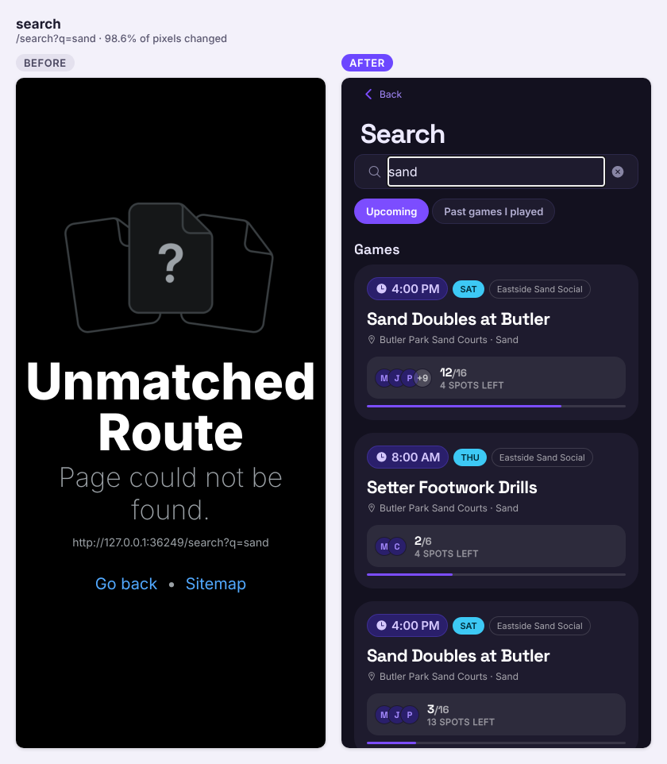
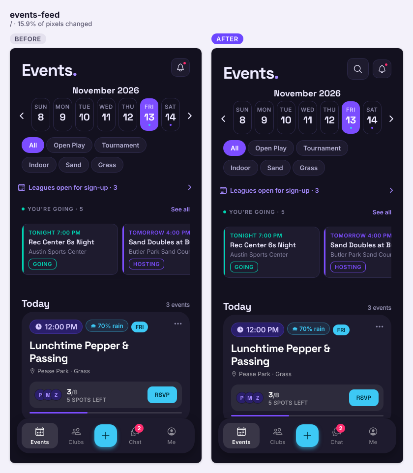
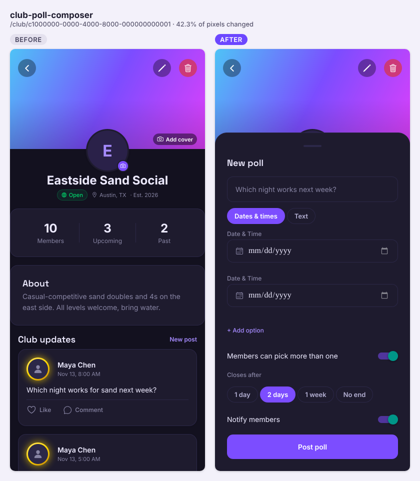
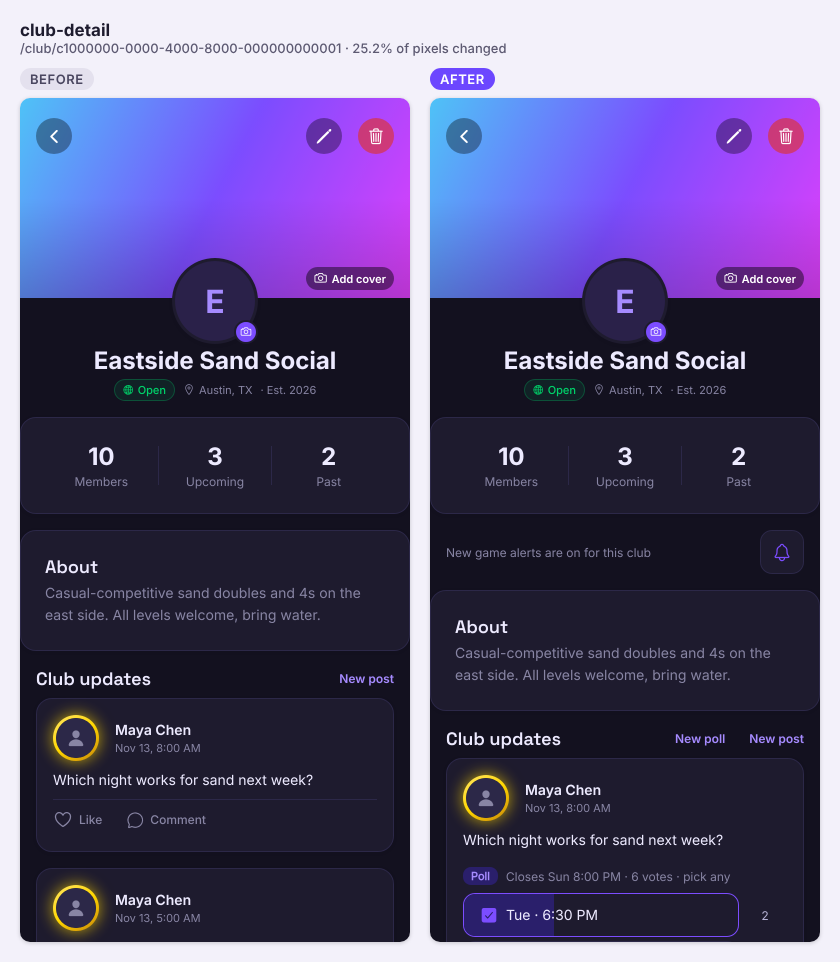
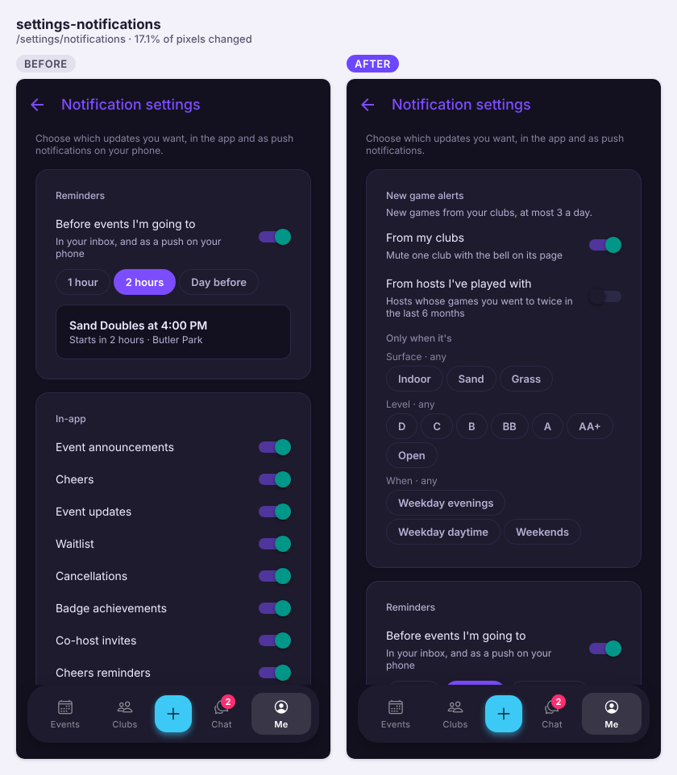
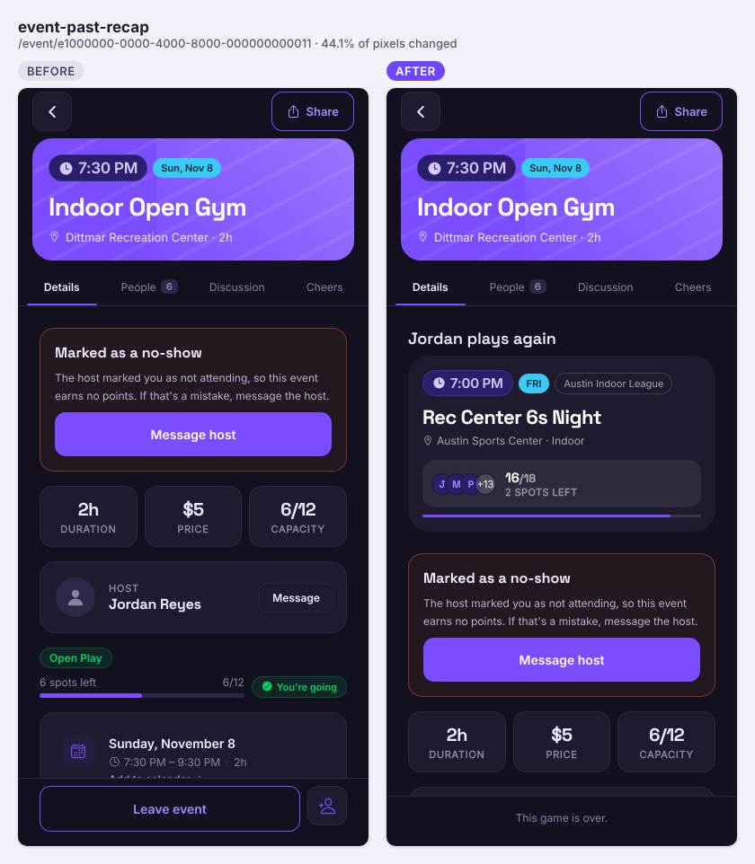
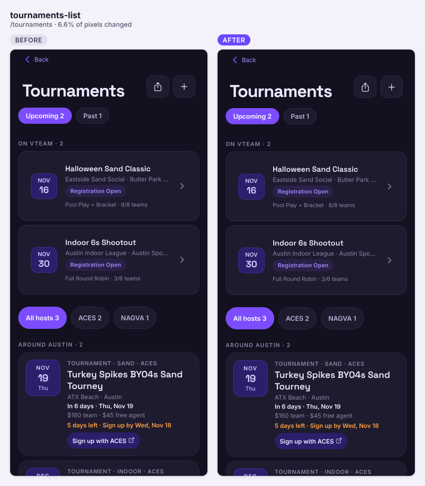

Thirty-one PRs landed and nineteen issues closed: search, club polls, new game alerts, real player reports, game recaps, web push, the Expo SDK 58 upgrade, and outage hardening after the Nov 12 freeze.

## Shipped

**Features**

- Search: a search button on the Events header opens one box that finds games (vteam and other venues), hosts with upcoming games and clubs; signed-in players can search their past games. The search sits in the URL, so links and Back keep it (#272, closes #176)

  
  

  | Object | Change | Notes |
  |---|---|---|
  | `pg_trgm` extension + six trigram indexes | added | On event title/location, outside session title/venue, club name, username |
  | `search_score(q, text)` | added | Substring match, else trigram word similarity (typos). anon + authenticated |
  | `search_feed(q, scope, region)` | added | SECURITY INVOKER (RLS decides), 2–60 chars, max 20 per group; hosts only with upcoming games, public columns. anon + authenticated |

  ```mermaid
  sequenceDiagram
    participant App as App (useSearch)
    participant PG as Postgres + RLS
    App->>App: wait 250 ms, need 2+ chars
    App->>PG: rpc search_feed(q, scope, region)
    PG->>PG: search_score() over events, outside sessions, hosts, clubs
    PG-->>App: ranked event ids, sessions, hosts, clubs
    App->>PG: select events (EVENT_CARD_LIST_SELECT) in ids
    PG-->>App: cards
  ```

- Club polls: owners post a poll (dates & times or text, 2–10 options, close time, notify members); members vote in one tap; when a time poll closes, the owner can create the event for the winning time and the poll links to it (#273, closes #175)

  
  

  | Object | Change | Notes |
  |---|---|---|
  | `club_polls`, `club_poll_options`, `club_poll_votes` | added | Club members read (votes visible to members); no client writes |
  | `create_club_poll(...)` | added | Owners; inserts post + poll + options, notifies members. authenticated |
  | `vote_club_poll(post, options)` | added | Members while open; replaces the caller's picks. authenticated |
  | `link_poll_event(post, event)` | added | Owner who created the club's event. authenticated |
  | `notifications` type check | changed | Adds `club_poll` |

  ```mermaid
  sequenceDiagram
    participant Owner as App (owner)
    participant Member as App (member)
    participant PG as Postgres (RPCs)
    Owner->>PG: rpc create_club_poll(club, question, options, closes_at, notify)
    PG->>PG: insert club_posts + club_polls + options; club_poll notifications
    Member->>PG: rpc vote_club_poll(post, option_ids)
    PG-->>Member: picks replaced (optimistic in app)
    Note over Owner,PG: poll closes (timestamp, no cron)
    Owner->>PG: save_event(...) prefilled from winning time
    Owner->>PG: rpc link_poll_event(post, event)
  ```

- New game alerts: players hear when a club they're in, or a host they keep playing with, posts a game that fits their surface/level/time filters; settings in Notifications, and a mute bell per club (#270, closes #170)

  

  | Object | Change | Notes |
  |---|---|---|
  | `user_settings.game_alerts` | added | jsonb, clubs on / hosts off by default; owner-only |
  | `club_members.game_alerts` | added | bool, default true; written only by `set_club_game_alerts` |
  | `set_club_game_alerts(club, on)` | added | Own row only. authenticated |
  | `game_alert_log` | added | One alert per player and event. Service-only |
  | `game_alert_matches()`, `new_game_alert_text()`, `send_new_game_alerts()` | added | No client EXECUTE |
  | `events_created_at_idx` | added | Partial index for the job's window |
  | `new-game-alerts` cron job | added | Every 10 minutes |
  | `notifications` type check | changed | Adds `new_game` |

  ```mermaid
  sequenceDiagram
    participant Cron as pg_cron (every 10 min)
    participant PG as send_new_game_alerts()
    participant Hook as Webhook → send-notification-push
    Cron->>PG: run
    PG->>PG: games created 10–70 min ago, not cancelled/started/full
    PG->>PG: club members + 2-games-in-180-days players, minus host/roster/silenced
    PG->>PG: game_alert_matches(filters); max 3/day; fold per club or host
    PG->>PG: insert new_game notifications + game_alert_log
    PG-->>Hook: notifications INSERT → push
  ```

- Report player writes a real report: reason, details and "Also silence", rate limited with a copy of the reported text; admins review in Admin metrics → Reports and Dismiss / Warn / Suspend (#264, closes #243)

  | Object | Change | Notes |
  |---|---|---|
  | `user_reports` | added | No client access at all |
  | `report_user(target, kind, context, reason, details)` | added | Signed in, not yourself, 10/day, one open per context. authenticated |
  | `admin_reports(status)`, `admin_resolve_report(id, action, note)` | added | Admin only (42501 otherwise) |
  | `notifications` type check | changed | Adds `moderation_warning`, `report_resolved` |

  ```mermaid
  sequenceDiagram
    participant App as App (reporter)
    participant PG as Postgres
    participant Admin as App (admin)
    App->>PG: rpc report_user(...)
    PG->>PG: check_rate_limit, snapshot text, insert user_reports
    Admin->>PG: rpc admin_reports('open')
    Admin->>PG: rpc admin_resolve_report(id, warn)
    PG->>PG: moderation_warning → reported player; report_resolved → reporter
  ```

- Game recap: finished games drop Join/Leave and show Your game (points, cheers, games this year), Share your game as a picture, and the host's next game (#274, closes #227)

  

- Web push: the site is installable, Settings → Notifications on web can turn on browser pushes (with iPhone Add to Home Screen steps), and the edge functions send to browsers (#278); plus a "Get a reminder before this game?" nudge after RSVP (#283) (part of #189)

  | Object | Change | Notes |
  |---|---|---|
  | `push_tokens.web_keys` | added | Nullable jsonb (`p256dh`, `auth`); check requires them for web rows. RLS unchanged |
  | `send-notification-push`, `send-chat-push` | changed | Send web tokens via VAPID; 404/410 deletes the token |

  ```mermaid
  sequenceDiagram
    participant Browser as Browser (sw.js)
    participant App
    participant PG as Postgres
    participant Fn as send-notification-push
    App->>Browser: tap Turn on → permission, pushManager.subscribe(VAPID key)
    App->>PG: upsert push_tokens (platform web, endpoint, web_keys)
    PG-->>Fn: notifications INSERT webhook
    Fn->>Browser: Web Push (VAPID JWT + aes128gcm)
    Browser->>App: tap → focus window, open deep_link
  ```

- Shared event links open with the game already on screen: the page carries the event inside it (#265, closes #244)
- Tournaments: double elimination plays a grand-final reset when the losers-bracket champion wins (#281, part of #7)
- AI badge art for admins: an edge function generates tier art once and stores it; earned tiers show it over the bundled art (#120, closes #10)

  | Object | Change | Notes |
  |---|---|---|
  | `badge_art` | added | Badge tier → image URL. Anyone reads URL columns; no client writes |
  | `generate-badge-art` edge function | added | Admin only; OpenAI Images → `badges` bucket → upsert `badge_art` |

  ```mermaid
  sequenceDiagram
    participant CLI as scripts/generate-badge-art.mjs (admin)
    participant Fn as generate-badge-art
    participant AI as OpenAI Images API
    participant PG as Postgres + Storage
    CLI->>Fn: tier spec (JWT)
    Fn->>PG: caller is admin?
    Fn->>AI: generate 1024×1024 PNG
    Fn->>PG: upload badges/generated/…; upsert badge_art
    Fn-->>CLI: image URL
  ```

**Fixes**

- When the server stalls: requests count as failed after 15–20 s, a status bar says "vteam isn't answering" with Retry, refetches/heartbeats/analytics pause, and failed saves say the server didn't save it (#293, closes #289)
- Events no longer crash for returning players holding an old saved ads copy (snapshot version bumped); Sentry now labels errors by database (#296)
- Tournaments stop jumping on load (club list saved on the device, same-height placeholders) and Back rows no longer grow (#292, closes #288)
- Avatar borders: pickers show your photo, and Stormcaller/Aether no longer cover it (#271, #261)

  

**Under the hood**

- One-transaction event save: `save_event` writes every date and tag (and promotes waitlisted players on edit) in one call, and the host form is split into a pure core, hooks and sections (#295, #294, #287, closes #188)

  | Object | Change | Notes |
  |---|---|---|
  | `save_event(edit_id, event, dates, tag_ids)` | added | SECURITY INVOKER (RLS applies), authenticated only; 1–52 dates; edit promotes waitlist under the capacity lock |

  ```mermaid
  sequenceDiagram
    participant App as App (useSaveEvent)
    participant PG as Postgres + RLS
    App->>PG: rpc save_event(edit_id, event, dates, tag_ids)
    alt create
      PG->>PG: insert one events row per date + event_tags
    else edit
      PG->>PG: update row, diff tags
      PG->>PG: lock event_capacity, promote oldest waitlisted
    end
    PG-->>App: event ids (all or nothing)
  ```

- Events screen split into calendar, section rules, hiding hook and layouts: 1,398 → 397 lines, no change on screen (#279, #284, #285, #286, closes #217)
- Upgrade to Expo SDK 58 / React Native 0.88 (#269, closes #226)
- Startup config from the CDN as an A/B experiment, and the update check no longer reads the ad tables on every screen (#276, #280, closes #216)
- Startup budget in CI: first screens fail the build if they get slower or send more reads (#275, closes #225)
- Server headroom watch every 30 minutes on live: memory commitment, RAM, swap, disk, connections (#291, closes #290)
- Production deploy waits for the live schema: a "Live schema ready" check (#263) and a gate inside the Vercel build itself (#267) (closes #245)
- Edge functions deploy from main after an approval (#277, closes #172)
- Flaky usage-metrics e2e test fixed (#268)

## Closed issues

- #290 Server headroom watch
- #289 When the server stalls
- #288 Tournaments stops jumping
- #245 Schema first, then code: hold the production deploy
- #244 Shared event links open with the game already on screen
- #243 Reports that reach someone
- #227 Game recap card
- #226 Upgrade Expo SDK 54 → 58
- #225 Startup guard
- #217 Events screen in pieces
- #216 Startup config from the CDN
- #188 Host form in pieces
- #176 Search games
- #175 Club polls
- #172 Testing: edge function tests, approved deploy, drift check
- #170 New game alerts
- #99 Privacy fixes before store launch
- #10 AI image generation for tier badges
- #7 Tournaments: pool play, bracket, trophies

## In progress

- No open PRs.

## Needs you

If not done already:

- Web push (#278): generate VAPID keys (`npx web-push generate-vapid-keys`), set `VAPID_PUBLIC_KEY`, `VAPID_PRIVATE_KEY`, `VAPID_SUBJECT=https://vteamvolleyball.com` as live function secrets and redeploy `send-notification-push` / `send-chat-push`; add `EXPO_PUBLIC_VAPID_PUBLIC_KEY` in Vercel and redeploy.
- Server headroom (#291): create a live Secret API key (e.g. `ci-metrics`), add it as repo secret `SUPABASE_METRICS_KEY`, and run the workflow once by hand.
- Function deploys (#277): create the GitHub environment `production` (you as required reviewer) with a `SUPABASE_ACCESS_TOKEN` secret.
- Badge art (#120): set the `OPENAI_API_KEY` function secret.
