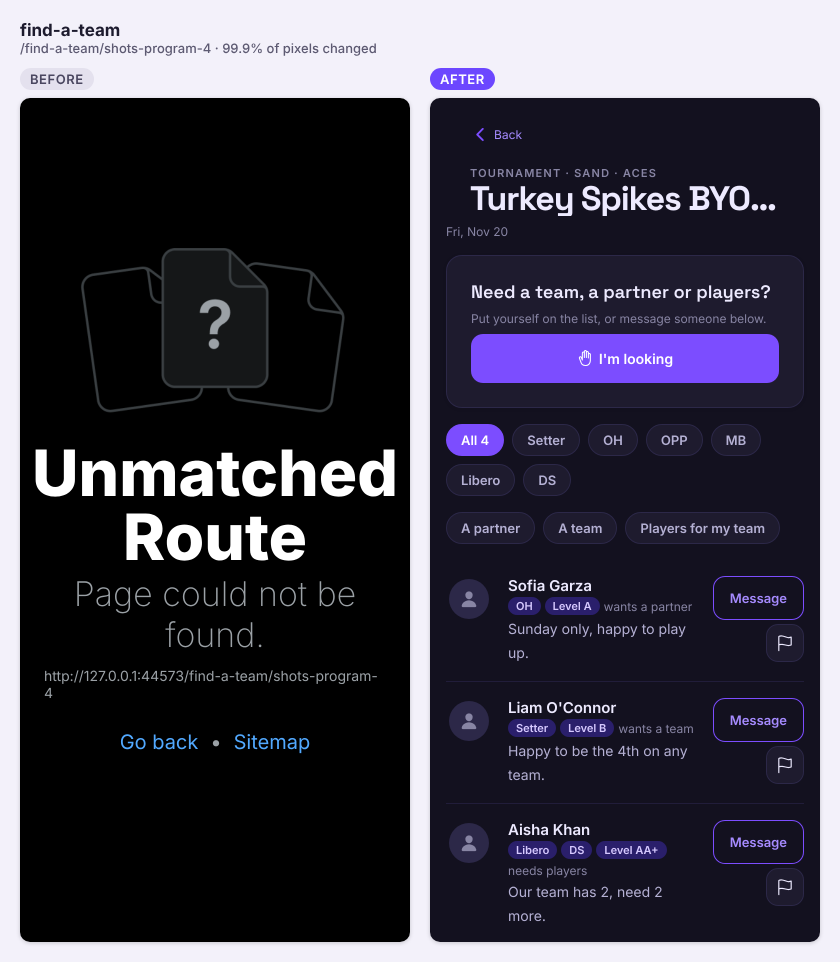
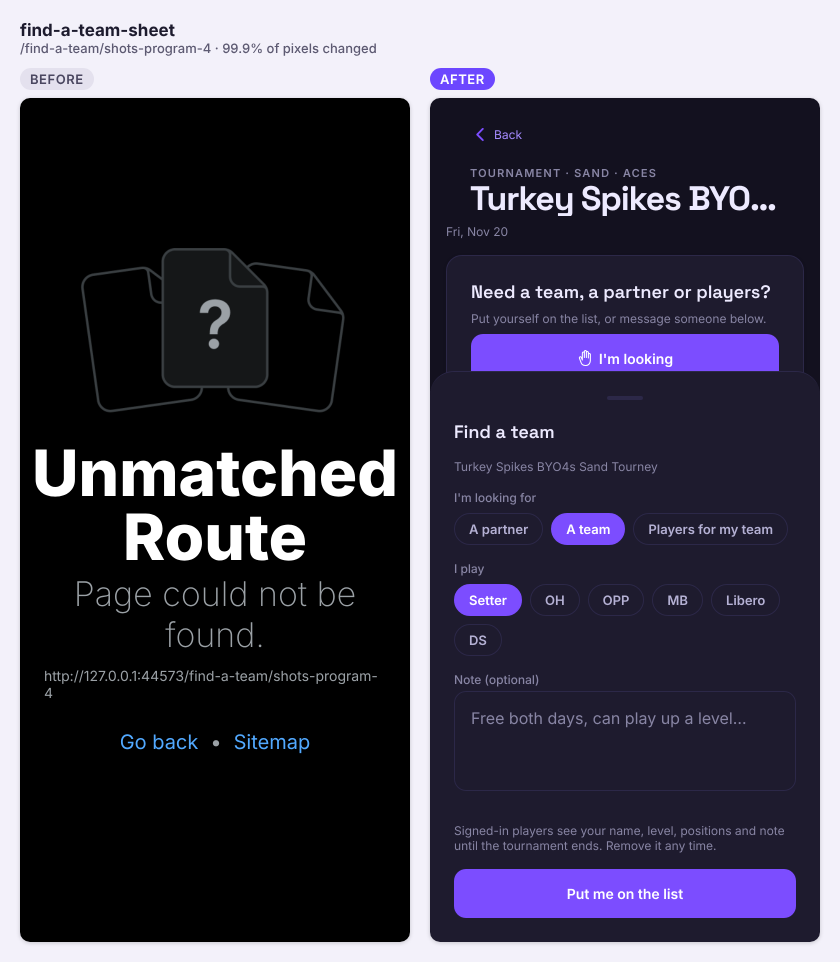
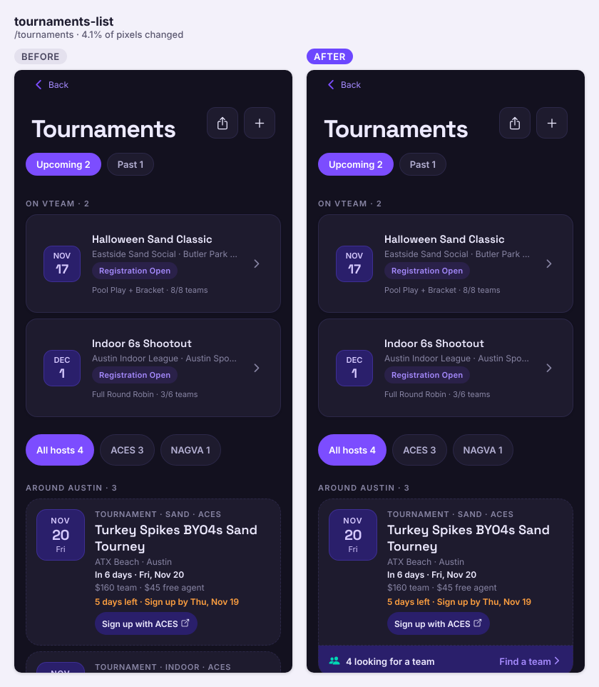
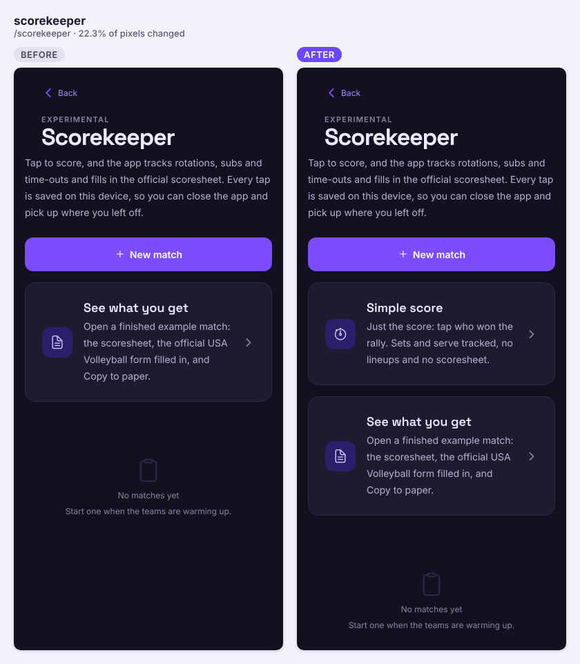
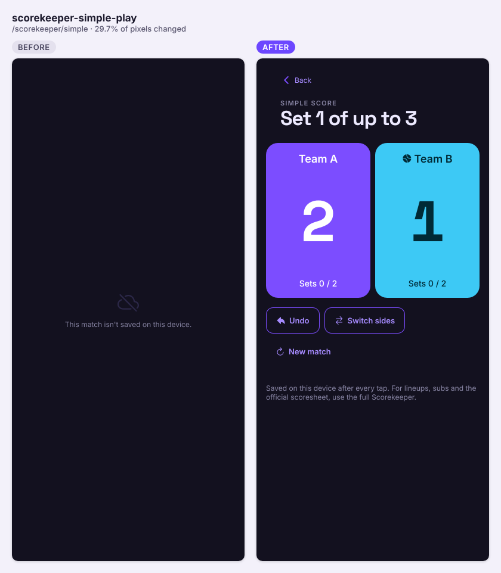
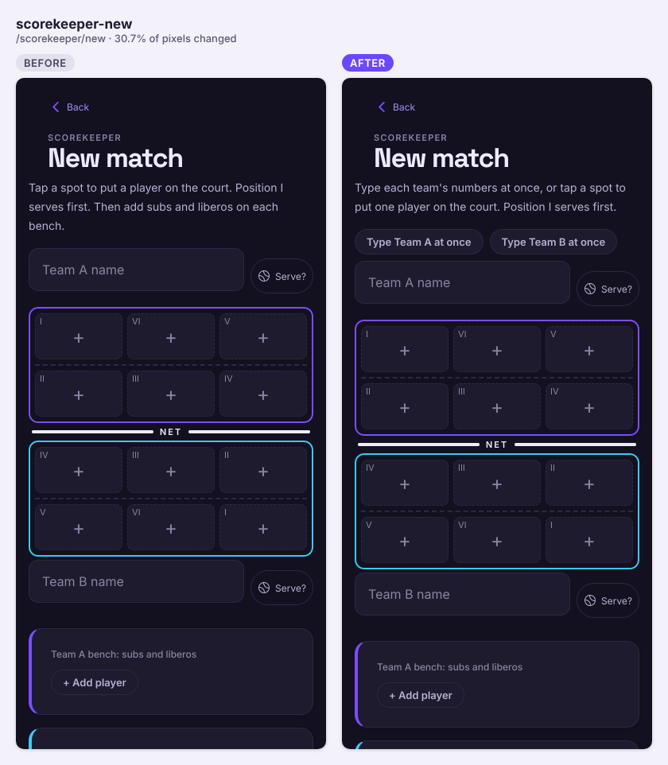
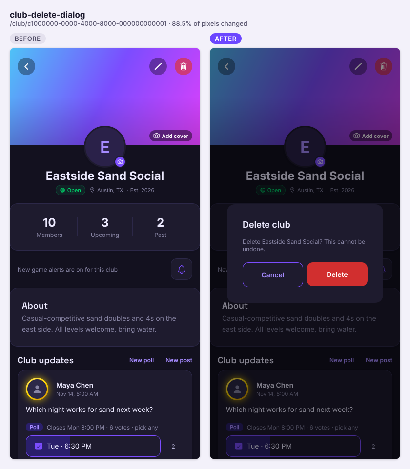
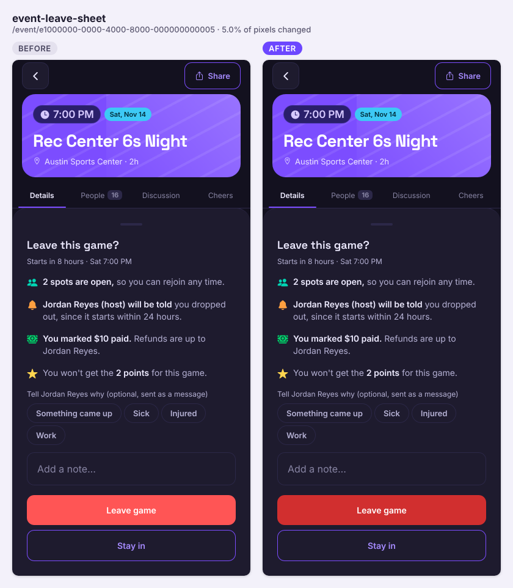

Eleven PRs landed for Texas AO weekend: Find a team on outside tournaments and leagues, a Simple score counter and faster team entry in the Scorekeeper, a losers bracket on the live scores page, and cleaner event links.

## Shipped

**Features**

- Find a team: outside tournaments and leagues that haven't ended get a "Find a team" strip; players list themselves (a partner, a team, or players for their team, positions and a short note), signed-in players browse and Message each other, guests see how many are looking (#310, closes #304)

  
  
  

  | Object | Change | Notes |
  |---|---|---|
  | `program_free_agents` | added | `program_id` (no FK to the rebuilt programs mirror), `user_id` → profiles on delete cascade, want, positions, note ≤ 200, copied title and `expires_on`; unique per program + user. Authenticated read own rows plus unexpired rows where neither side silenced the other; write own rows only. No anon access |
  | `program_free_agents_fill()` trigger | added | Own rows only (42501); copies title and last day from `external_programs`; refuses unknown or finished programs (P0002). No client EXECUTE |
  | `free_agent_visible(uuid)` | added | Silence check in both directions. authenticated |
  | `program_free_agent_counts(text[])` | added | Counts only, up to 100 ids, unexpired. anon + authenticated |
  | rate limit trigger | added | 20 inserts an hour per user |

  ```mermaid
  sequenceDiagram
    participant App as App (Tournaments / Leagues)
    participant Page as App (/find-a-team)
    participant PG as Postgres + RLS
    App->>PG: rpc program_free_agent_counts(ids)
    PG-->>App: (program_id, n) — numbers only
    Page->>PG: insert program_free_agents (own row)
    PG->>PG: rate limit; fill trigger checks owner, copies title/expires_on from external_programs
    Page->>PG: select program_free_agents
    PG->>PG: policy: unexpired + free_agent_visible(user)
    PG-->>Page: listed players → Message opens a DM
  ```

- Scorekeeper Simple score: a plain point counter next to the official scoresheet: two team names, a format, who serves, then two big buttons with undo; kept on the device (#311)

  
  

- Scorekeeper: type or paste a whole team at once (liberos and captain marked), and the match clock now alerts at 0:00 and offers +1 / +2 / +5 min next to End on time (#309)

  

- Texas AO Sunday: the scores page draws the losers bracket, shows planned times for games not started, and lists each team's ref duties (#302)

**Fixes**

- Event links open clean: no "event/[id]" header while the page loads, and Back/Share and the tab bar show from the first frame (#307, closes #306)
- Texas AO scores point at the Sheet the tournament's site actually links (56 teams, 4 divisions) (#297)
- vteam only reads the Texas AO Sheet: no "I'm a scorekeeper" for that tournament, which is scored at the desk (#301)
- Gentler on the organizer's Sheet: live scores refresh every 30 s instead of 10 s (#300)
- Original purple V logo restored for the favicon and app icons (#303)

**Under the hood**

- Club page split into hooks and sections (893 → 204 lines), one join/leave path for the club page and Clubs list; delete uses the shared dialog, and filled danger buttons are a darker, accessible red everywhere (#308, closes #305)

  
  

- Tournament engine rules for the new tournament creation: divisions fed by pool finish, partial round robin, and 1–1 pool ties worth half a win. Pure code, nothing visible yet (#298)
- Shadow-mode recorder: a GitHub workflow saves the Texas AO feed whenever it changes (now once a minute) so the engine can be replayed against it later (#297, #300)

  ```mermaid
  sequenceDiagram
    participant GA as GitHub Actions (sheet-recorder.yml)
    participant Sheet as Google Apps Script (?format=json)
    GA->>Sheet: GET feed, once a minute
    Sheet-->>GA: tournament state + stamp
    GA->>GA: save a copy when stamp changes
    GA->>GA: upload snapshots as artifact
  ```

## Closed issues

- #304 Find a team: players looking for a tournament or league team, right on the card
- #305 Club page in pieces: one membership hook, an edit hook, and sections under 250 lines
- #306 Event links open clean: no "event/[id]" header, and the header row is there from the first frame

## In progress

- #312 Scorekeeper fewer taps (all numbers on one screen, one-tap serve, minimal scoring screen): CI green except the accessibility check, which hasn't reported; behind main
- #299 Tournament divisions and days (schema, expand only): unit tests failing and behind main; at merge it needs the up SQL applied on live, types regenerated and `complete_pr` on beta

Screenshots: mocked export, mobile, `02b45d2` → `c24a289`.
