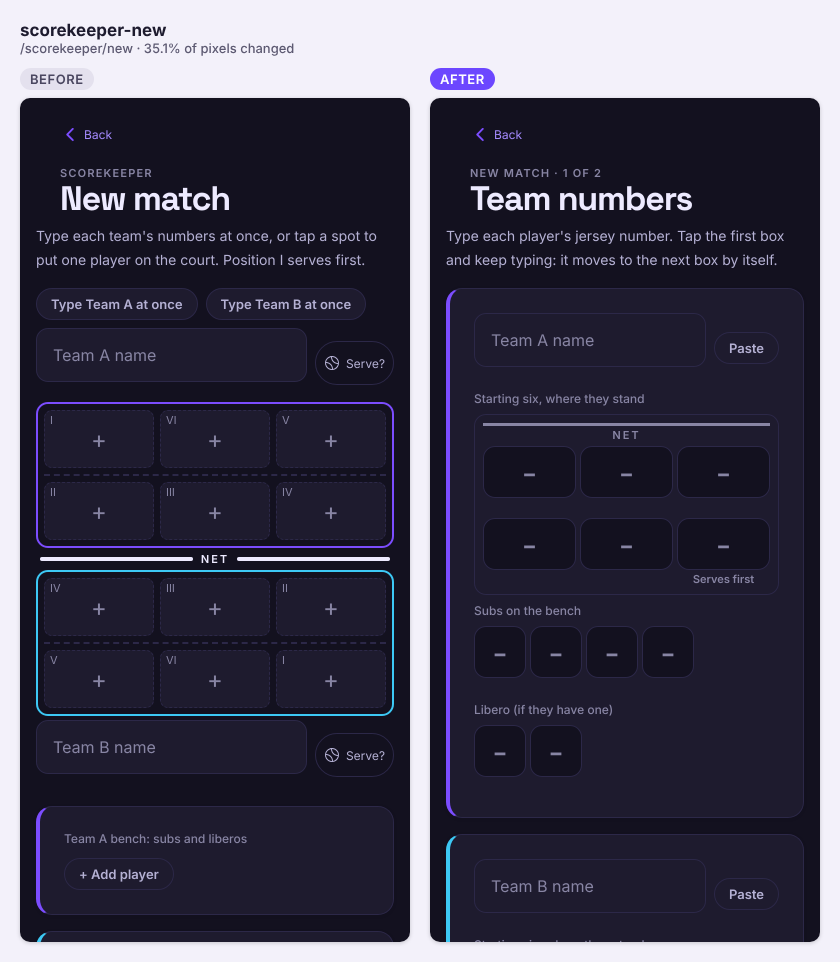
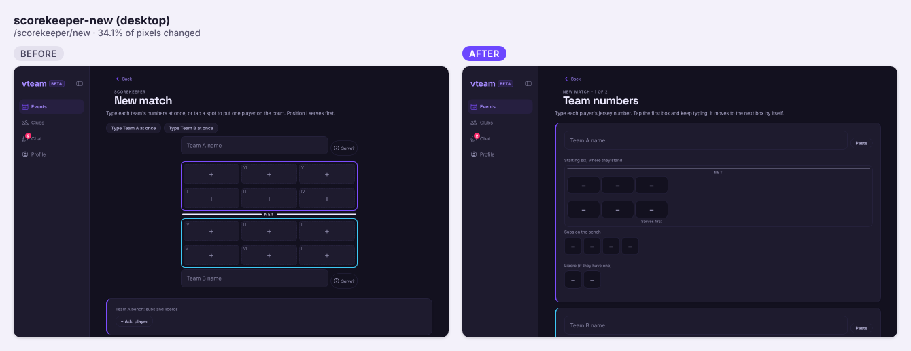
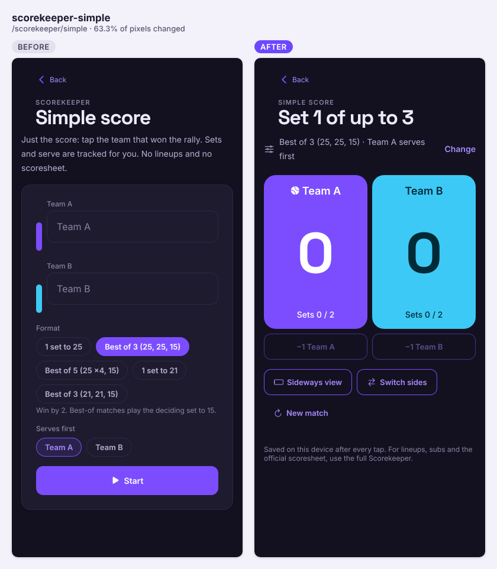
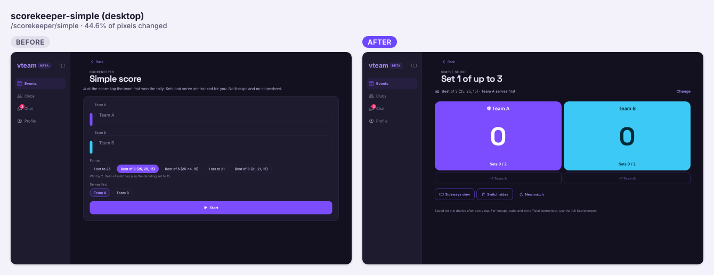
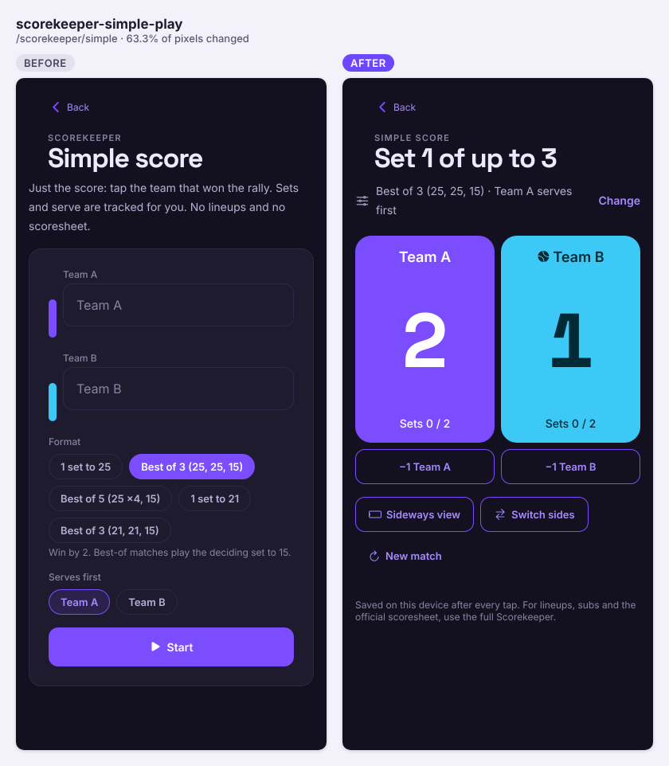
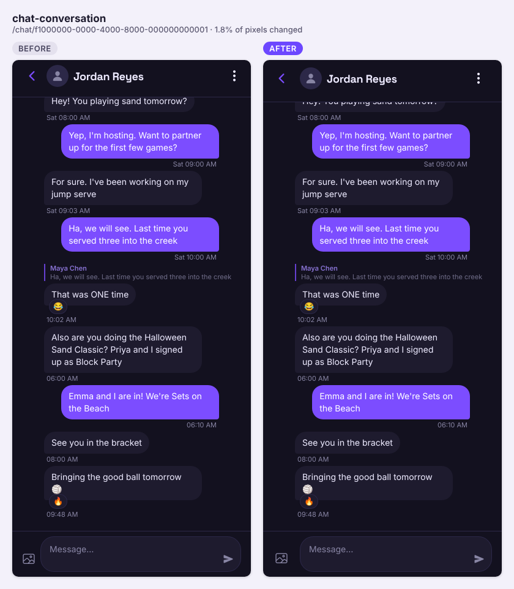
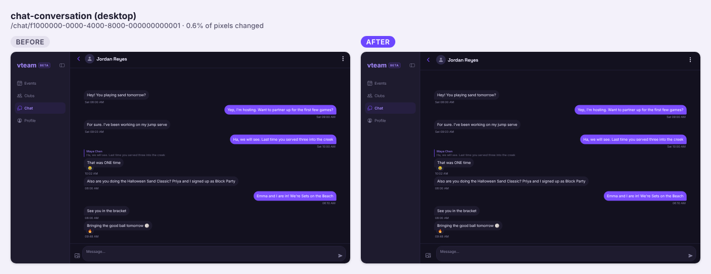
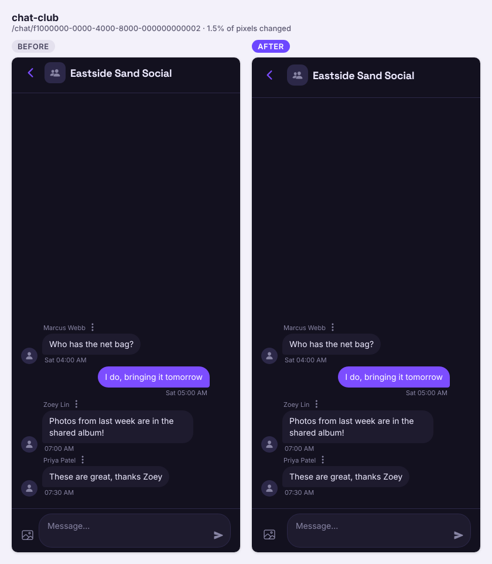

Eight PRs landed: a faster Scorekeeper (two-step setup, minimal scoring screen, Simple score straight on the board), crashes that no longer stick, a cleaner chat room, and a new CI upgrade check. Heads-up: nothing has deployed to production since #315.

## Shipped

**Features**

- Scorekeeper takes fewer taps: New match is two steps (every jersey box for both teams on one screen, typing moves box to box, then one tap on who serves first starts the match); the scoring screen is just two big point buttons, Undo and More; between sets "Same lineups, start set N" is one tap. Simple score now opens straight on the board with −1 per team, format under Change, and a sideways view (#312)

  
  
  
  
  

- A crash never sticks: every way out of the error screen clears cached reads and device snapshots; a repeat crash offers Reload vteam / Report the problem (bug form prefilled with screen, time, version, platform); for 10 minutes after a crash the app starts without saved copies; crashes are counted and job health emails you at 3+ people in 3 h (#319, closes #316)

  | Object | Change | Notes |
  |---|---|---|
  | `job_health()` | changed | New `app: crashes` row: counts of `app_crash` events in 24 h and people in 3 h (fails at 3+), test accounts in `metrics_excluded_users` left out; aggregates only. SECURITY DEFINER, anon + authenticated execute (unchanged) |

  ```mermaid
  sequenceDiagram
    participant App as App (ErrorFallback)
    participant PG as Postgres (app_events)
    participant GH as job-health.yml (every 3 h)
    App->>App: recoverFromCrash(): drop cached reads + both snapshots, set vteam.crashMarker
    App->>PG: insert app_crash {screen, attempt, had_snapshot} (flushed at once)
    GH->>PG: rpc job_health()
    PG-->>GH: app: crashes row (fails at 3+ people in 3 h)
    GH-->>GH: failing run emails the owner
  ```

**Fixes**

- Profile and Clubs no longer flash the top for a frame when you come back from a pushed screen like Cheers (#313)
- Next up on iPad/desktop skips outside tournaments, which opened a broken event page (#314)

**Under the hood**

- Chat room split into pieces (757 → 238 lines), same behavior; compact header now has 44pt Back and menu targets (about 8px taller), better labels, and the bad-word prompt uses ConfirmDialog (#321, closes #318)

  
  
  

- Upgrade check in CI: every PR's build is opened on a device that last ran `main`, catching saved-data crashes like Nov 13's (#320, closes #317)
- Accessibility baseline lowered for the chat room after #321 (#322)
- Vercel builds production only; PRs no longer get preview deploys (#315)

## Closed issues

- #316 A crash never sticks: the error screen clears saved data, gets you back, and tells us
- #317 Upgrade check: every PR opens on a device that last ran `main`
- #318 Chat room in pieces: composer, mentions and the bad-word prompt out of a 757-line screen

## In progress

- #299 Tournament divisions and days (schema, expand only): unit tests failing and behind main; at merge it needs the up SQL on live, types regenerated and `complete_pr` on beta

## Needs you

- Production hasn't deployed since #315: every main commit after it (#319, #320, #321, #322) shows Vercel "Canceled by Ignored Build Step", and the last Production deployment is #312's `246c7f5`. The new `ignoreCommand` is skipping production too (check that `VERCEL_ENV` reaches the Ignored Build Step, or remove the line and redeploy)
- Job health is failing: `cron: new-game-alerts` has no entry in `EXPECTATIONS` in `scripts/job-health.mjs`

Screenshots: mocked export, mobile and desktop, `c24a289` → `3fd01b8`.
