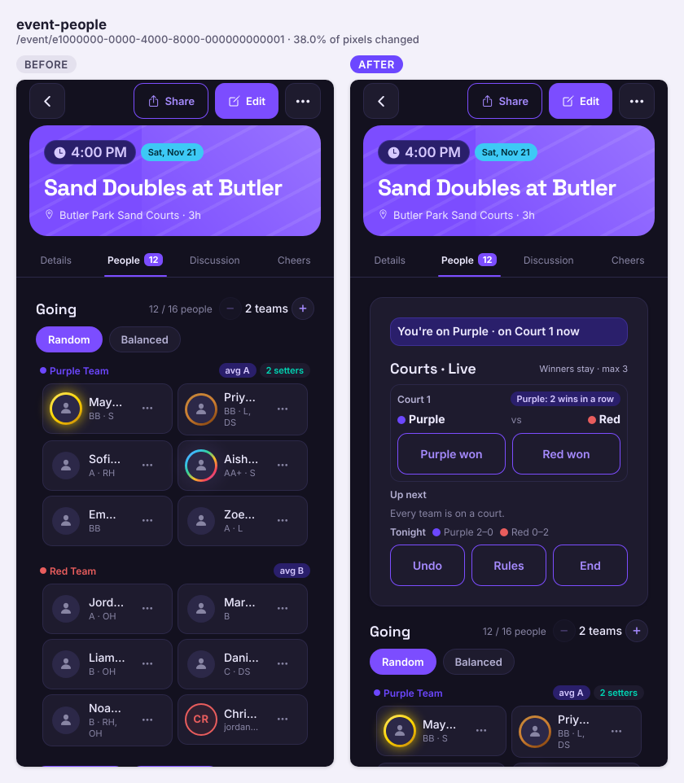
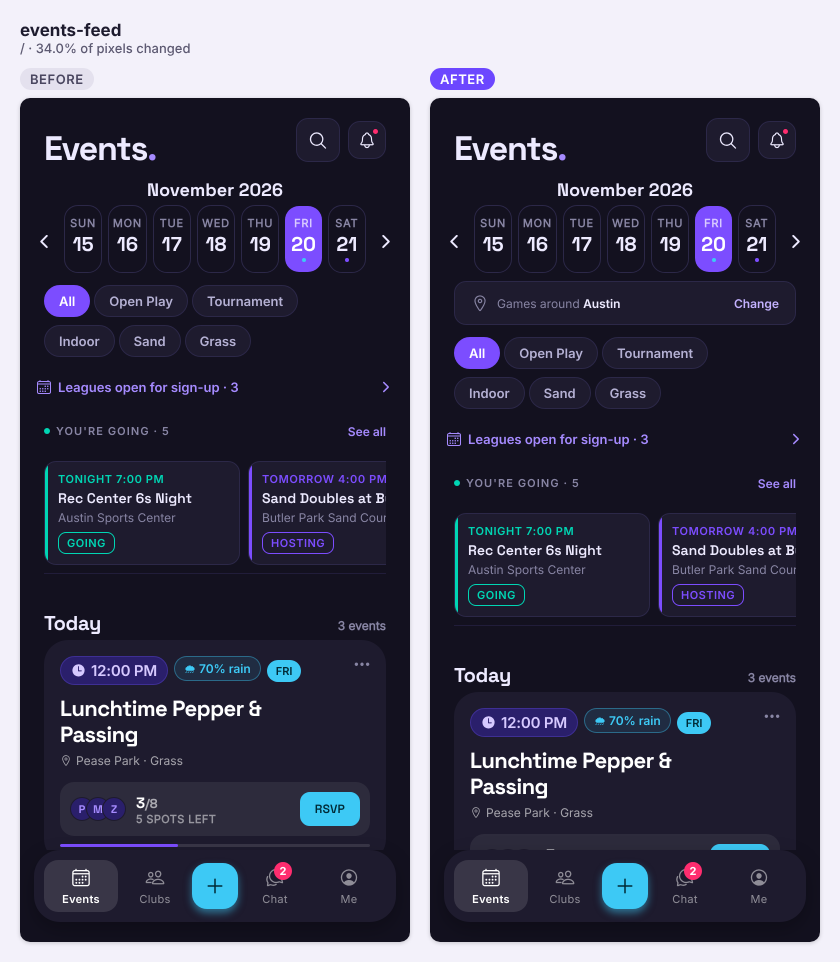
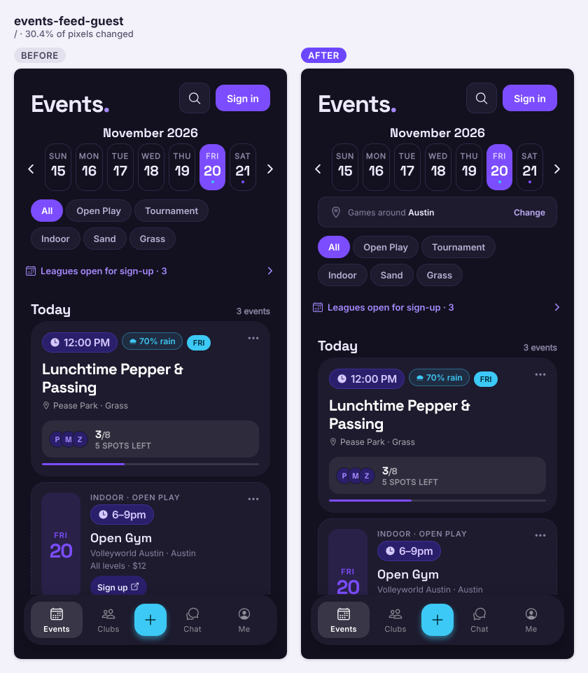
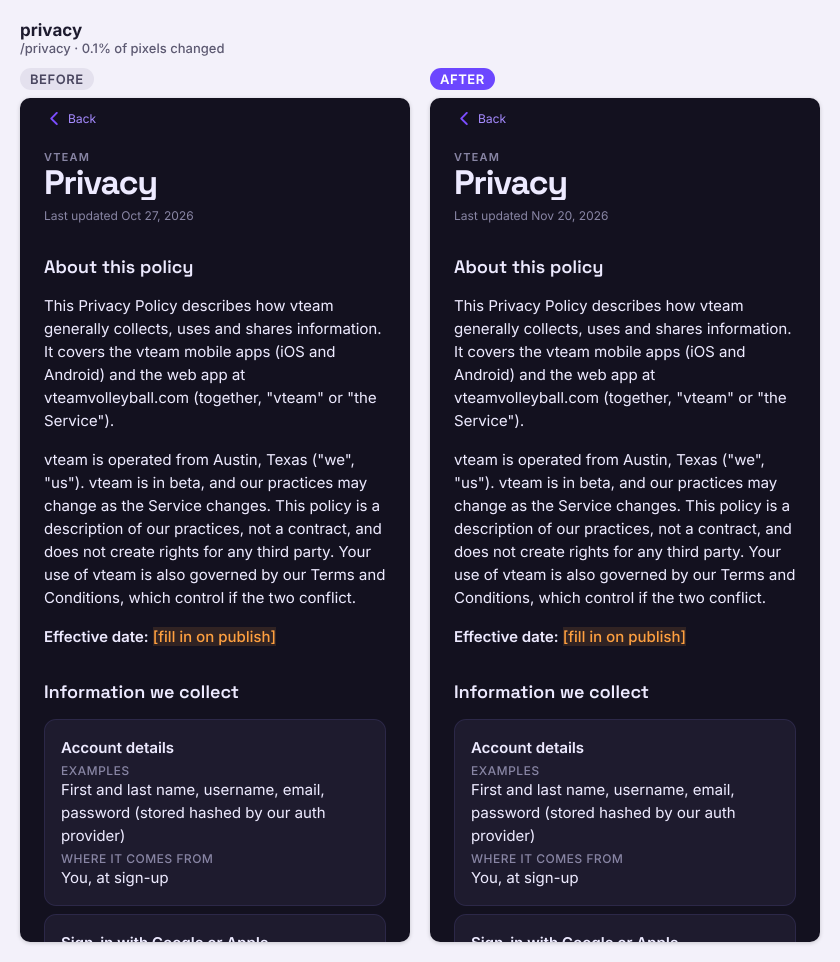
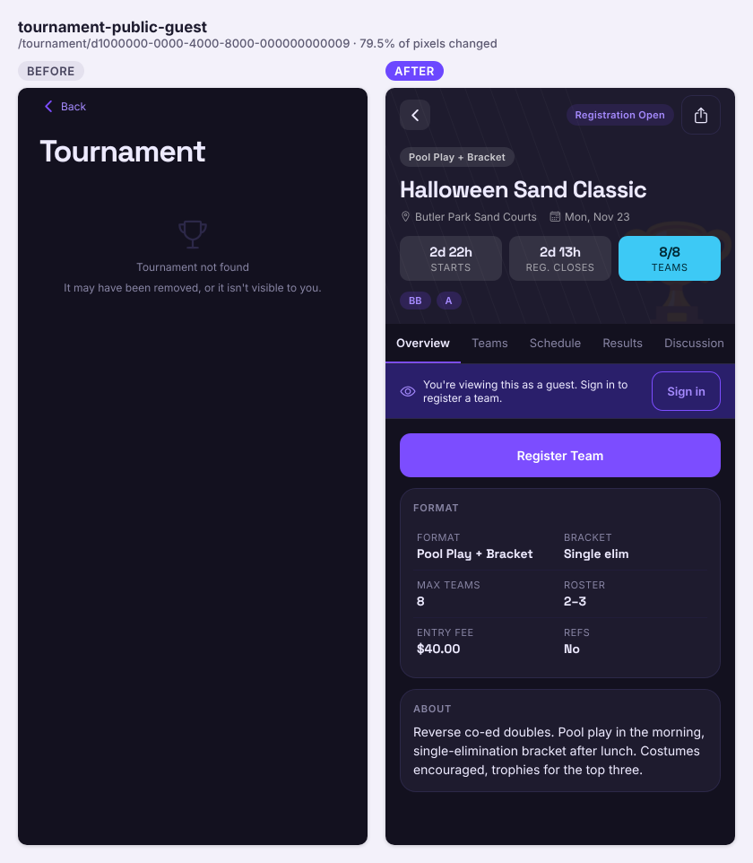
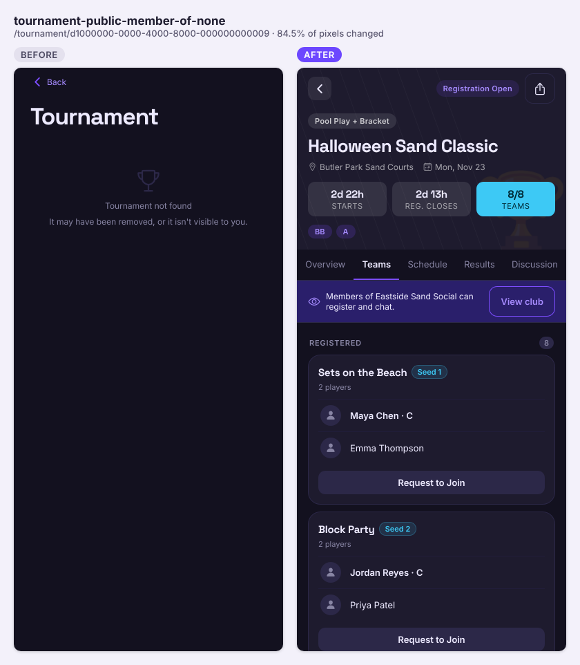
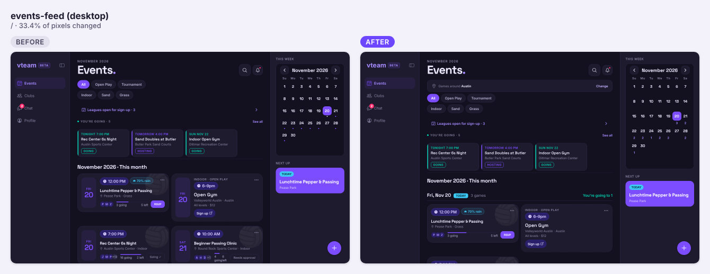
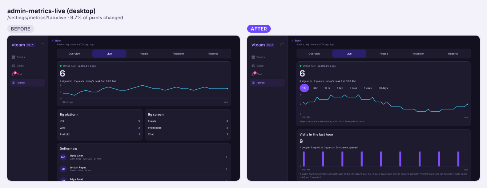

Eight PRs in one evening: a live court queue for open play, outside games that follow the viewer's city, public tournament pages for guests and non-members, a desktop feed split by day, plus the Skelly feed-address fix. All four migrations are on live (the "Live schema ready" check passed on main).

## Shipped

**Features**

- **Court queue for open play.** When teams outnumber courts, the host or a co-host starts a queue from the People tab (1–4 courts; winners stay up to 1–5 in a row, always, or both teams off), taps "<Team> won" per court, reorders the line, undoes and ends it. Everyone at the game sees it live with their own place on top ("You're on Purple · on Court 1 now"); guests see the courts. Closes #333 (#338)

  

  ```mermaid
  sequenceDiagram
    participant H as App (host / co-host)
    participant P as Postgres (save_court_queue, definer)
    participant T as event_court_queues
    participant R as Realtime
    participant V as App (players, guests)
    H->>H: rotation computed client-side (utils/courtQueue.ts)
    H->>P: rpc save_court_queue(event, courts, rule, stay_max, state, expected, ended)
    P->>P: host/co-host? (42501) · not cancelled · state shape + every team has players (22023) · 120/min
    alt expected ≠ current version
      P-->>H: PT409 (HTTP 409) → refetch, toast, show the other phone's state
    else
      P->>T: upsert row, version + 1, updated_by
      P-->>H: row as JSON
      T->>R: change on court-queue:<event>
      R-->>V: live update (read via anon/auth SELECT)
    end
  ```

  **Model changes**

  | Object | Change | Notes |
  | --- | --- | --- |
  | `event_court_queues` | added | One row per event (cascade): courts 1–4, rule stay/both_off, `stay_max` 1–5 or null, `state` jsonb (≤ 32 KB), `version`, started/ended/updated, `updated_by` (set null). Everyone reads (anon too); no direct writes |
  | `save_court_queue(...)` | added | SECURITY DEFINER, authenticated only; host/co-host, shape and version checks, 120 saves a minute |
  | `supabase_realtime` publication | changed | Adds `event_court_queues` |

- **Outside games follow the viewer's city** (Austin, Dallas, Houston), guests included: a city picked on the device, else the profile's home city, else the covered city nearest the viewer's network, else Austin. A "Games around <city> · Change" line above the Events filters opens a city sheet with **Use my location** (web only for now). Feed, Tournaments, Leagues and Search all use it. The Privacy Policy gains an "Approximate location" row. No schema change (#340)

  
  
  

  ```mermaid
  sequenceDiagram
    participant A as App (useFeedCity)
    participant S as Device storage (vteam.feedRegion)
    participant U as user_settings (home city)
    participant W as Vercel Edge GET /api/where
    A->>S: city picked on this device?
    alt none
      A->>U: home city covered by vteam?
      alt none
        A->>W: GET /api/where
        W->>W: nearestFeedRegion(x-vercel-ip-latitude/longitude), ~100 mi
        W-->>A: { region } or null (no-store, nothing logged)
      end
    end
    A->>A: fallback Austin; feed, Tournaments, Leagues, Search use the region
  ```

- **Guests and players outside a club can open a published tournament page**, read-only: Overview, Teams (names only), Schedule and Results, with a strip offering Sign in (guests) or View club (non-members). No payment handle, Paid pills, organizer controls or chat. First part of #282 (#339)

  
  

  ```mermaid
  sequenceDiagram
    participant A as App (useTournamentData)
    participant DB as Postgres / RLS
    participant F as get_public_tournament (definer)
    A->>DB: member read (fetchTournamentCore)
    DB-->>A: nothing (guest or not in the club)
    A->>F: rpc get_public_tournament(id)
    F->>F: build_public_tournament (now with description, levels, roster sizes, refs, schedule published, pool order)
    F-->>A: public JSON (drafts → null)
    A->>A: publicTournamentView → read-only tabs + Sign in / View club strip
  ```

  **Model changes**

  | Object | Change | Notes |
  | --- | --- | --- |
  | `build_public_tournament(uuid)` | changed | Adds fields anyone may see (description, skill levels, roster sizes, teams advancing, refs, schedule published, pool order). Still not executable by clients; drafts still null |

- **Desktop Events feed split by day.** Each day gets a header that stays in view ("Fri, Nov 20 · TODAY · 3 games · You're going to 1"), cards drop their date block, busy days show 4 then "Show N more". Fixes clicking a day in the desktop calendar, which only highlighted it: it now scrolls the feed there; the calendar shows game counts per day (#341)

  

- **Admin metrics Live: pick a time span** (1 hour to 30 days) and a new **Visits** card: sessions opened, unique people, signed in vs guests, screens opened, charted over time. Test accounts are left out (#335)

  

  ```mermaid
  sequenceDiagram
    participant A as App (admin, Live tab)
    participant F as admin_traffic_series (definer)
    participant PG as app_online_samples / app_sessions / app_events
    A->>F: rpc admin_traffic_series(p_minutes) every 15 s
    F->>F: current_user_is_admin()? else 42501
    F->>PG: online samples, sessions opened, screen_view counts (minus metrics_excluded_users)
    F-->>A: ≤ ~90 buckets + totals (visits, unique, guests, screens)
  ```

  **Model changes**

  | Object | Change | Notes |
  | --- | --- | --- |
  | `admin_traffic_series(integer)` | added | SECURITY DEFINER, authenticated (admins only, 42501 otherwise); aggregates only |
  | `app_sessions_started_at_idx` | added | Index on `app_sessions(started_at)` |

**Fixes**

- **Schelagg → Skelly feed addresses.** The repository rename moved both public feeds (GitHub Pages doesn't redirect), so the session and program imports were getting 404s. The two ingest functions and the courts fallback URL now point at `/skelly/` (#336)

  **Model changes**

  | Object | Change | Notes |
  | --- | --- | --- |
  | `ingest_schelagg_feed()` | changed | Feed URL only → `bryanw121.github.io/skelly/data/occurrences.json` |
  | `ingest_schelagg_programs()` | changed | Feed URL only → `.../skelly/data/programs.json` |

**Under the hood**

- People tab split out of the app's largest file (741 → 149 lines) into a roster card, team board and request/waitlist lists, with a shared drag hook; pixel-identical. Closes #332 (#334)
- First-visit timing now separates server time from the app's own start (`server_ms` / `boot_ms`), labels crawler-like browsers (`bot: true`; all four recorded first visits were crawlers), and a CI flow times a guest's first visit. A bundle-trimming attempt (−108 KB) showed no measurable gain and was not kept. Part of #331 (#337)

Screenshots: 8 of 20 changed captures (mocked export, main before → after).

## Closed issues

- #333 Court queue for open play: who's on, who's next, winners stay
- #332 People tab in pieces: one draggable roster card, a team board and two lists out of the app's largest file

## In progress

- No open PRs. Still open on #282: player pinning (needs a mock) and a non-organizer e2e (needs a beta tournament owned by `e2ebuddy`). #331's first-card target (≤ 2.5 s) isn't met yet; script evaluation and the Events render are the next targets.
- Court queue follow-ups: a browser e2e for the host flow; players reporting results and a "you're up next" push were not built (#338).

## Needs you

- Check the **Maestro flows (emulator)** Android run: it failed on main's latest commit (c83a081).
