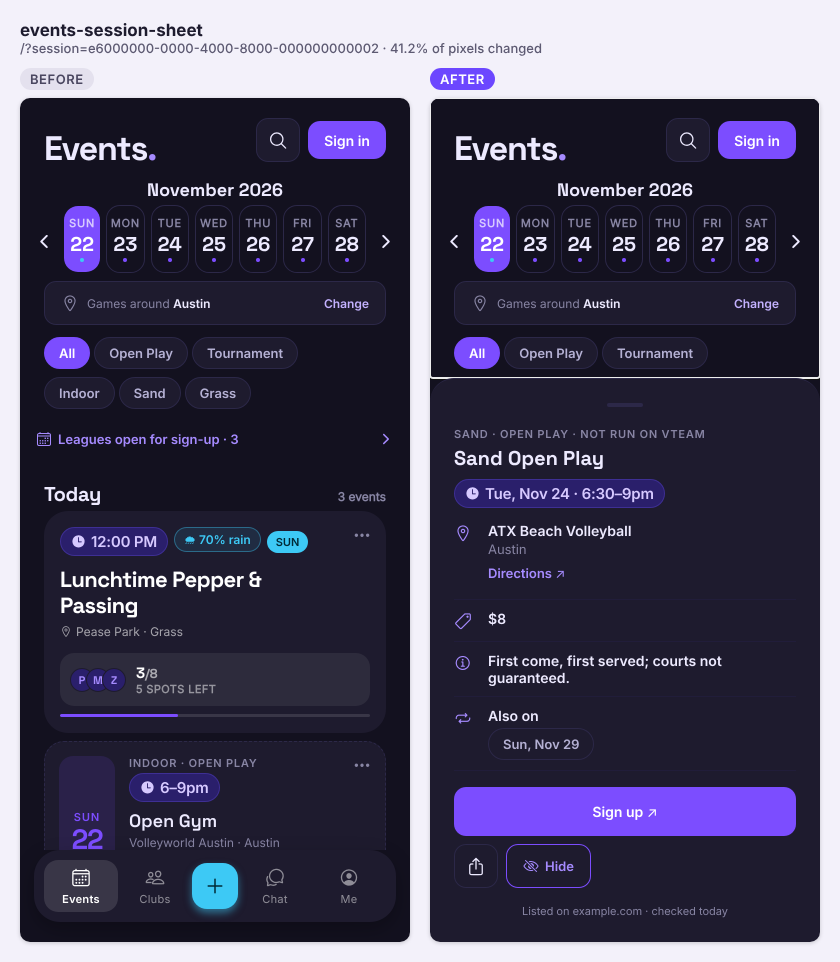
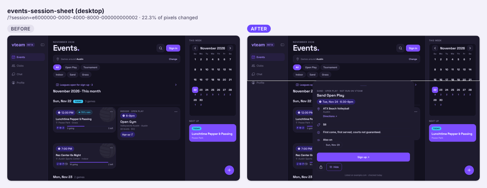
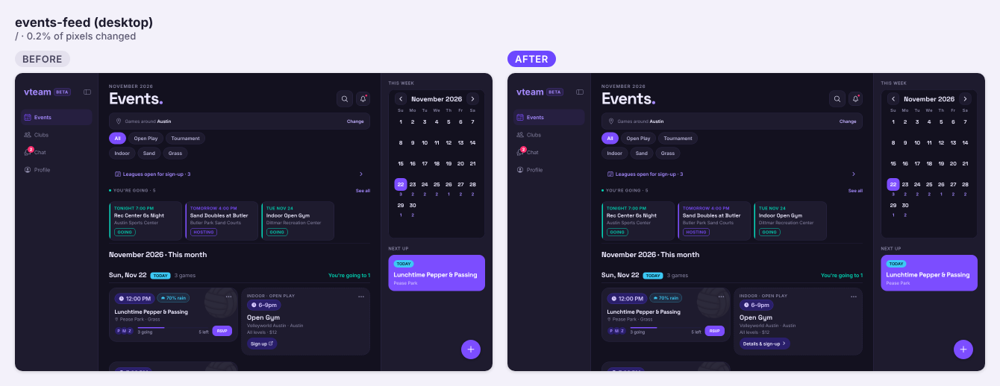
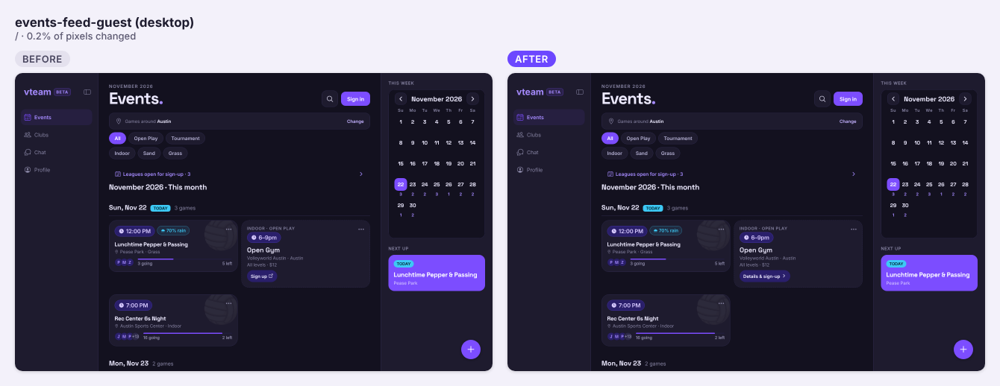

Outside sessions now show the venue's note and open a details sheet before you leave vteam; shared event links load about half a second sooner; CI's browser checks run in three parallel jobs.

## Shipped

**Features**

- **Outside sessions: the venue's note on the card, and a details sheet.** Cards for sessions from other venues (feed and search) now show the venue's note (2 lines; 88 of 102 upcoming sessions have one) and read **Details & sign-up ›**. Tapping opens a sheet instead of leaving vteam: time, venue with Directions, price and level, the full note, the stale-check warning, **Also on** (later dates of the same session), the sign-up button (same venue check as before), Share and Hide. On Events the open session is in the URL (`?session=<id>`), so a shared link opens it; a session outside the loaded months is read by id, and a gone one shows a toast. New metric `outside_session_opened`; `outside_link_opened` gains `from: card | sheet`. Closes #348 (#351)

  
  
  
  

**Speed**

- **Shared event links preload the event screen's code.** A guest opening `/event/<id>` used to wait for the app to start before the browser fetched the event screen chunk (~1.1 MB). The build now writes `dist/event-chunk.json` (failing if there isn't exactly one such chunk), and the Vercel link-preview function puts a `<link rel="preload">` for it right after `<meta charset>`, ahead of the app scripts. Measured locally (4× CPU, median of 7): Join on screen 4.21 s → 3.73 s. A new CI check (`event-link-flow.mjs`, budget Join ≤ 4.7 s) guards it, and a new metric `event_first_paint` {ms, preloaded, seeded} records real launches. Page looks the same. Part 1 of #347, which is closed (#352)

  ```mermaid
  sequenceDiagram
    participant B as Browser (guest)
    participant V as Vercel api/event-page.ts
    participant S as Supabase (anon)
    participant A as App
    B->>V: GET /event/<uuid>
    V->>S: read event (EVENT_PREVIEW_COLUMNS)
    V->>V: read dist/event-chunk.json, check tag shape
    V-->>B: index.html + og tags + preload EventDetailScreen chunk
    par
      B->>V: app scripts
    and
      B->>V: EventDetailScreen-<hash>.js (preloaded)
    end
    A->>A: event screen renders (no chunk wait)
    A->>S: app_events insert: event_first_paint
  ```

**Under the hood**

- **CI in about half the time.** The 14-minute Accessibility (axe) job's 12 browser checks now run as three parallel jobs (Browser: upgrade, Browser: axe and budgets, Browser: flows) sharing a composite setup action; Accessibility (axe) stays as an aggregator. Also fixes the upgrade-check cache, which never hit because main saved from `dist-mock/` and PRs restored into `dist-base/`. Expected wall time ~9–10 min (was 17–18). Closes #349 (#350)

Screenshots: 4 of 6 changed captures shown. `event-people-balanced` (phone and desktop) also differs, from the random team shuffle, as on earlier days. No schema changes.

## Closed issues

- #347 Shared event links 0.6 s sooner: the page asks for the event screen's code itself
- #348 Outside sessions say what the venue says: the note on the card, and a details sheet before you leave vteam
- #349 CI in half the time: three browser jobs side by side, and an upgrade-check cache that actually hits

## In progress

- No open PRs. #347 part 2 (keeping team-drag code out of the event chunk for players) waits on live `event_first_paint` numbers.
