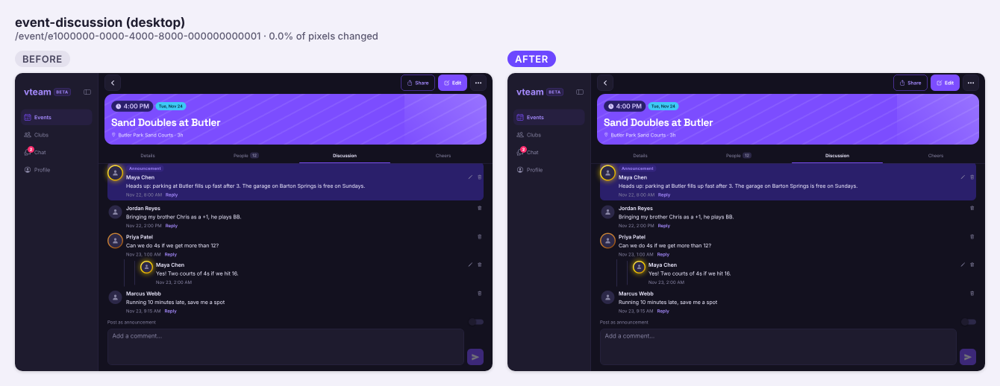

The event screen was split into small hooks and pieces with no visible change, and a new watch checks every 30 minutes that vteamvolleyball.com runs main and opens for a guest.

## Shipped

**Under the hood**

- **Production watch: know within the hour when the live site is behind main or won't open.** Every web build now writes `dist/version.json` (`{ sha, builtAt }`). A new workflow runs every 30 minutes (read-only) and compares live's version with main's head. If live is still behind 40 minutes after a merge, it fails and says why, using the Production deployment and the **Live schema ready** check: no deployment (as on Nov 14–16), a failed build (Nov 18), still building, or deployed but not served. While a migration is still pending it only reports. It also opens the real site as a guest on phone and desktop (Events cards, the outside session sheet, Tournaments, Leagues, Terms, with no crash screen, page error or React #418) and checks the event link preview, `/api/where` and `/api/forecast`. Failing checks get one retry; a failure emails you. CI's **Browser: flows** runs the same browser steps on the mocked export, so a renamed selector fails the PR instead. Closes #353 (#355)

  ```mermaid
  sequenceDiagram
    participant C as GitHub Actions cron (every 30 min)
    participant W as production-watch.mjs
    participant G as GitHub API
    participant L as vteamvolleyball.com
    C->>W: run
    W->>G: main head, Production deployment, "Live schema ready" check
    W->>L: GET /version.json
    W->>W: judgeDeploy (40-min grace, schema pending = report only)
    W->>L: Chromium as guest: Events, session sheet, Tournaments, Leagues, Terms
    W->>L: event link preview (og:title, og:image), /api/where, /api/forecast
    W-->>C: job summary table, screenshots of failed steps; exit 1 emails owner
  ```

- **Event screen in pieces, same pixels.** `EventDetailScreen` went from 616 to 248 lines and now only composes, with no direct Supabase calls. Tabs, discussion, the viewer's status, join-after-sign-up, leaving, the game recap and deleting each moved into their own hook under `hooks/event/`. The sheets and dialogs moved into `EventDialogs`, where the +1, deny and delete dialogs share one state, so only one can be open at a time. The footer and recap cards are now separate components, and the pure rules live in `utils/eventDetail.ts`. 23 new tests. Closes #354 (#356)

  

Screenshots: 21 screens × phone and desktop were compared, and 3 captures differed. `event-discussion` (desktop) differed by 21 pixels and looks the same (shown above). `event-people-balanced` (phone and desktop) differed only because of the random team shuffle, as on earlier days. No schema changes.

## Closed issues

- #353 Production watch: know within the hour when vteamvolleyball.com isn't running main, or doesn't open
- #354 Event screen in pieces: join intent, leave, recap, mentions and delete out of a 616-line screen

## In progress

- No open PRs. #357 (an alternative split of the event screen) was closed in favour of #356.

## Needs you

- Run the Production watch workflow once by hand (Actions → Production watch → Run workflow). Its checks against the live site haven't run yet, because the sandbox that built it couldn't reach vteamvolleyball.com.
