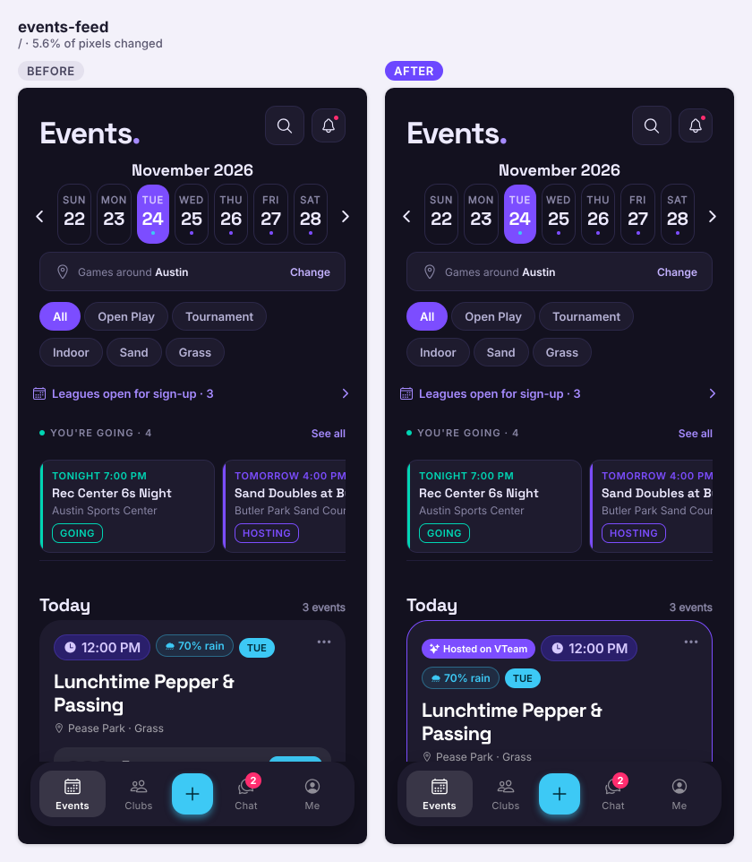
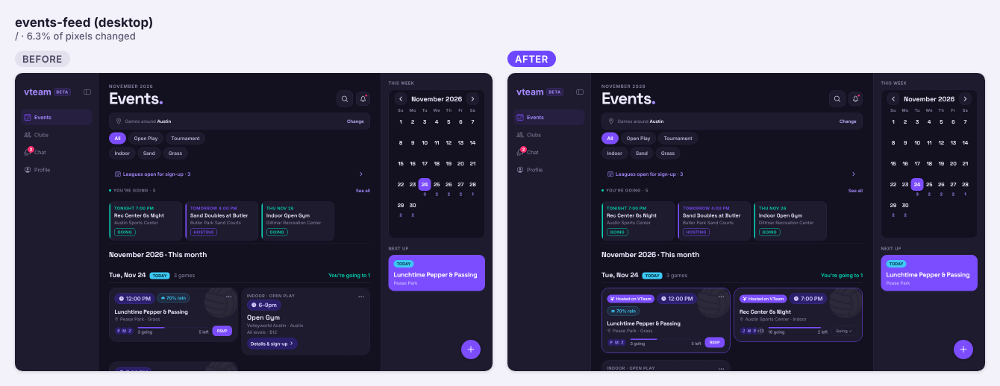
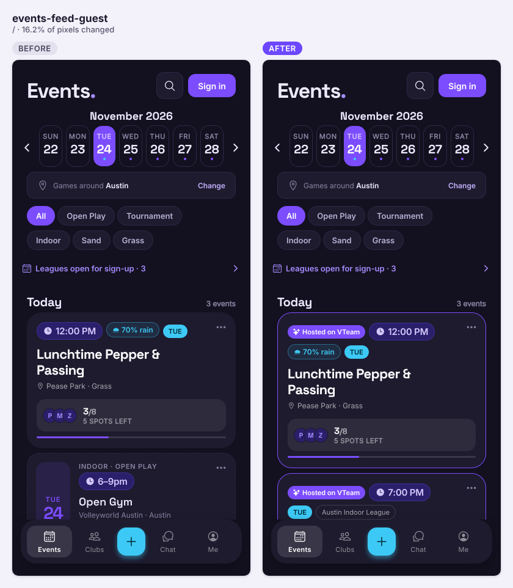
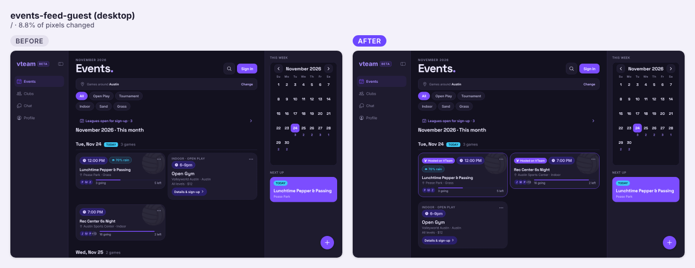

vteam's own games now come first on every day of the Events feed with a "Hosted on VTeam" badge, an open tab survives a deploy by reloading into the new build, and the Android nightly finally says why it fails.

## Shipped

**Features**

- **vteam games first, marked "Hosted on VTeam".** On each day of the Events feed (phone and desktop), games and tournaments hosted on vteam now come before outside sessions and tournaments from Skelly, then by start time. Their feed cards get a purple outline and a solid **Hosted on VTeam** badge at the start of the chip row. The badge shows only in the Events feed, not on club pages, history or search. Day headers, hidden counts, the "You're going" rail and sponsored slots are unchanged. (#367)

  
  
  
  

**Fixes**

- **A deploy no longer crashes an open tab.** If someone has vteam open during a deploy, the first new screen they open used to fail with "This screen hit a snag" (live's only recorded `app_crash`, Nov 20 on /leagues). Now the app spots a failed code load, checks `/version.json`, and reloads once into the new build, then shows a toast: "vteam was updated while you were away. Tap again to open that screen." If the host doesn't answer, it says "Couldn't load this screen" with Try again. A tab that comes back after 10+ minutes hidden reloads into a newer build straight away, unless a text field is focused or filled in. Missing script files now answer 404 with no caching instead of an `index.html` cached for a year. New metrics are `app_updated_in_tab` and `screen_load_failed`, and the first-visit script budget went from 2391 to 2400 KB. A new CI browser flow and a production-watch check cover it. No schema change. Closes #359 (#363)

  ```mermaid
  sequenceDiagram
    participant U as Player's open tab
    participant B as ErrorFallback
    participant V as vteamvolleyball.com (Vercel)
    U->>V: load lazy screen chunk (old build's file)
    V-->>U: 404, no-store
    U->>B: render error
    B->>B: isChunkLoadError? (before noteCrash)
    B->>V: GET /version.json (no-store, 3 s)
    alt newer build
      B->>U: reload same address once (5-min guard), then info toast
    else host doesn't answer
      B-->>U: "Couldn't load this screen" + Try again
    else same build
      B-->>U: normal crash screen
    end
  ```

**Under the hood**

- **Event cards in one piece.** The phone and desktop event cards now share one pure card model (`utils/eventCardModel.ts`), one actions hook, and shared `AttendeeStack` / `RsvpButton` pieces. 65 inline styles moved to the stylesheet, and `EventCard.tsx` went from 545 to 197 lines. The PR's screenshot compare was pixel-identical. Closes #360 (#364)
- **An Android nightly you can trust.** The nightly failed 7 of its last 15 runs, and the app wasn't the cause. A new `run.sh` adds a warm-up launch and taps Wait on system "isn't responding" dialogs. On any failure it writes to the job summary what was on screen (texts, ids, the dialog, the app's last log lines). A warm-up failure counts as **environment** and gets one retry on a fresh emulator; a flow failure is never retried. The sign-in flow's missed tap (Nov 16, Nov 23) is fixed. Closes #361 (#362)
- **Android nightly: Pixel Launcher turned off.** The new summary named the cause on its first run: "Pixel Launcher isn't responding" on both emulators. The launcher is now disabled after install, and warm-up keeps dismissing dialogs for about 3 minutes until Events shows. (#365)

Screenshots: 12 screens × phone and desktop were compared. The 4 Events feed captures changed, all from #367. Everything else, including the cards that #364 refactored, was unchanged. No schema changes.

## Closed issues

- #359 A deploy never crashes an open tab: move to the new build instead of "This screen hit a snag"
- #360 Event cards in one piece: one card model for both layouts, and 65 inline styles into the stylesheet
- #361 An Android nightly you can trust: 7 of the last 15 runs failed, none because of the app

## In progress

- #368 Hosted on VTeam badge: drop the sparkles icon (follow-up to #367). CI was still running.
- #366 Solo sign-up tournaments: players join alone, and the organizer pins, shuffles and posts teams (#282). Blocked: its migration hasn't been applied on beta, because that session's Supabase access to beta was refused.
- #358 Admin metrics: leave crawler sessions out of Overview (#331). It's applied on beta and CI is green, so it's ready to merge. Its function-only migration then goes to live.

## Needs you

- #366: once beta access works, apply its migration on beta, get CI green, merge, apply it on live, regenerate `types/database.ts` (it's hand-edited for now) and run `complete_pr`.
- #358: merge it, then apply its migration on live and run `complete_pr(358)` on beta.
