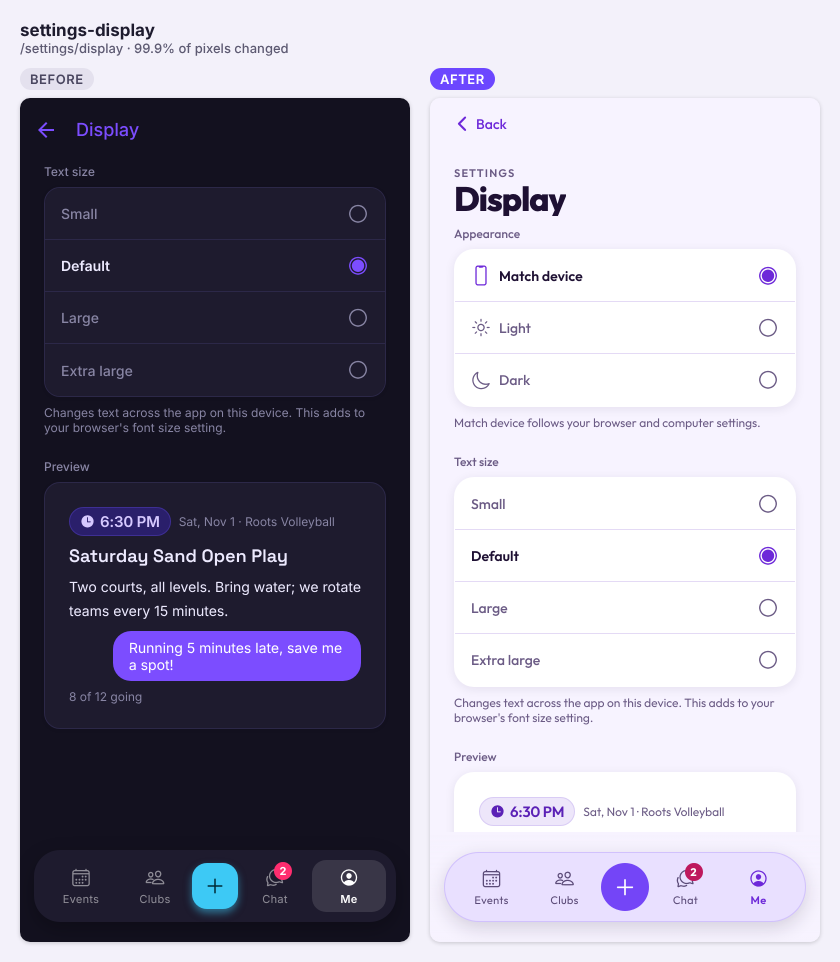
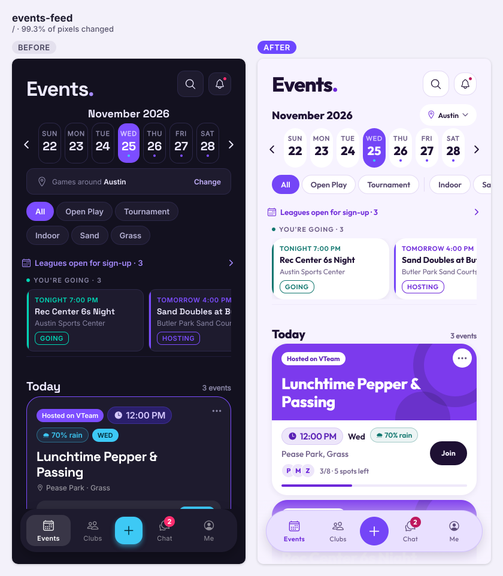
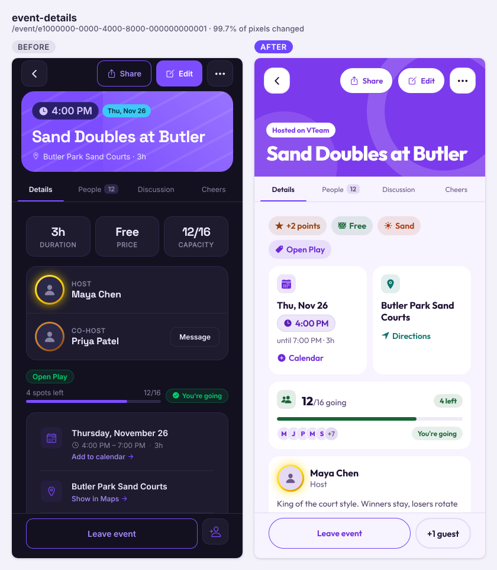
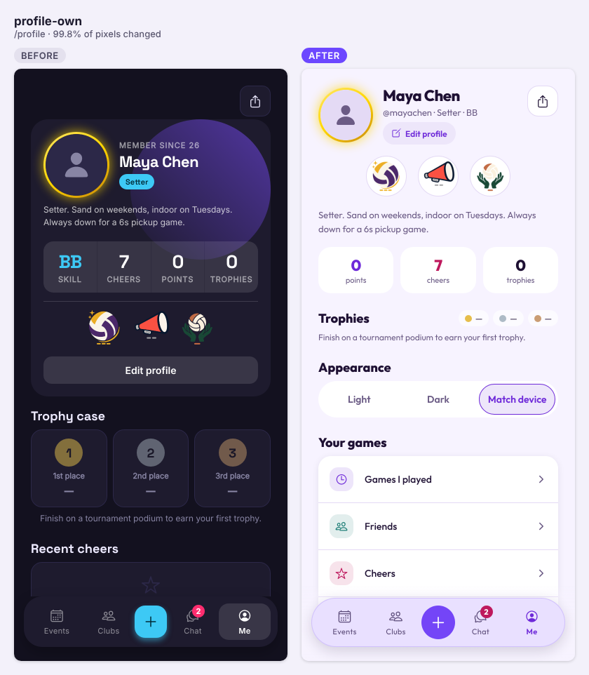
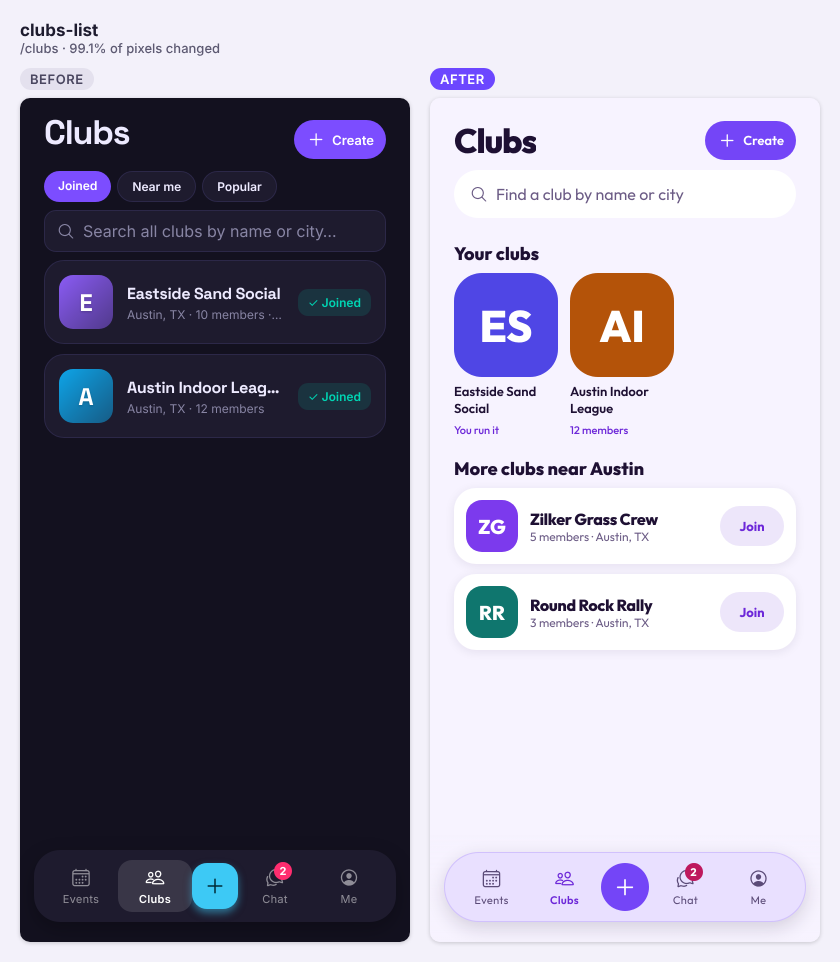
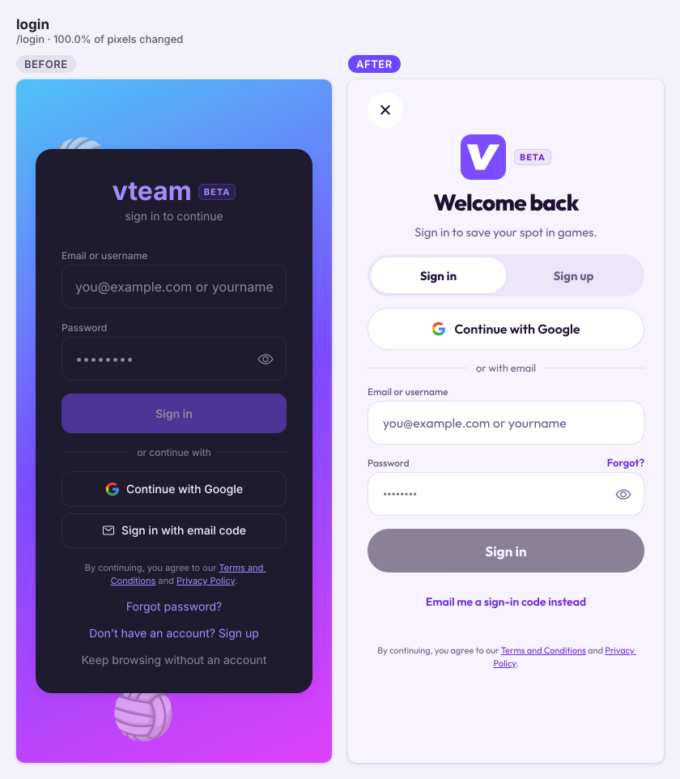
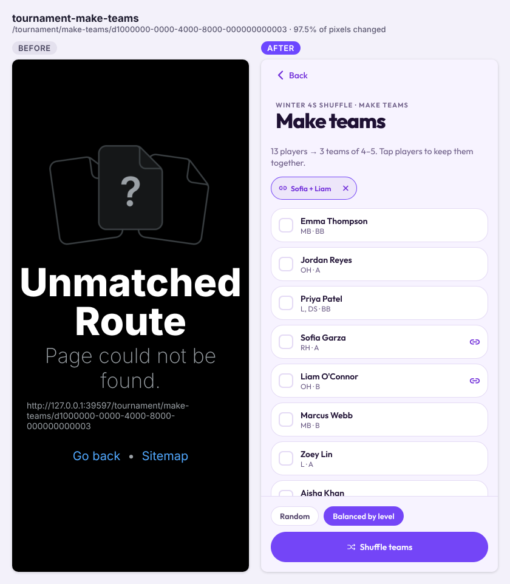

vteam got its new look today. The Party invite theme with the V logo is now the default, dark mode is in, and Events, the event page, Profile, Clubs and sign-in were each rebuilt in the new layout. Solo sign-up tournaments shipped too. 22 PRs merged.

## Shipped

**Features**

- **Party invite theme and the new V logo.** The light lavender palette, white cards and purple primary are now the default, set in Outfit. Every app icon, favicon and splash is now drawn from the slanted V. (#369)
- **Dark mode.** Profile → Display → Appearance offers Match device (the default), Light or Dark. On web the page reloads in the new look, and Match device follows the browser. On native the choice applies at the next launch. The PR also brings the new loading screen and lines up the tabs. (#371)

  

- **Events on phones, new layout.** The city is a pill next to the month, and the type and surface filters share one sideways row. Cards show the time, place, who's in and Join. The first game card now fits on the first screen. (#372)

  

- **Event page, new layout.** It opens on a colour cover. Below that, When and Where sit side by side, then a "Who's in" bar, the host's note, and colour chips for points, price, surface and tags. The footer buttons are pills. (#374)

  

- **Profile, new layout.** The avatar and name sit on the page with an Edit profile pill. Counts are colour-coded, trophies show as tiles, and a Light / Dark / Match device switch is on the page. The menu is in three groups, with "Games I played" and "Help & feedback" renamed. Other players' profiles use the same header. (#381)

  

- **Clubs, new layout.** A "Find a club" search sits at the top, your clubs show as big colour tiles, and below them are clubs to join, your city first, each with a Join pill. The Joined / Near me / Popular chips are gone. (#384)

  

- **Sign in and sign up redesign.** One frame with a Sign in | Sign up switch and Google first. On wide web a purple panel sits beside the form. The blank page that used to show after tapping Sign in is gone, because the screens now preload. (#373)

  

- **Party invite shapes across the app.** Rounder corners, cards on a soft shadow instead of an outline, and pill buttons on every screen, not only the redesigned ones. (#383)
- **Solo sign-up tournaments.** An organizer can pick "Players sign up solo, I make teams" (2–9 per team). Players tap Sign up solo. The organizer then opens **Make teams** (new page), keeps chosen players together, picks Random or Balanced by level, shuffles, swaps players and posts the teams. Closes #282 (#366)

  

  ```mermaid
  sequenceDiagram
    participant O as Organizer (Make teams)
    participant DB as Postgres (RLS, SECURITY INVOKER)
    participant P as Players
    P->>DB: Sign up solo (free_agent tournament_teams entry)
    O->>DB: Keep these together → update tournaments.team_pins
    O->>O: drawSoloTeams (Random / Balanced, pins kept whole)
    O->>DB: rpc post_solo_teams(tournament, teams)
    DB->>DB: organizer only (42501); solo mode, each member a solo sign-up once (22023)
    DB->>DB: one transaction: free-agent entries → registered, approved teams; clear pins
    DB-->>P: teams visible on the tournament
  ```

  | Object | Change | Notes |
  | --- | --- | --- |
  | `tournaments.team_mode` | added | `captains` (default) or `solo`. Same access as the rest of the row. |
  | `tournaments.team_size` | added | Solo only: players per team (2–9). |
  | `tournaments.team_pins` | added | Solo only: groups of user ids kept together, `[[uid, …]]`. Cleared when teams are posted. |
  | `save_tournament(jsonb, jsonb)` | changed | Saves the three new fields. Authenticated only. |
  | `post_solo_teams(uuid, jsonb)` | added | SECURITY INVOKER, authenticated only, organizer only. Posts the drawn teams in one transaction. |

**Fixes**

- **Event page comes back where you left it.** Back from a profile used to land at the top of the event. Each event tab now remembers its scroll offset. Closes #376 (#378)
- **One 44-pt Back on every screen.** A new `BackButton` replaces the hand-built backs. Settings and Notifications now use the shared page header. (#380)
- **44-pt tap targets on phones without changing the look.** Chips, icon buttons and about 15 small controls get a bigger touch area at the same drawn size. Closes #386 (#391)
- **Filled actions are pills everywhere.** That covers feed Join, Sign in, New message, Unhide and Send. A new UI check rule counts any that aren't. Closes #388 (#394)
- **One kind of pop-up per job.** Yes/no questions use the confirm dialog, choices use bottom sheets, and "it worked" is a toast. Saving an event goes straight back with a toast, and a failed save keeps what you typed with Try again. Closes #389 (#397)
- **Outfit everywhere.** Text without a font now falls back to Outfit instead of the system font. "Experimental features" is shortened to **Experiments**. Closes #385 (#390)
- **Loading screen bounces once.** On a fast start it no longer flashes on and off. (#375)
- **Bottom bar floats over the feed.** Cards fade under the pill instead of being cut off in a hard line. (#393)
- **Desktop calendar:** dots under days again instead of game counts, as you asked. (#400)

**Under the hood**

- **Admin metrics leave out crawlers.** Overview and its funnels skip any session flagged `bot: true`. This also applies to past sessions. Closes #331 (#358)

  | Object | Change | Notes |
  | --- | --- | --- |
  | `admin_metrics_overview(date, date)` | changed | Skips bot-flagged sessions. Admin only (42501 otherwise). |
  | `admin_metrics_events(date, date)` | changed | Same, for the event counts and guest funnel. |

- **UI consistency check made steady.** Each finding now counts once per screen, a failing screen is measured again, and the baseline is taken from CI's runner. The court queue card's text is now in Outfit. (#379, #382)
- **`types/database.ts` regenerated from live** after #366's migration. (#370)

Screenshots: all 80 screens were compared on phone and desktop, and all 160 captures changed because the theme is new everywhere. Eight are shown above. Make teams is a new page.

## Closed issues

- #389 Shared pop-ups: confirms on ConfirmDialog, lists on BottomSheet, saves as toasts
- #388 One shape for filled actions: the last five onto Button, and a button-shape rule
- #387 Fix the Tournaments (guest) and event People (desktop) layout shifts on reload
- #386 44-pt tap targets on phones without changing how small controls look
- #385 Outfit by default: every Text falls back to the app font
- #377 UX/UI consistency in CI, starting with one 44-pt Back on every screen
- #376 The event page comes back where you left it
- #331 First visits: the server answers in 0.4 s, the phone draws at 2.9 s
- #282 Tournaments follow-ups: guest visibility, player pinning, non-organizer e2e

## In progress

- #408 Settings: Party invite layout. Checks are still running.
- #407 Tournaments: scoring rules per phase, and every pool team can play the bracket. Its migration is already on beta and live. Checks are still running.
- #406 Tournament form: place search, a calendar on tap, skill levels best first. A check is failing or still unfinished.
- #405 Tournaments: Party invite layout. Green and ready to merge.
- #399 Chat: Party invite layout. Has merge conflicts.
- #398 Share outside games, with a sheet for outside tournaments and leagues. Has merge conflicts.

## Needs you

- #407: its migration is already on live, so merge it soon, then run `select beta_meta.complete_pr(407);` on beta.
- The new icons and dark mode reach the phone apps only with the next native build (#369, #371).
