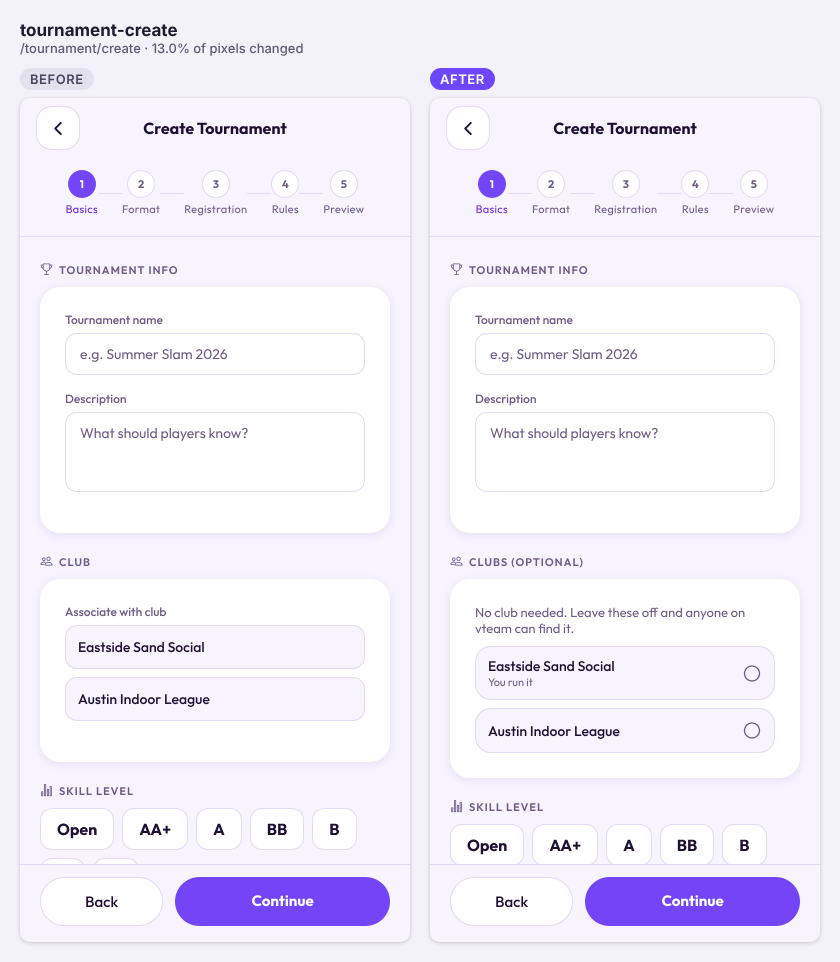
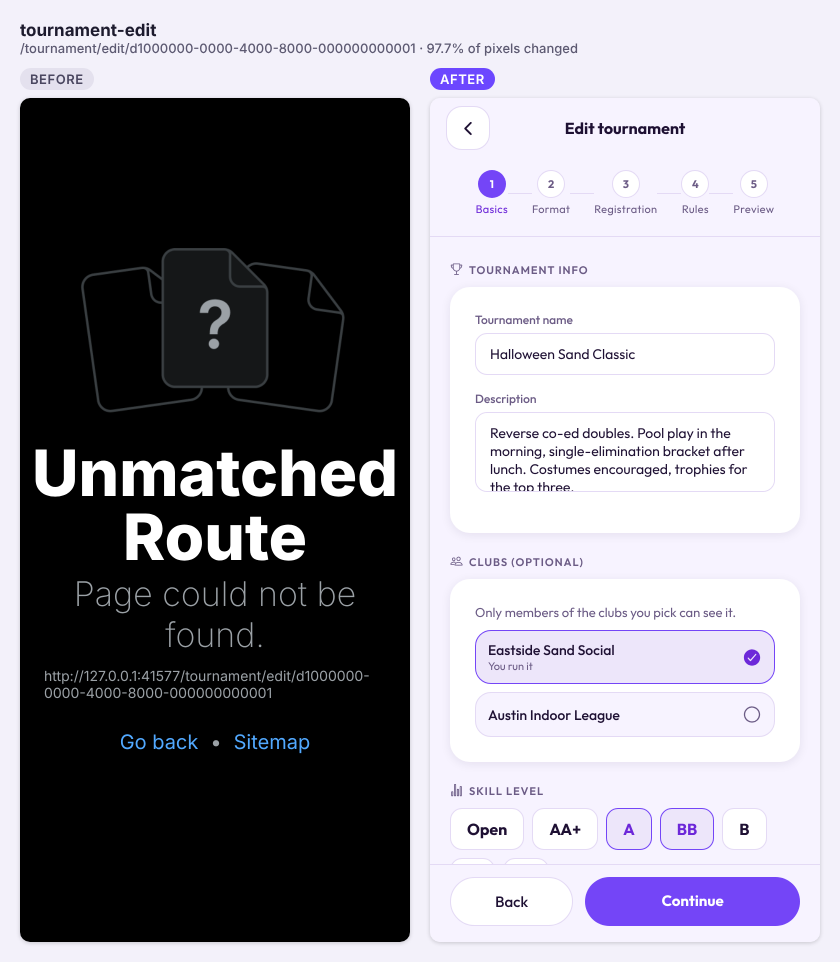
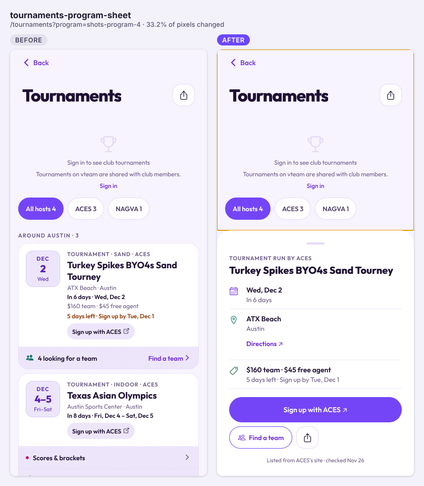
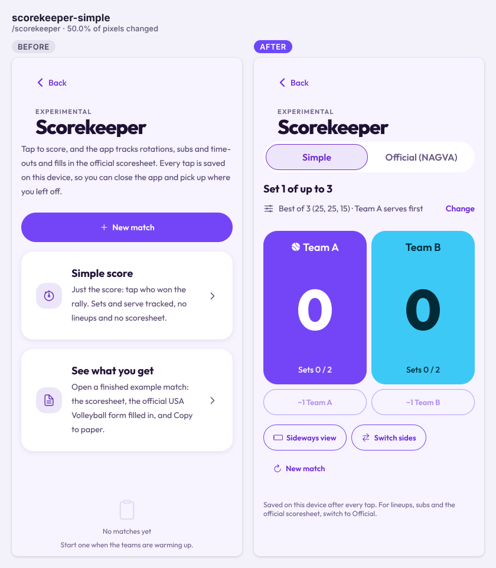
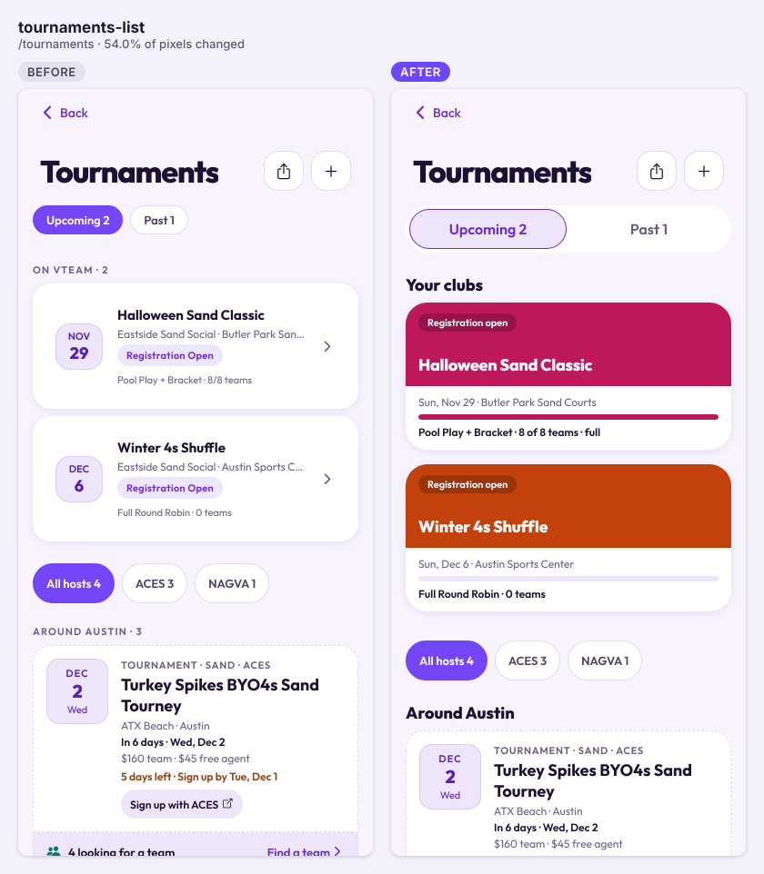
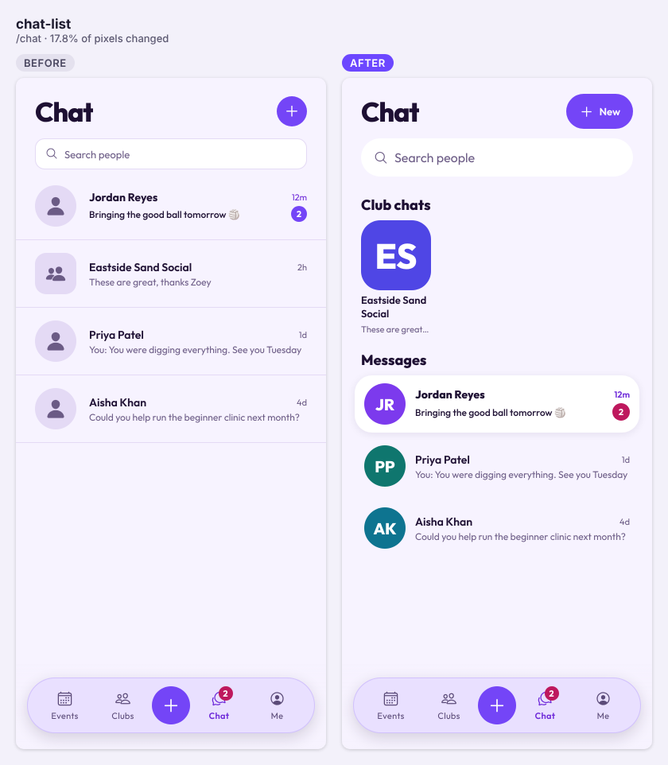
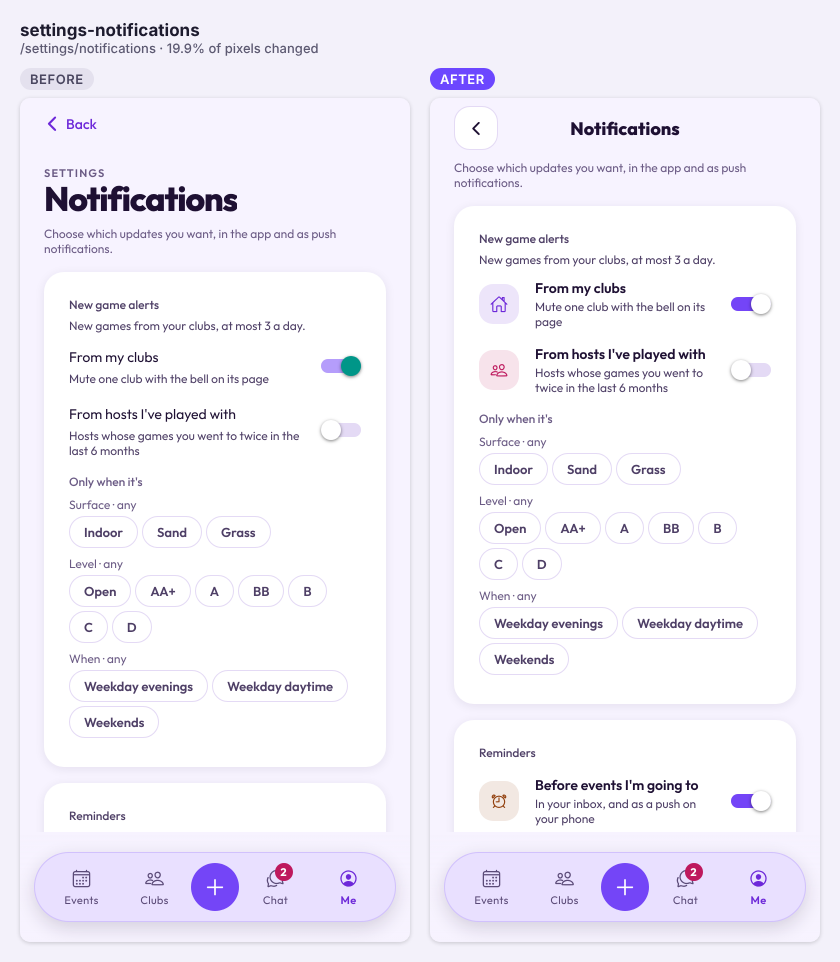
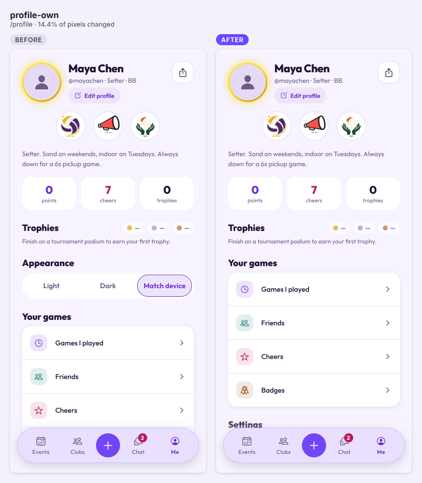

Tournaments got a big day: hosts can run one without a club, edit it afterwards and tell every player what changed, set scoring per phase, and send every pool team to the bracket. Chat, Settings and Tournaments moved to the Party invite layout, and a new integration suite found and closed three roster loopholes. 13 PRs merged.

## Shipped

**Features**

- **Host a tournament without a club, and edit it after.** On Create, clubs are now optional checkboxes: none means anyone signed in on vteam can find it, one or more means only those clubs' members can. Hosts get a pencil on their tournament page that opens the same five steps already filled in. The last step can hand the tournament to another signed-up player, and one button, **Save and tell N players**, sends everyone signed up a "Fall Slam was updated · Changed: location, start time" notification (in-app and push, with its own "Tournament changes" switch). Closes #401 and #402 (#409)

  

  

  ```mermaid
  sequenceDiagram
    participant H as Host (Edit tournament)
    participant DB as Postgres (update_tournament, SECURITY DEFINER)
    participant N as notifications
    participant W as send-notification-push (webhook)
    participant P as Signed-up players
    H->>DB: rpc update_tournament(id, tournament, rules, new_host)
    DB->>DB: signed in, host only (42501); fields and clubs checked (22023 / 42501)
    DB->>DB: write changed fields, replace tournament_clubs, check phase rules, hand over host
    DB->>N: one tournament_updated row per team member, captain and new host (not a draft)
    N->>W: INSERT webhook
    W-->>P: push with deep link to the tournament
    DB-->>H: number of players told → toast "We told 12 players"
  ```

  | Object | Change | Notes |
  | --- | --- | --- |
  | `tournaments.club_id` | changed | Now nullable. Kept as the first linked club for older builds. |
  | `tournament_clubs` | added | Tournament ↔ club links (backfilled from `club_id`). Readable with the tournament; the host inserts links to their own clubs. |
  | `tournament_open_to_me(id)` | added | SECURITY DEFINER, authenticated. True for a non-draft with no club, or one linked to a club you're in. |
  | SELECT policies on `tournaments` and every child table | added | "open or linked-club" policies using the helper; the club-member policies stay. Plus an insert policy for comments. |
  | `creator can insert tournaments` policy | changed | Insert check updated for optional clubs. |
  | `save_tournament(jsonb, jsonb)` | changed | Takes `club_ids` (at most 10, each must be the caller's). Authenticated only. |
  | `update_tournament(uuid, jsonb, jsonb, uuid)` | added | SECURITY DEFINER, host only. Edits, hands over the host, notifies players, returns how many were told. |
  | `notifications` type check | changed | Adds `tournament_updated`. |

- **Scoring rules per phase, and every team can play the bracket.** On the Rules step each phase (pool play, bracket, losers bracket, final) gets a tab with its own start score, points to win, deciding set, win by, cap and sets; later phases stay "Same as pool play" until switched off. Overview lists each phase that differs. A new Pool Advancement option, "Every team plays the bracket", seeds every team by pool place with byes. Closes #403 and #404 (#407)

  | Object | Change | Notes |
  | --- | --- | --- |
  | `tournament_rules.phase_rules` | added | jsonb, default `{}`. Per-phase overrides keyed `bracket` / `losers` / `final`, only fields that differ. Same access as the rules row. |
  | `valid_phase_rules(jsonb)` | added | Checks phases, fields and bounds (22023). Authenticated only. |
  | `save_tournament(jsonb, jsonb)` | changed | Same signature; validates and saves `phase_rules`. |

- **Share outside games.** Every outside session, tournament and league card has a share button in its corner, sharing a vteam link plus one line (what, where, when, price or deadline). Outside tournaments and leagues now open a new sheet in the app (when, where with Directions, divisions, Sign up with the organizer, Find a team, Scores & brackets, Share) instead of leaving. Shared links get a link preview. Closes #395 (#398)

  

  ```mermaid
  sequenceDiagram
    participant C as Chat app / crawler
    participant V as Vercel (vercel.json route by query)
    participant F as api/outside-page.ts
    participant DB as Supabase REST (anon key, RLS)
    C->>V: GET /tournaments?program=<id> or /?session=<id>
    V->>F: route (before static files)
    F->>DB: read the program or session row
    DB-->>F: row (or nothing → generic card)
    F-->>C: index.html with title / og / twitter tags in the head
  ```

- **Scorekeeper: Simple | Official (NAGVA) switch.** The Scorekeeper now opens straight on a simple point counter with nothing to set up; the Official tab has New match with the NAGVA setups, the example and saved matches. (#416)

  

- **Tournaments, Party invite layout.** One Upcoming | Past switch with counts; club tournaments become cover cards with a teams-signed-up bar and "8 of 8 teams · full"; plain section titles here and on Leagues. Part of #396 (#405)

  

- **Chat, Party invite layout.** New and Search people pills, club chats as a sideways row of tiles, unread DMs on white cards with a pink count, initials tiles for people without a photo. Part of #396 (#399)

  

- **Settings, Party invite layout.** Every settings page has one header row with the Back pill and a centred title; switches are solid purple with a white knob, and alert rows get coloured icon tiles. Part of #396 (#408)

  

**Fixes**

- **Tournament rosters locked down.** Players can no longer add themselves to a team without a pending invite, mark their own join request approved, or re-point an invite. Payment, approval and seeding were already guarded, and the app never used these paths. (#412)

  | Object | Change | Notes |
  | --- | --- | --- |
  | `user can insert self as member` policy | removed | Replaced by the one below. |
  | `invitee can join the inviting team` policy | added | Insert yourself into `tournament_team_members` only with a pending invite to that team. |
  | `tournament_join_request_guard` trigger + function | added | Only the captain or organizer answers a join request; the requester may only cancel. Server-side writers trusted. |
  | `tournament_invitation_guard` trigger + function | added | Only the invitee answers; inviter, captain or organizer may withdraw; nobody changes the player or team. |

- **Tournaments list and CI.** The signed-in Tournaments list broke on live once #409 gave tournaments a second path to clubs (PostgREST answered HTTP 300); it now names the club link. The stability check also pins its clock, so it stops failing after 7 PM. (#410)
- **Appearance switch removed from Profile.** Light / Dark / Match device now lives only in Settings → Display. (#415)

  

- **Stormcaller and Aether borders removed.** Bronze, Gold and Legend stay; no one on live had either selected. (#417)

**Under the hood**

- **Integration suite.** 39 tests call every feature's server side the way the app does, against beta, twice a day (1:23 AM and PM Central) and on PRs that change it; failures email you with each server error. It's what found the roster loopholes in #412. (#411)
- **Beta runs its timers less often.** Beta's free server was over its memory limit from live's every-minute jobs; a beta-only script runs them hourly or every 30 minutes there, and the drift check no longer compares cron schedules. Live is unchanged. (#414)

  | Object | Change | Notes |
  | --- | --- | --- |
  | `schema_fingerprint()` | changed | Hashes a cron job's command and on/off, not its schedule. |

## Closed issues

- #395 Share outside games
- #401 Tournament create
- #402 Tournament hosts can edit anything, and edits message everyone
- #403 Bracket

## In progress

No open PRs.

## Needs you

- Run `select beta_meta.complete_pr(407);` on beta if it isn't done yet (#407 asks for it after merge).
- Job health is red on **beta only** (cron failures in the last 24h, the overload #414 fixes); live is all green. If `scripts/beta-cron-schedules.sql` hasn't been run on beta yet, run it there.
