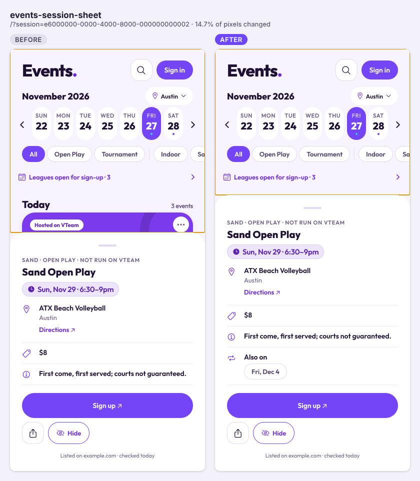

The outside session sheet now lists next month's dates in a month's last week, screenshot checks fail when a screen never reaches its state, and browser tabs no longer read "Untitled" while vteam loads. 2 PRs merged.

## Shipped

**Fixes**

- **"Also on" works at month end.** Phones load only the current week's months, so in a month's last week an outside session's sheet left out next month's dates. When the loaded feed has fewer than four later dates, the sheet now reads the venue's later sessions itself (one small cached read, with the feed's own filters, only when the sheet opens). The same PR makes a shots screen that never shows its ready state fail the screenshot, axe and UI checks, fixes the four screens that had been passing in the wrong state (the recap card had never been checked), adds an integration spec for the read on beta, and has the nightly stability job capture every screen on the 10th and the 28th. Closes #421 (#422)

  

  ```mermaid
  sequenceDiagram
    participant S as Session sheet (useAlsoOn)
    participant F as Loaded feed
    participant DB as Postgres (external_sessions, anon SELECT)
    S->>F: later dates of the same source, title and venue
    alt fewer than four found
      S->>DB: readAlsoOnRows: same source, later, not cancelled, refreshed recently
      DB-->>S: rows (cached at STALE.feed)
      S->>S: mergeAlsoOn, drop rows the feed would hide
    end
    S-->>S: show "Also on" dates
  ```

- **Tabs never read "Untitled".** Every exported page now has `<title>VTeam</title>` in its HTML, so the tab is named while the app loads and on tabs the browser kept without running them. Event link previews still get the event's own title. (#418)

## Closed issues

- #421 Screens that prove what they show: a shots screen that never gets ready fails, and "Also on" works at month end
- #404 Scoring rules per phase (pool, bracket, losers bracket)
- #396 Party invite layout

## Noticed

- The recap card shows "+2 points" twice (the stat and the line under it). It predates #422 and shows now only because the recap screen finally renders (from #422's description).
